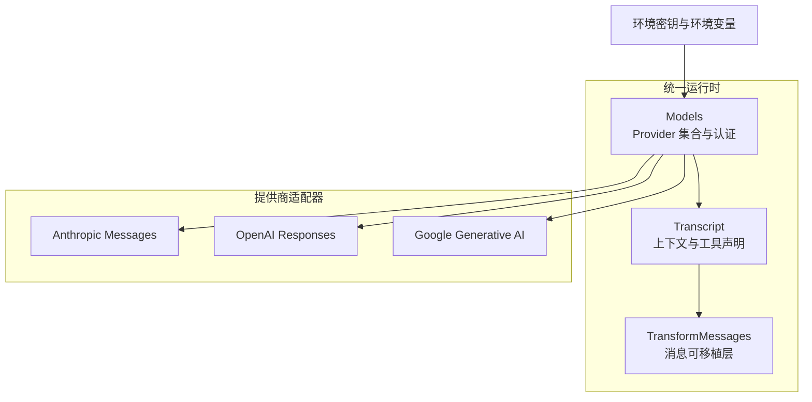
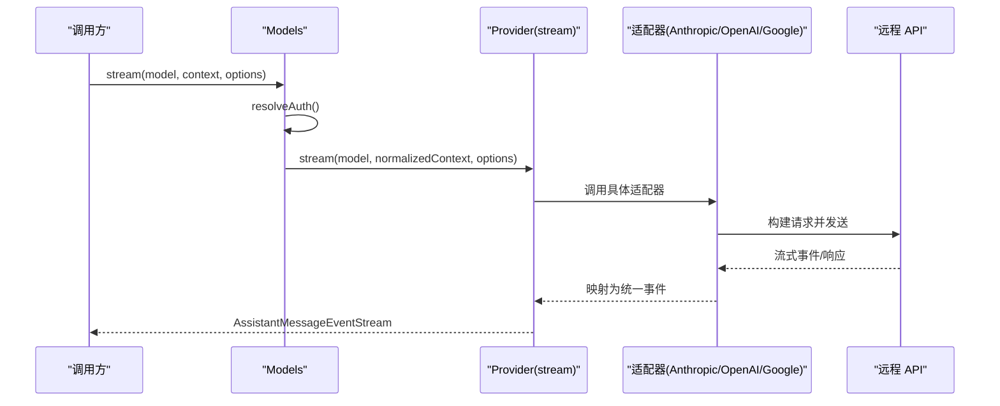
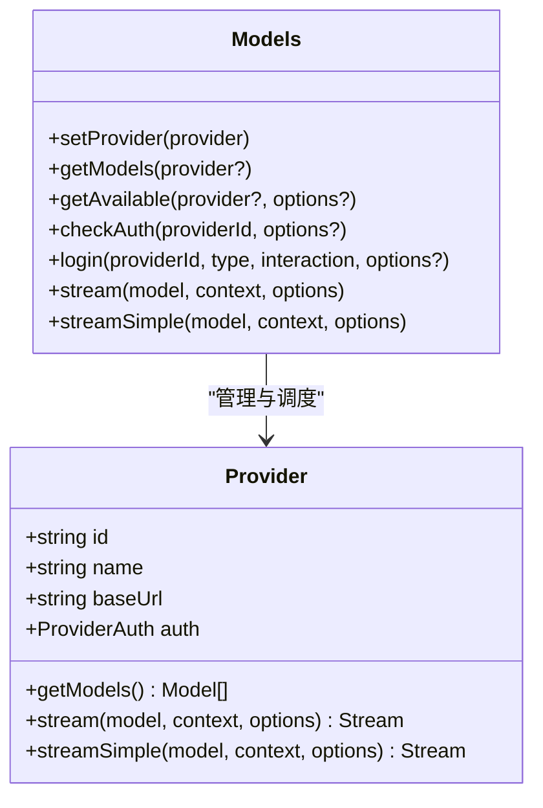
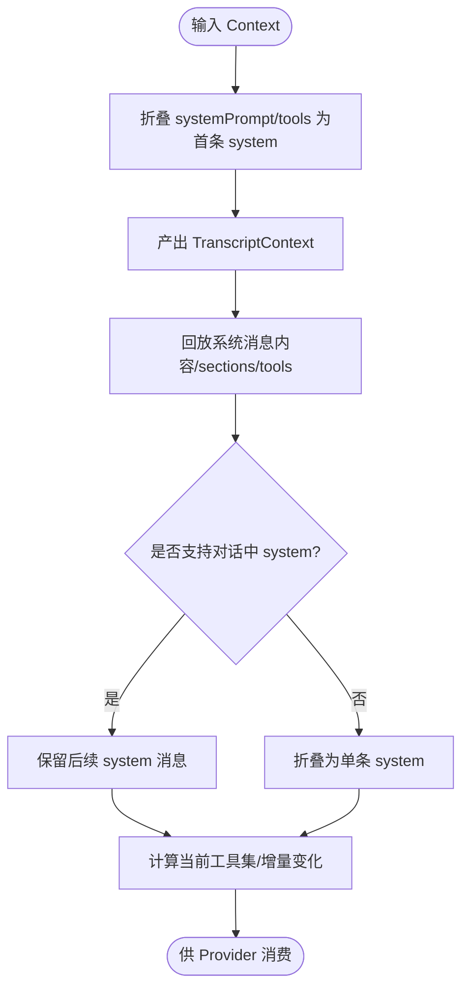
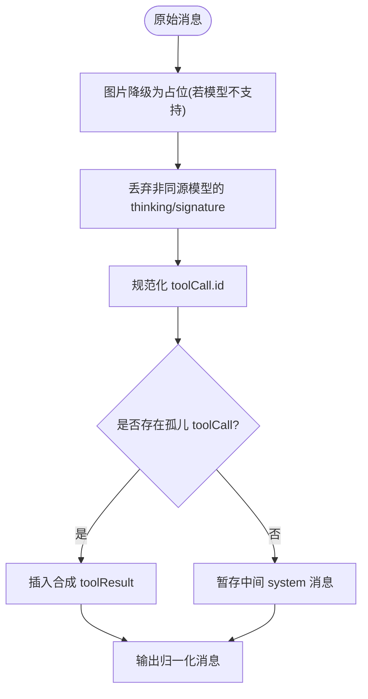
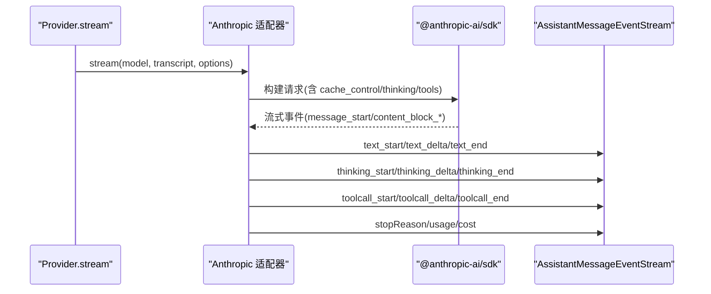
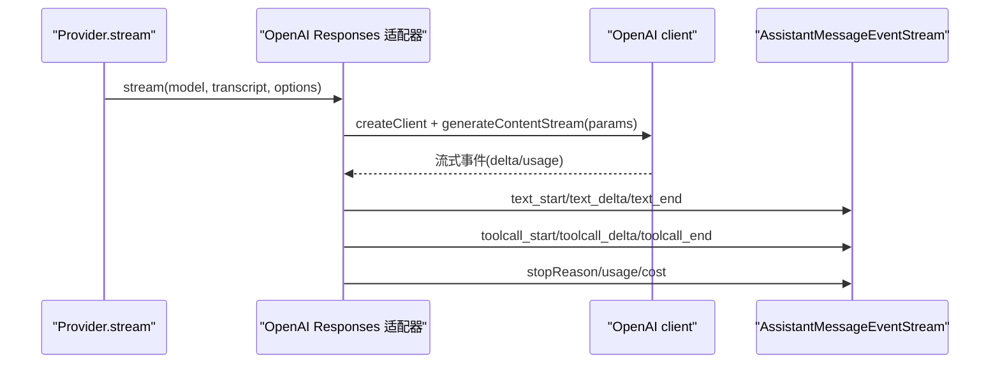
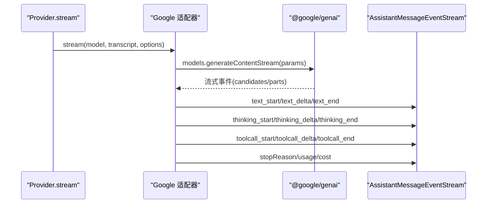
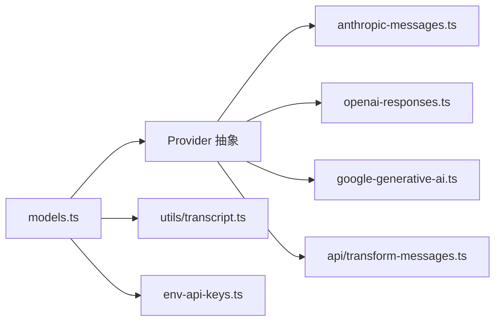
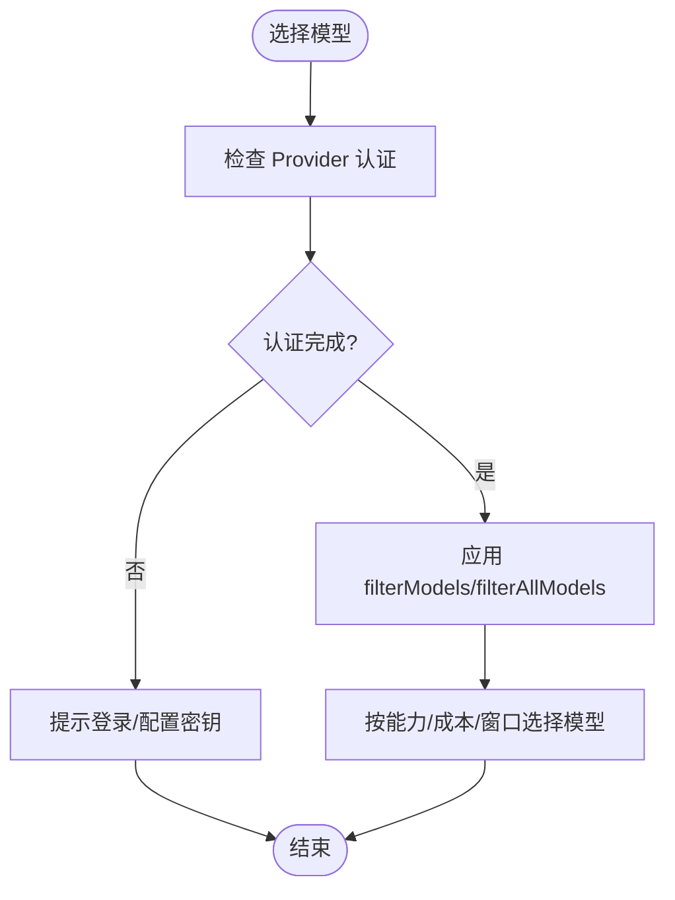

# AI 集成

<cite>
**本文引用的文件**
- [packages/ai/src/models.ts](file://packages/ai/src/models.ts)
- [packages/ai/src/utils/transcript.ts](file://packages/ai/src/utils/transcript.ts)
- [packages/ai/src/api/transform-messages.ts](file://packages/ai/src/api/transform-messages.ts)
- [packages/ai/src/api/anthropic-messages.ts](file://packages/ai/src/api/anthropic-messages.ts)
- [packages/ai/src/api/openai-responses.ts](file://packages/ai/src/api/openai-responses.ts)
- [packages/ai/src/api/google-generative-ai.ts](file://packages/ai/src/api/google-generative-ai.ts)
- [packages/ai/src/env-api-keys.ts](file://packages/ai/src/env-api-keys.ts)
- [docs/explains/16-provider-adapters.md](file://docs/explains/16-provider-adapters.md)
- [docs/explains/05-provider-stream.md](file://docs/explains/05-provider-stream.md)
</cite>

## 目录
1. [引言](#引言)
2. [项目结构](#项目结构)
3. [核心组件](#核心组件)
4. [架构总览](#架构总览)
5. [详细组件分析](#详细组件分析)
6. [依赖关系分析](#依赖关系分析)
7. [性能与缓存优化](#性能与缓存优化)
8. [认证与模型选择策略](#认证与模型选择策略)
9. [故障排查指南](#故障排查指南)
10. [结论](#结论)

## 引言
本文件面向“AI 集成模块”，聚焦多 LLM 提供商的统一接入、请求处理、响应解析、错误处理、认证管理、模型选择与性能优化。代码库通过 Provider 适配层将 OpenAI、Anthropic、Google 等厂商的 API 差异收敛到统一的 TranscriptContext 和事件流契约中，上层调用方无需关心具体厂商实现细节。

## 项目结构
AI 集成位于 packages/ai 包内，关键路径如下：
- 统一运行时与 Provider 集合：packages/ai/src/models.ts
- 消息与工具声明的可移植层：packages/ai/src/utils/transcript.ts
- 跨提供商消息归一化：packages/ai/src/api/transform-messages.ts
- 各提供商适配器：packages/ai/src/api/anthropic-messages.ts、openai-responses.ts、google-generative-ai.ts
- 环境变量与密钥发现：packages/ai/src/env-api-keys.ts
- 设计说明文档：docs/explains/16-provider-adapters.md、docs/explains/05-provider-stream.md

**图示来源**
- [packages/ai/src/models.ts:158-247](file://packages/ai/src/models.ts#L158-L247)
- [packages/ai/src/utils/transcript.ts:30-34](file://packages/ai/src/utils/transcript.ts#L30-L34)
- [packages/ai/src/api/transform-messages.ts:91-101](file://packages/ai/src/api/transform-messages.ts#L91-L101)
- [packages/ai/src/api/anthropic-messages.ts:1-73](file://packages/ai/src/api/anthropic-messages.ts#L1-L73)
- [packages/ai/src/api/openai-responses.ts:1-35](file://packages/ai/src/api/openai-responses.ts#L1-L35)
- [packages/ai/src/api/google-generative-ai.ts:1-45](file://packages/ai/src/api/google-generative-ai.ts#L1-L45)
- [packages/ai/src/env-api-keys.ts:137-197](file://packages/ai/src/env-api-keys.ts#L137-L197)

**章节来源**
- [packages/ai/src/models.ts:158-247](file://packages/ai/src/models.ts#L158-L247)
- [docs/explains/16-provider-adapters.md:1-58](file://docs/explains/16-provider-adapters.md#L1-L58)

## 核心组件
- Models（Provider 集合）：负责注册 Provider、解析认证、刷新模型列表、按模型路由到对应 Provider 执行 stream/complete/streamSimple 等操作。
- Provider 接口：每个 Provider 暴露 id/name/baseUrl/auth/getModels/stream/streamSimple 等能力；错误以事件流形式返回，而非同步抛出。
- Transcript 协议：把 systemPrompt 与 tools 折叠为第一条 system message，并以增量方式表达 prompt 与工具变更，保证缓存命中。
- TransformMessages：跨提供商的消息归一化，包括图片降级、thinking 过滤、tool call id 规范化、孤儿 tool call 补结果、丢弃 error/aborted assistant 消息等。

**章节来源**
- [packages/ai/src/models.ts:158-247](file://packages/ai/src/models.ts#L158-L247)
- [packages/ai/src/utils/transcript.ts:30-34](file://packages/ai/src/utils/transcript.ts#L30-L34)
- [packages/ai/src/api/transform-messages.ts:91-101](file://packages/ai/src/api/transform-messages.ts#L91-L101)
- [docs/explains/16-provider-adapters.md:6-35](file://docs/explains/16-provider-adapters.md#L6-L35)

## 架构总览
下图展示从调用方到具体提供商的完整流程：Models 解析认证并标准化上下文，随后根据模型所属 Provider 分发到具体适配器；适配器内部进行参数构建、重试、流式事件映射与用量统计。

**图示来源**
- [packages/ai/src/models.ts:324-348](file://packages/ai/src/models.ts#L324-L348)
- [packages/ai/src/api/anthropic-messages.ts:1-73](file://packages/ai/src/api/anthropic-messages.ts#L1-L73)
- [packages/ai/src/api/openai-responses.ts:155-200](file://packages/ai/src/api/openai-responses.ts#L155-L200)
- [packages/ai/src/api/google-generative-ai.ts:59-100](file://packages/ai/src/api/google-generative-ai.ts#L59-L100)

## 详细组件分析

### 统一运行时：Models 与 Provider 抽象
- Provider 接口定义 id/name/baseUrl/auth/getModels/stream/streamSimple 等能力，要求 getModels 同步不抛错，stream 接收已归一化的 TranscriptContext，错误编码进事件流。
- ModelsImpl 提供 setProvider/getModel/getAvailable/checkAuth/login/logout/stream/complete/streamSimple 等方法，集中处理认证解析、模型刷新、并发控制与错误收集。

**图示来源**
- [packages/ai/src/models.ts:158-247](file://packages/ai/src/models.ts#L158-L247)
- [packages/ai/src/models.ts:258-367](file://packages/ai/src/models.ts#L258-L367)

**章节来源**
- [packages/ai/src/models.ts:158-247](file://packages/ai/src/models.ts#L158-L247)
- [packages/ai/src/models.ts:258-367](file://packages/ai/src/models.ts#L258-L367)
- [docs/explains/16-provider-adapters.md:6-35](file://docs/explains/16-provider-adapters.md#L6-L35)

### 消息与工具声明：Transcript 协议
- normalizeContext 将 systemPrompt 与 tools 折叠为首条 system message，确保所有 Provider 只消费 TranscriptContext。
- getCurrentSystemMessage 与 collapseSystemMessages 支持 mid-conversation system message 的差异追加与回退策略。
- resolveTranscriptTools 根据传输能力决定工具声明位置（顶层或原地），影响缓存失效粒度。

**图示来源**
- [packages/ai/src/utils/transcript.ts:30-34](file://packages/ai/src/utils/transcript.ts#L30-L34)
- [packages/ai/src/utils/transcript.ts:73-120](file://packages/ai/src/utils/transcript.ts#L73-L120)
- [packages/ai/src/utils/transcript.ts:252-263](file://packages/ai/src/utils/transcript.ts#L252-L263)

**章节来源**
- [packages/ai/src/utils/transcript.ts:30-34](file://packages/ai/src/utils/transcript.ts#L30-L34)
- [packages/ai/src/utils/transcript.ts:73-120](file://packages/ai/src/utils/transcript.ts#L73-L120)
- [docs/explains/05-provider-stream.md:1-40](file://docs/explains/05-provider-stream.md#L1-L40)

### 跨提供商消息归一化：TransformMessages
- 对不支持图片的模型，将 image 替换为占位文本。
- 丢弃其他模型的 thinking 块与 thoughtSignature，避免误判。
- 规范化 tool call id，解决不同 API 的 id 长度与字符限制。
- 为孤儿 tool call 插入合成结果，保证会话完整性。
- 在 tool call 与 result 之间透明处理 system message，避免重复结果。

**图示来源**
- [packages/ai/src/api/transform-messages.ts:62-84](file://packages/ai/src/api/transform-messages.ts#L62-L84)
- [packages/ai/src/api/transform-messages.ts:91-101](file://packages/ai/src/api/transform-messages.ts#L91-L101)
- [packages/ai/src/api/transform-messages.ts:179-200](file://packages/ai/src/api/transform-messages.ts#L179-L200)

**章节来源**
- [packages/ai/src/api/transform-messages.ts:62-84](file://packages/ai/src/api/transform-messages.ts#L62-L84)
- [packages/ai/src/api/transform-messages.ts:91-101](file://packages/ai/src/api/transform-messages.ts#L91-L101)
- [packages/ai/src/api/transform-messages.ts:179-200](file://packages/ai/src/api/transform-messages.ts#L179-L200)

### Anthropic 适配器：anthropic-messages
- 支持 cacheRetention（short/long/none）、会话亲和、Claude Code 兼容模式、message threads、严格工具降级、thinking 配置与 usage 计算。
- 将 Anthropic 原生事件映射为 Pi 统一事件（text_start/delta/end、thinking_start/delta/end、toolcall_start/delta/end）。
- 使用 ToolCallArgumentsStream 增量解析工具参数，处理不完整 JSON。

**图示来源**
- [packages/ai/src/api/anthropic-messages.ts:1-73](file://packages/ai/src/api/anthropic-messages.ts#L1-L73)
- [docs/explains/16-provider-adapters.md:79-165](file://docs/explains/16-provider-adapters.md#L79-L165)

**章节来源**
- [packages/ai/src/api/anthropic-messages.ts:1-73](file://packages/ai/src/api/anthropic-messages.ts#L1-L73)
- [docs/explains/16-provider-adapters.md:79-165](file://docs/explains/16-provider-adapters.md#L79-L165)

### OpenAI 适配器：openai-responses
- 支持 reasoning.effort、serviceTier、toolChoice、prompt cache key mode、session affinity format、strict mode、grammar tools 等特性开关。
- 自动检测 ChatGPT Sign-in access token 与 OpenRouter session affinity。
- 将 responses 流事件映射为统一事件，维护 usage 与 cost。

**图示来源**
- [packages/ai/src/api/openai-responses.ts:155-200](file://packages/ai/src/api/openai-responses.ts#L155-L200)

**章节来源**
- [packages/ai/src/api/openai-responses.ts:155-200](file://packages/ai/src/api/openai-responses.ts#L155-L200)

### Google 适配器：google-generative-ai
- 支持 toolChoice、thinking.enabled/budgetTokens/level，以及 function calling 与思考内容的分块处理。
- 将 Google 流事件映射为统一事件，维护 responseId、content blocks、stopReason 与 usage。

**图示来源**
- [packages/ai/src/api/google-generative-ai.ts:59-100](file://packages/ai/src/api/google-generative-ai.ts#L59-L100)

**章节来源**
- [packages/ai/src/api/google-generative-ai.ts:59-100](file://packages/ai/src/api/google-generative-ai.ts#L59-L100)

## 依赖关系分析
- Models 依赖 Provider 抽象与认证解析；Provider 实现依赖各自适配器；适配器依赖 Transcript 与 TransformMessages 做消息归一化；环境变量与密钥发现由 env-api-keys 提供。
- 适配器之间解耦，仅通过统一事件流与 TranscriptContext 交互，降低耦合度。

**图示来源**
- [packages/ai/src/models.ts:158-247](file://packages/ai/src/models.ts#L158-L247)
- [packages/ai/src/utils/transcript.ts:30-34](file://packages/ai/src/utils/transcript.ts#L30-L34)
- [packages/ai/src/api/transform-messages.ts:91-101](file://packages/ai/src/api/transform-messages.ts#L91-L101)
- [packages/ai/src/env-api-keys.ts:137-197](file://packages/ai/src/env-api-keys.ts#L137-L197)

**章节来源**
- [packages/ai/src/models.ts:158-247](file://packages/ai/src/models.ts#L158-L247)
- [packages/ai/src/utils/transcript.ts:30-34](file://packages/ai/src/utils/transcript.ts#L30-L34)
- [packages/ai/src/api/transform-messages.ts:91-101](file://packages/ai/src/api/transform-messages.ts#L91-L101)
- [packages/ai/src/env-api-keys.ts:137-197](file://packages/ai/src/env-api-keys.ts#L137-L197)

## 性能与缓存优化
- Transcript 增量机制：通过 content 拼接与 sections 覆盖，避免每轮重建整段 system prompt，减少缓存 miss。
- 工具声明策略：根据传输能力选择顶层列表或原地声明，仅在删除/重定义时触发一次缓存失效。
- 各 Provider 缓存：Anthropic 支持 short/long/none 的 cacheControl；OpenAI Responses 支持 prompt cache key mode 与 long retention；Google 通过 SDK 原生缓存。
- Usage 与成本：统一记录 input/output/cacheRead/cacheWrite/cost，部分 Provider（如 OpenRouter）可报告实际费用覆盖默认价格。

**章节来源**
- [docs/explains/05-provider-stream.md:41-64](file://docs/explains/05-provider-stream.md#L41-L64)
- [docs/explains/16-provider-adapters.md:83-90](file://docs/explains/16-provider-adapters.md#L83-L90)
- [packages/ai/src/api/openai-responses.ts:125-142](file://packages/ai/src/api/openai-responses.ts#L125-L142)

## 认证与模型选择策略
- 认证来源：API Key、OAuth、环境密钥（OPENAI_API_KEY、ANTHROPIC_API_KEY、GOOGLE_CLOUD_*、AWS_* 等），以及 Application Default Credentials（Vertex AI）与 AWS 多种凭证。
- Models.getAuth：按 providerId 或 model 解析认证，合并模型级 headers；失败时抛出 ModelsError（oauth/auth/provider）。
- 可用模型：getAvailable/getAllAvailable 基于 checkAuth 过滤未配置 Provider 的模型；Provider 可实现 filterModels/filterAllModels 做凭据相关可用性裁剪。
- 模型选择：根据模型元数据（input、reasoning、contextWindow、maxTokens、cost）与业务需求（thinking、工具、图像）选择合适模型。

**图示来源**
- [packages/ai/src/models.ts:690-752](file://packages/ai/src/models.ts#L690-L752)
- [packages/ai/src/env-api-keys.ts:137-197](file://packages/ai/src/env-api-keys.ts#L137-L197)

**章节来源**
- [packages/ai/src/models.ts:690-752](file://packages/ai/src/models.ts#L690-L752)
- [packages/ai/src/env-api-keys.ts:137-197](file://packages/ai/src/env-api-keys.ts#L137-L197)

## 故障排查指南
- 认证失败：ModelsError 的 code 可能为 oauth（token 刷新失败）、auth（API Key 解析或存储失败）、provider（未知 Provider）。检查环境变量、OAuth 刷新状态与 Credential Store。
- 流式错误：一旦返回 stream，请求/模型/运行时错误必须编码为 stopReason: "error"/"aborted" + errorMessage；上层 agent loop 据此决定是否重试或终止。
- 工具调用异常：检查 tool call id 规范化、孤儿 tool call 合成结果、strict tool 降级策略。
- 缓存问题：确认 cacheRetention、sessionId、prompt cache key mode 设置是否符合 Provider 能力。

**章节来源**
- [packages/ai/src/models.ts:306-316](file://packages/ai/src/models.ts#L306-L316)
- [docs/explains/05-provider-stream.md:66-72](file://docs/explains/05-provider-stream.md#L66-L72)
- [packages/ai/src/api/transform-messages.ts:179-200](file://packages/ai/src/api/transform-messages.ts#L179-L200)

## 结论
该 AI 集成模块通过 Provider 抽象与 Transcript 协议，将多家 LLM 提供商的请求与响应统一为一致的事件流与数据结构。认证、模型选择、缓存与错误处理均被收敛到 Models 与适配器层，使上层调用简洁稳定。实践中应优先利用 Transcript 增量与 Provider 缓存能力，合理配置认证与模型选择策略，以获得最佳性能与成本效益。