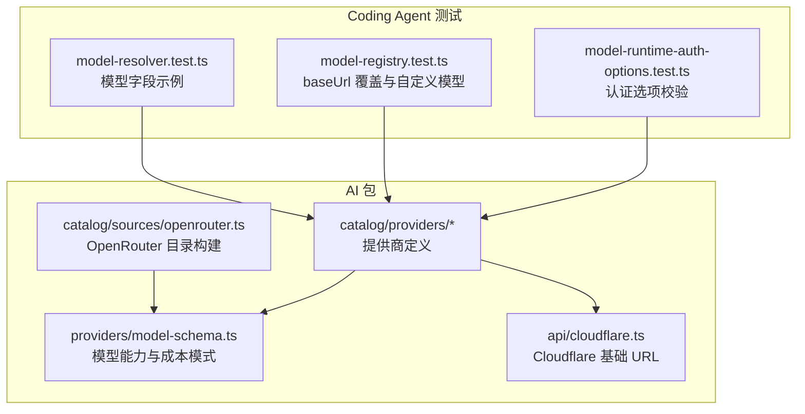
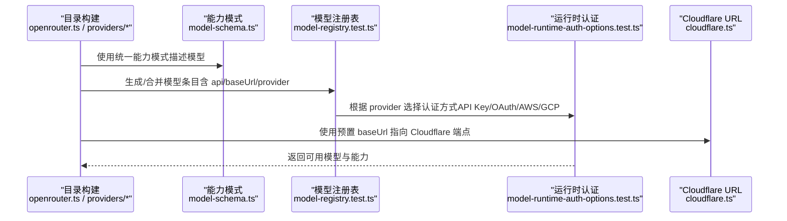
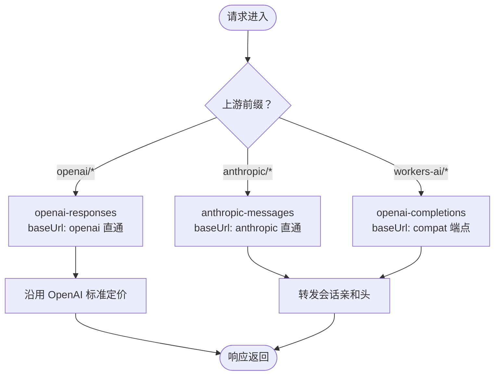
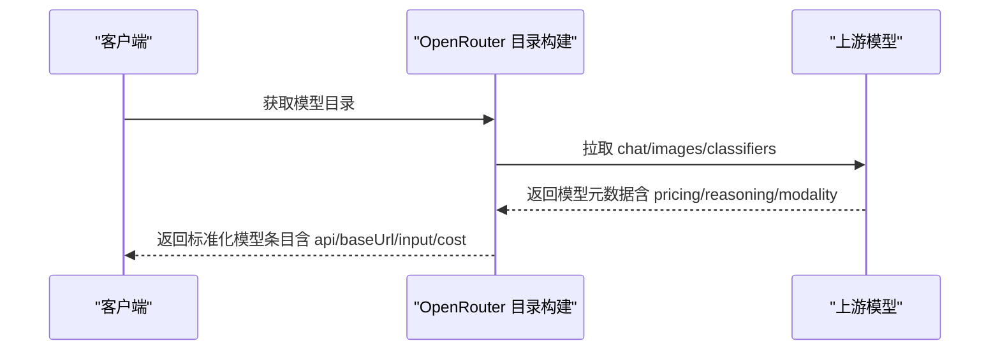
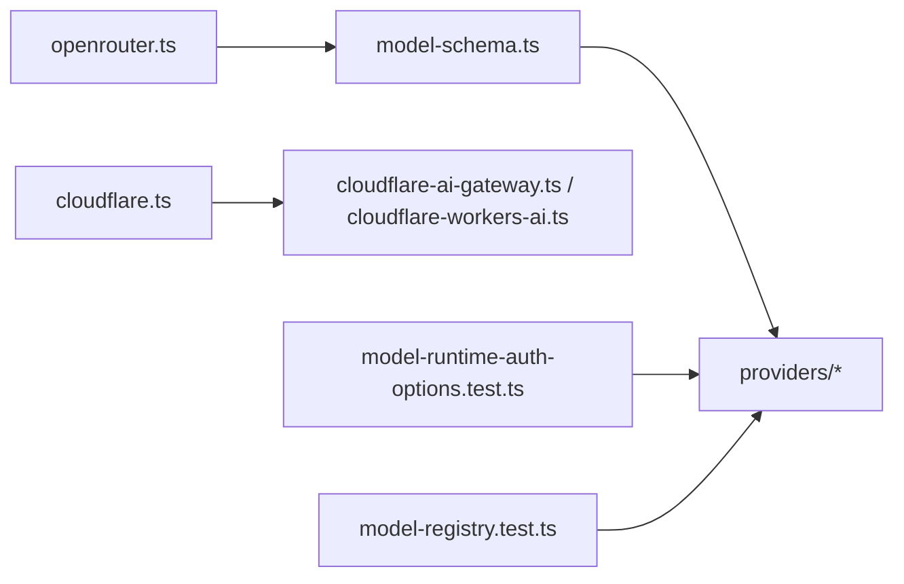

# 支持的 LLM 提供商

<cite>
**本文引用的文件**
- [packages/ai/src/providers/model-schema.ts](file://packages/ai/src/providers/model-schema.ts)
- [packages/ai/catalog/sources/openrouter.ts](file://packages/ai/catalog/sources/openrouter.ts)
- [packages/ai/catalog/providers/cloudflare-ai-gateway.ts](file://packages/ai/catalog/providers/cloudflare-ai-gateway.ts)
- [packages/ai/catalog/providers/cloudflare-workers-ai.ts](file://packages/ai/catalog/providers/cloudflare-workers-ai.ts)
- [packages/ai/src/api/cloudflare.ts](file://packages/ai/src/api/cloudflare.ts)
- [packages/coding-agent/test/model-runtime-auth-options.test.ts](file://packages/coding-agent/test/model-runtime-auth-options.test.ts)
- [packages/coding-agent/test/model-registry.test.ts](file://packages/coding-agent/test/model-registry.test.ts)
- [packages/coding-agent/test/model-resolver.test.ts](file://packages/coding-agent/test/model-resolver.test.ts)
</cite>

## 目录
1. [简介](#简介)
2. [项目结构](#项目结构)
3. [核心组件](#核心组件)
4. [架构总览](#架构总览)
5. [详细组件分析](#详细组件分析)
6. [依赖关系分析](#依赖关系分析)
7. [性能与成本](#性能与成本)
8. [故障排查指南](#故障排查指南)
9. [结论](#结论)
10. [附录：配置与最佳实践](#附录配置与最佳实践)

## 简介
本文件系统性梳理本项目所支持的 LLM 提供商，重点覆盖 OpenAI、Anthropic、Google Vertex AI、Amazon Bedrock、Cloudflare AI Gateway、OpenRouter。内容包含各提供商的 API 类型、基础 URL、模型能力（推理、多模态）、成本信息、环境变量与 API Key 配置方式，以及连接参数与最佳实践。文档同时给出架构图、数据流图与流程图，帮助读者快速理解系统如何加载、路由与调用不同提供商的模型。

## 项目结构
围绕“提供商”与“模型目录”的关键代码主要位于 packages/ai 与 packages/coding-agent 中：
- 提供商定义与模型目录构建：packages/ai/catalog/providers/*、packages/ai/catalog/sources/*
- 通用模型能力与成本模式：packages/ai/src/providers/model-schema.ts
- Cloudflare 相关基础 URL：packages/ai/src/api/cloudflare.ts
- 认证选项与运行时行为验证：packages/coding-agent/test/model-runtime-auth-options.test.ts
- 模型注册表与 baseUrl 覆盖行为：packages/coding-agent/test/model-registry.test.ts
- 模型解析与示例模型字段：packages/coding-agent/test/model-resolver.test.ts

图表来源
- [packages/ai/src/providers/model-schema.ts:1-116](file://packages/ai/src/providers/model-schema.ts#L1-L116)
- [packages/ai/catalog/sources/openrouter.ts:1-149](file://packages/ai/catalog/sources/openrouter.ts#L1-L149)
- [packages/ai/catalog/providers/cloudflare-ai-gateway.ts:1-85](file://packages/ai/catalog/providers/cloudflare-ai-gateway.ts#L1-L85)
- [packages/ai/catalog/providers/cloudflare-workers-ai.ts:1-62](file://packages/ai/catalog/providers/cloudflare-workers-ai.ts#L1-L62)
- [packages/ai/src/api/cloudflare.ts:1-20](file://packages/ai/src/api/cloudflare.ts#L1-L20)
- [packages/coding-agent/test/model-runtime-auth-options.test.ts:77-106](file://packages/coding-agent/test/model-runtime-auth-options.test.ts#L77-L106)
- [packages/coding-agent/test/model-registry.test.ts:77-120](file://packages/coding-agent/test/model-registry.test.ts#L77-L120)
- [packages/coding-agent/test/model-resolver.test.ts:25-79](file://packages/coding-agent/test/model-resolver.test.ts#L25-L79)

章节来源
- [packages/ai/src/providers/model-schema.ts:1-116](file://packages/ai/src/providers/model-schema.ts#L1-L116)
- [packages/ai/catalog/sources/openrouter.ts:1-149](file://packages/ai/catalog/sources/openrouter.ts#L1-L149)
- [packages/ai/catalog/providers/cloudflare-ai-gateway.ts:1-85](file://packages/ai/catalog/providers/cloudflare-ai-gateway.ts#L1-L85)
- [packages/ai/catalog/providers/cloudflare-workers-ai.ts:1-62](file://packages/ai/catalog/providers/cloudflare-workers-ai.ts#L1-L62)
- [packages/ai/src/api/cloudflare.ts:1-20](file://packages/ai/src/api/cloudflare.ts#L1-L20)
- [packages/coding-agent/test/model-runtime-auth-options.test.ts:77-106](file://packages/coding-agent/test/model-runtime-auth-options.test.ts#L77-L106)
- [packages/coding-agent/test/model-registry.test.ts:77-120](file://packages/coding-agent/test/model-registry.test.ts#L77-L120)
- [packages/coding-agent/test/model-resolver.test.ts:25-79](file://packages/coding-agent/test/model-resolver.test.ts#L25-L79)

## 核心组件
- 模型能力与成本模式
  - 支持思考级别映射、输入模态（文本/图像）、缓存保留策略、成本率与分层定价、图像输入限制等。
  - 这些模式为所有提供商的统一能力描述提供基础。
- 提供商定义与模型目录
  - 通过 catalog/providers/* 定义各提供商的默认 API、baseUrl、兼容特性与模型映射。
  - OpenRouter 通过 catalog/sources/openrouter.ts 动态拉取并构建模型目录。
- Cloudflare 基础 URL
  - 集中定义 Workers AI、AI Gateway 兼容端点与 OpenAI/Anthropic 直通的基础 URL。
- 认证与运行时
  - 测试用例覆盖了 Amazon Bedrock、Google Vertex AI、Anthropic、Cloudflare AI Gateway 等的认证选项类型。
- 模型注册与 baseUrl 覆盖
  - 支持对内置提供商进行 baseUrl 覆盖，合并自定义模型，保持内置模型列表完整。

章节来源
- [packages/ai/src/providers/model-schema.ts:1-116](file://packages/ai/src/providers/model-schema.ts#L1-L116)
- [packages/ai/catalog/sources/openrouter.ts:1-149](file://packages/ai/catalog/sources/openrouter.ts#L1-L149)
- [packages/ai/catalog/providers/cloudflare-ai-gateway.ts:1-85](file://packages/ai/catalog/providers/cloudflare-ai-gateway.ts#L1-L85)
- [packages/ai/catalog/providers/cloudflare-workers-ai.ts:1-62](file://packages/ai/catalog/providers/cloudflare-workers-ai.ts#L1-L62)
- [packages/ai/src/api/cloudflare.ts:1-20](file://packages/ai/src/api/cloudflare.ts#L1-L20)
- [packages/coding-agent/test/model-runtime-auth-options.test.ts:77-106](file://packages/coding-agent/test/model-runtime-auth-options.test.ts#L77-L106)
- [packages/coding-agent/test/model-registry.test.ts:77-120](file://packages/coding-agent/test/model-registry.test.ts#L77-L120)

## 架构总览
下图展示从“提供商定义”到“模型目录构建”，再到“运行时认证与请求路由”的整体流程。

图表来源
- [packages/ai/catalog/sources/openrouter.ts:1-149](file://packages/ai/catalog/sources/openrouter.ts#L1-L149)
- [packages/ai/src/providers/model-schema.ts:1-116](file://packages/ai/src/providers/model-schema.ts#L1-L116)
- [packages/coding-agent/test/model-registry.test.ts:77-120](file://packages/coding-agent/test/model-registry.test.ts#L77-L120)
- [packages/coding-agent/test/model-runtime-auth-options.test.ts:77-106](file://packages/coding-agent/test/model-runtime-auth-options.test.ts#L77-L106)
- [packages/ai/src/api/cloudflare.ts:1-20](file://packages/ai/src/api/cloudflare.ts#L1-L20)

## 详细组件分析

### OpenAI
- API 类型
  - openai-completions、openai-responses（在 Cloudflare AI Gateway 场景启用 strict mode）。
- 基础 URL
  - 默认 OpenAI 官方端点在测试中以 https://api.openai.com/v1 作为示例 baseUrl。
- 模型列表
  - 由提供商定义与目录构建逻辑维护；OpenAI 模型通常具备工具调用能力。
- 功能特性
  - 推理能力：取决于具体模型；OpenRouter 上部分 OpenAI 模型可开启 reasoning。
  - 多模态：部分模型支持图像输入。
- 成本信息
  - 标准定价通过 family 函数注入；Cloudflare AI Gateway 透传 OpenAI 用量并按 OpenAI 列表价计费。
- 配置示例与最佳实践
  - 环境变量：设置 OpenAI API Key（如 OPENAI_API_KEY）。
  - baseUrl 覆盖：可通过模型注册表将 OpenAI 的 baseUrl 替换为代理地址，不影响内置模型集合。
  - 连接参数：遵循 OpenAI 兼容协议；如需严格模式，可在 openai-responses 上启用。

章节来源
- [packages/coding-agent/test/model-registry.test.ts:77-120](file://packages/coding-agent/test/model-registry.test.ts#L77-L120)
- [packages/coding-agent/test/model-resolver.test.ts:25-79](file://packages/coding-agent/test/model-resolver.test.ts#L25-L79)
- [packages/ai/catalog/providers/cloudflare-ai-gateway.ts:47-85](file://packages/ai/catalog/providers/cloudflare-ai-gateway.ts#L47-L85)

### Anthropic
- API 类型
  - anthropic-messages。
- 基础 URL
  - 默认 Anthropic 官方端点在测试中以 https://api.anthropic.com 作为示例 baseUrl。
- 模型列表
  - 由提供商定义与目录构建逻辑维护；Claude 系列模型普遍支持推理与多模态。
- 功能特性
  - 推理能力：多数 Claude 模型支持 thinking-level 映射。
  - 多模态：支持文本与图像输入。
- 成本信息
  - 成本字段按 model-schema 的成本结构定义；OpenRouter 上 Anthropic 模型价格随上游定价。
- 配置示例与最佳实践
  - 环境变量：设置 ANTHROPIC_API_KEY。
  - OAuth：运行时认证选项包含 OAuth 类型（用于某些集成场景）。
  - baseUrl 覆盖：可将 Anthropic 的 baseUrl 替换为代理地址，保持模型列表不变。

章节来源
- [packages/coding-agent/test/model-resolver.test.ts:25-79](file://packages/coding-agent/test/model-resolver.test.ts#L25-L79)
- [packages/coding-agent/test/model-runtime-auth-options.test.ts:77-106](file://packages/coding-agent/test/model-runtime-auth-options.test.ts#L77-L106)
- [packages/coding-agent/test/model-registry.test.ts:94-120](file://packages/coding-agent/test/model-registry.test.ts#L94-L120)

### Google Vertex AI
- API 类型
  - 通过运行时认证选项识别为 Google Cloud credentials。
- 基础 URL
  - 由提供商定义与目录构建逻辑决定；此处以认证类型为主。
- 模型列表
  - 由目录构建逻辑维护；Vertex AI 模型能力取决于上游模型。
- 功能特性
  - 推理能力：取决于具体模型。
  - 多模态：取决于具体模型。
- 成本信息
  - 由上游模型定价决定；在本项目中以目录中的 cost 字段体现。
- 配置示例与最佳实践
  - 环境变量：配置 Google Cloud 凭据（例如服务账号 JSON 或应用默认凭据）。
  - 连接参数：遵循 Vertex AI 的认证与访问控制要求。

章节来源
- [packages/coding-agent/test/model-runtime-auth-options.test.ts:77-106](file://packages/coding-agent/test/model-runtime-auth-options.test.ts#L77-L106)

### Amazon Bedrock
- API 类型
  - 通过运行时认证选项识别为 AWS credentials 或 bearer token。
- 基础 URL
  - 由提供商定义与目录构建逻辑决定；此处以认证类型为主。
- 模型列表
  - 由目录构建逻辑维护；Bedrock 模型能力取决于上游模型。
- 功能特性
  - 推理能力：取决于具体模型。
  - 多模态：取决于具体模型。
- 成本信息
  - 由上游模型定价决定；在本项目中以目录中的 cost 字段体现。
- 配置示例与最佳实践
  - 环境变量：配置 AWS 凭据（AWS_ACCESS_KEY_ID、AWS_SECRET_ACCESS_KEY 等）或使用 IAM 角色。
  - 连接参数：遵循 Bedrock 的鉴权与区域配置。

章节来源
- [packages/coding-agent/test/model-runtime-auth-options.test.ts:77-106](file://packages/coding-agent/test/model-runtime-auth-options.test.ts#L77-L106)

### Cloudflare AI Gateway
- API 类型
  - 兼容 OpenAI 与 Anthropic 的 passthrough；Workers AI 通过 OpenAI 兼容 /compat 端点暴露。
- 基础 URL
  - 统一入口：https://gateway.ai.cloudflare.com/v1/{CLOUDFLARE_ACCOUNT_ID}/{CLOUDFLARE_GATEWAY_ID}/compat
  - OpenAI 直通：https://gateway.ai.cloudflare.com/v1/{CLOUDFLARE_ACCOUNT_ID}/{CLOUDFLARE_GATEWAY_ID}/openai
  - Anthropic 直通：https://gateway.ai.cloudflare.com/v1/{CLOUDFLARE_ACCOUNT_ID}/{CLOUDFLARE_GATEWAY_ID}/anthropic
- 模型列表
  - 基于 models.dev 的 cloudflare-ai-gateway 目录；对 upstream 前缀（openai/anthropic/workers-ai）进行路由与 ID 转换。
- 功能特性
  - 推理能力：取决于上游模型；OpenAI 直通在 responses 上启用 strict mode。
  - 多模态：取决于上游模型；Workers AI 分类器支持图像输入。
- 成本信息
  - OpenAI 直通沿用 OpenAI 标准定价；Anthropic 直通转发会话亲和头；Workers AI 分类器有固定成本。
- 配置示例与最佳实践
  - 环境变量：设置 CLOUDFLARE_ACCOUNT_ID、CLOUDFLARE_GATEWAY_ID 与相应 API Key。
  - baseUrl 覆盖：可使用 compat 端点进行统一路由；必要时使用 openai 或 anthropic 直通端点。
  - 连接参数：注意会话亲和头（sendSessionAffinityHeaders）与语法工具（grammar tools）启用。

图表来源
- [packages/ai/catalog/providers/cloudflare-ai-gateway.ts:10-45](file://packages/ai/catalog/providers/cloudflare-ai-gateway.ts#L10-L45)
- [packages/ai/catalog/providers/cloudflare-ai-gateway.ts:47-85](file://packages/ai/catalog/providers/cloudflare-ai-gateway.ts#L47-L85)
- [packages/ai/src/api/cloudflare.ts:1-20](file://packages/ai/src/api/cloudflare.ts#L1-L20)

章节来源
- [packages/ai/catalog/providers/cloudflare-ai-gateway.ts:1-85](file://packages/ai/catalog/providers/cloudflare-ai-gateway.ts#L1-L85)
- [packages/ai/src/api/cloudflare.ts:1-20](file://packages/ai/src/api/cloudflare.ts#L1-L20)

### Cloudflare Workers AI
- API 类型
  - openai-completions（通过 /compat 暴露），System One 分类器使用专用 API。
- 基础 URL
  - Workers AI REST 根：https://api.cloudflare.com/client/v4/accounts/{CLOUDFLARE_ACCOUNT_ID}/ai
  - Workers AI v1：https://api.cloudflare.com/client/v4/accounts/{CLOUDFLARE_ACCOUNT_ID}/ai/v1
- 模型列表
  - 分类器模型（Clef、Jev 等）在提供商定义中硬编码；其余模型来自 models.dev 目录。
- 功能特性
  - 推理能力：取决于具体模型。
  - 多模态：分类器支持图像输入（images/assets）。
- 成本信息
  - 分类器模型具有固定成本（input 非零，output/cache 为零）。
- 配置示例与最佳实践
  - 环境变量：设置 CLOUDFLARE_ACCOUNT_ID 与 API Key。
  - 连接参数：启用 sendSessionAffinityHeaders；strict mode 在某些场景可用。

章节来源
- [packages/ai/catalog/providers/cloudflare-workers-ai.ts:1-62](file://packages/ai/catalog/providers/cloudflare-workers-ai.ts#L1-L62)
- [packages/ai/src/api/cloudflare.ts:1-20](file://packages/ai/src/api/cloudflare.ts#L1-L20)

### OpenRouter
- API 类型
  - openai-completions（默认 chat 走 OpenAI 兼容端点）；Anthropic 别名走 anthropic-messages。
- 基础 URL
  - Chat：https://openrouter.ai/api/v1
  - Images：https://openrouter.ai/api/v1
  - Classifiers：https://openrouter.ai/api/v1
- 模型列表
  - 通过 fetchOpenRouterCatalog 动态拉取 chat/images/classifiers 三类模型；仅包含支持工具的 chat 模型。
- 功能特性
  - 推理能力：通过 reasoning_options 映射为 thinkingLevelMap；mandatory 时强制关闭 off。
  - 多模态：根据 architecture.input_modalities/output_modalities 判断。
- 成本信息
  - 使用 openRouterCost 将上游定价转换为统一成本结构。
- 配置示例与最佳实践
  - 环境变量：设置 OPENROUTER_API_KEY。
  - baseUrl 覆盖：可通过模型注册表将 OpenRouter 的 baseUrl 替换为代理地址。
  - 连接参数：注意 Anthropic 别名的 baseUrl 差异与 reasoning 参数传递。

图表来源
- [packages/ai/catalog/sources/openrouter.ts:54-149](file://packages/ai/catalog/sources/openrouter.ts#L54-L149)

章节来源
- [packages/ai/catalog/sources/openrouter.ts:1-149](file://packages/ai/catalog/sources/openrouter.ts#L1-L149)

## 依赖关系分析
- 模型能力模式（model-schema.ts）被所有提供商共享，确保统一的 thinking-level、cost、image input limits 等字段。
- Cloudflare 相关提供商依赖 cloudflare.ts 中的基础 URL。
- OpenRouter 目录构建依赖上游 API 返回的结构，并将 reasoning 与 modality 映射为 Pi 的能力字段。
- 运行时认证选项在不同提供商间存在差异（API Key、OAuth、AWS/GCP 凭据）。

图表来源
- [packages/ai/src/providers/model-schema.ts:1-116](file://packages/ai/src/providers/model-schema.ts#L1-L116)
- [packages/ai/src/api/cloudflare.ts:1-20](file://packages/ai/src/api/cloudflare.ts#L1-L20)
- [packages/ai/catalog/sources/openrouter.ts:1-149](file://packages/ai/catalog/sources/openrouter.ts#L1-L149)
- [packages/coding-agent/test/model-runtime-auth-options.test.ts:77-106](file://packages/coding-agent/test/model-runtime-auth-options.test.ts#L77-L106)
- [packages/coding-agent/test/model-registry.test.ts:77-120](file://packages/coding-agent/test/model-registry.test.ts#L77-L120)

章节来源
- [packages/ai/src/providers/model-schema.ts:1-116](file://packages/ai/src/providers/model-schema.ts#L1-L116)
- [packages/ai/src/api/cloudflare.ts:1-20](file://packages/ai/src/api/cloudflare.ts#L1-L20)
- [packages/ai/catalog/sources/openrouter.ts:1-149](file://packages/ai/catalog/sources/openrouter.ts#L1-L149)
- [packages/coding-agent/test/model-runtime-auth-options.test.ts:77-106](file://packages/coding-agent/test/model-runtime-auth-options.test.ts#L77-L106)
- [packages/coding-agent/test/model-registry.test.ts:77-120](file://packages/coding-agent/test/model-registry.test.ts#L77-L120)

## 性能与成本
- 成本结构
  - 所有提供商的模型成本均遵循 model-schema 的成本模式：input/output/cacheRead/cacheWrite，以及可选的分层定价 tiers。
- 缓存优化
  - 支持 prompt cache 生命周期（short/long）；仅在已知生命周期的 tier 上进行预热。
- 图像输入限制
  - 支持每消息与每请求的图像数量上限，以及 resize 配置（maxWidth/maxHeight/maxBytes/jpegQuality）。
- 上下文窗口与最大输出
  - 每个模型声明 contextWindow 与 maxTokens，影响批处理与流式输出的性能规划。

章节来源
- [packages/ai/src/providers/model-schema.ts:44-116](file://packages/ai/src/providers/model-schema.ts#L44-L116)

## 故障排查指南
- 认证失败
  - 检查对应提供商的认证类型是否匹配（API Key、OAuth、AWS/GCP 凭据）。
  - 参考运行时认证选项测试用例，确认 provider.id 与 method.name 是否正确。
- baseUrl 覆盖异常
  - 若自定义 baseUrl 未生效，检查模型注册表配置是否包含 baseUrl 且 provider 为内置提供商。
  - 对于非内置提供商，必须显式提供 baseUrl。
- 模型不可用
  - 检查模型是否在目录构建逻辑中被过滤（如 OpenRouter 仅包含支持工具的 chat 模型）。
  - 核对模型的 input/output modalities 与 reasoning 能力是否符合预期。

章节来源
- [packages/coding-agent/test/model-runtime-auth-options.test.ts:77-106](file://packages/coding-agent/test/model-runtime-auth-options.test.ts#L77-L106)
- [packages/coding-agent/test/model-registry.test.ts:233-276](file://packages/coding-agent/test/model-registry.test.ts#L233-L276)
- [packages/ai/catalog/sources/openrouter.ts:54-87](file://packages/ai/catalog/sources/openrouter.ts#L54-L87)

## 结论
本项目通过统一的模型能力模式与提供商定义，实现了对 OpenAI、Anthropic、Google Vertex AI、Amazon Bedrock、Cloudflare AI Gateway、OpenRouter 等多提供商的抽象与扩展。模型目录构建与运行时认证解耦，便于在不同环境中灵活配置与切换。Cloudflare 生态提供了统一的网关与 Workers AI 能力，OpenRouter 则聚合了多家上游模型并标准化其能力与成本。建议在生产环境中结合成本结构与缓存策略进行性能优化，并通过 baseUrl 覆盖与认证配置实现安全可控的接入。

## 附录：配置与最佳实践

### 环境变量与 API Key
- OpenAI
  - OPENAI_API_KEY
- Anthropic
  - ANTHROPIC_API_KEY
- Google Vertex AI
  - Google Cloud 凭据（服务账号 JSON 或应用默认凭据）
- Amazon Bedrock
  - AWS_ACCESS_KEY_ID、AWS_SECRET_ACCESS_KEY 或 IAM 角色
- Cloudflare
  - CLOUDFLARE_ACCOUNT_ID、CLOUDFLARE_GATEWAY_ID、API Key
- OpenRouter
  - OPENROUTER_API_KEY

### baseUrl 覆盖与自定义模型
- 对内置提供商（如 anthropic、openrouter）可直接覆盖 baseUrl，而不丢失内置模型。
- 非内置提供商需显式提供 baseUrl 与 api 类型。
- 自定义模型可与内置模型合并，继承 api/baseUrl 与 provider。

### 连接参数与兼容性
- Cloudflare AI Gateway
  - 使用 compat 端点进行统一路由；必要时使用 openai/anthropic 直通端点。
  - 启用 sendSessionAffinityHeaders 以维持会话亲和。
  - 在 openai-responses 上启用 strict mode。
- OpenRouter
  - Anthropic 别名走 anthropic-messages 端点，baseUrl 不同。
  - reasoning 参数通过 thinkingLevelMap 映射。

章节来源
- [packages/coding-agent/test/model-registry.test.ts:94-120](file://packages/coding-agent/test/model-registry.test.ts#L94-L120)
- [packages/coding-agent/test/model-registry.test.ts:233-276](file://packages/coding-agent/test/model-registry.test.ts#L233-L276)
- [packages/ai/catalog/providers/cloudflare-ai-gateway.ts:47-85](file://packages/ai/catalog/providers/cloudflare-ai-gateway.ts#L47-L85)
- [packages/ai/catalog/sources/openrouter.ts:70-87](file://packages/ai/catalog/sources/openrouter.ts#L70-L87)