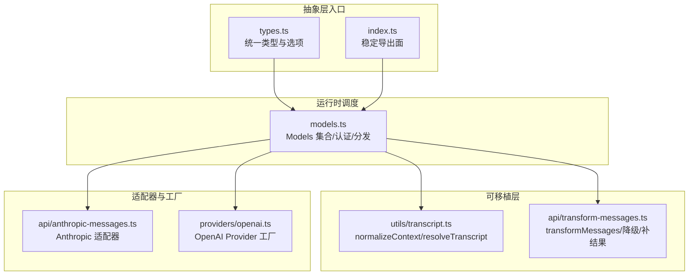
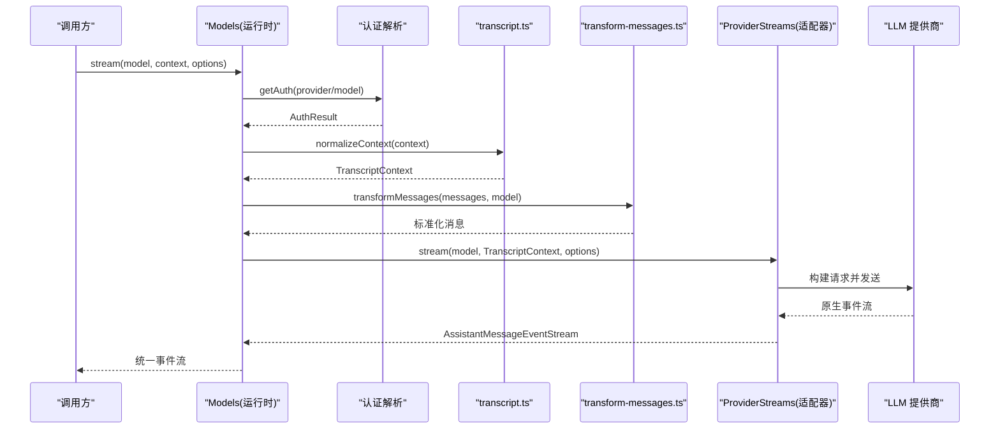
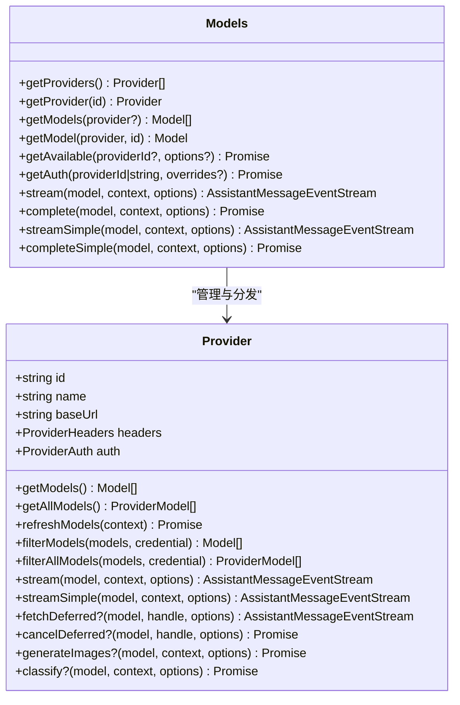
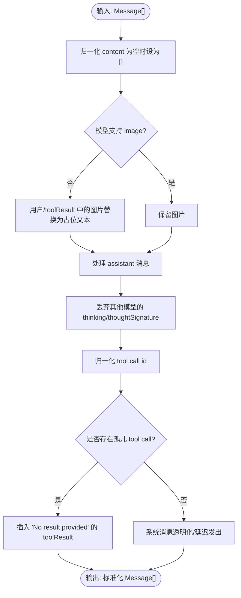
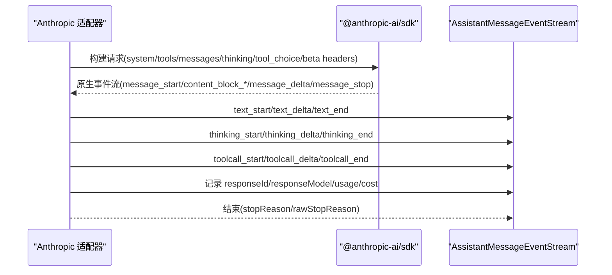
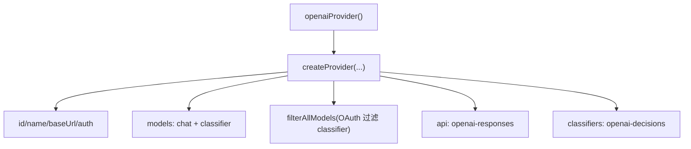
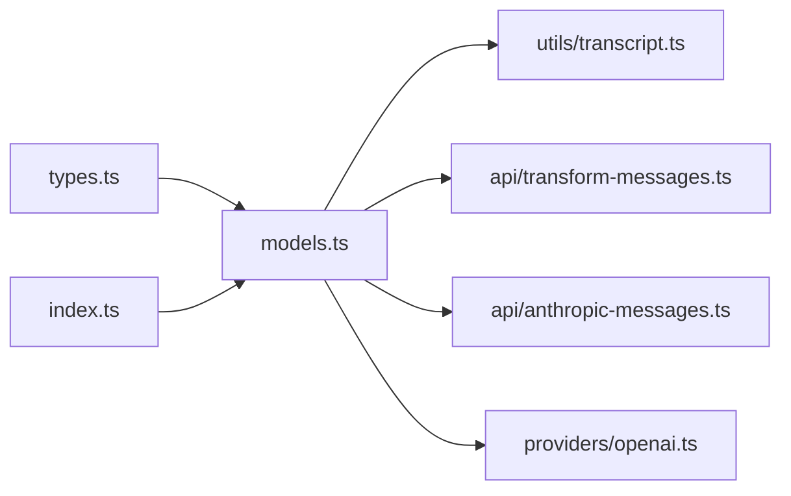

# 统一 API 抽象层

<cite>
**本文引用的文件**
- [packages/ai/src/models.ts](file://packages/ai/src/models.ts)
- [packages/ai/src/types.ts](file://packages/ai/src/types.ts)
- [packages/ai/src/index.ts](file://packages/ai/src/index.ts)
- [packages/ai/src/utils/transcript.ts](file://packages/ai/src/utils/transcript.ts)
- [packages/ai/src/api/transform-messages.ts](file://packages/ai/src/api/transform-messages.ts)
- [packages/ai/src/api/anthropic-messages.ts](file://packages/ai/src/api/anthropic-messages.ts)
- [packages/ai/src/providers/openai.ts](file://packages/ai/src/providers/openai.ts)
- [docs/explains/16-provider-adapters.md](file://docs/explains/16-provider-adapters.md)
</cite>

## 目录
1. [简介](#简介)
2. [项目结构](#项目结构)
3. [核心组件](#核心组件)
4. [架构总览](#架构总览)
5. [详细组件分析](#详细组件分析)
6. [依赖分析](#依赖分析)
7. [性能考虑](#性能考虑)
8. [故障排查指南](#故障排查指南)
9. [结论](#结论)
10. [附录：扩展新提供商实现指南](#附录扩展新提供商实现指南)

## 简介
本文件面向“统一 API 抽象层”的设计与实现，目标是解释如何在多 LLM 提供商之间屏蔽协议差异，提供一致的调用体验。重点包括：
- 请求格式标准化：将不同提供商的消息、工具、图片、thinking 等差异收敛到统一的 TranscriptContext 和消息模型。
- 响应解析统一：各 provider 适配器将原生事件映射为统一的 AssistantMessageEventStream。
- 错误处理一致化：认证失败可同步抛出；请求开始后的失败编码进流（如 stopReason: "error"/"aborted"）。
- 设计模式：Provider 接口 + ProviderStreams 适配器 + transformMessages 可移植层 + Models 集合调度。
- 使用方式：通过统一入口 Models.stream()/streamSimple() 调用任意提供商。
- 扩展指南：新增提供商需实现 ProviderStreams 并注册 Provider。

## 项目结构
本项目在 packages/ai 中实现了统一抽象层，关键位置如下：
- 类型与公共导出：types.ts、index.ts
- 运行时集合与认证调度：models.ts
- 消息可移植层：utils/transcript.ts、api/transform-messages.ts
- 具体适配器示例：api/anthropic-messages.ts
- Provider 工厂示例：providers/openai.ts
- 适配层说明文档：docs/explains/16-provider-adapters.md

**图表来源**
- [packages/ai/src/types.ts:64-88](file://packages/ai/src/types.ts#L64-L88)
- [packages/ai/src/index.ts:1-48](file://packages/ai/src/index.ts#L1-L48)
- [packages/ai/src/models.ts:158-247](file://packages/ai/src/models.ts#L158-L247)
- [packages/ai/src/utils/transcript.ts:30-34](file://packages/ai/src/utils/transcript.ts#L30-L34)
- [packages/ai/src/api/transform-messages.ts:91-200](file://packages/ai/src/api/transform-messages.ts#L91-L200)
- [packages/ai/src/api/anthropic-messages.ts:1-72](file://packages/ai/src/api/anthropic-messages.ts#L1-L72)
- [packages/ai/src/providers/openai.ts:9-35](file://packages/ai/src/providers/openai.ts#L9-L35)

**章节来源**
- [packages/ai/src/types.ts:64-88](file://packages/ai/src/types.ts#L64-L88)
- [packages/ai/src/index.ts:1-48](file://packages/ai/src/index.ts#L1-L48)
- [packages/ai/src/models.ts:158-247](file://packages/ai/src/models.ts#L158-L247)
- [packages/ai/src/utils/transcript.ts:30-34](file://packages/ai/src/utils/transcript.ts#L30-L34)
- [packages/ai/src/api/transform-messages.ts:91-200](file://packages/ai/src/api/transform-messages.ts#L91-L200)
- [packages/ai/src/api/anthropic-messages.ts:1-72](file://packages/ai/src/api/anthropic-messages.ts#L1-L72)
- [packages/ai/src/providers/openai.ts:9-35](file://packages/ai/src/providers/openai.ts#L9-L35)

## 核心组件
- Provider 接口：定义每个提供商的元数据、认证、模型列表、流式与非流式能力。
- ProviderStreams：每个 api/*.ts 模块导出的 stream/streamSimple 函数契约。
- Models：运行时集合，负责认证解析、模型发现、按 model.api 路由到对应 ProviderStreams。
- TranscriptContext 与 transformMessages：统一消息表示、图片降级、tool call id 归一化、孤儿 tool call 补结果等。
- 统一事件流：AssistantMessageEventStream 承载文本、thinking、toolCall 增量事件及最终 AssistantMessage。

关键职责边界：
- 核心层不感知具体协议细节，只通过 resolveTranscript() 与 model.compat 做分支。
- 提供商特有逻辑（缓存、线程、伪装 headers、strict 降级）收敛在适配器内部。
- 成本计算统一：适配器填充 usage，calculateCost() 负责价格。

**章节来源**
- [packages/ai/src/models.ts:158-247](file://packages/ai/src/models.ts#L158-L247)
- [packages/ai/src/types.ts:327-340](file://packages/ai/src/types.ts#L327-L340)
- [packages/ai/src/utils/transcript.ts:30-34](file://packages/ai/src/utils/transcript.ts#L30-L34)
- [packages/ai/src/api/transform-messages.ts:91-200](file://packages/ai/src/api/transform-messages.ts#L91-L200)
- [docs/explains/16-provider-adapters.md:6-77](file://docs/explains/16-provider-adapters.md#L6-L77)

## 架构总览
下图展示从调用方到提供商的完整流程：调用 Models.stream()/streamSimple() → 认证解析 → normalizeContext → resolveTranscript → transformMessages → 选择 ProviderStreams → 发送请求 → 事件映射 → 返回统一事件流。

**图表来源**
- [packages/ai/src/models.ts:324-348](file://packages/ai/src/models.ts#L324-L348)
- [packages/ai/src/utils/transcript.ts:30-34](file://packages/ai/src/utils/transcript.ts#L30-L34)
- [packages/ai/src/api/transform-messages.ts:91-200](file://packages/ai/src/api/transform-messages.ts#L91-L200)
- [packages/ai/src/types.ts:327-340](file://packages/ai/src/types.ts#L327-L340)

## 详细组件分析

### Provider 接口与 Models 集合
- Provider 暴露 id/name/baseUrl/headers/auth/getModels/stream/streamSimple 等能力。
- Models 管理 Provider 注册、刷新、认证检查、可用模型过滤，并将请求委派给对应 Provider。
- Provider 的错误与状态尽量进入事件流，而非同步抛出。

**图表来源**
- [packages/ai/src/models.ts:158-247](file://packages/ai/src/models.ts#L158-L247)
- [packages/ai/src/models.ts:258-367](file://packages/ai/src/models.ts#L258-L367)

**章节来源**
- [packages/ai/src/models.ts:158-247](file://packages/ai/src/models.ts#L158-L247)
- [packages/ai/src/models.ts:258-367](file://packages/ai/src/models.ts#L258-L367)

### 消息可移植层：normalizeContext 与 transformMessages
- normalizeContext：将 Context.systemPrompt 与 tools 折叠为首条 system 消息，形成 TranscriptContext。
- resolveTranscript：根据是否支持 mid-conversation system message 决定保留或折叠后续 system 消息。
- transformMessages：
  - 将 null/undefined content 归一化为 []
  - 对不支持图片的模型进行降级（替换为占位文本）
  - 丢弃其他模型的 thinking 与 thoughtSignature
  - 归一化 tool call id（跨提供商兼容）
  - 为孤儿 tool call 合成空结果
  - 透明化处理夹在 tool call 与 result 之间的 system 消息

**图表来源**
- [packages/ai/src/utils/transcript.ts:30-34](file://packages/ai/src/utils/transcript.ts#L30-L34)
- [packages/ai/src/utils/transcript.ts:115-120](file://packages/ai/src/utils/transcript.ts#L115-L120)
- [packages/ai/src/api/transform-messages.ts:91-200](file://packages/ai/src/api/transform-messages.ts#L91-L200)

**章节来源**
- [packages/ai/src/utils/transcript.ts:30-34](file://packages/ai/src/utils/transcript.ts#L30-L34)
- [packages/ai/src/utils/transcript.ts:115-120](file://packages/ai/src/utils/transcript.ts#L115-L120)
- [packages/ai/src/api/transform-messages.ts:91-200](file://packages/ai/src/api/transform-messages.ts#L91-L200)

### Anthropic 适配器示例
Anthropic Messages 适配器展示了复杂场景的处理：
- 缓存策略：short/long/none，会话亲和头 x-session-id/x-session-affinity
- Claude Code 兼容模式：OAuth token 走特定身份，工具名大小写映射
- Message threads：继续上一次回复或新建线程，拒绝后回退
- 严格工具降级：strict tool 限制被拒则去掉 strict 重试
- 流式事件映射：将 Anthropic 原生事件映射为 Pi 统一事件（text_start/delta/end、thinking_start/delta/end、toolcall_start/delta/end）
- Usage 计算：input/output/cacheRead/cacheWrite，必要时覆盖 OpenRouter 实际费用

**图表来源**
- [packages/ai/src/api/anthropic-messages.ts:1-72](file://packages/ai/src/api/anthropic-messages.ts#L1-L72)
- [docs/explains/16-provider-adapters.md:79-165](file://docs/explains/16-provider-adapters.md#L79-L165)

**章节来源**
- [packages/ai/src/api/anthropic-messages.ts:1-72](file://packages/ai/src/api/anthropic-messages.ts#L1-L72)
- [docs/explains/16-provider-adapters.md:79-165](file://docs/explains/16-provider-adapters.md#L79-L165)

### Provider 工厂与模型注册
以 OpenAI 为例，Provider 工厂负责：
- 声明 provider.id/name/baseUrl
- 配置 auth（apiKey/env、OAuth）
- 注册 models（chat/image/classifier）
- 可选 filterAllModels（例如 OAuth 仅允许 Responses，不允许 classifier）
- 绑定 api（openai-responses）与 classifiers（openai-decisions）

**图表来源**
- [packages/ai/src/providers/openai.ts:9-35](file://packages/ai/src/providers/openai.ts#L9-L35)

**章节来源**
- [packages/ai/src/providers/openai.ts:9-35](file://packages/ai/src/providers/openai.ts#L9-L35)

## 依赖分析
- types.ts 定义了所有统一类型（Api、KnownApi、ProviderRequestOptions、StreamOptions、AssistantMessage、Usage 等），是抽象层的类型基石。
- index.ts 作为稳定导出面，仅暴露类型与必要工具，避免副作用。
- models.ts 依赖 types.ts 的类型与 utils（identity、abort、transcript），并聚合 Provider 实现。
- transcript.ts 与 transform-messages.ts 提供可移植层，被所有适配器复用。
- anthropic-messages.ts 作为适配器示例，依赖 SDK、utils（diagnostics、error-body、event-stream、json-parse、streaming-json、text、transcript）以及 simple-options/constrained-sampling/transform-messages。

**图表来源**
- [packages/ai/src/types.ts:64-88](file://packages/ai/src/types.ts#L64-L88)
- [packages/ai/src/index.ts:1-48](file://packages/ai/src/index.ts#L1-L48)
- [packages/ai/src/models.ts:1-70](file://packages/ai/src/models.ts#L1-L70)
- [packages/ai/src/api/anthropic-messages.ts:1-72](file://packages/ai/src/api/anthropic-messages.ts#L1-L72)
- [packages/ai/src/providers/openai.ts:1-8](file://packages/ai/src/providers/openai.ts#L1-L8)

**章节来源**
- [packages/ai/src/types.ts:64-88](file://packages/ai/src/types.ts#L64-L88)
- [packages/ai/src/index.ts:1-48](file://packages/ai/src/index.ts#L1-L48)
- [packages/ai/src/models.ts:1-70](file://packages/ai/src/models.ts#L1-L70)
- [packages/ai/src/api/anthropic-messages.ts:1-72](file://packages/ai/src/api/anthropic-messages.ts#L1-L72)
- [packages/ai/src/providers/openai.ts:1-8](file://packages/ai/src/providers/openai.ts#L1-L8)

## 性能考虑
- 流式优先：所有适配器返回 AssistantMessageEventStream，避免整段响应驻留内存。
- 增量 JSON 解析：工具参数使用 ToolCallArgumentsStream 增量解析，降低不完整 JSON 的解析开销。
- 上下文裁剪：simple-options 中根据上下文窗口裁剪 maxTokens，并为 thinking 预留空间。
- 并发刷新：Models.refresh() 对多个 Provider 并发刷新，使用 AbortController 控制生命周期。
- 成本计算：适配器仅填充 usage，calculateCost() 集中计算，减少重复逻辑。

[本节为通用指导，不直接分析具体文件]

## 故障排查指南
- 认证失败：getAuth() 可能抛出 ModelsError（oauth/api_key 解析失败），上层应捕获并提示重新登录。
- 请求错误：一旦流已返回，错误应编码为 AssistantMessage.stopReason="error"/"aborted"，errorMessage 携带详情。
- 工具调用异常：transformMessages 会为孤儿 tool call 插入 "No result provided" 的结果，便于调试。
- 图片不支持：非视觉模型会将图片替换为占位文本，避免协议报错。
- 严格工具限制：Anthropic 适配器在 strict tool 被拒时自动降级重试一次，并记录诊断。

**章节来源**
- [packages/ai/src/models.ts:306-316](file://packages/ai/src/models.ts#L306-L316)
- [packages/ai/src/types.ts:406-410](file://packages/ai/src/types.ts#L406-L410)
- [packages/ai/src/api/transform-messages.ts:179-200](file://packages/ai/src/api/transform-messages.ts#L179-L200)
- [docs/explains/16-provider-adapters.md:122-125](file://docs/explains/16-provider-adapters.md#L122-L125)

## 结论
该抽象层通过窄契约（Provider/ProviderStreams）、强类型（types.ts）、可移植层（transcript/transform）与 Models 调度，成功屏蔽了多家 LLM 提供商的协议差异。适配器只需关注自身协议细节，上层业务无需关心底层差异，即可获得一致的流式调用、错误处理与成本统计体验。

[本节为总结性内容，不直接分析具体文件]

## 附录：扩展新提供商实现指南
步骤概览：
1. 创建适配器模块
   - 在 src/api/ 下新增 xxx-api.ts，导出 stream/streamSimple（必要时 fetchDeferred/cancelDeferred）。
   - 实现 ProviderStreams 契约，接收 TranscriptContext，返回 AssistantMessageEventStream。
   - 使用 transformMessages 与 resolveTranscript 保证消息兼容性。
   - 将上游事件映射为统一事件（text/thinking/toolCall 起止与增量）。
   - 填充 Usage 与 cost（如需覆盖 provider-reported cost，参考 Anthropic 适配器）。

2. 创建 Provider 工厂
   - 在 src/providers/ 下新增 provider.ts，调用 createProvider(...)。
   - 配置 id/name/baseUrl/auth（apiKey/env 或 OAuth）。
   - 注册 models（chat/image/classifier），必要时实现 filterAllModels/filterModels。
   - 绑定 api（指向你的适配器）与 classifiers（如有）。

3. 集成与使用
   - 在应用启动时注册 Provider 到 Models。
   - 通过 Models.stream()/streamSimple() 调用，传入 model 与 Context。
   - 监听事件流，消费 text/thinking/toolCall 增量，并在结束时处理 AssistantMessage。

4. 测试建议
   - 单元测试：验证消息转换、事件映射、错误编码、Usage 计算。
   - 端到端测试：模拟上游事件，校验下游事件顺序与字段完整性。
   - 兼容性测试：覆盖不支持图片、thinking、mid-conversation system message 等场景。

参考路径：
- 适配器示例：[packages/ai/src/api/anthropic-messages.ts](file://packages/ai/src/api/anthropic-messages.ts)
- Provider 工厂示例：[packages/ai/src/providers/openai.ts](file://packages/ai/src/providers/openai.ts)
- 统一类型与选项：[packages/ai/src/types.ts](file://packages/ai/src/types.ts)
- 可移植层：[packages/ai/src/utils/transcript.ts](file://packages/ai/src/utils/transcript.ts)、[packages/ai/src/api/transform-messages.ts](file://packages/ai/src/api/transform-messages.ts)
- 适配层说明文档：[docs/explains/16-provider-adapters.md](file://docs/explains/16-provider-adapters.md)

**章节来源**
- [packages/ai/src/api/anthropic-messages.ts:1-72](file://packages/ai/src/api/anthropic-messages.ts#L1-L72)
- [packages/ai/src/providers/openai.ts:9-35](file://packages/ai/src/providers/openai.ts#L9-L35)
- [packages/ai/src/types.ts:327-340](file://packages/ai/src/types.ts#L327-L340)
- [packages/ai/src/utils/transcript.ts:30-34](file://packages/ai/src/utils/transcript.ts#L30-L34)
- [packages/ai/src/api/transform-messages.ts:91-200](file://packages/ai/src/api/transform-messages.ts#L91-L200)
- [docs/explains/16-provider-adapters.md:6-77](file://docs/explains/16-provider-adapters.md#L6-L77)