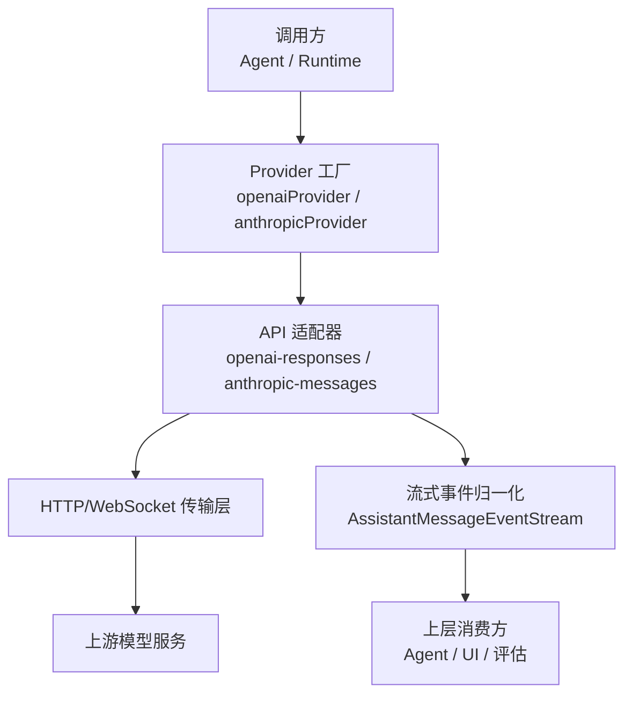
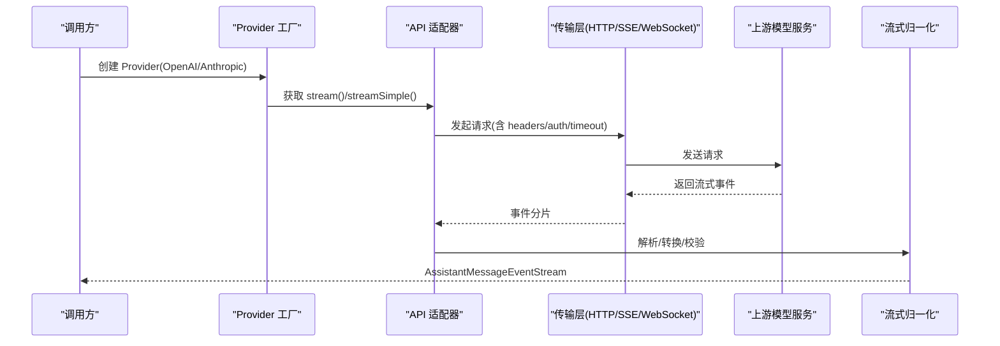
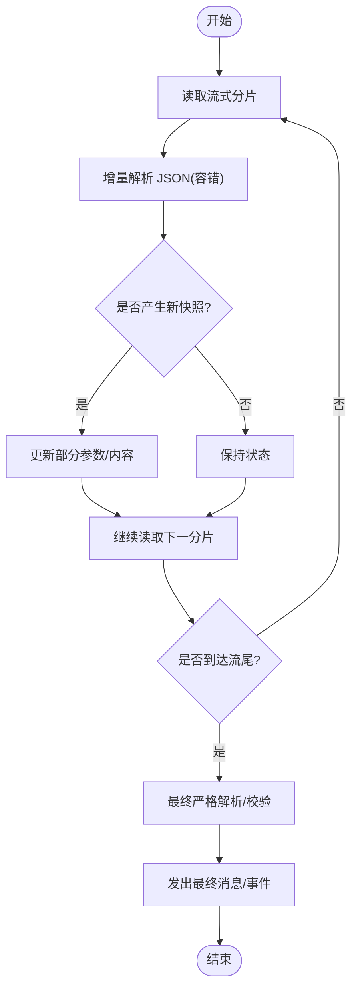
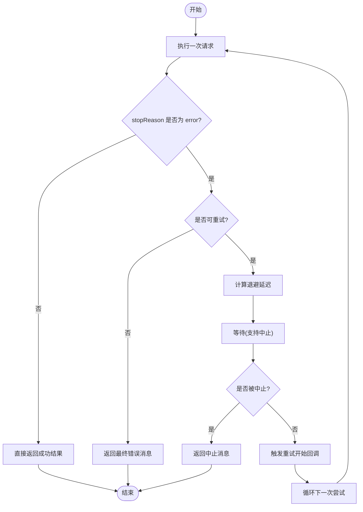
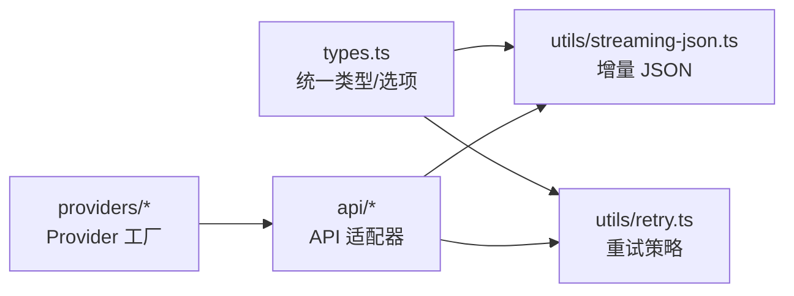

# 请求响应处理

<cite>
**本文引用的文件**
- [packages/ai/src/types.ts](file://packages/ai/src/types.ts)
- [packages/ai/src/utils/retry.ts](file://packages/ai/src/utils/retry.ts)
- [packages/ai/src/utils/streaming-json.ts](file://packages/ai/src/utils/streaming-json.ts)
- [packages/ai/src/providers/openai.ts](file://packages/ai/src/providers/openai.ts)
- [packages/ai/src/providers/anthropic.ts](file://packages/ai/src/providers/anthropic.ts)
- [packages/ai/src/api/lazy.ts](file://packages/ai/src/api/lazy.ts)
- [packages/ai/src/api/openai-codex-responses.ts](file://packages/ai/src/api/openai-codex-responses.ts)
- [packages/ai/src/api/openai-responses-shared.ts](file://packages/ai/src/api/openai-responses-shared.ts)
- [packages/mcp/src/transports/streamable-http.ts](file://packages/mcp/src/transports/streamable-http.ts)
</cite>

## 目录
1. [简介](#简介)
2. [项目结构](#项目结构)
3. [核心组件](#核心组件)
4. [架构总览](#架构总览)
5. [详细组件分析](#详细组件分析)
6. [依赖关系分析](#依赖关系分析)
7. [性能考虑](#性能考虑)
8. [故障排除指南](#故障排除指南)
9. [结论](#结论)

## 简介
本文面向“请求-响应处理机制”的完整链路，覆盖从请求构建、发送、接收、解析到流式响应处理、超时控制、重试与错误恢复的全过程。文档同时解释不同提供商（如 OpenAI、Anthropic）在响应格式上的差异如何被统一处理，以及数据转换与验证逻辑。最后给出性能优化建议、监控指标、调试方法与常见问题排查路径。

## 项目结构
本仓库采用多包架构，与请求响应处理直接相关的代码集中在 `packages/ai`：
- 类型与选项定义：`src/types.ts`
- 通用工具：重试策略 `src/utils/retry.ts`、增量 JSON 解析 `src/utils/streaming-json.ts`
- 提供商注册与 API 适配：`src/providers/*`、`src/api/*`
- MCP 可移植 HTTP 传输层（SSE/JSON）：`packages/mcp/src/transports/streamable-http.ts`

图表来源
- [packages/ai/src/providers/openai.ts:9-34](file://packages/ai/src/providers/openai.ts#L9-L34)
- [packages/ai/src/providers/anthropic.ts:74-89](file://packages/ai/src/providers/anthropic.ts#L74-L89)
- [packages/ai/src/api/lazy.ts:108-112](file://packages/ai/src/api/lazy.ts#L108-L112)

章节来源
- [packages/ai/src/providers/openai.ts:9-34](file://packages/ai/src/providers/openai.ts#L9-L34)
- [packages/ai/src/providers/anthropic.ts:74-89](file://packages/ai/src/providers/anthropic.ts#L74-L89)

## 核心组件
- 统一类型与选项
  - `ProviderRequestOptions`：认证、自定义 fetch、环境变量、请求头、身份标识、超时、重试次数、最大重试延迟等。
  - `StreamOptions`：扩展了流式回调、采样参数、传输方式、会话缓存、WebSocket 连接超时、元数据等。
  - `ApiStreamOptions`：按已知 API 映射具体选项类型，保证类型安全。
  - `ProviderStreams`：统一的流接口契约，包含 `stream`、`streamSimple`、可选的延迟获取与取消方法。
- 重试策略
  - `RetryPolicy`：指数退避、最大尝试次数、最大延迟上限。
  - `retryAssistantCall`：对失败消息进行可重试判定、退避等待、中止信号支持，并输出标准化结果。
  - `isRetryableAssistantError`：基于错误文本模式匹配区分“可重试”和“不可重试”（如配额耗尽）。
- 流式 JSON 解析
  - `StreamingJsonParser`：增量、容错地解析分片 JSON，提供快照与变更通知，避免阻塞与重复拷贝。
  - `ToolCallArgumentsStream`：维护工具调用的增量参数文本与部分对象，最终完成时做严格解析与错误报告。

章节来源
- [packages/ai/src/types.ts:161-219](file://packages/ai/src/types.ts#L161-L219)
- [packages/ai/src/types.ts:221-278](file://packages/ai/src/types.ts#L221-L278)
- [packages/ai/src/types.ts:298-340](file://packages/ai/src/types.ts#L298-L340)
- [packages/ai/src/utils/retry.ts:127-150](file://packages/ai/src/utils/retry.ts#L127-L150)
- [packages/ai/src/utils/retry.ts:191-259](file://packages/ai/src/utils/retry.ts#L191-L259)
- [packages/ai/src/utils/retry.ts:261-275](file://packages/ai/src/utils/retry.ts#L261-L275)
- [packages/ai/src/utils/streaming-json.ts:1-34](file://packages/ai/src/utils/streaming-json.ts#L1-L34)
- [packages/ai/src/utils/streaming-json.ts:108-155](file://packages/ai/src/utils/streaming-json.ts#L108-L155)
- [packages/ai/src/utils/streaming-json.ts:447-499](file://packages/ai/src/utils/streaming-json.ts#L447-L499)

## 架构总览
下图展示一次典型流式请求的生命周期：从高层调用进入 Provider，选择 API 实现，建立传输通道，解析流式事件，归一化为统一消息，再返回给上层。

图表来源
- [packages/ai/src/providers/openai.ts:9-34](file://packages/ai/src/providers/openai.ts#L9-L34)
- [packages/ai/src/providers/anthropic.ts:74-89](file://packages/ai/src/providers/anthropic.ts#L74-L89)
- [packages/ai/src/api/lazy.ts:108-112](file://packages/ai/src/api/lazy.ts#L108-L112)

## 详细组件分析

### 请求构建与发送
- 认证与环境
  - OpenAI：支持 API Key 与 ChatGPT OAuth；OAuth 仅用于 Responses API。
  - Anthropic：支持 API Key、Bearer Token、工作负载身份联邦等多种认证路径。
- 请求头与身份
  - 通过 `headers` 注入自定义头；保留保留头不被覆盖；`identity` 生成 `User-Agent` 与归属头。
- 超时与重试
  - `timeoutMs`：HTTP 请求级超时。
  - `maxRetries`、`maxRetryDelayMs`：客户端侧重试次数与最长等待。
- 传输方式
  - `transport` 支持 `sse`、`websocket`、`websocket-cached`、`auto`。
  - WebSocket 连接超时由 `websocketConnectTimeoutMs` 控制。

章节来源
- [packages/ai/src/providers/openai.ts:9-34](file://packages/ai/src/providers/openai.ts#L9-L34)
- [packages/ai/src/providers/anthropic.ts:19-71](file://packages/ai/src/providers/anthropic.ts#L19-L71)
- [packages/ai/src/types.ts:161-219](file://packages/ai/src/types.ts#L161-L219)
- [packages/ai/src/types.ts:221-278](file://packages/ai/src/types.ts#L221-L278)

### 流式响应处理与解析
- 事件流抽象
  - 各 API 模块导出 `stream` 与 `streamSimple`，返回 `AssistantMessageEventStream`。
  - 懒加载包装器将实际实现延迟至首次调用，减少冷启动开销。
- 增量 JSON 解析
  - 工具调用参数以流式追加，使用 `StreamingJsonParser` 维护部分对象与快照。
  - 结束时用严格解析器产出最终参数与错误信息。
- 终止条件
  - 某些 API 要求流结束前出现终态事件，否则抛出异常提示未收到终端响应。

图表来源
- [packages/ai/src/utils/streaming-json.ts:108-155](file://packages/ai/src/utils/streaming-json.ts#L108-L155)
- [packages/ai/src/utils/streaming-json.ts:447-499](file://packages/ai/src/utils/streaming-json.ts#L447-L499)
- [packages/ai/src/api/openai-responses-shared.ts:816-816](file://packages/ai/src/api/openai-responses-shared.ts#L816-L816)

章节来源
- [packages/ai/src/api/lazy.ts:108-112](file://packages/ai/src/api/lazy.ts#L108-L112)
- [packages/ai/src/utils/streaming-json.ts:1-34](file://packages/ai/src/utils/streaming-json.ts#L1-L34)
- [packages/ai/src/utils/streaming-json.ts:108-155](file://packages/ai/src/utils/streaming-json.ts#L108-L155)
- [packages/ai/src/utils/streaming-json.ts:447-499](file://packages/ai/src/utils/streaming-json.ts#L447-L499)
- [packages/ai/src/api/openai-responses-shared.ts:816-816](file://packages/ai/src/api/openai-responses-shared.ts#L816-L816)

### 超时控制
- HTTP 层超时：`timeoutMs` 控制单次请求的等待上限。
- WebSocket 连接超时：`websocketConnectTimeoutMs` 仅覆盖握手阶段。
- 代理/网关重连：MCP Streamable HTTP 支持指数退避与最大重试次数，防止长连接抖动导致长时间挂起。

章节来源
- [packages/ai/src/types.ts:221-278](file://packages/ai/src/types.ts#L221-L278)
- [packages/mcp/src/transports/streamable-http.ts:138-145](file://packages/mcp/src/transports/streamable-http.ts#L138-L145)

### 重试机制与错误恢复
- 可重试判定
  - 基于错误文本的正则匹配，区分“可重试”（网络/服务端瞬时错误）与“不可重试”（配额/计费耗尽）。
- 重试策略
  - 指数退避：基础延迟乘以 2^(attempt-1)，并受最大延迟上限限制。
  - 中止信号：退避期间若被中止，会转换为标准化的“已中止”消息，不继续重试。
- 回调钩子
  - 提供计划重试、开始重试、结束重试的回调，便于监控与日志记录。

图表来源
- [packages/ai/src/utils/retry.ts:191-259](file://packages/ai/src/utils/retry.ts#L191-L259)
- [packages/ai/src/utils/retry.ts:261-275](file://packages/ai/src/utils/retry.ts#L261-L275)

章节来源
- [packages/ai/src/utils/retry.ts:127-150](file://packages/ai/src/utils/retry.ts#L127-L150)
- [packages/ai/src/utils/retry.ts:191-259](file://packages/ai/src/utils/retry.ts#L191-L259)
- [packages/ai/src/utils/retry.ts:261-275](file://packages/ai/src/utils/retry.ts#L261-L275)

### 不同提供商的响应格式差异处理
- OpenAI
  - 通过 `openaiProvider()` 暴露 Responses API 与分类器 API；OAuth 令牌仅用于 Responses。
  - 流式事件需确保存在终态事件，否则视为未完成。
- Anthropic
  - 支持多种认证方式（API Key、Bearer、联邦身份），并在 SDK 中自动交换短期令牌。
  - 流式事件可能包含思考内容、工具调用等，需要增量解析与规范化。

章节来源
- [packages/ai/src/providers/openai.ts:9-34](file://packages/ai/src/providers/openai.ts#L9-L34)
- [packages/ai/src/providers/anthropic.ts:19-71](file://packages/ai/src/providers/anthropic.ts#L19-L71)
- [packages/ai/src/api/openai-codex-responses.ts:1436-1436](file://packages/ai/src/api/openai-codex-responses.ts#L1436-L1436)
- [packages/ai/src/api/openai-responses-shared.ts:816-816](file://packages/ai/src/api/openai-responses-shared.ts#L816-L816)

### 数据转换与验证
- 工具调用参数
  - 使用 `ToolCallArgumentsStream` 累积原始文本，并提供部分对象快照；结束时调用严格解析器产出最终参数与错误描述。
- 流式 JSON 容错
  - 对不完整或非法 JSON 采取宽容解析，避免中断主流程；最终再进行一次严格解析以捕获问题。

章节来源
- [packages/ai/src/utils/streaming-json.ts:447-499](file://packages/ai/src/utils/streaming-json.ts#L447-L499)
- [packages/ai/src/utils/streaming-json.ts:1-34](file://packages/ai/src/utils/streaming-json.ts#L1-L34)

## 依赖关系分析
- Provider 与 API 解耦
  - Provider 负责认证、模型列表与基础 URL；API 模块负责协议细节与流式事件归一化。
- 类型驱动
  - `ApiStreamOptions` 将已知 API 与其具体选项类型绑定，保证编译期类型安全。
- 工具复用
  - 重试与流式 JSON 解析作为通用工具被多个 API 与传输层复用。

图表来源
- [packages/ai/src/types.ts:298-340](file://packages/ai/src/types.ts#L298-L340)
- [packages/ai/src/utils/retry.ts:127-150](file://packages/ai/src/utils/retry.ts#L127-L150)
- [packages/ai/src/utils/streaming-json.ts:108-155](file://packages/ai/src/utils/streaming-json.ts#L108-L155)

章节来源
- [packages/ai/src/types.ts:298-340](file://packages/ai/src/types.ts#L298-L340)

## 性能考虑
- 懒加载 API 实现
  - 通过懒加载包装器仅在首次使用时加载具体 API 实现，降低冷启动成本。
- 增量解析与快照
  - 流式 JSON 解析避免全量拷贝，按需复制开放路径，减少内存占用与 GC 压力。
- 传输选择
  - 根据场景选择 SSE 或 WebSocket；WebSocket 连接超时独立于流空闲超时，避免握手阻塞。
- 重试退避上限
  - 设置合理的最大延迟上限，避免长时间无响应的重试风暴。

章节来源
- [packages/ai/src/api/lazy.ts:108-112](file://packages/ai/src/api/lazy.ts#L108-L112)
- [packages/ai/src/utils/streaming-json.ts:1-34](file://packages/ai/src/utils/streaming-json.ts#L1-L34)
- [packages/ai/src/types.ts:221-278](file://packages/ai/src/types.ts#L221-L278)
- [packages/ai/src/utils/retry.ts:127-150](file://packages/ai/src/utils/retry.ts#L127-L150)

## 故障排除指南
- 流式事件未到达终态
  - 现象：流结束但未收到终端事件。
  - 处理：检查 API 适配器是否要求终态事件；必要时增加超时与重试。
- 工具调用参数解析失败
  - 现象：最终参数为空或报错。
  - 处理：查看增量解析日志，确认参数文本完整性；必要时启用更严格的解析错误信息。
- 重试未生效或被中止
  - 现象：请求失败后未重试或在退避中被中止。
  - 处理：检查重试策略配置与中止信号；确认错误是否属于“可重试”类别。
- 认证失败或权限不足
  - 现象：401/403 或鉴权头缺失。
  - 处理：核对 Provider 认证配置（API Key/OAuth/Bearer）；检查自定义头是否被覆盖。

章节来源
- [packages/ai/src/api/openai-responses-shared.ts:816-816](file://packages/ai/src/api/openai-responses-shared.ts#L816-L816)
- [packages/ai/src/utils/streaming-json.ts:447-499](file://packages/ai/src/utils/streaming-json.ts#L447-L499)
- [packages/ai/src/utils/retry.ts:191-259](file://packages/ai/src/utils/retry.ts#L191-L259)
- [packages/ai/src/providers/openai.ts:9-34](file://packages/ai/src/providers/openai.ts#L9-L34)
- [packages/ai/src/providers/anthropic.ts:19-71](file://packages/ai/src/providers/anthropic.ts#L19-L71)

## 结论
该请求-响应处理机制通过 Provider 与 API 解耦、统一类型与选项、通用重试与流式解析工具，实现了跨提供商的一致体验。结合超时控制、重试退避与流式增量解析，系统在稳定性与性能之间取得平衡。实践中应关注终态事件、参数完整性与重试策略配置，并结合监控与日志快速定位问题。