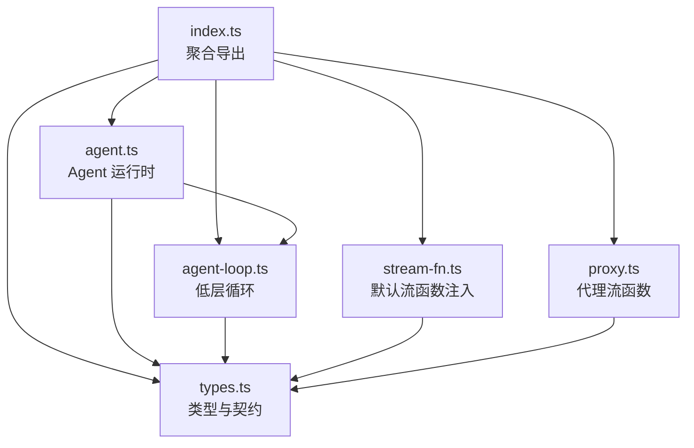
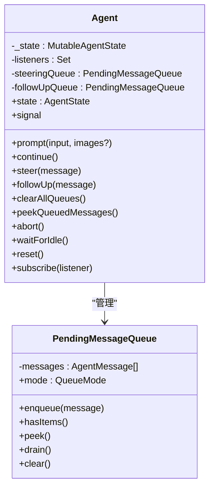
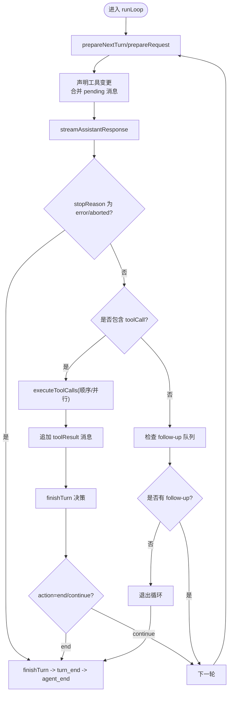
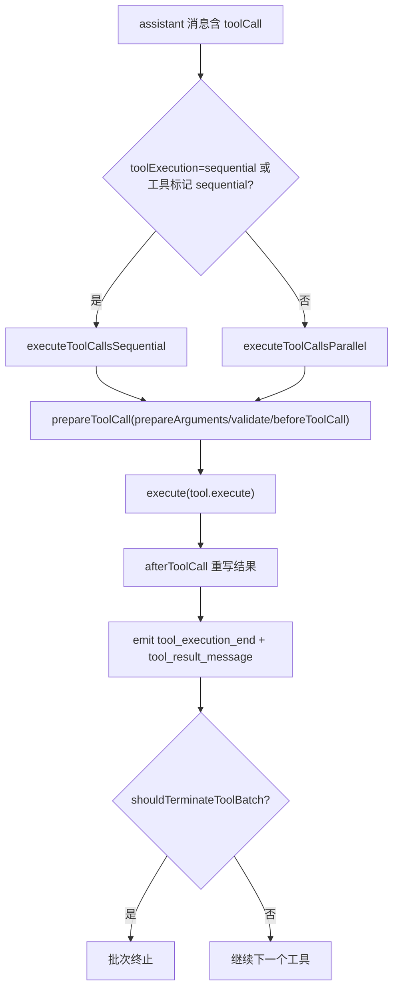
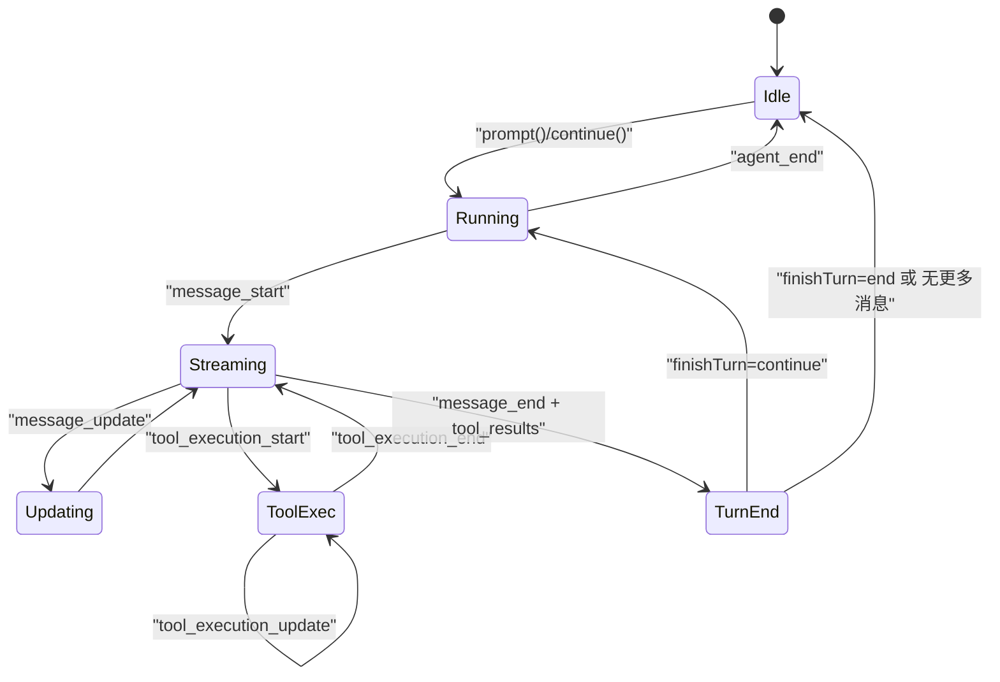
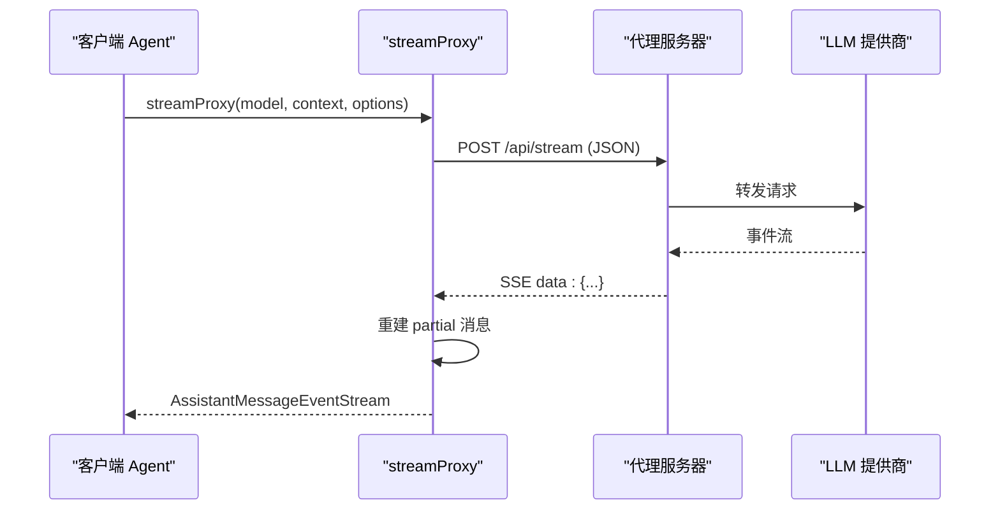
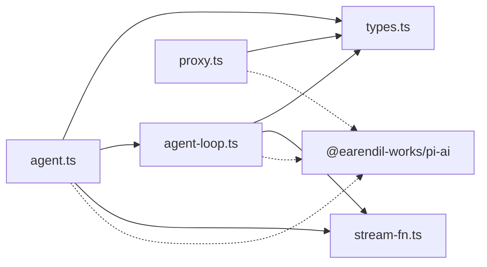

# Agent核心架构

<cite>
**本文引用的文件**   
- [packages/agent/src/index.ts](file://packages/agent/src/index.ts)
- [packages/agent/src/types.ts](file://packages/agent/src/types.ts)
- [packages/agent/src/agent.ts](file://packages/agent/src/agent.ts)
- [packages/agent/src/agent-loop.ts](file://packages/agent/src/agent-loop.ts)
- [packages/agent/src/stream-fn.ts](file://packages/agent/src/stream-fn.ts)
- [packages/agent/src/proxy.ts](file://packages/agent/src/proxy.ts)
- [README.md](file://README.md)
</cite>

## 目录
1. [引言](#引言)
2. [项目结构](#项目结构)
3. [核心组件](#核心组件)
4. [架构总览](#架构总览)
5. [详细组件分析](#详细组件分析)
6. [依赖关系分析](#依赖关系分析)
7. [性能与扩展性](#性能与扩展性)
8. [故障排查指南](#故障排查指南)
9. [结论](#结论)
10. [附录：开发指南与最佳实践](#附录开发指南与最佳实践)

## 引言
本文件面向开发者，系统化阐述 Agent 核心架构，覆盖生命周期管理、会话与状态管理、事件驱动机制、运行时工作流、消息传递、工具执行流程与错误处理策略。同时给出配置项、扩展点设计、插件化能力以及自定义 Agent 的开发指引，并辅以架构图和数据流图帮助理解。

Agent 核心位于 `@earendil-works/pi-agent-core`（仓库中的 `packages/agent`），提供：
- 可组合的 Agent 运行时
- 基于事件的流式对话循环
- 可扩展的工具调用与执行模式
- 面向 LLM 的消息转换与上下文准备钩子
- 可选的代理流函数以跨进程或远程路由请求

## 项目结构
Agent 包采用“核心类型 + 运行时 + 流式抽象”的分层组织方式：
- 类型定义集中在 `types.ts`，对外暴露统一契约
- `agent.ts` 封装有状态 Agent，负责生命周期、队列、事件分发和运行控制
- `agent-loop.ts` 实现低层循环，协调模型调用、工具执行与轮次决策
- `stream-fn.ts` 提供默认流函数注入点
- `proxy.ts` 提供通过服务端代理转发 LLM 调用的流函数
- `index.ts` 聚合导出公共 API



图表来源
- [packages/agent/src/index.ts:1-6](file://packages/agent/src/index.ts#L1-L6)
- [packages/agent/src/agent.ts:1-624](file://packages/agent/src/agent.ts#L1-L624)
- [packages/agent/src/agent-loop.ts:1-960](file://packages/agent/src/agent-loop.ts#L1-L960)
- [packages/agent/src/types.ts:1-552](file://packages/agent/src/types.ts#L1-L552)
- [packages/agent/src/stream-fn.ts:1-21](file://packages/agent/src/stream-fn.ts#L1-L21)
- [packages/agent/src/proxy.ts:1-398](file://packages/agent/src/proxy.ts#L1-L398)

章节来源
- [README.md:72-86](file://README.md#L72-L86)
- [packages/agent/src/index.ts:1-6](file://packages/agent/src/index.ts#L1-L6)

## 核心组件
- Agent：有状态运行时，持有消息、工具、模型、思考级别等状态，提供 prompt/continue/steer/followUp/subscribe/waitForIdle/abort/reset 等接口，负责事件分发与运行生命周期。
- AgentLoop：低层循环，负责将 AgentMessage 转换为 LLM 消息、调用流函数、编排工具执行、处理 turn 结束决策、支持 steering/follow-up 队列。
- StreamFn：流函数契约，用于将模型调用结果以事件流形式返回；可通过 setDefaultStreamFn 注入默认实现，或使用 streamProxy 走服务端代理。
- Proxy：代理流函数，将 LLM 请求转发到远端服务，并在客户端重建部分消息体。

章节来源
- [packages/agent/src/agent.ts:188-263](file://packages/agent/src/agent.ts#L188-L263)
- [packages/agent/src/agent-loop.ts:111-160](file://packages/agent/src/agent-loop.ts#L111-L160)
- [packages/agent/src/types.ts:19-37](file://packages/agent/src/types.ts#L19-L37)
- [packages/agent/src/stream-fn.ts:5-20](file://packages/agent/src/stream-fn.ts#L5-L20)
- [packages/agent/src/proxy.ts:108-255](file://packages/agent/src/proxy.ts#L108-L255)

## 架构总览
Agent 的核心是“事件驱动的循环”，由高层 Agent 调度，低层 agent-loop 驱动，并通过 StreamFn 与 LLM 交互。工具执行在循环内部完成，支持并行或串行模式。

```mermaid
sequenceDiagram
participant App as "应用"
participant Agent as "Agent"
participant Loop as "AgentLoop"
participant Stream as "StreamFn"
participant Provider as "LLM 提供商"
App->>Agent : prompt()/continue()
Agent->>Loop : runAgentLoop()/runAgentLoopContinue()
Loop->>Stream : 调用流函数(模型, 上下文, 选项)
Stream->>Provider : 发起流式请求
Provider-->>Stream : 事件流(start/text/toolcall/done/error)
Stream-->>Loop : 事件流
Loop-->>Agent : 事件(agent_start/turn/message/tool_execution/turn_end/agent_end)
Agent-->>App : subscribe 回调
```

图表来源
- [packages/agent/src/agent.ts:379-467](file://packages/agent/src/agent.ts#L379-L467)
- [packages/agent/src/agent-loop.ts:111-160](file://packages/agent/src/agent-loop.ts#L111-L160)
- [packages/agent/src/agent-loop.ts:390-479](file://packages/agent/src/agent-loop.ts#L390-L479)
- [packages/agent/src/types.ts:19-37](file://packages/agent/src/types.ts#L19-L37)

## 详细组件分析

### Agent 运行时与生命周期
Agent 是有状态包装器，围绕低层循环提供：
- 状态：systemPrompt、model、thinkingLevel、tools、messages、isStreaming、streamingMessage、pendingToolCalls、errorMessage
- 队列：steeringQueue、followUpQueue，支持 all/one-at-a-time 两种排空模式
- 生命周期：prompt/continue 启动运行，abort 中断，waitForIdle 等待所有监听器 settle，reset 清理会话但保留系统基线
- 事件：subscribe 订阅 agent_start/turn/message/tool_execution/turn_end/agent_end 等事件



图表来源
- [packages/agent/src/agent.ts:71-112](file://packages/agent/src/agent.ts#L71-L112)
- [packages/agent/src/agent.ts:149-180](file://packages/agent/src/agent.ts#L149-L180)
- [packages/agent/src/agent.ts:188-263](file://packages/agent/src/agent.ts#L188-L263)
- [packages/agent/src/agent.ts:265-377](file://packages/agent/src/agent.ts#L265-L377)

章节来源
- [packages/agent/src/agent.ts:71-112](file://packages/agent/src/agent.ts#L71-L112)
- [packages/agent/src/agent.ts:149-180](file://packages/agent/src/agent.ts#L149-L180)
- [packages/agent/src/agent.ts:188-263](file://packages/agent/src/agent.ts#L188-L263)
- [packages/agent/src/agent.ts:265-377](file://packages/agent/src/agent.ts#L265-L377)
- [packages/agent/src/agent.ts:517-566](file://packages/agent/src/agent.ts#L517-L566)
- [packages/agent/src/agent.ts:568-623](file://packages/agent/src/agent.ts#L568-L623)

### 低层循环与事件驱动
低层循环负责：
- 声明工具变更（向模型宣告 toolsAdded/toolsRemoved）
- 组装上下文与请求（prepareRequest/transformContext/convertToLlm）
- 流式获取助手响应（message_start/update/end）
- 工具调用执行（sequential/parallel），失败与截断保护
- turn 结束决策（finishTurn），支持 end/continue
- 队列注入（getSteeringMessages/getFollowUpMessages）



图表来源
- [packages/agent/src/agent-loop.ts:172-330](file://packages/agent/src/agent-loop.ts#L172-L330)
- [packages/agent/src/agent-loop.ts:342-384](file://packages/agent/src/agent-loop.ts#L342-L384)
- [packages/agent/src/agent-loop.ts:390-479](file://packages/agent/src/agent-loop.ts#L390-L479)
- [packages/agent/src/agent-loop.ts:518-670](file://packages/agent/src/agent-loop.ts#L518-L670)

章节来源
- [packages/agent/src/agent-loop.ts:111-160](file://packages/agent/src/agent-loop.ts#L111-L160)
- [packages/agent/src/agent-loop.ts:172-330](file://packages/agent/src/agent-loop.ts#L172-L330)
- [packages/agent/src/agent-loop.ts:342-384](file://packages/agent/src/agent-loop.ts#L342-L384)
- [packages/agent/src/agent-loop.ts:390-479](file://packages/agent/src/agent-loop.ts#L390-L479)
- [packages/agent/src/agent-loop.ts:518-670](file://packages/agent/src/agent-loop.ts#L518-L670)

### 消息传递与上下文转换
- transformContext：在 convertToLlm 之前对 AgentMessage[] 做上下文裁剪、外部信息注入等
- convertToLlm：将 AgentMessage[] 转为 LLM 可用的 Message[]，过滤 UI-only 消息
- normalizeContext：标准化上下文后传给 StreamFn
- DEFAULT_AGENT_IDENTITY：为请求附加 attribution 标识，可被 Agent.identity 覆盖

```mermaid
sequenceDiagram
participant Loop as "AgentLoop"
participant Ctx as "上下文"
participant Conv as "convertToLlm"
participant Norm as "normalizeContext"
participant SF as "StreamFn"
Loop->>Ctx : transformContext(messages)
Loop->>Conv : convertToLlm(transformed)
Conv-->>Loop : Message[]
Loop->>Norm : normalizeContext({ messages })
Loop->>SF : stream(model, context, options)
```

图表来源
- [packages/agent/src/agent-loop.ts:390-417](file://packages/agent/src/agent-loop.ts#L390-L417)
- [packages/agent/src/types.ts:193-244](file://packages/agent/src/types.ts#L193-L244)
- [packages/agent/src/agent-loop.ts:38-41](file://packages/agent/src/agent-loop.ts#L38-L41)

章节来源
- [packages/agent/src/agent-loop.ts:390-417](file://packages/agent/src/agent-loop.ts#L390-L417)
- [packages/agent/src/types.ts:193-244](file://packages/agent/src/types.ts#L193-L244)

### 工具执行流程与错误处理
- 工具执行模式：
  - sequential：逐个准备、执行、收尾
  - parallel：顺序预检，允许的工具并发执行；tool_execution_end 按完成顺序发出，tool-result 消息按原顺序发出
- 工具准备：
  - prepareArguments：兼容旧参数
  - validateToolArguments：校验参数
  - beforeToolCall：拦截/阻断，支持 terminate 提示
- 工具执行：
  - execute：工具实现
  - afterToolCall：重写 result 字段（content/details/isError/usage/terminate/structuredContent）
- 错误处理：
  - 输出 token 截断时，批量失败工具调用并提示重新发起
  - abort 信号贯穿准备/执行/收尾阶段
  - finishTurn 可决定提前终止



图表来源
- [packages/agent/src/agent-loop.ts:518-670](file://packages/agent/src/agent-loop.ts#L518-L670)
- [packages/agent/src/agent-loop.ts:704-787](file://packages/agent/src/agent-loop.ts#L704-L787)
- [packages/agent/src/agent-loop.ts:488-513](file://packages/agent/src/agent-loop.ts#L488-L513)
- [packages/agent/src/types.ts:478-511](file://packages/agent/src/types.ts#L478-L511)

章节来源
- [packages/agent/src/agent-loop.ts:518-670](file://packages/agent/src/agent-loop.ts#L518-L670)
- [packages/agent/src/agent-loop.ts:704-787](file://packages/agent/src/agent-loop.ts#L704-L787)
- [packages/agent/src/agent-loop.ts:488-513](file://packages/agent/src/agent-loop.ts#L488-L513)
- [packages/agent/src/types.ts:478-511](file://packages/agent/src/types.ts#L478-L511)

### 会话管理与状态模式
- Agent 状态：
  - systemPrompt：从 transcript 的系统消息中读取
  - model/thinkingLevel：当前模型与推理级别
  - tools/messages：可执行工具集与对话转录
  - isStreaming/streamingMessage/pendingToolCalls/errorMessage：运行时标志
- 状态更新：
  - 通过 processEvents 同步 message/tool/turn/agent 生命周期事件
  - reset 仅保留系统基线，清空其余状态
- 队列模式：
  - steeringMode/followUpMode：all 或 one-at-a-time
- 与上层会话的关系：
  - 上层 SessionManager/AgentSession 可将 Agent.state.messages 投影为会话条目，并持久化



图表来源
- [packages/agent/src/agent.ts:568-623](file://packages/agent/src/agent.ts#L568-L623)
- [packages/agent/src/agent.ts:379-467](file://packages/agent/src/agent.ts#L379-L467)
- [packages/agent/src/agent.ts:517-566](file://packages/agent/src/agent.ts#L517-L566)

章节来源
- [packages/agent/src/agent.ts:379-467](file://packages/agent/src/agent.ts#L379-L467)
- [packages/agent/src/agent.ts:517-566](file://packages/agent/src/agent.ts#L517-L566)
- [packages/agent/src/agent.ts:568-623](file://packages/agent/src/agent.ts#L568-L623)

### 代理流函数与远程集成
- streamProxy：通过 HTTP/SSE 将请求转发到服务端，客户端重建 partial AssistantMessage
- 支持 signal 中止、错误映射、providerThinkingLevel 透传
- 适用于需要集中鉴权、缓存、审计或网络隔离的场景



图表来源
- [packages/agent/src/proxy.ts:108-255](file://packages/agent/src/proxy.ts#L108-L255)
- [packages/agent/src/proxy.ts:260-397](file://packages/agent/src/proxy.ts#L260-L397)

章节来源
- [packages/agent/src/proxy.ts:108-255](file://packages/agent/src/proxy.ts#L108-L255)
- [packages/agent/src/proxy.ts:260-397](file://packages/agent/src/proxy.ts#L260-L397)

## 依赖关系分析
- Agent 依赖：
  - types.ts：AgentState、AgentMessage、AgentTool、AgentEvent、AgentLoopConfig 等
  - agent-loop.ts：runAgentLoop/runAgentLoopContinue
  - stream-fn.ts：getDefaultStreamFn
  - @earendil-works/pi-ai：Model、Message、Tool、Transport、SimpleStreamOptions 等
- AgentLoop 依赖：
  - types.ts：AgentContext、AgentToolCall、AgentLoopConfig 等
  - stream-fn.ts：getDefaultStreamFn
  - @earendil-works/pi-ai：工具声明、工具校验、上下文标准化等
- Proxy 依赖：
  - @earendil-works/pi-ai：AssistantMessageEventStream、ToolCallArgumentsStream 等



图表来源
- [packages/agent/src/agent.ts:1-35](file://packages/agent/src/agent.ts#L1-L35)
- [packages/agent/src/agent-loop.ts:1-33](file://packages/agent/src/agent-loop.ts#L1-L33)
- [packages/agent/src/proxy.ts:1-17](file://packages/agent/src/proxy.ts#L1-L17)
- [packages/agent/src/stream-fn.ts:1-21](file://packages/agent/src/stream-fn.ts#L1-L21)
- [packages/agent/src/types.ts:1-17](file://packages/agent/src/types.ts#L1-L17)

章节来源
- [packages/agent/src/agent.ts:1-35](file://packages/agent/src/agent.ts#L1-L35)
- [packages/agent/src/agent-loop.ts:1-33](file://packages/agent/src/agent-loop.ts#L1-L33)
- [packages/agent/src/proxy.ts:1-17](file://packages/agent/src/proxy.ts#L1-L17)
- [packages/agent/src/stream-fn.ts:1-21](file://packages/agent/src/stream-fn.ts#L1-L21)
- [packages/agent/src/types.ts:1-17](file://packages/agent/src/types.ts#L1-L17)

## 性能与扩展性
- 工具执行并行化：
  - 默认 parallel 提升吞吐；对需严格有序的工具可设置 executionMode="sequential"
  - 批量终止：当每个工具结果都设置 terminate=true 时，整批提前结束
- 上下文窗口优化：
  - transformContext 可在每次请求前裁剪历史消息或注入外部知识
- 流式体验：
  - message_update 实时推送增量内容，UI 可即时渲染
- 可扩展点：
  - setDefaultStreamFn：全局注入默认流函数
  - AgentOptions.streamFn：实例级替换流函数
  - AgentOptions.beforeToolCall/afterToolCall：工具前后钩子
  - AgentOptions.finishTurn：轮次结束决策
  - AgentOptions.prepareRequest/prepareNextTurn：请求与下一轮准备
  - AgentOptions.getApiKey：动态解析密钥
  - AgentOptions.convertToLlm/transformContext：消息转换与上下文变换
  - Agent.steeringMode/followUpMode：队列注入策略

章节来源
- [packages/agent/src/agent-loop.ts:518-670](file://packages/agent/src/agent-loop.ts#L518-L670)
- [packages/agent/src/types.ts:193-342](file://packages/agent/src/types.ts#L193-L342)
- [packages/agent/src/stream-fn.ts:5-20](file://packages/agent/src/stream-fn.ts#L5-L20)

## 故障排查指南
- 常见错误与定位：
  - “Cannot continue from message role: assistant”：上下文末尾必须是 user 或 toolResult
  - “No messages to continue from”：上下文为空或仅有 system 消息
  - “Agent is already processing.”：重复 prompt/continue 未等待完成
  - “Tool call was not executed: response hit the output token limit...”：输出截断导致工具参数不完整
  - “Operation aborted”：用户中止或 beforeToolCall 阻断
- 建议排查步骤：
  - 检查 Agent.state.isStreaming 与 waitForIdle 的使用
  - 确认 convertToLlm 能正确过滤非 LLM 消息
  - 使用 beforeToolCall/afterToolCall 记录参数与结果
  - 在 finishTurn 中打印 lastCompletedTurn 以便分析轮次决策
  - 使用 proxy 时检查服务端 SSE 是否完整发送 done/error 事件

章节来源
- [packages/agent/src/agent-loop.ts:80-109](file://packages/agent/src/agent-loop.ts#L80-L109)
- [packages/agent/src/agent-loop.ts:137-160](file://packages/agent/src/agent-loop.ts#L137-L160)
- [packages/agent/src/agent.ts:379-420](file://packages/agent/src/agent.ts#L379-L420)
- [packages/agent/src/agent-loop.ts:488-513](file://packages/agent/src/agent-loop.ts#L488-L513)
- [packages/agent/src/proxy.ts:222-246](file://packages/agent/src/proxy.ts#L222-L246)

## 结论
Agent 核心通过清晰的职责分层与事件驱动模型，实现了高内聚、低耦合的可扩展运行时。Agent 负责状态与生命周期，agent-loop 专注编排与工具执行，StreamFn 抽象了与 LLM 的交互方式。借助丰富的扩展点（before/afterToolCall、finishTurn、prepareRequest/prepareNextTurn、convertToLlm/transformContext、getApiKey），开发者可以灵活定制消息转换、上下文管理、工具行为与轮次策略，满足复杂业务场景。

## 附录：开发指南与最佳实践

### 配置清单（AgentOptions）
- initialState：初始 state（systemPrompt、tools、messages、model、thinkingLevel）
- convertToLlm：AgentMessage[] → Message[]
- transformContext：消息预处理（如裁剪历史、注入外部上下文）
- streamFn：流函数（必须提供或调用 setDefaultStreamFn）
- getApiKey：动态解析 provider 密钥
- onPayload/onResponse/onProviderStreamEvent：底层流回调
- beforeToolCall/afterToolCall：工具前后钩子
- finishTurn：轮次结束决策（end/continue）
- prepareRequest/prepareNextTurn：请求与下一轮准备
- steeringMode/followUpMode：队列注入策略（all/one-at-a-time）
- sessionId：会话标识（供缓存感知后端使用）
- thinkingBudgets：每级思考预算
- transport：传输偏好
- maxRetryDelayMs：最大重试延迟
- toolExecution：工具执行模式（sequential/parallel）
- identity：客户端身份（覆盖默认 attribution）

章节来源
- [packages/agent/src/agent.ts:114-147](file://packages/agent/src/agent.ts#L114-L147)
- [packages/agent/src/types.ts:193-342](file://packages/agent/src/types.ts#L193-L342)

### 扩展点设计
- 流函数：
  - setDefaultStreamFn：全局默认
  - AgentOptions.streamFn：实例级替换
  - streamProxy：服务端代理
- 工具：
  - AgentTool.prepareArguments：兼容旧参数
  - AgentTool.outputSchema：结构化结果 schema
  - AgentTool.executionMode：单工具执行模式
  - AgentTool.replay：幂等恢复策略
- 生命周期钩子：
  - beforeToolCall/afterToolCall：工具执行前后
  - finishTurn：轮次结束决策
  - prepareRequest/prepareNextTurn：请求与下一轮准备
- 消息转换：
  - convertToLlm：过滤/转换消息
  - transformContext：上下文裁剪/增强

章节来源
- [packages/agent/src/types.ts:478-511](file://packages/agent/src/types.ts#L478-L511)
- [packages/agent/src/types.ts:193-342](file://packages/agent/src/types.ts#L193-L342)
- [packages/agent/src/stream-fn.ts:5-20](file://packages/agent/src/stream-fn.ts#L5-L20)
- [packages/agent/src/proxy.ts:108-255](file://packages/agent/src/proxy.ts#L108-L255)

### 自定义 Agent 开发指南
- 创建 Agent：
  - 传入必要的 streamFn（或调用 setDefaultStreamFn）
  - 配置 convertToLlm/transformContext 以适配你的消息格式
  - 注册工具集 tools，必要时设置 executionMode
- 运行与协作：
  - 使用 prompt/continue 驱动对话
  - 使用 steer/followUp 注入中间指令或后续任务
  - 使用 subscribe 监听事件进行 UI 渲染或日志记录
  - 使用 waitForIdle/abort 管理生命周期
- 高级定制：
  - 使用 finishTurn 控制轮次流转
  - 使用 prepareRequest/prepareNextTurn 动态调整模型/思考级别
  - 使用 getApiKey 支持短期令牌
  - 使用 streamProxy 走服务端代理

章节来源
- [packages/agent/src/agent.ts:238-263](file://packages/agent/src/agent.ts#L238-L263)
- [packages/agent/src/agent.ts:379-467](file://packages/agent/src/agent.ts#L379-L467)
- [packages/agent/src/agent.ts:517-566](file://packages/agent/src/agent.ts#L517-L566)
- [packages/agent/src/agent-loop.ts:172-330](file://packages/agent/src/agent-loop.ts#L172-L330)