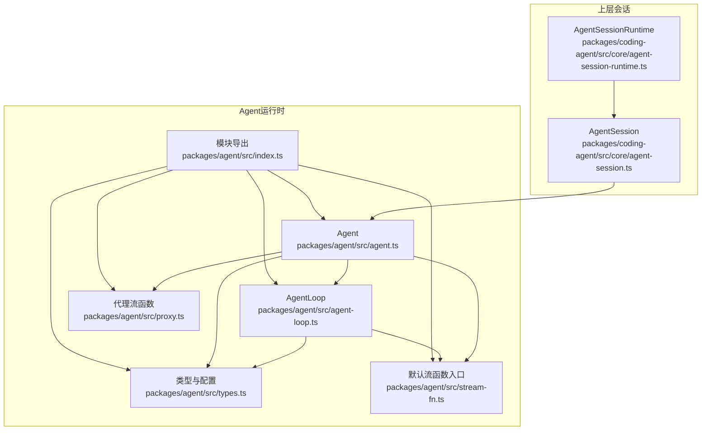
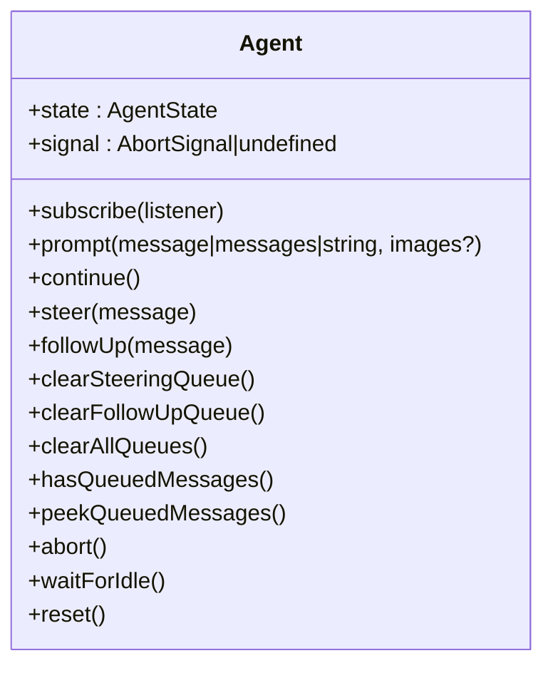
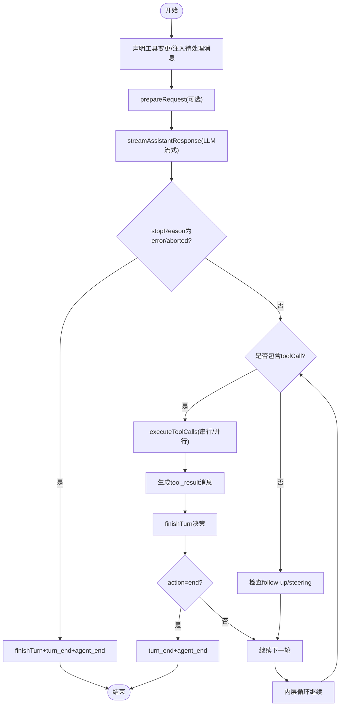
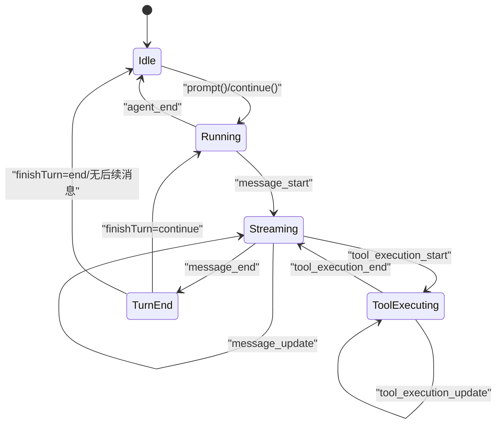
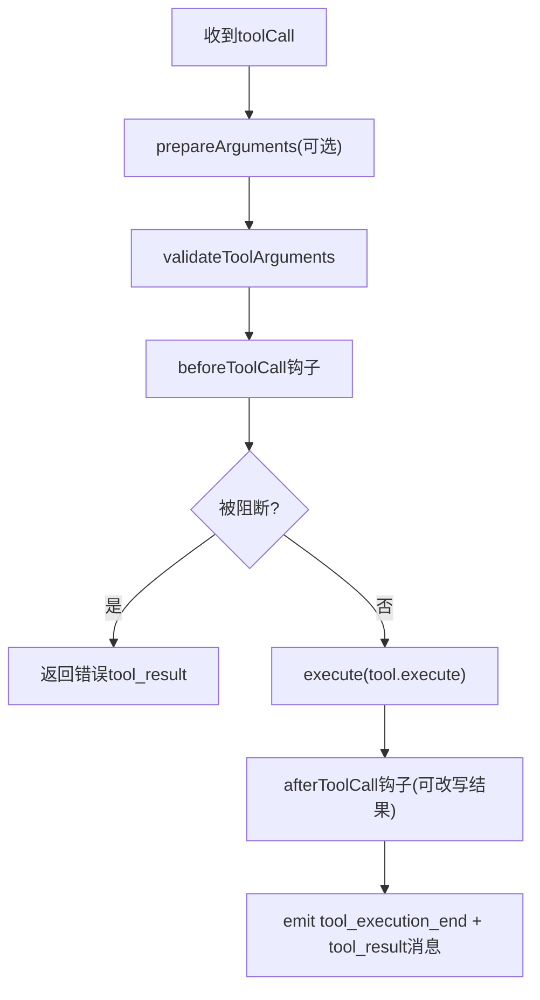
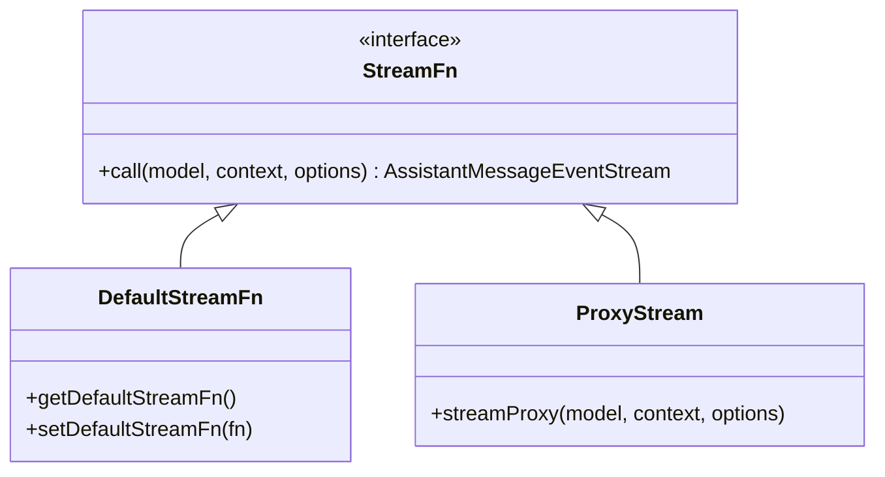
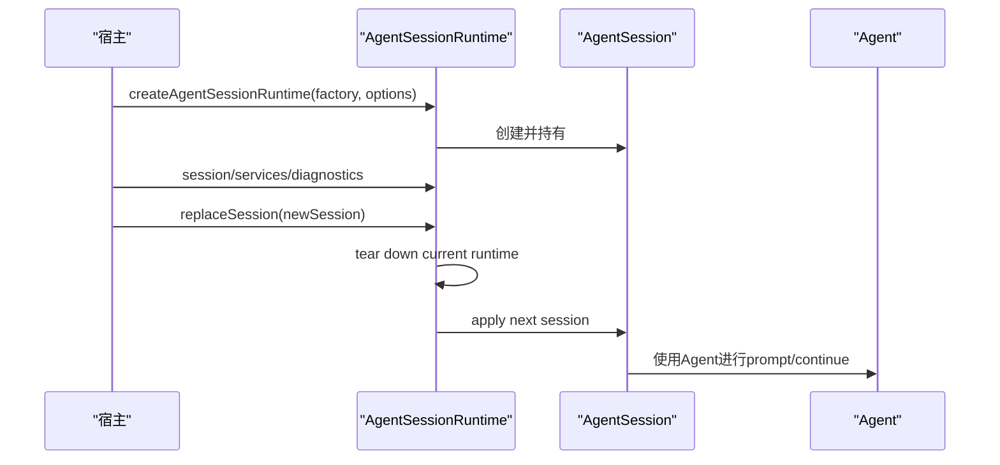
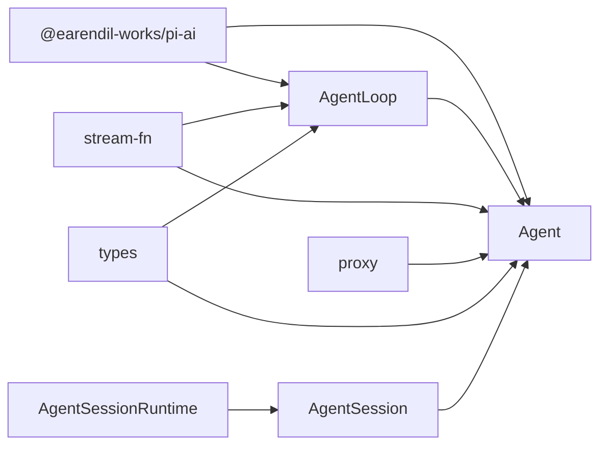

# Agent生命周期管理

<cite>
**本文引用的文件**   
- [packages/agent/src/agent.ts](file://packages/agent/src/agent.ts)
- [packages/agent/src/agent-loop.ts](file://packages/agent/src/agent-loop.ts)
- [packages/agent/src/types.ts](file://packages/agent/src/types.ts)
- [packages/agent/src/stream-fn.ts](file://packages/agent/src/stream-fn.ts)
- [packages/agent/src/proxy.ts](file://packages/agent/src/proxy.ts)
- [packages/agent/src/index.ts](file://packages/agent/src/index.ts)
- [packages/coding-agent/src/core/agent-session.ts](file://packages/coding-agent/src/core/agent-session.ts)
- [packages/coding-agent/src/core/agent-session-runtime.ts](file://packages/coding-agent/src/core/agent-session-runtime.ts)
</cite>

## 目录
1. [引言](#引言)
2. [项目结构](#项目结构)
3. [核心组件](#核心组件)
4. [架构总览](#架构总览)
5. [详细组件分析](#详细组件分析)
6. [依赖关系分析](#依赖关系分析)
7. [性能与资源管理](#性能与资源管理)
8. [故障排查指南](#故障排查指南)
9. [结论](#结论)
10. [附录：API与配置速查](#附录api与配置速查)

## 引言
本文面向Agent生命周期管理，系统阐述Agent的创建、初始化、运行和销毁过程；解释状态转换、事件驱动架构与生命周期钩子机制；说明Agent配置选项、启动参数、工具执行上下文、扩展点集成；给出实例化示例、状态监控方法与错误处理策略；并补充Agent与Session的关系。

## 项目结构
本仓库中Agent运行时位于`packages/agent`，对外暴露统一的Agent类、低层循环、类型定义、流函数默认实现以及代理流函数。上层交互层（如编码Agent）通过`AgentSession`等组件组合Agent，形成完整的会话与生命周期管理。



**图表来源**
- [packages/agent/src/index.ts:1-6](file://packages/agent/src/index.ts#L1-L6)
- [packages/agent/src/agent.ts:194-263](file://packages/agent/src/agent.ts#L194-L263)
- [packages/agent/src/agent-loop.ts:111-160](file://packages/agent/src/agent-loop.ts#L111-L160)
- [packages/agent/src/types.ts:193-342](file://packages/agent/src/types.ts#L193-L342)
- [packages/agent/src/stream-fn.ts:11-20](file://packages/agent/src/stream-fn.ts#L11-L20)
- [packages/agent/src/proxy.ts:108-255](file://packages/agent/src/proxy.ts#L108-L255)
- [packages/coding-agent/src/core/agent-session.ts:1-14](file://packages/coding-agent/src/core/agent-session.ts#L1-L14)
- [packages/coding-agent/src/core/agent-session-runtime.ts:67-95](file://packages/coding-agent/src/core/agent-session-runtime.ts#L67-L95)

**章节来源**
- [packages/agent/src/index.ts:1-6](file://packages/agent/src/index.ts#L1-L6)
- [packages/agent/src/agent.ts:194-263](file://packages/agent/src/agent.ts#L194-L263)
- [packages/agent/src/agent-loop.ts:111-160](file://packages/agent/src/agent-loop.ts#L111-L160)
- [packages/agent/src/types.ts:193-342](file://packages/agent/src/types.ts#L193-L342)
- [packages/agent/src/stream-fn.ts:11-20](file://packages/agent/src/stream-fn.ts#L11-L20)
- [packages/agent/src/proxy.ts:108-255](file://packages/agent/src/proxy.ts#L108-L255)
- [packages/coding-agent/src/core/agent-session.ts:1-14](file://packages/coding-agent/src/core/agent-session.ts#L1-L14)
- [packages/coding-agent/src/core/agent-session-runtime.ts:67-95](file://packages/coding-agent/src/core/agent-session-runtime.ts#L67-L95)

## 核心组件
- Agent：封装对话状态、消息队列、事件订阅、工具调用编排与生命周期控制。
- AgentLoop：低层循环，负责消息准备、LLM流式响应、工具调用执行、轮次结束决策与事件发射。
- StreamFn：模型流式接口抽象，支持默认实现与代理实现。
- ProxyStream：通过服务端代理转发LLM请求，重建部分消息。
- Types：统一的状态、事件、工具、钩子与配置类型。
- AgentSession / AgentSessionRuntime：上层会话抽象，持有Agent实例、服务与诊断信息，提供会话创建、替换与清理能力。

**章节来源**
- [packages/agent/src/agent.ts:194-263](file://packages/agent/src/agent.ts#L194-L263)
- [packages/agent/src/agent-loop.ts:111-160](file://packages/agent/src/agent-loop.ts#L111-L160)
- [packages/agent/src/types.ts:193-342](file://packages/agent/src/types.ts#L193-L342)
- [packages/agent/src/stream-fn.ts:11-20](file://packages/agent/src/stream-fn.ts#L11-L20)
- [packages/agent/src/proxy.ts:108-255](file://packages/agent/src/proxy.ts#L108-L255)
- [packages/coding-agent/src/core/agent-session-runtime.ts:67-95](file://packages/coding-agent/src/core/agent-session-runtime.ts#L67-L95)

## 架构总览
Agent生命周期由“创建→初始化→运行→销毁”四阶段组成，贯穿事件流、工具执行与钩子回调。

```mermaid
sequenceDiagram
participant App as "应用"
participant Agent as "Agent"
participant Loop as "AgentLoop"
participant Stream as "StreamFn"
participant Provider as "LLM提供方"
participant Tools as "工具集合"
App->>Agent : new Agent(options)
Agent->>Agent : 初始化状态/队列/钩子
App->>Agent : prompt()/continue()
Agent->>Loop : runAgentLoop()/runAgentLoopContinue()
Loop->>Loop : 声明工具变更/注入待处理消息
Loop->>Stream : streamAssistantResponse(...)
Stream->>Provider : 发起流式请求
Provider-->>Stream : 文本/思考/工具调用片段
Stream-->>Loop : 事件流
Loop->>Tools : executeToolCalls(...)
Tools-->>Loop : tool_result消息
Loop->>Agent : emit(agent_start/turn_start/message_*/tool_execution_*/turn_end/agent_end)
Agent-->>App : subscribe监听事件
App->>Agent : abort()/waitForIdle()
Agent->>Agent : finishRun()清理状态
```

**图表来源**
- [packages/agent/src/agent.ts:379-467](file://packages/agent/src/agent.ts#L379-L467)
- [packages/agent/src/agent-loop.ts:111-160](file://packages/agent/src/agent-loop.ts#L111-L160)
- [packages/agent/src/agent-loop.ts:390-479](file://packages/agent/src/agent-loop.ts#L390-L479)
- [packages/agent/src/agent-loop.ts:518-670](file://packages/agent/src/agent-loop.ts#L518-L670)
- [packages/agent/src/agent.ts:517-566](file://packages/agent/src/agent.ts#L517-L566)

## 详细组件分析

### Agent类：生命周期与状态机
- 创建与初始化
  - 构造器接收`AgentOptions`，设置初始状态、流函数、钩子、队列模式、传输方式、重试延迟上限、工具执行模式、身份标识等。
  - 内部维护可变状态`MutableAgentState`，包括消息、工具、流式消息、挂起工具调用、错误信息等。
- 运行入口
  - `prompt()`：标准化输入为`AgentMessage[]`，进入`runPromptMessages`，包装生命周期后调用`runAgentLoop`。
  - `continue()`：校验上下文，若上一条是assistant则优先处理steering/followUp队列，否则调用`runContinuation`走`runAgentLoopContinue`。
- 事件与状态更新
  - `processEvents`根据事件类型更新`streamingMessage`、`pendingToolCalls`、`errorMessage`等，并顺序await所有订阅者。
- 生命周期钩子
  - `beforeToolCall`/`afterToolCall`：在工具执行前后拦截，可阻断、改写结果或提示提前终止。
  - `finishTurn`：在轮次结束后决定继续或结束。
  - `prepareRequest`/`prepareNextTurn`：在每次请求前或下一轮开始前调整context/model/thinkingLevel。
- 队列与调度
  - steeringQueue/followUpQueue：支持`all`或`one-at-a-time`两种排空模式。
- 中止与等待
  - `abort()`触发当前运行的AbortSignal；`waitForIdle()`等待当前run及所有awaited listener完成。
- 重置与清理
  - `reset()`清空对话与队列但保留system baseline；`finishRun()`恢复空闲状态并resolve Promise。



**图表来源**
- [packages/agent/src/agent.ts:194-263](file://packages/agent/src/agent.ts#L194-L263)
- [packages/agent/src/agent.ts:275-377](file://packages/agent/src/agent.ts#L275-L377)
- [packages/agent/src/agent.ts:379-467](file://packages/agent/src/agent.ts#L379-L467)
- [packages/agent/src/agent.ts:517-566](file://packages/agent/src/agent.ts#L517-L566)

**章节来源**
- [packages/agent/src/agent.ts:114-147](file://packages/agent/src/agent.ts#L114-L147)
- [packages/agent/src/agent.ts:194-263](file://packages/agent/src/agent.ts#L194-L263)
- [packages/agent/src/agent.ts:275-377](file://packages/agent/src/agent.ts#L275-L377)
- [packages/agent/src/agent.ts:379-467](file://packages/agent/src/agent.ts#L379-L467)
- [packages/agent/src/agent.ts:517-566](file://packages/agent/src/agent.ts#L517-L566)

### AgentLoop：事件驱动主循环
- 入口
  - `runAgentLoop`：追加初始消息，发射`agent_start`/`turn_start`，然后进入`runLoop`。
  - `runAgentLoopContinue`：不追加新消息，直接复用上下文继续。
- 主循环`runLoop`
  - 外层while：当存在follow-up消息时继续新一轮。
  - 内层while：处理工具调用与steering消息，必要时调用`prepareNextTurn`更新上下文。
  - 请求前钩子：`prepareRequest`可动态调整model/thinkingLevel/context。
  - 流式响应：`streamAssistantResponse`将AgentMessage转换为LLM Message，分发start/text/thinking/toolcall/done/error事件。
  - 工具执行：按`toolExecution`模式串行或并行执行，生成tool_result消息。
  - 轮次结束：调用`finishTurn`，根据action决定是否继续或结束。
- 工具调用流程
  - `executeToolCalls`选择串行或并行路径。
  - `prepareToolCall`进行参数预处理、校验、`beforeToolCall`钩子与中断检查。
  - `finalizeExecutedToolCall`与`emitToolExecutionEnd`产出最终结果与事件。
  - 截断保护：输出token限制导致截断时，批量失败工具调用以避免不安全执行。



**图表来源**
- [packages/agent/src/agent-loop.ts:111-160](file://packages/agent/src/agent-loop.ts#L111-L160)
- [packages/agent/src/agent-loop.ts:172-330](file://packages/agent/src/agent-loop.ts#L172-L330)
- [packages/agent/src/agent-loop.ts:390-479](file://packages/agent/src/agent-loop.ts#L390-L479)
- [packages/agent/src/agent-loop.ts:518-670](file://packages/agent/src/agent-loop.ts#L518-L670)
- [packages/agent/src/agent-loop.ts:488-513](file://packages/agent/src/agent-loop.ts#L488-L513)

**章节来源**
- [packages/agent/src/agent-loop.ts:111-160](file://packages/agent/src/agent-loop.ts#L111-L160)
- [packages/agent/src/agent-loop.ts:172-330](file://packages/agent/src/agent-loop.ts#L172-L330)
- [packages/agent/src/agent-loop.ts:390-479](file://packages/agent/src/agent-loop.ts#L390-L479)
- [packages/agent/src/agent-loop.ts:518-670](file://packages/agent/src/agent-loop.ts#L518-L670)
- [packages/agent/src/agent-loop.ts:488-513](file://packages/agent/src/agent-loop.ts#L488-L513)

### 事件与状态转换
- 事件序列
  - agent_start → turn_start → message_start → (message_update)* → message_end → (tool_execution_start → tool_execution_update* → tool_execution_end)* → turn_end → agent_end
- 状态字段
  - isStreaming：是否在运行中
  - streamingMessage：当前流式助手消息
  - pendingToolCalls：正在执行的工具调用ID集合
  - errorMessage：最近一次失败的assistant消息中的错误信息



**图表来源**
- [packages/agent/src/types.ts:528-551](file://packages/agent/src/types.ts#L528-L551)
- [packages/agent/src/agent.ts:575-622](file://packages/agent/src/agent.ts#L575-L622)
- [packages/agent/src/agent-loop.ts:126-134](file://packages/agent/src/agent-loop.ts#L126-L134)
- [packages/agent/src/agent-loop.ts:254-330](file://packages/agent/src/agent-loop.ts#L254-L330)

**章节来源**
- [packages/agent/src/types.ts:528-551](file://packages/agent/src/types.ts#L528-L551)
- [packages/agent/src/agent.ts:575-622](file://packages/agent/src/agent.ts#L575-L622)
- [packages/agent/src/agent-loop.ts:126-134](file://packages/agent/src/agent-loop.ts#L126-L134)
- [packages/agent/src/agent-loop.ts:254-330](file://packages/agent/src/agent-loop.ts#L254-L330)

### 工具执行上下文与钩子
- 工具定义`AgentTool`
  - 含label、prepareArguments、outputSchema、execute、replay、executionMode等。
- 执行模式
  - `sequential`：逐个准备、执行、收尾。
  - `parallel`：先顺序准备，再并发执行允许的工具；tool_execution_end按完成顺序发出，tool_result消息按原assistant顺序发出。
- 钩子
  - beforeToolCall：可block/terminate，传入assistantMessage、toolCall、args、context与AbortSignal。
  - afterToolCall：可覆盖content/details/isError/usage/terminate/structuredContent。
- 参数校验与预处理
  - prepareArguments用于兼容旧参数格式；validateToolArguments确保参数符合schema。



**图表来源**
- [packages/agent/src/types.ts:478-511](file://packages/agent/src/types.ts#L478-L511)
- [packages/agent/src/agent-loop.ts:718-787](file://packages/agent/src/agent-loop.ts#L718-L787)
- [packages/agent/src/agent-loop.ts:540-670](file://packages/agent/src/agent-loop.ts#L540-L670)

**章节来源**
- [packages/agent/src/types.ts:478-511](file://packages/agent/src/types.ts#L478-L511)
- [packages/agent/src/agent-loop.ts:718-787](file://packages/agent/src/agent-loop.ts#L718-L787)
- [packages/agent/src/agent-loop.ts:540-670](file://packages/agent/src/agent-loop.ts#L540-L670)

### 扩展点与流函数
- 默认流函数
  - 通过`setDefaultStreamFn`注册全局默认实现；未设置时抛出明确错误。
- 代理流函数
  - `streamProxy`通过HTTP/SSE与服务端通信，客户端重建partial消息，支持AbortSignal与错误映射。
- 自定义流函数
  - 任何满足`StreamFn`签名的实现均可注入，便于对接不同后端。



**图表来源**
- [packages/agent/src/types.ts:19-37](file://packages/agent/src/types.ts#L19-L37)
- [packages/agent/src/stream-fn.ts:11-20](file://packages/agent/src/stream-fn.ts#L11-L20)
- [packages/agent/src/proxy.ts:108-255](file://packages/agent/src/proxy.ts#L108-L255)

**章节来源**
- [packages/agent/src/types.ts:19-37](file://packages/agent/src/types.ts#L19-L37)
- [packages/agent/src/stream-fn.ts:11-20](file://packages/agent/src/stream-fn.ts#L11-L20)
- [packages/agent/src/proxy.ts:108-255](file://packages/agent/src/proxy.ts#L108-L255)

### Agent与Session的关系
- AgentSession：封装Agent状态访问、事件订阅、模型与thinking级别管理、压缩、Bash执行、会话切换与分支。
- AgentSessionRuntime：拥有当前AgentSession及其cwd绑定服务，负责运行时创建、替换与清理；提供session/services/diagnostics等属性。
- 典型流程：上层通过`createAgentSessionRuntime`创建初始runtime，并在需要时替换session；替换前先tear down当前runtime，再apply下一个。



**图表来源**
- [packages/coding-agent/src/core/agent-session.ts:1-14](file://packages/coding-agent/src/core/agent-session.ts#L1-L14)
- [packages/coding-agent/src/core/agent-session-runtime.ts:67-95](file://packages/coding-agent/src/core/agent-session-runtime.ts#L67-L95)
- [packages/coding-agent/src/core/agent-session-runtime.ts:421-445](file://packages/coding-agent/src/core/agent-session-runtime.ts#L421-L445)

**章节来源**
- [packages/coding-agent/src/core/agent-session.ts:1-14](file://packages/coding-agent/src/core/agent-session.ts#L1-L14)
- [packages/coding-agent/src/core/agent-session-runtime.ts:67-95](file://packages/coding-agent/src/core/agent-session-runtime.ts#L67-L95)
- [packages/coding-agent/src/core/agent-session-runtime.ts:421-445](file://packages/coding-agent/src/core/agent-session-runtime.ts#L421-L445)

## 依赖关系分析
- Agent依赖
  - pi-ai：消息、模型、工具、流事件、工具声明与校验等。
  - agent-loop：低层循环与工具执行逻辑。
  - stream-fn：默认流函数入口。
  - proxy：代理流实现。
  - types：统一类型与配置。
- AgentLoop依赖
  - pi-ai：工具状态差异计算、工具声明、上下文规范化等。
  - stream-fn：默认流函数回退。
  - types：AgentContext/AgentLoopConfig/AgentEvent等。
- 上层会话依赖
  - Agent：通过AgentSession持有并操作Agent。
  - AgentSessionRuntime：管理AgentSession生命周期与cwd绑定服务。



**图表来源**
- [packages/agent/src/agent.ts:1-36](file://packages/agent/src/agent.ts#L1-L36)
- [packages/agent/src/agent-loop.ts:1-34](file://packages/agent/src/agent-loop.ts#L1-L34)
- [packages/agent/src/stream-fn.ts:1-20](file://packages/agent/src/stream-fn.ts#L1-L20)
- [packages/agent/src/proxy.ts:1-17](file://packages/agent/src/proxy.ts#L1-L17)
- [packages/agent/src/types.ts:1-17](file://packages/agent/src/types.ts#L1-L17)
- [packages/coding-agent/src/core/agent-session.ts:1-14](file://packages/coding-agent/src/core/agent-session.ts#L1-L14)
- [packages/coding-agent/src/core/agent-session-runtime.ts:67-95](file://packages/coding-agent/src/core/agent-session-runtime.ts#L67-L95)

**章节来源**
- [packages/agent/src/agent.ts:1-36](file://packages/agent/src/agent.ts#L1-L36)
- [packages/agent/src/agent-loop.ts:1-34](file://packages/agent/src/agent-loop.ts#L1-L34)
- [packages/agent/src/stream-fn.ts:1-20](file://packages/agent/src/stream-fn.ts#L1-L20)
- [packages/agent/src/proxy.ts:1-17](file://packages/agent/src/proxy.ts#L1-L17)
- [packages/agent/src/types.ts:1-17](file://packages/agent/src/types.ts#L1-L17)
- [packages/coding-agent/src/core/agent-session.ts:1-14](file://packages/coding-agent/src/core/agent-session.ts#L1-L14)
- [packages/coding-agent/src/core/agent-session-runtime.ts:67-95](file://packages/coding-agent/src/core/agent-session-runtime.ts#L67-L95)

## 性能与资源管理
- 工具执行模式
  - 并行模式提升吞吐，但需注意工具副作用与顺序语义；串行模式保证严格顺序。
- 上下文变换
  - `transformContext`可用于裁剪历史消息以控制上下文窗口；`convertToLlm`过滤UI-only消息减少无效负载。
- 重试与延迟
  - `maxRetryDelayMs`限制提供方建议的重试延迟，避免长时间阻塞。
- 流式传输
  - 使用`StreamFn`流式消费，降低内存峰值；代理模式下客户端重建partial消息，注意网络异常与EOF处理。
- 资源清理
  - `finishRun`重置isStreaming、streamingMessage、pendingToolCalls并resolve等待Promise；`reset`清空对话与队列但保留baseline。
- 取消与中断
  - 所有关键路径均检查AbortSignal，避免无效工作；工具执行与流式响应均支持中断。

[本节为通用指导，不直接分析具体文件]

## 故障排查指南
- 常见错误与定位
  - “No default stream function configured”：未设置默认流函数且未传入streamFn。
  - “Agent is already processing”：重复prompt/continue或reset时Agent仍在运行。
  - “Cannot continue from message role: assistant”：上下文末尾为assistant时不能continue。
  - “Cannot continue: no messages in context”：上下文为空时无法继续。
  - 工具未找到/参数校验失败：检查工具名称与schema，确认prepareArguments兼容性。
  - 输出截断导致工具调用不安全：loop会批量失败这些工具调用，让模型重新生成完整参数。
- 错误传播
  - 运行失败会在Agent侧构造错误assistant消息，依次发射message_start/end、turn_end、agent_end，供UI与日志记录。
- 调试建议
  - 订阅agent_start/turn_start/message_start/message_update/message_end/tool_execution_start/tool_execution_update/tool_execution_end/turn_end/agent_end全量事件。
  - 使用`peekQueuedMessages`预览即将注入的消息，结合`hasQueuedMessages`判断队列状态。
  - 在beforeToolCall/afterToolCall中记录args/result与durationMs，辅助定位慢工具与失败原因。

**章节来源**
- [packages/agent/src/stream-fn.ts:15-20](file://packages/agent/src/stream-fn.ts#L15-L20)
- [packages/agent/src/agent.ts:382-420](file://packages/agent/src/agent.ts#L382-L420)
- [packages/agent/src/agent-loop.ts:86-109](file://packages/agent/src/agent-loop.ts#L86-L109)
- [packages/agent/src/agent-loop.ts:488-513](file://packages/agent/src/agent-loop.ts#L488-L513)
- [packages/agent/src/agent.ts:542-558](file://packages/agent/src/agent.ts#L542-L558)

## 结论
Agent生命周期围绕Agent与AgentLoop协作展开：Agent负责状态、队列与钩子，AgentLoop负责事件驱动的主循环与工具执行。通过丰富的钩子与配置项，可在请求前、轮次间、工具执行前后灵活定制行为。上层Session与Runtime负责会话级管理与资源清理。借助事件流与状态监控，可实现可靠的UI渲染、日志追踪与错误恢复。

[本节为总结性内容，不直接分析具体文件]

## 附录：API与配置速查
- AgentOptions关键字段
  - initialState：初始systemPrompt/model/thinkingLevel等
  - streamFn：流式函数
  - getApiKey：动态获取API Key
  - beforeToolCall/afterToolCall：工具执行前后钩子
  - finishTurn：轮次结束决策
  - prepareRequest/prepareNextTurn：请求前与下一轮前钩子
  - steeringMode/followUpMode：队列排空模式
  - sessionId：会话标识
  - thinkingBudgets：每级思考token预算
  - transport：传输方式
  - maxRetryDelayMs：最大重试延迟
  - toolExecution：工具执行模式
  - identity：客户端身份标识
- AgentState关键字段
  - systemPrompt/model/thinkingLevel/tools/messages
  - isStreaming/streamingMessage/pendingToolCalls/errorMessage
- AgentEvent关键字段
  - agent_start/agent_end
  - turn_start/turn_end
  - message_start/message_update/message_end
  - tool_execution_start/tool_execution_update/tool_execution_end

**章节来源**
- [packages/agent/src/agent.ts:114-147](file://packages/agent/src/agent.ts#L114-L147)
- [packages/agent/src/types.ts:193-342](file://packages/agent/src/types.ts#L193-L342)
- [packages/agent/src/types.ts:382-421](file://packages/agent/src/types.ts#L382-L421)
- [packages/agent/src/types.ts:528-551](file://packages/agent/src/types.ts#L528-L551)