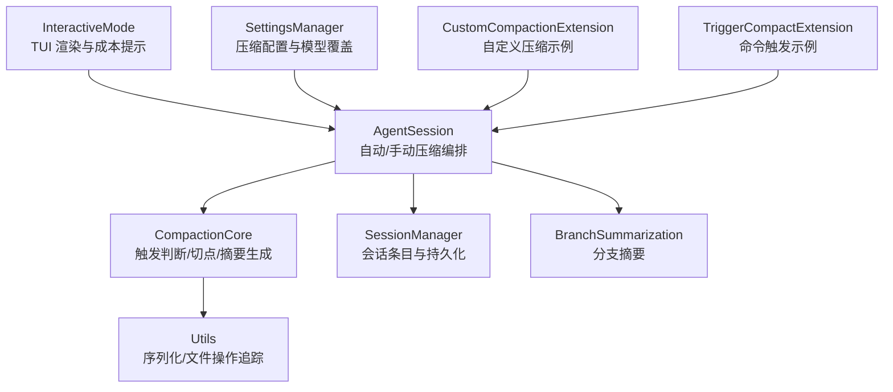
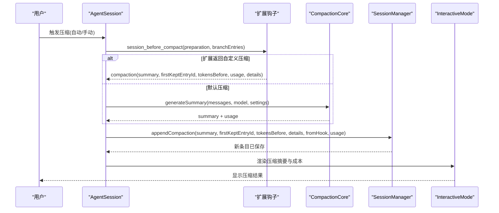
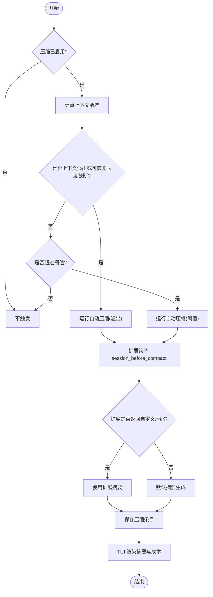
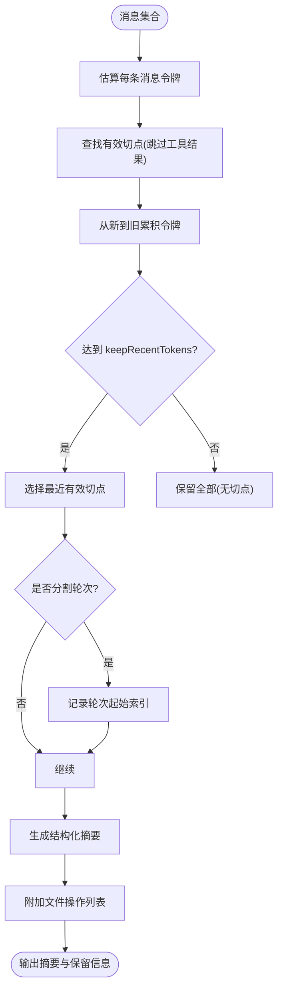
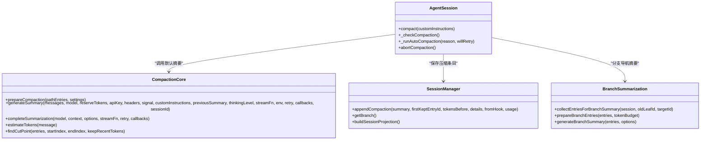
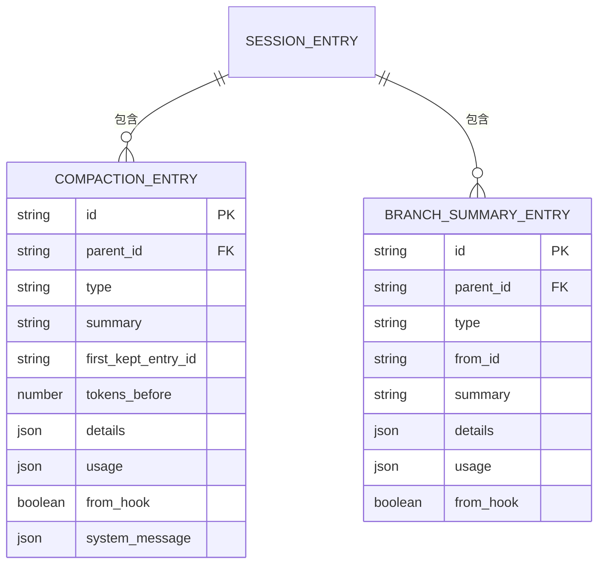
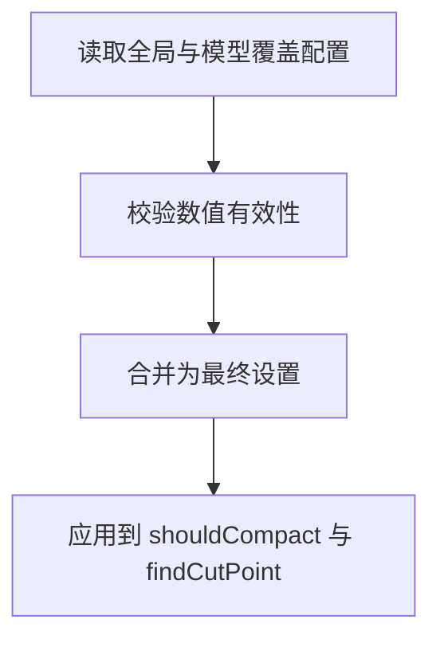
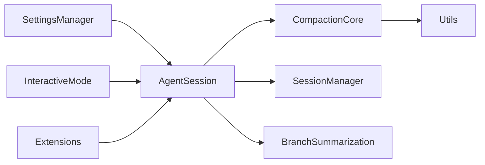
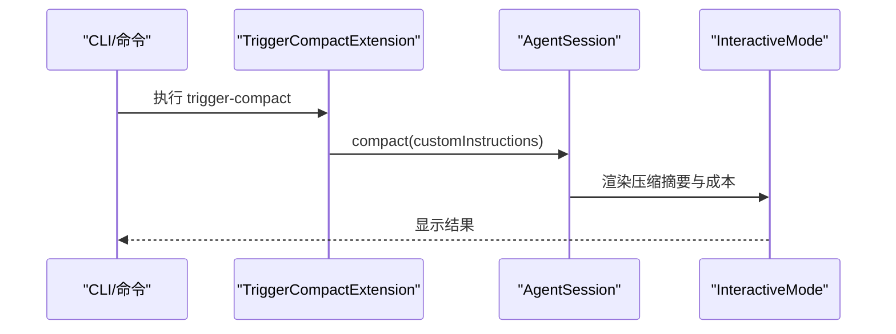

# 上下文压缩

<cite>
**本文引用的文件**   
- [compaction.ts](file://packages/coding-agent/src/core/compaction/compaction.ts)
- [utils.ts](file://packages/coding-agent/src/core/compaction/utils.ts)
- [branch-summarization.ts](file://packages/coding-agent/src/core/compaction/branch-summarization.ts)
- [session-manager.ts](file://packages/coding-agent/src/core/session-manager.ts)
- [agent-session.ts](file://packages/coding-agent/src/core/agent-session.ts)
- [interactive-mode.ts](file://packages/coding-agent/src/modes/interactive/interactive-mode.ts)
- [custom-compaction.ts](file://packages/coding-agent/examples/extensions/custom-compaction.ts)
- [trigger-compact.ts](file://packages/coding-agent/examples/extensions/trigger-compact.ts)
- [settings-manager.ts](file://packages/coding-agent/src/core/settings-manager.ts)
- [session-context-stats.mjs](file://scripts/session-context-stats.mjs)
</cite>

## 目录
1. [引言](#引言)
2. [项目结构](#项目结构)
3. [核心组件](#核心组件)
4. [架构总览](#架构总览)
5. [详细组件分析](#详细组件分析)
6. [依赖关系分析](#依赖关系分析)
7. [性能与内存管理](#性能与内存管理)
8. [监控、手动触发与结果验证](#监控手动触发与结果验证)
9. [对上下文质量的影响与最佳实践](#对上下文质量的影响与最佳实践)
10. [故障排查](#故障排查)
11. [结论](#结论)

## 引言
本文件系统性说明“上下文压缩”功能：包括触发条件、摘要生成算法、保留策略、入口点、摘要消息结构、压缩统计信息、配置选项、性能调优、内存管理、监控示例、手动触发与结果验证，以及压缩对上下文质量的影响和最佳实践。该能力主要用于长会话中控制模型上下文大小，通过结构化摘要替代被丢弃的历史消息，从而在可用上下文窗口内维持工作连续性。

## 项目结构
上下文压缩相关代码集中在 coding-agent 包中，主要涉及以下模块：
- 压缩核心逻辑与摘要生成：`src/core/compaction/compaction.ts`
- 序列化、文件操作追踪与系统提示词：`src/core/compaction/utils.ts`
- 分支导航时的分支摘要：`src/core/compaction/branch-summarization.ts`
- 会话条目类型与持久化：`src/core/session-manager.ts`
- 自动/手动压缩流程编排与事件：`src/core/agent-session.ts`
- TUI 渲染与压缩成本提示：`src/modes/interactive/interactive-mode.ts`
- 扩展示例（自定义压缩、命令触发）：`examples/extensions/custom-compaction.ts`、`examples/extensions/trigger-compact.ts`
- 设置解析与按模型覆盖：`src/core/settings-manager.ts`
- 会话上下文统计脚本：`scripts/session-context-stats.mjs`

**图表来源**
- [agent-session.ts:2900-3350](file://packages/coding-agent/src/core/agent-session.ts#L2900-L3350)
- [compaction.ts:120-130](file://packages/coding-agent/src/core/compaction/compaction.ts#L120-L130)
- [utils.ts:1-165](file://packages/coding-agent/src/core/compaction/utils.ts#L1-L165)
- [branch-summarization.ts:1-399](file://packages/coding-agent/src/core/compaction/branch-summarization.ts#L1-L399)
- [session-manager.ts:91-116](file://packages/coding-agent/src/core/session-manager.ts#L91-L116)
- [interactive-mode.ts:3557-3573](file://packages/coding-agent/src/modes/interactive/interactive-mode.ts#L3557-L3573)
- [settings-manager.ts:846-876](file://packages/coding-agent/src/core/settings-manager.ts#L846-L876)
- [custom-compaction.ts:1-118](file://packages/coding-agent/examples/extensions/custom-compaction.ts#L1-L118)
- [trigger-compact.ts:1-50](file://packages/coding-agent/examples/extensions/trigger-compact.ts#L1-L50)

**章节来源**
- [compaction.ts:1-130](file://packages/coding-agent/src/core/compaction/compaction.ts#L1-L130)
- [utils.ts:1-165](file://packages/coding-agent/src/core/compaction/utils.ts#L1-L165)
- [branch-summarization.ts:1-399](file://packages/coding-agent/src/core/compaction/branch-summarization.ts#L1-L399)
- [session-manager.ts:91-116](file://packages/coding-agent/src/core/session-manager.ts#L91-L116)
- [agent-session.ts:2900-3350](file://packages/coding-agent/src/core/agent-session.ts#L2900-L3350)
- [interactive-mode.ts:3557-3573](file://packages/coding-agent/src/modes/interactive/interactive-mode.ts#L3557-L3573)
- [settings-manager.ts:846-876](file://packages/coding-agent/src/core/settings-manager.ts#L846-L876)
- [custom-compaction.ts:1-118](file://packages/coding-agent/examples/extensions/custom-compaction.ts#L1-L118)
- [trigger-compact.ts:1-50](file://packages/coding-agent/examples/extensions/trigger-compact.ts#L1-L50)

## 核心组件
- 压缩核心（compaction.ts）
  - 提供压缩配置、令牌估算、切点查找、摘要生成、重试封装等。
  - 关键接口：`CompactionSettings`、`CompactionResult`、`estimateTokens`、`findCutPoint`、`generateSummary`、`completeSummarization`。
- 工具与序列化（utils.ts）
  - 文件操作提取与列表计算、对话序列化、系统提示词。
- 分支摘要（branch-summarization.ts）
  - 收集需要摘要的分支条目、预算控制、生成分支摘要并附加文件操作信息。
- 会话管理器（session-manager.ts）
  - 定义 `CompactionEntry`、`BranchSummaryEntry` 等条目类型，负责追加压缩条目与构建会话投影。
- AgentSession（agent-session.ts）
  - 自动/手动压缩流程编排、事件发射、错误处理、与扩展钩子集成。
- 交互模式（interactive-mode.ts）
  - 在 TUI 中渲染压缩摘要、显示压缩成本。
- 设置管理（settings-manager.ts）
  - 解析全局与按模型的压缩配置，校验数值有效性。
- 扩展示例
  - `custom-compaction.ts`：用不同模型进行全量摘要的自定义压缩。
  - `trigger-compact.ts`：基于阈值与命令触发的压缩示例。

**章节来源**
- [compaction.ts:104-130](file://packages/coding-agent/src/core/compaction/compaction.ts#L104-L130)
- [utils.ts:13-88](file://packages/coding-agent/src/core/compaction/utils.ts#L13-L88)
- [branch-summarization.ts:39-97](file://packages/coding-agent/src/core/compaction/branch-summarization.ts#L39-L97)
- [session-manager.ts:91-116](file://packages/coding-agent/src/core/session-manager.ts#L91-L116)
- [agent-session.ts:2900-3350](file://packages/coding-agent/src/core/agent-session.ts#L2900-L3350)
- [interactive-mode.ts:3557-3573](file://packages/coding-agent/src/modes/interactive/interactive-mode.ts#L3557-L3573)
- [settings-manager.ts:846-876](file://packages/coding-agent/src/core/settings-manager.ts#L846-L876)
- [custom-compaction.ts:1-118](file://packages/coding-agent/examples/extensions/custom-compaction.ts#L1-L118)
- [trigger-compact.ts:1-50](file://packages/coding-agent/examples/extensions/trigger-compact.ts#L1-L50)

## 架构总览
上下文压缩由 AgentSession 统一编排，根据自动或手动触发路径进入压缩流程；压缩前通过扩展钩子允许自定义行为；默认实现使用 LLM 生成结构化摘要，并将摘要写入会话作为压缩边界；TUI 会渲染摘要并展示成本统计。

**图表来源**
- [agent-session.ts:2900-3350](file://packages/coding-agent/src/core/agent-session.ts#L2900-L3350)
- [compaction.ts:644-753](file://packages/coding-agent/src/core/compaction/compaction.ts#L644-L753)
- [session-manager.ts:91-116](file://packages/coding-agent/src/core/session-manager.ts#L91-L116)
- [interactive-mode.ts:3557-3573](file://packages/coding-agent/src/modes/interactive/interactive-mode.ts#L3557-L3573)

## 详细组件分析

### 触发条件与入口点
- 自动触发
  - 上下文溢出恢复：当助手消息出现上下文溢出错误或可恢复的长度截断时，尝试压缩并重试一次。
  - 阈值触发：根据当前上下文令牌数与模型上下文窗口比较，超过阈值则触发压缩。
  - 入口函数：`_checkCompaction` 与 `_runAutoCompaction`。
- 手动触发
  - 通过 `AgentSession.compact()` 直接调用，支持传入自定义指令。
  - 入口函数：`compact()`。
- 扩展钩子
  - `session_before_compact`：可在压缩前取消、替换摘要生成逻辑或注入自定义压缩结果。
  - `session_compact`：压缩完成后通知扩展。

**图表来源**
- [agent-session.ts:3081-3215](file://packages/coding-agent/src/core/agent-session.ts#L3081-L3215)
- [agent-session.ts:3227-3350](file://packages/coding-agent/src/core/agent-session.ts#L3227-L3350)
- [agent-session.ts:2900-3043](file://packages/coding-agent/src/core/agent-session.ts#L2900-L3043)

**章节来源**
- [agent-session.ts:3081-3215](file://packages/coding-agent/src/core/agent-session.ts#L3081-L3215)
- [agent-session.ts:3227-3350](file://packages/coding-agent/src/core/agent-session.ts#L3227-L3350)
- [agent-session.ts:2900-3043](file://packages/coding-agent/src/core/agent-session.ts#L2900-L3043)

### 摘要生成算法与保留策略
- 令牌估算
  - `estimateTokens`：按角色与内容块估算令牌数，保守估计（字符数/4）。
  - `estimateContextTokens`：优先使用最后有效助手消息的 usage，否则估算尾部消息。
  - `estimateProjectedContextTokens`：考虑上下文编辑与压缩边界后的投影上下文估算。
- 切点查找
  - `findCutPoint`：从最新向旧方向累积估算令牌，达到 `keepRecentTokens` 后选择最近的有效切点；避免在工具结果处切割，保证工具调用与其结果完整性。
  - 支持“分割轮次”（split turn），即切点在非用户消息处，此时会记录起始用户消息索引。
- 摘要生成
  - `generateSummary` / `generateSummaryWithUsage`：将对话序列化为文本，结合系统提示词与可选的“更新摘要”提示，调用 LLM 生成结构化摘要。
  - `completeSummarization`：统一的摘要调用封装，支持重试、流式调用、缓存禁用与 sessionId 隔离。
- 保留策略
  - `firstKeptEntryId`：标记首次保留的原始条目 ID，用于后续会话重建与上下文投影。
  - `tokensBefore`：压缩前的上下文令牌总数。
  - 文件操作追踪：从工具调用中提取 read/write/edit 文件列表，并在摘要末尾以 XML 标签形式附加，便于后续恢复上下文时参考。

**图表来源**
- [compaction.ts:298-349](file://packages/coding-agent/src/core/compaction/compaction.ts#L298-L349)
- [compaction.ts:446-501](file://packages/coding-agent/src/core/compaction/compaction.ts#L446-L501)
- [compaction.ts:644-753](file://packages/coding-agent/src/core/compaction/compaction.ts#L644-L753)
- [utils.ts:121-156](file://packages/coding-agent/src/core/compaction/utils.ts#L121-L156)

**章节来源**
- [compaction.ts:298-349](file://packages/coding-agent/src/core/compaction/compaction.ts#L298-L349)
- [compaction.ts:446-501](file://packages/coding-agent/src/core/compaction/compaction.ts#L446-L501)
- [compaction.ts:644-753](file://packages/coding-agent/src/core/compaction/compaction.ts#L644-L753)
- [utils.ts:121-156](file://packages/coding-agent/src/core/compaction/utils.ts#L121-L156)

### 压缩入口点与扩展机制
- 手动压缩入口
  - `AgentSession.compact()`：准备压缩、触发扩展钩子、执行默认或自定义摘要、保存压缩条目、发射事件。
- 自动压缩入口
  - `_checkCompaction()`：检测溢出与阈值，决定自动压缩原因与是否重试。
  - `_runAutoCompaction()`：执行自动压缩流程，包含扩展钩子、默认摘要、保存条目与事件。
- 扩展钩子
  - `session_before_compact`：接收 `preparation`（含 `messagesToSummarize`、`turnPrefixMessages`、`tokensBefore`、`firstKeptEntryId`、`isSplitTurn`、`previousSummary`、`fileOps`、`settings`）、`branchEntries`、`signal` 等。
  - 扩展可返回 `compaction` 对象，覆盖默认摘要生成。
- 示例扩展
  - `custom-compaction.ts`：使用 Gemini Flash 模型生成全量摘要，忽略默认保留策略。
  - `trigger-compact.ts`：监听 `turn_end` 并根据阈值触发压缩，同时注册命令 `trigger-compact`。

**图表来源**
- [agent-session.ts:2900-3350](file://packages/coding-agent/src/core/agent-session.ts#L2900-L3350)
- [compaction.ts:859-874](file://packages/coding-agent/src/core/compaction/compaction.ts#L859-L874)
- [compaction.ts:644-753](file://packages/coding-agent/src/core/compaction/compaction.ts#L644-L753)
- [session-manager.ts:91-116](file://packages/coding-agent/src/core/session-manager.ts#L91-L116)
- [branch-summarization.ts:115-153](file://packages/coding-agent/src/core/compaction/branch-summarization.ts#L115-L153)
- [branch-summarization.ts:307-399](file://packages/coding-agent/src/core/compaction/branch-summarization.ts#L307-L399)

**章节来源**
- [agent-session.ts:2900-3350](file://packages/coding-agent/src/core/agent-session.ts#L2900-L3350)
- [compaction.ts:859-874](file://packages/coding-agent/src/core/compaction/compaction.ts#L859-L874)
- [branch-summarization.ts:115-153](file://packages/coding-agent/src/core/compaction/branch-summarization.ts#L115-L153)
- [custom-compaction.ts:1-118](file://packages/coding-agent/examples/extensions/custom-compaction.ts#L1-L118)
- [trigger-compact.ts:1-50](file://packages/coding-agent/examples/extensions/trigger-compact.ts#L1-L50)

### 摘要消息结构与压缩统计信息
- 压缩条目（CompactionEntry）
  - `summary`：结构化摘要文本。
  - `firstKeptEntryId`：首次保留的原始条目 ID。
  - `tokensBefore`：压缩前上下文令牌总数。
  - `usage`：摘要生成的 LLM 用量（输入/输出/缓存等）。
  - `details`：扩展数据（如文件操作索引、版本标记）。
  - `fromHook`：是否由扩展生成。
  - `systemMessage`：压缩边界的完整系统提示与工具状态。
- 分支摘要条目（BranchSummaryEntry）
  - `fromId`：被摘要分支的起点。
  - `summary`：分支摘要。
  - `usage`、`details`、`fromHook` 同压缩条目。
- 压缩统计
  - `estimatedTokensAfter`：压缩后上下文令牌估算。
  - `usage`：摘要生成的用量，供 TUI 显示成本。
  - 脚本统计：`session-context-stats.mjs` 汇总会话上下文使用率、压缩次数与比率。

**图表来源**
- [session-manager.ts:91-116](file://packages/coding-agent/src/core/session-manager.ts#L91-L116)
- [agent-session.ts:3327-3337](file://packages/coding-agent/src/core/agent-session.ts#L3327-L3337)
- [session-context-stats.mjs:290-300](file://scripts/session-context-stats.mjs#L290-L300)

**章节来源**
- [session-manager.ts:91-116](file://packages/coding-agent/src/core/session-manager.ts#L91-L116)
- [agent-session.ts:3327-3337](file://packages/coding-agent/src/core/agent-session.ts#L3327-L3337)
- [session-context-stats.mjs:290-300](file://scripts/session-context-stats.mjs#L290-L300)

### 压缩配置选项与设置解析
- 全局默认配置
  - `DEFAULT_COMPACTION_SETTINGS`：`enabled=true`、`reserveTokens=16384`、`keepRecentTokens=20000`。
- 设置解析
  - `SettingsManager.getCompactionReserveTokens` / `getCompactionKeepRecentTokens`：读取全局与按模型覆盖值，校验为非负安全整数。
  - 支持 `modelOverrides` 针对特定模型调整 `reserveTokens` 与 `keepRecentTokens`。
- 触发判断
  - `shouldCompact(contextTokens, contextWindow, settings)`：当 `contextTokens > contextWindow - reserveTokens` 时触发。

**图表来源**
- [compaction.ts:120-130](file://packages/coding-agent/src/core/compaction/compaction.ts#L120-L130)
- [settings-manager.ts:846-876](file://packages/coding-agent/src/core/settings-manager.ts#L846-L876)
- [compaction.ts:267-270](file://packages/coding-agent/src/core/compaction/compaction.ts#L267-L270)

**章节来源**
- [compaction.ts:120-130](file://packages/coding-agent/src/core/compaction/compaction.ts#L120-L130)
- [settings-manager.ts:846-876](file://packages/coding-agent/src/core/settings-manager.ts#L846-L876)
- [compaction.ts:267-270](file://packages/coding-agent/src/core/compaction/compaction.ts#L267-L270)

## 依赖关系分析
- AgentSession 依赖 SettingsManager 获取压缩配置，依赖 SessionManager 读写会话条目，依赖 CompactionCore 生成摘要。
- CompactionCore 依赖 Utils 进行对话序列化与文件操作追踪。
- BranchSummarization 复用 CompactionCore 的摘要调用与工具方法。
- InteractiveMode 消费 AgentSession 的事件以渲染 UI。
- 扩展示例通过 ExtensionAPI 订阅事件并注册命令。

**图表来源**
- [agent-session.ts:2900-3350](file://packages/coding-agent/src/core/agent-session.ts#L2900-L3350)
- [compaction.ts:1-130](file://packages/coding-agent/src/core/compaction/compaction.ts#L1-L130)
- [utils.ts:1-165](file://packages/coding-agent/src/core/compaction/utils.ts#L1-L165)
- [branch-summarization.ts:1-399](file://packages/coding-agent/src/core/compaction/branch-summarization.ts#L1-L399)
- [session-manager.ts:91-116](file://packages/coding-agent/src/core/session-manager.ts#L91-L116)
- [interactive-mode.ts:3557-3573](file://packages/coding-agent/src/modes/interactive/interactive-mode.ts#L3557-L3573)

**章节来源**
- [agent-session.ts:2900-3350](file://packages/coding-agent/src/core/agent-session.ts#L2900-L3350)
- [compaction.ts:1-130](file://packages/coding-agent/src/core/compaction/compaction.ts#L1-L130)
- [utils.ts:1-165](file://packages/coding-agent/src/core/compaction/utils.ts#L1-L165)
- [branch-summarization.ts:1-399](file://packages/coding-agent/src/core/compaction/branch-summarization.ts#L1-L399)
- [session-manager.ts:91-116](file://packages/coding-agent/src/core/session-manager.ts#L91-L116)
- [interactive-mode.ts:3557-3573](file://packages/coding-agent/src/modes/interactive/interactive-mode.ts#L3557-L3573)

## 性能与内存管理
- 令牌估算开销
  - `estimateTokens` 对每条消息进行轻量扫描，整体复杂度 O(N)，N 为消息数量。
  - 对于大会话，建议合理设置 `keepRecentTokens` 以减少摘要生成输入规模。
- 摘要生成开销
  - `generateSummaryWithUsage` 将对话序列化为文本，可能较大；通过 `serializeConversation` 限制工具结果长度（默认 2000 字符）以降低请求大小。
  - `completeSummarization` 禁用缓存写入并使用独立 sessionId，避免污染会话缓存。
- 重试与中断
  - `retryAssistantCall` 封装重试策略，避免瞬时网络问题导致压缩失败。
  - AbortController 支持手动/自动压缩的中断。
- 内存管理
  - 压缩后仅保留摘要与 `firstKeptEntryId`，历史消息不再参与上下文投影，显著降低内存占用。
  - 文件操作列表仅在摘要末尾附加，避免额外数据结构膨胀。

[本节为通用指导，不直接分析具体文件]

## 监控、手动触发与结果验证
- 监控示例
  - TUI 渲染压缩摘要与成本：`interactive-mode.ts` 在压缩完成后添加压缩摘要消息与成本提示。
  - 统计脚本：`session-context-stats.mjs` 汇总会话上下文使用率、压缩次数与比率。
- 手动触发
  - 命令触发：`trigger-compact.ts` 注册命令 `trigger-compact`，监听 `turn_end` 并根据阈值触发压缩。
  - 自定义压缩：`custom-compaction.ts` 在 `session_before_compact` 中返回自定义摘要，使用不同模型。
- 结果验证
  - 检查 `CompactionEntry.summary` 是否为空或包含工具调用（应抛出错误）。
  - 检查 `usage` 是否存在且合理（输入/输出/缓存）。
  - 检查 `firstKeptEntryId` 是否在会话中存在，确保上下文重建正确。
  - 检查 `estimatedTokensAfter` 是否低于预期阈值。

**图表来源**
- [trigger-compact.ts:1-50](file://packages/coding-agent/examples/extensions/trigger-compact.ts#L1-L50)
- [interactive-mode.ts:3557-3573](file://packages/coding-agent/src/modes/interactive/interactive-mode.ts#L3557-L3573)
- [agent-session.ts:2900-3043](file://packages/coding-agent/src/core/agent-session.ts#L2900-L3043)

**章节来源**
- [interactive-mode.ts:3557-3573](file://packages/coding-agent/src/modes/interactive/interactive-mode.ts#L3557-L3573)
- [session-context-stats.mjs:290-300](file://scripts/session-context-stats.mjs#L290-L300)
- [trigger-compact.ts:1-50](file://packages/coding-agent/examples/extensions/trigger-compact.ts#L1-L50)
- [custom-compaction.ts:1-118](file://packages/coding-agent/examples/extensions/custom-compaction.ts#L1-L118)

## 对上下文质量的影响与最佳实践
- 影响
  - 结构化摘要保留目标、约束、进度、决策与下一步，有助于后续模型理解上下文。
  - 文件操作列表辅助恢复上下文时定位相关文件。
  - 若摘要不完整或被截断（length stop），可能导致上下文丢失。
- 最佳实践
  - 合理设置 `reserveTokens` 与 `keepRecentTokens`，平衡上下文保留与摘要成本。
  - 使用扩展钩子选择更便宜/更快的模型进行摘要生成。
  - 避免在工具结果密集的场景频繁压缩，优先在轮次边界切分。
  - 监控 `usage` 与 `estimatedTokensAfter`，确保压缩效果符合预期。
  - 在长会话中定期查看上下文使用率，必要时调整阈值。

[本节为通用指导，不直接分析具体文件]

## 故障排查
- 常见问题
  - 摘要为空：检查 `getSummarizationFailure` 返回的错误信息，确认未触发 length stop 或 error。
  - 摘要包含工具调用：应抛出错误，检查模型响应是否符合预期。
  - 压缩失败：检查 `compaction_end` 事件的 `errorMessage` 与 `aborted` 标志。
  - 无法压缩：检查 `prepareCompaction` 返回值，确认会话大小与压缩边界。
- 调试步骤
  - 启用扩展钩子日志，观察 `session_before_compact` 的 `preparation` 与 `branchEntries`。
  - 检查 `estimateTokens` 与 `findCutPoint` 的结果，确认切点选择合理。
  - 查看 `CompactionEntry.details` 中的文件操作列表，确认文件追踪正确。

**章节来源**
- [compaction.ts:585-593](file://packages/coding-agent/src/core/compaction/compaction.ts#L585-L593)
- [compaction.ts:742-753](file://packages/coding-agent/src/core/compaction/compaction.ts#L742-L753)
- [agent-session.ts:3019-3043](file://packages/coding-agent/src/core/agent-session.ts#L3019-L3043)
- [agent-session.ts:3342-3350](file://packages/coding-agent/src/core/agent-session.ts#L3342-L3350)

## 结论
上下文压缩通过结构化摘要与文件操作追踪，在长会话中有效管理模型上下文大小。其触发条件涵盖溢出恢复与阈值触发，入口点统一由 AgentSession 编排，并通过扩展钩子支持自定义行为。合理配置 `reserveTokens` 与 `keepRecentTokens`，结合监控与手动触发，可显著提升长会话的稳定性和效率。最佳实践强调摘要质量、文件操作追踪与性能权衡，确保上下文质量不受显著影响。