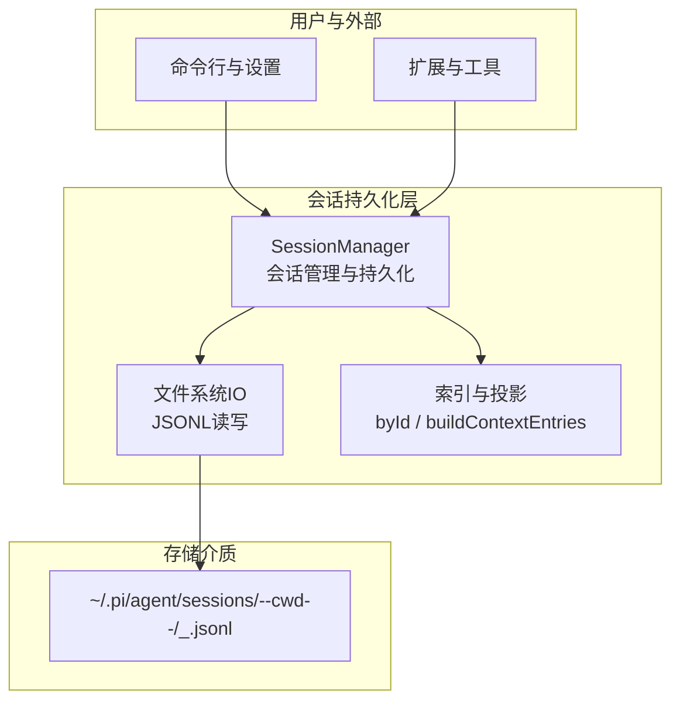
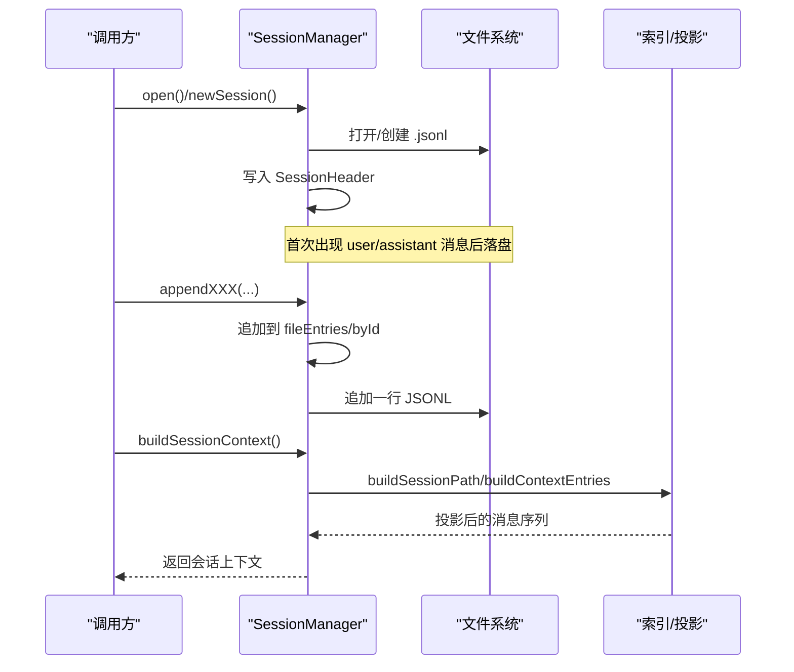
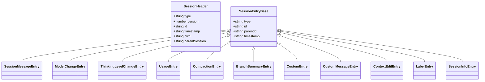
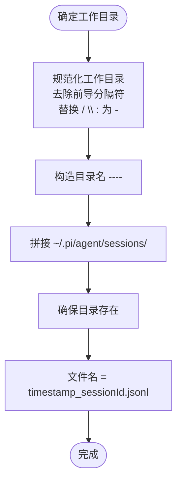
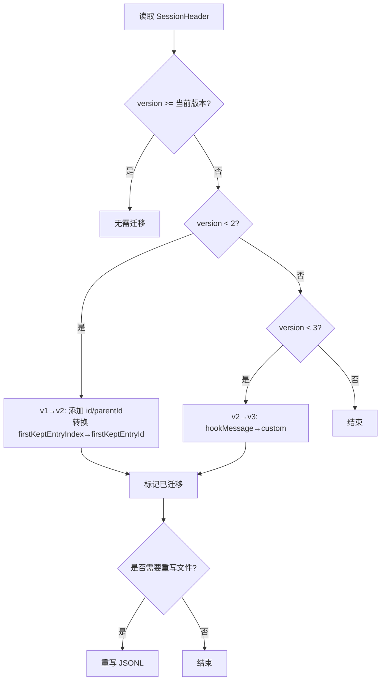
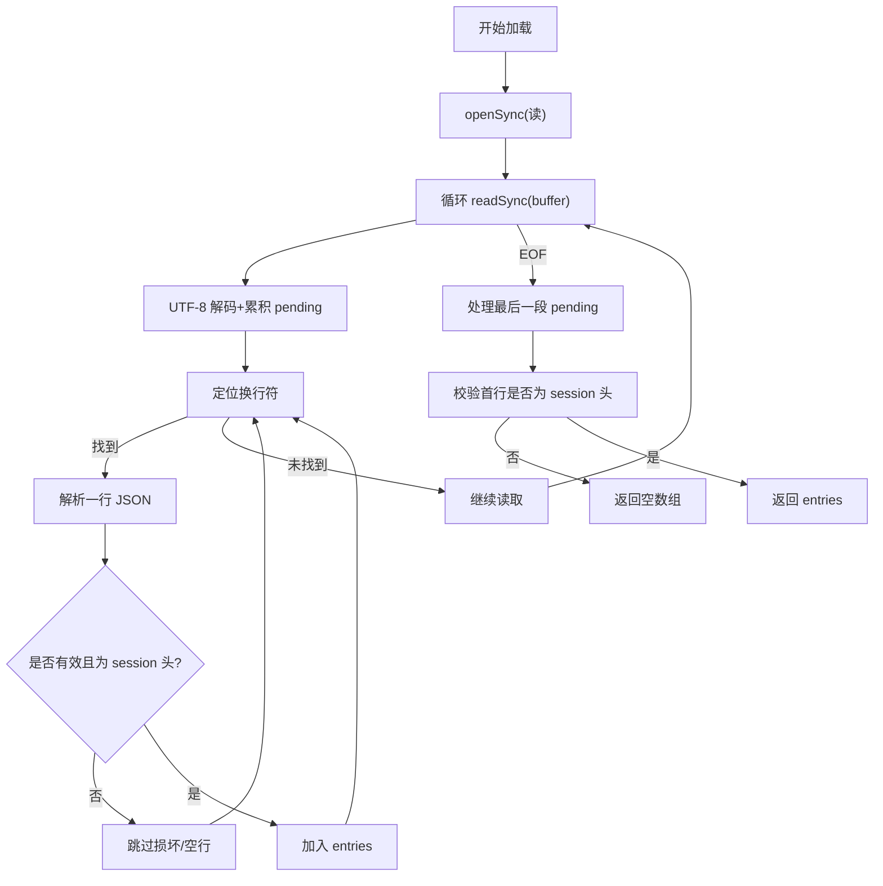
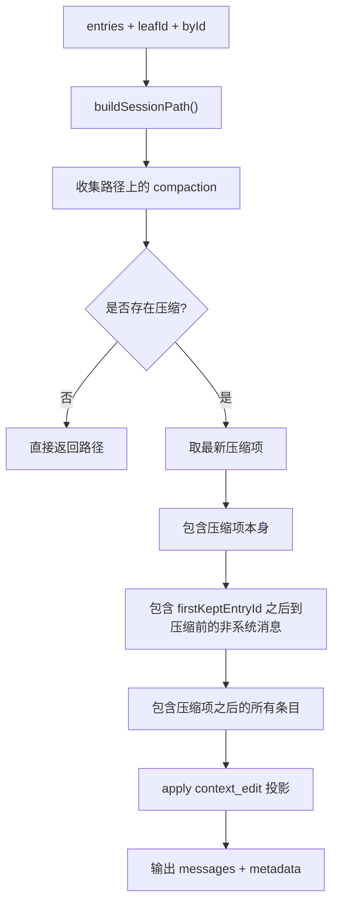
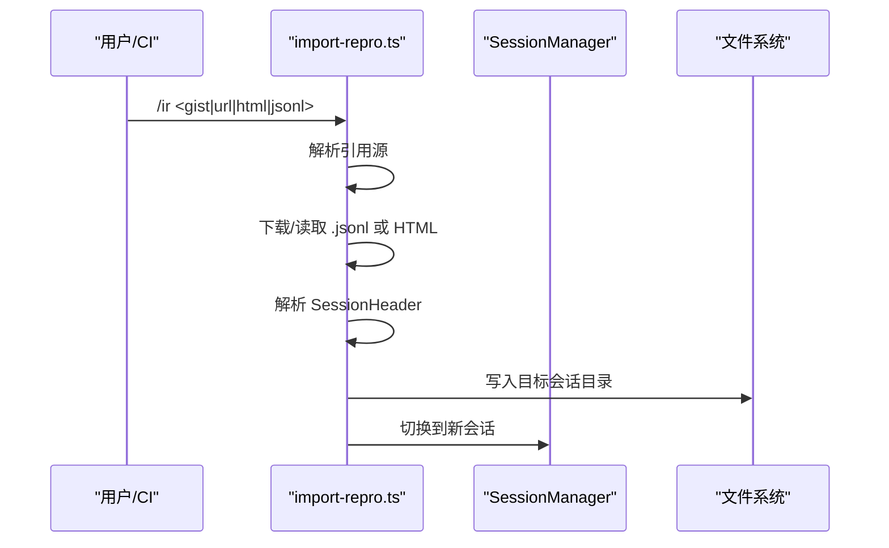
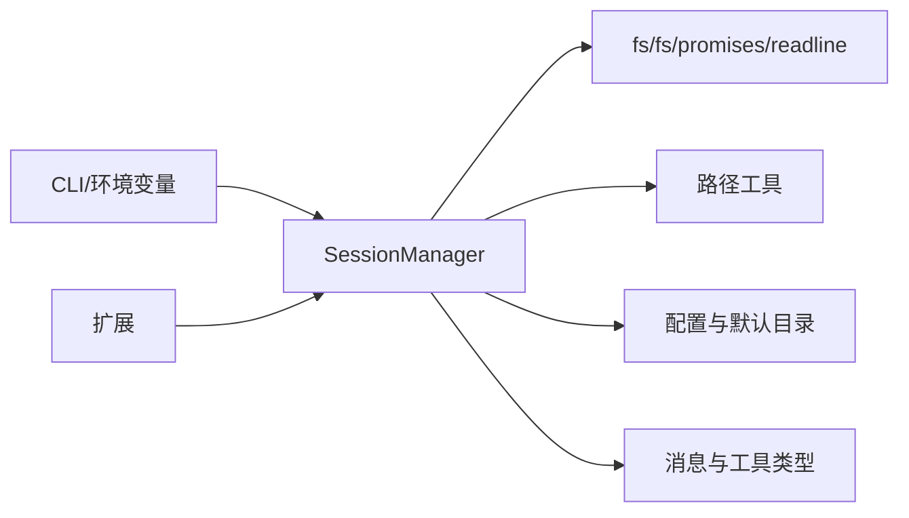
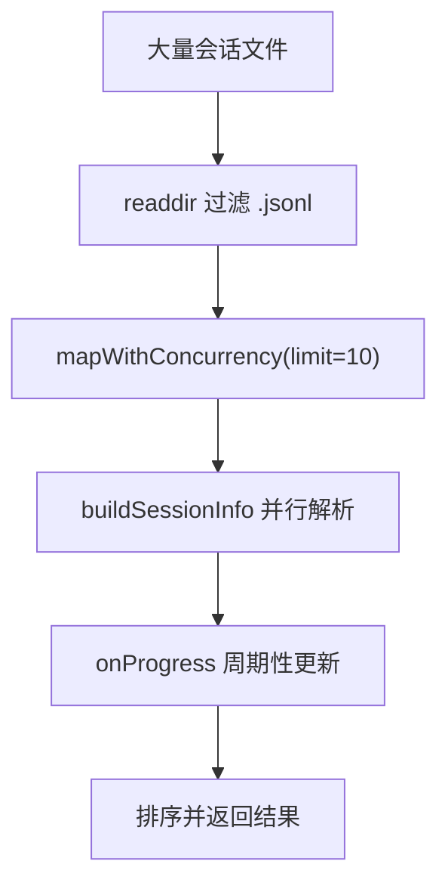

# 会话持久化存储

<cite>
**本文引用的文件**
- [session-manager.ts](file://packages/coding-agent/src/core/session-manager.ts)
- [session-format.md](file://packages/coding-agent/docs/session-format.md)
- [main.ts](file://packages/coding-agent/src/main.ts)
- [import-repro.ts](file://.pi/extensions/import-repro.ts)
- [cli.md](file://packages/coding-agent/docs/cli.md)
- [environment-variables.md](file://packages/coding-agent/docs/environment-variables.md)
- [configuration.md](file://packages/coding-agent/docs/configuration.md)
- [settings.schema.json](file://packages/coding-agent/schemas/settings.schema.json)
- [args.ts](file://packages/coding-agent/src/cli/args.ts)
- [compaction.md](file://packages/coding-agent/docs/compaction.md)
</cite>

## 目录
1. [引言](#引言)
2. [项目结构](#项目结构)
3. [核心组件](#核心组件)
4. [架构总览](#架构总览)
5. [详细组件分析](#详细组件分析)
6. [依赖关系分析](#依赖关系分析)
7. [性能与大数据处理](#性能与大数据处理)
8. [故障排查](#故障排查)
9. [结论](#结论)
10. [附录：导入导出与备份恢复](#附录导入导出与备份恢复)

## 引言
本文件面向“会话持久化存储”的完整技术文档，聚焦以下目标：
- 解释会话数据的文件格式（JSONL）、存储结构设计、版本迁移机制。
- 详细说明会话文件的读写流程、缓冲区管理、错误处理策略。
- 说明会话目录结构、文件命名规则与路径解析逻辑。
- 提供会话导入导出、数据备份恢复与性能优化建议。
- 覆盖会话头信息、条目索引构建、上下文投影与大数据量处理方案。

该实现以追加写入的 JSONL 文件作为持久化载体，使用 `id`/`parentId` 维护树形会话结构，并通过压缩摘要、分支摘要、上下文编辑等扩展能力支持大规模对话历史的高效重建与展示。

## 项目结构
会话持久化相关代码主要位于编码代理包中，关键位置如下：
- 会话格式规范与类型定义：`packages/coding-agent/docs/session-format.md`
- 会话管理器与持久化实现：`packages/coding-agent/src/core/session-manager.ts`
- 会话选择与路径解析入口：`packages/coding-agent/src/main.ts`
- 会话导入工具（扩展）：`.pi/extensions/import-repro.ts`
- CLI 与环境变量配置：`packages/coding-agent/docs/cli.md`、`packages/coding-agent/docs/environment-variables.md`、`packages/coding-agent/src/cli/args.ts`
- 会话目录与默认路径：`packages/coding-agent/docs/configuration.md`、`packages/coding-agent/schemas/settings.schema.json`
- 压缩策略参考：`packages/coding-agent/docs/compaction.md`

**图表来源**
- [session-manager.ts:41-50](file://packages/coding-agent/src/core/session-manager.ts#L41-L50)
- [session-manager.ts:590-603](file://packages/coding-agent/src/core/session-manager.ts#L590-L603)
- [session-manager.ts:988-1084](file://packages/coding-agent/src/core/session-manager.ts#L988-L1084)
- [session-format.md:8-14](file://packages/coding-agent/docs/session-format.md#L8-L14)

**章节来源**
- [session-manager.ts:41-50](file://packages/coding-agent/src/core/session-manager.ts#L41-L50)
- [session-format.md:8-14](file://packages/coding-agent/docs/session-format.md#L8-L14)

## 核心组件
- SessionHeader：会话头，包含版本、会话 ID、时间戳、工作目录以及可选父会话路径。
- FileEntry/SessionEntry：JSONL 行对象，包括消息、模型变更、思考级别变更、用量、压缩、分支摘要、自定义条目、上下文编辑、标签与会话信息等。
- SessionManager：会话生命周期、树结构、索引、上下文投影、持久化与批量列表的核心类。
- 路径与目录：默认会话目录基于工作目录生成，文件名由时间戳与会话 ID 组成。
- 流式读取与缓冲：按固定大小缓冲逐行解析，避免一次性加载大文件。
- 版本迁移：v1→v2（引入 id/parentId），v2→v3（hookMessage→custom）。

**章节来源**
- [session-manager.ts:41-50](file://packages/coding-agent/src/core/session-manager.ts#L41-L50)
- [session-manager.ts:57-197](file://packages/coding-agent/src/core/session-manager.ts#L57-L197)
- [session-manager.ts:286-347](file://packages/coding-agent/src/core/session-manager.ts#L286-L347)
- [session-manager.ts:988-1084](file://packages/coding-agent/src/core/session-manager.ts#L988-L1084)

## 架构总览
会话持久化的整体流程如下：
- 创建会话：生成 SessionHeader，按需写入首个 `.jsonl` 文件；首次出现用户或助手消息时才真正落盘。
- 追加条目：所有操作通过 appendXXX 方法追加到内存数组并同步追加写入文件末尾。
- 读取会话：优先快速扫描头部获取元数据；全量加载时采用缓冲逐行解析，跳过损坏行。
- 索引与投影：构建 byId 索引，计算当前分支路径，应用压缩与上下文编辑，生成 LLM 上下文。
- 会话发现：列出目录下 `.jsonl` 文件，并行解析会话信息并按修改时间排序。

**图表来源**
- [session-manager.ts:1058-1084](file://packages/coding-agent/src/core/session-manager.ts#L1058-L1084)
- [session-manager.ts:1173-1207](file://packages/coding-agent/src/core/session-manager.ts#L1173-L1207)
- [session-manager.ts:1496-1511](file://packages/coding-agent/src/core/session-manager.ts#L1496-L1511)

## 详细组件分析

### 文件格式与存储结构
- 文件格式：JSONL，每行一个 JSON 对象，首行为 SessionHeader。
- 树结构：除 SessionHeader 外，每个条目具备 `id` 与 `parentId`，形成树；叶子节点表示当前位置。
- 条目类型：
  - message：对话消息，系统消息携带 prompt 与工具声明增量补丁。
  - model_change/thinking_level_change：模型与思考级别变更。
  - usage：非上下文中的用量记录。
  - compaction：压缩摘要，保留 systemMessage 快照与 firstKeptEntryId。
  - branch_summary：分支摘要，记录被放弃分支的上下文。
  - custom/custom_message：扩展状态与可参与上下文的扩展消息。
  - context_edit：对早期上下文贡献的追加式编辑。
  - label/session_info：书签与会话显示名。

**图表来源**
- [session-manager.ts:41-50](file://packages/coding-agent/src/core/session-manager.ts#L41-L50)
- [session-manager.ts:57-197](file://packages/coding-agent/src/core/session-manager.ts#L57-L197)
- [session-format.md:49-207](file://packages/coding-agent/docs/session-format.md#L49-L207)

**章节来源**
- [session-format.md:1-40](file://packages/coding-agent/docs/session-format.md#L1-L40)
- [session-format.md:49-207](file://packages/coding-agent/docs/session-format.md#L49-L207)
- [session-manager.ts:57-197](file://packages/coding-agent/src/core/session-manager.ts#L57-L197)

### 会话目录结构与文件命名
- 默认目录：`~/.pi/agent/sessions/--<path>--`，其中 `<path>` 为规范化后的工作目录，去除前导分隔符并将 `/`、`\`、`:` 替换为 `-`。
- 文件名：`<timestamp>_<session-id>.jsonl`，时间戳来自会话创建时间，ID 可为 UUID 或自定义 ID。
- 会话发现：仅扫描 `.jsonl` 后缀文件，按 mtime 倒序查找最近会话。

**图表来源**
- [session-manager.ts:590-603](file://packages/coding-agent/src/core/session-manager.ts#L590-L603)
- [session-manager.ts:1058-1084](file://packages/coding-agent/src/core/session-manager.ts#L1058-L1084)
- [session-format.md:8-14](file://packages/coding-agent/docs/session-format.md#L8-L14)

**章节来源**
- [session-manager.ts:590-603](file://packages/coding-agent/src/core/session-manager.ts#L590-L603)
- [session-manager.ts:1058-1084](file://packages/coding-agent/src/core/session-manager.ts#L1058-L1084)
- [session-format.md:8-14](file://packages/coding-agent/docs/session-format.md#L8-L14)

### 会话头信息与版本迁移
- 会话头字段：type、version、id、timestamp、cwd、parentSession。
- 版本演进：
  - v1：线性序列（旧版，加载时自动迁移）。
  - v2：引入 id/parentId 树结构，并将压缩的 firstKeptEntryIndex 转换为 firstKeptEntryId。
  - v3：将 hookMessage role 重命名为 custom，统一扩展角色。
- 迁移策略：加载时检测 header.version，依次执行迁移函数，并在需要时重写文件。

**图表来源**
- [session-manager.ts:286-347](file://packages/coding-agent/src/core/session-manager.ts#L286-L347)
- [session-format.md:22-30](file://packages/coding-agent/docs/session-format.md#L22-L30)

**章节来源**
- [session-manager.ts:286-347](file://packages/coding-agent/src/core/session-manager.ts#L286-L347)
- [session-format.md:22-30](file://packages/coding-agent/docs/session-format.md#L22-L30)

### 会话文件读写与缓冲区管理
- 全量加载：
  - 使用固定大小缓冲（默认约 1MB）循环 readSync，解码 UTF-8，按行解析 JSON。
  - 跳过空行与损坏行，最终校验首行是否为有效 SessionHeader。
  - 若尾部存在未换行的内容，会补写换行以确保文件完整性。
- 头部快速扫描：
  - 限制最大扫描字节数（默认约 1MB），用于快速发现会话头，避免大文件开销。
  - 超出限制抛出专用异常，调用方可回退到全量加载。
- 写入策略：
  - 仅在出现用户或助手消息后才创建物理文件，减少无意义写入。
  - 首次落盘时顺序写出全部条目；后续追加使用 appendFileSync。
  - 迁移或重写时使用写模式覆盖整个文件。

**图表来源**
- [session-manager.ts:605-671](file://packages/coding-agent/src/core/session-manager.ts#L605-L671)
- [session-manager.ts:686-728](file://packages/coding-agent/src/core/session-manager.ts#L686-L728)
- [session-manager.ts:1173-1207](file://packages/coding-agent/src/core/session-manager.ts#L1173-L1207)

**章节来源**
- [session-manager.ts:605-671](file://packages/coding-agent/src/core/session-manager.ts#L605-L671)
- [session-manager.ts:686-728](file://packages/coding-agent/src/core/session-manager.ts#L686-L728)
- [session-manager.ts:1173-1207](file://packages/coding-agent/src/core/session-manager.ts#L1173-L1207)

### 索引构建与上下文投影
- 索引构建：
  - byId：条目 ID 到条目的映射，O(n) 构建，O(1) 查询。
  - labelsById/labelTimestampsById：标签与最新标签时间戳。
  - leafId：当前叶子节点 ID。
- 路径构建：
  - 从 leafId 沿 parentId 回溯至根，得到分支路径。
- 上下文构建：
  - buildContextEntries：考虑压缩条目，保留 firstKeptEntryId 之后的条目与压缩后条目之后的条目。
  - buildSessionProjection：应用最新的 context_edit，生成模型可见的消息序列及来源条目。
  - buildSessionContext：提取 thinkingLevel 与 model 设置，输出最终消息列表。

**图表来源**
- [session-manager.ts:381-416](file://packages/coding-agent/src/core/session-manager.ts#L381-L416)
- [session-manager.ts:476-512](file://packages/coding-agent/src/core/session-manager.ts#L476-L512)
- [session-manager.ts:544-584](file://packages/coding-agent/src/core/session-manager.ts#L544-L584)

**章节来源**
- [session-manager.ts:381-416](file://packages/coding-agent/src/core/session-manager.ts#L381-L416)
- [session-manager.ts:476-512](file://packages/coding-agent/src/core/session-manager.ts#L476-L512)
- [session-manager.ts:544-584](file://packages/coding-agent/src/core/session-manager.ts#L544-L584)

### 会话导入导出与路径解析
- 导入：
  - 扩展支持从 gist、分享链接、issue URL、HTML 或远程 .jsonl 导入会话，解析出 SessionHeader 与 JSONL 文本，必要时重写工作目录后保存到当前会话目录。
- 导出：
  - 工作流中可将会话导出为 HTML 与 .jsonl，便于归档与复现。
- 路径解析：
  - 若参数像路径或 .jsonl 文件，则直接解析绝对路径。
  - 否则尝试精确匹配本地会话 ID，再尝试前缀匹配，最后在全局会话列表中搜索。

**图表来源**
- [import-repro.ts:77-127](file://.pi/extensions/import-repro.ts#L77-L127)
- [import-repro.ts:273-332](file://.pi/extensions/import-repro.ts#L273-L332)
- [main.ts:299-330](file://packages/coding-agent/src/main.ts#L299-L330)

**章节来源**
- [import-repro.ts:77-127](file://.pi/extensions/import-repro.ts#L77-L127)
- [import-repro.ts:273-332](file://.pi/extensions/import-repro.ts#L273-L332)
- [main.ts:299-330](file://packages/coding-agent/src/main.ts#L299-L330)

## 依赖关系分析
- SessionManager 依赖：
  - 文件系统 API：fs、fs/promises、readline、string_decoder。
  - 路径工具：normalizePath、pathsEqual、resolvePath。
  - 配置与默认目录：getAgentDir、getSessionsDir。
  - 消息与工具：AgentMessage、SystemMessage、getCurrentSystemMessage。
- 外部集成点：
  - CLI 参数与环境变量控制会话目录与行为。
  - 扩展通过 SessionManager API 注入自定义条目与上下文消息。

**图表来源**
- [session-manager.ts:1-33](file://packages/coding-agent/src/core/session-manager.ts#L1-L33)
- [args.ts:313-463](file://packages/coding-agent/src/cli/args.ts#L313-L463)
- [environment-variables.md:82-82](file://packages/coding-agent/docs/environment-variables.md#L82-L82)

**章节来源**
- [session-manager.ts:1-33](file://packages/coding-agent/src/core/session-manager.ts#L1-L33)
- [args.ts:313-463](file://packages/coding-agent/src/cli/args.ts#L313-L463)
- [environment-variables.md:82-82](file://packages/coding-agent/docs/environment-variables.md#L82-L82)

## 性能与大数据处理
- 流式读取与大文件：
  - 使用固定大小缓冲（约 1MB）逐块读取，避免一次性加载大文件。
  - 头部快速扫描限制在约 1MB，防止超大头导致阻塞。
- 并发列表会话：
  - 会话列表构建支持并发（默认最多 10 个），并周期性发布部分结果以提升 UI 响应。
- 压缩与上下文裁剪：
  - 压缩条目保留最近 token 阈值（可通过设置调整），减少上下文体积。
- 写入优化：
  - 仅在出现真实对话后才创建文件，避免无意义写入。
  - 首次落盘顺序写出，后续追加最小化 IO。

**图表来源**
- [session-manager.ts:892-975](file://packages/coding-agent/src/core/session-manager.ts#L892-L975)
- [compaction.md:45-45](file://packages/coding-agent/docs/compaction.md#L45-L45)

**章节来源**
- [session-manager.ts:892-975](file://packages/coding-agent/src/core/session-manager.ts#L892-L975)
- [compaction.md:45-45](file://packages/coding-agent/docs/compaction.md#L45-L45)

## 故障排查
- 无效会话文件：
  - 如果文件非空但无法解析为有效 pi 会话，会抛出明确错误，不修改原文件。
- 头部扫描超限：
  - 当头部超过扫描限制时抛出 SessionHeaderScanLimitError，调用方可回退到全量加载。
- 损坏行处理：
  - 解析失败行会被跳过，不影响其他行；最终仍需校验首行是否为有效 session 头。
- 显式路径保留：
  - 恢复损坏文件时，显式传入的会话文件路径会被保留，便于调试与审计。

**章节来源**
- [session-manager.ts:1030-1056](file://packages/coding-agent/src/core/session-manager.ts#L1030-L1056)
- [session-manager.ts:610-615](file://packages/coding-agent/src/core/session-manager.ts#L610-L615)
- [session-manager.ts:617-671](file://packages/coding-agent/src/core/session-manager.ts#L617-L671)
- [session-manager.ts:1777-1797](file://packages/coding-agent/src/core/session-manager.ts#L1777-L1797)

## 结论
会话持久化以 JSONL 为稳定载体，结合树形结构与多种扩展条目类型，既保证了可追溯性与可扩展性，又通过压缩与上下文编辑实现了高效的大规模对话重建。读写流程采用流式缓冲与头部快速扫描，兼顾性能与健壮性；版本迁移机制确保向后兼容。配合 CLI、环境变量与扩展生态，提供了完整的会话导入导出、备份恢复与性能优化能力。

## 附录：导入导出与备份恢复
- 导入：
  - 支持 gist、分享链接、issue URL、HTML 或远程 .jsonl 导入，解析后保存至当前会话目录并切换会话。
- 导出：
  - CI 工作流可将会话导出为 HTML 与 .jsonl，便于归档与复现。
- 备份与恢复：
  - 直接复制或删除 `~/.pi/agent/sessions/` 下的 `.jsonl` 文件即可备份与清理会话。
  - 交互式删除可使用 trash 命令以避免永久删除。

**章节来源**
- [import-repro.ts:77-127](file://.pi/extensions/import-repro.ts#L77-L127)
- [import-repro.ts:273-332](file://.pi/extensions/import-repro.ts#L273-L332)
- [session-format.md:16-20](file://packages/coding-agent/docs/session-format.md#L16-L20)