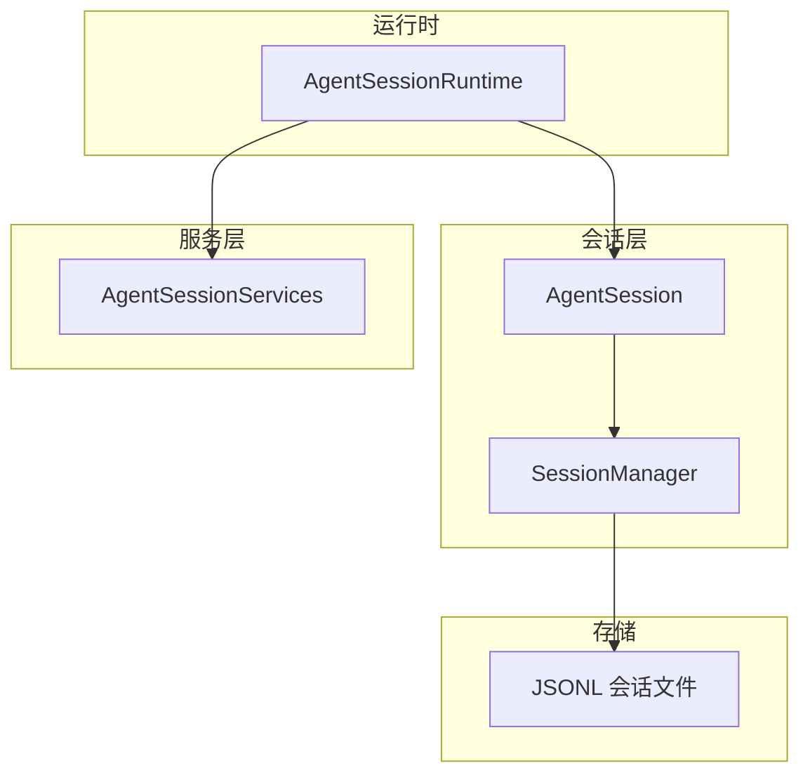
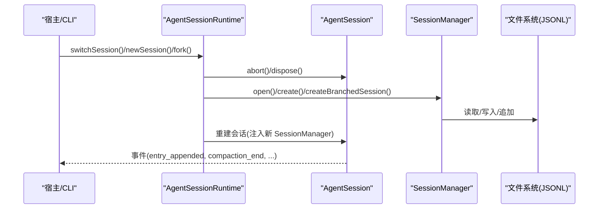
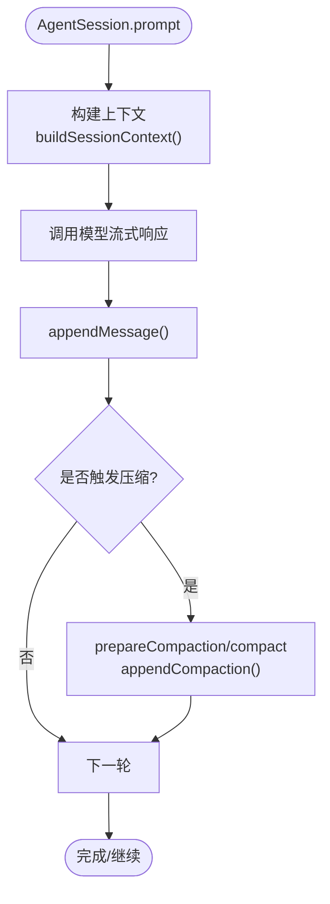
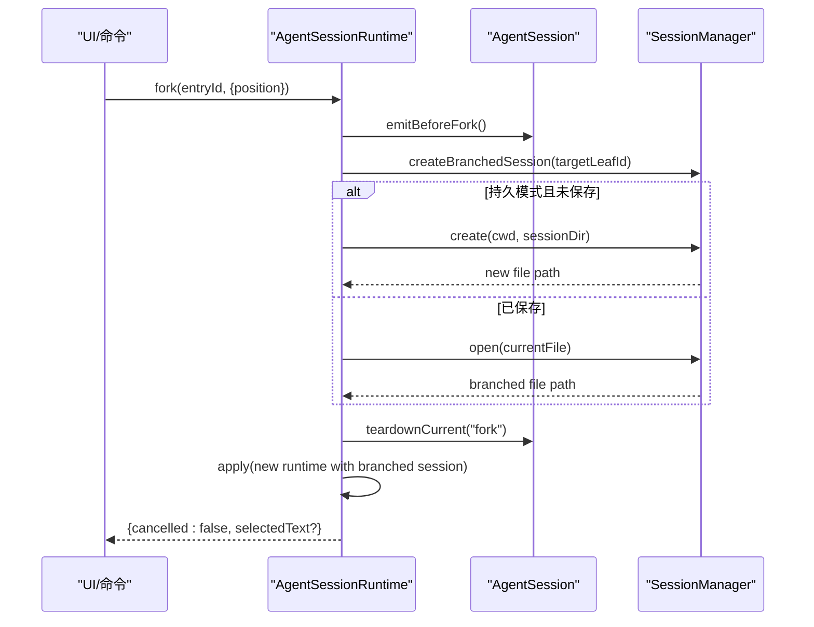
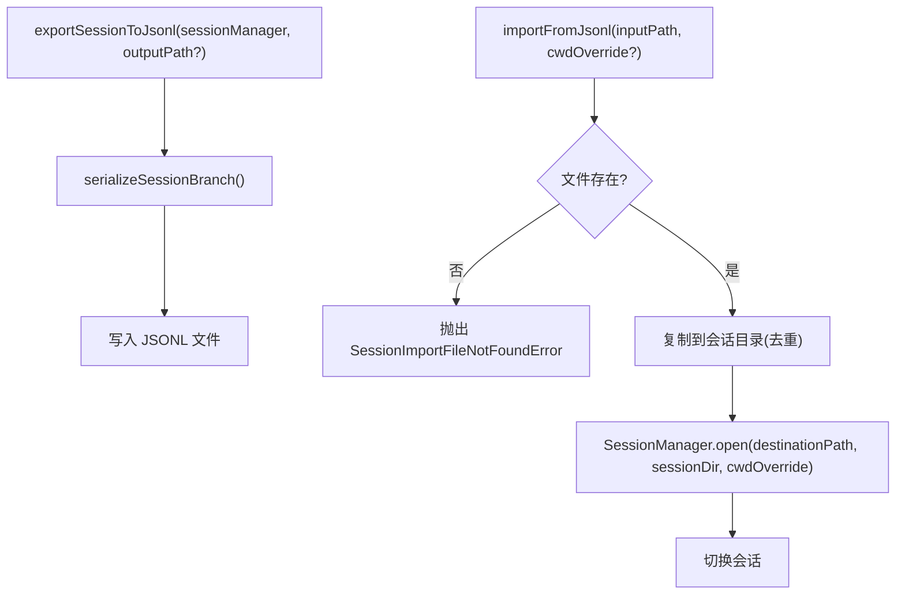
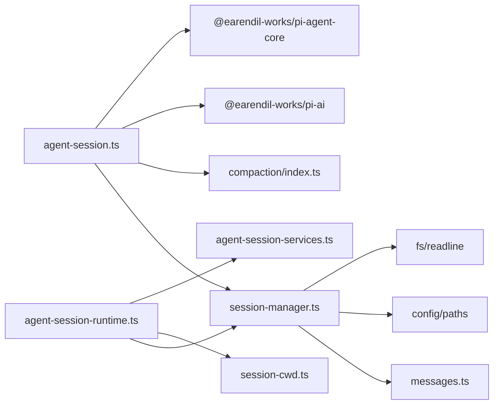
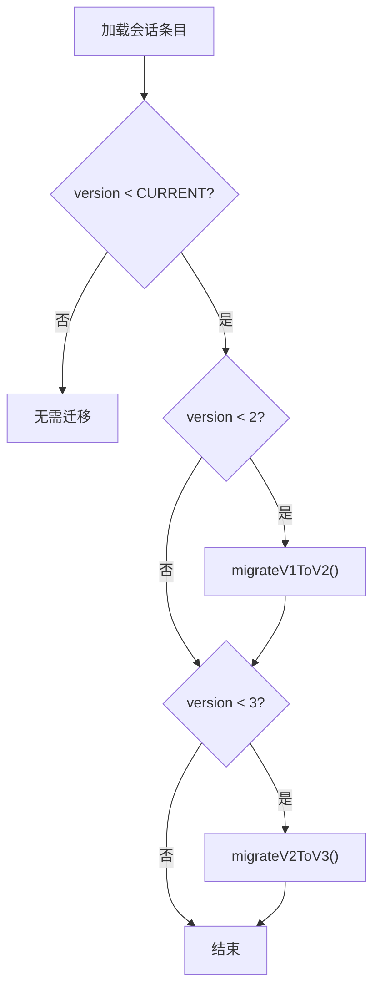

# 会话管理机制

<cite>
**本文引用的文件**   
- [session-manager.ts](file://packages/coding-agent/src/core/session-manager.ts)
- [agent-session.ts](file://packages/coding-agent/src/core/agent-session.ts)
- [agent-session-runtime.ts](file://packages/coding-agent/src/core/agent-session-runtime.ts)
- [agent-session-services.ts](file://packages/coding-agent/src/core/agent-session-services.ts)
- [session-export.ts](file://packages/coding-agent/src/core/session-export.ts)
</cite>

## 目录
1. [引言](#引言)
2. [项目结构](#项目结构)
3. [核心组件](#核心组件)
4. [架构总览](#架构总览)
5. [详细组件分析](#详细组件分析)
6. [依赖关系分析](#依赖关系分析)
7. [性能与可扩展性](#性能与可扩展性)
8. [故障排查指南](#故障排查指南)
9. [结论](#结论)
10. [附录：API、配置与迁移策略](#附录api配置与迁移策略)

## 引言
本文件系统化说明会话管理机制，覆盖以下目标：
- 会话的创建、持久化、恢复与分支管理
- 会话状态存储、消息历史与上下文保持机制
- 会话配置选项、存储后端选择与数据迁移策略
- 会话操作 API、分支切换示例与会话导出功能
- 会话与 Agent 的关系、消息流处理与会话统计信息

该机制以“追加不可变树”为核心：每个会话由 JSONL 文件中的条目序列组成，每个条目带有 id 和 parentId，形成一棵对话树。当前活跃路径通过 leafId 指针维护；分支通过移动 leafId 实现，不修改已有历史。

## 项目结构
会话相关代码集中在 coding-agent 包的 core 层：
- session-manager.ts：会话数据结构、JSONL 持久化、树遍历、分支、上下文投影与构建
- agent-session.ts：Agent 生命周期、事件订阅、模型与思考级别管理、压缩、工具执行、会话切换与分支
- agent-session-runtime.ts：运行时封装，负责会话切换、新建、分叉、导入等高层流程
- agent-session-services.ts：cwd 绑定的服务工厂（模型运行时、设置、资源加载）
- session-export.ts：会话分支序列化与 JSONL 导出



**图表来源**
- [agent-session-runtime.ts:74-418](file://packages/coding-agent/src/core/agent-session-runtime.ts#L74-L418)
- [agent-session.ts:409-559](file://packages/coding-agent/src/core/agent-session.ts#L409-L559)
- [session-manager.ts:988-1199](file://packages/coding-agent/src/core/session-manager.ts#L988-L1199)
- [agent-session-services.ts:135-204](file://packages/coding-agent/src/core/agent-session-services.ts#L135-L204)

**章节来源**
- [session-manager.ts:977-1023](file://packages/coding-agent/src/core/session-manager.ts#L977-L1023)
- [agent-session-runtime.ts:74-95](file://packages/coding-agent/src/core/agent-session-runtime.ts#L74-L95)

## 核心组件
- SessionManager：会话的内存表示与 JSONL 持久化，提供消息追加、分支、标签、上下文构建、树遍历、会话信息导出等能力。
- AgentSession：Agent 与会话的桥接，负责事件订阅、模型/思考级别、压缩、工具调用、会话切换与分支、统计信息等。
- AgentSessionRuntime：面向宿主的高层运行时，封装 new/fork/resume/import 等流程，协调 teardown 与重建。
- AgentSessionServices：按 cwd 创建 ModelRuntime、SettingsManager、ResourceLoader 等服务。
- session-export：将当前分支序列化为 JSONL 并写入文件。

**章节来源**
- [session-manager.ts:43-227](file://packages/coding-agent/src/core/session-manager.ts#L43-L227)
- [agent-session.ts:266-374](file://packages/coding-agent/src/core/agent-session.ts#L266-L374)
- [agent-session-runtime.ts:74-95](file://packages/coding-agent/src/core/agent-session-runtime.ts#L74-L95)
- [agent-session-services.ts:73-80](file://packages/coding-agent/src/core/agent-session-services.ts#L73-L80)
- [session-export.ts:8-45](file://packages/coding-agent/src/core/session-export.ts#L8-L45)

## 架构总览
会话在系统中的职责分层如下：
- 运行时层：决定何时创建、切换、分叉或导入会话，统一处理扩展钩子与清理。
- 会话管理层：维护追加式树结构、索引、leaf 指针、标签、上下文投影与持久化。
- Agent 层：将会话与 Agent 生命周期绑定，处理模型选择、思考级别、压缩、工具调用、统计。
- 服务层：为特定 cwd 提供模型认证、设置、资源加载等基础设施。



**图表来源**
- [agent-session-runtime.ts:196-350](file://packages/coding-agent/src/core/agent-session-runtime.ts#L196-L350)
- [session-manager.ts:1058-1199](file://packages/coding-agent/src/core/session-manager.ts#L1058-L1199)

## 详细组件分析

### SessionManager：会话树与持久化
- 数据结构
  - SessionHeader：会话头，包含 version、id、timestamp、cwd、parentSession。
  - SessionEntry：多种类型（message、thinking_level_change、model_change、usage、compaction、branch_summary、custom、custom_message、context_edit、label、session_info）。
  - FileEntry：SessionHeader | SessionEntry。
  - SessionProjection / SessionContext：用于 LLM 的上下文投影与最终消息列表。
- 持久化
  - JSONL 格式，每行一个 JSON 对象。
  - 首次写入：当存在 user/assistant 消息时才创建文件，避免空会话落盘。
  - 追加写入：后续条目 appendFileSync。
  - 重写：迁移或分支导出时重写整个文件。
- 树与分支
  - 通过 id/parentId 构建父子关系，leafId 指向当前活跃叶子。
  - branch() 移动 leafId；appendXXX() 基于当前 leafId 追加子节点。
  - getBranch() 从指定节点回溯到根，返回有序路径。
- 上下文构建
  - buildContextEntries()：考虑 compaction 摘要，保留 firstKeptEntryId 之后的条目。
  - buildSessionProjection()：应用 context_edit，生成带 sourceEntry 的投影。
  - buildSessionContext()：提取 messages、thinkingLevel、model。
- 标签与名称
  - label 条目支持书签与导航。
  - session_info 条目维护会话显示名。
- 会话发现与信息
  - findMostRecentSession()：扫描 .jsonl，解析 header 匹配 cwd。
  - buildSessionInfo()：异步流式扫描，统计 messageCount、firstMessage、allMessagesText、modified 时间等。

```mermaid
classDiagram
class SessionManager {
+string sessionId
+string|undefined sessionFile
+string sessionDir
+string cwd
+boolean persist
+boolean flushed
+Map~string,SessionEntry~ byId
+Map~string,string~ labelsById
+Map~string,string~ labelTimestampsById
+string|null leafId
+newSession(options) string|undefined
+appendMessage(message) string
+appendThinkingLevelChange(level) string
+appendModelChange(provider,modelId) string
+appendUsage(kind,provider,model,usage,note) UsageEntry
+appendCompaction(summary,firstKeptEntryId,tokensBefore,details,fromHook,usage) string
+appendCustomEntry(customType,data) string
+appendSessionInfo(name) string
+appendCustomMessageEntry(customType,content,display,details) string
+appendContextEdit(targetId,replacement) string
+branch(id) void
+getBranch(fromId) SessionEntry[]
+buildContextEntries() SessionEntry[]
+buildSessionProjection() SessionProjection
+buildSessionContext() SessionContext
+getTree() SessionTreeNode[]
+getEntries() SessionEntry[]
+getSessionName() string|undefined
}
class SessionHeader {
+string type
+number|undefined version
+string id
+string timestamp
+string cwd
+string|undefined parentSession
}
class SessionEntry {
<<union>>
}
class SessionProjection {
+entries ProjectedSessionEntry[]
+messages AgentMessage[]
+string thinkingLevel
+{provider : string,modelId : string}|null model
}
SessionManager --> SessionHeader : "拥有"
SessionManager --> SessionEntry : "管理"
SessionManager --> SessionProjection : "构建"
```

**图表来源**
- [session-manager.ts:43-227](file://packages/coding-agent/src/core/session-manager.ts#L43-L227)
- [session-manager.ts:988-1599](file://packages/coding-agent/src/core/session-manager.ts#L988-L1599)

**章节来源**
- [session-manager.ts:43-227](file://packages/coding-agent/src/core/session-manager.ts#L43-L227)
- [session-manager.ts:586-603](file://packages/coding-agent/src/core/session-manager.ts#L586-L603)
- [session-manager.ts:628-671](file://packages/coding-agent/src/core/session-manager.ts#L628-L671)
- [session-manager.ts:750-769](file://packages/coding-agent/src/core/session-manager.ts#L750-L769)
- [session-manager.ts:800-883](file://packages/coding-agent/src/core/session-manager.ts#L800-L883)
- [session-manager.ts:988-1199](file://packages/coding-agent/src/core/session-manager.ts#L988-L1199)
- [session-manager.ts:1415-1599](file://packages/coding-agent/src/core/session-manager.ts#L1415-L1599)

### AgentSession：会话与 Agent 的生命周期绑定
- 职责
  - 订阅 Agent 事件，自动持久化消息、工具调用、压缩、重试等。
  - 管理模型与思考级别，记录 model_change 与 thinking_level_change。
  - 触发压缩（手动/阈值/溢出），生成 compaction 摘要。
  - 暴露会话切换、分支、统计、HTML/JSONL 导出等能力。
- 与 SessionManager 的关系
  - 通过 sessionManager.appendXXX() 写入会话条目。
  - 使用 buildSessionContext() 获取发送给 LLM 的消息。
  - 在分支/切换时替换 SessionManager 实例。
- 统计
  - SessionStats：用户/助手消息数、工具调用/结果数、token 用量、成本、上下文用量等。



**图表来源**
- [agent-session.ts:409-559](file://packages/coding-agent/src/core/agent-session.ts#L409-L559)
- [session-manager.ts:1271-1298](file://packages/coding-agent/src/core/session-manager.ts#L1271-L1298)

**章节来源**
- [agent-session.ts:266-374](file://packages/coding-agent/src/core/agent-session.ts#L266-L374)
- [agent-session.ts:409-559](file://packages/coding-agent/src/core/agent-session.ts#L409-L559)

### AgentSessionRuntime：会话切换、新建、分叉与导入
- 关键方法
  - switchSession(path, options)：切换到已存在的会话文件，校验 cwd，teardown 旧会话后重建。
  - newSession(options)：根据当前 SessionManager 是否持久化，创建持久或内存会话；可选 parentSession。
  - fork(entryId, options)：在指定 entry 处分叉，支持 before/at 位置；持久模式下复制分支到新文件。
  - importFromJsonl(inputPath, cwdOverride)：导入外部 JSONL 到会话目录，必要时重命名避免冲突。
- 扩展钩子
  - session_before_switch：允许取消切换。
  - session_before_fork：允许取消分叉。
  - session_shutdown：在销毁前通知扩展进行清理。



**图表来源**
- [agent-session-runtime.ts:262-350](file://packages/coding-agent/src/core/agent-session-runtime.ts#L262-L350)
- [session-manager.ts:1643-1759](file://packages/coding-agent/src/core/session-manager.ts#L1643-L1759)

**章节来源**
- [agent-session-runtime.ts:133-165](file://packages/coding-agent/src/core/agent-session-runtime.ts#L133-L165)
- [agent-session-runtime.ts:196-350](file://packages/coding-agent/src/core/agent-session-runtime.ts#L196-L350)
- [agent-session-runtime.ts:359-402](file://packages/coding-agent/src/core/agent-session-runtime.ts#L359-L402)

### 会话导出与导入
- 导出
  - serializeSessionBranch：序列化当前分支为 JSONL 字符串。
  - exportSessionToJsonl：写入 session-<timestamp>.jsonl。
- 导入
  - importFromJsonl：复制到会话目录，必要时加序号后缀；打开并切换。



**图表来源**
- [session-export.ts:8-45](file://packages/coding-agent/src/core/session-export.ts#L8-L45)
- [agent-session-runtime.ts:359-402](file://packages/coding-agent/src/core/agent-session-runtime.ts#L359-L402)

**章节来源**
- [session-export.ts:8-45](file://packages/coding-agent/src/core/session-export.ts#L8-L45)
- [agent-session-runtime.ts:359-402](file://packages/coding-agent/src/core/agent-session-runtime.ts#L359-L402)

## 依赖关系分析
- SessionManager 依赖：
  - fs/fs/promises/readline/string_decoder：文件读写与流式解析。
  - config/paths：默认会话目录、路径规范化。
  - messages：构建分支摘要、压缩摘要等消息。
- AgentSession 依赖：
  - pi-agent-core/pi-ai：Agent 事件、模型、工具、流式调用。
  - compaction/index：压缩准备、估算、摘要生成。
  - session-manager：会话树与上下文构建。
  - extensions：扩展运行器与事件。
- AgentSessionRuntime 依赖：
  - agent-session-services：cwd 绑定服务。
  - session-cwd：会话 cwd 校验。
  - session-manager：会话打开/创建/分支。



**图表来源**
- [session-manager.ts:1-40](file://packages/coding-agent/src/core/session-manager.ts#L1-L40)
- [agent-session.ts:16-161](file://packages/coding-agent/src/core/agent-session.ts#L16-L161)
- [agent-session-runtime.ts:1-15](file://packages/coding-agent/src/core/agent-session-runtime.ts#L1-L15)

**章节来源**
- [session-manager.ts:1-40](file://packages/coding-agent/src/core/session-manager.ts#L1-L40)
- [agent-session.ts:16-161](file://packages/coding-agent/src/core/agent-session.ts#L16-L161)
- [agent-session-runtime.ts:1-15](file://packages/coding-agent/src/core/agent-session-runtime.ts#L1-L15)

## 性能与可扩展性
- 大文件读取
  - loadEntriesFromFile：缓冲读取，逐行解析，跳过损坏行。
  - readSessionHeader：限制头部扫描字节数，防止超大自定义字段导致阻塞。
- 会话列表
  - listSessionsFromDir：并发构建会话信息，分批回调进度。
- 写入策略
  - 首次写入延迟到出现 user/assistant 消息，减少空会话文件。
  - 追加写入避免频繁重写，提升吞吐。
- 上下文构建
  - buildContextEntries 仅保留 compaction 后的必要条目，降低 LLM 输入长度。
  - projectContextEntry 对可编辑内容做最小替换，避免不必要拷贝。

[本节为通用性能讨论，不直接分析具体文件]

## 故障排查指南
- 会话文件无效
  - 现象：打开显式路径为空但非零大小时报错。
  - 原因：文件存在但不是有效会话头。
  - 处理：检查是否为其他程序写入的 JSONL，或重新创建会话。
- 会话头扫描超限
  - 现象：readSessionHeader 抛出 SessionHeaderScanLimitError。
  - 原因：header 区域过大（例如超大 cwd 或自定义元数据）。
  - 处理：减小 header 体积，或修复损坏文件。
- 导入失败
  - 现象：importFromJsonl 抛出 SessionImportFileNotFoundError。
  - 原因：输入路径不存在。
  - 处理：确认路径正确，或先复制文件到会话目录。
- 分支无效
  - 现象：fork 传入非法 entryId 或非 user 消息。
  - 原因：entryId 不存在或位置不符合规则。
  - 处理：确保 entryId 存在且 position=before 时对应 user 消息。

**章节来源**
- [session-manager.ts:1030-1056](file://packages/coding-agent/src/core/session-manager.ts#L1030-L1056)
- [session-manager.ts:686-728](file://packages/coding-agent/src/core/session-manager.ts#L686-L728)
- [agent-session-runtime.ts:359-363](file://packages/coding-agent/src/core/agent-session-runtime.ts#L359-L363)
- [agent-session-runtime.ts:274-287](file://packages/coding-agent/src/core/agent-session-runtime.ts#L274-L287)

## 结论
会话管理机制以追加不可变树为核心，结合 JSONL 持久化、compaction 摘要、分支与标签，提供了高可靠、可追溯、可扩展的对话状态管理。AgentSession 将会话与 Agent 生命周期紧密绑定，AgentSessionRuntime 则提供高层的会话切换、新建、分叉与导入流程。通过清晰的上下文投影与统计信息，系统既满足 LLM 上下文需求，又便于调试与审计。

[本节为总结性内容，不直接分析具体文件]

## 附录：API、配置与迁移策略

### 会话配置选项
- NewSessionOptions
  - id：自定义会话 ID（需符合命名规范）。
  - parentSession：父会话路径，用于建立父子关系。
- AgentSessionConfig
  - agent、sessionManager、settingsManager、cwd、resourceLoader、modelRuntime 等。
  - scopedModels、initialActiveToolNames、usesDefaultTools、defaultToolModifiers、allowedToolNames、excludedToolNames、baseToolsOverride、extensionRunnerRef、sessionStartEvent 等。
- CreateAgentSessionServicesOptions
  - cwd、agentDir、settingsManager、modelRuntime、extensionFlagValues、resourceLoaderOptions、resourceLoaderReloadOptions。

**章节来源**
- [session-manager.ts:52-55](file://packages/coding-agent/src/core/session-manager.ts#L52-L55)
- [agent-session.ts:266-314](file://packages/coding-agent/src/core/agent-session.ts#L266-L314)
- [agent-session-services.ts:37-46](file://packages/coding-agent/src/core/agent-session-services.ts#L37-L46)

### 存储后端选择
- 默认后端：本地文件系统 JSONL 文件。
- 会话目录：默认 ~/.pi/agent/sessions/<encoded-cwd>/。
- 内存模式：SessionManager.inMemory() 用于测试或不持久化场景。
- 自定义目录：SessionManager.create(cwd, sessionDir)。

**章节来源**
- [session-manager.ts:586-603](file://packages/coding-agent/src/core/session-manager.ts#L586-L603)
- [session-manager.ts:1766-1769](file://packages/coding-agent/src/core/session-manager.ts#L1766-L1769)

### 数据迁移策略
- 版本常量：CURRENT_SESSION_VERSION。
- v1→v2：添加 id/parentId 树结构，转换 compaction.firstKeptEntryIndex → firstKeptEntryId。
- v2→v3：将 hookMessage role 重命名为 custom。
- migrateToCurrentVersion：顺序执行迁移，若无需迁移返回 false。



**图表来源**
- [session-manager.ts:286-347](file://packages/coding-agent/src/core/session-manager.ts#L286-L347)

**章节来源**
- [session-manager.ts:286-347](file://packages/coding-agent/src/core/session-manager.ts#L286-L347)

### 会话操作 API 速览
- 创建与打开
  - SessionManager.create(cwd, sessionDir?, options?)
  - SessionManager.open(filePath, sessionDir?, cwdOverride?)
  - SessionManager.inMemory(cwd, sessionDir?, entries?)
- 写入
  - appendMessage(message)
  - appendThinkingLevelChange(level)
  - appendModelChange(provider, modelId)
  - appendUsage(kind, provider, model, usage, note?)
  - appendCompaction(summary, firstKeptEntryId, tokensBefore, details?, fromHook?, usage?)
  - appendCustomEntry(customType, data?)
  - appendSessionInfo(name)
  - appendCustomMessageEntry(customType, content, display, details?)
  - appendContextEdit(targetId, replacement)
- 查询与遍历
  - getBranch(fromId?)
  - buildContextEntries()
  - buildSessionProjection()
  - buildSessionContext()
  - getTree()
  - getEntries()
  - getSessionName()
  - getLabel(id)
  - appendLabelChange(targetId, label?)
- 分支与导出
  - branch(branchFromId)
  - createBranchedSession(leafId)
  - exportSessionToJsonl(sessionManager, outputPath?, trailingEntries?)

**章节来源**
- [session-manager.ts:1058-1199](file://packages/coding-agent/src/core/session-manager.ts#L1058-L1199)
- [session-manager.ts:1215-1409](file://packages/coding-agent/src/core/session-manager.ts#L1215-L1409)
- [session-manager.ts:1415-1599](file://packages/coding-agent/src/core/session-manager.ts#L1415-L1599)
- [session-manager.ts:1606-1759](file://packages/coding-agent/src/core/session-manager.ts#L1606-L1759)
- [session-export.ts:8-45](file://packages/coding-agent/src/core/session-export.ts#L8-L45)

### 分支切换示例（概念步骤）
- 在 UI 中选择某条用户消息作为分叉点。
- 调用 Runtime.fork(entryId, {position:"before"})。
- 若当前会话未保存，创建新会话并标记 parentSession。
- 若已保存，调用 SessionManager.createBranchedSession(targetLeafId) 生成新分支文件。
- 切换至新分支会话，继续对话。

**章节来源**
- [agent-session-runtime.ts:262-350](file://packages/coding-agent/src/core/agent-session-runtime.ts#L262-L350)
- [session-manager.ts:1643-1759](file://packages/coding-agent/src/core/session-manager.ts#L1643-L1759)

### 会话与 Agent 的关系
- AgentSession 持有 SessionManager，并通过其写入会话条目。
- AgentSession 订阅 Agent 事件，自动持久化消息、工具调用、压缩、重试等。
- 模型与思考级别变更会记录为 model_change 与 thinking_level_change 条目。
- 会话统计信息（SessionStats）汇总消息数量、工具调用、token 用量与成本。

**章节来源**
- [agent-session.ts:409-559](file://packages/coding-agent/src/core/agent-session.ts#L409-L559)
- [agent-session.ts:356-374](file://packages/coding-agent/src/core/agent-session.ts#L356-L374)