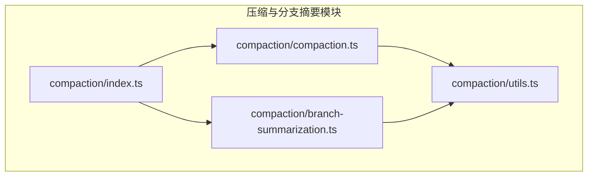
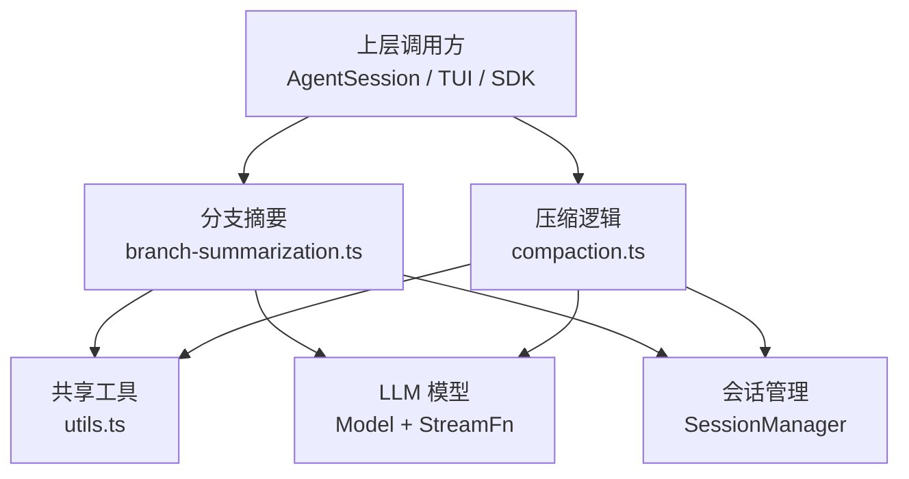
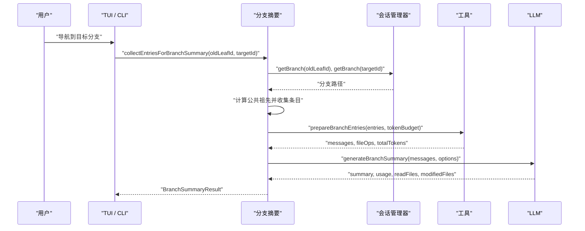
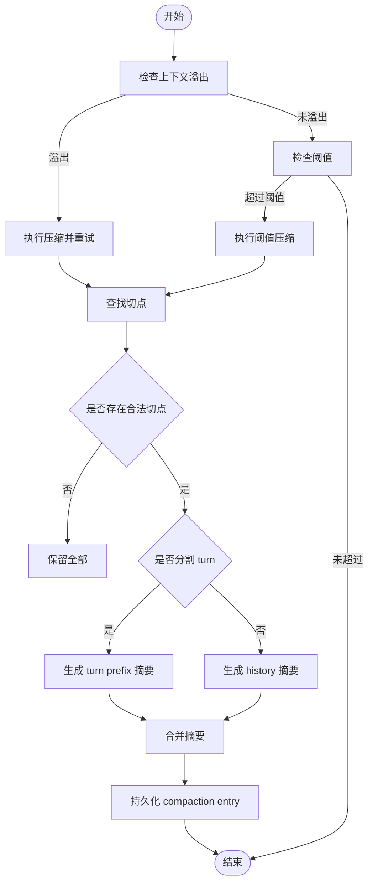
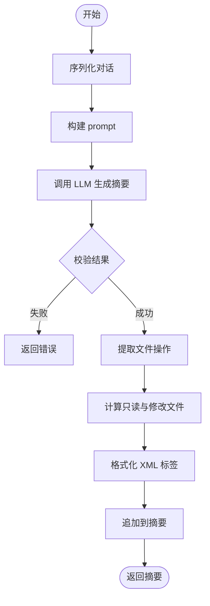
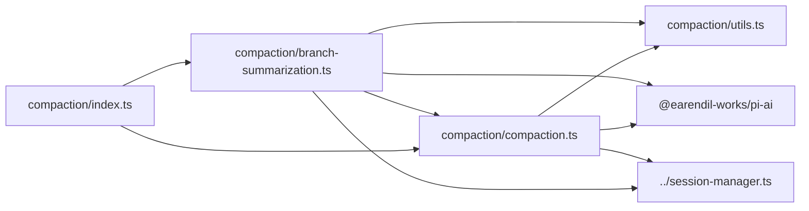

# 压缩与分支摘要系统

<cite>
**本文引用的文件**
- [README.md](file://README.md)
- [10-compaction.md](file://docs/omca/10-compaction.md)
- [index.ts](file://packages/coding-agent/src/core/compaction/index.ts)
- [branch-summarization.ts](file://packages/coding-agent/src/core/compaction/branch-summarization.ts)
- [compaction.ts](file://packages/coding-agent/src/core/compaction/compaction.ts)
- [utils.ts](file://packages/coding-agent/src/core/compaction/utils.ts)
</cite>

## 目录
1. [引言](#引言)
2. [项目结构](#项目结构)
3. [核心组件](#核心组件)
4. [架构总览](#架构总览)
5. [详细组件分析](#详细组件分析)
6. [依赖关系分析](#依赖关系分析)
7. [性能考量](#性能考量)
8. [故障排查指南](#故障排查指南)
9. [结论](#结论)
10. [附录](#附录)

## 引言
本文件面向“压缩与分支摘要系统”，聚焦于长会话上下文管理与多分支会话导航时的上下文保留机制。该系统由两部分组成：
- 压缩子系统：在会话过长时，将历史消息压缩为结构化摘要，同时保留最近的关键上下文，并持久化压缩边界、系统提示和工具状态快照。
- 分支摘要子系统：当用户在会话树中从某个叶子节点导航到另一个分支时，对即将被放弃的分支生成结构化摘要，避免上下文丢失。

该实现位于 `packages/coding-agent/src/core/compaction` 目录下，配套文档位于 `docs/omca/10-compaction.md`。仓库根 README 说明该项目是 Pi 编码代理的核心运行时之一，提供可扩展的 Agent 能力；压缩与分支摘要是其中保证长会话可用性的关键基础设施。

**章节来源**
- [README.md:13-21](file://README.md#L13-L21)
- [10-compaction.md:1-8](file://docs/omca/10-compaction.md#L1-L8)

## 项目结构
压缩与分支摘要系统的代码组织以功能域为核心，采用“按特性拆分”的方式：
- `compaction/index.ts`：统一导出压缩与分支摘要相关能力。
- `compaction/compaction.ts`：压缩触发条件、切点选择、摘要生成、使用量估算、重试封装等核心逻辑。
- `compaction/branch-summarization.ts`：分支导航时收集待摘要条目、准备消息预算、生成分支摘要。
- `compaction/utils.ts`：文件操作提取、序列化、系统提示等共享工具。

**图表来源**
- [index.ts:1-8](file://packages/coding-agent/src/core/compaction/index.ts#L1-L8)
- [compaction.ts:1-46](file://packages/coding-agent/src/core/compaction/compaction.ts#L1-L46)
- [branch-summarization.ts:1-34](file://packages/coding-agent/src/core/compaction/branch-summarization.ts#L1-L34)
- [utils.ts:1-8](file://packages/coding-agent/src/core/compaction/utils.ts#L1-L8)

**章节来源**
- [index.ts:1-8](file://packages/coding-agent/src/core/compaction/index.ts#L1-L8)
- [compaction.ts:1-46](file://packages/coding-agent/src/core/compaction/compaction.ts#L1-L46)
- [branch-summarization.ts:1-34](file://packages/coding-agent/src/core/compaction/branch-summarization.ts#L1-L34)
- [utils.ts:1-8](file://packages/coding-agent/src/core/compaction/utils.ts#L1-L8)

## 核心组件
本节梳理压缩与分支摘要系统中的关键类型、函数职责以及它们之间的协作关系。

### 压缩子系统
- 配置与默认值：
  - `CompactionSettings`：控制是否启用压缩、预留 token 数、保留近期 token 数。
  - `DEFAULT_COMPACTION_SETTINGS`：默认开启压缩，预留 16384 token，保留最近约 20000 token。
- Token 估算：
  - `estimateTokens`：基于字符数 / 4 的保守估算，图片按固定字符估算。
  - `calculateContextTokens`：优先使用 `totalTokens`，否则累加 input/output/cacheRead/cacheWrite。
  - `estimateContextTokens`：结合最后一条有效 assistant usage 与后续消息估算。
  - `estimateProjectedContextTokens`：若 usage 之后存在 context_edit 或 compaction，则丢弃旧 usage 重新估算。
- 触发判断：
  - `shouldCompact`：当当前上下文 token 超过模型窗口减去 reserveTokens 时触发。
- 切点选择：
  - `findValidCutPoints`：过滤出合法切点，不能切在 toolResult。
  - `findTurnStartIndex`：定位 turn 起始位置。
  - `findCutPoint`：从新往旧累计 token，达到 keepRecentTokens 后选择最近合法切点，并判断是否 split turn。
- 摘要生成：
  - `completeSummarization`：统一的 LLM 调用入口，支持 streamFn、retry、sessionId、reasoning 等。
  - `generateSummary` / `generateSummaryWithUsage`：构建 prompt、序列化对话、调用 LLM、校验结果。
  - `getSummarizationFailure`：识别 error 或 length 截断等失败情况。
- 文件操作追踪：
  - `extractFileOperations`：从 previous compaction details 与 messages 中提取 read/written/edited。
  - `computeFileLists` / `formatFileOperations`：计算最终只读与修改文件列表，并以 XML 追加到摘要。

**章节来源**
- [compaction.ts:120-130](file://packages/coding-agent/src/core/compaction/compaction.ts#L120-L130)
- [compaction.ts:136-262](file://packages/coding-agent/src/core/compaction/compaction.ts#L136-L262)
- [compaction.ts:267-270](file://packages/coding-agent/src/core/compaction/compaction.ts#L267-L270)
- [compaction.ts:294-349](file://packages/coding-agent/src/core/compaction/compaction.ts#L294-L349)
- [compaction.ts:351-501](file://packages/coding-agent/src/core/compaction/compaction.ts#L351-L501)
- [compaction.ts:581-638](file://packages/coding-agent/src/core/compaction/compaction.ts#L581-L638)
- [compaction.ts:640-753](file://packages/coding-agent/src/core/compaction/compaction.ts#L640-L753)
- [compaction.ts:47-88](file://packages/coding-agent/src/core/compaction/compaction.ts#L47-L88)

### 分支摘要子系统
- 类型定义：
  - `BranchSummaryResult`：返回 summary、usage、readFiles、modifiedFiles、aborted、error。
  - `BranchSummaryDetails`：记录 readFiles 与 modifiedFiles。
  - `BranchPreparation`：包含 messages、fileOps、totalTokens。
  - `CollectEntriesResult`：包含 entries 与 commonAncestorId。
  - `GenerateBranchSummaryOptions`：model、apiKey、headers、env、signal、thinkingLevel、customInstructions、replaceInstructions、reserveTokens、streamFn、retry、callbacks。
- 条目收集：
  - `collectEntriesForBranchSummary`：从 oldLeafId 回溯到与 targetId 的公共祖先，收集被放弃的条目（时间顺序）。
- 条目转消息与预算控制：
  - `getMessageFromEntry`：将 session entry 转为 AgentMessage，处理 message/custom_message/branch_summary/compaction 等。
  - `prepareBranchEntries`：从最新到最旧加入消息，直到 token 预算；compaction 与 branch_summary 条目优先保留；累积文件操作。
- 摘要生成：
  - `generateBranchSummary`：构造 prompt、序列化对话、调用 LLM、检查中止与错误、附加文件操作信息。

**章节来源**
- [branch-summarization.ts:39-97](file://packages/coding-agent/src/core/compaction/branch-summarization.ts#L39-L97)
- [branch-summarization.ts:103-153](file://packages/coding-agent/src/core/compaction/branch-summarization.ts#L103-L153)
- [branch-summarization.ts:159-261](file://packages/coding-agent/src/core/compaction/branch-summarization.ts#L159-L261)
- [branch-summarization.ts:301-398](file://packages/coding-agent/src/core/compaction/branch-summarization.ts#L301-L398)

### 共享工具
- 文件操作：
  - `createFileOps`：初始化 read/written/edited 集合。
  - `extractFileOpsFromMessage`：从 assistant 或 toolResult 的工具调用中提取路径。
  - `computeFileLists`：计算只读与修改文件列表。
  - `formatFileOperations`：输出 `<read-files>` / `<modified-files>`。
- 消息序列化：
  - `serializeConversation`：将 LLM 消息序列化为文本，避免模型继续对话；toolResult 截断至 2000 字符。
- 系统提示：
  - `SUMMARIZATION_SYSTEM_PROMPT`：约束模型仅输出结构化摘要，不继续对话。

**章节来源**
- [utils.ts:13-88](file://packages/coding-agent/src/core/compaction/utils.ts#L13-L88)
- [utils.ts:94-156](file://packages/coding-agent/src/core/compaction/utils.ts#L94-L156)
- [utils.ts:158-165](file://packages/coding-agent/src/core/compaction/utils.ts#L158-L165)

## 架构总览
下图展示压缩与分支摘要系统在模块层面的交互关系：

**图表来源**
- [branch-summarization.ts:1-34](file://packages/coding-agent/src/core/compaction/branch-summarization.ts#L1-L34)
- [compaction.ts:1-46](file://packages/coding-agent/src/core/compaction/compaction.ts#L1-L46)
- [utils.ts:1-8](file://packages/coding-agent/src/core/compaction/utils.ts#L1-L8)

## 详细组件分析

### 分支导航与摘要流程
当用户通过 `/tree` 导航到另一个 leaf 时，系统会：
1. 计算 oldLeafId 与 targetId 的公共祖先。
2. 从 oldLeafId 回溯到公共祖先，收集被放弃的条目。
3. 将条目转换为消息，并按 token 预算裁剪，优先保留 compaction 与 branch_summary。
4. 序列化对话并调用 LLM 生成结构化摘要。
5. 附加文件操作信息，返回 BranchSummaryResult。

**图表来源**
- [branch-summarization.ts:103-153](file://packages/coding-agent/src/core/compaction/branch-summarization.ts#L103-L153)
- [branch-summarization.ts:159-261](file://packages/coding-agent/src/core/compaction/branch-summarization.ts#L159-L261)
- [branch-summarization.ts:301-398](file://packages/coding-agent/src/core/compaction/branch-summarization.ts#L301-L398)

**章节来源**
- [branch-summarization.ts:103-153](file://packages/coding-agent/src/core/compaction/branch-summarization.ts#L103-L153)
- [branch-summarization.ts:159-261](file://packages/coding-agent/src/core/compaction/branch-summarization.ts#L159-L261)
- [branch-summarization.ts:301-398](file://packages/coding-agent/src/core/compaction/branch-summarization.ts#L301-L398)

### 压缩触发与切点选择
压缩的触发条件包括：
- 上下文溢出：stopReason 为 error 且 context overflow，或 usage 匹配当前投影且超出窗口，或 stopReason 为 length 且输出低于 maxTokens。
- 阈值压缩：token 超过阈值但未溢出。

切点选择算法：
- 从新往旧累计 estimateTokens，达到 keepRecentTokens 后选择最近的合法切点。
- 合法切点不能是 toolResult。
- 如果切点在 turn 中间，标记 isSplitTurn，并额外生成 turn prefix summary。

**图表来源**
- [compaction.ts:267-270](file://packages/coding-agent/src/core/compaction/compaction.ts#L267-L270)
- [compaction.ts:351-501](file://packages/coding-agent/src/core/compaction/compaction.ts#L351-L501)
- [10-compaction.md:34-104](file://docs/omca/10-compaction.md#L34-L104)

**章节来源**
- [compaction.ts:267-270](file://packages/coding-agent/src/core/compaction/compaction.ts#L267-L270)
- [compaction.ts:351-501](file://packages/coding-agent/src/core/compaction/compaction.ts#L351-L501)
- [10-compaction.md:34-104](file://docs/omca/10-compaction.md#L34-L104)

### 摘要生成与文件操作追踪
摘要生成的输入不是原始消息，而是序列化后的文本，以避免模型继续对话。系统提示约束模型仅输出结构化摘要。文件操作从 assistant 的工具调用与 toolResult 的 nestedCalls 中提取，并在多次压缩中累积。

**图表来源**
- [compaction.ts:640-753](file://packages/coding-agent/src/core/compaction/compaction.ts#L640-L753)
- [utils.ts:94-156](file://packages/coding-agent/src/core/compaction/utils.ts#L94-L156)
- [utils.ts:158-165](file://packages/coding-agent/src/core/compaction/utils.ts#L158-L165)

**章节来源**
- [compaction.ts:640-753](file://packages/coding-agent/src/core/compaction/compaction.ts#L640-L753)
- [utils.ts:94-156](file://packages/coding-agent/src/core/compaction/utils.ts#L94-L156)
- [utils.ts:158-165](file://packages/coding-agent/src/core/compaction/utils.ts#L158-L165)

## 依赖关系分析
压缩与分支摘要系统对外暴露的能力集中在 `compaction/index.ts`，内部依赖如下：
- `compaction.ts` 依赖 `utils.ts` 的文件操作与序列化工具。
- `branch-summarization.ts` 依赖 `utils.ts` 与 `compaction.ts` 中的 `completeSummarization`、`getSummarizationFailure`。
- 两者都依赖 `@earendil-works/pi-ai` 提供的 LLM 抽象、重试策略、上下文归一化等能力。
- 会话数据来自 `../session-manager.ts`，用于读取分支路径、条目、投影等。

**图表来源**
- [index.ts:1-8](file://packages/coding-agent/src/core/compaction/index.ts#L1-L8)
- [compaction.ts:1-46](file://packages/coding-agent/src/core/compaction/compaction.ts#L1-L46)
- [branch-summarization.ts:1-34](file://packages/coding-agent/src/core/compaction/branch-summarization.ts#L1-L34)
- [utils.ts:1-8](file://packages/coding-agent/src/core/compaction/utils.ts#L1-L8)

**章节来源**
- [index.ts:1-8](file://packages/coding-agent/src/core/compaction/index.ts#L1-L8)
- [compaction.ts:1-46](file://packages/coding-agent/src/core/compaction/compaction.ts#L1-L46)
- [branch-summarization.ts:1-34](file://packages/coding-agent/src/core/compaction/branch-summarization.ts#L1-L34)
- [utils.ts:1-8](file://packages/coding-agent/src/core/compaction/utils.ts#L1-L8)

## 性能考量
- Token 估算采用保守的 chars / 4 方法，避免低估导致上下文溢出。
- 图片内容按固定字符估算，防止大图片导致估算偏差。
- 摘要请求使用 `cacheRetention: "none"`，避免一次性摘要写入缓存影响正常会话缓存前缀。
- 通过 `reserveTokens` 为 prompt 与输出预留空间，降低截断风险。
- `keepRecentTokens` 确保压缩后仍保留足够的近期上下文，提升后续对话质量。
- 文件操作跨压缩累积，减少重复读取文件的概率，提高摘要准确性。

[本节为通用性能讨论，不直接分析具体文件]

## 故障排查指南
常见问题与处理建议：
- 摘要失败：
  - 若 `stopReason === "error"`，表示 LLM 调用失败，需检查 API key、网络、provider 状态。
  - 若 `stopReason === "length"`，表示生成被截断，摘要不完整，应调整 reserveTokens 或 reduce 输入规模。
- 分支摘要尝试调用工具：
  - 系统禁止摘要过程调用工具，若检测到 toolCall，视为失败，应检查 customInstructions 是否引入不当指令。
- 上下文溢出恢复失败：
  - 自动压缩仅尝试一次溢出恢复，若再次溢出，明确报错，不应无限重试。
- 文件操作缺失：
  - 检查 assistant 消息中的 toolCall 与 toolResult.nestedCalls 是否正确记录路径。
  - 确认 extractFileOpsFromMessage 能正确解析 read/write/edit 工具。

**章节来源**
- [compaction.ts:581-638](file://packages/coding-agent/src/core/compaction/compaction.ts#L581-L638)
- [compaction.ts:640-753](file://packages/coding-agent/src/core/compaction/compaction.ts#L640-L753)
- [branch-summarization.ts:301-398](file://packages/coding-agent/src/core/compaction/branch-summarization.ts#L301-L398)
- [10-compaction.md:155-162](file://docs/omca/10-compaction.md#L155-L162)

## 结论
压缩与分支摘要系统通过结构化摘要、切点选择、文件操作追踪与重试封装，在保证长会话可用性的同时，维持了上下文的一致性与可追溯性。分支摘要进一步增强了多分支会话导航的体验，使被放弃的探索路径也能以摘要形式保留关键决策与下一步计划。整体设计强调“压缩是检查点而非删除”，并通过 systemMessage 快照与 compaction entry 持久化，确保 prompt 与工具状态不会丢失。

[本节为总结性内容，不直接分析具体文件]

## 附录
- 默认压缩设置：
  - enabled: true
  - reserveTokens: 16384
  - keepRecentTokens: 20000
- 摘要结构字段：
  - Goal
  - Constraints & Preferences
  - Progress (Done / In Progress / Blocked)
  - Key Decisions
  - Next Steps
  - Critical Context

**章节来源**
- [compaction.ts:120-130](file://packages/coding-agent/src/core/compaction/compaction.ts#L120-L130)
- [10-compaction.md:121-137](file://docs/omca/10-compaction.md#L121-L137)