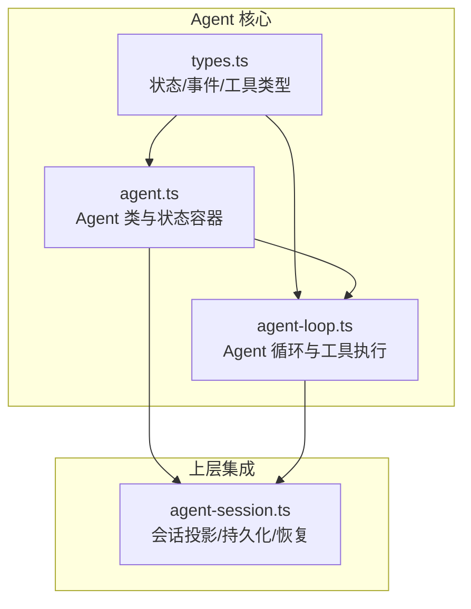
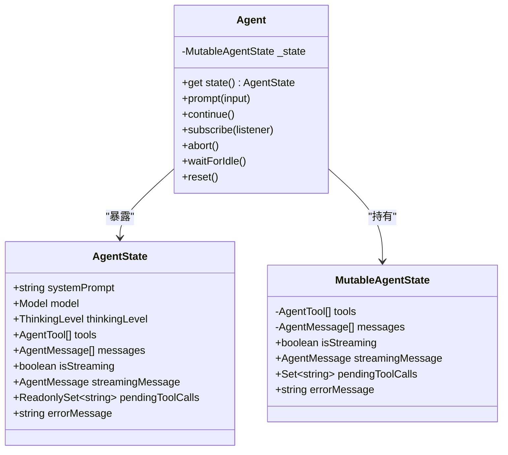
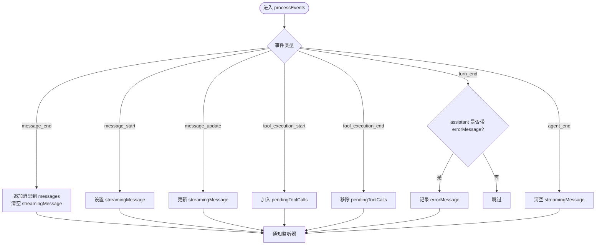
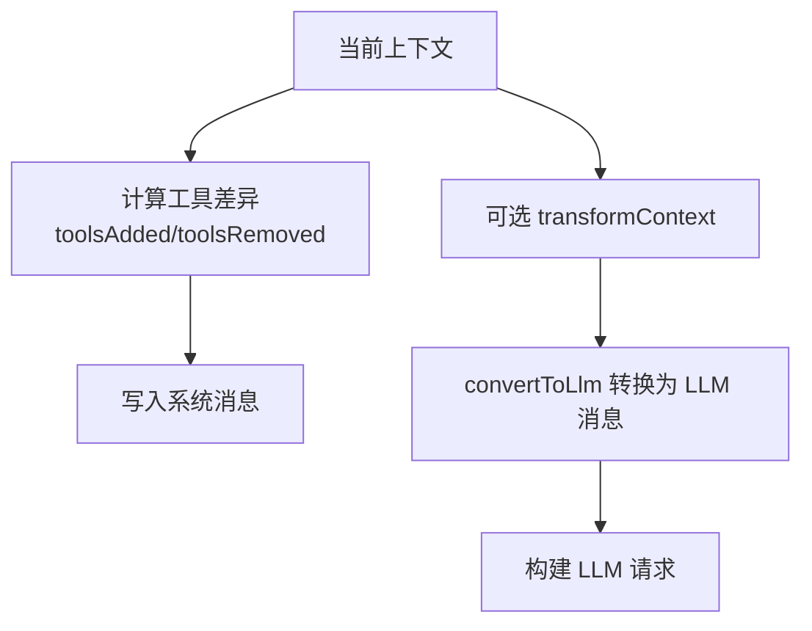
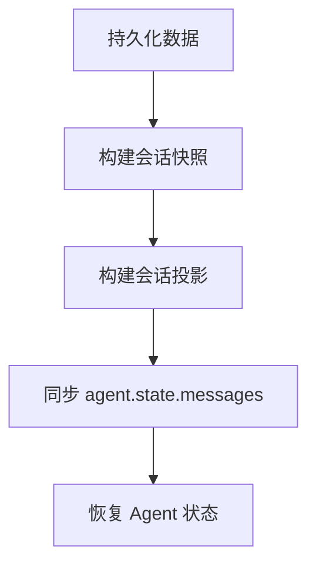
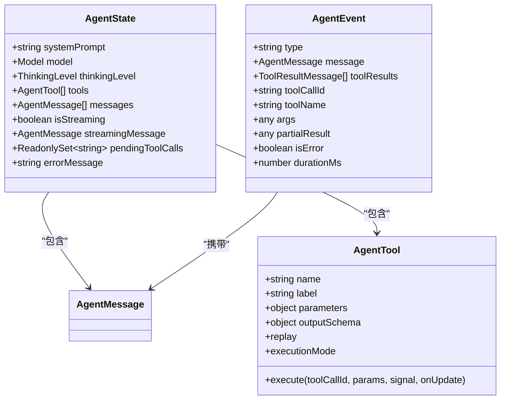
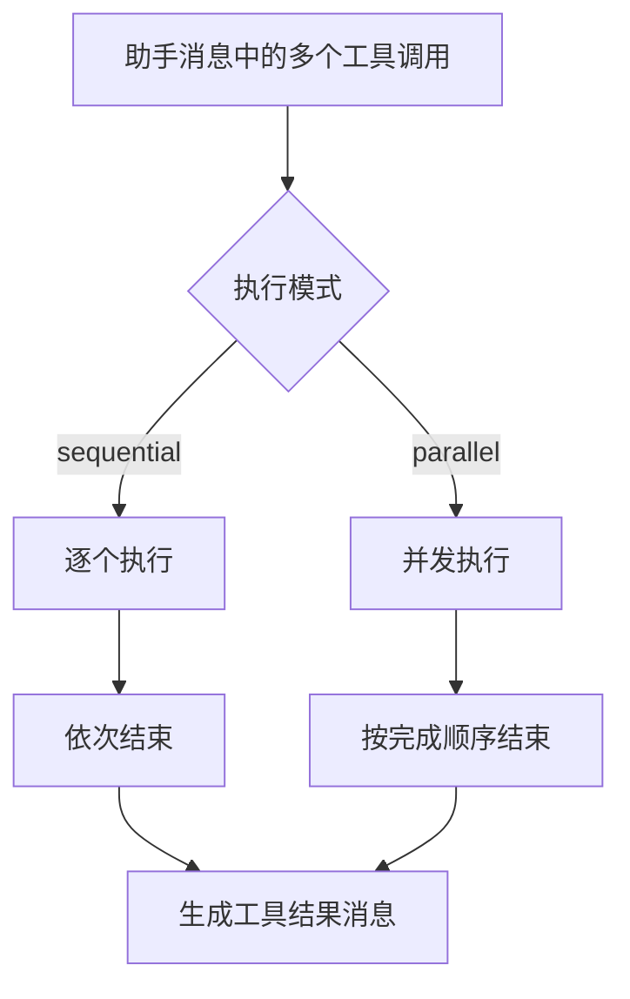
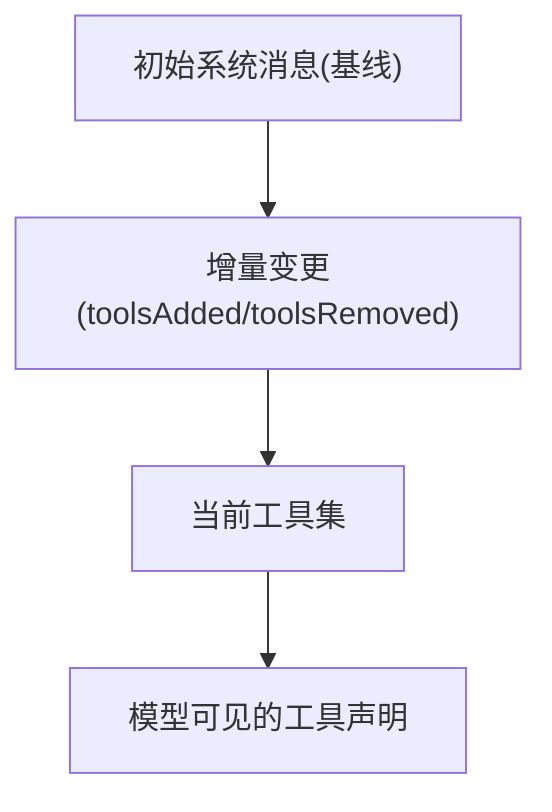
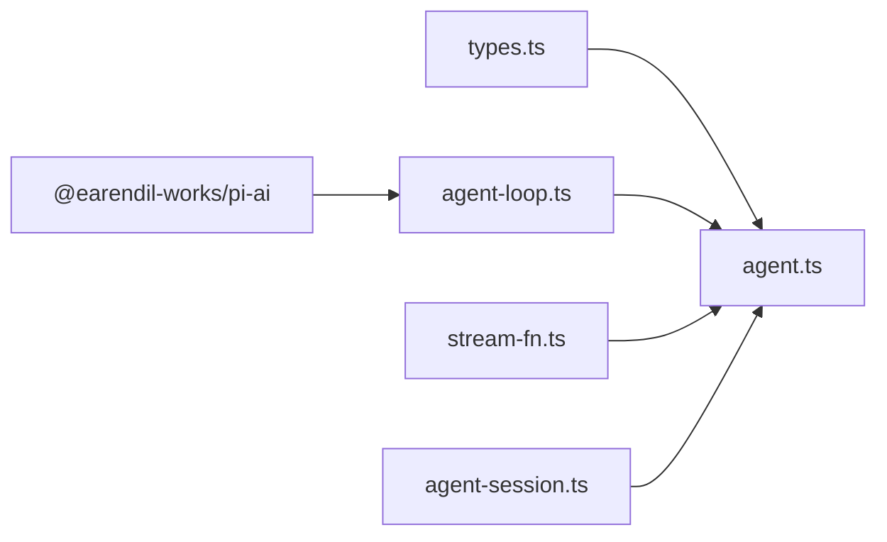

# 状态管理模式

<cite>
**本文引用的文件**
- [packages/agent/src/types.ts](file://packages/agent/src/types.ts)
- [packages/agent/src/agent.ts](file://packages/agent/src/agent.ts)
- [packages/agent/src/agent-loop.ts](file://packages/agent/src/agent-loop.ts)
- [packages/agent/test/agent.test.ts](file://packages/agent/test/agent.test.ts)
- [packages/coding-agent/src/core/agent-session.ts](file://packages/coding-agent/src/core/agent-session.ts)
</cite>

## 目录
1. [引言](#引言)
2. [项目结构](#项目结构)
3. [核心组件](#核心组件)
4. [架构总览](#架构总览)
5. [详细组件分析](#详细组件分析)
6. [依赖关系分析](#依赖关系分析)
7. [性能与优化](#性能与优化)
8. [故障排查指南](#故障排查指南)
9. [结论](#结论)
10. [附录：状态操作示例与监控建议](#附录状态操作示例与监控建议)

## 引言
本文件围绕 Agent 的状态管理模式展开，系统性说明 Agent 状态结构、状态更新机制、状态同步策略、状态变更监听、状态持久化与恢复流程、状态类型定义、状态验证规则、并发状态处理、状态版本管理，以及状态监控与性能优化建议。文档以代码仓库中的 Agent 核心实现为依据，兼顾可读性与可维护性，帮助读者从“概念”逐步深入到“实现细节”。

## 项目结构
Agent 的状态管理主要位于 `packages/agent` 包中，关键文件如下：
- `types.ts`：定义 Agent 状态、事件、工具、上下文等核心类型。
- `agent.ts`：对外暴露的 `Agent` 类，封装状态、队列、生命周期、事件订阅和运行控制。
- `agent-loop.ts`：低层 Agent 循环，负责消息流、工具调用、轮次调度以及与 LLM 的交互边界。
- `test/agent.test.ts`：覆盖默认状态、初始状态、工具声明变更、重置、事件订阅、中止、继续等场景。
- `packages/coding-agent/src/core/agent-session.ts`：上层会话层对 Agent 状态的投影、持久化和恢复逻辑。



**图表来源**
- [packages/agent/src/types.ts:382-421](file://packages/agent/src/types.ts#L382-L421)
- [packages/agent/src/agent.ts:194-263](file://packages/agent/src/agent.ts#L194-L263)
- [packages/agent/src/agent-loop.ts:172-330](file://packages/agent/src/agent-loop.ts#L172-L330)
- [packages/coding-agent/src/core/agent-session.ts:955-967](file://packages/coding-agent/src/core/agent-session.ts#L955-L967)

**章节来源**
- [packages/agent/src/types.ts:382-421](file://packages/agent/src/types.ts#L382-L421)
- [packages/agent/src/agent.ts:194-263](file://packages/agent/src/agent.ts#L194-L263)
- [packages/agent/src/agent-loop.ts:172-330](file://packages/agent/src/agent-loop.ts#L172-L330)
- [packages/coding-agent/src/core/agent-session.ts:955-967](file://packages/coding-agent/src/core/agent-session.ts#L955-L967)

## 核心组件
- AgentState：对外公开的状态接口，包含系统提示、模型、思考级别、工具集、对话消息、流式标志、当前流式消息、待执行工具调用集合、最近错误信息等。
- MutableAgentState：内部可变状态，用于在运行时安全地更新上述字段。
- Agent：状态容器、事件总线、队列（引导消息与跟进消息）、运行生命周期、中止与空闲等待。
- AgentLoop：低层循环，负责轮次推进、工具准备与执行、LLM 请求边界、错误与中止处理。
- Session 层：将 Agent 状态映射到会话快照，并负责持久化与恢复。

**章节来源**
- [packages/agent/src/types.ts:382-421](file://packages/agent/src/types.ts#L382-L421)
- [packages/agent/src/agent.ts:71-112](file://packages/agent/src/agent.ts#L71-L112)
- [packages/agent/src/agent.ts:194-263](file://packages/agent/src/agent.ts#L194-L263)
- [packages/agent/src/agent-loop.ts:172-330](file://packages/agent/src/agent-loop.ts#L172-L330)

## 架构总览
Agent 的状态管理采用“状态容器 + 事件驱动 + 循环调度”的模式：
- 状态容器：`Agent` 持有 `_state`，通过 getter/setter 暴露只读或受控的可变字段。
- 事件驱动：所有状态变更由循环或外部 API 触发，统一经 `processEvents` 分发为 `AgentEvent`，供订阅者消费。
- 循环调度：`agent-loop.ts` 负责多轮对话、工具调用、引导/跟进消息注入、错误与中止路径。

```mermaid
sequenceDiagram
participant App as "应用"
participant Agent as "Agent"
participant Loop as "AgentLoop"
participant Provider as "LLM 提供者"
participant UI as "UI/监听器"
App->>Agent : prompt()/continue()
Agent->>Loop : runAgentLoop()/runAgentLoopContinue()
Loop->>Provider : streamAssistantResponse()
Provider-->>Loop : 流式事件/完成消息
Loop-->>Agent : emit(AgentEvent)
Agent->>UI : processEvents(event)
UI-->>App : 状态变更通知
```

**图表来源**
- [packages/agent/src/agent.ts:379-467](file://packages/agent/src/agent.ts#L379-L467)
- [packages/agent/src/agent-loop.ts:390-479](file://packages/agent/src/agent-loop.ts#L390-L479)
- [packages/agent/src/agent.ts:575-622](file://packages/agent/src/agent.ts#L575-L622)

## 详细组件分析

### Agent 状态结构与可变性
- 公开状态 `AgentState`：
  - 只读属性：`systemPrompt`、`isStreaming`、`streamingMessage`、`pendingToolCalls`、`errorMessage`。
  - 可写属性：`model`、`thinkingLevel`、`tools`、`messages`。
- 内部可变状态 `MutableAgentState`：
  - 使用闭包保存 `tools`、`messages`，并在 setter 中拷贝数组，避免外部引用污染。
  - 运行时字段：`isStreaming`、`streamingMessage`、`pendingToolCalls`、`errorMessage`。



**图表来源**
- [packages/agent/src/types.ts:382-421](file://packages/agent/src/types.ts#L382-L421)
- [packages/agent/src/agent.ts:71-112](file://packages/agent/src/agent.ts#L71-L112)
- [packages/agent/src/agent.ts:194-263](file://packages/agent/src/agent.ts#L194-L263)

**章节来源**
- [packages/agent/src/types.ts:382-421](file://packages/agent/src/types.ts#L382-L421)
- [packages/agent/src/agent.ts:71-112](file://packages/agent/src/agent.ts#L71-L112)
- [packages/agent/src/agent.ts:194-263](file://packages/agent/src/agent.ts#L194-L263)

### 状态更新机制
- 初始化：
  - 根据 `initialState` 构造 `MutableAgentState`，若已有消息不以 `system` 开头，则插入初始系统消息（含系统提示与工具声明）。
- 运行时更新：
  - `message_start/update/end`：更新 `streamingMessage`，最终追加到 `messages`。
  - `tool_execution_start/end`：维护 `pendingToolCalls`。
  - `turn_end`：若 assistant 消息带 `errorMessage`，记录到 `errorMessage`。
  - `agent_end`：清理 `streamingMessage`。
- 生命周期：
  - `prompt()`/`continue()` 启动运行，设置 `isStreaming=true`，完成后清理并 resolve。
  - `reset()`：保留基线系统消息，清空对话历史与运行时状态。



**图表来源**
- [packages/agent/src/agent.ts:575-622](file://packages/agent/src/agent.ts#L575-L622)

**章节来源**
- [packages/agent/src/agent.ts:83-112](file://packages/agent/src/agent.ts#L83-L112)
- [packages/agent/src/agent.ts:517-566](file://packages/agent/src/agent.ts#L517-L566)
- [packages/agent/src/agent.ts:575-622](file://packages/agent/src/agent.ts#L575-L622)

### 状态同步策略
- 工具声明同步：
  - 每次请求前比较“可执行工具集”与“转录中的工具声明”，生成 `toolsAdded`/`toolsRemoved`，写入系统消息，确保模型看到一致的可用工具。
- 上下文转换：
  - 支持 `transformContext` 在转换为 LLM 消息前裁剪/增强消息序列，便于上下文窗口管理与外部信息注入。
- 请求准备：
  - `prepareRequest` 可在每次请求前替换 context/model/thinkingLevel，但不轮询队列；`prepareNextTurn` 在轮次结束后影响下一轮。



**图表来源**
- [packages/agent/src/agent-loop.ts:342-384](file://packages/agent/src/agent-loop.ts#L342-L384)
- [packages/agent/src/agent-loop.ts:390-418](file://packages/agent/src/agent-loop.ts#L390-L418)

**章节来源**
- [packages/agent/src/agent-loop.ts:342-384](file://packages/agent/src/agent-loop.ts#L342-L384)
- [packages/agent/src/agent-loop.ts:390-418](file://packages/agent/src/agent-loop.ts#L390-L418)

### 状态变更监听
- 订阅 API：`Agent.subscribe(listener)` 返回取消订阅函数。
- 事件类型：包括 `agent_start`、`turn_start/end`、`message_start/update/end`、`tool_execution_start/update/end`、`agent_end`。
- 监听器契约：
  - 监听器按顺序 await，参与当前运行的结算。
  - `agent_end` 后，只有当所有 awaited 监听器 settle 后，Agent 才视为 idle。
  - 监听器会收到当前运行的 AbortSignal。

```mermaid
sequenceDiagram
participant Sub as "订阅者"
participant Agent as "Agent"
participant Loop as "AgentLoop"
Sub->>Agent : subscribe(listener)
Loop-->>Agent : emit(event)
Agent->>Sub : listener(event, signal)
Note over Sub,Agent : 监听器 await 顺序执行并参与运行结算
```

**图表来源**
- [packages/agent/src/agent.ts:275-278](file://packages/agent/src/agent.ts#L275-L278)
- [packages/agent/src/agent.ts:517-566](file://packages/agent/src/agent.ts#L517-L566)
- [packages/agent/src/types.ts:528-552](file://packages/agent/src/types.ts#L528-L552)

**章节来源**
- [packages/agent/src/agent.ts:275-278](file://packages/agent/src/agent.ts#L275-L278)
- [packages/agent/src/types.ts:528-552](file://packages/agent/src/types.ts#L528-L552)

### 状态持久化与恢复
- 会话层投影：
  - 会话管理器构建会话投影，并将投影后的消息同步回 `agent.state.messages`，保证 UI 与底层状态一致。
- 快照合并：
  - 将 `agent.state.tools`、`agent.state.model`、`agent.state.thinkingLevel` 等纳入快照，结合新增消息形成持久化对象。
- 恢复流程：
  - 从持久化数据重建会话投影，刷新 Agent 状态，必要时追加编辑条目以标记恢复点。



**图表来源**
- [packages/coding-agent/src/core/agent-session.ts:955-967](file://packages/coding-agent/src/core/agent-session.ts#L955-L967)
- [packages/coding-agent/src/core/agent-session.ts:974-980](file://packages/coding-agent/src/core/agent-session.ts#L974-L980)

**章节来源**
- [packages/coding-agent/src/core/agent-session.ts:955-967](file://packages/coding-agent/src/core/agent-session.ts#L955-L967)
- [packages/coding-agent/src/core/agent-session.ts:974-980](file://packages/coding-agent/src/core/agent-session.ts#L974-L980)

### 状态类型定义与验证规则
- 状态类型：
  - `AgentState`：对外状态接口。
  - `AgentMessage`：扩展消息类型，允许自定义消息。
  - `AgentTool`：工具定义，含参数 schema、输出 schema、执行回调、回放策略、执行模式等。
  - `AgentEvent`：统一事件类型，涵盖生命周期、消息、工具执行。
- 验证规则：
  - 工具参数通过 `validateToolArguments` 校验。
  - 工具结果可通过 `AfterToolCallResult` 部分覆盖，字段语义明确（content/details/structuredContent/isError/usage/terminate）。
  - 工具执行模式支持 per-tool 覆盖（sequential/parallel），与全局 `toolExecution` 协同。



**图表来源**
- [packages/agent/src/types.ts:382-421](file://packages/agent/src/types.ts#L382-L421)
- [packages/agent/src/types.ts:478-511](file://packages/agent/src/types.ts#L478-L511)
- [packages/agent/src/types.ts:528-552](file://packages/agent/src/types.ts#L528-L552)

**章节来源**
- [packages/agent/src/types.ts:382-421](file://packages/agent/src/types.ts#L382-L421)
- [packages/agent/src/types.ts:478-511](file://packages/agent/src/types.ts#L478-L511)
- [packages/agent/src/types.ts:528-552](file://packages/agent/src/types.ts#L528-L552)

### 并发状态处理
- 工具执行模式：
  - 全局 `toolExecution` 可为 `sequential` 或 `parallel`。
  - 单个工具可设置 `executionMode` 覆盖全局策略。
- 并行执行：
  - 预检阶段顺序准备工具调用，随后并发执行允许的工具。
  - `tool_execution_end` 按完成顺序发出，工具结果消息按助手源顺序发出。
- 中止信号：
  - 工具执行过程中检查 AbortSignal，立即终止并返回错误结果。
- 状态一致性：
  - `pendingToolCalls` 在开始/结束时原子更新，避免并发竞态。



**图表来源**
- [packages/agent/src/agent-loop.ts:518-533](file://packages/agent/src/agent-loop.ts#L518-L533)
- [packages/agent/src/agent-loop.ts:540-594](file://packages/agent/src/agent-loop.ts#L540-L594)
- [packages/agent/src/agent-loop.ts:596-670](file://packages/agent/src/agent-loop.ts#L596-L670)

**章节来源**
- [packages/agent/src/agent-loop.ts:518-533](file://packages/agent/src/agent-loop.ts#L518-L533)
- [packages/agent/src/agent-loop.ts:540-594](file://packages/agent/src/agent-loop.ts#L540-L594)
- [packages/agent/src/agent-loop.ts:596-670](file://packages/agent/src/agent-loop.ts#L596-L670)

### 状态版本管理
- 工具声明版本：
  - 通过 `toolsAdded`/`toolsRemoved` 精确描述工具集变化，确保模型侧与运行时一致。
- 转录基线：
  - 首次系统消息作为基线，后续变更以增量形式表达，避免重复声明。
- 恢复一致性：
  - 会话投影基于持久化快照重建，确保恢复后 Agent 状态与上次一致。



**图表来源**
- [packages/agent/src/agent-loop.ts:342-384](file://packages/agent/src/agent-loop.ts#L342-L384)

**章节来源**
- [packages/agent/src/agent-loop.ts:342-384](file://packages/agent/src/agent-loop.ts#L342-L384)

## 依赖关系分析
- Agent 依赖：
  - `types.ts`：类型与事件定义。
  - `agent-loop.ts`：循环与工具执行。
  - `stream-fn.ts`：默认流函数。
- AgentLoop 依赖：
  - `@earendil-works/pi-ai`：消息、工具、工具状态差异、标准化上下文等。
- 上层集成：
  - `coding-agent` 的 `agent-session.ts` 读取并同步 `agent.state`，进行持久化与恢复。



**图表来源**
- [packages/agent/src/agent.ts:1-35](file://packages/agent/src/agent.ts#L1-L35)
- [packages/agent/src/agent-loop.ts:6-21](file://packages/agent/src/agent-loop.ts#L6-L21)
- [packages/coding-agent/src/core/agent-session.ts:955-967](file://packages/coding-agent/src/core/agent-session.ts#L955-L967)

**章节来源**
- [packages/agent/src/agent.ts:1-35](file://packages/agent/src/agent.ts#L1-L35)
- [packages/agent/src/agent-loop.ts:6-21](file://packages/agent/src/agent-loop.ts#L6-L21)
- [packages/coding-agent/src/core/agent-session.ts:955-967](file://packages/coding-agent/src/core/agent-session.ts#L955-L967)

## 性能与优化
- 上下文窗口优化：
  - 使用 `transformContext` 在请求前裁剪旧消息或注入外部上下文，减少 token 消耗。
- 工具执行优化：
  - 合理选择 `toolExecution` 模式；对 I/O 密集型工具启用并行，对需要严格顺序的工具设置 `executionMode="sequential"`。
- 重试与延迟：
  - 通过 `maxRetryDelayMs` 限制 provider 请求的重试延迟，避免长时间阻塞。
- 流式处理：
  - 利用 `onPayload`/`onResponse`/`onProviderStreamEvent` 观察请求与响应，辅助性能分析与调试。
- 状态复制成本：
  - `tools`/`messages` 赋值时拷贝顶层数组，避免深层复制开销；谨慎频繁替换整个数组。

[本节提供通用指导，不直接分析具体文件]

## 故障排查指南
- 常见错误：
  - 运行中调用 `reset()`：抛出“正在处理”的错误，需等待完成后再重置。
  - 运行中调用 `prompt()`/`continue()`：抛出“正在处理”的错误，应使用 `steer()`/`followUp()` 排队。
  - 从 assistant 消息继续：抛出“不能从 assistant 角色继续”的错误。
- 错误消息传播：
  - 失败或中止的 assistant 消息会携带 `stopReason` 与 `errorMessage`，同时更新 `agent.state.errorMessage`。
- 监听器异常：
  - 监听器按顺序 await，任何未处理的拒绝可能影响运行结算；建议在监听器中捕获异常并记录日志。

**章节来源**
- [packages/agent/src/agent.ts:363-377](file://packages/agent/src/agent.ts#L363-L377)
- [packages/agent/src/agent.ts:382-420](file://packages/agent/src/agent.ts#L382-L420)
- [packages/agent/src/agent.ts:542-558](file://packages/agent/src/agent.ts#L542-L558)

## 结论
Agent 的状态管理以清晰的类型定义、受控的可变状态、事件驱动的更新机制和灵活的循环调度为核心。通过工具声明同步、上下文转换、请求准备钩子，Agent 能够在复杂的多轮对话与工具执行场景中保持状态一致性与可扩展性。上层会话层负责状态投影、持久化与恢复，确保系统在崩溃或重启后可恢复至一致状态。配合并发工具执行、中止信号与重试策略，Agent 提供了健壮且高性能的状态管理能力。

[本节为总结性内容，不直接分析具体文件]

## 附录：状态操作示例与监控建议

### 状态操作示例
- 创建 Agent 并设置初始状态：
  - 参考测试用例中对默认状态与自定义初始状态的断言。
- 修改工具集与消息：
  - 通过 `agent.state.tools` 与 `agent.state.messages` 的 setter 进行替换，注意数组会被拷贝。
- 查询与清空队列：
  - 使用 `steer()`/`followUp()` 入队，`clearSteeringQueue()`/`clearFollowUpQueue()`/`clearAllQueues()` 清空。
- 中止与等待空闲：
  - 调用 `abort()` 中止当前运行，`waitForIdle()` 等待监听器 settle 后返回。

**章节来源**
- [packages/agent/test/agent.test.ts:114-142](file://packages/agent/test/agent.test.ts#L114-L142)
- [packages/agent/test/agent.test.ts:614-647](file://packages/agent/test/agent.test.ts#L614-L647)
- [packages/agent/test/agent.test.ts:649-667](file://packages/agent/test/agent.test.ts#L649-L667)
- [packages/agent/test/agent.test.ts:400-433](file://packages/agent/test/agent.test.ts#L400-L433)

### 状态监控方法
- 订阅事件：
  - 监听 `agent_start`/`turn_start/end`/`message_start/update/end`/`tool_execution_start/update/end`/`agent_end`，统计各阶段耗时与错误率。
- 观察流式消息：
  - 通过 `message_update` 事件跟踪 `streamingMessage` 的增量更新，用于 UI 实时渲染。
- 工具执行监控：
  - 监听 `tool_execution_start/update/end`，记录 `durationMs`、`isError`、`partialResult`，分析工具性能与失败原因。
- 状态快照：
  - 定期读取 `agent.state` 的关键字段（如 `messages.length`、`pendingToolCalls.size`、`isStreaming`）进行健康检查。

**章节来源**
- [packages/agent/src/types.ts:528-552](file://packages/agent/src/types.ts#L528-L552)
- [packages/agent/src/agent.ts:575-622](file://packages/agent/src/agent.ts#L575-L622)