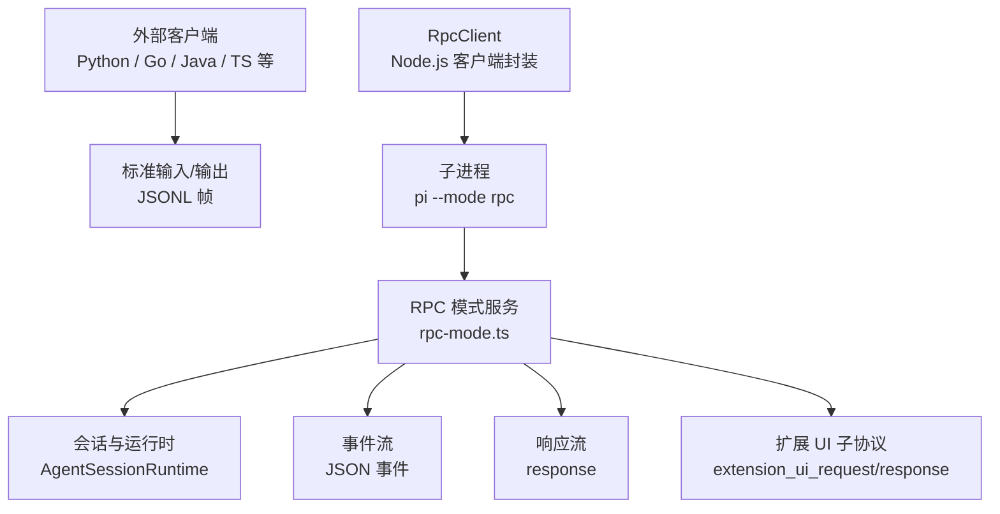
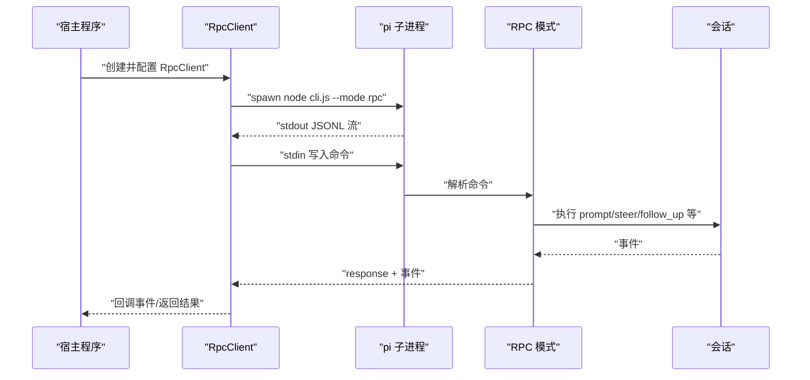
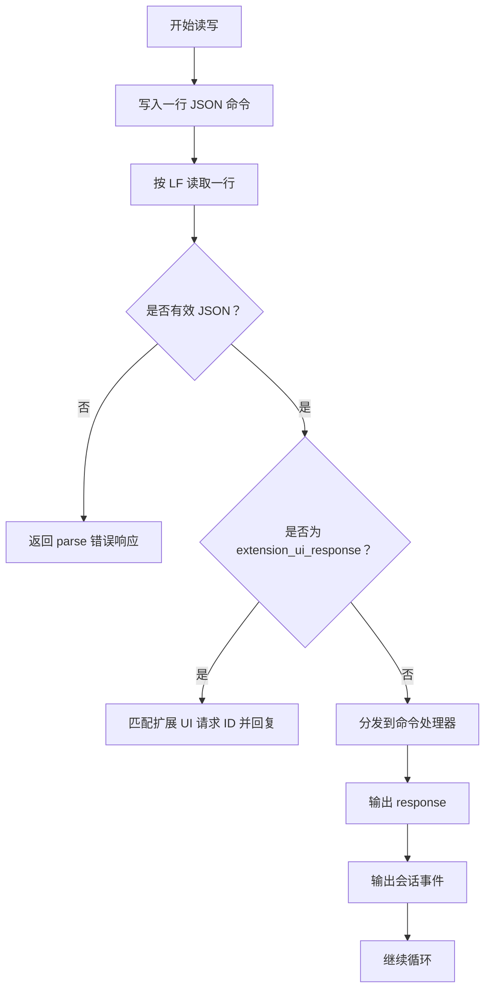
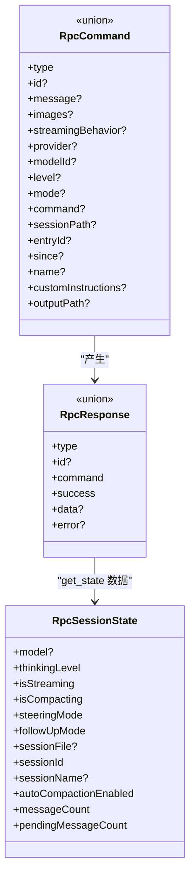
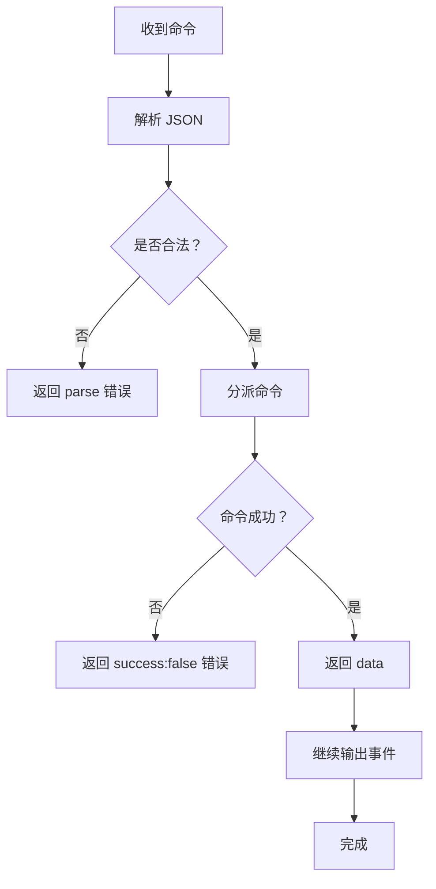
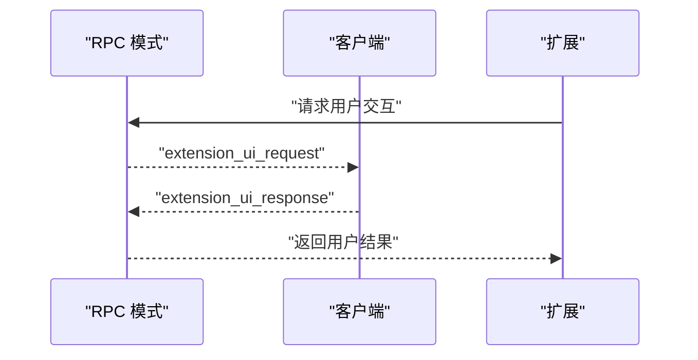
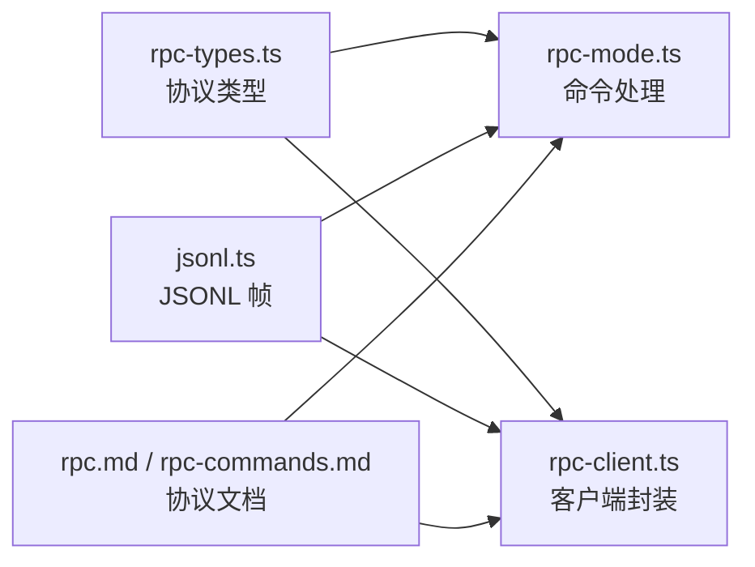
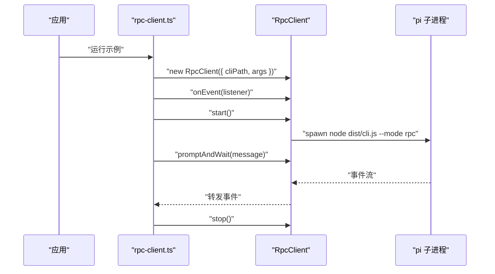

# RPC 模式

<cite>
**本文引用的文件**
- [rpc.md](file://packages/coding-agent/docs/rpc.md)
- [rpc-commands.md](file://packages/coding-agent/docs/rpc-commands.md)
- [rpc-types.ts](file://packages/coding-agent/src/modes/rpc/rpc-types.ts)
- [rpc-mode.ts](file://packages/coding-agent/src/modes/rpc/rpc-mode.ts)
- [rpc-client.ts](file://packages/coding-agent/src/modes/rpc/rpc-client.ts)
- [jsonl.ts](file://packages/coding-agent/src/modes/rpc/jsonl.ts)
- [rpc-client-example.ts](file://packages/coding-agent/examples/rpc-client.ts)
</cite>

## 目录
1. [简介](#简介)
2. [项目结构与定位](#项目结构与定位)
3. [核心组件](#核心组件)
4. [架构总览](#架构总览)
5. [详细组件分析](#详细组件分析)
6. [依赖关系分析](#依赖关系分析)
7. [性能与连接管理](#性能与连接管理)
8. [错误处理机制](#错误处理机制)
9. [安全与认证](#安全与认证)
10. [程序化集成示例](#程序化集成示例)
11. [故障排查](#故障排查)
12. [结论](#结论)

## 简介
RPC 模式用于以“长驻子进程 + JSONL 协议”的方式控制 OMFDE（Pi）的编码代理。它适合：
- 跨语言集成；
- 进程隔离；
- IDE、自动化脚本或自定义 UI；
- 通过标准输入输出进行命令、响应和事件流式通信。

在 Node.js/Bun 环境中，如果希望直接调用 TypeScript API，应优先使用 SDK；如果需要进程边界、跨语言或更稳定的隔离，则使用 RPC 模式。

RPC 模式通过以下边界工作：
- 启动方式：`pi --mode rpc`；
- 传输层：标准输入/输出；
- 帧格式：严格 JSONL（每行一个 JSON 对象，换行符为 LF）；
- 消息类型：命令、响应、会话事件、扩展 UI 请求/响应。

**章节来源**
- [rpc.md:1-11](file://packages/coding-agent/docs/rpc.md#L1-L11)
- [rpc.md:12-20](file://packages/coding-agent/docs/rpc.md#L12-L20)

## 项目结构与定位
RPC 相关实现集中在 `packages/coding-agent` 中，分为三类：
- 文档：说明如何启用、如何使用、命令参考；
- 服务端实现：解析 stdin 命令、绑定会话、输出事件和响应；
- 客户端实现：封装子进程生命周期、命令发送、事件订阅和等待完成。

**图示来源**
- [rpc.md:22-48](file://packages/coding-agent/docs/rpc.md#L22-L48)
- [rpc-mode.ts:54-62](file://packages/coding-agent/src/modes/rpc/rpc-mode.ts#L54-L62)
- [rpc-client.ts:74-130](file://packages/coding-agent/src/modes/rpc/rpc-client.ts#L74-L130)

**章节来源**
- [rpc.md:1-11](file://packages/coding-agent/docs/rpc.md#L1-L11)
- [rpc.md:22-48](file://packages/coding-agent/docs/rpc.md#L22-L48)

## 核心组件
- RPC 模式服务：负责接收命令、维护会话、输出事件和响应。
- RPC 客户端：负责启动子进程、发送命令、关联响应、订阅事件。
- 协议类型：定义命令、响应、状态、扩展 UI 请求/响应的数据结构。
- JSONL 帧工具：提供严格的 JSONL 序列化与读取实现。

这些组件共同构成“命令-响应-事件”三通道模型：
- 命令：从客户端到服务端；
- 响应：服务端对命令的结果；
- 事件：会话运行过程中持续输出的异步活动。

**章节来源**
- [rpc-types.ts:1-15](file://packages/coding-agent/src/modes/rpc/rpc-types.ts#L1-L15)
- [rpc-mode.ts:54-77](file://packages/coding-agent/src/modes/rpc/rpc-mode.ts#L54-L77)
- [rpc-client.ts:56-69](file://packages/coding-agent/src/modes/rpc/rpc-client.ts#L56-L69)
- [jsonl.ts:4-12](file://packages/coding-agent/src/modes/rpc/jsonl.ts#L4-L12)

## 架构总览
RPC 模式的整体交互如下：

**图示来源**
- [rpc-client.ts:74-130](file://packages/coding-agent/src/modes/rpc/rpc-client.ts#L74-L130)
- [rpc-mode.ts:400-435](file://packages/coding-agent/src/modes/rpc/rpc-mode.ts#L400-L435)
- [rpc.md:58-71](file://packages/coding-agent/docs/rpc.md#L58-L71)

## 详细组件分析

### RPC 协议消息格式
RPC 协议使用严格 JSONL 帧：
- 每个记录是一个完整 JSON 对象；
- 记录以 LF 结尾；
- 客户端必须按字节或 UTF-8 流读取 stdout，并按 LF 分割；
- 不要使用会把 Unicode 行分隔符当作记录边界的通用行读取器；
- stdout 保留给协议记录，诊断和应用日志走 stderr。

**图示来源**
- [rpc.md:50-57](file://packages/coding-agent/docs/rpc.md#L50-L57)
- [rpc-mode.ts:768-800](file://packages/coding-agent/src/modes/rpc/rpc-mode.ts#L768-L800)
- [jsonl.ts:14-58](file://packages/coding-agent/src/modes/rpc/jsonl.ts#L14-L58)

**章节来源**
- [rpc.md:50-57](file://packages/coding-agent/docs/rpc.md#L50-L57)
- [jsonl.ts:4-12](file://packages/coding-agent/src/modes/rpc/jsonl.ts#L4-L12)

### 请求与响应结构
命令结构由 `RpcCommand` 定义，常见类别包括：
- 提示类：`prompt`、`steer`、`follow_up`、`abort`、`clear_queue`；
- 状态类：`get_state`；
- 模型类：`set_model`、`cycle_model`、`get_available_models`；
- 思考级别类：`set_thinking_level`、`cycle_thinking_level`、`get_available_thinking_levels`；
- 队列模式类：`set_steering_mode`、`set_follow_up_mode`；
- 压缩类：`compact`、`set_auto_compaction`；
- 重试类：`set_auto_retry`、`abort_retry`；
- Bash 类：`bash`、`abort_bash`；
- 会话类：`get_session_stats`、`export_html`、`switch_session`、`fork`、`clone`、`get_fork_messages`、`get_entries`、`get_tree`、`get_last_assistant_text`、`set_session_name`；
- 消息类：`get_messages`；
- 可发现命令类：`get_commands`。

响应结构统一为 `RpcResponse`，成功时包含 `success: true` 和可选 `data`，失败时包含 `success: false` 和 `error`。

**图示来源**
- [rpc-types.ts:20-74](file://packages/coding-agent/src/modes/rpc/rpc-types.ts#L20-L74)
- [rpc-types.ts:96-109](file://packages/coding-agent/src/modes/rpc/rpc-types.ts#L96-L109)
- [rpc-types.ts:116-245](file://packages/coding-agent/src/modes/rpc/rpc-types.ts#L116-L245)

**章节来源**
- [rpc-types.ts:20-74](file://packages/coding-agent/src/modes/rpc/rpc-types.ts#L20-L74)
- [rpc-types.ts:116-245](file://packages/coding-agent/src/modes/rpc/rpc-types.ts#L116-L245)
- [rpc-commands.md:5-44](file://packages/coding-agent/docs/rpc-commands.md#L5-L44)

### 错误处理机制
RPC 的错误分为三层：
1. 协议层错误：JSON 解析失败会返回 `parse` 错误响应；
2. 命令层错误：某个命令处理失败返回 `success: false` 的响应；
3. 运行时错误：子进程退出、stdin/stdout 异常、超时、Provider 失败等。

**图示来源**
- [rpc.md:73-89](file://packages/coding-agent/docs/rpc.md#L73-L89)
- [rpc-mode.ts:768-782](file://packages/coding-agent/src/modes/rpc/rpc-mode.ts#L768-L782)
- [rpc-client.ts:545-554](file://packages/coding-agent/src/modes/rpc/rpc-client.ts#L545-L554)

**章节来源**
- [rpc.md:73-89](file://packages/coding-agent/docs/rpc.md#L73-L89)
- [rpc-mode.ts:768-782](file://packages/coding-agent/src/modes/rpc/rpc-mode.ts#L768-L782)
- [rpc-client.ts:545-616](file://packages/coding-agent/src/modes/rpc/rpc-client.ts#L545-L616)

### 扩展 UI 子协议
扩展可以在 RPC 模式下发起用户交互，例如选择、确认、输入、编辑器、通知、状态更新、标题设置、文本编辑器操作等。客户端需要：
- 监听 `extension_ui_request`；
- 根据 `id` 回复 `extension_ui_response`；
- 支持取消、超时和信号中断；
- 注意某些 TUI 专属能力在 RPC 模式下不可用或退化为无操作。

**图示来源**
- [rpc-mode.ts:79-135](file://packages/coding-agent/src/modes/rpc/rpc-mode.ts#L79-L135)
- [rpc-types.ts:251-297](file://packages/coding-agent/src/modes/rpc/rpc-types.ts#L251-L297)

**章节来源**
- [rpc-mode.ts:79-135](file://packages/coding-agent/src/modes/rpc/rpc-mode.ts#L79-L135)
- [rpc-types.ts:251-297](file://packages/coding-agent/src/modes/rpc/rpc-types.ts#L251-L297)

## 依赖关系分析
RPC 模式的核心依赖关系如下：

**图示来源**
- [rpc-types.ts:1-15](file://packages/coding-agent/src/modes/rpc/rpc-types.ts#L1-L15)
- [rpc-mode.ts:31-48](file://packages/coding-agent/src/modes/rpc/rpc-mode.ts#L31-L48)
- [rpc-client.ts:14-16](file://packages/coding-agent/src/modes/rpc/rpc-client.ts#L14-L16)
- [jsonl.ts:1-12](file://packages/coding-agent/src/modes/rpc/jsonl.ts#L1-L12)

**章节来源**
- [rpc-types.ts:1-15](file://packages/coding-agent/src/modes/rpc/rpc-types.ts#L1-L15)
- [rpc-mode.ts:31-48](file://packages/coding-agent/src/modes/rpc/rpc-mode.ts#L31-L48)
- [rpc-client.ts:14-16](file://packages/coding-agent/src/modes/rpc/rpc-client.ts#L14-L16)
- [jsonl.ts:1-12](file://packages/coding-agent/src/modes/rpc/jsonl.ts#L1-L12)

## 性能与连接管理
- 连接模型：RPC 模式是长驻子进程，不是每次请求新建进程；
- 背压：服务端尊重 stdout 背压，客户端必须持续消费 stdout，否则可能阻塞进程；
- 事件订阅：应在发送 `prompt` 之前订阅事件，避免错过快速完成的响应；
- 空闲等待：使用 `agent_settled` 判断代理不再自动继续工作；
- 子进程生命周期：关闭 stdin 请求有序退出；SIGTERM/SIGHUP 也会触发有序退出；重复信号强制退出；
- 客户端超时：内部命令发送有默认超时，应避免无限等待；
- 批量命令：建议使用唯一 `id` 关联多个并发命令，而不是依赖响应顺序。

最佳实践：
- 始终订阅事件后再发送命令；
- 使用 `waitForIdle` 或 `collectEvents` 等待完成；
- 合理设置超时；
- 捕获子进程退出和 stderr；
- 不要在 stdout 上写非协议内容；
- 使用严格 JSONL 读取器，避免 Unicode 分隔符问题。

**章节来源**
- [rpc.md:50-71](file://packages/coding-agent/docs/rpc.md#L50-L71)
- [rpc.md:91-98](file://packages/coding-agent/docs/rpc.md#L91-L98)
- [rpc-client.ts:172-180](file://packages/coding-agent/src/modes/rpc/rpc-client.ts#L172-L180)
- [rpc-client.ts:471-508](file://packages/coding-agent/src/modes/rpc/rpc-client.ts#L471-L508)
- [rpc-client.ts:556-605](file://packages/coding-agent/src/modes/rpc/rpc-client.ts#L556-L605)

## 错误处理机制
RPC 的错误处理应覆盖：
- JSON 解析错误；
- 未知命令；
- 命令业务错误；
- 子进程启动失败；
- 子进程意外退出；
- stdin/stdout 流错误；
- 命令响应超时；
- Provider 或工具调用失败（通过事件和消息流报告）。

客户端建议：
- 检查 `response.success`；
- 区分“命令被拒绝”和“运行期间失败”；
- 监听 `agent_settled` 作为最终稳定点；
- 收集 stderr 用于调试；
- 在进程退出时拒绝所有待处理请求。

**章节来源**
- [rpc.md:73-89](file://packages/coding-agent/docs/rpc.md#L73-L89)
- [rpc-mode.ts:768-782](file://packages/coding-agent/src/modes/rpc/rpc-mode.ts#L768-L782)
- [rpc-client.ts:107-125](file://packages/coding-agent/src/modes/rpc/rpc-client.ts#L107-L125)
- [rpc-client.ts:545-616](file://packages/coding-agent/src/modes/rpc/rpc-client.ts#L545-L616)

## 安全与认证
当前仓库中的 RPC 模式本身没有内置 HTTP 认证、OAuth、TLS 或访问控制。它基于本地子进程的标准输入输出通信，因此安全性主要取决于宿主环境：
- 仅暴露给可信进程；
- 不将 RPC 端口或管道暴露给网络；
- 不在不受信任的环境中启动 RPC 子进程；
- 如需远程调用，应在 RPC 之上叠加受信任的网络层，例如：
  - 使用受保护的 HTTP 网关；
  - 使用 mTLS；
  - 使用 OAuth/OIDC 或 API Key；
  - 使用零信任网络或内网隔离；
  - 对命令做白名单、参数校验和速率限制。

仓库中与认证相关的代码主要集中在 MCP 模块的 OAuth 实现中，而不是 RPC 模式本身。若你通过 MCP 调用外部服务，应遵循 MCP 的 OAuth 流程；但 RPC 模式本身的 stdin/stdout 通道不包含该认证逻辑。

**章节来源**
- [rpc.md:1-11](file://packages/coding-agent/docs/rpc.md#L1-L11)
- [rpc.md:50-57](file://packages/coding-agent/docs/rpc.md#L50-L57)
- [rpc.md:89-98](file://packages/coding-agent/docs/rpc.md#L89-L98)

## 程序化集成示例

### 使用 TypeScript RpcClient
这是官方提供的 TypeScript 客户端示例，展示如何：
- 启动 Pi 子进程；
- 订阅事件；
- 发送 prompt；
- 等待完成；
- 清理资源。

**图示来源**
- [rpc-client-example.ts:15-35](file://packages/coding-agent/examples/rpc-client.ts#L15-L35)
- [rpc-client.ts:74-130](file://packages/coding-agent/src/modes/rpc/rpc-client.ts#L74-L130)

**章节来源**
- [rpc-client-example.ts:1-36](file://packages/coding-agent/examples/rpc-client.ts#L1-L36)
- [rpc-client.ts:74-130](file://packages/coding-agent/src/modes/rpc/rpc-client.ts#L74-L130)

### 使用 Python 或其他语言
RPC 模式是语言无关的，只要你能：
- 启动 `pi --mode rpc` 子进程；
- 向 stdin 写入 JSONL 命令；
- 从 stdout 按 LF 读取 JSONL 记录；
- 处理 `response` 和事件；
- 在结束时关闭 stdin 并等待进程退出。

文档提供了一个最小 Python 示例，展示如何：
- 启动子进程；
- 发送 `prompt`；
- 打印流式文本；
- 等待 `agent_settled`；
- 关闭 stdin 并等待进程。

**章节来源**
- [rpc.md:99-134](file://packages/coding-agent/docs/rpc.md#L99-L134)

### 通过 HTTP 或其他协议调用 OMFDE
RPC 模式本身不提供 HTTP 接口。如果你需要通过 HTTP 调用 OMFDE，推荐两种路径：
1. 使用 SDK：在 Node.js/Bun 中直接调用 TypeScript API；
2. 自建 HTTP 网关：HTTP 服务验证请求后，将请求转换为 RPC 命令，并通过 stdin/stdout 与 RPC 子进程通信。

无论哪种方式，都应：
- 在 HTTP 层做身份认证和授权；
- 对命令做白名单和参数校验；
- 限制请求频率；
- 记录审计日志；
- 保护敏感信息；
- 避免把 RPC 子进程直接暴露给公网。

**章节来源**
- [rpc.md:1-11](file://packages/coding-agent/docs/rpc.md#L1-L11)
- [rpc.md:136-144](file://packages/coding-agent/docs/rpc.md#L136-L144)

## 故障排查
常见问题与处理方式：
- 无法解析 JSON：检查是否使用了错误的行分隔符；确保只按 LF 分割；
- 事件丢失：确保在发送命令前订阅事件；
- 进程卡住：检查是否停止读取 stdout；
- 子进程退出：检查 stderr 和退出码；
- 命令无响应：检查是否超时；检查是否已订阅事件；
- 扩展 UI 无响应：检查是否正确回复 `extension_ui_response`；
- 会话切换或新会话被取消：检查扩展事件是否返回 `cancelled`。

**章节来源**
- [rpc.md:50-57](file://packages/coding-agent/docs/rpc.md#L50-L57)
- [rpc.md:73-98](file://packages/coding-agent/docs/rpc.md#L73-L98)
- [rpc-client.ts:107-130](file://packages/coding-agent/src/modes/rpc/rpc-client.ts#L107-L130)
- [rpc-client.ts:545-616](file://packages/coding-agent/src/modes/rpc/rpc-client.ts#L545-L616)

## 结论
RPC 模式为 OMFDE 提供了稳定、语言无关、进程隔离的控制面。它通过严格 JSONL 帧在标准输入输出上传输命令、响应和事件，适合 IDE、自动化系统和跨语言集成。

使用时应重点关注：
- 正确启动 `pi --mode rpc`；
- 使用严格 JSONL 帧；
- 先订阅事件再发送命令；
- 使用 `agent_settled` 判断最终稳定状态；
- 正确处理错误、超时和进程生命周期；
- 在 RPC 之上叠加必要的网络安全和认证机制。