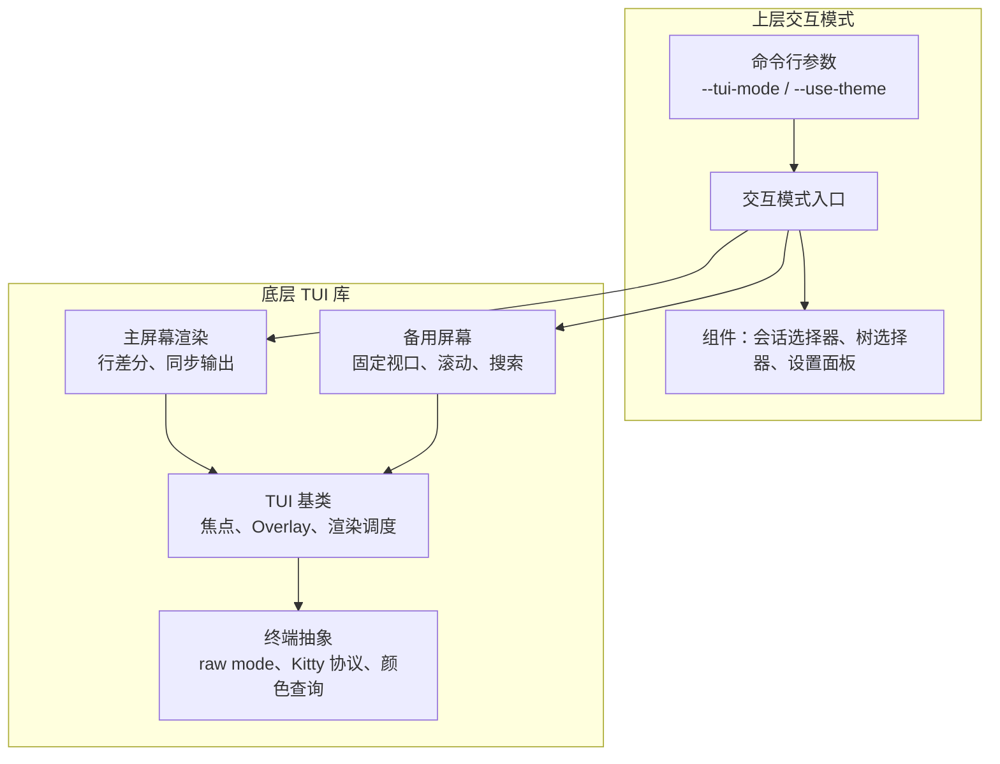
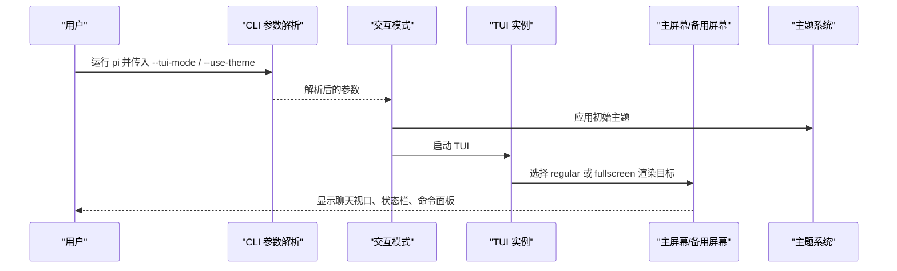
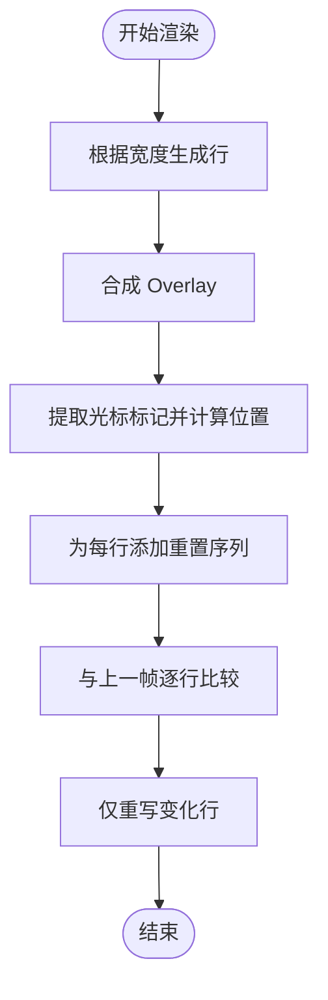
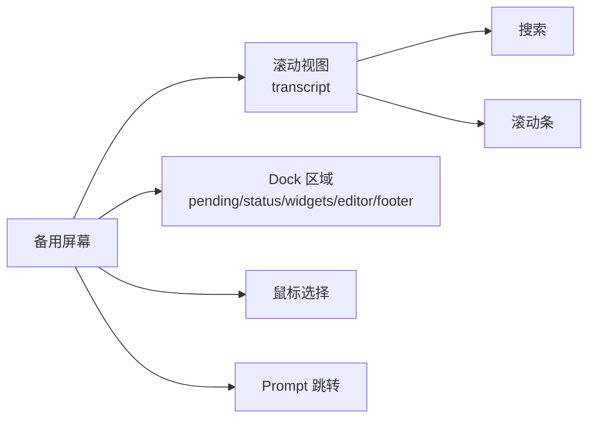
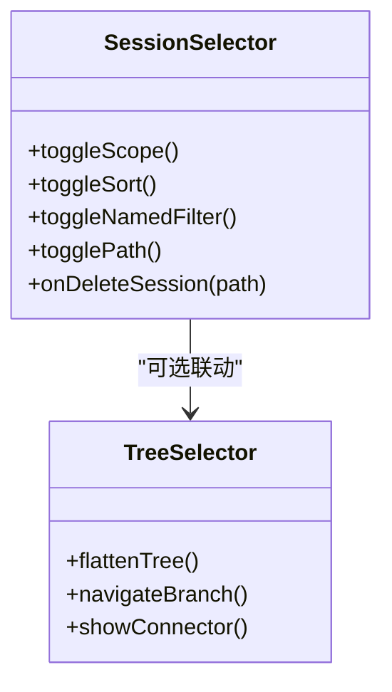
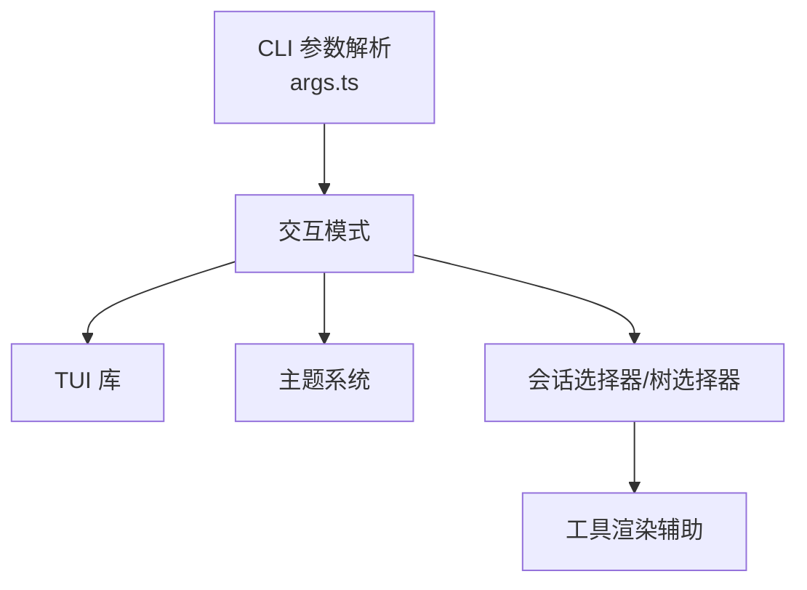
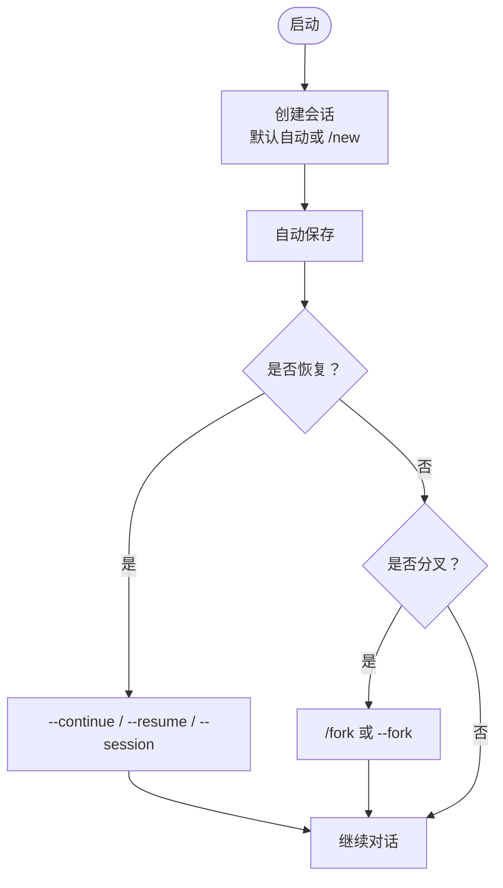
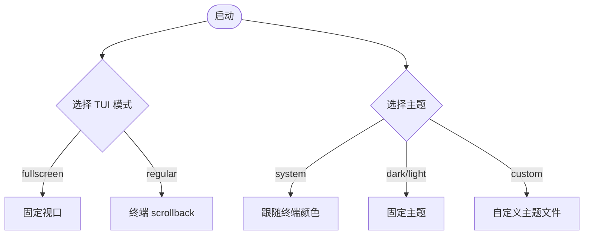

# 交互式模式（TUI）

<cite>
**本文引用的文件**   
- [15-tui.md](file://docs/explains/15-tui.md)
- [27-tui-usage.md](file://docs/explains/27-tui-usage.md)
- [cli.md](file://packages/coding-agent/docs/cli.md)
- [themes.md](file://packages/coding-agent/docs/themes.md)
- [usage.md](file://packages/coding-agent/docs/usage.md)
- [args.ts](file://packages/coding-agent/src/cli/args.ts)
- [tui-main-screen.ts](file://packages/tui/src/tui-main-screen.ts)
- [session-selector.ts](file://packages/coding-agent/src/modes/interactive/components/session-selector.ts)
</cite>

## 目录
1. [简介](#简介)
2. [项目结构](#项目结构)
3. [核心组件](#核心组件)
4. [架构总览](#架构总览)
5. [详细组件分析](#详细组件分析)
6. [依赖关系分析](#依赖关系分析)
7. [性能与渲染特性](#性能与渲染特性)
8. [启动与会话管理](#启动与会话管理)
9. [快捷键与界面自定义](#快捷键与界面自定义)
10. [最佳实践](#最佳实践)
11. [故障排查](#故障排查)
12. [结论](#结论)

## 简介
本文件面向使用终端交互模式（TUI）的用户，目标是帮助你快速、稳定地启动会话、管理会话、使用快捷键、自定义主题与界面模式，并理解 TUI 的底层工作方式。文档同时覆盖命令行参数 `--tui-mode`、`--use-theme` 等配置项，以及会话创建、保存、恢复、分叉等操作路径。

## 项目结构
TUI 由两个层面组成：
- 底层 TUI 库：负责终端抽象、输入解析、布局、渲染、光标、Overlay、备用屏幕等。
- 上层交互模式：基于 TUI 库实现聊天视口、命令面板、会话选择器、设置面板、主题系统等。

**图表来源**
- [cli.md:235-236](file://packages/coding-agent/docs/cli.md#L235-L236)
- [themes.md:50-55](file://packages/coding-agent/docs/themes.md#L50-L55)
- [15-tui.md:22-44](file://docs/explains/15-tui.md#L22-L44)
- [15-tui.md:62-100](file://docs/explains/15-tui.md#L62-L100)
- [15-tui.md:158-183](file://docs/explains/15-tui.md#L158-L183)

**章节来源**
- [15-tui.md:1-44](file://docs/explains/15-tui.md#L1-L44)
- [cli.md:235-236](file://packages/coding-agent/docs/cli.md#L235-L236)
- [themes.md:1-12](file://packages/coding-agent/docs/themes.md#L1-L12)

## 核心组件
- **组件模型**：每个组件只负责根据宽度返回若干行字符串，样式可包含 ANSI；布局、合成、差分、光标定位由 TUI 统一处理。
- **TUI 接口**：提供添加子组件、焦点管理、Overlay、渲染调度、输入监听、终端能力查询等方法。
- **两个渲染目标**：
  - 主屏幕：用于普通终端输出和 scrollback，采用按行差分减少闪烁。
  - 备用屏幕：用于聊天视口，支持固定布局、滚动条、搜索、鼠标选择和 prompt 跳转。
- **布局系统**：通过 `vstack`、`hstack`、`scroll` 等布局节点分配尺寸，支持 grow/shrink/min/max/gap。
- **Overlay**：支持宽高、锚点、行列位置、边距、可见性条件和非抢占焦点。
- **终端抽象**：封装 raw mode、stdin 事件、resize、Kitty 键盘协议、OSC 颜色查询、单元格尺寸查询、进度与程序状态。
- **光标机制**：组件在需要光标的位置插入特殊标记，TUI 计算可见列后移动硬件光标或绘制假光标。
- **输入与按键**：解析按键、默认键位、配置覆盖、冲突检测，支持 Kitty 协议及 release/repeat 事件。
- **常用组件**：文本、边框、空行、堆叠容器、滚动视图、编辑器、单行输入、Markdown、选择列表、图片、加载器等。

**章节来源**
- [15-tui.md:6-20](file://docs/explains/15-tui.md#L6-L20)
- [15-tui.md:22-58](file://docs/explains/15-tui.md#L22-L58)
- [15-tui.md:62-100](file://docs/explains/15-tui.md#L62-L100)
- [15-tui.md:102-156](file://docs/explains/15-tui.md#L102-L156)
- [15-tui.md:158-210](file://docs/explains/15-tui.md#L158-L210)
- [15-tui.md:212-229](file://docs/explains/15-tui.md#L212-L229)

## 架构总览
下图展示从命令行到 TUI 渲染的关键流程：用户通过 CLI 传入 `--tui-mode` 和 `--use-theme`，交互模式解析参数并启动 TUI；TUI 根据模式选择主屏幕或备用屏幕进行渲染，并通过 Overlay 显示命令面板、会话选择器等。

**图表来源**
- [cli.md:235-236](file://packages/coding-agent/docs/cli.md#L235-L236)
- [themes.md:50-55](file://packages/coding-agent/docs/themes.md#L50-L55)
- [usage.md:84-88](file://packages/coding-agent/docs/usage.md#L84-L88)

## 详细组件分析

### 主屏幕渲染与差分
主屏幕负责将组件渲染结果写入终端主屏和 scrollback，核心是按行差分：先得到新行，再与上一帧比较，只重写变化区域，并使用同步输出包裹整帧以减少闪烁。当终端宽度或高度变化、内容变短且开启清理策略、或变化行超出可见区域时，会触发整屏重绘。

**图表来源**
- [15-tui.md:62-89](file://docs/explains/15-tui.md#L62-L89)

**章节来源**
- [15-tui.md:62-89](file://docs/explains/15-tui.md#L62-L89)
- [tui-main-screen.ts:126-159](file://packages/tui/src/tui-main-screen.ts#L126-L159)

### 备用屏幕与聊天视口
备用屏幕用于聊天视口，具有固定布局：上方是滚动 transcript，下方 dock 包括待发送消息、状态、小部件、编辑器和页脚。它支持搜索、滚动条、鼠标选择、prompt 跳转等功能。

**图表来源**
- [15-tui.md:91-100](file://docs/explains/15-tui.md#L91-L100)

**章节来源**
- [15-tui.md:91-100](file://docs/explains/15-tui.md#L91-L100)

### 会话选择器与树选择器
会话选择器提供会话列表、排序、过滤、作用域切换（当前目录或全部）、删除确认、路径显示等能力；树选择器以缩进和连接符展示会话分支结构，便于在多个分支间导航。

**图表来源**
- [session-selector.ts:1-22](file://packages/coding-agent/src/modes/interactive/components/session-selector.ts#L1-L22)
- [session-selector.ts:520-571](file://packages/coding-agent/src/modes/interactive/components/session-selector.ts#L520-L571)

**章节来源**
- [session-selector.ts:1-22](file://packages/coding-agent/src/modes/interactive/components/session-selector.ts#L1-L22)
- [session-selector.ts:520-571](file://packages/coding-agent/src/modes/interactive/components/session-selector.ts#L520-L571)

## 依赖关系分析
- CLI 参数解析模块负责识别 `--tui-mode` 与 `--use-theme`，并将它们传递给交互模式。
- 交互模式依赖 TUI 库提供的组件、布局、渲染、输入能力。
- 主题系统根据终端能力动态构建颜色，支持自动切换 light/dark。
- 会话管理相关组件依赖会话管理器提供的会话信息、树结构和工具渲染辅助。

**图表来源**
- [args.ts:202-238](file://packages/coding-agent/src/cli/args.ts#L202-L238)
- [themes.md:50-55](file://packages/coding-agent/docs/themes.md#L50-L55)
- [session-selector.ts:1-22](file://packages/coding-agent/src/modes/interactive/components/session-selector.ts#L1-L22)

**章节来源**
- [args.ts:202-238](file://packages/coding-agent/src/cli/args.ts#L202-L238)
- [themes.md:50-55](file://packages/coding-agent/docs/themes.md#L50-L55)
- [session-selector.ts:1-22](file://packages/coding-agent/src/modes/interactive/components/session-selector.ts#L1-L22)

## 性能与渲染特性
- **渲染节流**：常规渲染请求进入队列，避免频繁刷新；键盘输入走即时渲染路径，保证低延迟。
- **同步输出**：整帧输出被包裹在同步序列中，减少闪烁并使差分更新看起来原子。
- **按宽度缓存**：同一帧内对相同宽度的渲染结果进行缓存，避免重复计算。
- **增量写入**：大输出按块写入，避免形成超大字符串。
- **终端能力探测**：颜色、单元格尺寸、Kitty 协议等在运行时探测，确保兼容性。

**章节来源**
- [15-tui.md:46-58](file://docs/explains/15-tui.md#L46-L58)
- [15-tui.md:86-89](file://docs/explains/15-tui.md#L86-L89)
- [15-tui.md:231-242](file://docs/explains/15-tui.md#L231-L242)

## 启动与会话管理

### 启动方式
- 日常开发推荐使用 npm 脚本直接启动 TUI。
- 带参数时使用 `--` 分隔，例如指定 provider、model、continue 或非交互模式。
- 源码入口适合开发调试，构建产物适合生产环境。

**章节来源**
- [27-tui-usage.md:6-32](file://docs/explains/27-tui-usage.md#L6-L32)

### 会话创建、保存、恢复、分叉
- **创建会话**：正常对话即自动创建会话；可通过 `/new` 新建会话，或通过 `--name` 设置显示名称。
- **保存会话**：默认自动保存，除非显式禁用持久化。
- **恢复会话**：
  - 使用 `/resume` 打开会话选择器。
  - 使用 `--continue` 恢复当前目录最近会话。
  - 使用 `--resume` 打开选择器并跨目录恢复。
  - 使用 `--session <path|id>` 通过文件或 ID 打开会话。
  - 使用 `--session-id <id>` 在当前目录使用或创建指定 ID 的会话。
- **分叉会话**：
  - 使用 `/fork` 在当前会话基础上探索不同方案。
  - 使用 `--fork <path|id>` 将某个会话分叉到当前目录。
- **会话统计与导出**：
  - 使用 `/session` 查看会话文件、ID、消息数、token、缓存命中率、费用。
  - 使用 `/export` 导出 HTML 或 JSONL。

**图表来源**
- [cli.md:82-109](file://packages/coding-agent/docs/cli.md#L82-L109)
- [usage.md:55-66](file://packages/coding-agent/docs/usage.md#L55-L66)
- [27-tui-usage.md:225-233](file://docs/explains/27-tui-usage.md#L225-L233)

**章节来源**
- [cli.md:82-109](file://packages/coding-agent/docs/cli.md#L82-L109)
- [usage.md:55-66](file://packages/coding-agent/docs/usage.md#L55-L66)
- [27-tui-usage.md:225-233](file://docs/explains/27-tui-usage.md#L225-L233)

## 快捷键与界面自定义

### 常用快捷键
- `Enter`：发送消息。
- `Shift+Enter`：换行（tmux 需启用 extended-keys）。
- `Escape`：中止当前生成。
- `Ctrl+C`：第一次清空编辑器，第二次退出。
- `Ctrl+D`：编辑器为空时退出。
- `Ctrl+L`：打开模型选择器。
- `Ctrl+P` / `Alt+P`：循环切换模型。
- `Shift+Tab`：循环 thinking 等级。
- `Ctrl+O`：展开/折叠工具输出。
- `Ctrl+T`：显示/隐藏 thinking 块。
- `Ctrl+G`：用外部编辑器写长 prompt。
- `Ctrl+X`：复制最后一条助手消息。
- `Ctrl+Q`：排队 follow-up。
- `@`：文件选择。
- `!` / `!!`：Bash 模式，`!` 的输出进入上下文，`!!` 不进入。
- `/`：命令面板。

**章节来源**
- [27-tui-usage.md:235-254](file://docs/explains/27-tui-usage.md#L235-L254)
- [usage.md:11-27](file://packages/coding-agent/docs/usage.md#L11-L27)
- [usage.md:44-53](file://packages/coding-agent/docs/usage.md#L44-L53)

### 界面模式与主题
- **TUI 模式**：
  - `fullscreen`（默认）：编辑器与状态区固定，transcript 在终端窗口内滚动。
  - `regular`：使用终端的正常 scrollback。
  - 可通过 `/settings` 或 `--tui-mode` 切换。
- **主题系统**：
  - 内置 `system`、`dark`、`light` 主题。
  - `system` 默认跟随终端颜色，支持自动切换 light/dark。
  - 可通过 `/settings` 选择主题，或使用 `--use-theme` 临时指定。
  - 支持自定义主题文件，位于 `<agent-dir>/themes/<name>.json`。

**图表来源**
- [usage.md:84-88](file://packages/coding-agent/docs/usage.md#L84-L88)
- [themes.md:1-12](file://packages/coding-agent/docs/themes.md#L1-L12)
- [themes.md:50-55](file://packages/coding-agent/docs/themes.md#L50-L55)

**章节来源**
- [usage.md:84-88](file://packages/coding-agent/docs/usage.md#L84-L88)
- [themes.md:1-12](file://packages/coding-agent/docs/themes.md#L1-L12)
- [themes.md:50-55](file://packages/coding-agent/docs/themes.md#L50-L55)

## 最佳实践
- **会话命名**：使用 `--name` 或 `/name` 为重要会话设置易识别的名称，便于后续查找与管理。
- **会话分叉**：在复杂任务中使用 `/fork` 或 `--fork` 探索不同方案，保留原始工作成果。
- **模型与思考等级**：通过 `/model`、`Ctrl+L`、`Ctrl+P`、`Shift+Tab` 调整模型与 thinking 等级，平衡质量与成本。
- **工具控制**：按需启用/禁用工具，必要时使用 `--tools`、`--exclude-tools`、`--no-tools` 限制能力范围。
- **主题与模式**：根据终端能力选择 `system` 主题以获得最佳对比度；在 tmux 或受限环境中优先使用 `regular` 模式。
- **调试与诊断**：遇到渲染或状态问题时，使用 `/debug` 收集诊断日志，注意敏感信息脱敏后再分享。

[本节为通用建议，不直接分析具体文件]

## 故障排查
- **tmux 扩展键未启用**：`Shift+Enter` 可能无效，提示会在启动页出现。解决方法：启用 `extended-keys on` 并重启 tmux。
- **tmux 截图裁剪**：在 tmux 中使用 `capture-pane` 截图时，若弹层高于终端窗口，顶部会被裁掉。解决方法：调高窗口。
- **TUI 模式不支持**：某些终端（如 Windows conhost）在 fullscreen 模式下可能出现崩溃，建议使用 `--tui-mode regular`。
- **主题颜色异常**：检查终端 truecolor 支持与对比度设置；必要时切换到固定主题或自定义主题。

**章节来源**
- [27-tui-usage.md:256-267](file://docs/explains/27-tui-usage.md#L256-L267)
- [usage.md:84-95](file://packages/coding-agent/docs/usage.md#L84-L95)

## 结论
TUI 提供了强大的终端交互体验：稳定的组件模型、高效的渲染与差分、灵活的布局与 Overlay、完善的输入与快捷键体系，以及丰富的会话管理与主题定制能力。通过合理使用 `--tui-mode`、`--use-theme`、会话恢复与分叉、快捷键与主题，你可以获得一致、高效、可视化的编码助手体验。遇到问题时，优先检查终端能力、tmux 配置与主题设置，并结合 `/debug` 输出定位问题。

[本节为总结性内容，不直接分析具体文件]