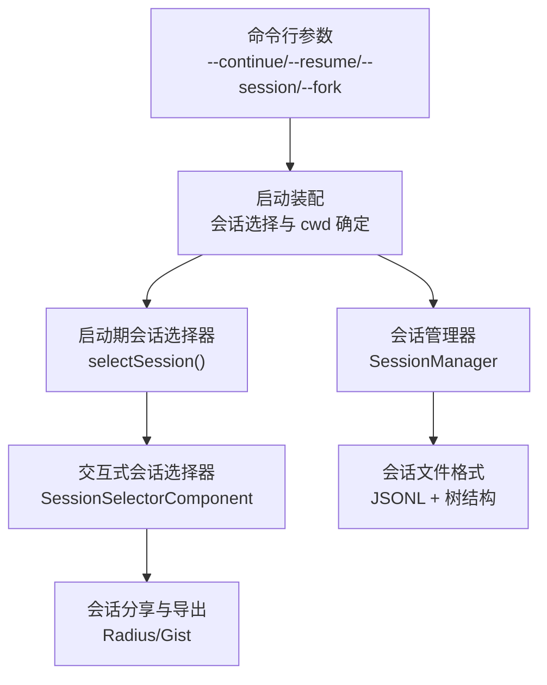
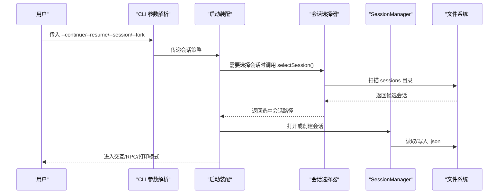
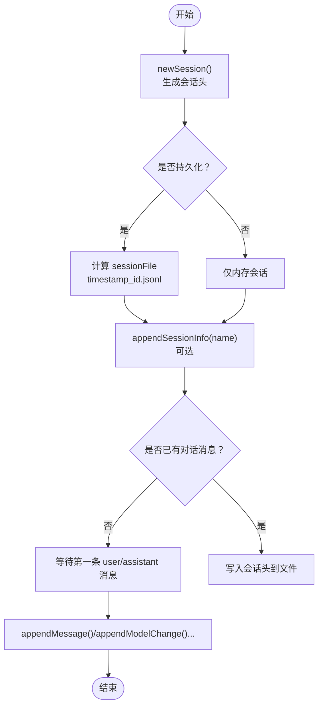
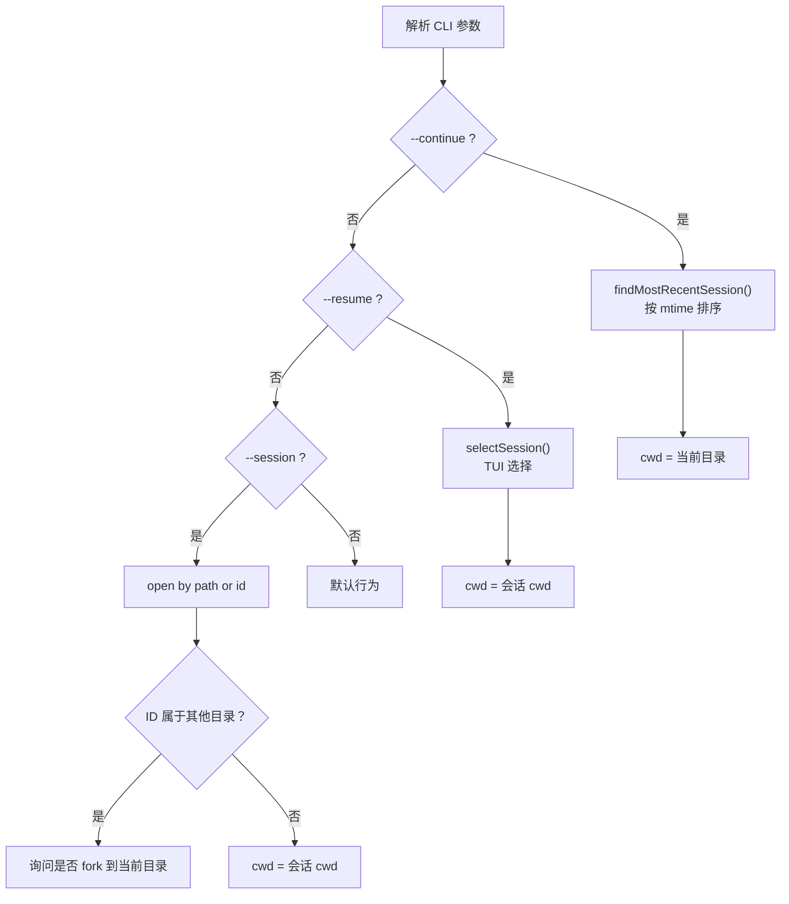
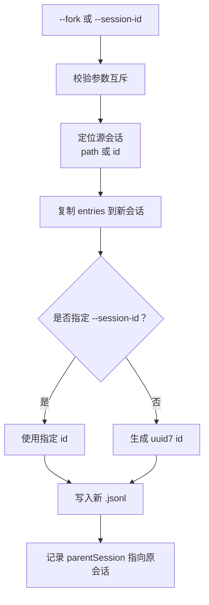
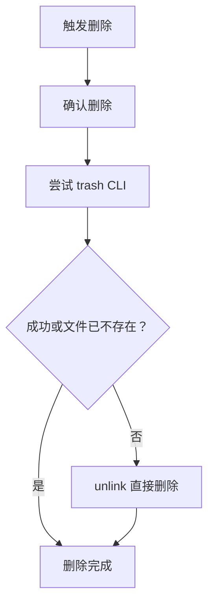
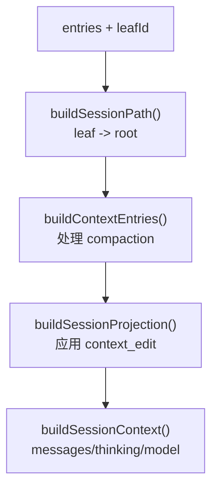
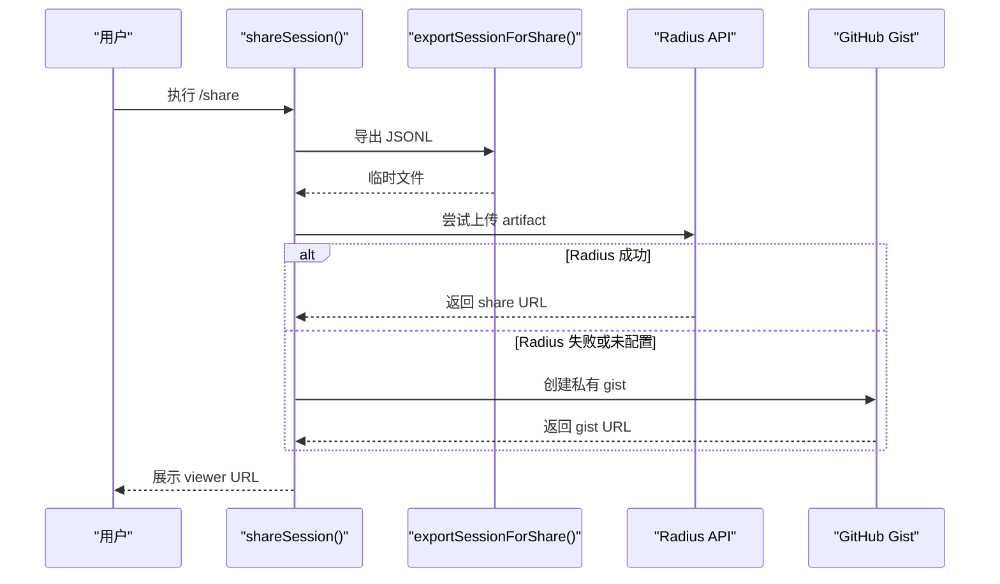
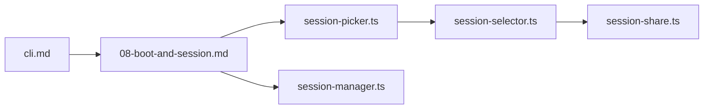

# 会话管理

<cite>
**本文引用的文件**
- [session-manager.ts](file://packages/coding-agent/src/core/session-manager.ts)
- [cli.md](file://packages/coding-agent/docs/cli.md)
- [sessions.md](file://packages/coding-agent/docs/sessions.md)
- [session-format.md](file://packages/coding-agent/docs/session-format.md)
- [08-boot-and-session.md](file://docs/explains/08-boot-and-session.md)
- [session-picker.ts](file://packages/coding-agent/src/cli/session-picker.ts)
- [session-selector.ts](file://packages/coding-agent/src/modes/interactive/components/session-selector.ts)
- [session-share.ts](file://packages/coding-agent/src/modes/interactive/session-share.ts)
</cite>

## 目录
1. [简介](#简介)
2. [项目结构与定位](#项目结构与定位)
3. [核心组件](#核心组件)
4. [架构总览](#架构总览)
5. [详细组件分析](#详细组件分析)
6. [依赖关系分析](#依赖关系分析)
7. [性能与可扩展性](#性能与可扩展性)
8. [故障排查](#故障排查)
9. [最佳实践与迁移指南](#最佳实践与迁移指南)
10. [结论](#结论)

## 简介
本文件面向“会话管理”这一核心能力，覆盖以下目标：
- 会话的创建、命名、保存、恢复、分叉和删除。
- 命令行参数 `--continue`、`--resume`、`--session`、`--fork`、`--session-id`、`--session-dir`、`--no-session`、`--name` 的行为与约束。
- 会话文件的存储位置、JSONL 格式、版本迁移与树形结构。
- 会话生命周期管理、跨项目共享与管理、数据迁移与备份建议。

## 项目结构与定位
会话管理在项目中由“核心持久化层 + CLI 选择器 + TUI 交互层 + 分享导出层”共同实现：
- 核心持久化与数据结构：`packages/coding-agent/src/core/session-manager.ts`
- 命令行文档与参数语义：`packages/coding-agent/docs/cli.md`
- 会话使用指南与工作目录语义：`packages/coding-agent/docs/sessions.md`
- 会话文件格式与类型定义说明：`packages/coding-agent/docs/session-format.md`
- 启动装配与会话选择流程：`docs/explains/08-boot-and-session.md`
- 启动期会话选择 UI：`packages/coding-agent/src/cli/session-picker.ts`
- 交互式会话列表、搜索、重命名、删除等：`packages/coding-agent/src/modes/interactive/components/session-selector.ts`
- 会话导出与分享（Radius / GitHub Gist）：`packages/coding-agent/src/modes/interactive/session-share.ts`

**图表来源**
- [08-boot-and-session.md:22-38](file://docs/explains/08-boot-and-session.md#L22-L38)
- [session-picker.ts:14-55](file://packages/coding-agent/src/cli/session-picker.ts#L14-L55)
- [session-selector.ts:684-800](file://packages/coding-agent/src/modes/interactive/components/session-selector.ts#L684-L800)
- [session-manager.ts:988-1023](file://packages/coding-agent/src/core/session-manager.ts#L988-L1023)
- [session-format.md:8-14](file://packages/coding-agent/docs/session-format.md#L8-L14)

**章节来源**
- [08-boot-and-session.md:22-38](file://docs/explains/08-boot-and-session.md#L22-L38)
- [cli.md:78-109](file://packages/coding-agent/docs/cli.md#L78-L109)
- [sessions.md:5-28](file://packages/coding-agent/docs/sessions.md#L5-L28)

## 核心组件
- SessionManager：会话的内存模型、追加写入、树遍历、上下文构建、压缩摘要、分支指针、会话信息扫描与最近会话查找。
- CLI 会话选择器：为 `--resume` 提供启动期 TUI 选择界面。
- 交互式会话选择器：支持搜索、排序、按线程显示、重命名、删除、路径显示等。
- 会话分享模块：将当前会话导出为 JSONL/HTML，并通过 Radius 或 GitHub Gist 分享。
- 文档层：CLI 参数、会话工作目录语义、会话文件格式。

**章节来源**
- [session-manager.ts:988-1023](file://packages/coding-agent/src/core/session-manager.ts#L988-L1023)
- [session-picker.ts:14-55](file://packages/coding-agent/src/cli/session-picker.ts#L14-L55)
- [session-selector.ts:684-800](file://packages/coding-agent/src/modes/interactive/components/session-selector.ts#L684-L800)
- [session-share.ts:56-103](file://packages/coding-agent/src/modes/interactive/session-share.ts#L56-L103)

## 架构总览
会话管理的整体流程如下：
1. 解析 CLI 参数，决定会话策略：新建、继续、恢复、分叉、无会话。
2. 根据策略选择或创建 SessionManager。
3. 确定最终工作目录（cwd），并加载对应项目的信任状态与服务。
4. 进入交互模式、RPC 模式或打印模式。
5. 用户通过 `/resume`、`/new`、`/fork`、`/import` 切换会话；或通过 CLI 参数控制启动行为。
6. 会话以 JSONL 形式持久化，支持树形分支、压缩摘要、标签、名称等元数据。

**图表来源**
- [08-boot-and-session.md:22-38](file://docs/explains/08-boot-and-session.md#L22-L38)
- [session-picker.ts:14-55](file://packages/coding-agent/src/cli/session-picker.ts#L14-L55)
- [session-manager.ts:628-670](file://packages/coding-agent/src/core/session-manager.ts#L628-L670)

## 详细组件分析

### 会话创建、命名与保存
- 创建会话：
  - 默认通过 `SessionManager.newSession()` 生成会话头，包含会话 ID、时间戳、cwd、父会话路径等。
  - 如果启用持久化，会基于 sessionDir 和时间戳+会话 ID 生成 `.jsonl` 文件路径。
- 命名会话：
  - 通过 `appendSessionInfo(name)` 追加 `session_info` 条目，名称会被清洗并去换行。
  - 可通过 CLI `-n/--name` 设置初始名称，或在交互中使用 `/name`。
- 保存会话：
  - 首次写入发生在出现 user 或 assistant 消息后；仅系统提示、模型变更等不会立即落盘。
  - 后续追加采用 append-only 写入，避免破坏历史。

**图表来源**
- [session-manager.ts:1058-1084](file://packages/coding-agent/src/core/session-manager.ts#L1058-L1084)
- [session-manager.ts:1161-1190](file://packages/coding-agent/src/core/session-manager.ts#L1161-L1190)
- [session-manager.ts:1314-1326](file://packages/coding-agent/src/core/session-manager.ts#L1314-L1326)

**章节来源**
- [session-manager.ts:1058-1084](file://packages/coding-agent/src/core/session-manager.ts#L1058-L1084)
- [session-manager.ts:1161-1190](file://packages/coding-agent/src/core/session-manager.ts#L1161-L1190)
- [session-manager.ts:1314-1326](file://packages/coding-agent/src/core/session-manager.ts#L1314-L1326)
- [cli.md:102-103](file://packages/coding-agent/docs/cli.md#L102-L103)
- [sessions.md:26-28](file://packages/coding-agent/docs/sessions.md#L26-L28)

### 会话恢复：--continue、--resume、--session
- `--continue`：
  - 恢复当前目录最近的会话。
  - 工作目录为当前目录。
- `--resume`：
  - 打开会话选择器，允许从所有目录中选择会话。
  - 恢复后会切换到该会话的工作目录运行。
- `--session <path|id>`：
  - 通过文件路径或完整/部分会话 ID 打开会话。
  - 如果 ID 匹配的是其他目录的会话，可询问是否在当前目录分叉。
  - 恢复后会切换到该会话的工作目录运行。

**图表来源**
- [cli.md:88-97](file://packages/coding-agent/docs/cli.md#L88-L97)
- [sessions.md:14-23](file://packages/coding-agent/docs/sessions.md#L14-L23)
- [session-manager.ts:750-769](file://packages/coding-agent/src/core/session-manager.ts#L750-L769)
- [session-picker.ts:14-55](file://packages/coding-agent/src/cli/session-picker.ts#L14-L55)

**章节来源**
- [cli.md:88-97](file://packages/coding-agent/docs/cli.md#L88-L97)
- [sessions.md:14-23](file://packages/coding-agent/docs/sessions.md#L14-L23)
- [session-manager.ts:750-769](file://packages/coding-agent/src/core/session-manager.ts#L750-L769)

### 会话分叉：--fork、--session-id
- `--fork <path|id>`：
  - 根据路径或 ID 选择一个现有会话，将其内容复制到当前目录的新会话中。
  - 不能与 `--session`、`--continue`、`--resume`、`--no-session` 同时使用。
- `--session-id <id>`：
  - 指定新会话的 ID。
  - 不能与 `--session`、`--continue`、`--resume` 同时使用；可与 `--fork` 组合为新分叉会话指定 ID。

**图表来源**
- [cli.md:94-109](file://packages/coding-agent/docs/cli.md#L94-L109)
- [session-manager.ts:1058-1084](file://packages/coding-agent/src/core/session-manager.ts#L1058-L1084)

**章节来源**
- [cli.md:94-109](file://packages/coding-agent/docs/cli.md#L94-L109)
- [session-manager.ts:1058-1084](file://packages/coding-agent/src/core/session-manager.ts#L1058-L1084)

### 会话删除与清理
- 交互式删除：
  - 在 `/resume` 中选择会话并按快捷键触发删除确认。
  - 优先尝试 `trash` CLI；失败则回退到直接删除。
  - 当前活动会话不允许删除。
- 手动删除：
  - 可直接删除 `~/.pi/agent/sessions/` 下的 `.jsonl` 文件。

**图表来源**
- [session-selector.ts:641-679](file://packages/coding-agent/src/modes/interactive/components/session-selector.ts#L641-L679)
- [session-selector.ts:392-408](file://packages/coding-agent/src/modes/interactive/components/session-selector.ts#L392-L408)
- [session-format.md:16-20](file://packages/coding-agent/docs/session-format.md#L16-L20)

**章节来源**
- [session-selector.ts:392-408](file://packages/coding-agent/src/modes/interactive/components/session-selector.ts#L392-L408)
- [session-selector.ts:641-679](file://packages/coding-agent/src/modes/interactive/components/session-selector.ts#L641-L679)
- [session-format.md:16-20](file://packages/coding-agent/docs/session-format.md#L16-L20)

### 会话文件存储位置与格式
- 默认存储位置：
  - `~/.pi/agent/sessions/--<path>--/<timestamp>_<session-id>.jsonl`
  - `<path>` 中的 `/`、`\`、`:` 会被替换为 `-`。
- 环境变量与配置覆盖：
  - `PI_CODING_AGENT_SESSION_DIR` 可覆盖默认目录。
  - `--session-dir` 优先级最高。
  - `sessionDir` 设置项也可配置。
- 文件格式：
  - JSONL，每行一个 JSON 对象。
  - 首行为 `session` 头，包含 `type`、`version`、`id`、`timestamp`、`cwd`、`parentSession`。
  - 后续为各类 entry：message、model_change、thinking_level_change、usage、compaction、branch_summary、custom、custom_message、context_edit、label、session_info。
  - 通过 `id`/`parentId` 形成树结构，leaf 表示当前位置。

```mermaid
erDiagram
SESSION_HEADER {
string type
number version
string id
string timestamp
string cwd
string parentSession
}
MESSAGE_ENTRY {
string type
string id
string parentId
string timestamp
object message
}
COMPACTION_ENTRY {
string type
string id
string parentId
string timestamp
string summary
string firstKeptEntryId
number tokensBefore
object systemMessage
}
BRANCH_SUMMARY_ENTRY {
string type
string id
string parentId
string timestamp
string fromId
string summary
}
CUSTOM_ENTRY {
string type
string id
string parentId
string timestamp
string customType
object data
}
CUSTOM_MESSAGE_ENTRY {
string type
string id
string parentId
string timestamp
string customType
string content
boolean display
}
CONTEXT_EDIT_ENTRY {
string type
string id
string parentId
string timestamp
string targetId
object replacement
}
LABEL_ENTRY {
string type
string id
string parentId
string timestamp
string targetId
string label
}
SESSION_INFO_ENTRY {
string type
string id
string parentId
string timestamp
string name
}
MODEL_CHANGE_ENTRY {
string type
string id
string parentId
string timestamp
string provider
string modelId
}
THINKING_LEVEL_CHANGE_ENTRY {
string type
string id
string parentId
string timestamp
string thinkingLevel
}
USAGE_ENTRY {
string type
string id
string parentId
string timestamp
string kind
string provider
string model
object usage
}
```

**图表来源**
- [session-format.md:8-14](file://packages/coding-agent/docs/session-format.md#L8-L14)
- [session-format.md:64-207](file://packages/coding-agent/docs/session-format.md#L64-L207)
- [session-manager.ts:43-197](file://packages/coding-agent/src/core/session-manager.ts#L43-L197)

**章节来源**
- [session-format.md:8-14](file://packages/coding-agent/docs/session-format.md#L8-L14)
- [session-format.md:64-207](file://packages/coding-agent/docs/session-format.md#L64-L207)
- [session-manager.ts:43-197](file://packages/coding-agent/src/core/session-manager.ts#L43-L197)

### 会话生命周期与上下文构建
- 会话生命周期：
  - 启动阶段选择会话。
  - 运行时追加消息、模型变更、思考级别变更、用量统计、压缩摘要、分支摘要、自定义扩展数据、上下文编辑、标签、会话信息等。
  - 关闭时若未产生对话消息，可能不写文件。
- 上下文构建：
  - `buildContextEntries()` 沿 leaf 到 root 的路径收集活跃 entry，处理 compaction。
  - `buildSessionProjection()` 应用最新的 context_edit，返回投影后的消息与来源。
  - `buildSessionContext()` 输出给 LLM 的消息列表、thinkingLevel、model。

**图表来源**
- [session-manager.ts:390-416](file://packages/coding-agent/src/core/session-manager.ts#L390-L416)
- [session-manager.ts:476-512](file://packages/coding-agent/src/core/session-manager.ts#L476-L512)
- [session-manager.ts:543-584](file://packages/coding-agent/src/core/session-manager.ts#L543-L584)

**章节来源**
- [session-manager.ts:390-416](file://packages/coding-agent/src/core/session-manager.ts#L390-L416)
- [session-manager.ts:476-512](file://packages/coding-agent/src/core/session-manager.ts#L476-L512)
- [session-manager.ts:543-584](file://packages/coding-agent/src/core/session-manager.ts#L543-L584)

### 会话分享与跨项目共享
- 导出：
  - 可将当前会话导出为 JSONL 或 HTML。
  - 分享时会附加 `pi.share` 自定义 entry，携带 systemPrompt 与 tools 描述。
- 分享渠道：
  - 优先尝试 Radius artifact；未配置时回退到 GitHub Gist。
  - 需要 GitHub CLI 登录。
- 跨项目共享：
  - 通过 `/export`、`/share` 生成链接或文件，供他人查看。
  - 注意会话可能包含敏感信息，分享前需审查。

**图表来源**
- [session-share.ts:56-103](file://packages/coding-agent/src/modes/interactive/session-share.ts#L56-L103)
- [session-share.ts:105-164](file://packages/coding-agent/src/modes/interactive/session-share.ts#L105-L164)
- [session-share.ts:166-217](file://packages/coding-agent/src/modes/interactive/session-share.ts#L166-L217)

**章节来源**
- [session-share.ts:56-103](file://packages/coding-agent/src/modes/interactive/session-share.ts#L56-L103)
- [sessions.md:64-68](file://packages/coding-agent/docs/sessions.md#L64-L68)

## 依赖关系分析
- CLI 参数与文档：
  - `cli.md` 定义了会话相关参数的语义与约束。
- 启动装配：
  - `08-boot-and-session.md` 描述了从 CLI 到会话选择的装配顺序。
- 会话选择器：
  - `session-picker.ts` 提供启动期 TUI 选择。
  - `session-selector.ts` 提供交互式会话列表、搜索、删除、重命名。
- 会话管理器：
  - `session-manager.ts` 提供会话持久化、树结构、上下文构建、最近会话查找。
- 会话分享：
  - `session-share.ts` 负责导出与分享。

**图表来源**
- [cli.md:78-109](file://packages/coding-agent/docs/cli.md#L78-L109)
- [08-boot-and-session.md:22-38](file://docs/explains/08-boot-and-session.md#L22-L38)
- [session-picker.ts:14-55](file://packages/coding-agent/src/cli/session-picker.ts#L14-L55)
- [session-selector.ts:684-800](file://packages/coding-agent/src/modes/interactive/components/session-selector.ts#L684-L800)
- [session-manager.ts:988-1023](file://packages/coding-agent/src/core/session-manager.ts#L988-L1023)
- [session-share.ts:56-103](file://packages/coding-agent/src/modes/interactive/session-share.ts#L56-L103)

**章节来源**
- [cli.md:78-109](file://packages/coding-agent/docs/cli.md#L78-L109)
- [08-boot-and-session.md:22-38](file://docs/explains/08-boot-and-session.md#L22-L38)
- [session-picker.ts:14-55](file://packages/coding-agent/src/cli/session-picker.ts#L14-L55)
- [session-selector.ts:684-800](file://packages/coding-agent/src/modes/interactive/components/session-selector.ts#L684-L800)
- [session-manager.ts:988-1023](file://packages/coding-agent/src/core/session-manager.ts#L988-L1023)
- [session-share.ts:56-103](file://packages/coding-agent/src/modes/interactive/session-share.ts#L56-L103)

## 性能与可扩展性
- 会话发现与列表：
  - 并发加载会话信息，限制最大并发数，避免 IO 风暴。
  - 支持进度回调，便于 TUI 逐步渲染。
- 大文件读取：
  - 使用缓冲读取与流式解析，避免一次性加载整个文件。
  - 头部扫描有字节上限，防止超大 header 导致阻塞。
- 追加写入：
  - 首次写入会话头，后续追加消息，减少随机写。
- 扩展点：
  - CustomEntry 与 CustomMessageEntry 允许扩展持久化自身状态或注入上下文。
  - CompactionEntry 与 BranchSummaryEntry 支持压缩与分支摘要，控制上下文大小。

**章节来源**
- [session-manager.ts:902-975](file://packages/coding-agent/src/core/session-manager.ts#L902-L975)
- [session-manager.ts:628-670](file://packages/coding-agent/src/core/session-manager.ts#L628-L670)
- [session-manager.ts:1173-1190](file://packages/coding-agent/src/core/session-manager.ts#L1173-L1190)
- [session-manager.ts:1300-1312](file://packages/coding-agent/src/core/session-manager.ts#L1300-L1312)
- [session-manager.ts:1350-1368](file://packages/coding-agent/src/core/session-manager.ts#L1350-L1368)

## 故障排查
- 无法分叉未保存的会话：
  - 如果会话尚未保存（没有 user/assistant 消息），分叉会报错。
- 会话文件无效：
  - 空文件或非 pi 会话文件会被拒绝或初始化。
- 会话头过大：
  - 超过扫描限制的会话头会抛出错误，用于保护系统。
- 删除失败：
  - `trash` 不可用或失败时回退 unlink；若仍失败，检查权限与路径。
- 分享失败：
  - Radius 未配置或认证失败；GitHub Gist 需要 `gh auth login`。

**章节来源**
- [session-manager.ts:1030-1056](file://packages/coding-agent/src/core/session-manager.ts#L1030-L1056)
- [session-manager.ts:610-615](file://packages/coding-agent/src/core/session-manager.ts#L610-L615)
- [session-selector.ts:641-679](file://packages/coding-agent/src/modes/interactive/components/session-selector.ts#L641-L679)
- [session-share.ts:78-87](file://packages/coding-agent/src/modes/interactive/session-share.ts#L78-L87)

## 最佳实践与迁移指南
- 会话命名：
  - 使用 `/name` 或 `--name` 为会话设置可读名称，便于在 `/resume` 中识别。
- 会话分组：
  - 默认按 cwd 分组存储；必要时使用 `--session-dir` 或 `PI_CODING_AGENT_SESSION_DIR` 调整存储位置。
- 会话恢复策略：
  - 日常开发使用 `--continue`；跨项目或不确定时使用 `--resume`。
  - 明确指定会话时使用 `--session`，并根据提示决定是否 fork。
- 会话分叉：
  - 使用 `--fork` 创建独立分支；如需固定 ID，结合 `--session-id`。
- 会话清理：
  - 定期通过 `/resume` 删除无用会话；或直接删除对应 `.jsonl`。
- 数据迁移：
  - 旧版本会话会在加载时自动迁移至最新版本。
  - 如需批量迁移，可复制 `.jsonl` 到新环境并重新加载。
- 跨项目共享：
  - 使用 `/export` 或 `/share` 导出 JSONL/HTML 或分享链接。
  - 分享前审查敏感信息；必要时使用 Radius 组织可见性或 Gist 私有链接。

**章节来源**
- [sessions.md:5-28](file://packages/coding-agent/docs/sessions.md#L5-L28)
- [sessions.md:58-68](file://packages/coding-agent/docs/sessions.md#L58-L68)
- [session-format.md:22-30](file://packages/coding-agent/docs/session-format.md#L22-L30)
- [cli.md:88-109](file://packages/coding-agent/docs/cli.md#L88-L109)

## 结论
会话管理在本项目中由清晰的职责分层构成：CLI 参数驱动启动策略，启动装配确定 cwd 与服务，SessionManager 负责持久化与上下文构建，TUI 提供选择与操作体验，分享模块支持跨项目协作。通过 JSONL 与树结构，系统既能保留完整历史，又能高效构建模型上下文。遵循本文的最佳实践，可以在不同项目间安全、可控地创建、恢复、分叉、命名、删除与共享会话。