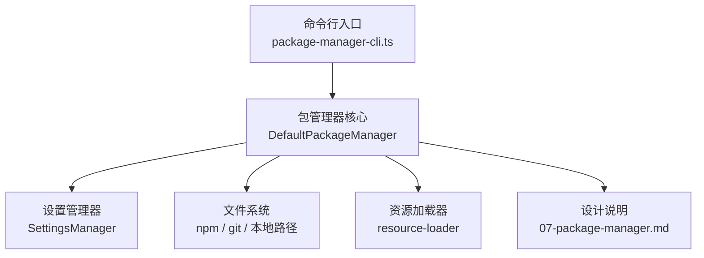
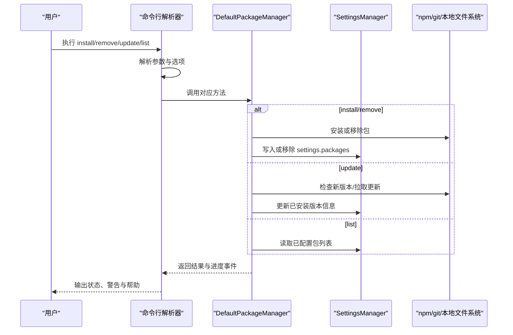
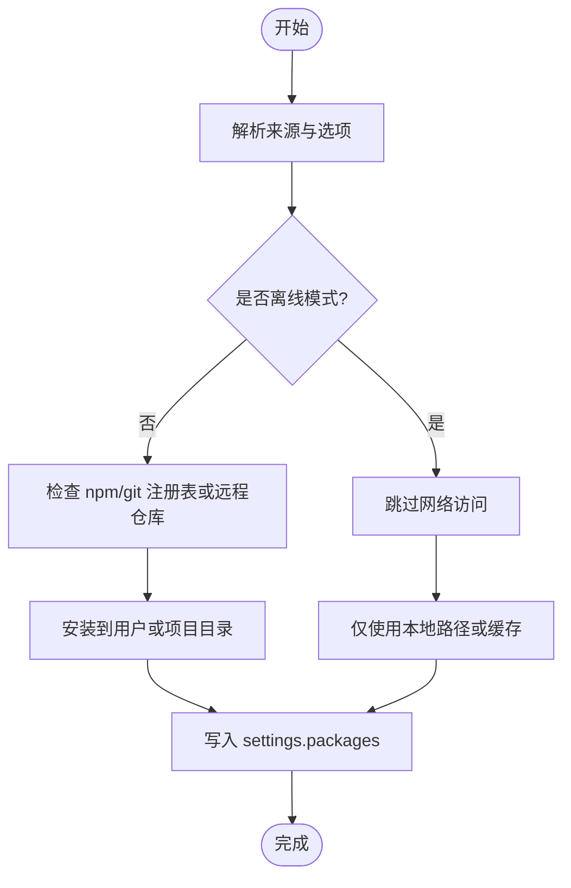
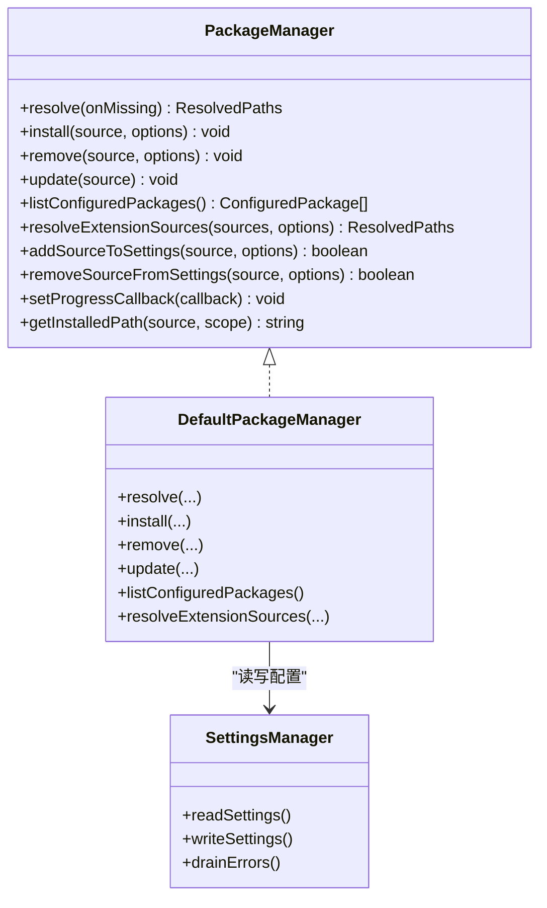

# 包管理命令

<cite>
**本文引用的文件**
- [package-manager-cli.ts](file://packages/coding-agent/src/package-manager-cli.ts)
- [package-manager.ts](file://packages/coding-agent/src/core/package-manager.ts)
- [07-package-manager.md](file://docs/explains/07-package-manager.md)
- [package-manager.test.ts](file://packages/coding-agent/test/package-manager.test.ts)
</cite>

## 目录
1. [简介](#简介)
2. [项目结构](#项目结构)
3. [核心组件](#核心组件)
4. [架构总览](#架构总览)
5. [详细命令说明](#详细命令说明)
6. [扩展来源、版本与依赖处理](#扩展来源版本与依赖处理)
7. [包的搜索、安装与卸载流程](#包的搜索安装与卸载流程)
8. [内置扩展与第三方扩展管理](#内置扩展与第三方扩展管理)
9. [依赖关系分析](#依赖关系分析)
10. [性能与可靠性特性](#性能与可靠性特性)
11. [最佳实践](#最佳实践)
12. [故障排查](#故障排查)
13. [结论](#结论)

## 简介
本文件面向包管理命令的使用者与维护者，系统说明 `install`、`remove`（含别名 `uninstall`）、`update`、`list` 的行为，解释扩展的安装源、版本管理与依赖处理机制，并给出包开发者与用户的最佳实践。文档同时覆盖如何管理内置扩展和第三方扩展，以及离线模式、信任策略、更新目标等关键概念。

## 项目结构
包管理相关能力主要分布在两个层次：
- 命令行层：负责解析参数、打印帮助、选择更新目标、调用底层包管理器。
- 包管理器核心层：负责解析来源、安装 npm/git/本地包、列出已配置包、生成资源路径、处理过滤与优先级。

**图表来源**
- [package-manager-cli.ts:292-400](file://packages/coding-agent/src/package-manager-cli.ts#L292-L400)
- [package-manager.ts:140-156](file://packages/coding-agent/src/core/package-manager.ts#L140-L156)
- [07-package-manager.md:1-22](file://docs/explains/07-package-manager.md#L1-L22)

**章节来源**
- [package-manager-cli.ts:292-400](file://packages/coding-agent/src/package-manager-cli.ts#L292-L400)
- [package-manager.ts:140-156](file://packages/coding-agent/src/core/package-manager.ts#L140-L156)
- [07-package-manager.md:1-22](file://docs/explains/07-package-manager.md#L1-L22)

## 核心组件
- 命令行解析器：定义命令类型、选项校验、帮助输出、更新目标推导。
- 默认包管理器实现：提供 `resolve`、`install`、`remove`、`update`、`listConfiguredPackages`、`resolveExtensionSources` 等方法。
- 资源发现与过滤：按用户/项目作用域、自动发现、内置扩展、包资源进行合并与优先级排序。
- 设置持久化：通过 `SettingsManager` 读写全局和项目级 settings。

**章节来源**
- [package-manager-cli.ts:50-52](file://packages/coding-agent/src/package-manager-cli.ts#L50-L52)
- [package-manager.ts:140-156](file://packages/coding-agent/src/core/package-manager.ts#L140-L156)
- [package-manager.ts:231-237](file://packages/coding-agent/src/core/package-manager.ts#L231-L237)

## 架构总览
包管理命令的调用链如下：

**图表来源**
- [package-manager-cli.ts:402-600](file://packages/coding-agent/src/package-manager-cli.ts#L402-L600)
- [package-manager.ts:140-156](file://packages/coding-agent/src/core/package-manager.ts#L140-L156)

## 详细命令说明

### install
- 用途：安装一个包并将其添加到 settings。
- 支持来源：
  - npm 包：如 `npm:@foo/bar`。
  - git 仓库：如 `git:github.com/user/repo`、`git:git@github.com:user/repo`、`https://github.com/user/repo`、`ssh://git@github.com/user/repo`。
  - 本地路径：如 `./local/path`。
- 选项：
  - `-l, --local`：将包安装到项目级 settings。
  - `-a, --approve`：允许信任项目级本地文件。
  - `-na, --no-approve`：忽略项目级本地文件。
- 行为要点：
  - 安装成功后会向 settings 添加该 source。
  - 若使用 `PI_OFFLINE=1`，则跳过所有网络访问。

参考用法示例与帮助文本位置：
- [package-manager-cli.ts:322-343](file://packages/coding-agent/src/package-manager-cli.ts#L322-L343)

**章节来源**
- [package-manager-cli.ts:322-343](file://packages/coding-agent/src/package-manager-cli.ts#L322-L343)
- [package-manager.ts:63-68](file://packages/coding-agent/src/core/package-manager.ts#L63-L68)

### remove / uninstall
- 用途：从 settings 中移除一个包及其 source；`uninstall` 是 `remove` 的别名。
- 选项：
  - `-l, --local`：从项目级 settings 移除。
  - `-a, --approve` / `-na, --no-approve`：信任或忽略项目级本地文件。
- 行为要点：
  - 删除后，包不再被 resolve 为可用资源。
  - 若包未配置在 settings，命令会报告相应错误。

参考帮助文本位置：
- [package-manager-cli.ts:345-361](file://packages/coding-agent/src/package-manager-cli.ts#L345-L361)
- [package-manager-cli.ts:405-408](file://packages/coding-agent/src/package-manager-cli.ts#L405-L408)

**章节来源**
- [package-manager-cli.ts:345-361](file://packages/coding-agent/src/package-manager-cli.ts#L345-L361)
- [package-manager-cli.ts:405-408](file://packages/coding-agent/src/package-manager-cli.ts#L405-L408)

### update
- 用途：更新 pi 自身、已安装的扩展或模型目录。
- 目标：
  - `self` 或 `pi`：仅更新 pi 自身。
  - `extensions`：仅更新已安装扩展。
  - `models`：刷新模型目录。
  - `all`：更新 pi 与已安装扩展。
  - 指定 source：更新单个包。
- 选项：
  - `--self`、`--extensions`、`--models`、`--all`、`--extension <source>`。
  - `-a, --approve` / `-na, --no-approve`。
  - `--force`：即使当前已是最新版本也重新安装 pi。
- 冲突规则：
  - `--all` 不能与其他目标标志组合。
  - `--models` 只能单独使用。
  - `--extension` 只能指定一次且不能与 `--self`、`--extensions`、`--all` 混用。
- 行为要点：
  - 默认无目标时更新 pi 自身。
  - 可刷新模型目录，超时保护为 15 秒。

参考帮助与参数解析位置：
- [package-manager-cli.ts:363-386](file://packages/coding-agent/src/package-manager-cli.ts#L363-L386)
- [package-manager-cli.ts:531-584](file://packages/coding-agent/src/package-manager-cli.ts#L531-L584)
- [package-manager-cli.ts:610-636](file://packages/coding-agent/src/package-manager-cli.ts#L610-L636)

**章节来源**
- [package-manager-cli.ts:363-386](file://packages/coding-agent/src/package-manager-cli.ts#L363-L386)
- [package-manager-cli.ts:531-584](file://packages/coding-agent/src/package-manager-cli.ts#L531-L584)
- [package-manager-cli.ts:610-636](file://packages/coding-agent/src/package-manager-cli.ts#L610-L636)

### list
- 用途：列出用户和项目 settings 中已配置的包。
- 选项：
  - `-a, --approve` / `-na, --no-approve`：信任或忽略项目级本地文件。
- 行为要点：
  - 不触发安装或更新，仅读取 settings 中的 packages 配置。

参考帮助位置：
- [package-manager-cli.ts:388-399](file://packages/coding-agent/src/package-manager-cli.ts#L388-L399)

**章节来源**
- [package-manager-cli.ts:388-399](file://packages/coding-agent/src/package-manager-cli.ts#L388-L399)

## 扩展来源、版本与依赖处理

### 来源类型与作用域
- 来源类型：
  - npm 包：支持精确版本或范围。
  - git 仓库：安装后记录 commit。
  - 本地路径：直接使用，不安装。
  - 内置扩展：以 `builtin:<name>` 表示。
- 作用域：
  - user：位于用户目录下的 `.pi/`。
  - project：位于项目根目录下的 `.pi/`。
  - temporary：CLI 传入但不持久化。
- 离线模式：
  - 设置 `PI_OFFLINE=1` 时跳过所有网络访问。

参考位置：
- [07-package-manager.md:6-22](file://docs/explains/07-package-manager.md#L6-L22)
- [package-manager.ts:63-68](file://packages/coding-agent/src/core/package-manager.ts#L63-L68)

### 版本管理
- npm 包：
  - 支持精确版本与语义化版本范围。
  - 更新时会比较已安装版本与注册表最新版本。
- git 包：
  - 安装后记录 commit，更新时拉取最新引用。
- 版本检查与自更新：
  - 命令行层会查询最新版本并决定是否更新 pi 自身。
  - 支持自定义自更新命令与环境变量控制。

参考位置：
- [package-manager.ts:70-76](file://packages/coding-agent/src/core/package-manager.ts#L70-L76)
- [package-manager-cli.ts:692-719](file://packages/coding-agent/src/package-manager-cli.ts#L692-L719)

### 依赖处理
- 包之间没有显式 `requires` 声明；依赖关系由路径与加载顺序决定。
- 资源优先级由 `resourcePrecedenceRank()` 决定，同名冲突采用“先到先得”。
- 项目对全局的 delta：
  - 当项目条目设置 `autoload: false` 时，它被视为全局条目的增量，两者都保留，delta 在前。

参考位置：
- [07-package-manager.md:41-55](file://docs/explains/07-package-manager.md#L41-L55)
- [07-package-manager.md:96-114](file://docs/explains/07-package-manager.md#L96-L114)
- [package-manager.ts:231-237](file://packages/coding-agent/src/core/package-manager.ts#L231-L237)

**章节来源**
- [07-package-manager.md:6-22](file://docs/explains/07-package-manager.md#L6-L22)
- [07-package-manager.md:41-55](file://docs/explains/07-package-manager.md#L41-L55)
- [07-package-manager.md:96-114](file://docs/explains/07-package-manager.md#L96-L114)
- [package-manager.ts:70-76](file://packages/coding-agent/src/core/package-manager.ts#L70-L76)
- [package-manager.ts:231-237](file://packages/coding-agent/src/core/package-manager.ts#L231-L237)
- [package-manager-cli.ts:692-719](file://packages/coding-agent/src/package-manager-cli.ts#L692-L719)

## 包的搜索、安装与卸载流程

### 搜索与发现
- 自动发现：
  - 约定目录 `extensions/`、`skills/`、`prompts/`、`themes/` 会被扫描。
  - 支持 `SKILL.md` 与 markdown 技能文件。
- 显式 manifest：
  - 包可通过 `pi.extensions`、`pi.skills` 等字段声明资源。
- 内置扩展：
  - 默认启用，除非被排除。

参考位置：
- [07-package-manager.md:23-35](file://docs/explains/07-package-manager.md#L23-L35)
- [package-manager.ts:602-630](file://packages/coding-agent/src/core/package-manager.ts#L602-L630)
- [package-manager.ts:632-684](file://packages/coding-agent/src/core/package-manager.ts#L632-L684)

### 安装流程

**图表来源**
- [package-manager-cli.ts:322-343](file://packages/coding-agent/src/package-manager-cli.ts#L322-L343)
- [package-manager.ts:63-68](file://packages/coding-agent/src/core/package-manager.ts#L63-L68)

### 卸载流程
- 从 settings 中移除 source。
- 若包未配置，命令报错。
- 卸载后资源不再被 resolve。

参考位置：
- [package-manager-cli.ts:345-361](file://packages/coding-agent/src/package-manager-cli.ts#L345-L361)

**章节来源**
- [07-package-manager.md:23-35](file://docs/explains/07-package-manager.md#L23-L35)
- [package-manager.ts:602-684](file://packages/coding-agent/src/core/package-manager.ts#L602-L684)
- [package-manager-cli.ts:322-361](file://packages/coding-agent/src/package-manager-cli.ts#L322-L361)

## 内置扩展与第三方扩展管理

### 内置扩展
- 表示方式：`builtin:<name>`。
- 默认启用，除非被 `-builtin:x` 或 `!builtin:x` 排除。
- 项目设置中的覆盖优先于全局设置。
- 标记为 `replaceable` 的内置扩展会在第三方注册同名 tool/command/flag 时让位。

参考位置：
- [07-package-manager.md:121-128](file://docs/explains/07-package-manager.md#L121-L128)

### 第三方扩展
- 通过 npm、git 或本地路径安装。
- 可使用 `autoload: false` 与显式 `extensions` 列表实现按需启用。
- 支持 `!`、`+`、`-` 前缀进行包含/排除/强制包含/强制排除。

参考位置：
- [07-package-manager.md:56-94](file://docs/explains/07-package-manager.md#L56-L94)
- [package-manager.ts:784-800](file://packages/coding-agent/src/core/package-manager.ts#L784-L800)

**章节来源**
- [07-package-manager.md:56-94](file://docs/explains/07-package-manager.md#L56-L94)
- [07-package-manager.md:121-128](file://docs/explains/07-package-manager.md#L121-L128)
- [package-manager.ts:784-800](file://packages/coding-agent/src/core/package-manager.ts#L784-L800)

## 依赖关系分析

**图表来源**
- [package-manager.ts:140-156](file://packages/coding-agent/src/core/package-manager.ts#L140-L156)
- [package-manager.ts:882-882](file://packages/coding-agent/src/core/package-manager.ts#L882-L882)

**章节来源**
- [package-manager.ts:140-156](file://packages/coding-agent/src/core/package-manager.ts#L140-L156)

## 性能与可靠性特性
- 禁用资源零成本：`enabled: false` 的资源不会进入加载器，避免不必要的加载开销。
- 并发控制：
  - 更新检查并发度为 4。
  - git 更新并发度为 4。
- 超时保护：
  - 网络请求超时为 10 秒。
  - 模型目录刷新超时为 15 秒。
- 安全与隔离：
  - 临时扩展目录权限设置为 0o700。
  - 支持 `PI_OFFLINE` 完全离线模式。

参考位置：
- [07-package-manager.md:37-39](file://docs/explains/07-package-manager.md#L37-L39)
- [package-manager.ts:59-61](file://packages/coding-agent/src/core/package-manager.ts#L59-L61)
- [package-manager.ts:63-68](file://packages/coding-agent/src/core/package-manager.ts#L63-L68)
- [package-manager.ts:270-275](file://packages/coding-agent/src/core/package-manager.ts#L270-L275)
- [package-manager-cli.ts:610-636](file://packages/coding-agent/src/package-manager-cli.ts#L610-L636)

**章节来源**
- [07-package-manager.md:37-39](file://docs/explains/07-package-manager.md#L37-L39)
- [package-manager.ts:59-68](file://packages/coding-agent/src/core/package-manager.ts#L59-L68)
- [package-manager.ts:270-275](file://packages/coding-agent/src/core/package-manager.ts#L270-L275)
- [package-manager-cli.ts:610-636](file://packages/coding-agent/src/package-manager-cli.ts#L610-L636)

## 最佳实践

### 对包用户
- 明确来源：
  - 优先使用 npm 包以获得稳定版本；使用 git 仓库用于开发分支或私有仓库。
- 控制启用范围：
  - 使用 `autoload: false` 与显式 `extensions` 列表，只启用需要的能力。
- 利用优先级：
  - 项目级 settings 覆盖全局 settings，适合团队分发与个人定制。
- 离线工作：
  - 设置 `PI_OFFLINE=1` 以避免网络访问。

参考位置：
- [07-package-manager.md:56-94](file://docs/explains/07-package-manager.md#L56-L94)
- [07-package-manager.md:96-114](file://docs/explains/07-package-manager.md#L96-L114)
- [07-package-manager.md:18-22](file://docs/explains/07-package-manager.md#L18-L22)

### 对包开发者
- 明确 manifest：
  - 在 `pi.extensions`、`pi.skills` 等字段声明资源，避免隐式发现带来的不确定性。
- 提供变更日志：
  - 使用 `changelogPath` 或约定 `CHANGELOG.md`，便于用户了解版本变化。
- 谨慎命名：
  - 避免与内置扩展或第三方扩展同名，必要时使用 `replaceable` 机制。
- 测试资源过滤：
  - 使用 `!`、`+`、`-` 前缀验证包含/排除逻辑是否符合预期。

参考位置：
- [package-manager.ts:602-630](file://packages/coding-agent/src/core/package-manager.ts#L602-L630)
- [package-manager.ts:713-729](file://packages/coding-agent/src/core/package-manager.ts#L713-L729)
- [07-package-manager.md:121-128](file://docs/explains/07-package-manager.md#L121-L128)

**章节来源**
- [07-package-manager.md:56-94](file://docs/explains/07-package-manager.md#L56-L94)
- [07-package-manager.md:96-114](file://docs/explains/07-package-manager.md#L96-L114)
- [07-package-manager.md:18-22](file://docs/explains/07-package-manager.md#L18-L22)
- [package-manager.ts:602-630](file://packages/coding-agent/src/core/package-manager.ts#L602-L630)
- [package-manager.ts:713-729](file://packages/coding-agent/src/core/package-manager.ts#L713-L729)
- [07-package-manager.md:121-128](file://docs/explains/07-package-manager.md#L121-L128)

## 故障排查
- 命令参数冲突：
  - 检查 `--all`、`--self`、`--extensions`、`--models`、`--extension` 的组合是否合法。
- 无法自更新：
  - 查看是否处于受管安装环境或自定义自更新命令未配置。
- 模型目录刷新失败：
  - 检查网络与认证配置，注意 15 秒超时。
- 设置错误：
  - 使用 `reportSettingsErrors` 获取 settings 解析错误详情。

参考位置：
- [package-manager-cli.ts:531-584](file://packages/coding-agent/src/package-manager-cli.ts#L531-L584)
- [package-manager-cli.ts:638-662](file://packages/coding-agent/src/package-manager-cli.ts#L638-L662)
- [package-manager-cli.ts:610-636](file://packages/coding-agent/src/package-manager-cli.ts#L610-L636)
- [package-manager-cli.ts:282-290](file://packages/coding-agent/src/package-manager-cli.ts#L282-L290)

**章节来源**
- [package-manager-cli.ts:531-584](file://packages/coding-agent/src/package-manager-cli.ts#L531-L584)
- [package-manager-cli.ts:638-662](file://packages/coding-agent/src/package-manager-cli.ts#L638-L662)
- [package-manager-cli.ts:610-636](file://packages/coding-agent/src/package-manager-cli.ts#L610-L636)
- [package-manager-cli.ts:282-290](file://packages/coding-agent/src/package-manager-cli.ts#L282-L290)

## 结论
包管理命令提供了统一的安装、卸载、更新与列表能力，支持 npm、git 与本地来源，并通过 settings 的作用域与过滤机制实现精细化的扩展管理。内置扩展与第三方扩展可以共存，项目级覆盖与全局分发形成清晰的职责边界。结合离线模式、并发控制与超时保护，系统在易用性与可靠性之间取得平衡。对于开发者与用户而言，遵循 manifest 规范、合理使用过滤与优先级、明确版本与依赖策略，是获得稳定体验的关键。