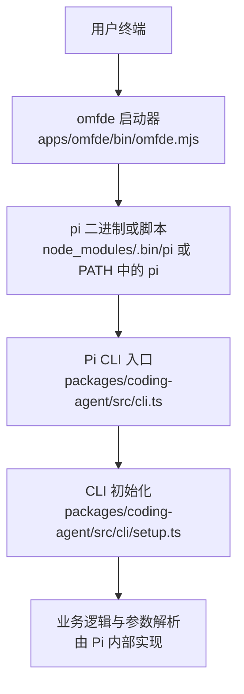
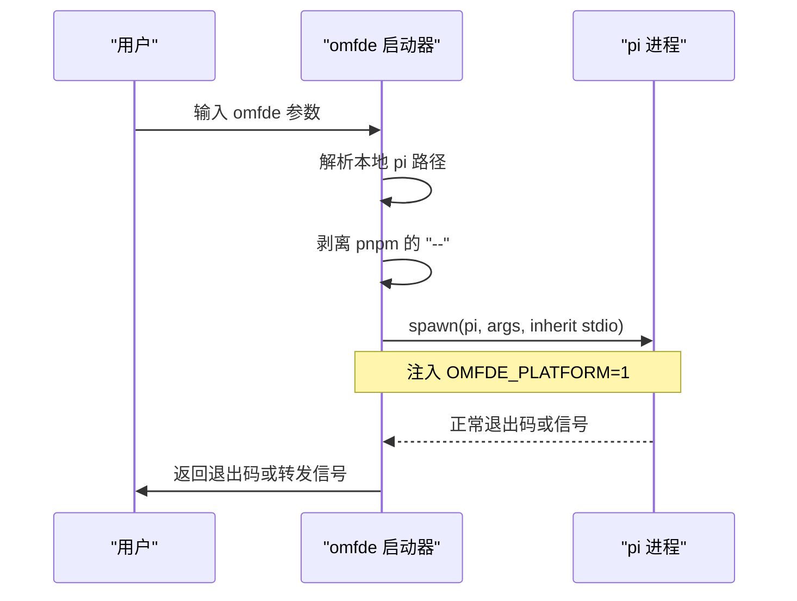
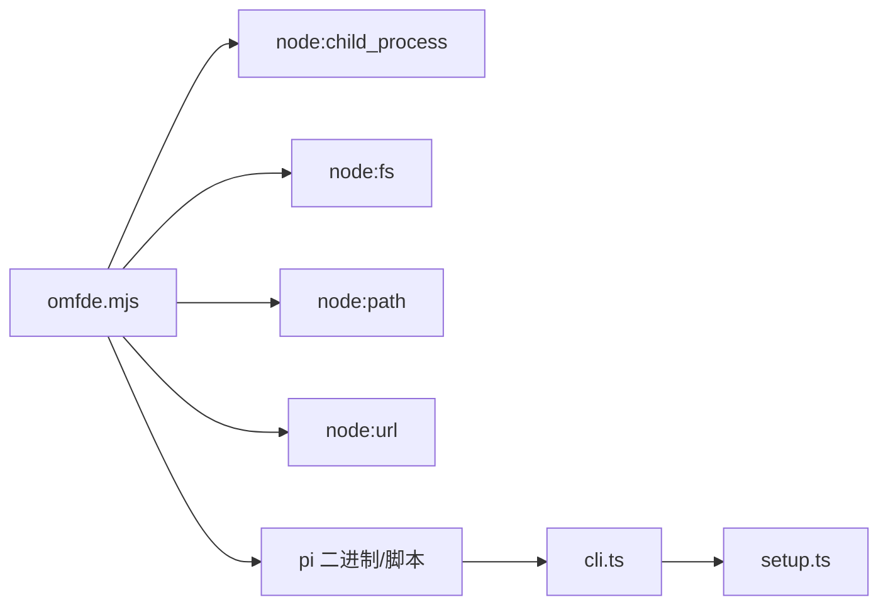

# 基础用法和参数

<cite>
**本文引用的文件**   
- [apps/omfde/bin/omfde.mjs](file://apps/omfde/bin/omfde.mjs)
- [apps/omfde/package.json](file://apps/omfde/package.json)
- [packages/coding-agent/src/cli.ts](file://packages/coding-agent/src/cli.ts)
- [packages/coding-agent/src/cli/setup.ts](file://packages/coding-agent/src/cli/setup.ts)
- [packages/coding-agent/docs/cli.md](file://packages/coding-agent/docs/cli.md)
</cite>

## 目录
1. [简介](#简介)
2. [项目结构](#项目结构)
3. [核心组件](#核心组件)
4. [架构总览](#架构总览)
5. [详细组件分析](#详细组件分析)
6. [依赖关系分析](#依赖关系分析)
7. [性能与行为特性](#性能与行为特性)
8. [常见用法与示例](#常见用法与示例)
9. [参数参考表](#参数参考表)
10. [环境变量与优先级](#环境变量与优先级)
11. [故障排查](#故障排查)
12. [结论](#结论)

## 简介
本文面向 CLI 使用者，说明 omfde 的入口行为以及底层 Pi 命令行的基础用法。重点包括：
- 基本命令结构与位置参数、可选参数、标志位的使用方法
- 核心参数如 --provider、--model、--system-prompt 等的使用方式
- 参数组合与环境变量的作用
- 完整的参数参考表，便于快速查找

omfde 本身是一个轻量启动器，负责把命令行参数转发给真正的 Pi 二进制程序；所有功能与参数定义由 Pi 提供。

## 项目结构
- apps/omfde/bin/omfde.mjs：Node 脚本，解析自身参数并启动 pi
- apps/omfde/package.json：声明 omfde 可执行入口
- packages/coding-agent/src/cli.ts：Pi 的顶层 CLI 入口
- packages/coding-agent/src/cli/setup.ts：CLI 初始化设置
- packages/coding-agent/docs/cli.md：Pi 官方 CLI 文档，包含完整参数说明

**图表来源**
- [apps/omfde/bin/omfde.mjs:13-27](file://apps/omfde/bin/omfde.mjs#L13-L27)
- [packages/coding-agent/src/cli.ts:1-6](file://packages/coding-agent/src/cli.ts#L1-L6)
- [packages/coding-agent/src/cli/setup.ts:4-12](file://packages/coding-agent/src/cli/setup.ts#L4-L12)

**章节来源**
- [apps/omfde/bin/omfde.mjs:1-42](file://apps/omfde/bin/omfde.mjs#L1-L42)
- [apps/omfde/package.json:6-11](file://apps/omfde/package.json#L6-L11)
- [packages/coding-agent/src/cli.ts:1-6](file://packages/coding-agent/src/cli.ts#L1-L6)
- [packages/coding-agent/src/cli/setup.ts:1-14](file://packages/coding-agent/src/cli/setup.ts#L1-L14)

## 核心组件
- omfde 启动器：定位本地 node_modules/.bin/pi 或 PATH 中的 pi，透传参数，保留退出码与信号。
- Pi CLI 入口：设置进程标题、环境变量，配置 HTTP 分发器，然后调用主流程处理参数。
- CLI 文档：描述 Pi 的所有命令、选项、模式与约束。

**章节来源**
- [apps/omfde/bin/omfde.mjs:13-41](file://apps/omfde/bin/omfde.mjs#L13-L41)
- [packages/coding-agent/src/cli.ts:1-6](file://packages/coding-agent/src/cli.ts#L1-L6)
- [packages/coding-agent/src/cli/setup.ts:4-12](file://packages/coding-agent/src/cli/setup.ts#L4-L12)
- [packages/coding-agent/docs/cli.md:1-19](file://packages/coding-agent/docs/cli.md#L1-L19)

## 架构总览
omfde 不实现业务逻辑，只做“代理转发”：
- 从当前工作目录之外的固定路径解析仓库根
- 优先使用本地 node_modules/.bin/pi，否则回退到系统 PATH 中的 pi
- 剥离 pnpm 转发的 -- 分隔符
- 以继承 stdio 的方式启动子进程，保持交互体验
- 将 OMFDE_PLATFORM=1 注入环境，供平台扩展识别
- 子进程错误时输出错误并退出
- 子进程退出时，若为信号则转发信号给父进程，否则返回退出码

**图表来源**
- [apps/omfde/bin/omfde.mjs:13-41](file://apps/omfde/bin/omfde.mjs#L13-L41)

## 详细组件分析

### omfde 启动器
- 作用：统一入口，屏蔽安装差异（pnpm workspace 链接 vs 全局安装）
- 关键行为：
  - 通过 import.meta.url 计算仓库根，确保在任何目录运行稳定
  - 优先使用本地 node_modules/.bin/pi，否则使用系统 pi
  - 剥离 pnpm 传递的 -- 分隔符
  - 继承 stdio，保证 TUI 与管道行为一致
  - 注入 OMFDE_PLATFORM=1，用于平台扩展区分 omfde 与直接 pi
  - 错误与退出码/信号处理

**章节来源**
- [apps/omfde/bin/omfde.mjs:13-41](file://apps/omfde/bin/omfde.mjs#L13-L41)

### Pi CLI 入口与初始化
- cli.ts：设置 CLI 后调用 main，传入 process.argv.slice(2)
- setup.ts：设置进程名、PI_CODING_AGENT、AI_AGENT，禁用默认警告，并在 SettingsManager 加载前配置 HTTP 分发器

**章节来源**
- [packages/coding-agent/src/cli.ts:1-6](file://packages/coding-agent/src/cli.ts#L1-L6)
- [packages/coding-agent/src/cli/setup.ts:4-12](file://packages/coding-agent/src/cli/setup.ts#L4-L12)

## 依赖关系分析
- omfde 依赖 Node.js child_process、fs、path、url
- omfde 在运行时依赖 pi 二进制或脚本
- Pi CLI 依赖内部模块进行参数解析、会话、模型、工具、资源等管理

**图表来源**
- [apps/omfde/bin/omfde.mjs:8-11](file://apps/omfde/bin/omfde.mjs#L8-L11)
- [packages/coding-agent/src/cli.ts:1-6](file://packages/coding-agent/src/cli.ts#L1-L6)
- [packages/coding-agent/src/cli/setup.ts:1-12](file://packages/coding-agent/src/cli/setup.ts#L1-L12)

**章节来源**
- [apps/omfde/bin/omfde.mjs:8-11](file://apps/omfde/bin/omfde.mjs#L8-L11)
- [packages/coding-agent/src/cli.ts:1-6](file://packages/coding-agent/src/cli.ts#L1-L6)
- [packages/coding-agent/src/cli/setup.ts:1-12](file://packages/coding-agent/src/cli/setup.ts#L1-L12)

## 性能与行为特性
- omfde 仅做参数转发，开销极小
- 继承 stdio 保证交互性能与管道行为与原生 pi 一致
- 子进程错误会立即输出错误信息并退出，避免挂起
- 信号转发保证 Ctrl+C 等行为符合预期

[本节为通用行为说明，不涉及具体代码片段]

## 常见用法与示例
以下示例基于 Pi CLI 文档的命令语法与选项说明。

- 列出可用模型
  - 命令：pi --list-models
  - 用途：查看当前可用的模型列表，支持模糊搜索

- 选择模型与提供商
  - 命令：pi --provider deepseek --model deepseek-flash
  - 说明：--provider 限制 --model 的查找范围；--model 支持 provider/id 与可选 :thinking 后缀

- 指定 API Key（非持久化）
  - 命令：pi --model sonnet:high --api-key sk-...
  - 说明：--api-key 需要配合 --model 或 --models 使用

- 设置思考级别
  - 命令：pi --model sonnet:high --thinking high
  - 说明：--thinking 覆盖 --model 的后缀，并被限制在模型能力范围内

- 替换或追加系统提示
  - 命令：pi --system-prompt "./instructions.md"
  - 命令：pi --append-system-prompt "./rules.md"
  - 说明：--system-prompt 替换默认系统提示；--append-system-prompt 追加内容，可重复

- 控制输出模式
  - 命令：pi --print "Summarize this repository"
  - 命令：pi --mode json "Inspect this repository" > events.jsonl
  - 说明：--print 一次性运行并输出最终文本；--mode text/json/rpc 选择输出接口

- 继续或恢复会话
  - 命令：pi --continue
  - 命令：pi --resume
  - 命令：pi --session <path|id>
  - 说明：--continue 继续最近会话；--resume 打开会话选择器；--session 按路径或 ID 打开

- 工具选择
  - 命令：pi --tools read,grep,find,ls --print "Review this project"
  - 命令：pi --exclude-tools bash
  - 命令：pi --no-builtin-tools
  - 命令：pi --no-tools
  - 说明：--tools 允许白名单或 +name/-name 修改；--exclude-tools 排除工具；--no-builtin-tools 禁用内置工具；--no-tools 禁用全部工具

- 资源与扩展
  - 命令：pi --extension ./review.ts
  - 命令：pi --skill ./skills
  - 命令：pi --prompt-template ./templates
  - 命令：pi --theme ./themes
  - 说明：-e/--extension、--skill、--prompt-template、--theme 可重复；-ne/--no-extensions、-ns/--no-skills、-np/--no-prompt-templates、-nc/--no-context-files 可禁用对应发现

- 调试与信任
  - 命令：pi --tui-mode fullscreen
  - 命令：pi --verbose
  - 命令：pi --approve
  - 命令：pi --offline
  - 说明：--tui-mode 选择全屏或常规模式；--verbose 显示详细启动信息；--approve 信任本地配置；--offline 禁止网络活动

- 认证相关
  - 命令：pi auth check --provider openai --json
  - 说明：auth check 输出 ready/not_ready/invalid，并返回相应退出码

**章节来源**
- [packages/coding-agent/docs/cli.md:55-77](file://packages/coding-agent/docs/cli.md#L55-L77)
- [packages/coding-agent/docs/cli.md:78-110](file://packages/coding-agent/docs/cli.md#L78-L110)
- [packages/coding-agent/docs/cli.md:111-185](file://packages/coding-agent/docs/cli.md#L111-L185)
- [packages/coding-agent/docs/cli.md:186-219](file://packages/coding-agent/docs/cli.md#L186-L219)
- [packages/coding-agent/docs/cli.md:221-249](file://packages/coding-agent/docs/cli.md#L221-L249)
- [packages/coding-agent/docs/cli.md:305-339](file://packages/coding-agent/docs/cli.md#L305-L339)

## 参数参考表
以下为常用参数的分类参考，便于快速查找。

- 模型与提供商
  - --provider <name>：限制 --model 查找范围，需配合 --model
  - --model <pattern>：按精确 ID 或模糊匹配选择模型，支持 provider/id 与 :thinking 后缀
  - --api-key <key>：非持久化 API Key 覆盖，需配合 --model 或 --models
  - --thinking <level>：设置 off/minimal/low/medium/high/xhigh/max，覆盖 --model 后缀并受模型能力限制
  - --models <patterns>：设置启动与切换的模型范围，支持通配与 :thinking
  - --list-models [search]：列出可用模型并退出

- 会话与会话控制
  - -c/--continue：继续最近会话
  - -r/--resume：打开会话选择器并恢复
  - --session <path|id>：按路径或 ID 打开并恢复
  - --session-id <id>：打开或创建当前目录的会话 ID
  - --fork <path|id>：分叉会话到新会话
  - --session-dir <dir>：覆盖会话存储与查找
  - --no-session：使用内存会话且不持久化
  - -n/--name <name>：设置会话显示名称

- 工具与 MCP
  - -t/--tools <list>：替换默认工具选择，支持白名单与 +name/-name
  - -xt/--exclude-tools <list>：排除工具，支持模式
  - -nbt/--no-builtin-tools：禁用内置工具
  - -nt/--no-tools：禁用全部工具
  - --no-mcp：禁用内置 MCP 支持

- 资源与扩展
  - -e/--extension <path>：加载扩展文件或目录，可重复
  - -ne/--no-extensions：禁用扩展发现
  - --skill <path>：加载技能文件/目录，可重复
  - -ns/--no-skills：禁用技能发现
  - --prompt-template <path>：加载提示模板文件/目录，可重复
  - -np/--no-prompt-templates：禁用模板发现
  - --theme <path>：加载主题文件/目录，可重复
  - --use-theme <name[/name]>：选择初始主题
  - --no-themes：禁用主题发现
  - -nc/--no-context-files：禁用 AGENTS.md 与 CLAUDE.md 发现

- 提示与进程
  - --system-prompt <text|path>：替换默认系统提示
  - --append-system-prompt <text|path>：追加系统提示，可重复
  - --tui-mode <mode>：fullscreen 或 regular
  - --verbose：显示详细启动信息
  - -a/--approve：信任本地配置与资源
  - -na/--no-approve：忽略信任门控的本地配置与资源
  - --offline：禁止自动网络活动，等价于 PI_OFFLINE=1
  - -h/--help：显示帮助
  - -v/--version：显示版本

- 包管理与更新
  - pi install/remove/uninstall/update/list/config：包管理命令
  - --local/-l：使用项目设置而非全局设置
  - --force：强制重装 Pi
  - --self/self/pi：更新 Pi 的别名
  - --extension：更新单个包的别名
  - --models：刷新模型目录
  - --all：更新 Pi 与所有已安装包

- 认证命令
  - pi auth login/logout/check/print-api-key/print-bearer-token
  - --api-key：保存 API Key
  - --no-browser：不使用浏览器登录
  - --json：结构化输出
  - --credentials：输出已解析凭据
  - --no-refresh：不刷新过期 OAuth 凭据
  - --min-expiry <duration>：要求最小剩余有效期

- MCP 命令
  - pi mcp add/remove/list/login/logout
  - --env KEY=VALUE：设置环境变量
  - --cwd <dir>：设置工作目录
  - --url <url>：添加 HTTP 服务器
  - --header KEY=VALUE：设置请求头
  - --bearer-token-env-var <NAME>：发送 Authorization Bearer
  - --oauth-client-id/secret/callback-port/client-name/registration：OAuth 配置
  - --exposure <mode>：控制工具暴露
  - --description <text>：设置描述

**章节来源**
- [packages/coding-agent/docs/cli.md:55-77](file://packages/coding-agent/docs/cli.md#L55-L77)
- [packages/coding-agent/docs/cli.md:78-110](file://packages/coding-agent/docs/cli.md#L78-L110)
- [packages/coding-agent/docs/cli.md:111-185](file://packages/coding-agent/docs/cli.md#L111-L185)
- [packages/coding-agent/docs/cli.md:186-219](file://packages/coding-agent/docs/cli.md#L186-L219)
- [packages/coding-agent/docs/cli.md:221-249](file://packages/coding-agent/docs/cli.md#L221-L249)
- [packages/coding-agent/docs/cli.md:252-303](file://packages/coding-agent/docs/cli.md#L252-L303)
- [packages/coding-agent/docs/cli.md:305-339](file://packages/coding-agent/docs/cli.md#L305-L339)
- [packages/coding-agent/docs/cli.md:341-357](file://packages/coding-agent/docs/cli.md#L341-L357)

## 环境变量与优先级
- OMFDE_PLATFORM=1：由 omfde 注入，供平台扩展区分 omfde 与直接 pi 启动
- PI_CODING_AGENT=true：由 Pi CLI 初始化设置，标识编码代理进程
- AI_AGENT=pi：由 Pi CLI 初始化设置，标识代理类型
- PI_OFFLINE=1：等价于 --offline，禁止自动网络活动
- PI_SELF_UPDATE_COMMAND：自定义 Pi 自更新命令，用于被其他包管理器托管的场景
- PI_CODING_AGENT_SESSION_DIR：会话目录的环境变量，但 --session-dir 具有更高优先级

优先级要点：
- 命令行参数通常高于环境变量与配置文件
- --session-dir 高于 PI_CODING_AGENT_SESSION_DIR 与 settings.sessionDir
- --offline 等价于 PI_OFFLINE=1，二者效果一致

**章节来源**
- [apps/omfde/bin/omfde.mjs:23-27](file://apps/omfde/bin/omfde.mjs#L23-L27)
- [packages/coding-agent/src/cli/setup.ts:4-8](file://packages/coding-agent/src/cli/setup.ts#L4-L8)
- [packages/coding-agent/docs/cli.md:98-101](file://packages/coding-agent/docs/cli.md#L98-L101)
- [packages/coding-agent/docs/cli.md:243-244](file://packages/coding-agent/docs/cli.md#L243-L244)
- [packages/coding-agent/docs/cli.md:287-295](file://packages/coding-agent/docs/cli.md#L287-L295)

## 故障排查
- 无法找到 pi 二进制
  - 现象：omfde 报错无法启动 pi
  - 原因：本地 node_modules/.bin/pi 不存在且 PATH 中也没有 pi
  - 解决：安装依赖或使用全局安装的 pi

- 参数不被识别
  - 现象：出现未知标志或短选项拒绝
  - 原因：使用了旧版或不支持的选项
  - 解决：查阅当前版本的 pi --help 或 docs/cli.md

- 会话冲突
  - 现象：--fork 与其他会话选项组合失败
  - 原因：--fork 不能与 --session、--continue、--resume、--no-session 同时使用
  - 解决：移除冲突选项

- 工具选择异常
  - 现象：--tools 与 +name/-name 混用报错
  - 原因：纯名称白名单与 +name/-name 修改不能混合
  - 解决：分别使用 --tools 白名单或 +name/-name 修改，或使用 --exclude-tools 排除

- 网络问题
  - 现象：模型目录刷新失败
  - 原因：未启用离线模式或未配置凭据
  - 解决：使用 --offline 或正确配置 --provider/--model/--api-key

**章节来源**
- [apps/omfde/bin/omfde.mjs:29-41](file://apps/omfde/bin/omfde.mjs#L29-L41)
- [packages/coding-agent/docs/cli.md:105-110](file://packages/coding-agent/docs/cli.md#L105-L110)
- [packages/coding-agent/docs/cli.md:121-130](file://packages/coding-agent/docs/cli.md#L121-L130)
- [packages/coding-agent/docs/cli.md:243-244](file://packages/coding-agent/docs/cli.md#L243-L244)

## 结论
- omfde 是轻量启动器，负责定位并启动 pi，透传参数与信号
- 所有 CLI 功能与参数由 Pi 提供，详见 packages/coding-agent/docs/cli.md
- 推荐使用 --provider 与 --model 明确模型与提供商，必要时使用 --api-key
- 使用 --system-prompt 或 --append-system-prompt 定制系统提示
- 使用 --tools、--exclude-tools、--no-builtin-tools、--no-tools 精细控制工具
- 使用 --offline 或 PI_OFFLINE=1 控制网络行为
- 遇到参数问题时，优先查阅当前版本的 help 与文档

[本节为总结性内容，不涉及具体代码片段]