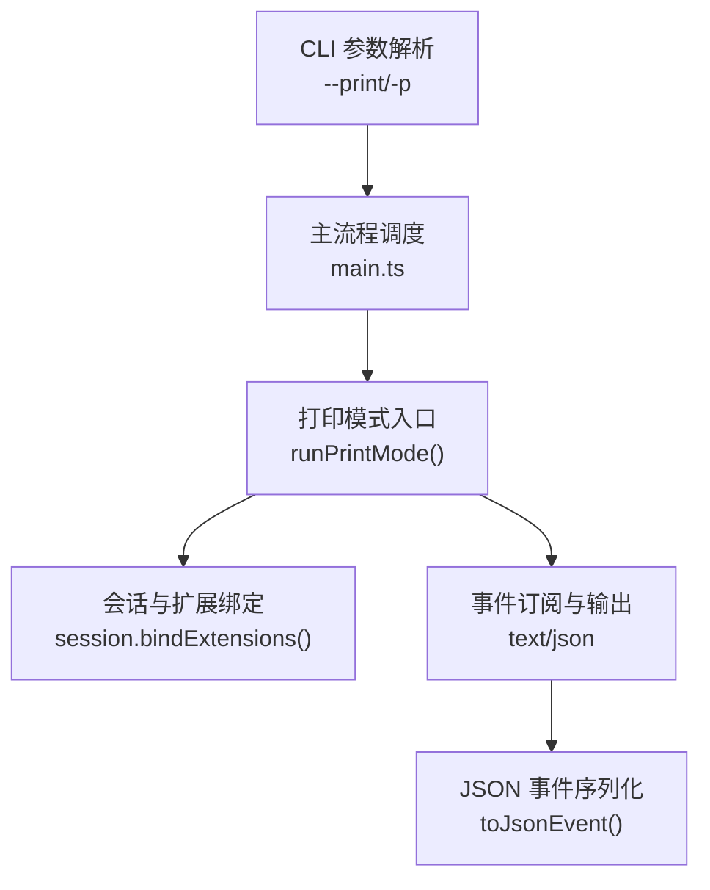
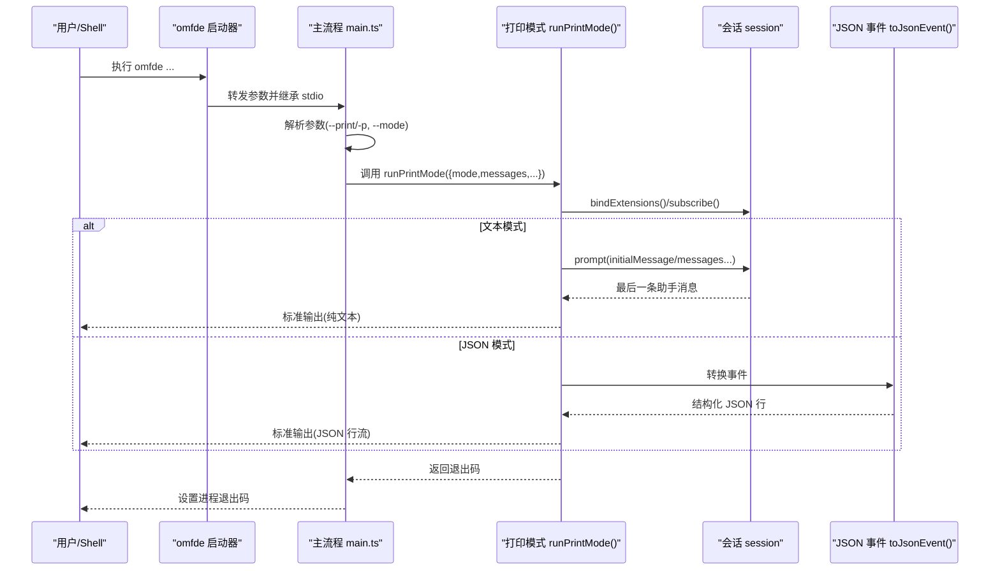
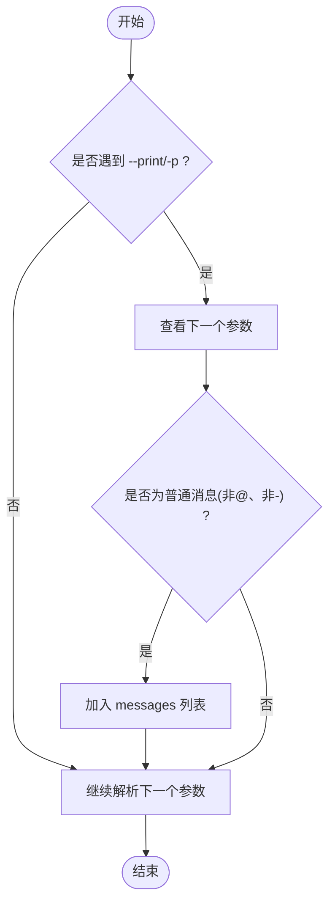
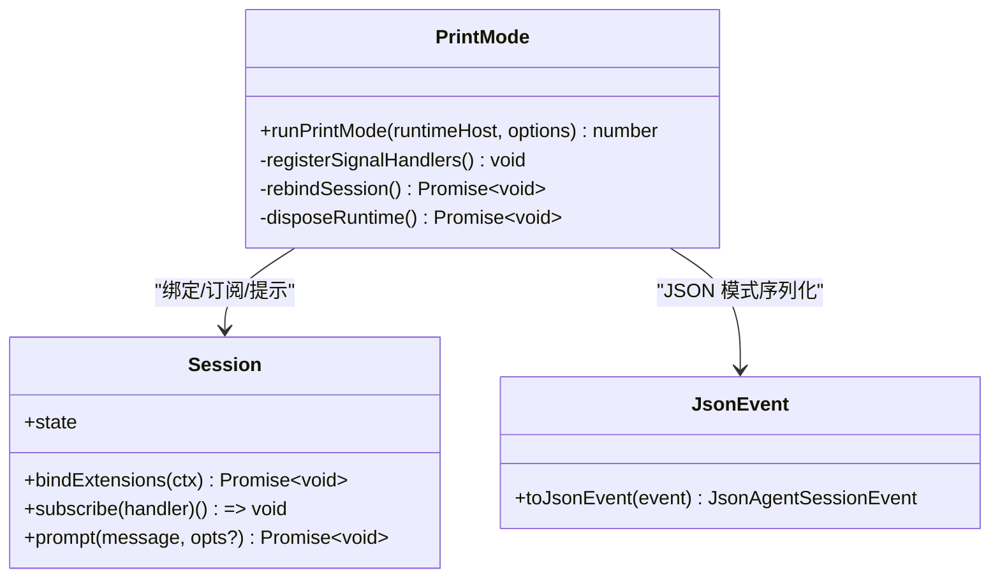
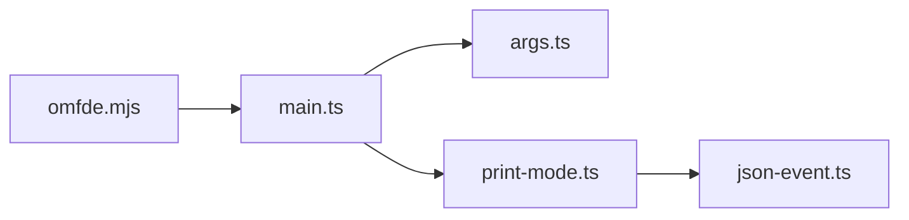

# 打印模式

<cite>
**本文引用的文件**   
- [apps/omfde/bin/omfde.mjs](file://apps/omfde/bin/omfde.mjs)
- [packages/coding-agent/src/cli/args.ts](file://packages/coding-agent/src/cli/args.ts)
- [packages/coding-agent/src/main.ts](file://packages/coding-agent/src/main.ts)
- [packages/coding-agent/src/modes/index.ts](file://packages/coding-agent/src/modes/index.ts)
- [packages/coding-agent/src/modes/print-mode.ts](file://packages/coding-agent/src/modes/print-mode.ts)
- [packages/coding-agent/src/modes/json-event.ts](file://packages/coding-agent/src/modes/json-event.ts)
- [packages/coding-agent/test/args.test.ts](file://packages/coding-agent/test/args.test.ts)
- [packages/coding-agent/test/print-mode.test.ts](file://packages/coding-agent/test/print-mode.test.ts)
</cite>

## 目录
1. [简介](#简介)
2. [项目结构](#项目结构)
3. [核心组件](#核心组件)
4. [架构总览](#架构总览)
5. [详细组件分析](#详细组件分析)
6. [依赖关系分析](#依赖关系分析)
7. [性能与优化建议](#性能与优化建议)
8. [故障排查指南](#故障排查指南)
9. [结论](#结论)
10. [附录：批量任务与脚本集成示例](#附录批量任务与脚本集成示例)

## 简介
本文件面向“打印模式”（非交互式处理）的使用与集成，围绕 --print/-p 参数展开，说明其触发方式、输出格式、错误处理与返回值语义，并给出在文件操作、代码分析等自动化场景中的批量任务实践，以及与 Shell 管道和外部脚本的集成方法。

## 项目结构
打印模式涉及 CLI 参数解析、主流程调度、打印模式实现以及 JSON 事件序列化四个关键位置：
- CLI 参数解析：识别 --print/-p 并将消息注入到待处理队列
- 主流程：根据是否进入打印模式调用对应运行器
- 打印模式：发送提示词、订阅会话事件、输出结果或 JSON 流
- JSON 事件：将内部会话事件序列化为稳定的 JSON 行协议

图示来源
- [packages/coding-agent/src/cli/args.ts:177-183](file://packages/coding-agent/src/cli/args.ts#L177-L183)
- [packages/coding-agent/src/main.ts:1045-1056](file://packages/coding-agent/src/main.ts#L1045-L1056)
- [packages/coding-agent/src/modes/print-mode.ts:33-183](file://packages/coding-agent/src/modes/print-mode.ts#L33-L183)
- [packages/coding-agent/src/modes/json-event.ts:46-61](file://packages/coding-agent/src/modes/json-event.ts#L46-L61)

章节来源
- [packages/coding-agent/src/cli/args.ts:72-270](file://packages/coding-agent/src/cli/args.ts#L72-L270)
- [packages/coding-agent/src/main.ts:1030-1059](file://packages/coding-agent/src/main.ts#L1030-L1059)

## 核心组件
- 参数解析器：负责识别 --print/-p，并将紧随其后的消息作为初始提示词；同时支持通过 @files 引入文件内容。
- 打印模式运行器：单发执行，发送初始消息与后续消息，按模式输出最终文本或完整事件流，并在结束时清理资源。
- JSON 事件转换器：将内部会话事件转换为稳定结构的 JSON 行，便于外部程序消费。
- 主流程调度：在非交互模式下调用打印模式，并将退出码映射到进程退出码。

章节来源
- [packages/coding-agent/src/cli/args.ts:177-183](file://packages/coding-agent/src/cli/args.ts#L177-L183)
- [packages/coding-agent/src/modes/print-mode.ts:33-183](file://packages/coding-agent/src/modes/print-mode.ts#L33-L183)
- [packages/coding-agent/src/modes/json-event.ts:46-61](file://packages/coding-agent/src/modes/json-event.ts#L46-L61)
- [packages/coding-agent/src/main.ts:1045-1056](file://packages/coding-agent/src/main.ts#L1045-L1056)

## 架构总览
下图展示从命令行到打印模式的端到端调用链，包括两种输出模式：文本模式与 JSON 事件模式。

图示来源
- [apps/omfde/bin/omfde.mjs:23-41](file://apps/omfde/bin/omfde.mjs#L23-L41)
- [packages/coding-agent/src/main.ts:1045-1056](file://packages/coding-agent/src/main.ts#L1045-L1056)
- [packages/coding-agent/src/modes/print-mode.ts:115-167](file://packages/coding-agent/src/modes/print-mode.ts#L115-L167)
- [packages/coding-agent/src/modes/json-event.ts:46-61](file://packages/coding-agent/src/modes/json-event.ts#L46-L61)

## 详细组件分析

### 参数解析与 --print/-p 行为
- 支持 --print 与 -p 两个等价标志。
- 当使用 --print/-p 时，若其后紧跟一个非选项且非文件引用（不以 @ 开头）的参数，该参数会被自动视为初始消息。
- 其他参数如 --model、--tools、--thinking 等仍可组合使用，以控制模型、工具集与思考级别。

图示来源
- [packages/coding-agent/src/cli/args.ts:177-183](file://packages/coding-agent/src/cli/args.ts#L177-L183)

章节来源
- [packages/coding-agent/src/cli/args.ts:72-270](file://packages/coding-agent/src/cli/args.ts#L72-L270)
- [packages/coding-agent/test/args.test.ts:36-45](file://packages/coding-agent/test/args.test.ts#L36-L45)

### 打印模式运行器 runPrintMode
职责与流程要点：
- 注册信号处理（SIGTERM/SIGHUP），确保在清理期间可被安全终止。
- 绑定扩展并提供命令上下文动作（等待空闲、新建会话、分叉、导航树、切换会话、重载）。
- 订阅会话事件：
  - JSON 模式：逐行输出序列化事件，并通过 backpressure 机制避免阻塞 stdout。
  - 文本模式：仅输出最后一条助手消息的文本内容。
- 错误与截断处理：
  - 助手消息 stopReason 为 error/aborted：写入错误信息到 stderr，返回非零退出码。
  - stopReason 为 length：表示响应被截断，写入警告到 stderr，返回非零退出码。
- 资源清理：释放订阅、销毁运行时、刷新 stdout。

图示来源
- [packages/coding-agent/src/modes/print-mode.ts:33-183](file://packages/coding-agent/src/modes/print-mode.ts#L33-L183)
- [packages/coding-agent/src/modes/json-event.ts:46-61](file://packages/coding-agent/src/modes/json-event.ts#L46-L61)

章节来源
- [packages/coding-agent/src/modes/print-mode.ts:33-183](file://packages/coding-agent/src/modes/print-mode.ts#L33-L183)
- [packages/coding-agent/test/print-mode.test.ts:93-188](file://packages/coding-agent/test/print-mode.test.ts#L93-L188)

### JSON 事件协议
- 用于 --mode json 时的逐行 JSON 输出。
- message_update 事件会移除累积快照，保留 usage、toolCall id/name 等必要字段，保证下游解析稳定。
- 头信息（session header）在 JSON 模式下优先输出，便于客户端建立会话元数据。

章节来源
- [packages/coding-agent/src/modes/json-event.ts:1-61](file://packages/coding-agent/src/modes/json-event.ts#L1-L61)
- [packages/coding-agent/src/modes/print-mode.ts:129-134](file://packages/coding-agent/src/modes/print-mode.ts#L129-L134)

### 主流程调度与退出码
- 非交互分支调用 runPrintMode，传入 mode（由应用层 mode 映射）、messages、initialMessage 与 initialImages。
- 将 runPrintMode 返回的退出码设置为进程退出码，供 Shell 判断成功与否。

章节来源
- [packages/coding-agent/src/main.ts:1045-1056](file://packages/coding-agent/src/main.ts#L1045-L1056)

## 依赖关系分析
- omfde 启动器：转发参数并继承 stdio，保持子进程退出码与信号传播。
- args.ts：解析 --print/-p 及消息、文件引用、工具与模型等参数。
- main.ts：根据是否打印模式选择运行路径，并传递参数给打印模式。
- print-mode.ts：实现打印模式的核心逻辑，包含事件订阅、输出与清理。
- json-event.ts：提供 JSON 事件序列化能力。

图示来源
- [apps/omfde/bin/omfde.mjs:23-41](file://apps/omfde/bin/omfde.mjs#L23-L41)
- [packages/coding-agent/src/main.ts:1045-1056](file://packages/coding-agent/src/main.ts#L1045-L1056)
- [packages/coding-agent/src/cli/args.ts:177-183](file://packages/coding-agent/src/cli/args.ts#L177-L183)
- [packages/coding-agent/src/modes/print-mode.ts:33-183](file://packages/coding-agent/src/modes/print-mode.ts#L33-L183)
- [packages/coding-agent/src/modes/json-event.ts:46-61](file://packages/coding-agent/src/modes/json-event.ts#L46-L61)

章节来源
- [apps/omfde/bin/omfde.mjs:1-42](file://apps/omfde/bin/omfde.mjs#L1-L42)
- [packages/coding-agent/src/cli/args.ts:72-270](file://packages/coding-agent/src/cli/args.ts#L72-L270)
- [packages/coding-agent/src/main.ts:1030-1059](file://packages/coding-agent/src/main.ts#L1030-L1059)
- [packages/coding-agent/src/modes/print-mode.ts:33-183](file://packages/coding-agent/src/modes/print-mode.ts#L33-L183)
- [packages/coding-agent/src/modes/json-event.ts:1-61](file://packages/coding-agent/src/modes/json-event.ts#L1-L61)

## 性能与优化建议
- 使用 --mode json 进行批处理时，注意 stdout 背压：打印模式已内置对 agent 订阅的背压等待，避免阻塞管道。
- 限制工具集：通过 --tools 仅启用必要工具（例如只读工具 read,grep,find,ls），减少 I/O 与副作用。
- 控制思考级别：通过 --thinking 降低推理强度，缩短延迟与成本。
- 避免不必要的会话持久化：结合 --no-session 或 --session-dir 指向临时目录，减少磁盘开销。
- 合理拆分任务：将大任务拆分为多个小消息，避免单次请求过长导致截断（stopReason=length）。
- 利用 @files 批量输入：将多段提示或上下文放入文件，通过 @file 引用，减少命令行长度与转义问题。

[本节为通用指导，不直接分析具体文件]

## 故障排查指南
常见问题与定位要点：
- 未进入打印模式：确认是否传入了 --print/-p，或是否存在其它交互相关标志导致走交互分支。
- 输出为空：检查最后一条助手消息是否存在；若 stopReason 为 error/aborted，会在 stderr 输出错误信息并返回非零退出码。
- 响应被截断：stopReason=length 时，stderr 会输出截断警告，返回非零退出码；建议拆分任务或调整模型输出上限。
- JSON 解析失败：确认使用的是 --mode json，并按行读取标准输出；message_update 事件已被规范化，可直接解析。
- 进程异常退出：SIGTERM/SIGHUP 会在清理阶段安全退出；重复信号会强制退出。

章节来源
- [packages/coding-agent/src/modes/print-mode.ts:146-172](file://packages/coding-agent/src/modes/print-mode.ts#L146-L172)
- [packages/coding-agent/test/print-mode.test.ts:126-154](file://packages/coding-agent/test/print-mode.test.ts#L126-L154)

## 结论
打印模式提供了简洁的非交互式处理能力：通过 --print/-p 即可快速发起一次对话并输出结果。文本模式适合人类可读的输出；JSON 模式适合机器消费与自动化流水线。配合工具白名单、思考级别与消息拆分，可在文件操作、代码分析等场景中构建稳定高效的批处理任务。

[本节为总结性内容，不直接分析具体文件]

## 附录：批量任务与脚本集成示例
以下为常见自动化场景的命令范式（示意，不包含具体代码内容）：
- 文件操作（只读）
  - pi -p --tools read,grep,find,ls "列出 src 下所有 .ts 文件并统计行数"
- 代码分析（允许编辑）
  - pi -p --tools read,bash,edit,write "重构 auth 模块，保持向后兼容"
- 多步骤任务（拆分消息）
  - pi -p "第一步：扫描潜在问题" "第二步：生成修复清单" "第三步：输出报告"
- 管道处理（JSON 模式）
  - pi --mode json "分析仓库变更" | jq '.assistantMessageEvent.delta'
- 结果解析（Shell）
  - code=$(pi -p "生成摘要") && echo "$code" > summary.txt
- 退出码判断
  - pi -p "执行任务" || echo "任务失败"

[本节为概念性示例，不直接分析具体文件]