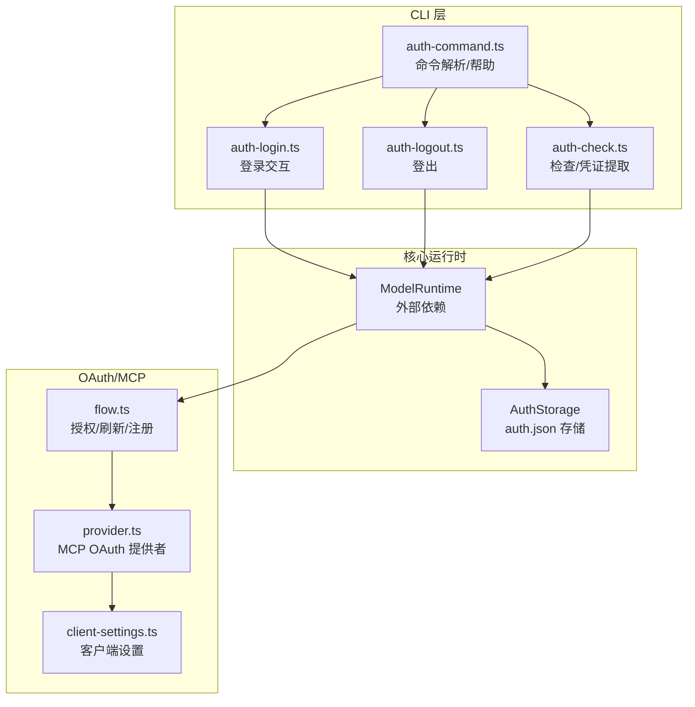
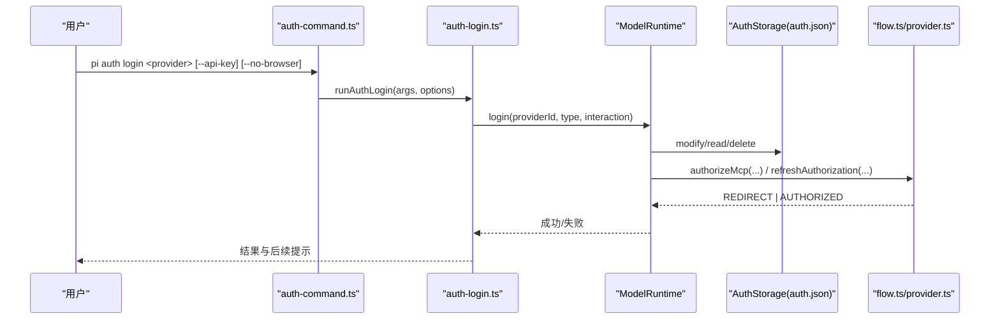
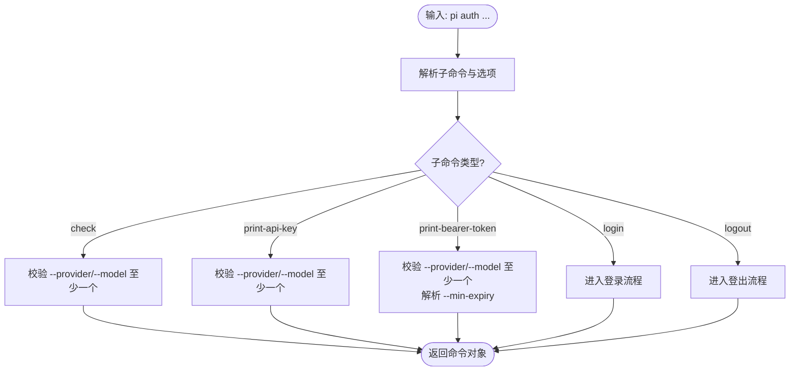
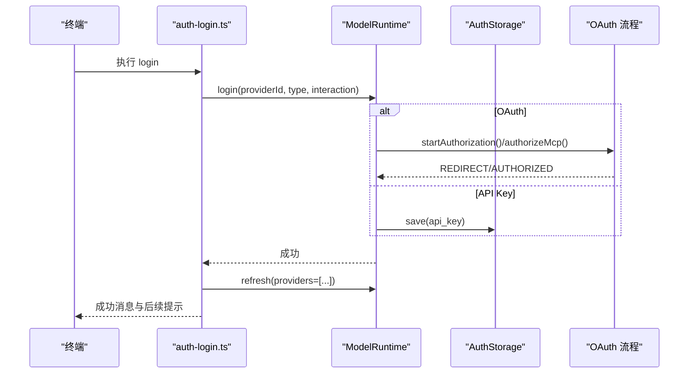
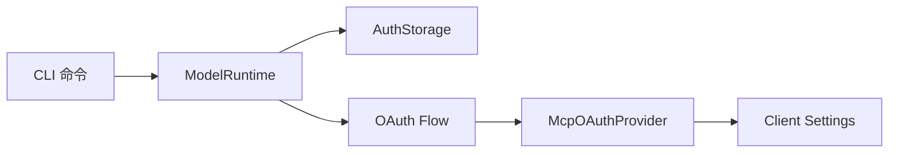

# 认证命令

<cite>
**本文引用的文件**
- [packages/coding-agent/src/cli/auth-command.ts](file://packages/coding-agent/src/cli/auth-command.ts)
- [packages/coding-agent/src/cli/auth-login.ts](file://packages/coding-agent/src/cli/auth-login.ts)
- [packages/coding-agent/src/cli/auth-logout.ts](file://packages/coding-agent/src/cli/auth-logout.ts)
- [packages/coding-agent/src/cli/auth-check.ts](file://packages/coding-agent/src/cli/auth-check.ts)
- [packages/coding-agent/src/core/auth-storage.ts](file://packages/coding-agent/src/core/auth-storage.ts)
- [packages/mcp/src/oauth/flow.ts](file://packages/mcp/src/oauth/flow.ts)
- [packages/mcp/src/oauth/provider.ts](file://packages/mcp/src/oauth/provider.ts)
- [packages/mcp/src/oauth/client-settings.ts](file://packages/mcp/src/oauth/client-settings.ts)
- [packages/coding-agent/test/auth-login.test.ts](file://packages/coding-agent/test/auth-login.test.ts)
- [packages/coding-agent/test/auth-logout.test.ts](file://packages/coding-agent/test/auth-logout.test.ts)
</cite>

## 目录
1. [简介](#简介)
2. [项目结构](#项目结构)
3. [核心组件](#核心组件)
4. [架构总览](#架构总览)
5. [详细组件分析](#详细组件分析)
6. [依赖关系分析](#依赖关系分析)
7. [性能考虑](#性能考虑)
8. [故障排除指南](#故障排除指南)
9. [结论](#结论)
10. [附录](#附录)

## 简介
本文件面向使用 `pi auth` 子命令的用户与集成方，系统说明如何登录、登出、打印 API Key/Bearer Token、检查认证状态，以及支持的认证提供商与认证流程。文档同时覆盖 API Key 与 OAuth 两种认证方式的配置方法、在 CI/CD 环境中的最佳实践，以及常见问题排查建议。

## 项目结构
认证相关能力主要分布在以下模块：
- CLI 命令解析与帮助输出：auth-command.ts
- 登录交互与终端提示：auth-login.ts
- 登出逻辑：auth-logout.ts
- 认证检查与凭证提取：auth-check.ts
- 本地凭证存储（auth.json）：auth-storage.ts
- MCP OAuth 流程与提供者封装：mcp/oauth/flow.ts、provider.ts、client-settings.ts

图表来源
- [packages/coding-agent/src/cli/auth-command.ts:18-70](file://packages/coding-agent/src/cli/auth-command.ts#L18-L70)
- [packages/coding-agent/src/cli/auth-login.ts:36-92](file://packages/coding-agent/src/cli/auth-login.ts#L36-L92)
- [packages/coding-agent/src/cli/auth-logout.ts:21-71](file://packages/coding-agent/src/cli/auth-logout.ts#L21-L71)
- [packages/coding-agent/src/cli/auth-check.ts:22-64](file://packages/coding-agent/src/cli/auth-check.ts#L22-L64)
- [packages/coding-agent/src/core/auth-storage.ts:329-491](file://packages/coding-agent/src/core/auth-storage.ts#L329-L491)
- [packages/mcp/src/oauth/flow.ts:181-213](file://packages/mcp/src/oauth/flow.ts#L181-L213)
- [packages/mcp/src/oauth/provider.ts:53-117](file://packages/mcp/src/oauth/provider.ts#L53-L117)
- [packages/mcp/src/oauth/client-settings.ts:85-117](file://packages/mcp/src/oauth/client-settings.ts#L85-L117)

章节来源
- [packages/coding-agent/src/cli/auth-command.ts:18-70](file://packages/coding-agent/src/cli/auth-command.ts#L18-L70)
- [packages/coding-agent/src/cli/auth-login.ts:36-92](file://packages/coding-agent/src/cli/auth-login.ts#L36-L92)
- [packages/coding-agent/src/cli/auth-logout.ts:21-71](file://packages/coding-agent/src/cli/auth-logout.ts#L21-L71)
- [packages/coding-agent/src/cli/auth-check.ts:22-64](file://packages/coding-agent/src/cli/auth-check.ts#L22-L64)
- [packages/coding-agent/src/core/auth-storage.ts:329-491](file://packages/coding-agent/src/core/auth-storage.ts#L329-L491)
- [packages/mcp/src/oauth/flow.ts:181-213](file://packages/mcp/src/oauth/flow.ts#L181-L213)
- [packages/mcp/src/oauth/provider.ts:53-117](file://packages/mcp/src/oauth/provider.ts#L53-L117)
- [packages/mcp/src/oauth/client-settings.ts:85-117](file://packages/mcp/src/oauth/client-settings.ts#L85-L117)

## 核心组件
- 命令解析与帮助：提供 login/logout/print-api-key/print-bearer-token/check 等子命令的用法、参数校验与错误提示。
- 登录流程：交互式选择浏览器或设备码等方式完成 OAuth；或直接保存 API Key；登录后刷新模型目录并可选更新 MCP 服务器配置。
- 登出流程：删除本地存储的凭据，不影响环境变量与 models.json。
- 检查与导出：检查某 provider 是否就绪，支持按 provider 或 model 解析；可输出 API Key 或 Bearer Token。
- 凭证存储：基于 auth.json 的安全读写，支持并发锁、只读视图、内存后端等。
- OAuth 流程：实现发现、动态注册、PKCE、授权码交换、刷新令牌、范围提升等标准流程。

章节来源
- [packages/coding-agent/src/cli/auth-command.ts:18-70](file://packages/coding-agent/src/cli/auth-command.ts#L18-L70)
- [packages/coding-agent/src/cli/auth-login.ts:36-92](file://packages/coding-agent/src/cli/auth-login.ts#L36-L92)
- [packages/coding-agent/src/cli/auth-logout.ts:21-71](file://packages/coding-agent/src/cli/auth-logout.ts#L21-L71)
- [packages/coding-agent/src/cli/auth-check.ts:22-64](file://packages/coding-agent/src/cli/auth-check.ts#L22-L64)
- [packages/coding-agent/src/core/auth-storage.ts:329-491](file://packages/coding-agent/src/core/auth-storage.ts#L329-L491)
- [packages/mcp/src/oauth/flow.ts:181-213](file://packages/mcp/src/oauth/flow.ts#L181-L213)

## 架构总览
下图展示从 CLI 到运行时与 OAuth 流程的整体调用链。

图表来源
- [packages/coding-agent/src/cli/auth-command.ts:39-70](file://packages/coding-agent/src/cli/auth-command.ts#L39-L70)
- [packages/coding-agent/src/cli/auth-login.ts:36-92](file://packages/coding-agent/src/cli/auth-login.ts#L36-L92)
- [packages/coding-agent/src/core/auth-storage.ts:451-491](file://packages/coding-agent/src/core/auth-storage.ts#L451-L491)
- [packages/mcp/src/oauth/flow.ts:468-492](file://packages/mcp/src/oauth/flow.ts#L468-L492)

## 详细组件分析

### 命令解析与帮助（auth-command.ts）
- 支持的子命令：login、logout、print-api-key、print-bearer-token、check。
- 关键选项：
  - --provider/--model：指定目标 provider 或从 model 解析 provider。
  - --json/--credentials/--no-refresh：仅 check 支持。
  - --min-expiry：仅 print-bearer-token 支持，用于最小剩余有效期过滤。
- 帮助文本统一输出，包含所有子命令与选项说明。

图表来源
- [packages/coding-agent/src/cli/auth-command.ts:18-70](file://packages/coding-agent/src/cli/auth-command.ts#L18-L70)
- [packages/coding-agent/src/cli/auth-command.ts:72-142](file://packages/coding-agent/src/cli/auth-command.ts#L72-L142)

章节来源
- [packages/coding-agent/src/cli/auth-command.ts:18-70](file://packages/coding-agent/src/cli/auth-command.ts#L18-L70)
- [packages/coding-agent/src/cli/auth-command.ts:72-142](file://packages/coding-agent/src/cli/auth-command.ts#L72-L142)

### 登录（auth-login.ts）
- 交互流程：
  - 若 provider 支持 OAuth，默认走账户登录；也可通过 --api-key 直接保存 API Key。
  - 支持浏览器登录与设备码登录两种方式；--no-browser 会跳过自动打开浏览器。
  - 登录成功后刷新模型目录，并在特定 provider（如 Radius）时自动更新 MCP 服务器配置。
- 错误处理：区分“已登录但本地模型状态同步失败”、“用户取消”、“登录失败”等场景。

图表来源
- [packages/coding-agent/src/cli/auth-login.ts:36-92](file://packages/coding-agent/src/cli/auth-login.ts#L36-L92)
- [packages/coding-agent/src/cli/auth-login.ts:116-128](file://packages/coding-agent/src/cli/auth-login.ts#L116-L128)
- [packages/coding-agent/src/cli/auth-login.ts:223-259](file://packages/coding-agent/src/cli/auth-login.ts#L223-L259)

章节来源
- [packages/coding-agent/src/cli/auth-login.ts:36-92](file://packages/coding-agent/src/cli/auth-login.ts#L36-L92)
- [packages/coding-agent/src/cli/auth-login.ts:116-128](file://packages/coding-agent/src/cli/auth-login.ts#L116-L128)
- [packages/coding-agent/src/cli/auth-login.ts:223-259](file://packages/coding-agent/src/cli/auth-login.ts#L223-L259)

### 登出（auth-logout.ts）
- 行为：删除由 login 保存的本地凭据；不修改环境变量与 models.json。
- 交互：列出已存储凭据，定位目标 provider 后执行 logout。
- 错误：区分“本地模型状态同步失败”与“登出失败”。

章节来源
- [packages/coding-agent/src/cli/auth-logout.ts:21-71](file://packages/coding-agent/src/cli/auth-logout.ts#L21-L71)

### 检查与凭证导出（auth-check.ts）
- check：判断 provider 是否 ready/not_ready/invalid，并可输出 JSON 与凭据信息。
- getProviderCredential：优先读取缓存的 access token（非刷新模式），否则从运行时获取并提取 Bearer Token。
- createAuthCheckModelRuntime：构造轻量 ModelRuntime 用于检查。

章节来源
- [packages/coding-agent/src/cli/auth-check.ts:22-64](file://packages/coding-agent/src/cli/auth-check.ts#L22-L64)
- [packages/coding-agent/src/cli/auth-check.ts:66-74](file://packages/coding-agent/src/cli/auth-check.ts#L66-L74)

### 凭证存储（auth-storage.ts）
- 文件路径：~/.pi/agent/auth.json。
- 安全特性：
  - 读写加锁，避免并发冲突。
  - 写入权限 0o600，目录 0o700。
  - 支持只读视图与内存后端（测试用）。
- 数据结构：
  - api_key：{ type:"api_key", key?: string, env?: Record<string,string> }
  - oauth：{ type:"oauth", access:string, refresh:string, expires:number }

章节来源
- [packages/coding-agent/src/core/auth-storage.ts:329-491](file://packages/coding-agent/src/core/auth-storage.ts#L329-L491)
- [packages/coding-agent/src/core/auth-storage.ts:205-291](file://packages/coding-agent/src/core/auth-storage.ts#L205-L291)

### OAuth 流程与提供者（flow.ts、provider.ts、client-settings.ts）
- 流程要点：
  - 发现授权服务器元数据与资源元数据。
  - 动态注册客户端或使用 Client ID Metadata Documents。
  - PKCE 授权码流程，支持 scope 与 resource。
  - 刷新令牌与范围提升（step-up scope）。
  - 对 invalid_client/unauthorized_client/invalid_grant 的错误进行自愈重试。
- 提供者封装：
  - McpOAuthProvider：管理 state、tokens、code verifier、discovery 等持久化状态。
  - createOAuthClientProvider：根据 settings 构建 OAuth 客户端提供者。

章节来源
- [packages/mcp/src/oauth/flow.ts:181-213](file://packages/mcp/src/oauth/flow.ts#L181-L213)
- [packages/mcp/src/oauth/flow.ts:259-316](file://packages/mcp/src/oauth/flow.ts#L259-L316)
- [packages/mcp/src/oauth/flow.ts:339-492](file://packages/mcp/src/oauth/flow.ts#L339-L492)
- [packages/mcp/src/oauth/provider.ts:53-117](file://packages/mcp/src/oauth/provider.ts#L53-L117)
- [packages/mcp/src/oauth/client-settings.ts:85-117](file://packages/mcp/src/oauth/client-settings.ts#L85-L117)

## 依赖关系分析
- CLI 层依赖 ModelRuntime 完成登录、登出、检查与凭证获取。
- ModelRuntime 依赖 AuthStorage 进行本地凭据读写。
- OAuth 流程依赖 MCP OAuth 提供者与客户端设置，负责与授权服务器交互。

图表来源
- [packages/coding-agent/src/cli/auth-login.ts:36-92](file://packages/coding-agent/src/cli/auth-login.ts#L36-L92)
- [packages/coding-agent/src/core/auth-storage.ts:329-491](file://packages/coding-agent/src/core/auth-storage.ts#L329-L491)
- [packages/mcp/src/oauth/flow.ts:468-492](file://packages/mcp/src/oauth/flow.ts#L468-L492)
- [packages/mcp/src/oauth/provider.ts:53-117](file://packages/mcp/src/oauth/provider.ts#L53-L117)
- [packages/mcp/src/oauth/client-settings.ts:85-117](file://packages/mcp/src/oauth/client-settings.ts#L85-L117)

章节来源
- [packages/coding-agent/src/cli/auth-login.ts:36-92](file://packages/coding-agent/src/cli/auth-login.ts#L36-L92)
- [packages/coding-agent/src/core/auth-storage.ts:329-491](file://packages/coding-agent/src/core/auth-storage.ts#L329-L491)
- [packages/mcp/src/oauth/flow.ts:468-492](file://packages/mcp/src/oauth/flow.ts#L468-L492)
- [packages/mcp/src/oauth/provider.ts:53-117](file://packages/mcp/src/oauth/provider.ts#L53-L117)
- [packages/mcp/src/oauth/client-settings.ts:85-117](file://packages/mcp/src/oauth/client-settings.ts#L85-L117)

## 性能考虑
- 登录成功后会尝试刷新模型目录，超时或失败不会阻塞登录结果，下次启动会自动重试。
- OAuth 流程具备错误自愈机制，对部分服务端错误自动清理并重试，减少人工干预。
- 凭证存储采用文件级锁与异步重试策略，降低并发写冲突风险。

[本节为通用指导，无需具体文件引用]

## 故障排除指南
- 无法识别 provider：
  - 确认 provider 是否存在且支持登录（OAuth 或 API Key）。
  - 参考错误输出中列出的可用 provider 列表。
- 登录被取消：
  - 检查 Ctrl+C 或信号中断；重新运行登录命令。
- 本地模型状态同步失败：
  - 登录成功但本地状态未同步；稍后重试或重启应用以自动恢复。
- 登出失败：
  - 检查网络或服务端可用性；若仅本地状态不同步，凭据已移除。
- 检查命令返回 not_ready/invalid：
  - not_ready：未配置凭据或 provider 不存在。
  - invalid：运行时处于无效状态，需先修复基础配置。
- OAuth 相关错误：
  - invalid_client/unauthorized_client：可能因客户端注册信息变更，流程会自动清理并重试。
  - invalid_grant：刷新令牌失效，流程会清理并重试授权。
  - 范围不足：触发范围提升流程，可能需要重新授权。

章节来源
- [packages/coding-agent/src/cli/auth-login.ts:74-92](file://packages/coding-agent/src/cli/auth-login.ts#L74-L92)
- [packages/coding-agent/src/cli/auth-logout.ts:53-71](file://packages/coding-agent/src/cli/auth-logout.ts#L53-L71)
- [packages/coding-agent/src/cli/auth-check.ts:22-53](file://packages/coding-agent/src/cli/auth-check.ts#L22-L53)
- [packages/mcp/src/oauth/flow.ts:468-492](file://packages/mcp/src/oauth/flow.ts#L468-L492)

## 结论
`pi auth` 子命令提供了完整的认证生命周期管理能力，涵盖登录、登出、凭证导出与健康检查。其底层依托安全的本地凭证存储与标准的 OAuth 流程，既适合开发者日常使用，也便于在 CI/CD 环境中自动化配置与验证。

[本节为总结性内容，无需具体文件引用]

## 附录

### 常用命令速查
- 登录
  - pi auth login <provider> [--api-key] [--no-browser]
- 登出
  - pi auth logout <provider>
- 打印 API Key
  - pi auth print-api-key [--provider <provider>] [--model <model>]
- 打印 Bearer Token
  - pi auth print-bearer-token [--provider <provider>] [--model <model>] [--min-expiry <duration>]
- 检查认证状态
  - pi auth check [--provider <provider>] [--model <model>] [--json] [--credentials] [--no-refresh]

章节来源
- [packages/coding-agent/src/cli/auth-command.ts:39-70](file://packages/coding-agent/src/cli/auth-command.ts#L39-L70)

### API Key 与 OAuth 配置方法
- API Key
  - 使用 --api-key 直接保存密钥；或通过环境变量注入（env 字段）。
  - 适用于不支持账户登录的 provider。
- OAuth
  - 默认走浏览器授权；也可选择设备码方式。
  - 支持动态注册客户端、PKCE、刷新令牌与范围提升。
  - 可通过 Client ID Metadata Documents 替代动态注册。

章节来源
- [packages/coding-agent/src/cli/auth-login.ts:116-128](file://packages/coding-agent/src/cli/auth-login.ts#L116-L128)
- [packages/mcp/src/oauth/flow.ts:181-213](file://packages/mcp/src/oauth/flow.ts#L181-L213)
- [packages/mcp/src/oauth/client-settings.ts:85-117](file://packages/mcp/src/oauth/client-settings.ts#L85-L117)

### 在 CI/CD 中配置认证信息
- 推荐做法
  - 提前准备 auth.json，将 provider 的 API Key 或 OAuth 凭据写入对应键值。
  - 使用 pi auth check 验证凭据有效性，结合 --json 输出结构化结果供流水线消费。
  - 对于需要 Bearer Token 的场景，使用 print-bearer-token 并配合 --min-expiry 确保令牌有效期满足任务时长。
- 注意事项
  - 不要将敏感凭据硬编码进脚本；通过 CI 平台提供的密钥管理服务注入环境变量或挂载文件。
  - 若使用 OAuth，CI 中通常更适合预置 API Key 或短效令牌，避免交互式授权。

章节来源
- [packages/coding-agent/src/cli/auth-check.ts:22-64](file://packages/coding-agent/src/cli/auth-check.ts#L22-L64)
- [packages/coding-agent/src/cli/auth-command.ts:72-142](file://packages/coding-agent/src/cli/auth-command.ts#L72-L142)

### 测试用例参考
- 登录流程测试：展示了 OAuth 与 API Key 双模式的交互与返回值。
- 登出流程测试：验证了必须指定 provider 的参数约束与错误输出。

章节来源
- [packages/coding-agent/test/auth-login.test.ts:76-115](file://packages/coding-agent/test/auth-login.test.ts#L76-L115)
- [packages/coding-agent/test/auth-logout.test.ts:33-41](file://packages/coding-agent/test/auth-logout.test.ts#L33-L41)