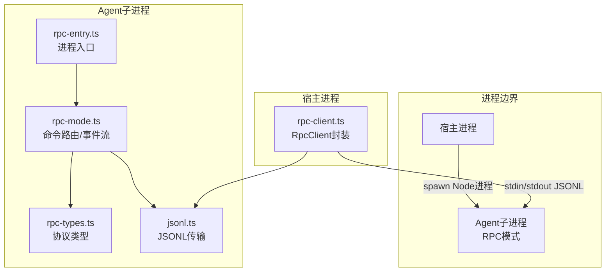
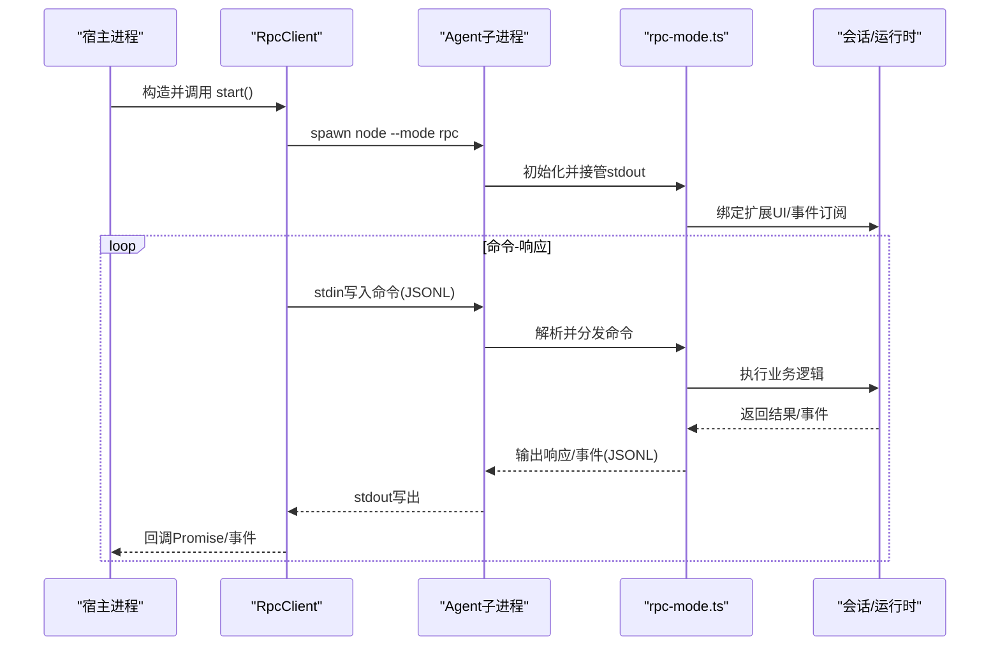
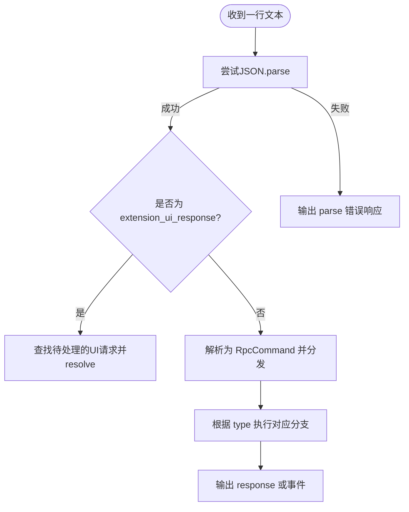
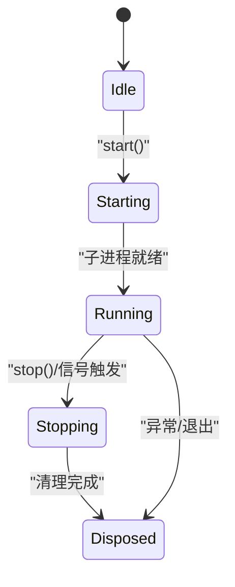
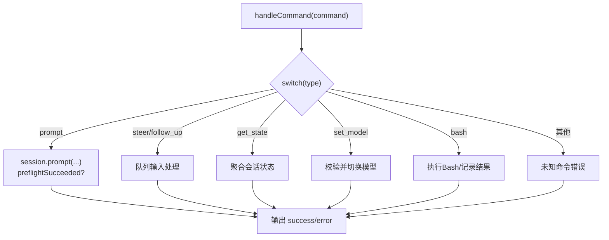
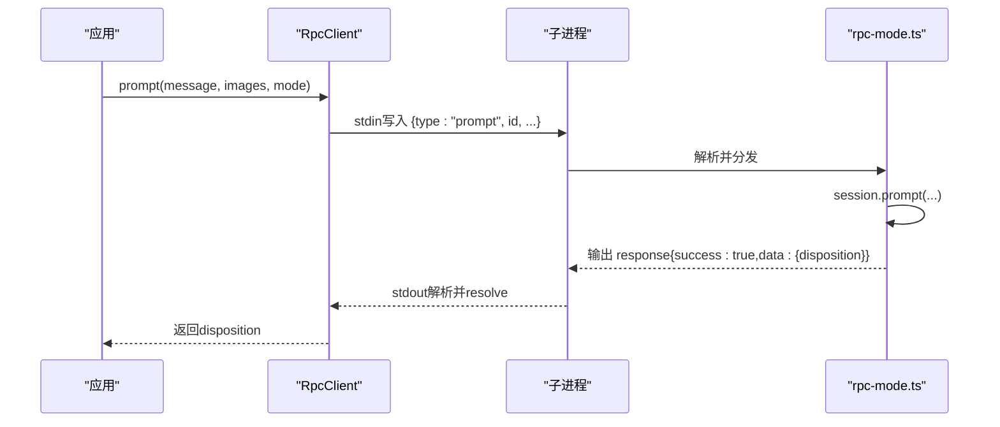
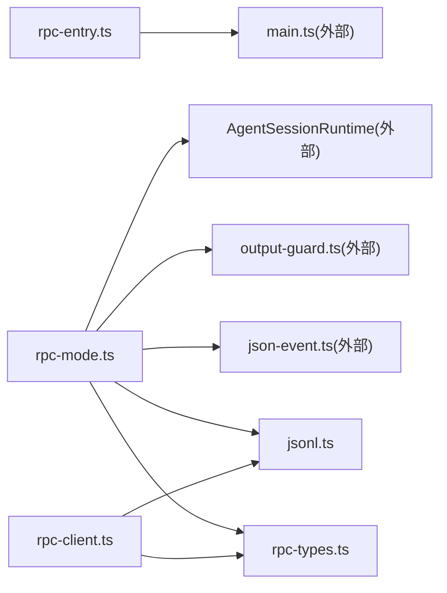
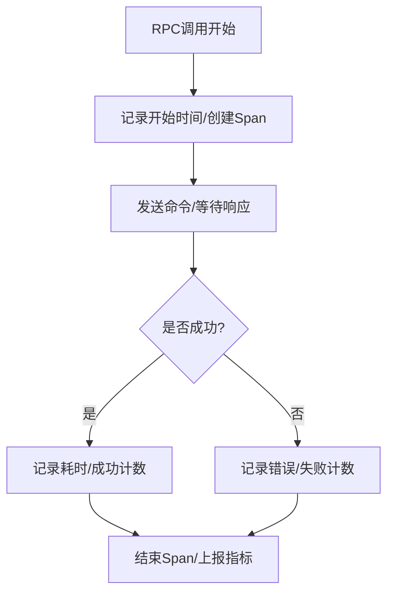
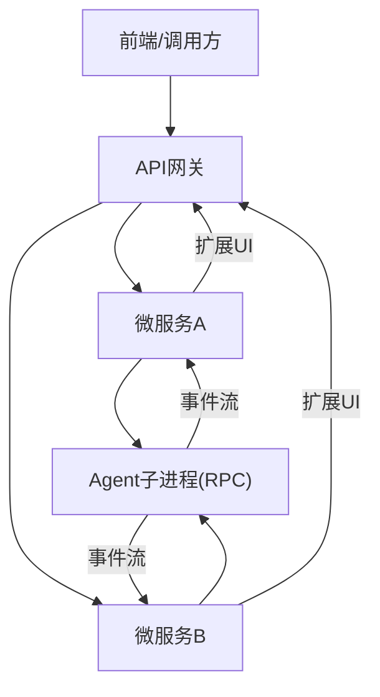

# RPC模式

<cite>
**本文引用的文件**   
- [rpc-entry.ts](file://packages/coding-agent/src/rpc-entry.ts)
- [rpc-mode.ts](file://packages/coding-agent/src/modes/rpc/rpc-mode.ts)
- [rpc-client.ts](file://packages/coding-agent/src/modes/rpc/rpc-client.ts)
- [rpc-types.ts](file://packages/coding-agent/src/modes/rpc/rpc-types.ts)
- [jsonl.ts](file://packages/coding-agent/src/modes/rpc/jsonl.ts)
- [rpc.md](file://packages/coding-agent/docs/rpc.md)
- [rpc-commands.md](file://packages/coding-agent/docs/rpc-commands.md)
- [rpc-extension-ui.md](file://packages/coding-agent/docs/rpc-extension-ui.md)
- [cli.md](file://packages/coding-agent/docs/cli.md)
- [json.md](file://packages/coding-agent/docs/json.md)
- [extensions.md](file://packages/coding-agent/docs/extensions.md)
- [client.ts](file://packages/mcp/src/client.ts)
- [streamable-http.ts](file://packages/mcp/src/transports/streamable-http.ts)
- [jsonrpc.ts](file://packages/mcp/src/protocol/jsonrpc.ts)
- [metrics.ts](file://packages/telemetry/src/metrics.ts)
- [memory.ts](file://packages/telemetry/src/memory.ts)
</cite>

## 目录
1. [简介](#简介)
2. [项目结构](#项目结构)
3. [核心组件](#核心组件)
4. [架构总览](#架构总览)
5. [详细组件分析](#详细组件分析)
6. [依赖关系分析](#依赖关系分析)
7. [性能与可观测性](#性能与可观测性)
8. [安全与权限控制](#安全与权限控制)
9. [API网关与微服务集成示例](#api网关与微服务集成示例)
10. [故障排查指南](#故障排查指南)
11. [结论](#结论)

## 简介
本文件系统化梳理仓库中的“RPC模式”实现，覆盖协议规范、消息格式、连接管理、服务器启动配置、客户端调用方式、错误处理机制，并补充企业级特性（安全认证、权限控制、性能监控）以及API网关与微服务架构的集成思路。该RPC模式面向“无头进程内嵌”场景：外部程序通过标准输入输出与Agent子进程进行JSONL双向通信，既可用于自动化编排，也可作为内部微服务或API网关的后端能力。

## 项目结构
RPC相关代码集中在coding-agent包中，采用“模式+类型+传输”的分层组织：
- 进程入口：提供独立的RPC进程启动入口
- 运行模式：定义RPC模式的命令路由、事件流、扩展UI交互
- 客户端封装：封装子进程生命周期、请求-响应匹配、超时与错误处理
- 协议类型：统一描述命令、响应、会话状态、扩展UI请求/响应
- JSONL传输：严格基于换行符分帧的JSONL序列化与读取

图表来源
- [rpc-entry.ts:1-14](file://packages/coding-agent/src/rpc-entry.ts#L1-L14)
- [rpc-mode.ts:1-12](file://packages/coding-agent/src/modes/rpc/rpc-mode.ts#L1-L12)
- [rpc-client.ts:1-17](file://packages/coding-agent/src/modes/rpc/rpc-client.ts#L1-L17)
- [rpc-types.ts:1-15](file://packages/coding-agent/src/modes/rpc/rpc-types.ts#L1-L15)
- [jsonl.ts:1-12](file://packages/coding-agent/src/modes/rpc/jsonl.ts#L1-L12)

章节来源
- [rpc-entry.ts:1-14](file://packages/coding-agent/src/rpc-entry.ts#L1-L14)
- [rpc-mode.ts:1-12](file://packages/coding-agent/src/modes/rpc/rpc-mode.ts#L1-L12)
- [rpc-client.ts:1-17](file://packages/coding-agent/src/modes/rpc/rpc-client.ts#L1-L17)
- [rpc-types.ts:1-15](file://packages/coding-agent/src/modes/rpc/rpc-types.ts#L1-L15)
- [jsonl.ts:1-12](file://packages/coding-agent/src/modes/rpc/jsonl.ts#L1-L12)

## 核心组件
- 进程入口：设置进程名与环境变量，初始化HTTP调度器，并将参数转发给主入口以进入RPC模式
- 运行模式：接管stdout，解析stdin JSONL命令，分发到会话与运行时，输出响应与事件；支持扩展UI交互与优雅退出
- 客户端封装：启动Agent子进程，维护请求ID映射、超时、stderr收集、事件订阅、批量方法封装
- 协议类型：统一定义所有命令、响应、会话状态、扩展UI请求/响应
- JSONL传输：严格LF分帧，避免Node readline对Unicode分隔符的歧义

章节来源
- [rpc-entry.ts:1-14](file://packages/coding-agent/src/rpc-entry.ts#L1-L14)
- [rpc-mode.ts:50-135](file://packages/coding-agent/src/modes/rpc/rpc-mode.ts#L50-L135)
- [rpc-client.ts:56-167](file://packages/coding-agent/src/modes/rpc/rpc-client.ts#L56-L167)
- [rpc-types.ts:16-75](file://packages/coding-agent/src/modes/rpc/rpc-types.ts#L16-L75)
- [jsonl.ts:4-21](file://packages/coding-agent/src/modes/rpc/jsonl.ts#L4-L21)

## 架构总览
RPC模式采用“进程内嵌+JSONL双向流”的轻量架构。宿主进程通过RpcClient启动Agent子进程，并以JSONL在stdin/stdout上交换命令、响应与事件。Agent侧由rpc-mode.ts统一解析命令、驱动会话、输出事件，并通过扩展UI子协议与宿主交互。

图表来源
- [rpc-client.ts:74-140](file://packages/coding-agent/src/modes/rpc/rpc-client.ts#L74-L140)
- [rpc-mode.ts:54-135](file://packages/coding-agent/src/modes/rpc/rpc-mode.ts#L54-L135)
- [rpc-types.ts:16-75](file://packages/coding-agent/src/modes/rpc/rpc-types.ts#L16-L75)

## 详细组件分析

### 进程入口与启动配置
- 进程入口设置进程名、环境变量，启用HTTP调度器，并将命令行参数追加`--mode rpc`后交给主入口
- CLI文档说明`--mode rpc`选择JSONL接口，stdout保留给协议记录，不支持`@file`提示词参数

章节来源
- [rpc-entry.ts:1-14](file://packages/coding-agent/src/rpc-entry.ts#L1-L14)
- [cli.md:32-53](file://packages/coding-agent/docs/cli.md#L32-L53)

### 协议规范与消息格式
- 传输层：严格JSONL，每条记录以换行符结尾；客户端与服务端均使用同一序列化/解析工具
- 命令：每个命令为JSON对象，包含可选`id`用于关联响应，必填`type`标识命令类别
- 响应：类型为`response`，携带`command`、`success`、可选`data`或`error`
- 事件：会话事件按发生顺序直接输出，不等待响应
- 扩展UI：服务端发出`extension_ui_request`，客户端回复`extension_ui_response`

图表来源
- [jsonl.ts:4-21](file://packages/coding-agent/src/modes/rpc/jsonl.ts#L4-L21)
- [rpc-mode.ts:768-800](file://packages/coding-agent/src/modes/rpc/rpc-mode.ts#L768-L800)
- [rpc-types.ts:16-75](file://packages/coding-agent/src/modes/rpc/rpc-types.ts#L16-L75)

章节来源
- [rpc-types.ts:16-75](file://packages/coding-agent/src/modes/rpc/rpc-types.ts#L16-L75)
- [rpc-types.ts:112-245](file://packages/coding-agent/src/modes/rpc/rpc-types.ts#L112-L245)
- [rpc-types.ts:247-297](file://packages/coding-agent/src/modes/rpc/rpc-types.ts#L247-L297)
- [jsonl.ts:4-21](file://packages/coding-agent/src/modes/rpc/jsonl.ts#L4-L21)

### 连接管理与生命周期
- 客户端启动：创建子进程，收集stderr，注册exit/error/stdin错误监听，启动JSONL读取器
- 停止流程：先停止读取，发送SIGTERM，等待退出，必要时SIGKILL，清理pending请求
- 信号处理：服务端注册SIGTERM/SIGHUP，优雅关闭运行时、分离输入、刷新输出并退出

图表来源
- [rpc-client.ts:74-167](file://packages/coding-agent/src/modes/rpc/rpc-client.ts#L74-L167)
- [rpc-mode.ts:373-395](file://packages/coding-agent/src/modes/rpc/rpc-mode.ts#L373-L395)
- [rpc-mode.ts:743-766](file://packages/coding-agent/src/modes/rpc/rpc-mode.ts#L743-L766)

章节来源
- [rpc-client.ts:74-167](file://packages/coding-agent/src/modes/rpc/rpc-client.ts#L74-L167)
- [rpc-mode.ts:373-395](file://packages/coding-agent/src/modes/rpc/rpc-mode.ts#L373-L395)
- [rpc-mode.ts:743-766](file://packages/coding-agent/src/modes/rpc/rpc-mode.ts#L743-L766)

### 命令路由与业务处理
- 命令分类：提示词、状态查询、模型切换、思考级别、队列模式、压缩、重试、Bash、会话操作、消息与命令枚举等
- 异步处理：prompt预检成功后立即返回disposition，后续事件继续输出；activeCommands计数保证优雅退出时机
- 扩展UI：select/confirm/input/editor/notify/setStatus/setWidget/setTitle/setEditorText等方法通过请求-响应子协议工作

图表来源
- [rpc-mode.ts:400-738](file://packages/coding-agent/src/modes/rpc/rpc-mode.ts#L400-L738)

章节来源
- [rpc-mode.ts:400-738](file://packages/coding-agent/src/modes/rpc/rpc-mode.ts#L400-L738)
- [rpc-types.ts:16-75](file://packages/coding-agent/src/modes/rpc/rpc-types.ts#L16-L75)

### 客户端调用方式
- 高级API：prompt/steer/followUp/abort/newSession/getState/setModel/cycleModel/getAvailableModels/setThinkingLevel/cycleThinkingLevel/getAvailableThinkingLevels/setSteeringMode/setFollowUpMode/compact/setAutoCompaction/setAutoRetry/abortRetry/bash/abortBash/getSessionStats/exportHtml/switchSession/fork/clone/getForkMessages/getEntries/getTree/getLastAssistantText/setSessionName/getMessages/getCommands
- 事件订阅：onEvent订阅agent_settled等事件；waitForIdle/collectEvents/promptAndWait提供便捷等待
- 内部实现：send方法分配唯一id，维护pendingRequests，30秒超时，write失败时reject

图表来源
- [rpc-client.ts:198-205](file://packages/coding-agent/src/modes/rpc/rpc-client.ts#L198-L205)
- [rpc-client.ts:556-605](file://packages/coding-agent/src/modes/rpc/rpc-client.ts#L556-L605)
- [rpc-mode.ts:409-435](file://packages/coding-agent/src/modes/rpc/rpc-mode.ts#L409-L435)

章节来源
- [rpc-client.ts:198-461](file://packages/coding-agent/src/modes/rpc/rpc-client.ts#L198-L461)
- [rpc-client.ts:471-517](file://packages/coding-agent/src/modes/rpc/rpc-client.ts#L471-L517)
- [rpc-client.ts:556-616](file://packages/coding-agent/src/modes/rpc/rpc-client.ts#L556-L616)

### 错误处理机制
- 客户端侧：子进程exit/error/stdin错误会拒绝所有pending请求；send写失败时立即reject；getData对success:false抛出错误
- 服务端侧：parse失败输出parse错误；未知命令返回错误响应；业务校验失败返回错误响应
- 扩展UI：取消/超时/Abort事件会清理待处理请求并返回默认值

章节来源
- [rpc-client.ts:107-140](file://packages/coding-agent/src/modes/rpc/rpc-client.ts#L107-L140)
- [rpc-client.ts:545-616](file://packages/coding-agent/src/modes/rpc/rpc-client.ts#L545-L616)
- [rpc-mode.ts:768-800](file://packages/coding-agent/src/modes/rpc/rpc-mode.ts#L768-L800)
- [rpc-mode.ts:734-738](file://packages/coding-agent/src/modes/rpc/rpc-mode.ts#L734-L738)

### 扩展UI子协议
- 服务端发出extension_ui_request，包含method、title、options、timeout等字段
- 客户端回复extension_ui_response，包含value/confirmed/cancelled等字段
- 支持select/confirm/input/editor/notify/setStatus/setWidget/setTitle/setEditorText

章节来源
- [rpc-types.ts:247-297](file://packages/coding-agent/src/modes/rpc/rpc-types.ts#L247-L297)
- [rpc-mode.ts:94-135](file://packages/coding-agent/src/modes/rpc/rpc-mode.ts#L94-L135)
- [rpc-extension-ui.md:3-25](file://packages/coding-agent/docs/rpc-extension-ui.md#L3-L25)

## 依赖关系分析
- 进程入口依赖主入口与HTTP调度器
- 运行模式依赖会话运行时、输出守卫、主题、JSON事件转换、JSONL传输、协议类型
- 客户端依赖子进程、JSONL传输、协议类型、会话事件类型
- MCP协议参考：MCP客户端与传输层实现展示了JSON-RPC 2.0与SSE流式传输的实现范式，可作为RPC模式在网络化时的参考

图表来源
- [rpc-entry.ts:1-14](file://packages/coding-agent/src/rpc-entry.ts#L1-L14)
- [rpc-mode.ts:14-48](file://packages/coding-agent/src/modes/rpc/rpc-mode.ts#L14-L48)
- [rpc-client.ts:1-17](file://packages/coding-agent/src/modes/rpc/rpc-client.ts#L1-L17)

章节来源
- [rpc-entry.ts:1-14](file://packages/coding-agent/src/rpc-entry.ts#L1-L14)
- [rpc-mode.ts:14-48](file://packages/coding-agent/src/modes/rpc/rpc-mode.ts#L14-L48)
- [rpc-client.ts:1-17](file://packages/coding-agent/src/modes/rpc/rpc-client.ts#L1-L17)

## 性能与可观测性
- 背压控制：服务端在事件输出后等待原始stdout背压，避免阻塞
- 超时与重试：客户端对所有请求设置30秒超时；MCP传输层展示SSE重连与指数退避策略，可作为网络RPC的参考
- 指标与追踪：telemetry模块提供计数器、直方图、度量上下文与内存存储，可在RPC调用链中埋点统计耗时、吞吐与错误率

图表来源
- [rpc-mode.ts:368-370](file://packages/coding-agent/src/modes/rpc/rpc-mode.ts#L368-L370)
- [streamable-http.ts:486-512](file://packages/mcp/src/transports/streamable-http.ts#L486-L512)
- [metrics.ts:43-145](file://packages/telemetry/src/metrics.ts#L43-L145)
- [memory.ts:261-366](file://packages/telemetry/src/memory.ts#L261-L366)

章节来源
- [rpc-mode.ts:368-370](file://packages/coding-agent/src/modes/rpc/rpc-mode.ts#L368-L370)
- [streamable-http.ts:486-512](file://packages/mcp/src/transports/streamable-http.ts#L486-L512)
- [metrics.ts:43-145](file://packages/telemetry/src/metrics.ts#L43-L145)
- [memory.ts:261-366](file://packages/telemetry/src/memory.ts#L261-L366)

## 安全与权限控制
- 当前RPC模式未内置鉴权与授权机制，适合受控环境（如本地进程或内网管道）使用
- 若需对外暴露，建议在网关层实施TLS、身份验证（如JWT/OAuth）、访问控制列表与速率限制
- MCP模块提供了OAuth保护资源发现、动态客户端注册、PKCE授权码流程与令牌刷新等能力，可作为网络RPC的安全参考

章节来源
- [rpc.md:15-20](file://packages/coding-agent/docs/rpc.md#L15-L20)
- [rpc.md:108-144](file://packages/coding-agent/docs/rpc.md#L108-L144)
- [client.ts:173-212](file://packages/mcp/src/client.ts#L173-L212)
- [client.ts:446-490](file://packages/mcp/src/client.ts#L446-L490)
- [jsonrpc.ts:103-113](file://packages/mcp/src/protocol/jsonrpc.ts#L103-L113)

## API网关与微服务集成示例
- 网关侧：将RPC命令序列化为HTTP请求，转发至后端Agent进程；将stdout事件流转换为SSE或WebSocket推送
- 微服务侧：以独立Agent进程承载业务逻辑，通过RPC模式暴露能力；服务间通过内部总线或gRPC/HTTP调用RPC命令
- 扩展UI：网关可提供交互式界面，接收用户输入并回传extension_ui_response

[此图为概念性集成示意，不直接映射具体源码文件]

## 故障排查指南
- 子进程异常：检查stderr收集、exitCode/signal、stdin是否可写；确认客户端已正确启动并等待初始化
- 命令解析失败：确认JSONL格式严格，仅以换行符分割；避免在JSON字符串中使用非标准分隔符
- 超时问题：检查服务端是否长时间无响应；适当调整客户端超时或增加背压等待
- 扩展UI未响应：确认宿主实现了extension_ui_response并正确回填id
- 优雅退出：确保信号处理与activeCommands计数正常，避免在命令进行中强制退出

章节来源
- [rpc-client.ts:107-140](file://packages/coding-agent/src/modes/rpc/rpc-client.ts#L107-L140)
- [rpc-client.ts:556-605](file://packages/coding-agent/src/modes/rpc/rpc-client.ts#L556-L605)
- [rpc-mode.ts:768-800](file://packages/coding-agent/src/modes/rpc/rpc-mode.ts#L768-L800)
- [rpc-mode.ts:743-766](file://packages/coding-agent/src/modes/rpc/rpc-mode.ts#L743-L766)

## 结论
RPC模式以简洁的JSONL协议和进程内嵌方式，为Agent能力提供了稳定可靠的编程接口。其清晰的命令-响应-事件三元结构与扩展UI子协议，便于在自动化、网关与微服务场景中复用。结合telemetry与MCP安全能力，可在生产环境中构建高性能、可观测且安全的RPC服务。