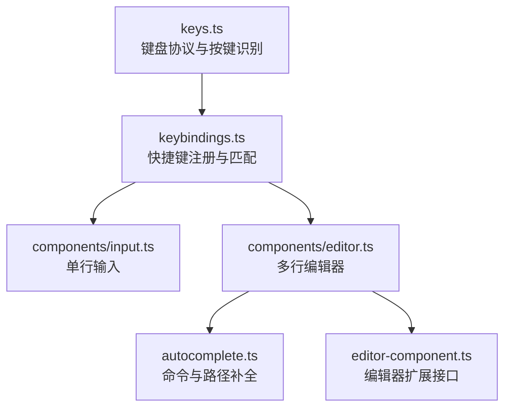
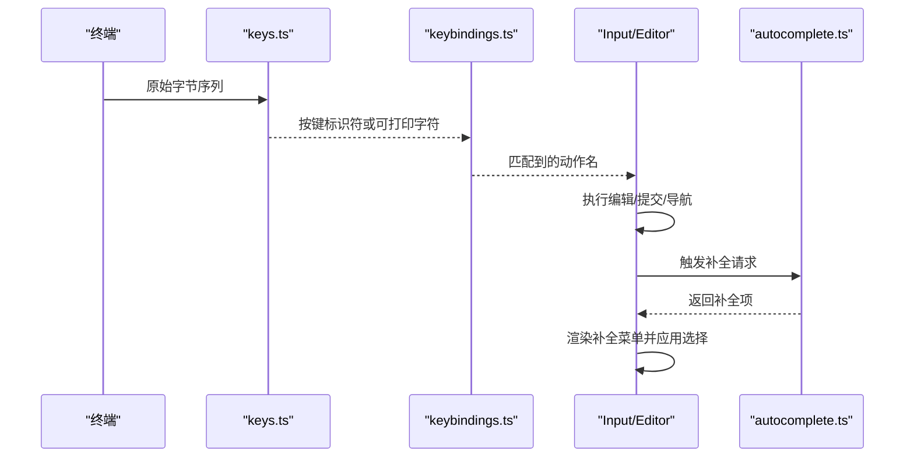
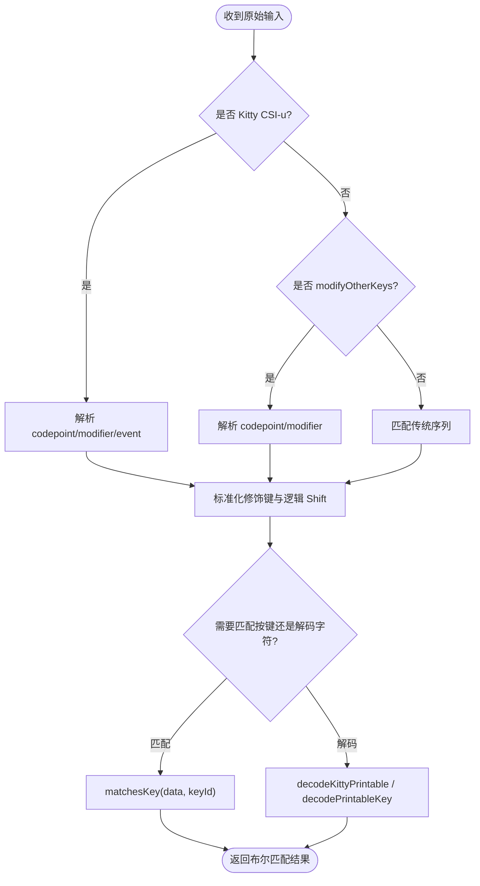
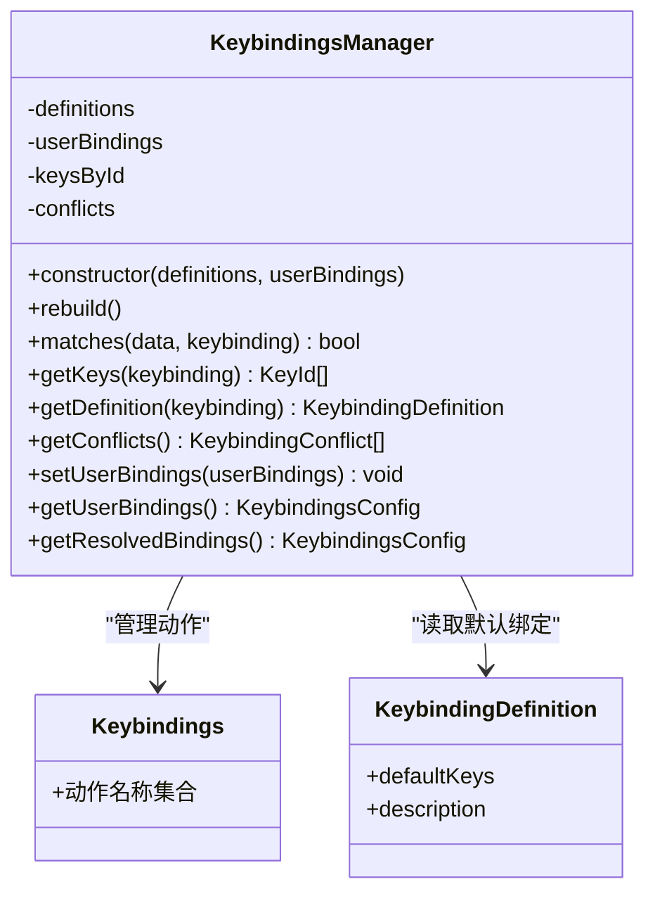
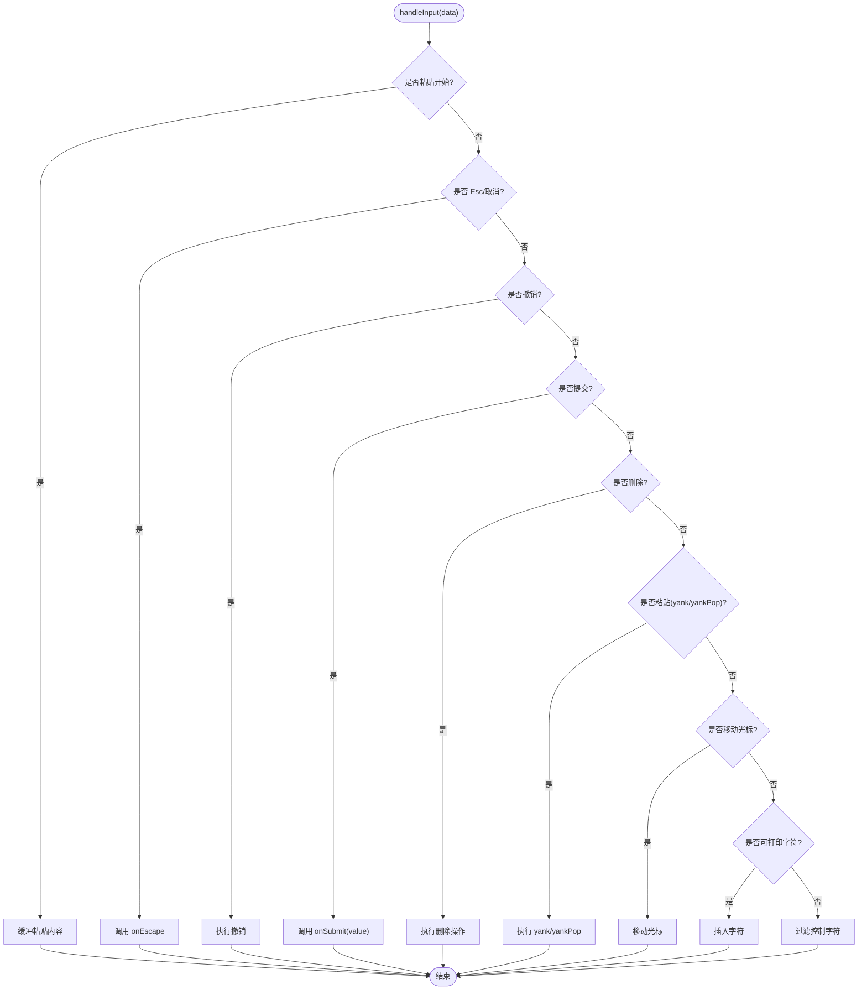
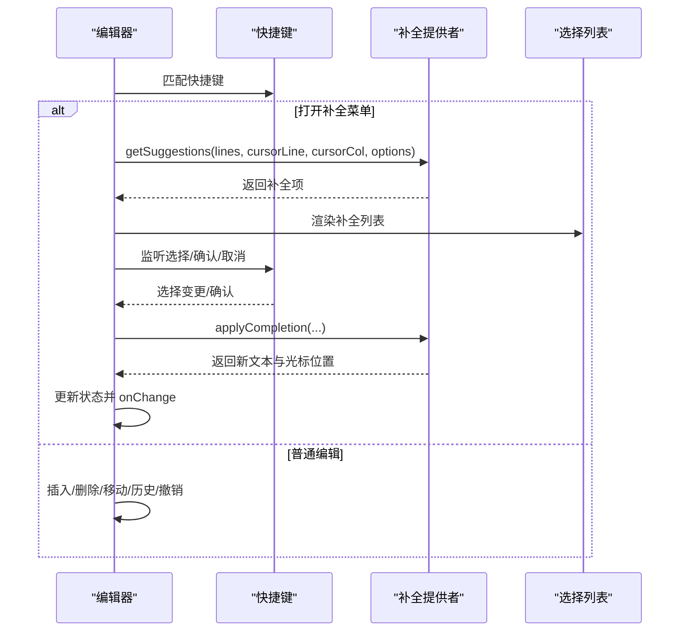
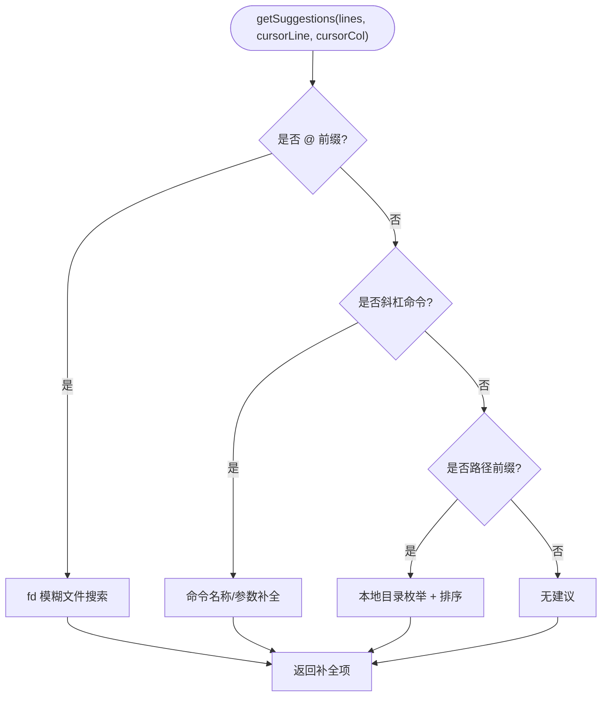
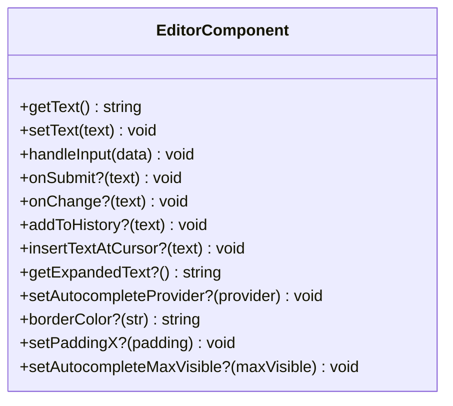
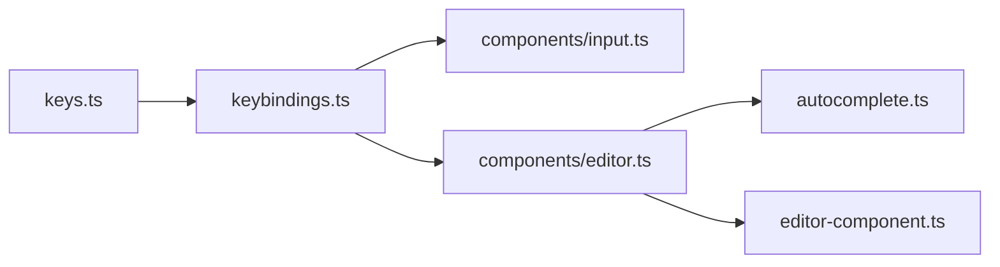

# 用户输入处理

<cite>
**本文引用的文件**   
- [keys.ts](file://packages/tui/src/keys.ts)
- [keybindings.ts](file://packages/tui/src/keybindings.ts)
- [input.ts](file://packages/tui/src/components/input.ts)
- [editor.ts](file://packages/tui/src/components/editor.ts)
- [autocomplete.ts](file://packages/tui/src/autocomplete.ts)
- [editor-component.ts](file://packages/tui/src/editor-component.ts)
</cite>

## 目录
1. [简介](#简介)
2. [项目结构与输入子系统定位](#项目结构与输入子系统定位)
3. [核心组件总览](#核心组件总览)
4. [架构总览](#架构总览)
5. [详细组件分析](#详细组件分析)
6. [依赖关系与扩展点](#依赖关系与扩展点)
7. [性能与行为特征](#性能与行为特征)
8. [常见问题与排错](#常见问题与排错)
9. [结论](#结论)

## 简介
本文面向“用户输入处理”这一目标，系统性梳理终端图形界面中的命令行输入解析、快捷键系统、命令补全机制，并覆盖输入模式、特殊字符处理、多行输入支持、输入验证、错误处理与用户体验优化。同时给出自定义快捷键配置、输入过滤器和扩展点的实践说明。

该能力主要集中在 TUI 包中：
- 键盘协议与按键识别由底层键码模块负责；
- 快捷键绑定由全局键绑定管理器统一维护；
- 单行输入组件提供基础文本编辑体验；
- 多行编辑器组件提供更完整的编辑、历史、粘贴、撤销与自动补全；
- 自动补全提供者负责斜杠命令、路径附件与参数补全。

## 项目结构与输入子系统定位
TUI 包的输入相关代码集中在 `packages/tui/src` 下：
- 键码与协议层：`keys.ts`
- 快捷键定义与管理：`keybindings.ts`
- 单行输入组件：`components/input.ts`
- 多行编辑器组件：`components/editor.ts`
- 自动补全提供者：`autocomplete.ts`
- 编辑器扩展接口：`editor-component.ts`

**图表来源**
- [keys.ts:1-19](file://packages/tui/src/keys.ts#L1-L19)
- [keybindings.ts:1-69](file://packages/tui/src/keybindings.ts#L1-L69)
- [input.ts:1-15](file://packages/tui/src/components/input.ts#L1-L15)
- [editor.ts:1-26](file://packages/tui/src/components/editor.ts#L1-L26)
- [autocomplete.ts:246-297](file://packages/tui/src/autocomplete.ts#L246-L297)
- [editor-component.ts:1-74](file://packages/tui/src/editor-component.ts#L1-L74)

**章节来源**
- [keys.ts:1-19](file://packages/tui/src/keys.ts#L1-L19)
- [keybindings.ts:1-69](file://packages/tui/src/keybindings.ts#L1-L69)
- [input.ts:1-15](file://packages/tui/src/components/input.ts#L1-L15)
- [editor.ts:1-26](file://packages/tui/src/components/editor.ts#L1-L26)
- [autocomplete.ts:246-297](file://packages/tui/src/autocomplete.ts#L246-L297)
- [editor-component.ts:1-74](file://packages/tui/src/editor-component.ts#L1-L74)

## 核心组件总览
- 键盘协议与按键识别：
  - 支持传统终端序列与 Kitty 键盘协议；
  - 提供按键标识符类型、辅助对象、匹配函数与可打印字符解码；
  - 处理修饰键（Ctrl/Shift/Alt/Super）、功能键、方向键、Home/End、PageUp/PageDown 等。
- 快捷键系统：
  - 集中定义动作名称与默认按键组合；
  - 支持用户覆盖默认绑定、冲突检测与查询；
  - 提供选择列表翻页等通用导航辅助方法。
- 单行输入组件：
  - 支持光标移动、删除、复制、撤销、粘贴清理、占位符显示与水平滚动；
  - 通过快捷键驱动行为，提交时触发回调。
- 多行编辑器组件：
  - 支持多行文本、换行、历史上下翻、跳转字符、粘贴标记、撤销栈、可视区域滚动；
  - 集成自动补全菜单，支持 Tab 确认、方向键选择、回车确认、Esc 取消；
  - 暴露编辑器扩展接口，允许外部实现自定义编辑器。
- 自动补全提供者：
  - 支持斜杠命令、命令参数、路径附件（@）与模糊搜索；
  - 使用 fd 快速遍历目录，尊重 .gitignore；
  - 智能引号包裹、路径分隔符处理、目录优先排序。

**章节来源**
- [keys.ts:1-19](file://packages/tui/src/keys.ts#L1-L19)
- [keybindings.ts:1-69](file://packages/tui/src/keybindings.ts#L1-L69)
- [input.ts:18-60](file://packages/tui/src/components/input.ts#L18-L60)
- [editor.ts:297-387](file://packages/tui/src/components/editor.ts#L297-L387)
- [autocomplete.ts:246-297](file://packages/tui/src/autocomplete.ts#L246-L297)
- [editor-component.ts:11-74](file://packages/tui/src/editor-component.ts#L11-L74)

## 架构总览
输入数据从终端进入后，先由键码模块解析为高层语义的按键标识符或可打印字符，再由快捷键管理器将原始输入映射到具体动作，最终由输入组件或编辑器组件消费这些动作，完成文本编辑、提交、补全等行为。

**图表来源**
- [keys.ts:892-1295](file://packages/tui/src/keys.ts#L892-L1295)
- [keybindings.ts:231-306](file://packages/tui/src/keybindings.ts#L231-L306)
- [input.ts:71-234](file://packages/tui/src/components/input.ts#L71-L234)
- [editor.ts:701-800](file://packages/tui/src/components/editor.ts#L701-L800)
- [autocomplete.ts:300-410](file://packages/tui/src/autocomplete.ts#L300-L410)

## 详细组件分析

### 键盘协议与按键识别（keys.ts）
- 关键职责：
  - 解析 Kitty CSI-u 序列与传统终端序列；
  - 标准化修饰键、功能键、箭头键、Home/End、PageUp/PageDown；
  - 提供 matchesKey、parseKey、decodeKittyPrintable、decodePrintableKey 等 API；
  - 兼容 Windows Terminal 的 Backspace 歧义处理。
- 重要特性：
  - 逻辑 Shift 符号候选：当 Shift 按下且物理键产生符号时，按“逻辑符号”匹配；
  - 非拉丁布局备用基键：在非拉丁字母或非已知符号时回退到标准 PC-101 布局键；
  - 可打印字符解码：仅接受纯文本或 Shift 修饰的可打印字符，拒绝 Ctrl/Alt 等修饰键产生的不可打印内容。

**图表来源**
- [keys.ts:625-716](file://packages/tui/src/keys.ts#L625-L716)
- [keys.ts:772-789](file://packages/tui/src/keys.ts#L772-L789)
- [keys.ts:892-1295](file://packages/tui/src/keys.ts#L892-L1295)
- [keys.ts:1439-1511](file://packages/tui/src/keys.ts#L1439-L1511)

**章节来源**
- [keys.ts:1-19](file://packages/tui/src/keys.ts#L1-L19)
- [keys.ts:258-345](file://packages/tui/src/keys.ts#L258-L345)
- [keys.ts:400-513](file://packages/tui/src/keys.ts#L400-L513)
- [keys.ts:625-716](file://packages/tui/src/keys.ts#L625-L716)
- [keys.ts:772-789](file://packages/tui/src/keys.ts#L772-L789)
- [keys.ts:892-1295](file://packages/tui/src/keys.ts#L892-L1295)
- [keys.ts:1439-1511](file://packages/tui/src/keys.ts#L1439-L1511)

### 快捷键系统（keybindings.ts）
- 关键职责：
  - 定义动作名称集合（编辑器、输入、选择、备用屏幕导航等）；
  - 维护默认按键组合与用户自定义覆盖；
  - 构建按键到动作的反查表，检测冲突；
  - 提供 getSelectPageIndex 等通用导航辅助。
- 扩展方式：
  - 通过声明合并扩展 Keybindings 接口，新增动作；
  - 在 TUI_KEYBINDINGS 中添加默认绑定；
  - 运行时通过 KeybindingsManager.setUserBindings 注入用户配置。

**图表来源**
- [keybindings.ts:1-69](file://packages/tui/src/keybindings.ts#L1-L69)
- [keybindings.ts:71-210](file://packages/tui/src/keybindings.ts#L71-L210)
- [keybindings.ts:231-306](file://packages/tui/src/keybindings.ts#L231-L306)

**章节来源**
- [keybindings.ts:1-69](file://packages/tui/src/keybindings.ts#L1-L69)
- [keybindings.ts:71-210](file://packages/tui/src/keybindings.ts#L71-L210)
- [keybindings.ts:231-306](file://packages/tui/src/keybindings.ts#L231-L306)
- [keybindings.ts:327-339](file://packages/tui/src/keybindings.ts#L327-L339)

### 单行输入组件（components/input.ts）
- 关键职责：
  - 单行文本输入、光标移动、删除、复制、撤销、粘贴清理；
  - 占位符显示、水平滚动、鼠标点击定位光标；
  - 通过快捷键驱动行为，提交时调用 onSubmit。
- 输入模式与特殊字符：
  - 支持括号粘贴模式缓冲，粘贴内容去除换行与制表符替换为空格；
  - 过滤控制字符（C0/C1/DEL），仅接受可打印字符；
  - 支持 Kitty CSI-u 可打印字符解码。
- 用户体验优化：
  - 撤销栈与 kill ring（Emacs 风格剪贴板）；
  - 连续单词输入合并为一个撤销单元；
  - 占位符光标与硬件光标标记配合 IME。

**图表来源**
- [input.ts:71-234](file://packages/tui/src/components/input.ts#L71-L234)
- [input.ts:254-413](file://packages/tui/src/components/input.ts#L254-L413)

**章节来源**
- [input.ts:18-60](file://packages/tui/src/components/input.ts#L18-L60)
- [input.ts:71-234](file://packages/tui/src/components/input.ts#L71-L234)
- [input.ts:254-413](file://packages/tui/src/components/input.ts#L254-L413)
- [input.ts:419-500](file://packages/tui/src/components/input.ts#L419-L500)

### 多行编辑器组件（components/editor.ts）
- 关键职责：
  - 多行文本编辑、换行、历史上下翻、跳转字符、粘贴标记、撤销栈；
  - 可视区域滚动、边框绘制、自动补全菜单渲染；
  - 鼠标点击定位光标、拖拽选择、IME 光标位置。
- 输入模式与特殊字符：
  - 支持括号粘贴模式缓冲，粘贴内容生成标记并在分段时原子化；
  - 支持字符跳转模式（jump forward/backward）；
  - 支持 Kitty CSI-u 可打印字符解码与传统序列兼容。
- 自动补全集成：
  - 支持 Tab 确认、方向键选择、回车确认、Esc 取消；
  - 根据触发字符（如 @、#）与上下文判断补全类型；
  - 防抖与强制触发（Tab）两种模式。

**图表来源**
- [editor.ts:701-800](file://packages/tui/src/components/editor.ts#L701-L800)
- [editor.ts:297-387](file://packages/tui/src/components/editor.ts#L297-L387)
- [autocomplete.ts:300-410](file://packages/tui/src/autocomplete.ts#L300-L410)

**章节来源**
- [editor.ts:297-387](file://packages/tui/src/components/editor.ts#L297-L387)
- [editor.ts:701-800](file://packages/tui/src/components/editor.ts#L701-L800)
- [editor.ts:526-636](file://packages/tui/src/components/editor.ts#L526-L636)
- [editor.ts:638-699](file://packages/tui/src/components/editor.ts#L638-L699)

### 自动补全提供者（autocomplete.ts）
- 关键职责：
  - 解析当前行与光标位置，判断补全上下文（斜杠命令、命令参数、路径附件）；
  - 使用 fd 快速遍历目录，结合模糊匹配返回补全项；
  - 智能引号包裹、路径分隔符处理、目录优先排序；
  - 提供 applyCompletion 以应用补全结果。
- 触发与防抖：
  - 自然触发字符（如 @、#）与强制触发（Tab）；
  - 对附件补全进行短间隔防抖，避免频繁 IO。

**图表来源**
- [autocomplete.ts:300-410](file://packages/tui/src/autocomplete.ts#L300-L410)
- [autocomplete.ts:596-730](file://packages/tui/src/autocomplete.ts#L596-L730)
- [autocomplete.ts:768-800](file://packages/tui/src/autocomplete.ts#L768-L800)

**章节来源**
- [autocomplete.ts:246-297](file://packages/tui/src/autocomplete.ts#L246-L297)
- [autocomplete.ts:300-410](file://packages/tui/src/autocomplete.ts#L300-L410)
- [autocomplete.ts:412-497](file://packages/tui/src/autocomplete.ts#L412-L497)
- [autocomplete.ts:596-730](file://packages/tui/src/autocomplete.ts#L596-L730)
- [autocomplete.ts:768-800](file://packages/tui/src/autocomplete.ts#L768-L800)

### 编辑器扩展接口（editor-component.ts）
- 关键职责：
  - 定义可扩展的编辑器组件接口，允许第三方实现自定义编辑器（如 vim/emacs 模式）；
  - 要求实现 getText/setText/handleInput，可选实现历史记录、文本插入、展开文本、补全提供者、外观设置等。
- 扩展点：
  - setAutocompleteProvider：注入自动补全提供者；
  - borderColor/setPaddingX/setAutocompleteMaxVisible：外观与布局定制；
  - addToHistory/getExpandedText/insertTextAtCursor：高级文本操作。

**图表来源**
- [editor-component.ts:11-74](file://packages/tui/src/editor-component.ts#L11-L74)

**章节来源**
- [editor-component.ts:1-74](file://packages/tui/src/editor-component.ts#L1-L74)

## 依赖关系与扩展点
- 组件耦合：
  - keys.ts 被 keybindings.ts、input.ts、editor.ts 共同依赖；
  - keybindings.ts 被 input.ts、editor.ts 依赖；
  - editor.ts 依赖 autocomplete.ts 与 select-list.ts；
  - autocomplete.ts 依赖 fuzzy.ts 与 utils.ts。
- 扩展点：
  - 自定义快捷键：通过 KeybindingsManager.setUserBindings 注入用户配置；
  - 自定义编辑器：实现 EditorComponent 接口；
  - 自定义补全：实现 AutocompleteProvider 接口并注入到编辑器。

**图表来源**
- [keys.ts:1-19](file://packages/tui/src/keys.ts#L1-L19)
- [keybindings.ts:1-69](file://packages/tui/src/keybindings.ts#L1-L69)
- [input.ts:1-15](file://packages/tui/src/components/input.ts#L1-L15)
- [editor.ts:1-26](file://packages/tui/src/components/editor.ts#L1-L26)
- [autocomplete.ts:246-297](file://packages/tui/src/autocomplete.ts#L246-L297)
- [editor-component.ts:1-74](file://packages/tui/src/editor-component.ts#L1-L74)

**章节来源**
- [keys.ts:1-19](file://packages/tui/src/keys.ts#L1-L19)
- [keybindings.ts:1-69](file://packages/tui/src/keybindings.ts#L1-L69)
- [input.ts:1-15](file://packages/tui/src/components/input.ts#L1-L15)
- [editor.ts:1-26](file://packages/tui/src/components/editor.ts#L1-L26)
- [autocomplete.ts:246-297](file://packages/tui/src/autocomplete.ts#L246-L297)
- [editor-component.ts:1-74](file://packages/tui/src/editor-component.ts#L1-L74)

## 性能与行为特征
- 键盘协议解析：
  - Kitty CSI-u 序列解析与标准化开销较低，优先使用现代协议；
  - 传统序列匹配使用预定义常量与正则，避免重复计算。
- 自动补全：
  - 使用 fd 子进程快速遍历目录，限制最大结果数与深度；
  - 对附件补全进行短间隔防抖，减少频繁 IO；
  - 目录优先排序与模糊评分提升用户体验。
- 编辑器渲染：
  - 可视区域滚动与边界指示器减少重绘范围；
  - 粘贴标记原子化分段避免光标错位。

[本节为一般性指导，不直接分析具体文件]

## 常见问题与排错
- 快捷键无效：
  - 检查是否启用了 Kitty 键盘协议；
  - 确认用户未覆盖默认绑定；
  - 查看 KeybindingsManager.getConflicts 是否存在冲突。
- 粘贴异常：
  - 确认终端启用括号粘贴模式；
  - 检查粘贴内容是否包含控制字符或非法编码；
  - 编辑器中粘贴标记是否正确合并。
- 补全不触发：
  - 检查触发字符配置（如 @、#）；
  - 确认 fd 可用且路径有效；
  - 查看是否处于强制触发（Tab）与自然触发模式。

**章节来源**
- [keybindings.ts:231-306](file://packages/tui/src/keybindings.ts#L231-L306)
- [input.ts:71-234](file://packages/tui/src/components/input.ts#L71-L234)
- [editor.ts:701-800](file://packages/tui/src/components/editor.ts#L701-L800)
- [autocomplete.ts:300-410](file://packages/tui/src/autocomplete.ts#L300-L410)

## 结论
该输入处理体系以键码解析为基础，通过快捷键管理器统一调度动作，由单行输入与多行编辑器组件提供丰富的编辑体验，并以自动补全提供者扩展命令与路径能力。整体设计兼顾兼容性（传统终端与 Kitty 协议）、可扩展性（编辑器与补全接口）与用户体验（撤销、历史、粘贴标记、可视滚动）。在实际使用中，可通过自定义快捷键、编辑器与补全提供者满足多样化需求。

[本节为总结性内容，不直接分析具体文件]