# 界面组件

<cite>
**本文引用的文件**   
- [packages/tui/README.md](file://packages/tui/README.md)
- [packages/coding-agent/docs/tui.md](file://packages/coding-agent/docs/tui.md)
- [packages/tui/src/index.ts](file://packages/tui/src/index.ts)
- [packages/tui/src/tui.ts](file://packages/tui/src/tui.ts)
- [packages/tui/src/layout.ts](file://packages/tui/src/layout.ts)
- [packages/tui/src/colors.ts](file://packages/tui/src/colors.ts)
- [packages/tui/src/components/text.ts](file://packages/tui/src/components/text.ts)
- [packages/tui/src/components/input.ts](file://packages/tui/src/components/input.ts)
- [packages/tui/src/components/editor.ts](file://packages/tui/src/components/editor.ts)
- [packages/tui/src/components/select-list.ts](file://packages/tui/src/components/select-list.ts)
- [packages/tui/src/components/scroll-view.ts](file://packages/tui/src/components/scroll-view.ts)
</cite>

## 目录
1. [简介](#简介)
2. [项目结构](#项目结构)
3. [核心组件](#核心组件)
4. [架构总览](#架构总览)
5. [详细组件分析](#详细组件分析)
6. [依赖关系分析](#依赖关系分析)
7. [性能与渲染优化](#性能与渲染优化)
8. [主题、颜色与样式覆盖](#主题颜色与样式覆盖)
9. [故障排查](#故障排查)
10. [结论](#结论)

## 简介
本文件面向终端 UI 组件体系，聚焦以下目标：
- 说明终端 UI 组件架构、生命周期与渲染机制。
- 记录常用 UI 组件的使用方法、属性配置与事件处理。
- 解释主题系统、颜色方案与布局管理。
- 提供组件定制指南、样式覆盖方法与性能优化建议。

该文档以 `@earendil-works/pi-tui` 为核心，结合扩展侧的 TUI 使用约定，给出从接口到具体组件的系统化说明。

## 项目结构
TUI 包采用“核心运行时 + 组件库”的组织方式：
- 核心运行时负责组件树、焦点、输入、覆层、渲染调度与终端能力探测。
- 组件库提供文本、输入、编辑器、列表、滚动视图等常见控件。
- 布局子系统为 `TuiAltScreen` 提供固定视口内的区域划分、裁剪与滚动条绘制。
- 颜色模块统一解析、混合与输出 ANSI 样式。

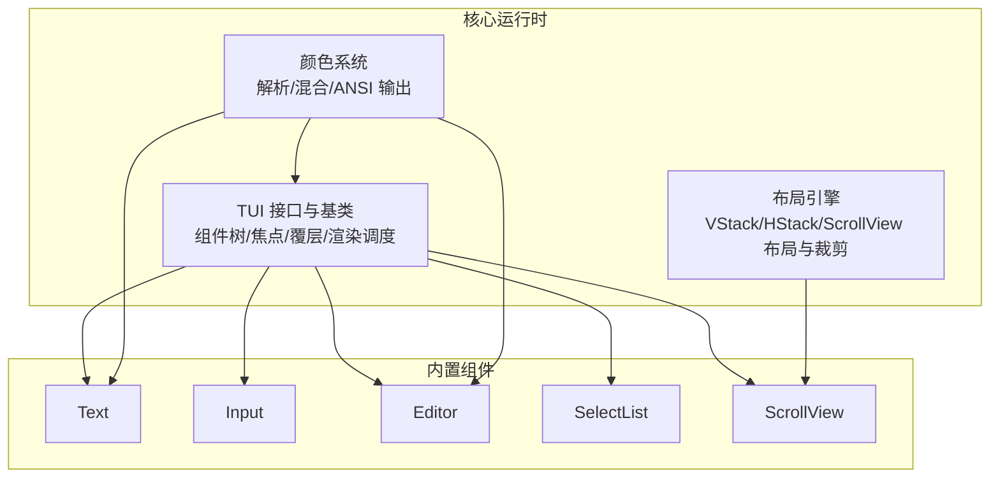

图表来源
- [packages/tui/src/tui.ts:117-148](file://packages/tui/src/tui.ts#L117-L148)
- [packages/tui/src/layout.ts:383-412](file://packages/tui/src/layout.ts#L383-L412)
- [packages/tui/src/colors.ts:23-56](file://packages/tui/src/colors.ts#L23-L56)

章节来源
- [packages/tui/src/index.ts:1-198](file://packages/tui/src/index.ts#L1-L198)
- [packages/tui/README.md:1-17](file://packages/tui/README.md#L1-L17)

## 核心组件
本节聚焦 TUI 的核心抽象与公共行为。

### 组件接口与生命周期
所有组件实现统一的 `Component` 接口：
- `render(width)`：按可用宽度返回行数组；每行不能超过 `width`。
- `handleInput(data)`：可选，接收键盘输入。
- `handleMouse(event)`：可选，接收标准化鼠标事件。
- `capturesViewportInput`：可选，当为真时接管全屏滚动与提示跳转键。
- `invalidate()`：清理缓存，使下一次渲染从零开始。

TUI 在焦点变化时设置 `Focusable.focused`，并扫描输出中的光标标记来定位硬件光标，从而支持 IME 候选窗口定位。

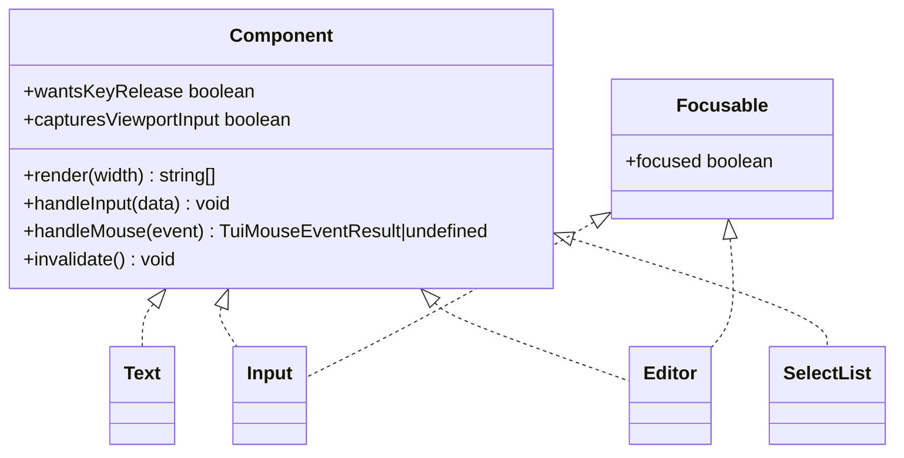

图表来源
- [packages/tui/src/tui.ts:117-148](file://packages/tui/src/tui.ts#L117-L148)
- [packages/tui/src/tui.ts:181-213](file://packages/tui/src/tui.ts#L181-L213)
- [packages/tui/src/components/text.ts:7-23](file://packages/tui/src/components/text.ts#L7-L23)
- [packages/tui/src/components/input.ts:32-60](file://packages/tui/src/components/input.ts#L32-L60)
- [packages/tui/src/components/editor.ts:297-387](file://packages/tui/src/components/editor.ts#L297-L387)
- [packages/tui/src/components/select-list.ts:40-60](file://packages/tui/src/components/select-list.ts#L40-L60)

章节来源
- [packages/tui/src/tui.ts:117-148](file://packages/tui/src/tui.ts#L117-L148)
- [packages/tui/src/tui.ts:181-213](file://packages/tui/src/tui.ts#L181-L213)
- [packages/coding-agent/docs/tui.md:20-28](file://packages/coding-agent/docs/tui.md#L20-L28)

### 渲染调度与差异更新
- TUI 维护渲染请求队列，合并多次 `requestRender()`，避免频繁刷新。
- `TuiMainScreen` 三种策略：首次全量、视口上方变化或宽度变化时清屏重绘、正常增量更新。
- `TuiAltScreen` 拥有固定高度视口，配合 `VStack`/`HStack`/`ScrollView` 进行区域划分与独立滚动。
- 所有输出包裹同步输出序列，保证原子更新、无闪烁。

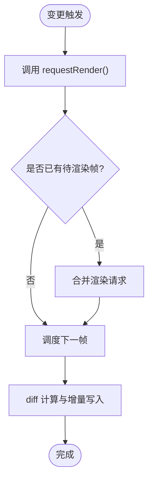

图表来源
- [packages/tui/src/tui.ts:512-556](file://packages/tui/src/tui.ts#L512-L556)
- [packages/tui/README.md:745-755](file://packages/tui/README.md#L745-L755)

章节来源
- [packages/tui/README.md:745-755](file://packages/tui/README.md#L745-L755)
- [packages/tui/src/tui.ts:512-556](file://packages/tui/src/tui.ts#L512-L556)

### 覆层（Overlay）与焦点恢复
- `showOverlay(component, options)` 显示模态覆层，支持锚点、百分比、绝对坐标、边距与可见性回调。
- 返回句柄用于隐藏、临时隐藏、获取边界、控制焦点。
- 焦点恢复策略会记住上一个捕获焦点的覆层，并在合适时机恢复。

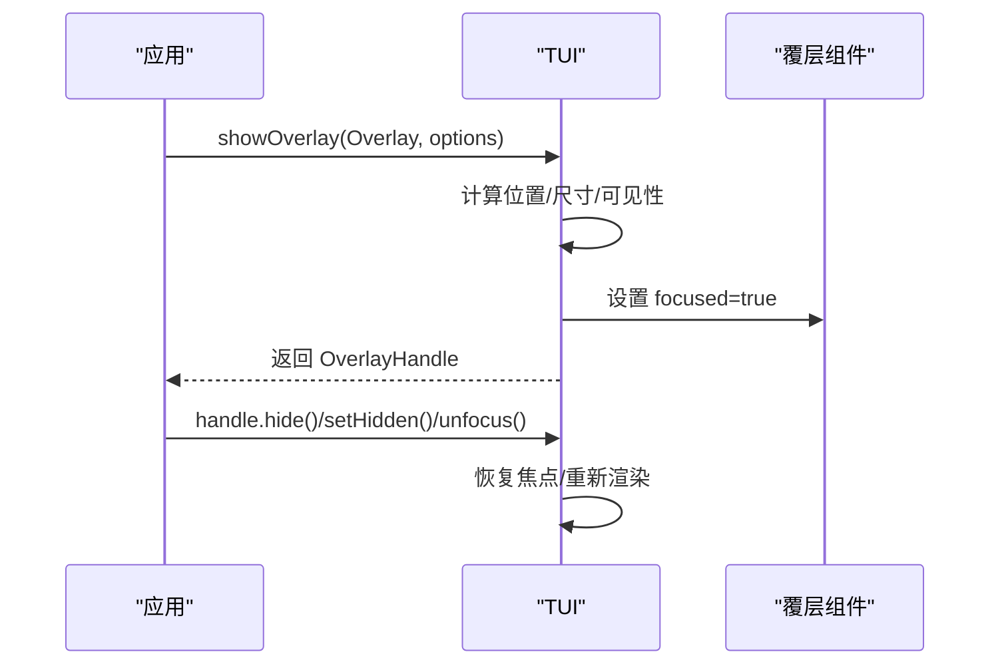

图表来源
- [packages/tui/src/tui.ts:754-800](file://packages/tui/src/tui.ts#L754-L800)
- [packages/tui/src/tui.ts:312-359](file://packages/tui/src/tui.ts#L312-L359)

章节来源
- [packages/tui/src/tui.ts:754-800](file://packages/tui/src/tui.ts#L754-L800)
- [packages/tui/README.md:166-244](file://packages/tui/README.md#L166-L244)

## 架构总览
TUI 由三层组成：
- 运行时层：组件树、焦点、覆层、输入监听、渲染调度、终端能力查询。
- 布局层：基于节点描述构建布局框树，计算可视区域、裁剪、滚动条几何与绘制。
- 组件层：文本、输入、编辑器、选择列表、滚动视图等可复用控件。

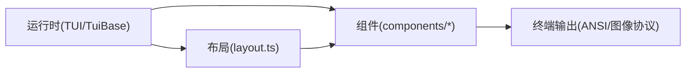

图表来源
- [packages/tui/src/tui.ts:512-556](file://packages/tui/src/tui.ts#L512-L556)
- [packages/tui/src/layout.ts:383-412](file://packages/tui/src/layout.ts#L383-L412)
- [packages/tui/src/index.ts:39-78](file://packages/tui/src/index.ts#L39-L78)

章节来源
- [packages/tui/src/index.ts:1-198](file://packages/tui/src/index.ts#L1-L198)
- [packages/tui/src/layout.ts:1-58](file://packages/tui/src/layout.ts#L1-L58)

## 详细组件分析

### Text 组件
- 功能：多行文本展示，自动换行，支持左右上下内边距与背景函数。
- 关键方法：`setText`、`setCustomBgFn`、`setPaddingX`、`invalidate`、`render`。
- 性能：内部缓存已渲染行与宽度，避免重复计算。

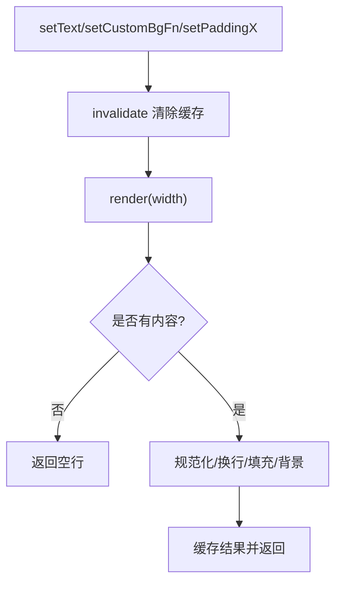

图表来源
- [packages/tui/src/components/text.ts:25-50](file://packages/tui/src/components/text.ts#L25-L50)
- [packages/tui/src/components/text.ts:52-113](file://packages/tui/src/components/text.ts#L52-L113)

章节来源
- [packages/tui/src/components/text.ts:1-116](file://packages/tui/src/components/text.ts#L1-L116)
- [packages/tui/README.md:390-403](file://packages/tui/README.md#L390-L403)

### Input 组件
- 功能：单行输入，水平滚动，IME 支持，撤销栈，剪贴板环。
- 关键特性：
  - 方括号粘贴模式缓冲。
  - 通过 `CURSOR_MARKER` + `renderFakeCursor` 实现硬件光标定位与反显光标。
  - 鼠标点击定位光标并请求焦点。
- 事件：`onSubmit`、`onEscape`。

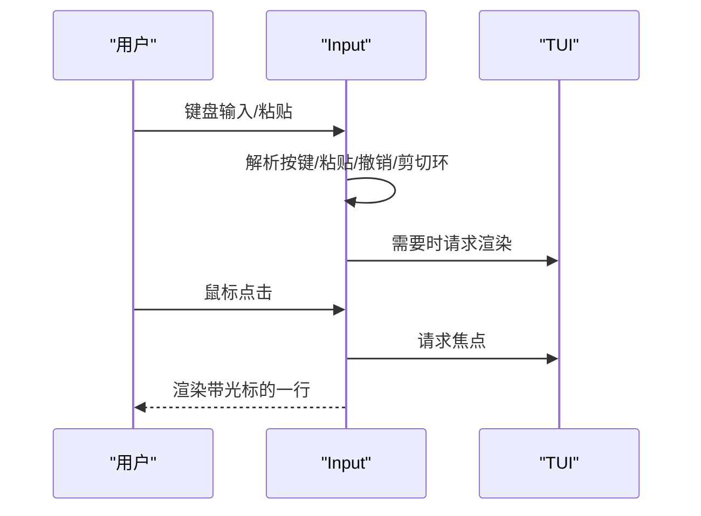

图表来源
- [packages/tui/src/components/input.ts:71-234](file://packages/tui/src/components/input.ts#L71-L234)
- [packages/tui/src/components/input.ts:236-252](file://packages/tui/src/components/input.ts#L236-L252)
- [packages/tui/src/components/input.ts:419-500](file://packages/tui/src/components/input.ts#L419-L500)

章节来源
- [packages/tui/src/components/input.ts:1-502](file://packages/tui/src/components/input.ts#L1-L502)
- [packages/tui/README.md:417-439](file://packages/tui/README.md#L417-L439)

### Editor 组件
- 功能：多行编辑器，自动补全（斜杠命令与文件路径），大段粘贴标记，历史导航，垂直滚动。
- 关键特性：
  - 自动补全菜单集成 `SelectList`。
  - 粘贴标记作为原子片段参与分词与换行。
  - 支持字符跳转、粘性视觉列、撤销栈。
- 事件：`onSubmit`、`onChange`，以及动态边框色与内边距。

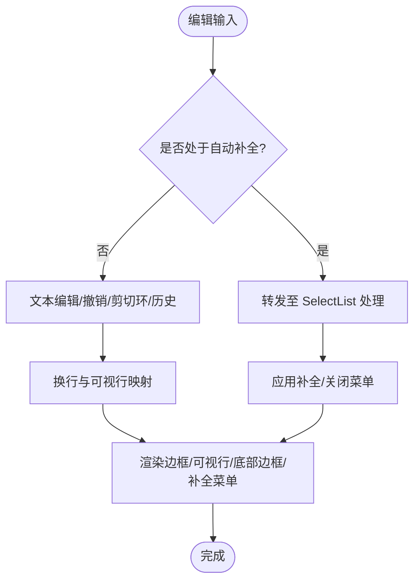

图表来源
- [packages/tui/src/components/editor.ts:701-800](file://packages/tui/src/components/editor.ts#L701-L800)
- [packages/tui/src/components/editor.ts:526-636](file://packages/tui/src/components/editor.ts#L526-L636)

章节来源
- [packages/tui/src/components/editor.ts:1-800](file://packages/tui/src/components/editor.ts#L1-L800)
- [packages/tui/README.md:440-484](file://packages/tui/README.md#L440-L484)

### SelectList 组件
- 功能：可搜索的选择列表，支持键盘与鼠标交互。
- 关键特性：
  - `capturesViewportInput = true`，接管翻页等全屏输入。
  - 主列宽度自适应，支持自定义截断逻辑。
  - 滚轮、点击、方向键、Enter/Esc 操作。

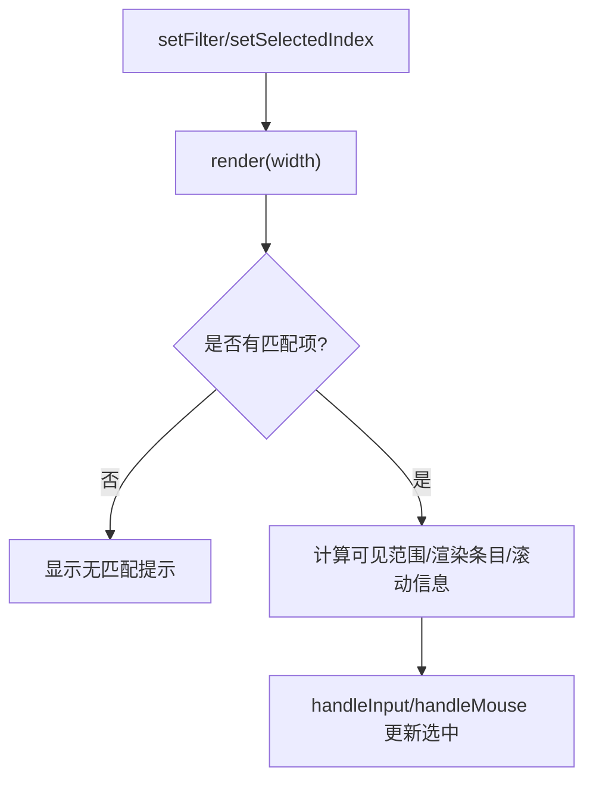

图表来源
- [packages/tui/src/components/select-list.ts:62-108](file://packages/tui/src/components/select-list.ts#L62-L108)
- [packages/tui/src/components/select-list.ts:110-178](file://packages/tui/src/components/select-list.ts#L110-L178)

章节来源
- [packages/tui/src/components/select-list.ts:1-282](file://packages/tui/src/components/select-list.ts#L1-L282)
- [packages/tui/README.md:571-611](file://packages/tui/README.md#L571-L611)

### ScrollView 组件
- 功能：受控滚动容器，支持跟随末尾、主滚动视图、越界传播、滚动条样式与延迟隐藏。
- 关键 API：
  - `scrollTop`、`isFollowingEnd`、`viewportHeight`、`scrollbar`、`isScrollbarVisible`。
  - `scrollTo`、`scrollBy`、`scrollToStart`、`scrollToEnd`。
  - `updateLayout(contentHeight, viewportHeight, requestRender)`。

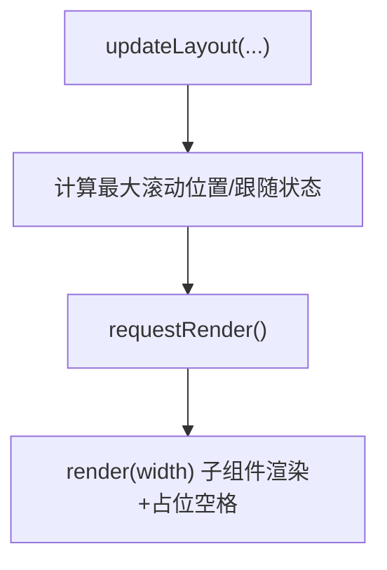

图表来源
- [packages/tui/src/components/scroll-view.ts:189-201](file://packages/tui/src/components/scroll-view.ts#L189-L201)
- [packages/tui/src/components/scroll-view.ts:215-223](file://packages/tui/src/components/scroll-view.ts#L215-L223)

章节来源
- [packages/tui/src/components/scroll-view.ts:1-225](file://packages/tui/src/components/scroll-view.ts#L1-L225)
- [packages/tui/README.md:119-164](file://packages/tui/README.md#L119-L164)

## 依赖关系分析
- 组件对 TUI 的依赖：
  - 输入与焦点：`Component`、`Focusable`、`CURSOR_MARKER`、`renderFakeCursor`。
  - 覆层与布局：`Container`、`isViewportTUI`、`OverlayOptions`。
- 布局对组件的依赖：
  - 通过 `getLayoutNode` 识别 `ScrollView`，驱动滚动布局与裁剪。
- 颜色对组件的依赖：
  - 组件通过 `styleText`/`foregroundAnsi`/`backgroundAnsi` 输出样式。

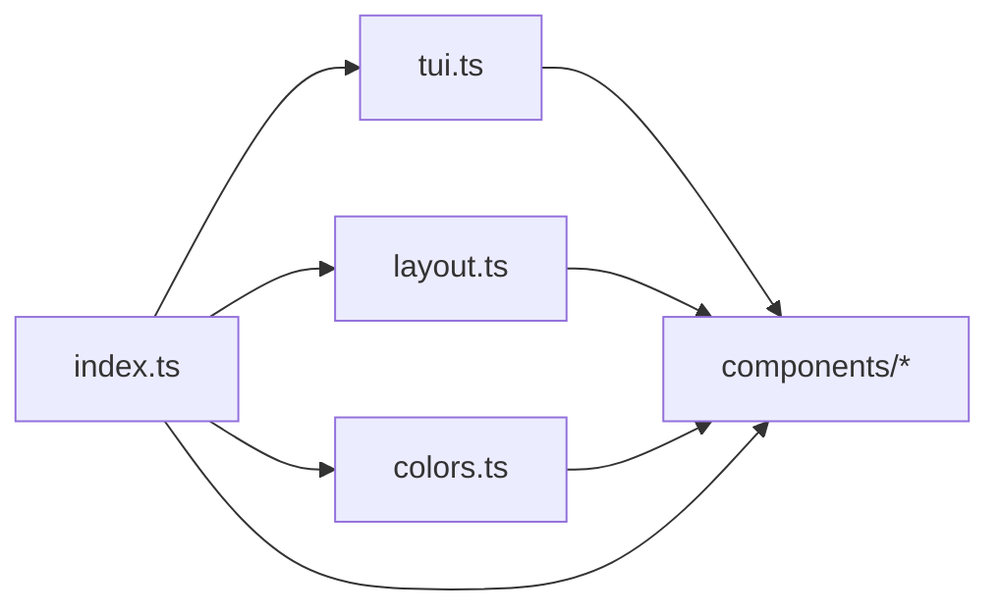

图表来源
- [packages/tui/src/index.ts:1-198](file://packages/tui/src/index.ts#L1-L198)
- [packages/tui/src/tui.ts:117-148](file://packages/tui/src/tui.ts#L117-L148)
- [packages/tui/src/layout.ts:1-12](file://packages/tui/src/layout.ts#L1-L12)
- [packages/tui/src/colors.ts:1-56](file://packages/tui/src/colors.ts#L1-L56)

章节来源
- [packages/tui/src/index.ts:1-198](file://packages/tui/src/index.ts#L1-L198)

## 性能与渲染优化
- 渲染合并：多次 `requestRender()` 被合并，避免抖动。
- 行级差异：仅更新变化的行或视口行，减少 I/O。
- 组件缓存：如 `Text` 缓存渲染结果，避免重复计算。
- 布局缓存：布局引擎对组件渲染结果按宽度缓存，减少重复测量。
- 颜色预计算：将昂贵颜色转换结果缓存为 sRGB 或 ANSI 序列，避免每行重复计算。
- 图像协议：Kitty/iTerm2 图像协议按需裁剪与占位，避免多余绘制。

实践建议：
- 在高频更新路径中预计算颜色与样式字符串。
- 使用 `visibleWidth`/`truncateToWidth`/`wrapTextWithAnsi` 避免自行实现宽度处理。
- 对长列表使用 `SelectList`/`ScrollView` 控制可视范围。
- 仅在必要时启用硬件光标，避免不必要的 IME 定位开销。

章节来源
- [packages/tui/README.md:745-755](file://packages/tui/README.md#L745-L755)
- [packages/tui/src/components/text.ts:52-113](file://packages/tui/src/components/text.ts#L52-L113)
- [packages/tui/src/layout.ts:68-89](file://packages/tui/src/layout.ts#L68-L89)
- [packages/tui/src/colors.ts:107-115](file://packages/tui/src/colors.ts#L107-L115)

## 主题、颜色与样式覆盖
### 颜色系统
- 支持索引 ANSI 色、sRGB、OKLCH、OKHSL。
- 提供 `parseColor`、`mixColors`、`colorToRgb`、`colorToHex`、`colorToOklch`、`colorToOkhsl`。
- 根据终端能力输出 256 色或真彩 ANSI 序列。
- 推荐：对频繁使用的颜色先转换为 sRGB 或 ANSI 序列再复用。

### 文本样式
- `styleText`/`styleTextWithAnsi` 组合前景/背景与粗体、斜体、下划线、删除线、反显等属性。
- 注意：每行末尾会重置样式与超链接，需逐行重新应用样式。

### 组件主题
- `EditorTheme`：边框色与选择列表主题。
- `MarkdownTheme`：标题、链接、代码块、引用、分隔符、加粗/斜体/删除线/下划线等。
- `SelectListTheme`：选中前缀/文本、描述、滚动信息、无匹配提示。
- `SettingsListTheme`：标签/值/描述/光标/提示样式。
- `ImageTheme`：回退颜色。

样式覆盖方法：
- 通过组件构造参数传入主题对象。
- 动态修改：如 `Editor.borderColor`、`Box.setBgFn`、`Text.setCustomBgFn`。
- 使用 `styleTextWithAnsi` 预计算 ANSI 序列以提升性能。

章节来源
- [packages/tui/src/colors.ts:1-56](file://packages/tui/src/colors.ts#L1-L56)
- [packages/tui/src/colors.ts:218-367](file://packages/tui/src/colors.ts#L218-L367)
- [packages/tui/README.md:81-117](file://packages/tui/README.md#L81-L117)
- [packages/tui/README.md:486-533](file://packages/tui/README.md#L486-L533)
- [packages/tui/README.md:571-645](file://packages/tui/README.md#L571-L645)
- [packages/tui/README.md:662-690](file://packages/tui/README.md#L662-L690)

## 故障排查
常见问题与对策：
- 中文/日文/韩文输入法候选窗口错位：
  - 确保输入组件实现 `Focusable`，并在渲染中插入 `CURSOR_MARKER`。
  - 容器组件需将 `focused` 状态传递给子 `Input`/`Editor`。
- 超长行导致渲染错误：
  - 使用 `truncateToWidth`/`wrapTextWithAnsi` 保证每行不超过 `width`。
- 颜色异常或闪烁：
  - 检查终端颜色模式，优先使用 `styleTextWithAnsi` 预计算 ANSI。
  - 避免跨行传递样式，每行末尾会重置。
- 覆层焦点丢失：
  - 使用 `OverlayHandle.unfocus({ target })` 明确释放焦点目标。
- 滚动条不显示或位置异常：
  - 确认 `ScrollView.scrollbar` 模式与内容高度大于视口高度。
  - 检查 `updateLayout` 是否正确调用。

章节来源
- [packages/tui/src/tui.ts:181-213](file://packages/tui/src/tui.ts#L181-L213)
- [packages/tui/src/tui.ts:308-362](file://packages/tui/src/tui.ts#L308-L362)
- [packages/tui/src/components/input.ts:419-500](file://packages/tui/src/components/input.ts#L419-L500)
- [packages/tui/src/components/scroll-view.ts:70-91](file://packages/tui/src/components/scroll-view.ts#L70-L91)
- [packages/tui/src/components/scroll-view.ts:189-201](file://packages/tui/src/components/scroll-view.ts#L189-L201)

## 结论
`@earendil-works/pi-tui` 提供了完整的终端 UI 框架：
- 清晰的组件接口与生命周期，便于扩展与测试。
- 高效的差异渲染与布局系统，适配主屏幕与备用屏幕两种模式。
- 完善的颜色与主题体系，支持丰富的样式定制。
- 丰富的内置组件，覆盖文本、输入、编辑器、列表与滚动场景。

在实际项目中，建议：
- 优先使用内置组件组合复杂界面。
- 通过主题对象与样式函数集中管理外观。
- 利用布局与滚动组件控制视口与交互体验。
- 关注性能热点，预计算颜色与样式，限制可视范围。