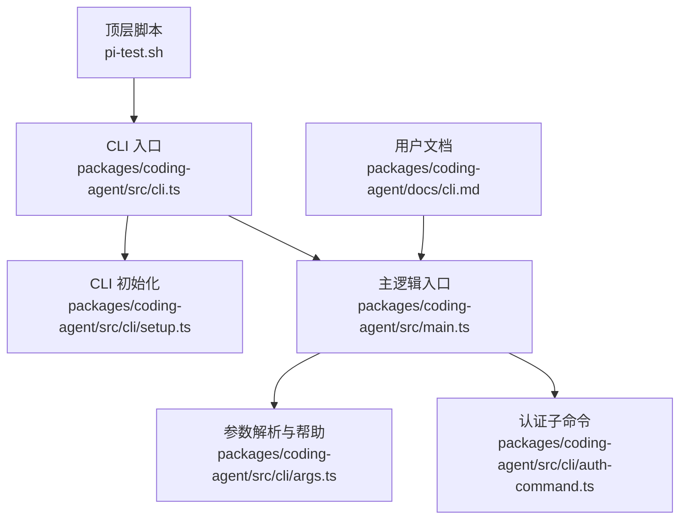
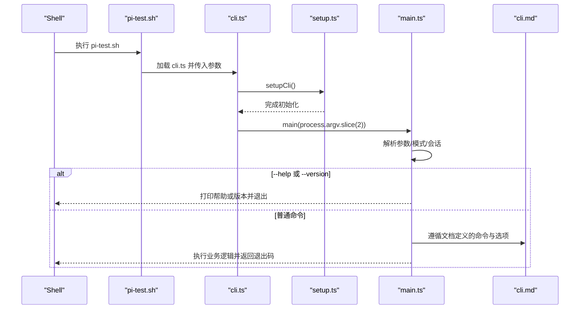
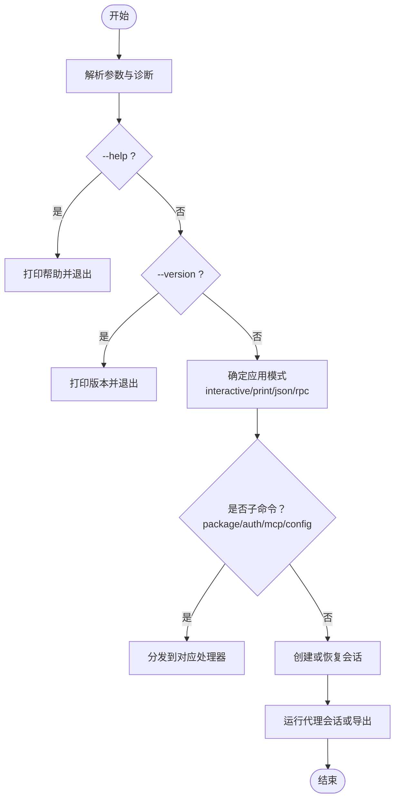
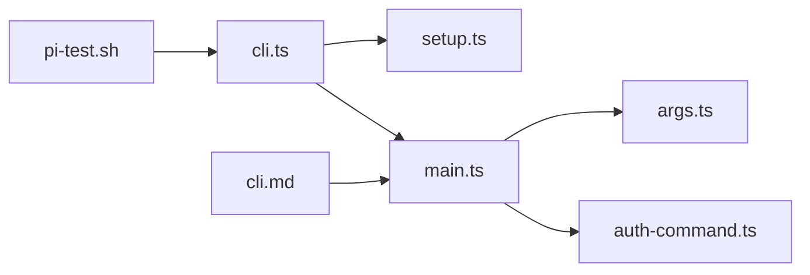

# 基础命令

<cite>
**本文引用的文件**
- [README.md](file://README.md)
- [pi-test.sh](file://pi-test.sh)
- [cli.md](file://packages/coding-agent/docs/cli.md)
- [cli.ts](file://packages/coding-agent/src/cli.ts)
- [setup.ts](file://packages/coding-agent/src/cli/setup.ts)
- [main.ts](file://packages/coding-agent/src/main.ts)
- [args.ts](file://packages/coding-agent/src/cli/args.ts)
- [auth-command.ts](file://packages/coding-agent/src/cli/auth-command.ts)
</cite>

## 目录
1. [简介](#简介)
2. [项目结构](#项目结构)
3. [核心组件](#核心组件)
4. [架构总览](#架构总览)
5. [详细命令分析](#详细命令分析)
6. [依赖关系分析](#依赖关系分析)
7. [性能与行为特征](#性能与行为特征)
8. [故障排查指南](#故障排查指南)
9. [结论](#结论)

## 简介
本文面向“基础 CLI 命令”，聚焦 `pi` 可执行入口、帮助信息、版本检查、安装验证以及常见命令行操作。文档基于仓库中的源码与官方文档，说明：
- `pi` 的基本语法与常用选项
- 安装与运行方式
- 帮助与版本输出
- 命令执行流程与退出码含义
- 典型使用示例与错误处理建议

## 项目结构
仓库是一个多包 monorepo，`pi` 的 CLI 入口位于 `packages/coding-agent` 中，顶层脚本用于在开发环境中直接运行源码。

**图表来源**
- [pi-test.sh:83-85](file://pi-test.sh#L83-L85)
- [cli.ts:1-6](file://packages/coding-agent/src/cli.ts#L1-L6)
- [setup.ts:4-12](file://packages/coding-agent/src/cli/setup.ts#L4-L12)
- [main.ts:1-12](file://packages/coding-agent/src/main.ts#L1-L12)
- [args.ts:457-480](file://packages/coding-agent/src/cli/args.ts#L457-L480)
- [auth-command.ts:39-63](file://packages/coding-agent/src/cli/auth-command.ts#L39-L63)
- [cli.md:1-19](file://packages/coding-agent/docs/cli.md#L1-L19)

**章节来源**
- [README.md:23-54](file://README.md#L23-L54)
- [pi-test.sh:1-86](file://pi-test.sh#L1-L86)
- [cli.ts:1-6](file://packages/coding-agent/src/cli.ts#L1-L6)
- [setup.ts:1-14](file://packages/coding-agent/src/cli/setup.ts#L1-L14)
- [main.ts:1-76](file://packages/coding-agent/src/main.ts#L1-L76)
- [cli.md:1-19](file://packages/coding-agent/docs/cli.md#L1-L19)

## 核心组件
- `pi-test.sh`：在仓库内直接运行源码，注入模块解析器并调用 `packages/coding-agent/src/cli.ts`。
- `cli.ts`：Node.js 可执行入口，设置进程名与环境变量后调用 `main()`。
- `setup.ts`：初始化 CLI 运行时环境，包括进程标题、环境变量与 HTTP 调度器配置。
- `main.ts`：主控制流，负责参数解析、模式选择、会话管理、扩展与 MCP 命令分发、帮助与版本输出等。
- `args.ts`：定义帮助文本、内置工具名称与环境变量说明。
- `auth-command.ts`：认证子命令的帮助与用法说明。
- `cli.md`：官方 CLI 参考文档，覆盖命令、选项、模式与返回值。

**章节来源**
- [pi-test.sh:83-85](file://pi-test.sh#L83-L85)
- [cli.ts:1-6](file://packages/coding-agent/src/cli.ts#L1-L6)
- [setup.ts:4-12](file://packages/coding-agent/src/cli/setup.ts#L4-L12)
- [main.ts:1-76](file://packages/coding-agent/src/main.ts#L1-L76)
- [args.ts:457-480](file://packages/coding-agent/src/cli/args.ts#L457-L480)
- [auth-command.ts:39-63](file://packages/coding-agent/src/cli/auth-command.ts#L39-L63)
- [cli.md:1-19](file://packages/coding-agent/docs/cli.md#L1-L19)

## 架构总览
下图展示从 shell 到 Node.js 主流程的关键路径，以及帮助与版本输出的分支。

**图表来源**
- [pi-test.sh:83-85](file://pi-test.sh#L83-L85)
- [cli.ts:1-6](file://packages/coding-agent/src/cli.ts#L1-L6)
- [setup.ts:4-12](file://packages/coding-agent/src/cli/setup.ts#L4-L12)
- [main.ts:621-710](file://packages/coding-agent/src/main.ts#L621-L710)
- [cli.md:1-19](file://packages/coding-agent/docs/cli.md#L1-L19)

## 详细命令分析

### 基本语法与常用选项
- 顶层语法（来自官方文档）：
  - `pi [options] [--] [@files...] [messages...]`
  - 子命令：`install`、`remove`、`uninstall`、`update`、`list`、`config`、`auth`、`mcp`
- 常用全局选项（节选）：
  - `-h, --help`：显示帮助，包含已加载扩展注册的选项，然后退出
  - `-v, --version`：显示 Pi 版本，然后退出
  - `--offline`：禁用自动网络活动（等价于 `PI_OFFLINE=1`）
  - `--provider <name>`、`--model <pattern>`、`--api-key <key>`、`--thinking <level>`
  - `--tools <list>`、`--exclude-tools <list>`、`--no-builtin-tools`、`--no-tools`
  - `--extension <path>`、`--skill <path>`、`--prompt-template <path>`、`--theme <path>`
  - `--system-prompt <text|path>`、`--append-system-prompt <text|path>`
  - `--tui-mode <mode>`、`--verbose`、`--approve`、`--no-approve`
  - `--print`、`--mode text/json/rpc`、`--export <input> [output]`

这些选项决定了：
- 是否进入交互式终端 UI
- 是否一次性执行并输出文本或 JSONL
- 是否通过 RPC 协议与外部系统集成
- 模型、工具、资源、会话与信任策略

**章节来源**
- [cli.md:7-19](file://packages/coding-agent/docs/cli.md#L7-L19)
- [cli.md:45-53](file://packages/coding-agent/docs/cli.md#L45-L53)
- [cli.md:55-77](file://packages/coding-agent/docs/cli.md#L55-L77)
- [cli.md:111-159](file://packages/coding-agent/docs/cli.md#L111-L159)
- [cli.md:186-219](file://packages/coding-agent/docs/cli.md#L186-L219)
- [cli.md:221-250](file://packages/coding-agent/docs/cli.md#L221-L250)

### 安装与运行
- 官方安装方式：
  - 使用安装脚本安装 CLI
  - Windows 使用 PowerShell 安装脚本
  - 也可通过 npm 全局安装
- 运行要求：
  - 需要 Node.js 22.19 或更高版本
  - macOS、Linux、Windows 安装器可在需要时安装 Node.js
- 启动方式：
  - 在项目目录中直接运行 `pi`
  - 内置 AI 提供商需先 `/login` 连接订阅或 API Key

**章节来源**
- [README.md:23-54](file://README.md#L23-L54)

### 帮助信息与版本检查
- 查看帮助：
  - `pi --help`
  - 或在任意子命令后追加 `--help`
- 查看版本：
  - `pi --version`
- 行为说明：
  - `--help` 会显示帮助，包括扩展注册的选项，然后退出
  - `--version` 会打印当前版本并退出

实现要点：
- `main.ts` 在解析参数后，若检测到 `--version`，则打印 `VERSION` 并退出
- `args.ts` 提供帮助文本与环境变量说明
- `auth-command.ts` 提供认证子命令的帮助与用法

**章节来源**
- [cli.md:245-250](file://packages/coding-agent/docs/cli.md#L245-L250)
- [main.ts:693-696](file://packages/coding-agent/src/main.ts#L693-L696)
- [args.ts:457-480](file://packages/coding-agent/src/cli/args.ts#L457-L480)
- [auth-command.ts:39-63](file://packages/coding-agent/src/cli/auth-command.ts#L39-L63)

### 命令执行流程
下图展示一次典型 `pi` 调用的关键步骤，包括帮助与版本分支、模式选择与子命令分发。

**图表来源**
- [main.ts:621-710](file://packages/coding-agent/src/main.ts#L621-L710)
- [main.ts:712-776](file://packages/coding-agent/src/main.ts#L712-L776)

**章节来源**
- [main.ts:621-776](file://packages/coding-agent/src/main.ts#L621-L776)

### 退出码与错误处理
- 通用规则：
  - 成功通常返回 `0`
  - 参数错误或内部异常通常返回非 `0`
- 认证检查命令：
  - `pi auth check` 输出状态：
    - `ready`：退出码 `0`
    - `not_ready`：退出码 `1`
    - `invalid`：退出码 `2`
- 其他常见退出场景：
  - 工作目录不存在：打印错误并退出
  - 参数冲突（如 `--fork` 与其他会话选项组合）：打印错误并退出
  - 会话未找到：打印错误并退出
  - 导出失败：打印错误并退出

**章节来源**
- [auth-command.ts:39-63](file://packages/coding-agent/src/cli/auth-command.ts#L39-L63)
- [main.ts:641-652](file://packages/coding-agent/src/main.ts#L641-L652)
- [main.ts:346-383](file://packages/coding-agent/src/main.ts#L346-L383)
- [main.ts:405-496](file://packages/coding-agent/src/main.ts#L405-L496)
- [main.ts:698-710](file://packages/coding-agent/src/main.ts#L698-L710)

### 典型使用示例
以下示例覆盖常见命令行操作场景，均来源于官方文档与仓库说明：

- 启动交互模式：
  - `cd /path/to/project && pi`
- 一次性输出文本：
  - `pi --print "Summarize this repository"`
- 管道输入并输出文本：
  - `git diff | pi --print "Review this change"`
- 输出 JSONL 事件流：
  - `pi --mode json "Inspect this repository" > events.jsonl`
- 列出可用模型：
  - `pi --list-models`
- 指定模型与思考级别：
  - `pi --model sonnet:high`
- 启用 codemode 工具：
  - `pi --tools +codemode`
- 离线模式：
  - `pi --offline`
- 查看帮助与版本：
  - `pi --help`
  - `pi --version`

**章节来源**
- [README.md:45-54](file://README.md#L45-L54)
- [cli.md:23-53](file://packages/coding-agent/docs/cli.md#L23-L53)
- [cli.md:55-77](file://packages/coding-agent/docs/cli.md#L55-L77)
- [cli.md:160-184](file://packages/coding-agent/docs/cli.md#L160-L184)
- [cli.md:243-250](file://packages/coding-agent/docs/cli.md#L243-L250)

## 依赖关系分析
- `pi-test.sh` 依赖 Node.js 与仓库内的 `packages/coding-agent/src/cli.ts`
- `cli.ts` 依赖 `setup.ts` 与 `main.ts`
- `main.ts` 依赖参数解析、认证、会话、扩展、MCP、模式等多个模块
- `args.ts` 提供帮助文本与环境变量说明
- `auth-command.ts` 提供认证子命令的帮助与用法
- `cli.md` 作为权威文档，描述命令与选项的行为

**图表来源**
- [pi-test.sh:83-85](file://pi-test.sh#L83-L85)
- [cli.ts:1-6](file://packages/coding-agent/src/cli.ts#L1-L6)
- [setup.ts:4-12](file://packages/coding-agent/src/cli/setup.ts#L4-L12)
- [main.ts:1-76](file://packages/coding-agent/src/main.ts#L1-L76)
- [args.ts:457-480](file://packages/coding-agent/src/cli/args.ts#L457-L480)
- [auth-command.ts:39-63](file://packages/coding-agent/src/cli/auth-command.ts#L39-L63)
- [cli.md:1-19](file://packages/coding-agent/docs/cli.md#L1-L19)

**章节来源**
- [pi-test.sh:1-86](file://pi-test.sh#L1-L86)
- [cli.ts:1-6](file://packages/coding-agent/src/cli.ts#L1-L6)
- [setup.ts:1-14](file://packages/coding-agent/src/cli/setup.ts#L1-L14)
- [main.ts:1-76](file://packages/coding-agent/src/main.ts#L1-L76)
- [args.ts:457-480](file://packages/coding-agent/src/cli/args.ts#L457-L480)
- [auth-command.ts:39-63](file://packages/coding-agent/src/cli/auth-command.ts#L39-L63)
- [cli.md:1-19](file://packages/coding-agent/docs/cli.md#L1-L19)

## 性能与行为特征
- 模式选择影响 I/O 与渲染：
  - 交互式模式打开终端 UI
  - print/json/rpc 模式分别输出文本、JSONL 或走 RPC 协议
- 标准输入/输出重定向会影响默认模式：
  - 当 stdin/stdout 被重定向且未选择 JSON/RPC 模式时，Pi 使用 print 模式
- 扩展与资源加载可能增加启动开销：
  - 可通过 `-ne/--no-extensions`、`--no-skills`、`--no-prompt-templates`、`--no-themes` 减少加载
- 离线模式避免网络请求：
  - `--offline` 或 `PI_OFFLINE=1` 禁用自动网络活动

**章节来源**
- [cli.md:23-53](file://packages/coding-agent/docs/cli.md#L23-L53)
- [cli.md:196-219](file://packages/coding-agent/docs/cli.md#L196-L219)
- [cli.md:243-250](file://packages/coding-agent/docs/cli.md#L243-L250)

## 故障排查指南
- 无法识别的参数：
  - 检查是否拼写正确；未知短选项会被拒绝
  - 使用 `pi --help` 或子命令的 `--help` 查看准确用法
- 认证问题：
  - 使用 `pi auth check --provider <provider> --json` 检查状态
  - 根据返回状态判断是否需要登录或刷新凭据
- 会话相关错误：
  - 确认 `--session`、`--continue`、`--resume`、`--fork`、`--no-session` 的组合是否符合约束
  - 检查会话 ID 是否有效，是否存在于当前或全局会话目录
- 工作目录问题：
  - 如果当前工作目录不存在，命令会报错并退出
- 导出失败：
  - 检查输入会话文件路径是否正确，权限是否足够

**章节来源**
- [cli.md:245-250](file://packages/coding-agent/docs/cli.md#L245-L250)
- [cli.md:305-339](file://packages/coding-agent/docs/cli.md#L305-L339)
- [main.ts:346-383](file://packages/coding-agent/src/main.ts#L346-L383)
- [main.ts:405-496](file://packages/coding-agent/src/main.ts#L405-L496)
- [main.ts:641-652](file://packages/coding-agent/src/main.ts#L641-L652)
- [main.ts:698-710](file://packages/coding-agent/src/main.ts#L698-L710)

## 结论
- `pi` 的基础命令以 `--help` 和 `--version` 为入口，便于快速验证安装与版本
- 官方文档 `cli.md` 是命令与选项的权威来源，涵盖模式、模型、会话、工具、资源与认证
- 主流程由 `main.ts` 控制，负责参数解析、模式选择、会话管理与子命令分发
- 退出码在认证检查等场景中具有明确语义，便于自动化脚本判断状态
- 通过合理选择模式与禁用不必要的扩展/资源，可优化启动与运行性能