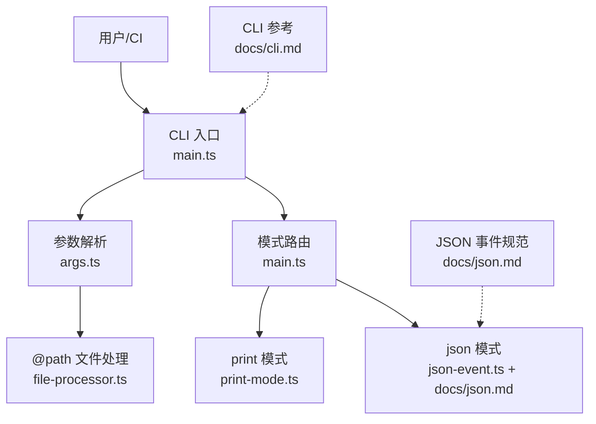
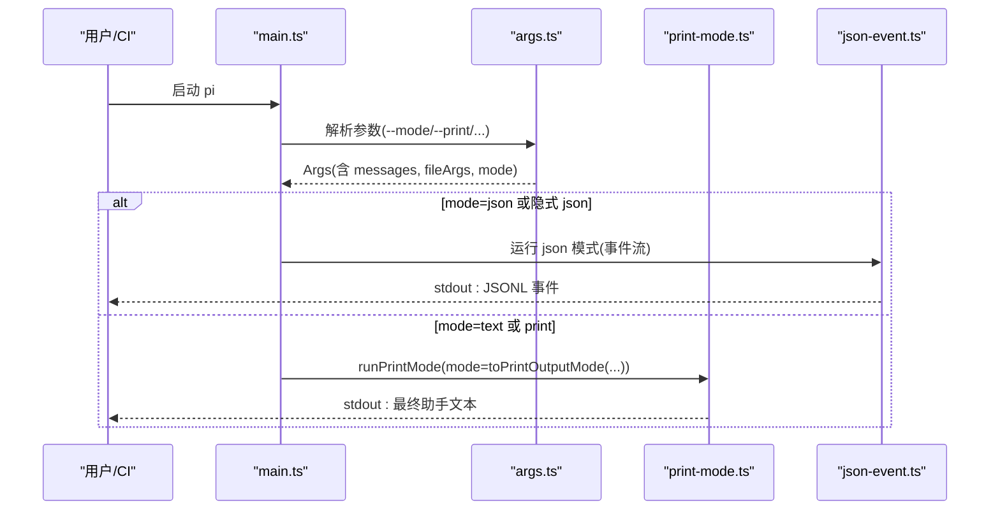
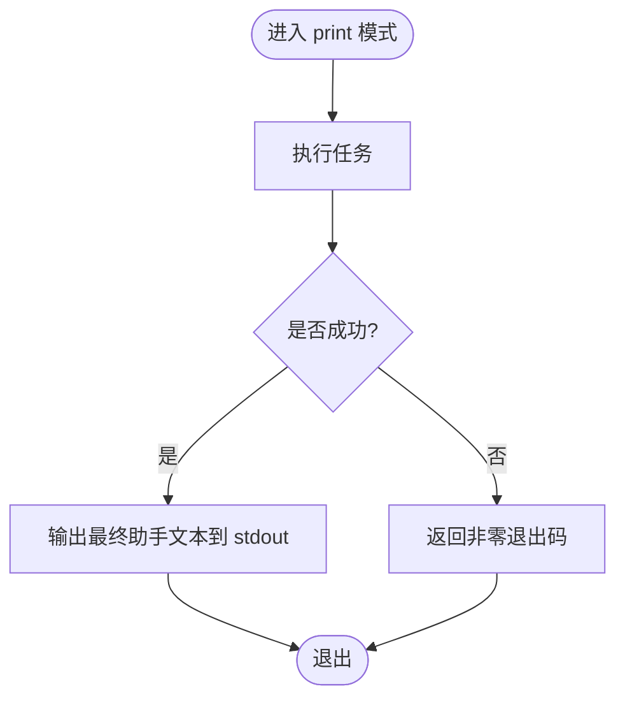
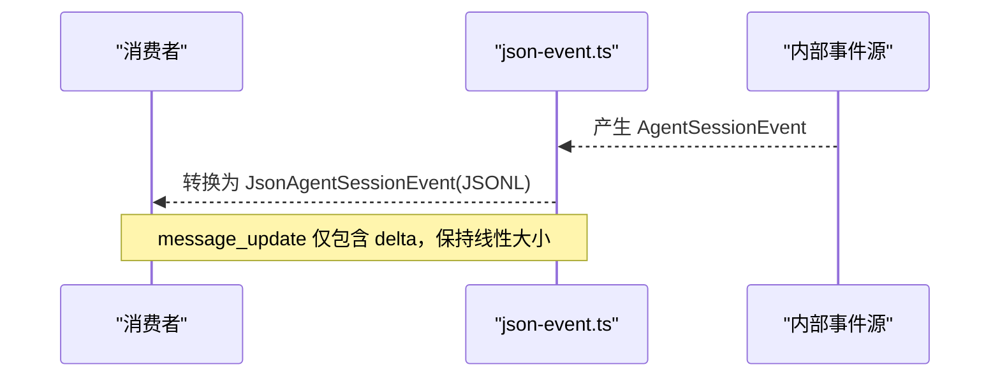
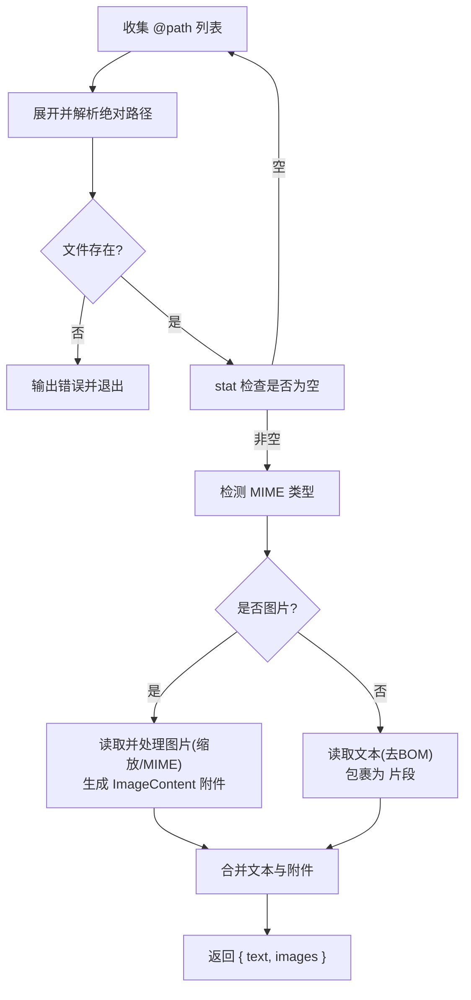
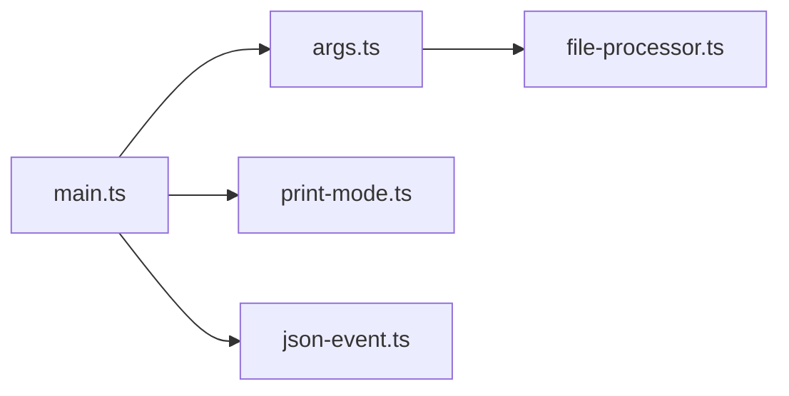

# 批处理模式

<cite>
**本文引用的文件**   
- [README.md](file://README.md)
- [cli.md](file://packages/coding-agent/docs/cli.md)
- [json.md](file://packages/coding-agent/docs/json.md)
- [args.ts](file://packages/coding-agent/src/cli/args.ts)
- [file-processor.ts](file://packages/coding-agent/src/cli/file-processor.ts)
- [main.ts](file://packages/coding-agent/src/main.ts)
- [print-mode.ts](file://packages/coding-agent/src/modes/print-mode.ts)
- [json-event.ts](file://packages/coding-agent/src/modes/json-event.ts)
</cite>

## 目录
1. [简介](#简介)
2. [项目结构](#项目结构)
3. [核心组件](#核心组件)
4. [架构总览](#架构总览)
5. [详细组件分析](#详细组件分析)
6. [依赖关系分析](#依赖关系分析)
7. [性能与可扩展性](#性能与可扩展性)
8. [故障排查指南](#故障排查指南)
9. [结论](#结论)
10. [附录：CI/CD 集成示例与最佳实践](#附录cicd-集成示例与最佳实践)

## 简介
本文件聚焦于 Pi 的批处理模式，覆盖两种关键运行方式：
- print 模式：一次性执行提示词，输出最终助手文本到标准输出并退出。适合脚本化、管道化和简单自动化。
- json 模式：以 JSONL 事件流形式输出结构化进度和结果，适合下游系统消费、审计、回放与可视化。

文档同时说明命令语法、输入文件处理、输出格式、错误处理与日志记录，并提供 CI/CD 集成示例与最佳实践。

## 项目结构
与批处理模式直接相关的代码与文档分布如下：
- 命令行与模式选择：src/cli/args.ts、src/main.ts
- 打印模式实现：src/modes/print-mode.ts
- JSON 事件流定义与转换：src/modes/json-event.ts、docs/json.md
- CLI 参考与用法：docs/cli.md
- 输入文件处理（@path）：src/cli/file-processor.ts
- 顶层使用说明：README.md

图表来源
- [main.ts:1006-1058](file://packages/coding-agent/src/main.ts#L1006-L1058)
- [args.ts:72-270](file://packages/coding-agent/src/cli/args.ts#L72-L270)
- [print-mode.ts:33-...](file://packages/coding-agent/src/modes/print-mode.ts#L33-L...)
- [json-event.ts:1-62](file://packages/coding-agent/src/modes/json-event.ts#L1-L62)
- [cli.md:21-53](file://packages/coding-agent/docs/cli.md#L21-L53)
- [json.md:1-20](file://packages/coding-agent/docs/json.md#L1-L20)

章节来源
- [README.md:15-21](file://README.md#L15-L21)
- [cli.md:21-53](file://packages/coding-agent/docs/cli.md#L21-L53)

## 核心组件
- 参数解析器（args.ts）
  - 负责解析 --mode、--print、--model、--tools、--session 等选项，并将未知扩展标志透传。
  - 支持 text/json/rpc 三种模式；当未显式指定时，根据终端与重定向情况自动选择交互或 print 模式。
- 主流程路由（main.ts）
  - 根据 appMode 决定进入 rpc、interactive 或 print 模式；print 模式下调用 runPrintMode 并返回退出码。
- print 模式（print-mode.ts）
  - 一次性执行任务，将最终助手文本写入 stdout 后退出；可配置输出类型（text/json）。
- JSON 事件流（json-event.ts + docs/json.md）
  - 将内部 AgentSessionEvent 转换为面向外部的 JsonAgentSessionEvent，去除累积快照，保持流大小线性增长。
  - 文档定义了会话头、事件序列、消息更新、工具执行、队列状态、压缩、重试等事件语义。
- 输入文件处理（file-processor.ts）
  - 解析 @path 参数，读取文本或图片，生成文本片段与图像附件，供初始消息使用。

章节来源
- [args.ts:11-59](file://packages/coding-agent/src/cli/args.ts#L11-L59)
- [args.ts:72-270](file://packages/coding-agent/src/cli/args.ts#L72-L270)
- [main.ts:1006-1058](file://packages/coding-agent/src/main.ts#L1006-L1058)
- [print-mode.ts:33-...](file://packages/coding-agent/src/modes/print-mode.ts#L33-L...)
- [json-event.ts:1-62](file://packages/coding-agent/src/modes/json-event.ts#L1-L62)
- [file-processor.ts:14-88](file://packages/coding-agent/src/cli/file-processor.ts#L14-L88)

## 架构总览
下图展示从命令行到具体模式的控制流，以及 print 与 json 两种批处理路径的分发。

图表来源
- [main.ts:1006-1058](file://packages/coding-agent/src/main.ts#L1006-L1058)
- [args.ts:72-270](file://packages/coding-agent/src/cli/args.ts#L72-L270)
- [print-mode.ts:33-...](file://packages/coding-agent/src/modes/print-mode.ts#L33-L...)
- [json-event.ts:1-62](file://packages/coding-agent/src/modes/json-event.ts#L1-L62)

## 详细组件分析

### 命令语法与模式选择
- 基本用法
  - 交互式：pi
  - 一次性打印：pi --print "提示词"
  - JSON 事件流：pi --mode json "提示词" > events.jsonl
- 模式行为
  - --print：非交互，执行一次并退出，stdout 输出最终助手文本。
  - --mode text：选择文本输出；若 stdin/stdout 为终端则仍可能打开 TUI。
  - --mode json：stdout 输出 JSONL 事件，然后退出。
  - --mode rpc：双向协议，不在此文档范围。
- 输入
  - 位置参数：初始提示词
  - @path：附加文本文件或图片到首条消息
  - 管道 stdin：内容追加到首条消息
- 工作目录
  - 当前目录用于解析 @path、项目配置、资源发现与会话分组。

章节来源
- [cli.md:21-53](file://packages/coding-agent/docs/cli.md#L21-L53)
- [args.ts:72-270](file://packages/coding-agent/src/cli/args.ts#L72-L270)

### print 模式
- 适用场景
  - 脚本中获取最终文本结果，便于后续处理或归档。
  - 与 shell 管道组合，进行过滤、格式化或持久化。
- 输出
  - stdout：最终助手文本（纯文本）。
  - stderr：诊断与应用日志。
- 退出码
  - 由 runPrintMode 返回；非零表示失败，main.ts 会将其映射为进程退出码。

图表来源
- [main.ts:1043-1057](file://packages/coding-agent/src/main.ts#L1043-L1057)
- [print-mode.ts:33-...](file://packages/coding-agent/src/modes/print-mode.ts#L33-L...)

章节来源
- [main.ts:1043-1057](file://packages/coding-agent/src/main.ts#L1043-L1057)
- [print-mode.ts:33-...](file://packages/coding-agent/src/modes/print-mode.ts#L33-L...)

### json 模式
- 适用场景
  - 需要结构化进度、工具调用、用量统计、重试与压缩事件的下游系统。
  - 回放、审计、可视化、指标采集。
- 帧格式
  - 严格 JSONL：每条记录一个 JSON 对象，以 LF 结尾。
  - 不要按 Unicode 行分隔符切分；建议使用字节或 UTF-8 解码并按 LF 切分。
  - stdout 仅用于 JSONL；诊断与日志走 stderr。
- 会话头
  - 第一条记录包含 session 头（id、timestamp、cwd 等），RPC 模式无此头。
- 事件序列
  - agent_start/agent_end/agent_settled
  - turn_start/turn_end
  - message_start/message_update/message_end
  - tool_execution_start/update/end
  - queue_update、entry_appended、session_info_changed、thinking_level_changed
  - compaction_start/end、auto_retry_*、summarization_retry_*
- 消息更新优化
  - message_update 只携带增量 delta，避免累积快照，保证流大小线性增长。

图表来源
- [json-event.ts:1-62](file://packages/coding-agent/src/modes/json-event.ts#L1-L62)
- [json.md:13-20](file://packages/coding-agent/docs/json.md#L13-L20)
- [json.md:31-49](file://packages/coding-agent/docs/json.md#L31-L49)
- [json.md:62-99](file://packages/coding-agent/docs/json.md#L62-L99)
- [json.md:101-127](file://packages/coding-agent/docs/json.md#L101-L127)
- [json.md:128-180](file://packages/coding-agent/docs/json.md#L128-L180)

章节来源
- [json.md:1-20](file://packages/coding-agent/docs/json.md#L1-L20)
- [json.md:31-49](file://packages/coding-agent/docs/json.md#L31-L49)
- [json.md:62-99](file://packages/coding-agent/docs/json.md#L62-L99)
- [json.md:101-127](file://packages/coding-agent/docs/json.md#L101-L127)
- [json.md:128-180](file://packages/coding-agent/docs/json.md#L128-L180)
- [json-event.ts:1-62](file://packages/coding-agent/src/modes/json-event.ts#L1-L62)

### 输入文件处理（@path）
- 功能
  - 解析 @path 参数，读取文本或图片，生成文本片段与图像附件。
  - 文本文件内容被包裹在 <file name="..."> 标签中；图片作为 ImageContent 附件。
- 行为
  - 不存在或无法读取的文件会报错并退出。
  - 空文件会被跳过。
  - 图片支持自动缩放与 MIME 检测。

图表来源
- [file-processor.ts:24-88](file://packages/coding-agent/src/cli/file-processor.ts#L24-L88)

章节来源
- [file-processor.ts:14-88](file://packages/coding-agent/src/cli/file-processor.ts#L14-L88)

## 依赖关系分析
- main.ts 依赖 args.ts 完成参数解析，并根据 appMode 分发到不同模式。
- print 模式通过 runPrintMode 暴露给外部调用者，返回退出码。
- json 模式通过 toJsonEvent 将内部事件转换为外部 JSONL 事件。
- file-processor.ts 被上层用于准备初始消息的文本与图片。

图表来源
- [main.ts:1006-1058](file://packages/coding-agent/src/main.ts#L1006-L1058)
- [args.ts:72-270](file://packages/coding-agent/src/cli/args.ts#L72-L270)
- [print-mode.ts:33-...](file://packages/coding-agent/src/modes/print-mode.ts#L33-L...)
- [json-event.ts:1-62](file://packages/coding-agent/src/modes/json-event.ts#L1-L62)
- [file-processor.ts:24-88](file://packages/coding-agent/src/cli/file-processor.ts#L24-L88)

章节来源
- [main.ts:1006-1058](file://packages/coding-agent/src/main.ts#L1006-L1058)
- [args.ts:72-270](file://packages/coding-agent/src/cli/args.ts#L72-L270)

## 性能与可扩展性
- JSON 事件流线性增长
  - message_update 仅传输增量 delta，避免累积消息体，确保流大小随时间线性增长。
- 流式消费要求
  - 必须持续消费 stdout，否则管道缓冲满会导致 Pi 阻塞。
- 大输出限制
  - 脚本输出有字符与项数上限，超出会触发错误并终止脚本执行，避免无限增长。
- 模型与工具选择
  - 可通过 --models、--tools、--exclude-tools 精确控制可用能力，减少不必要开销。

章节来源
- [json.md:62-99](file://packages/coding-agent/docs/json.md#L62-L99)
- [json.md:13-20](file://packages/coding-agent/docs/json.md#L13-L20)
- [cli.md:111-184](file://packages/coding-agent/docs/cli.md#L111-L184)

## 故障排查指南
- 常见错误
  - 文件不存在或不可读：file-processor 会输出错误并退出。
  - 空文件：被跳过，不会导致错误。
  - 无效模式或参数：args.ts 会将诊断信息写入 diagnostics，并在帮助中提示合法值。
- 日志与诊断
  - JSON 模式下，stdout 仅承载 JSONL；诊断与应用日志输出到 stderr。
  - 可使用 2>/dev/null 屏蔽诊断日志，仅保留 JSONL。
- 退出码
  - print 模式失败时返回非零退出码，main.ts 会将其映射为进程退出码，便于 CI 判断。

章节来源
- [file-processor.ts:30-88](file://packages/coding-agent/src/cli/file-processor.ts#L30-L88)
- [args.ts:92-109](file://packages/coding-agent/src/cli/args.ts#L92-L109)
- [json.md:13-20](file://packages/coding-agent/docs/json.md#L13-L20)
- [main.ts:1043-1057](file://packages/coding-agent/src/main.ts#L1043-L1057)

## 结论
- print 模式适合“拿到最终文本”的轻量自动化场景。
- json 模式适合需要结构化事件、可回放与可观测性的复杂流水线。
- 两者均遵循严格的 I/O 约定：stdout 承载业务输出，stderr 承载诊断日志。
- 通过 --print、--mode、@path、--tools 等参数，可在脚本与 CI 中灵活编排批处理任务。

## 附录：CI/CD 集成示例与最佳实践
- 基础用法
  - 一次性文本输出：pi --print "总结仓库变更"
  - JSON 事件流：pi --mode json "审查仓库" > events.jsonl
- 管道与过滤
  - 仅提取最终消息：pi --mode json "列出文件" 2>/dev/null | jq -c 'select(.type == "message_end")'
- 环境变量与离线
  - 设置 PI_OFFLINE=1 禁用启动网络活动。
  - 通过各 Provider 的环境变量注入密钥。
- 工具集裁剪
  - 只启用 read,grep,find,ls 等只读工具，降低风险。
- 会话管理
  - 使用 --no-session 避免持久化会话；或使用 --continue/--resume 恢复上下文。
- 最佳实践
  - 始终分离 stdout 与 stderr，避免污染 JSONL。
  - 对 JSONL 消费者采用 LF 切分，避免使用 readline。
  - 在 CI 中捕获非零退出码，标记失败任务。
  - 使用 --tools 白名单最小化权限。
  - 对大输出使用脚本或工具链预处理，避免超过输出限制。

章节来源
- [cli.md:21-53](file://packages/coding-agent/docs/cli.md#L21-L53)
- [json.md:220-227](file://packages/coding-agent/docs/json.md#L220-L227)
- [args.ts:418-468](file://packages/coding-agent/src/cli/args.ts#L418-L468)
- [cli.md:111-184](file://packages/coding-agent/docs/cli.md#L111-L184)