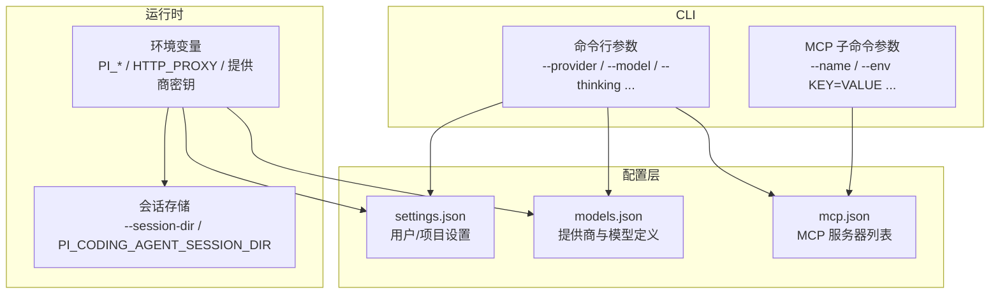
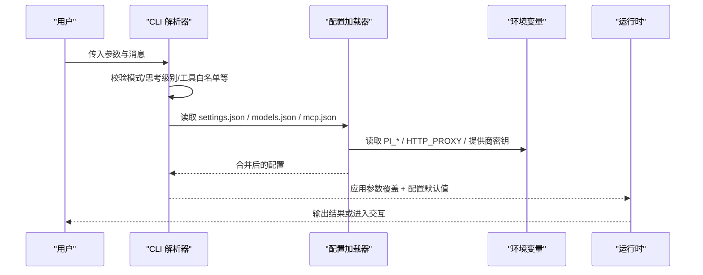
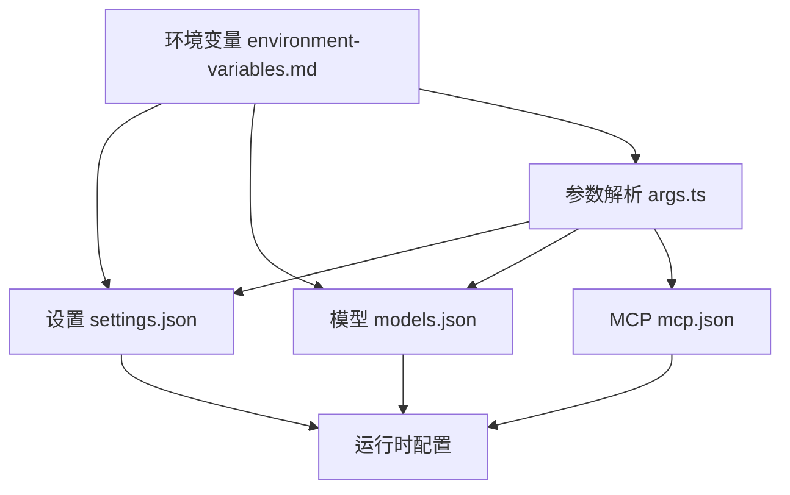

# 配置选项

<cite>
**本文引用的文件**   
- [README.md](file://README.md)
- [args.ts](file://packages/coding-agent/src/cli/args.ts)
- [configuration.md](file://packages/coding-agent/docs/configuration.md)
- [environment-variables.md](file://packages/coding-agent/docs/environment-variables.md)
- [models-configuration.md](file://packages/coding-agent/docs/models-configuration.md)
- [settings.md](file://packages/coding-agent/docs/settings.md)
- [settings.schema.json](file://packages/coding-agent/schemas/settings.schema.json)
- [cli.ts](file://packages/coding-agent/src/extensions/mcp/cli.ts)
</cite>

## 目录
1. [简介](#简介)
2. [项目结构](#项目结构)
3. [核心组件](#核心组件)
4. [架构总览](#架构总览)
5. [详细组件分析](#详细组件分析)
6. [依赖关系分析](#依赖关系分析)
7. [性能与成本考量](#性能与成本考量)
8. [故障排查指南](#故障排查指南)
9. [结论](#结论)
10. [附录：模板与最佳实践](#附录模板与最佳实践)

## 简介
本文面向 Pi CLI 的配置体系，提供完整的命令行参数参考、配置文件格式、环境变量说明、优先级规则以及高级配置项（模型、工具、会话等）。文档同时给出不同环境下的配置模板与最佳实践，帮助你在本地开发、CI 和容器化环境中稳定运行。

## 项目结构
Pi 的 CLI 配置由三部分构成：
- 命令行参数：通过解析器统一处理，支持短/长选项、位置参数、扩展自定义标志。
- 配置文件：用户级与项目级 settings.json、models.json、mcp.json 等。
- 环境变量：进程级开关、代理、路径覆盖、会话元数据注入等。

图表来源
- [args.ts:72-270](file://packages/coding-agent/src/cli/args.ts#L72-L270)
- [cli.ts:183-222](file://packages/coding-agent/src/extensions/mcp/cli.ts#L183-L222)
- [configuration.md:1-48](file://packages/coding-agent/docs/configuration.md#L1-L48)
- [environment-variables.md:75-103](file://packages/coding-agent/docs/environment-variables.md#L75-L103)

章节来源
- [args.ts:72-270](file://packages/coding-agent/src/cli/args.ts#L72-L270)
- [cli.ts:183-222](file://packages/coding-agent/src/extensions/mcp/cli.ts#L183-L222)
- [configuration.md:1-48](file://packages/coding-agent/docs/configuration.md#L1-L48)
- [environment-variables.md:75-103](file://packages/coding-agent/docs/environment-variables.md#L75-L103)

## 核心组件
- 命令行参数解析器：负责识别所有内置选项、校验取值范围、收集未知标志供扩展使用。
- 配置加载器：按“项目 .pi > 用户 ~/.pi/agent”顺序合并 settings.json；models.json 与 mcp.json 分别管理模型与 MCP。
- 环境变量注入：为进程与子进程提供运行期开关与凭据。

章节来源
- [args.ts:72-270](file://packages/coding-agent/src/cli/args.ts#L72-L270)
- [configuration.md:1-48](file://packages/coding-agent/docs/configuration.md#L1-L48)
- [environment-variables.md:75-103](file://packages/coding-agent/docs/environment-variables.md#L75-L103)

## 架构总览
下图展示一次典型启动过程中，命令行、配置与环境变量的交互关系。

图表来源
- [args.ts:72-270](file://packages/coding-agent/src/cli/args.ts#L72-L270)
- [configuration.md:1-48](file://packages/coding-agent/docs/configuration.md#L1-L48)
- [environment-variables.md:75-103](file://packages/coding-agent/docs/environment-variables.md#L75-L103)

## 详细组件分析

### 一、命令行参数参考
本节列出主要参数、语法、默认值、取值范围与验证规则。

- 通用
  - --help, -h：显示帮助。
  - --version, -v：打印版本。
  - --：结束选项解析，后续全部作为消息或文件参数。

- 模型与提供商
  - --provider <name>：指定提供商（需配合 --model）。
  - --model <pattern>：模型 ID 或模式，支持 provider/id 与 :thinking 简写。
  - --api-key <key>：API 密钥（优先于环境变量）。
  - --models <patterns>：逗号分隔的模式，用于 Ctrl+P 切换模型，支持通配与模糊匹配。
  - --thinking <level>：思考级别，取值 off | minimal | low | medium | high | xhigh | max。

- 会话与工作区
  - --continue, -c：继续最近会话。
  - --resume, -r：选择会话恢复。
  - --session <path|id>：按路径或完整/部分 ID 打开会话。
  - --session-id <id>：以当前目录现有会话 ID 创建或复用。
  - --fork <path|id>：基于路径或 ID 分叉会话到当前目录。
  - --session-dir <dir>：会话存储目录（覆盖 PI_CODING_AGENT_SESSION_DIR）。
  - --no-session：不保存会话（临时会话）。
  - --name, -n <name>：设置会话显示名。

- 工具与能力
  - --no-tools, -nt：默认禁用所有工具。
  - --no-builtin-tools, -nbt：仅禁用内置工具，保留扩展/MCP 工具。
  - --tools, -t <tools>：逗号分隔的工具白名单，支持 +name/-name 增量调整与 mcp__ 前缀。
  - --exclude-tools, -xt <tools>：逗号分隔的黑名单，作用于所有工具包括 MCP。
  - --extension, -e <path>：加载扩展文件或 builtin:<name>。
  - --no-extensions, -ne：禁用扩展发现与内置扩展（显式 -e 仍生效）。
  - --no-mcp：禁用内置 MCP 支持。
  - --skill <path>：加载技能文件或目录。
  - --no-skills, -ns：禁用技能发现与加载。
  - --prompt-template <path>：加载提示模板文件或目录。
  - --no-prompt-templates, -np：禁用提示模板发现与加载。
  - --theme <path>：加载主题文件或目录。
  - --use-theme <name[/name]>：设置本次运行的初始主题。
  - --no-themes：禁用主题发现与加载。
  - --no-context-files, -nc：禁用 AGENTS.md / CLAUDE.md 发现与加载。

- 输出与调试
  - --mode <mode>：输出模式 text | json | rpc。
  - --print, -p：非交互模式，处理并退出。
  - --export <file> [output]：导出会话为 HTML 并退出。
  - --list-models [search]：列出可用模型（可选搜索）。
  - --tui-mode <mode>：TUI 模式 regular | fullscreen。
  - --verbose：强制启动时输出详细信息。
  - --approve, -a / --no-approve, -na：是否信任项目本地文件。
  - --offline：禁用启动网络操作（等价于 PI_OFFLINE=1）。

- 扩展标志
  - 任何以 -- 开头的未识别标志会被收集为 unknownFlags，扩展可消费。

取值与校验要点
- --mode 仅接受 text/json/rpc，否则报错。
- --thinking 仅接受 off/minimal/low/medium/high/xhigh/max，否则警告。
- --tui-mode 仅接受 regular/fullscreen，否则报错。
- --tools/--exclude-tools 会进行工具名合法性校验，非法名称将产生诊断信息。

章节来源
- [args.ts:72-270](file://packages/coding-agent/src/cli/args.ts#L72-L270)
- [args.ts:273-480](file://packages/coding-agent/src/cli/args.ts#L273-L480)

### 二、配置文件格式与优先级

- 用户级配置目录
  - 默认路径：~/.pi/agent（可通过 PI_CODING_AGENT_DIR 覆盖）。
  - 关键文件：
    - settings.json：用户设置、资源路径、包声明。
    - models.json：兼容端点、模型与覆盖。
    - mcp.json：全局 MCP 服务器。
    - auth.json：已保存的 API Key/OAuth。
    - SYSTEM.md / APPEND_SYSTEM.md：系统提示词覆盖与追加。
    - extensions/、skills/、prompts/、themes/：用户扩展、技能、模板、主题。

- 项目级配置目录
  - 路径：工作目录下的 .pi。
  - 关键文件：
    - .pi/settings.json：项目级设置与资源路径。
    - .pi/mcp.json：项目级 MCP 服务器。
    - .pi/SYSTEM.md / .pi/APPEND_SYSTEM.md：项目级系统提示词覆盖与追加。
    - .pi/extensions/、.pi/skills/、.pi/prompts/、.pi/themes/：项目级资源。

- 优先级规则
  - 项目 settings.json 覆盖用户 settings.json。
  - 同名 SYSTEM.md / APPEND_SYSTEM.md 在项目级存在时完全替换用户级对应文件（不合并）。
  - sessionDir 在信任判定之前被读取，以便定位会话。
  - 资源数组（extensions/skills/prompts/themes/packages）在用户与项目设置中合并。

章节来源
- [configuration.md:1-48](file://packages/coding-agent/docs/configuration.md#L1-L48)

### 三、环境变量

- 进程与平台
  - PI_CODING_AGENT_DIR：覆盖配置目录。
  - PI_CODING_AGENT_SESSION_DIR：覆盖会话存储（可被 --session-dir 覆盖）。
  - PI_PACKAGE_DIR：覆盖包目录（Nix/Guix 场景）。
  - PI_OFFLINE：禁用自动网络活动（等价 --offline）。
  - PI_SKIP_VERSION_CHECK：跳过最新版本检查。
  - PI_SELF_UPDATE_COMMAND：覆盖 pi update 更新自身命令。
  - PI_TELEMETRY：覆盖安装/更新遥测与提供商归属头。
  - PI_CODEMODE_MAX_WORKERS：控制 codemode 并发 worker 数。
  - PI_CACHE_RETENTION：启用长期缓存（若受支持）。
  - PI_SHARE_VIEWER_URL：覆盖 /share 基础 URL。
  - PI_RADIUS_GATEWAY：覆盖 /bug 上传网关。
  - PI_CLEAR_ON_SHRINK：内容收缩时清空空行。
  - PI_HARDWARE_CURSOR：显示硬件光标。
  - PI_CLIPBOARD_OSC52：额外发送 OSC 52 剪贴板。
  - PI_HYPERLINKS：覆盖超链接检测。
  - PI_PROGRAM_STATUS：覆盖程序状态检测策略。
  - PI_IMAGE_PROTOCOL：覆盖内联图片协议检测。
  - PI_TRUE_COLOR：覆盖真彩检测。
  - PI_TUI_ESC_TIMEOUT：ESC 等待超时（毫秒）。
  - VISUAL / EDITOR：外部编辑器回退。
  - HTTP_PROXY / HTTPS_PROXY：HTTP(S) 代理。

- 会话注入（bash/powershell 工具）
  - PI_SESSION_ID / PI_SESSION_FILE / PI_PROVIDER / PI_MODEL / PI_REASONING_LEVEL。

- 提供商密钥
  - 各提供商密钥变量见 providers 文档；此处不再赘述。

章节来源
- [environment-variables.md:1-104](file://packages/coding-agent/docs/environment-variables.md#L1-L104)

### 四、模型配置（models.json）

- 提供商（providers）
  - 键为提供商 ID；内置 ID 修改行为，其他 ID 新增提供商，需提供 baseUrl 与 api。
  - 常用字段：name、baseUrl、apiKey、api、oauth、headers、compat、authHeader、models、modelOverrides。

- 模型（models）
  - id 必填；name 用于显示与 --model 匹配。
  - reasoning/thinkingLevelMap：是否支持思考及各级别映射。
  - input/inputLimits：输入类型与限制（含图片）。
  - cost/cost.tiers：输入/输出/缓存读写成本与阶梯定价。
  - promptCache：提示缓存生命周期。
  - contextWindow/maxTokens：上下文窗口与最大输出 token。
  - samplingParams/samplingParamsByThinkingLevel：请求体采样参数。
  - headers/compat：请求头与兼容性覆盖。

- 模型覆盖（modelOverrides）
  - 对内置或扩展模型进行字段级合并或替换，如 name、reasoning、input、cost、contextWindow、maxTokens、samplingParams、headers、compat 等。

- 输入限制（inputLimits）
  - maxRequestBytes、images.resize.*、images.maxPerMessage/PerRequest。

- 兼容性（compat）
  - 按 API 类型（openai-completions/openai-responses/anthropic-messages/bedrock-converse-stream/mistral-conversations/typesafe-system-one 等）提供差异化字段，如 thinkingFormat、chatTemplateKwargs、supportsStrictMode、cacheControlFormat、sessionAffinityFormat、promptCacheKeyMode、supportsLongCacheRetention 等。

章节来源
- [models-configuration.md:1-201](file://packages/coding-agent/docs/models-configuration.md#L1-L201)

### 五、用户设置（settings.json）

- 模型与思考
  - defaultProvider/defaultModel/defaultThinkingLevel/modelThinkingLevels/thinkingBudgets/enabledModels/hideThinkingBlock/showCacheMissNotices/cacheWarming。

- 交互
  - steeringMode/followUpMode/externalEditor/doubleEscapeAction/treeFilterMode/defaultProjectTrust。

- 工具
  - defaultTools（支持 +name/-name）、codemode.mode/codemode.inlineBudget。

- 会话与上下文
  - sessionDir/sessionShareDestination。
  - compaction.enabled/reserveTokens/keepRecentTokens/modelOverrides。
  - branchSummary.reserveTokens/branchSummary.skipPrompt。

- 终端与显示
  - theme/quietStartup/tuiMode/fullscreenExitOutput/fullscreenScrollbar/fullscreenCopyOnSelect/fullscreenWheelScrollLines/editorPaddingX/outputPad/autocompleteMaxVisible/showHardwareCursor/terminal.* / images.* / markdown.*。

- 网络与重试
  - transport/httpProxy/httpIdleTimeoutMs/websocketConnectTimeoutMs/retry.*。

- Shell
  - shellPath/shellCommandPrefix/npmCommand/selfUpdateCommand。

- 资源
  - packages/extensions/skills/prompts/themes/enableSkillCommands。

- 更新、遥测与告警
  - collapseChangelog/enableInstallTelemetry/enableAnalytics/warnings.anthropicExtraUsage。

- JSON Schema
  - settings.schema.json 提供字段类型、默认值与约束，可用于编辑器校验与补全。

章节来源
- [settings.md:1-174](file://packages/coding-agent/docs/settings.md#L1-L174)
- [settings.schema.json:1-800](file://packages/coding-agent/schemas/settings.schema.json#L1-L800)

### 六、MCP 子命令参数

- 参数解析
  - 支持 --name value、--flag、--list key=value 等。
  - 遇到未知选项会报错并提示用法。
  - 支持 -- 终止选项解析，将剩余参数透传给子命令。

- 键值对解析
  - --env KEY=VALUE 形式重复多次，内部解析为记录对象。

章节来源
- [cli.ts:183-222](file://packages/coding-agent/src/extensions/mcp/cli.ts#L183-L222)
- [cli.ts:333-346](file://packages/coding-agent/src/extensions/mcp/cli.ts#L333-L346)

## 依赖关系分析

图表来源
- [args.ts:72-270](file://packages/coding-agent/src/cli/args.ts#L72-L270)
- [configuration.md:1-48](file://packages/coding-agent/docs/configuration.md#L1-L48)
- [environment-variables.md:75-103](file://packages/coding-agent/docs/environment-variables.md#L75-L103)

章节来源
- [args.ts:72-270](file://packages/coding-agent/src/cli/args.ts#L72-L270)
- [configuration.md:1-48](file://packages/coding-agent/docs/configuration.md#L1-L48)
- [environment-variables.md:75-103](file://packages/coding-agent/docs/environment-variables.md#L75-L103)

## 性能与成本考量
- 提示缓存预热（cacheWarming）：仅在模型声明缓存生命周期且预估节省成本超过阈值时执行；刷新计入会话总量但不进入模型上下文。
- 成本与计费：models.json 中 cost 与 cost.tiers 决定输入/输出/缓存读写的单价与阶梯定价，影响会话成本估算。
- 重试与超时：retry.* 控制代理级与提供商级重试与超时，避免长时间阻塞。
- 并发与 Worker：PI_CODEMODE_MAX_WORKERS 控制 codemode 并发上限，避免内存与 CPU 过载。

章节来源
- [settings.md:1-174](file://packages/coding-agent/docs/settings.md#L1-L174)
- [models-configuration.md:1-201](file://packages/coding-agent/docs/models-configuration.md#L1-L201)

## 故障排查指南
- 未知选项
  - 现象：出现 Unknown option 错误。
  - 原因：使用了不支持的短/长选项。
  - 处理：核对 --help 输出或使用 -- 透传参数给子命令。

- 无效模式/思考级别/TUI 模式
  - 现象：--mode/--thinking/--tui-mode 报错或警告。
  - 原因：取值不在允许集合内。
  - 处理：改为 text/json/rpc、off/minimal/low/medium/high/xhigh/max、regular/fullscreen。

- 工具名非法
  - 现象：--tools/--exclude-tools 报诊断信息。
  - 原因：包含不存在或非法的工具名。
  - 处理：移除非法项或使用 * 通配符。

- 会话目录不可用
  - 现象：无法保存/恢复会话。
  - 原因：--session-dir 或 PI_CODING_AGENT_SESSION_DIR 指向的路径不可写。
  - 处理：修正路径权限或改用默认会话目录。

- 网络受限
  - 现象：启动时报网络错误或 catalog 拉取失败。
  - 原因：离线环境未设置 PI_OFFLINE。
  - 处理：设置 PI_OFFLINE=1 或使用 --offline。

章节来源
- [args.ts:72-270](file://packages/coding-agent/src/cli/args.ts#L72-L270)
- [environment-variables.md:75-103](file://packages/coding-agent/docs/environment-variables.md#L75-L103)

## 结论
Pi 的配置体系围绕“命令行参数 > 项目设置 > 用户设置 > 环境变量默认值”的优先级展开。通过 settings.json 与 models.json 的组合，可以精细控制工具、会话、模型与提供商行为；结合环境变量，可在不同环境下实现一致的运行体验。建议将敏感凭据放入 auth.json 或通过环境变量注入，并在 CI/容器中通过 PI_OFFLINE 与代理变量控制网络行为。

## 附录：模板与最佳实践

- 本地开发（macOS/Linux/Windows）
  - 使用默认用户目录 ~/.pi/agent，按需编辑 settings.json 与 models.json。
  - 通过 --model 与 --thinking 快速切换模型与思考级别。
  - 使用 --tools 与 --exclude-tools 限定工具集，减少误操作风险。

- CI 与非交互
  - 使用 --mode json 或 --print 输出结构化结果。
  - 通过 --offline 与 HTTP_PROXY/HTTPS_PROXY 控制网络。
  - 使用 --no-session 避免写入会话文件。

- 容器化
  - 将 ~/.pi/agent 挂载为卷持久化配置与会话。
  - 通过 PI_CODING_AGENT_DIR 与 PI_CODING_AGENT_SESSION_DIR 覆盖路径。
  - 通过环境变量注入提供商密钥，避免硬编码。

- 多项目协作
  - 将公共设置放在用户级 settings.json，项目差异放入 .pi/settings.json。
  - 使用 resources 数组的 +path/-path 精确控制扩展/技能/模板/主题的加载。

- 安全与最小权限
  - 尽量只启用必要工具（--no-tools 后使用 --tools +read,+grep,...）。
  - 谨慎开启 MCP 与扩展，必要时使用 --no-mcp 与 --no-extensions。
  - 使用 project trust 机制与 --approve/--no-approve 控制项目文件信任。

章节来源
- [README.md:23-64](file://README.md#L23-L64)
- [configuration.md:1-48](file://packages/coding-agent/docs/configuration.md#L1-L48)
- [environment-variables.md:75-103](file://packages/coding-agent/docs/environment-variables.md#L75-L103)
- [settings.md:1-174](file://packages/coding-agent/docs/settings.md#L1-L174)
- [models-configuration.md:1-201](file://packages/coding-agent/docs/models-configuration.md#L1-L201)