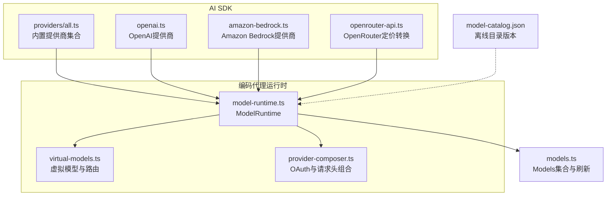
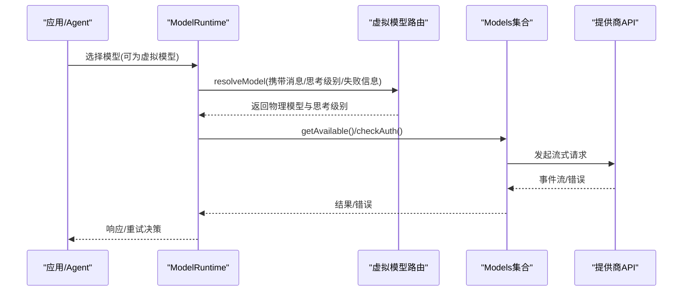
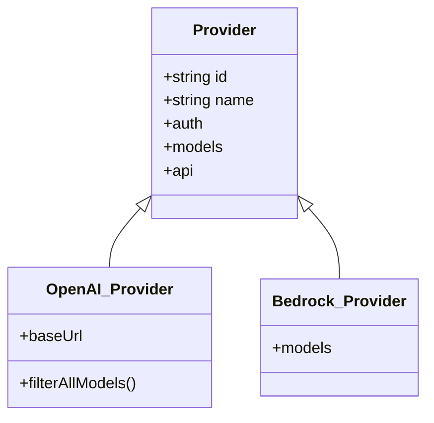
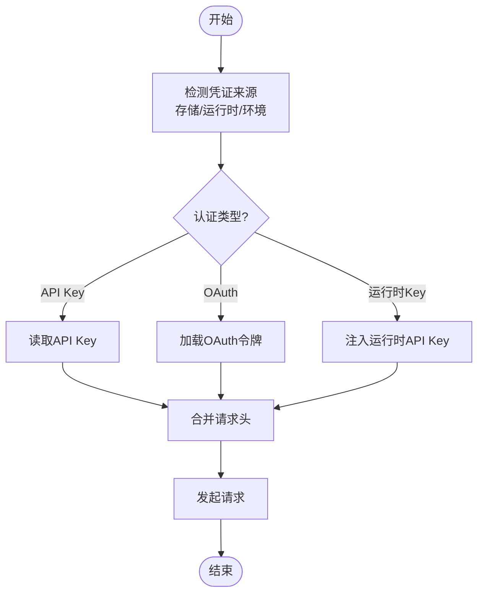
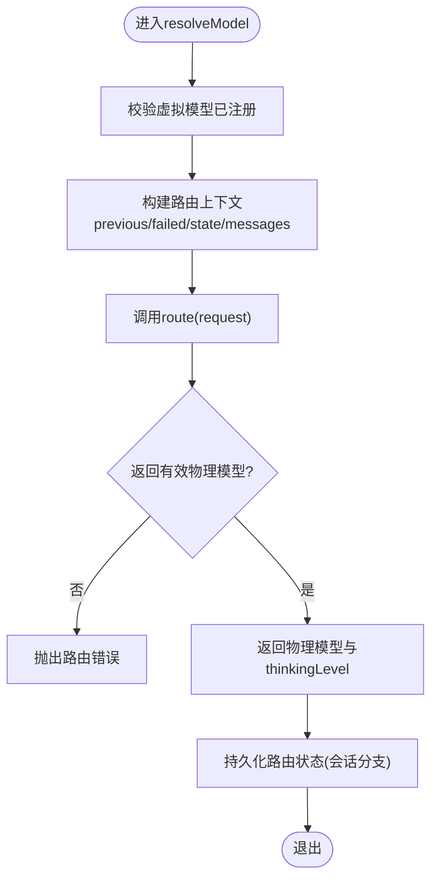
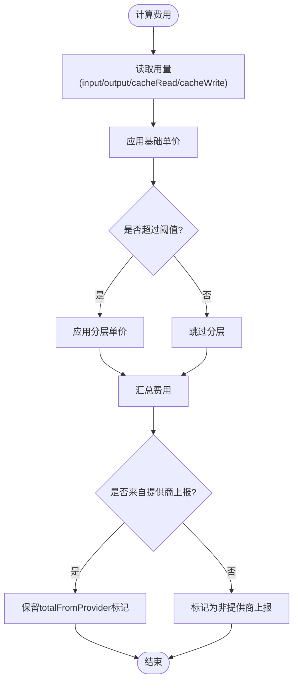
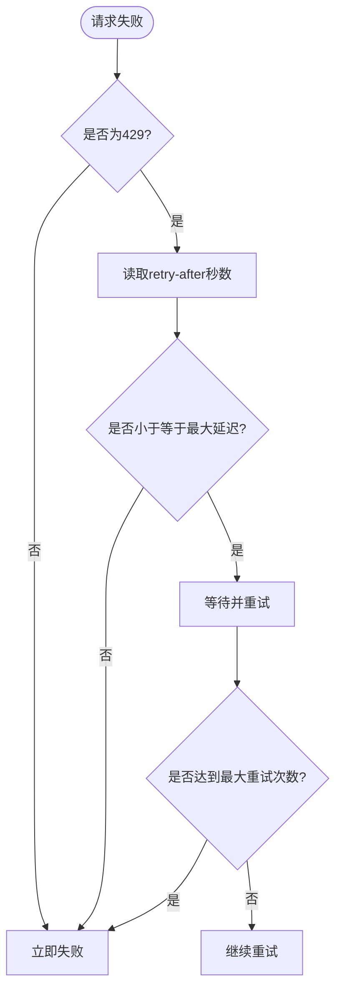
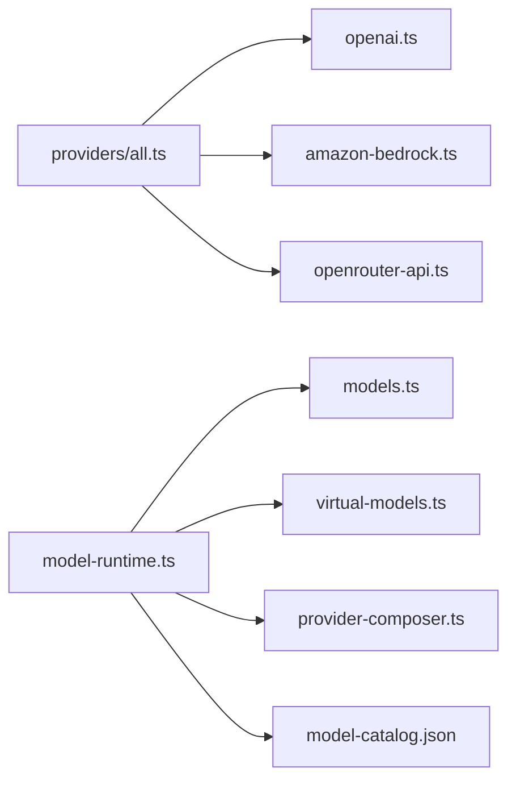

# LLM提供商集成

<cite>
**本文引用的文件**   
- [README.md](file://README.md)
- [all.ts](file://packages/ai/src/providers/all.ts)
- [openai.ts](file://packages/ai/src/providers/openai.ts)
- [amazon-bedrock.ts](file://packages/ai/src/providers/amazon-bedrock.ts)
- [openrouter-api.ts](file://packages/ai/src/providers/openrouter-api.ts)
- [model-runtime.ts](file://packages/coding-agent/src/core/model-runtime.ts)
- [virtual-models.ts](file://packages/coding-agent/src/core/virtual-models.ts)
- [provider-composer.ts](file://packages/coding-agent/src/core/provider-composer.ts)
- [models.ts](file://packages/ai/src/models.ts)
- [model-catalog.json](file://nix/model-catalog.json)
- [model-runtime-auth-options.test.ts](file://packages/coding-agent/test/model-runtime-auth-options.test.ts)
- [virtual-models.test.ts](file://packages/coding-agent/test/virtual-models.test.ts)
- [openai-completions-retry.test.ts](file://packages/ai/test/openai-completions-retry.test.ts)
- [models-runtime.test.ts](file://packages/ai/test/models-runtime.test.ts)
</cite>

## 目录
1. [简介](#简介)
2. [项目结构](#项目结构)
3. [核心组件](#核心组件)
4. [架构总览](#架构总览)
5. [详细组件分析](#详细组件分析)
6. [依赖关系分析](#依赖关系分析)
7. [性能与成本优化](#性能与成本优化)
8. [故障排查指南](#故障排查指南)
9. [结论](#结论)
10. [附录](#附录)

## 简介
本文件面向需要在多AI提供商之间进行统一接入、认证、模型路由、负载均衡与故障转移的开发者。仓库通过统一的“提供商”抽象，将OpenAI、Anthropic、Google（含Vertex）、AWS Bedrock等厂商封装为一致的API；同时提供虚拟模型机制实现动态选择、按上下文或失败状态切换物理模型，以及价格分层与重试策略。

## 项目结构
- 提供商注册与发现：所有内置提供商在统一入口集中注册，便于扩展与枚举。
- 提供商实现：每个提供商文件定义认证方式、模型清单与API适配层。
- 运行时与路由：编码代理侧提供ModelRuntime，负责凭证管理、可用性刷新、虚拟模型路由与会话状态持久化。
- 模型目录与离线数据：Nix构建使用固定版本的模型目录快照，运行时可叠加在线目录更新。

图示来源
- [all.ts:137-182](file://packages/ai/src/providers/all.ts#L137-L182)
- [openai.ts:9-35](file://packages/ai/src/providers/openai.ts#L9-L35)
- [amazon-bedrock.ts:82-90](file://packages/ai/src/providers/amazon-bedrock.ts#L82-L90)
- [openrouter-api.ts:45-77](file://packages/ai/src/providers/openrouter-api.ts#L45-L77)
- [model-runtime.ts:174-200](file://packages/coding-agent/src/core/model-runtime.ts#L174-L200)
- [virtual-models.ts:1-12](file://packages/coding-agent/src/core/virtual-models.ts#L1-L12)
- [provider-composer.ts:488-511](file://packages/coding-agent/src/core/provider-composer.ts#L488-L511)
- [models.ts:576-597](file://packages/ai/src/models.ts#L576-L597)
- [model-catalog.json:1-4](file://nix/model-catalog.json#L1-L4)

章节来源
- [README.md:72-86](file://README.md#L72-L86)
- [all.ts:1-48](file://packages/ai/src/providers/all.ts#L1-L48)

## 核心组件
- 提供商抽象与注册：通过createProvider创建统一Provider对象，包含id、名称、认证、模型列表与API适配器。
- 模型集合与刷新：Models统一管理各提供商模型，支持按需网络刷新与本地缓存。
- ModelRuntime：聚合凭证、配置、虚拟模型与远程目录，暴露可用模型、认证检查、流式调用等能力。
- 虚拟模型：以“路由函数”将一次请求映射到具体物理模型，并维护会话级路由状态。
- 认证组合：OAuth、API Key与环境变量合并，支持自定义请求头注入。

章节来源
- [all.ts:137-182](file://packages/ai/src/providers/all.ts#L137-L182)
- [model-runtime.ts:174-200](file://packages/coding-agent/src/core/model-runtime.ts#L174-L200)
- [virtual-models.ts:1-12](file://packages/coding-agent/src/core/virtual-models.ts#L1-L12)
- [provider-composer.ts:488-511](file://packages/coding-agent/src/core/provider-composer.ts#L488-L511)

## 架构总览
下图展示从应用侧到提供商的完整调用链，包括虚拟模型路由、认证与重试。

图示来源
- [model-runtime.ts:1022-1061](file://packages/coding-agent/src/core/model-runtime.ts#L1022-L1061)
- [virtual-models.ts:104-118](file://packages/coding-agent/src/core/virtual-models.ts#L104-L118)
- [models.ts:576-597](file://packages/ai/src/models.ts#L576-L597)

## 详细组件分析

### 提供商注册与模型枚举
- 内置提供商在统一入口集中构造并注册，便于批量启用与类型推导。
- 每个提供商声明其认证方式、模型清单与API适配器。例如OpenAI提供Responses API与分类器Decisions API；Bedrock提供Converse Stream API。

图示来源
- [all.ts:137-182](file://packages/ai/src/providers/all.ts#L137-L182)
- [openai.ts:9-35](file://packages/ai/src/providers/openai.ts#L9-L35)
- [amazon-bedrock.ts:82-90](file://packages/ai/src/providers/amazon-bedrock.ts#L82-L90)

章节来源
- [all.ts:1-48](file://packages/ai/src/providers/all.ts#L1-L48)
- [openai.ts:9-35](file://packages/ai/src/providers/openai.ts#L9-L35)
- [amazon-bedrock.ts:82-90](file://packages/ai/src/providers/amazon-bedrock.ts#L82-L90)

### 认证流程与密钥管理
- 支持的认证类型包括API Key、OAuth与运行时API Key覆盖。
- OAuth流程由提供商适配器加载，并与配置的请求头合并；运行时可临时注入环境变量或API Key。
- 测试覆盖了多种提供商的认证选项，如Bedrock的AWS凭据/Bearer Token、Vertex的Google Cloud凭据、Anthropic的OAuth、Cloudflare网关/Workers AI等。

图示来源
- [provider-composer.ts:488-511](file://packages/coding-agent/src/core/provider-composer.ts#L488-L511)
- [model-runtime-auth-options.test.ts:77-106](file://packages/coding-agent/test/model-runtime-auth-options.test.ts#L77-L106)

章节来源
- [provider-composer.ts:488-511](file://packages/coding-agent/src/core/provider-composer.ts#L488-L511)
- [model-runtime-auth-options.test.ts:77-106](file://packages/coding-agent/test/model-runtime-auth-options.test.ts#L77-L106)

### 模型路由与虚拟模型
- 虚拟模型不直接调用提供商，而是通过route函数在每个请求前决定实际物理模型与思考级别。
- 路由输入包含最近成功响应、上次失败信息、会话状态与消息上下文；输出包含新状态，用于跨轮次保持策略。
- 运行时会拒绝路由到未知或虚拟模型，确保最终调用的是具备凭证的物理模型。

图示来源
- [model-runtime.ts:1022-1061](file://packages/coding-agent/src/core/model-runtime.ts#L1022-L1061)
- [virtual-models.ts:52-102](file://packages/coding-agent/src/core/virtual-models.ts#L52-L102)
- [virtual-models.test.ts:174-200](file://packages/coding-agent/test/virtual-models.test.ts#L174-L200)

章节来源
- [virtual-models.ts:1-12](file://packages/coding-agent/src/core/virtual-models.ts#L1-L12)
- [virtual-models.ts:104-118](file://packages/coding-agent/src/core/virtual-models.ts#L104-L118)
- [virtual-models.test.ts:174-200](file://packages/coding-agent/test/virtual-models.test.ts#L174-L200)

### 模型目录与离线数据
- Nix构建使用固定的模型目录修订号，保证离线构建一致性；运行时仍可叠加在线目录更新。
- 目录中包含各提供商的模型元数据，供生成代码与运行时查询。

章节来源
- [model-catalog.json:1-4](file://nix/model-catalog.json#L1-L4)

### 价格与计费
- 支持按输入/输出/缓存读写计费的ModelCost结构，并可定义基于输入Token阈值的分层计价。
- OpenRouter的定价会被转换为系统内部格式，忽略时间片覆盖，保留基础价与按Prompt长度分层的覆盖价。

图示来源
- [openrouter-api.ts:45-77](file://packages/ai/src/providers/openrouter-api.ts#L45-L77)
- [models-runtime.test.ts:126-173](file://packages/ai/test/models-runtime.test.ts#L126-L173)

章节来源
- [openrouter-api.ts:45-77](file://packages/ai/src/providers/openrouter-api.ts#L45-L77)
- [models-runtime.test.ts:126-173](file://packages/ai/test/models-runtime.test.ts#L126-L173)

### 速率限制与错误重试
- 对429等限速错误，系统会尊重服务端retry-after头，但存在最大重试延迟上限，超出则立即失败。
- 重试次数与延迟可通过配置控制；每次重试会将maxRetries置零以避免嵌套重试。

图示来源
- [openai-completions-retry.test.ts:106-140](file://packages/ai/test/openai-completions-retry.test.ts#L106-L140)

章节来源
- [openai-completions-retry.test.ts:106-140](file://packages/ai/test/openai-completions-retry.test.ts#L106-L140)

## 依赖关系分析
- 提供商层：all.ts集中导入并实例化各提供商，形成Provider[]；每个提供商依赖各自的models与api实现。
- 运行时层：ModelRuntime依赖Models集合进行可用性检查与刷新，依赖虚拟模型模块进行路由，依赖provider-composer进行OAuth与请求头组合。
- 目录层：离线目录版本与在线目录叠加，影响模型枚举与价格信息。

图示来源
- [all.ts:137-182](file://packages/ai/src/providers/all.ts#L137-L182)
- [model-runtime.ts:174-200](file://packages/coding-agent/src/core/model-runtime.ts#L174-L200)
- [models.ts:576-597](file://packages/ai/src/models.ts#L576-L597)
- [model-catalog.json:1-4](file://nix/model-catalog.json#L1-L4)

章节来源
- [all.ts:1-48](file://packages/ai/src/providers/all.ts#L1-L48)
- [model-runtime.ts:174-200](file://packages/coding-agent/src/core/model-runtime.ts#L174-L200)

## 性能与成本优化
- 模型路由优化：通过虚拟模型根据上下文大小、失败历史与思考级别自动选择更合适或更便宜的物理模型，减少不必要的高成本调用。
- 分层计价：对长上下文场景启用更高输入Token的分层单价，避免低估成本。
- 重试与退避：合理设置最大重试次数与最大延迟，避免无限重试导致资源浪费。
- 目录缓存：离线目录与在线目录结合，减少重复网络开销。

[本节为通用指导，不直接分析具体文件]

## 故障排查指南
- 认证问题
  - 确认提供商所需的认证类型（API Key/OAuth/运行时Key）是否正确配置。
  - 检查OAuth令牌有效期与最小剩余有效期配置。
  - 参考测试用例中不同提供商的认证选项，验证配置项是否生效。
- 路由失败
  - 虚拟模型未注册或路由返回了未知/虚拟模型会导致失败。
  - 检查route函数的返回值是否指向具备凭证的物理模型。
- 速率限制
  - 若服务端返回超长retry-after，将被视为超限而立即失败；调整最大重试延迟或降低请求频率。
- 可用性刷新
  - 凭证变更后需触发availability刷新，确保模型列表与认证状态同步。

章节来源
- [model-runtime-auth-options.test.ts:77-106](file://packages/coding-agent/test/model-runtime-auth-options.test.ts#L77-L106)
- [virtual-models.test.ts:174-200](file://packages/coding-agent/test/virtual-models.test.ts#L174-L200)
- [openai-completions-retry.test.ts:106-140](file://packages/ai/test/openai-completions-retry.test.ts#L106-L140)

## 结论
该仓库通过统一的提供商抽象、灵活的虚拟模型路由、完善的认证组合与重试策略，实现了多LLM提供商的一体化集成。开发者可在不改动上层逻辑的前提下，动态切换提供商、优化成本与性能，并在复杂失败场景下实现稳健的故障转移。

[本节为总结性内容，不直接分析具体文件]

## 附录
- 快速上手
  - 安装CLI后，在Pi内执行/login连接订阅或API Key，随后即可使用内置提供商。
- 开发命令
  - npm run build/npm run check/./test.sh等命令可用于构建、检查与测试。

章节来源
- [README.md:23-54](file://README.md#L23-L54)
- [README.md:102-111](file://README.md#L102-L111)