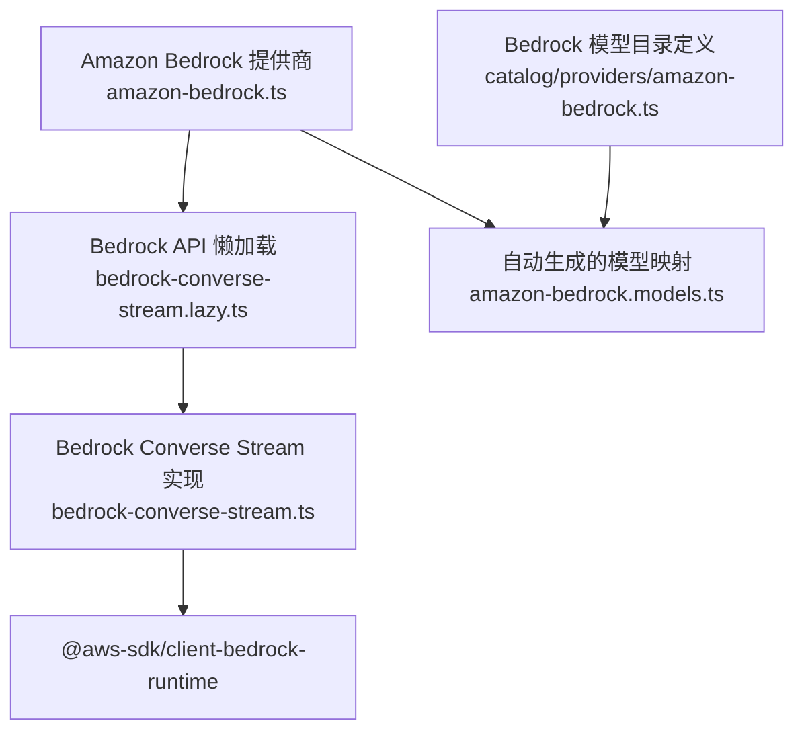
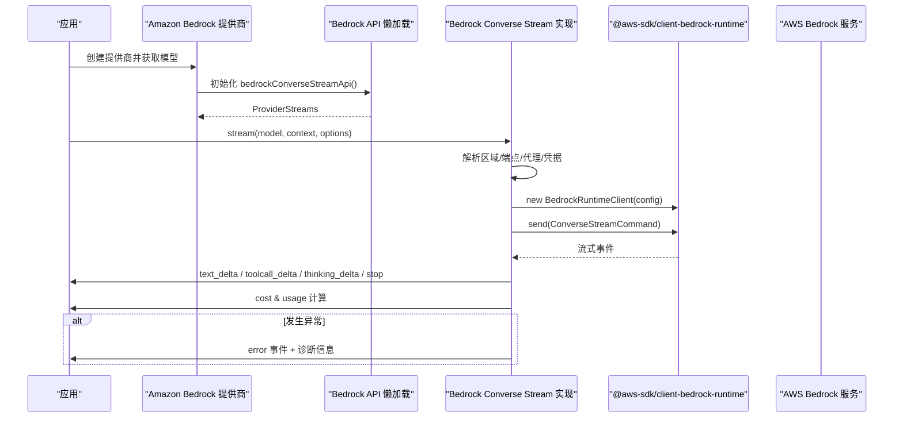
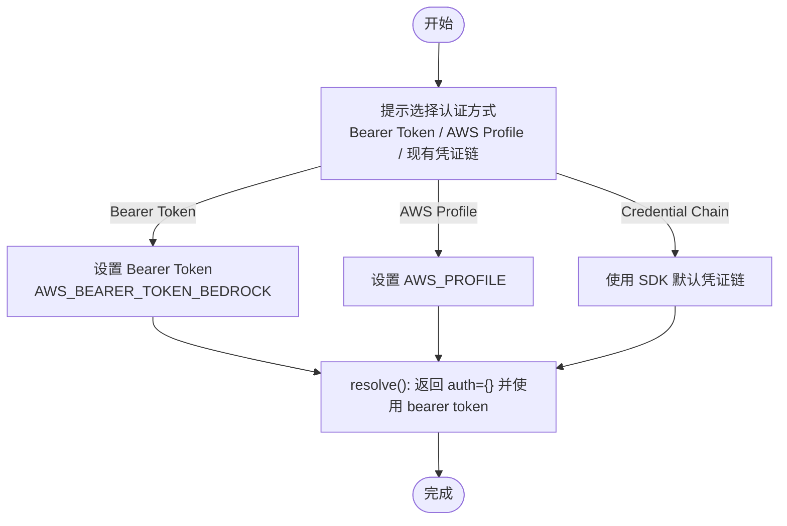
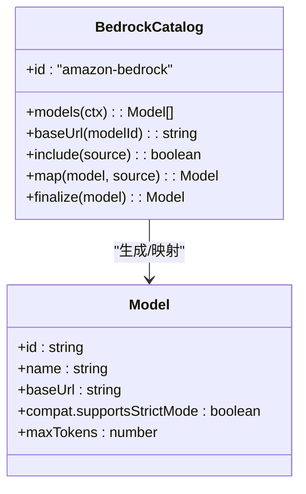
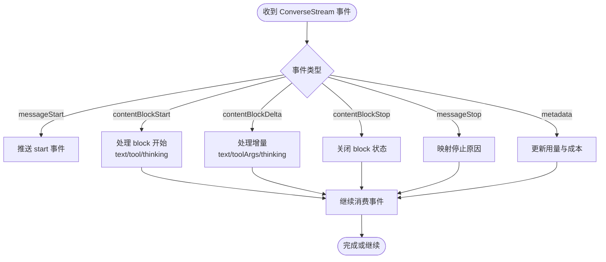
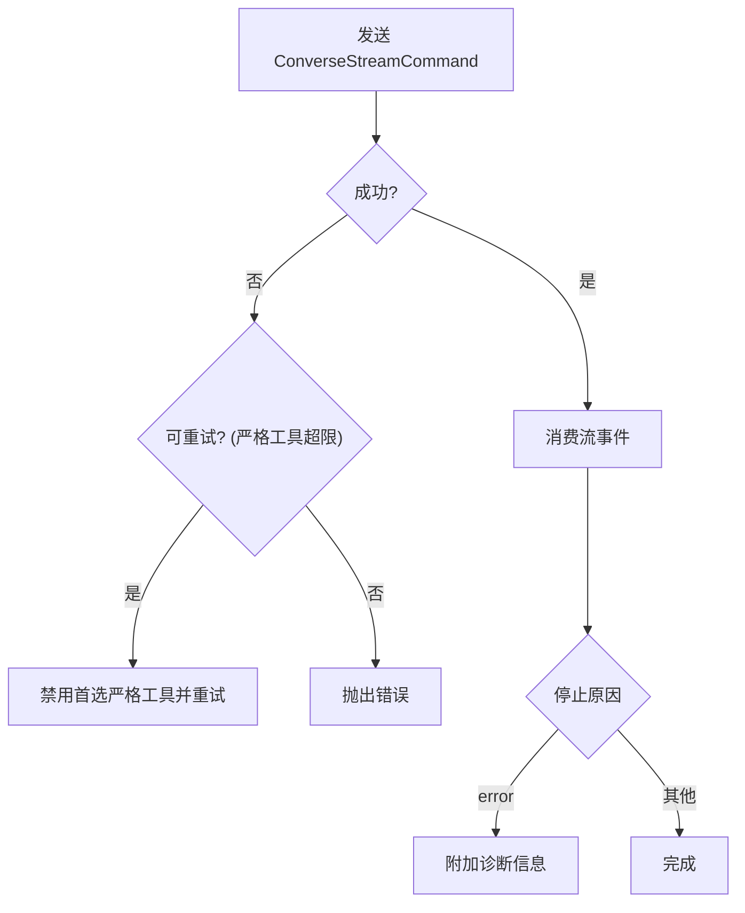
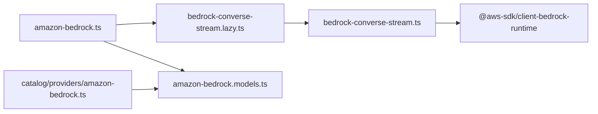

# AWS Bedrock提供商

<cite>
**本文引用的文件**   
- [packages/ai/src/providers/amazon-bedrock.ts](file://packages/ai/src/providers/amazon-bedrock.ts)
- [packages/ai/src/api/bedrock-converse-stream.ts](file://packages/ai/src/api/bedrock-converse-stream.ts)
- [packages/ai/src/api/bedrock-converse-stream.lazy.ts](file://packages/ai/src/api/bedrock-converse-stream.lazy.ts)
- [packages/ai/catalog/providers/amazon-bedrock.ts](file://packages/ai/catalog/providers/amazon-bedrock.ts)
- [packages/ai/src/providers/amazon-bedrock.models.ts](file://packages/ai/src/providers/amazon-bedrock.models.ts)
- [packages/ai/test/bedrock-utils.ts](file://packages/ai/test/bedrock-utils.ts)
- [packages/ai/test/bedrock-credentials.test.ts](file://packages/ai/test/bedrock-credentials.test.ts)
- [packages/ai/src/env-api-keys.ts](file://packages/ai/src/env-api-keys.ts)
</cite>

## 目录
1. [简介](#简介)
2. [项目结构](#项目结构)
3. [核心组件](#核心组件)
4. [架构总览](#架构总览)
5. [详细组件分析](#详细组件分析)
6. [依赖关系分析](#依赖关系分析)
7. [性能与成本控制](#性能与成本控制)
8. [故障排查指南](#故障排查指南)
9. [结论](#结论)
10. [附录：认证、权限与区域配置清单](#附录认证权限与区域配置清单)

## 简介
本文件面向在项目中集成并生产使用 AWS Bedrock 的工程师，聚焦以下目标：
- 认证配置：Bearer Token、AWS Profile、IAM Access Key/Secret、ECS/EKS 角色等。
- IAM 权限与最小授权建议。
- 区域与端点解析策略。
- 支持的模型家族（Claude、Llama、Titan 等）在 Bedrock 上的接入方式。
- SDK 集成要点、流式响应处理、错误恢复机制。
- 成本控制、性能优化与企业安全集成的最佳实践。

本项目通过 `amazonBedrockProvider` 暴露 Bedrock 提供商，并通过 `bedrockConverseStreamApi` 调用 Bedrock Converse Stream API，实现统一的流式对话、工具调用、思考内容、缓存用量统计与成本计算。

## 项目结构
围绕 Bedrock 的关键代码分布在以下位置：
- 提供商注册与认证流程：`packages/ai/src/providers/amazon-bedrock.ts`
- Bedrock Converse Stream API 实现：`packages/ai/src/api/bedrock-converse-stream.ts`
- Bedrock API 懒加载入口：`packages/ai/src/api/bedrock-converse-stream.lazy.ts`
- Bedrock 模型目录与过滤规则：`packages/ai/catalog/providers/amazon-bedrock.ts`
- 自动生成的 Bedrock 模型映射：`packages/ai/src/providers/amazon-bedrock.models.ts`
- 测试辅助与环境变量检测：`packages/ai/test/bedrock-utils.ts`、`packages/ai/test/bedrock-credentials.test.ts`
- 环境密钥显示逻辑（用于判断是否已配置 Bedrock 凭据）：`packages/ai/src/env-api-keys.ts`

**图表来源**
- [packages/ai/src/providers/amazon-bedrock.ts:82-90](file://packages/ai/src/providers/amazon-bedrock.ts#L82-L90)
- [packages/ai/src/api/bedrock-converse-stream.lazy.ts:38-43](file://packages/ai/src/api/bedrock-converse-stream.lazy.ts#L38-L43)
- [packages/ai/src/api/bedrock-converse-stream.ts:138-142](file://packages/ai/src/api/bedrock-converse-stream.ts#L138-L142)
- [packages/ai/catalog/providers/amazon-bedrock.ts:12-32](file://packages/ai/catalog/providers/amazon-bedrock.ts#L12-L32)
- [packages/ai/src/providers/amazon-bedrock.models.ts:7-14](file://packages/ai/src/providers/amazon-bedrock.models.ts#L7-L14)

**章节来源**
- [packages/ai/src/providers/amazon-bedrock.ts:1-91](file://packages/ai/src/providers/amazon-bedrock.ts#L1-L91)
- [packages/ai/src/api/bedrock-converse-stream.lazy.ts:1-43](file://packages/ai/src/api/bedrock-converse-stream.lazy.ts#L1-L43)
- [packages/ai/catalog/providers/amazon-bedrock.ts:1-33](file://packages/ai/catalog/providers/amazon-bedrock.ts#L1-L33)
- [packages/ai/src/providers/amazon-bedrock.models.ts:1-15](file://packages/ai/src/providers/amazon-bedrock.models.ts#L1-L15)

## 核心组件
- Amazon Bedrock 提供商：负责认证交互、模型列表装配、API 绑定。
- Bedrock Converse Stream API：封装 Bedrock Runtime Client，处理消息转换、工具选择、流事件、错误诊断、成本计算。
- 模型目录：按 provider 维度聚合 Bedrock 支持模型，并设置基础 URL、结构化输出兼容标志、输入限制等。
- 懒加载模块：避免 Node/Bun 打包时直接引入重型 SDK，按需加载 Bedrock 实现。

关键职责划分：
- 认证优先级：Bearer Token > AWS Profile > IAM Access Keys > ECS/EKS/Web Identity 等默认链。
- 区域解析：优先 ARN 中的 region，其次显式 region，再根据 endpoint 推导，最后回退到 us-east-1。
- 代理与 HTTP 版本：支持 HTTP(S) 代理；可通过环境变量强制 HTTP/1.1。
- 流式处理：文本、工具调用、思考内容、元数据、停止原因统一映射为内部事件。
- 错误处理：标准化异常前缀、诊断信息、重试降级（严格工具模式）。

**章节来源**
- [packages/ai/src/providers/amazon-bedrock.ts:6-90](file://packages/ai/src/providers/amazon-bedrock.ts#L6-L90)
- [packages/ai/src/api/bedrock-converse-stream.ts:84-116](file://packages/ai/src/api/bedrock-converse-stream.ts#L84-L116)
- [packages/ai/src/api/bedrock-converse-stream.ts:138-142](file://packages/ai/src/api/bedrock-converse-stream.ts#L138-L142)
- [packages/ai/catalog/providers/amazon-bedrock.ts:12-32](file://packages/ai/catalog/providers/amazon-bedrock.ts#L12-L32)

## 架构总览
下图展示从应用调用到 Bedrock 服务端的完整链路，包括认证、区域、代理、流式事件与错误处理。

**图表来源**
- [packages/ai/src/providers/amazon-bedrock.ts:82-90](file://packages/ai/src/providers/amazon-bedrock.ts#L82-L90)
- [packages/ai/src/api/bedrock-converse-stream.lazy.ts:38-43](file://packages/ai/src/api/bedrock-converse-stream.lazy.ts#L38-L43)
- [packages/ai/src/api/bedrock-converse-stream.ts:138-142](file://packages/ai/src/api/bedrock-converse-stream.ts#L138-L142)
- [packages/ai/src/api/bedrock-converse-stream.ts:261-305](file://packages/ai/src/api/bedrock-converse-stream.ts#L261-L305)
- [packages/ai/src/api/bedrock-converse-stream.ts:336-395](file://packages/ai/src/api/bedrock-converse-stream.ts#L336-L395)

## 详细组件分析

### 认证与权限
Bedrock 提供商支持多种认证方式，并在运行时按优先级解析：
- Bearer Token：通过 `AWS_BEARER_TOKEN_BEDROCK` 或选项传入，启用 `httpBearerAuth`，绕过 SigV4。
- AWS Profile：通过 `AWS_PROFILE` 或交互式登录保存。
- IAM Access Keys：通过 `AWS_ACCESS_KEY_ID` 和 `AWS_SECRET_ACCESS_KEY`。
- 容器/角色：ECS Task Role、Web Identity Token 等由 SDK 默认链解析。

认证交互流程如下：

**图表来源**
- [packages/ai/src/providers/amazon-bedrock.ts:11-53](file://packages/ai/src/providers/amazon-bedrock.ts#L11-L53)
- [packages/ai/src/providers/amazon-bedrock.ts:54-80](file://packages/ai/src/providers/amazon-bedrock.ts#L54-L80)

区域与端点解析策略：
- 若模型 ID 是 ARN，则从 ARN 提取 region。
- 否则优先使用显式 `region` 或 `AWS_REGION`/`AWS_DEFAULT_REGION`。
- 若使用标准 Bedrock runtime 端点且无 ambient profile，则回退到 `us-east-1`。
- 自定义端点（如 VPC/代理）不会被内置目录覆盖。

代理与 HTTP 版本：
- 支持 HTTP(S) 代理，通过 `NodeHttpHandler` 注入代理 agent。
- 可通过 `AWS_BEDROCK_FORCE_HTTP1=1` 强制使用 HTTP/1.1。

**章节来源**
- [packages/ai/src/providers/amazon-bedrock.ts:6-80](file://packages/ai/src/providers/amazon-bedrock.ts#L6-L80)
- [packages/ai/src/api/bedrock-converse-stream.ts:173-250](file://packages/ai/src/api/bedrock-converse-stream.ts#L173-L250)
- [packages/ai/src/api/bedrock-converse-stream.ts:232-244](file://packages/ai/src/api/bedrock-converse-stream.ts#L232-L244)
- [packages/ai/test/bedrock-credentials.test.ts:71-115](file://packages/ai/test/bedrock-credentials.test.ts#L71-L115)

### 模型家族与目录
Bedrock 模型目录通过 `defineProvider` 聚合模型，并按条件过滤不支持的工具或系统消息的模型。目录会为每个模型设置基础 URL，并根据结构化输出能力标记 `supportsStrictMode`。

支持的模型家族示例（来自目录与测试上下文）：
- Claude：例如 `anthropic.claude-opus-4-8` 等。
- Llama：以 `meta.llama*` 开头的模型。
- Titan：以 `amazon.titan*` 开头的模型。
- Mistral：例如 `mistral.mistral-*`。
- Jamba：例如 `ai21.jamba-*`（流式工具调用受限）。

注意：
- 某些模型（如 Jamba）在流式模式下不支持工具调用。
- 部分模型不支持系统消息，目录会排除这些模型。
- 跨区推理档案模型（如 `eu.*`）会使用对应的基础 URL。

**图表来源**
- [packages/ai/catalog/providers/amazon-bedrock.ts:6-32](file://packages/ai/catalog/providers/amazon-bedrock.ts#L6-L32)
- [packages/ai/src/providers/amazon-bedrock.models.ts:7-14](file://packages/ai/src/providers/amazon-bedrock.models.ts#L7-L14)

**章节来源**
- [packages/ai/catalog/providers/amazon-bedrock.ts:1-33](file://packages/ai/catalog/providers/amazon-bedrock.ts#L1-L33)
- [packages/ai/src/providers/amazon-bedrock.models.ts:1-15](file://packages/ai/src/providers/amazon-bedrock.models.ts#L1-L15)

### 流式响应处理
Bedrock Converse Stream 实现将 SDK 的事件流转换为内部事件：
- `messageStart`：启动助手消息。
- `contentBlockStart`：文本、工具调用、思考内容块开始。
- `contentBlockDelta`：增量文本、工具参数、思考内容。
- `contentBlockStop`：结束当前内容块。
- `messageStop`：停止原因映射（stop、length、toolUse、error）。
- `metadata`：用量与成本计算。

**图表来源**
- [packages/ai/src/api/bedrock-converse-stream.ts:336-369](file://packages/ai/src/api/bedrock-converse-stream.ts#L336-L369)
- [packages/ai/src/api/bedrock-converse-stream.ts:628-790](file://packages/ai/src/api/bedrock-converse-stream.ts#L628-L790)
- [packages/ai/src/api/bedrock-converse-stream.ts:746-763](file://packages/ai/src/api/bedrock-converse-stream.ts#L746-L763)
- [packages/ai/src/api/bedrock-converse-stream.ts:1229-1244](file://packages/ai/src/api/bedrock-converse-stream.ts#L1229-L1244)

### 错误恢复与诊断
错误处理包含：
- 标准化异常前缀（Internal server error、Model stream error、Validation error、Throttling error、Service unavailable）。
- 诊断信息附加：HTTP 状态码、错误码、请求 ID。
- 严格工具模式降级：当模型拒绝超过限制的严格工具时，禁用首选严格工具并重试。
- 中止与未知错误：区分 `aborted` 与 `error`，并抛出带诊断的错误事件。

**图表来源**
- [packages/ai/src/api/bedrock-converse-stream.ts:303-326](file://packages/ai/src/api/bedrock-converse-stream.ts#L303-L326)
- [packages/ai/src/api/bedrock-converse-stream.ts:386-395](file://packages/ai/src/api/bedrock-converse-stream.ts#L386-L395)
- [packages/ai/src/api/bedrock-converse-stream.ts:407-446](file://packages/ai/src/api/bedrock-converse-stream.ts#L407-L446)
- [packages/ai/src/api/bedrock-converse-stream.ts:475-494](file://packages/ai/src/api/bedrock-converse-stream.ts#L475-L494)

**章节来源**
- [packages/ai/src/api/bedrock-converse-stream.ts:303-326](file://packages/ai/src/api/bedrock-converse-stream.ts#L303-L326)
- [packages/ai/src/api/bedrock-converse-stream.ts:386-395](file://packages/ai/src/api/bedrock-converse-stream.ts#L386-L395)
- [packages/ai/src/api/bedrock-converse-stream.ts:407-446](file://packages/ai/src/api/bedrock-converse-stream.ts#L407-L446)
- [packages/ai/src/api/bedrock-converse-stream.ts:475-494](file://packages/ai/src/api/bedrock-converse-stream.ts#L475-L494)

## 依赖关系分析
- 提供商层：`amazon-bedrock.ts` 依赖懒加载 API 与模型目录。
- API 层：`bedrock-converse-stream.ts` 依赖 `@aws-sdk/client-bedrock-runtime` 与内部工具（错误、头、代理、转录、JSON 流等）。
- 目录层：`catalog/providers/amazon-bedrock.ts` 依赖 `defineProvider` 与模型开发工具，生成模型列表并设置基础 URL。
- 懒加载层：`bedrock-converse-stream.lazy.ts` 提供 Node/Bun 环境的动态导入入口。

**图表来源**
- [packages/ai/src/providers/amazon-bedrock.ts:1-5](file://packages/ai/src/providers/amazon-bedrock.ts#L1-L5)
- [packages/ai/src/api/bedrock-converse-stream.lazy.ts:1-43](file://packages/ai/src/api/bedrock-converse-stream.lazy.ts#L1-L43)
- [packages/ai/src/api/bedrock-converse-stream.ts:1-25](file://packages/ai/src/api/bedrock-converse-stream.ts#L1-L25)
- [packages/ai/catalog/providers/amazon-bedrock.ts:1-33](file://packages/ai/catalog/providers/amazon-bedrock.ts#L1-L33)
- [packages/ai/src/providers/amazon-bedrock.models.ts:1-15](file://packages/ai/src/providers/amazon-bedrock.models.ts#L1-L15)

**章节来源**
- [packages/ai/src/providers/amazon-bedrock.ts:1-91](file://packages/ai/src/providers/amazon-bedrock.ts#L1-L91)
- [packages/ai/src/api/bedrock-converse-stream.lazy.ts:1-43](file://packages/ai/src/api/bedrock-converse-stream.lazy.ts#L1-L43)
- [packages/ai/src/api/bedrock-converse-stream.ts:1-80](file://packages/ai/src/api/bedrock-converse-stream.ts#L1-L80)
- [packages/ai/catalog/providers/amazon-bedrock.ts:1-33](file://packages/ai/catalog/providers/amazon-bedrock.ts#L1-L33)
- [packages/ai/src/providers/amazon-bedrock.models.ts:1-15](file://packages/ai/src/providers/amazon-bedrock.models.ts#L1-L15)

## 性能与成本控制
- 用量与成本：通过 `metadata.usage` 更新 input/output/cacheRead/cacheWrite/totalTokens，并调用 `calculateCost` 计算费用。
- 思考预算：对 Claude 模型支持自适应思考与非自适应思考，调整 `maxTokens` 与 `thinkingBudgets`。
- 结构化输出：根据模型的 `structuredOutput` 能力启用严格工具模式，减少解析失败。
- 输入限制：目录最终化阶段为图像设置每消息最大数量限制。

建议：
- 合理设置 `maxTokens` 与 `temperature`，避免过长输出导致成本上升。
- 使用 `requestMetadata` 进行成本分配标签，便于在 AWS Cost Explorer 中拆分成本。
- 对非 Claude 模型谨慎开启思考功能，避免不必要的开销。

**章节来源**
- [packages/ai/src/api/bedrock-converse-stream.ts:746-763](file://packages/ai/src/api/bedrock-converse-stream.ts#L746-L763)
- [packages/ai/src/api/bedrock-converse-stream.ts:577-626](file://packages/ai/src/api/bedrock-converse-stream.ts#L577-L626)
- [packages/ai/catalog/providers/amazon-bedrock.ts:24-31](file://packages/ai/catalog/providers/amazon-bedrock.ts#L24-L31)

## 故障排查指南
常见问题与定位方法：
- 认证失败：检查 `AWS_BEARER_TOKEN_BEDROCK`、`AWS_PROFILE`、`AWS_ACCESS_KEY_ID`/`AWS_SECRET_ACCESS_KEY` 是否正确设置。
- 区域不匹配：确认模型 ARN 或 `AWS_REGION`/`AWS_DEFAULT_REGION` 是否与端点一致。
- 代理问题：检查代理 URL 与 `AWS_BEDROCK_FORCE_HTTP1=1` 的设置。
- 严格工具超限：观察诊断信息中的 `bedrock_strict_tools_fallback`，系统将自动降级。
- 数据保留模式错误：错误信息会附带文档链接，指导如何配置支持的保留模式。

诊断信息包含：
- HTTP 状态码、错误码、请求 ID。
- 标准化错误前缀，便于下游重试逻辑匹配。
- 流事件中的异常类型（InternalServerException、ModelStreamErrorException、ValidationException、ThrottlingException、ServiceUnavailableException）。

**章节来源**
- [packages/ai/test/bedrock-utils.ts:1-19](file://packages/ai/test/bedrock-utils.ts#L1-L19)
- [packages/ai/src/env-api-keys.ts:175-196](file://packages/ai/src/env-api-keys.ts#L175-L196)
- [packages/ai/src/api/bedrock-converse-stream.ts:407-446](file://packages/ai/src/api/bedrock-converse-stream.ts#L407-L446)
- [packages/ai/src/api/bedrock-converse-stream.ts:475-494](file://packages/ai/src/api/bedrock-converse-stream.ts#L475-L494)

## 结论
本项目为 AWS Bedrock 提供了完整的提供商集成：
- 多源认证与区域解析，适配企业级部署场景。
- 流式响应处理，支持文本、工具调用与思考内容。
- 错误诊断与恢复机制，提升稳定性。
- 模型目录与成本计算，便于规模化使用。

在生产环境中，建议结合 IAM 最小权限、成本分配标签、代理与网络策略，以及严格的模型选择与参数调优，确保安全性、性能与成本可控。

## 附录：认证、权限与区域配置清单

### 认证环境变量
- `AWS_BEARER_TOKEN_BEDROCK`：Bedrock Bearer Token。
- `AWS_PROFILE`：AWS 配置文件名称。
- `AWS_ACCESS_KEY_ID` / `AWS_SECRET_ACCESS_KEY`：IAM 访问密钥。
- `AWS_CONTAINER_CREDENTIALS_RELATIVE_URI` / `AWS_CONTAINER_CREDENTIALS_FULL_URI`：ECS 任务角色。
- `AWS_WEB_IDENTITY_TOKEN_FILE`：IRSA Web Identity Token。

**章节来源**
- [packages/ai/src/providers/amazon-bedrock.ts:54-80](file://packages/ai/src/providers/amazon-bedrock.ts#L54-L80)
- [packages/ai/test/bedrock-utils.ts:12-18](file://packages/ai/test/bedrock-utils.ts#L12-L18)
- [packages/ai/src/env-api-keys.ts:175-196](file://packages/ai/src/env-api-keys.ts#L175-L196)

### 区域与端点
- 优先从模型 ARN 提取 region。
- 其次使用 `AWS_REGION`/`AWS_DEFAULT_REGION` 或显式 `region`。
- 标准端点回退到 `us-east-1`。
- 自定义端点（VPC/代理）不被目录覆盖。

**章节来源**
- [packages/ai/src/api/bedrock-converse-stream.ts:173-250](file://packages/ai/src/api/bedrock-converse-stream.ts#L173-L250)
- [packages/ai/catalog/providers/amazon-bedrock.ts:6-10](file://packages/ai/catalog/providers/amazon-bedrock.ts#L6-L10)

### IAM 权限建议
- 使用 Bearer Token 时，需授予 `bedrock:CallWithBearerToken` 权限。
- 使用 IAM 用户/角色时，授予 Bedrock 运行时的最小权限（如 `bedrock:InvokeModel`、`bedrock:ListFoundationModels` 等，具体以实际使用为准）。
- 在企业环境中，建议使用托管策略与权限边界，限制资源范围与操作类型。

**章节来源**
- [packages/ai/src/api/bedrock-converse-stream.ts:110-115](file://packages/ai/src/api/bedrock-converse-stream.ts#L110-L115)