# Anthropic提供商

<cite>
**本文引用的文件**   
- [packages/ai/src/providers/anthropic.ts](file://packages/ai/src/providers/anthropic.ts)
- [packages/ai/src/api/anthropic-messages.ts](file://packages/ai/src/api/anthropic-messages.ts)
- [packages/ai/src/providers/anthropic.models.ts](file://packages/ai/src/providers/anthropic.models.ts)
- [packages/ai/src/auth/oauth/anthropic.ts](file://packages/ai/src/auth/oauth/anthropic.ts)
- [packages/ai/src/env-api-keys.ts](file://packages/ai/src/env-api-keys.ts)
- [packages/ai/test/stream.test.ts](file://packages/ai/test/stream.test.ts)
</cite>

## 目录
1. [简介](#简介)
2. [项目结构](#项目结构)
3. [核心组件](#核心组件)
4. [架构总览](#架构总览)
5. [详细组件分析](#详细组件分析)
6. [依赖关系分析](#依赖关系分析)
7. [性能与成本优化](#性能与成本优化)
8. [故障排查指南](#故障排查指南)
9. [结论](#结论)
10. [附录：配置与环境变量速查](#附录配置与环境变量速查)

## 简介
本文件面向在代码库中使用 Anthropic Claude 系列模型的开发者，系统性说明以下主题：
- Anthropic 提供商注册、模型清单与 API 实现入口
- 认证方式：API Key、Bearer Token、OAuth（Claude Pro/Max）、工作负载身份联合
- 消息格式、流式响应、工具调用、思考模式、会话线程等高级能力
- 速率限制、错误处理与重试策略
- 缓存控制、成本统计与优化建议

## 项目结构
Anthropic 相关代码集中在 `packages/ai` 中，关键路径如下：
- 提供商注册与模型清单：`src/providers/anthropic.ts`、`src/providers/anthropic.models.ts`
- 消息 API 实现与流式事件处理：`src/api/anthropic-messages.ts`
- OAuth 登录与令牌刷新：`src/auth/oauth/anthropic.ts`
- 环境变量与密钥发现：`src/env-api-keys.ts`
- 测试用例覆盖流式、工具调用、思考模式等场景：`test/stream.test.ts`

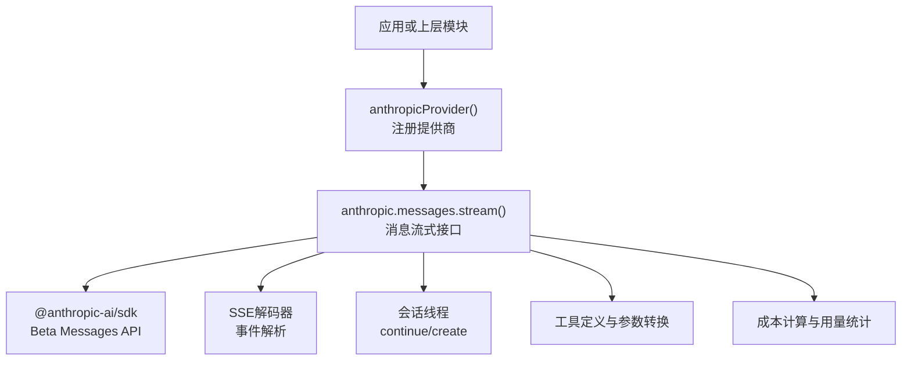

图表来源
- [packages/ai/src/providers/anthropic.ts:74-90](file://packages/ai/src/providers/anthropic.ts#L74-L90)
- [packages/ai/src/api/anthropic-messages.ts:806-1174](file://packages/ai/src/api/anthropic-messages.ts#L806-L1174)

章节来源
- [packages/ai/src/providers/anthropic.ts:1-91](file://packages/ai/src/providers/anthropic.ts#L1-L91)
- [packages/ai/src/providers/anthropic.models.ts:1-15](file://packages/ai/src/providers/anthropic.models.ts#L1-L15)

## 核心组件
- 提供商工厂：创建 Anthropic 提供商实例，绑定基础地址、模型列表、认证方式和 API 实现。
- 消息 API：封装 Anthropic Beta Messages API，负责构建请求、流式事件解析、工具调用、思考模式、会话线程、成本统计。
- OAuth：支持浏览器登录和复制码登录两种流程，完成授权码交换与令牌刷新。
- 环境变量：提供 Anthropic 各类密钥和环境变量的发现与读取。

章节来源
- [packages/ai/src/providers/anthropic.ts:19-90](file://packages/ai/src/providers/anthropic.ts#L19-L90)
- [packages/ai/src/api/anthropic-messages.ts:74-120](file://packages/ai/src/api/anthropic-messages.ts#L74-L120)
- [packages/ai/src/auth/oauth/anthropic.ts:140-307](file://packages/ai/src/auth/oauth/anthropic.ts#L140-L307)
- [packages/ai/src/env-api-keys.ts:29-36](file://packages/ai/src/env-api-keys.ts#L29-L36)

## 架构总览
Anthropic 提供商通过 `createProvider` 暴露统一的 Provider 接口，内部使用 `anthropicMessagesApi()` 提供的 `stream` 与 `streamSimple` 方法驱动 Beta Messages API。认证阶段优先从存储凭证、环境变量或 OAuth 获取凭据；当未显式提供密钥时，可启用工作负载身份联合，由 SDK 自行交换短期访问令牌。

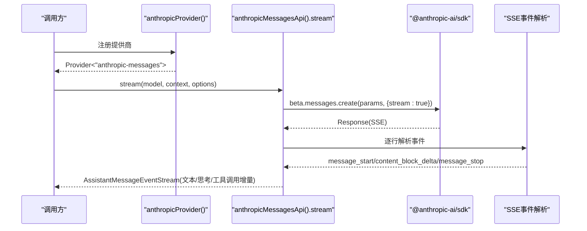

图表来源
- [packages/ai/src/providers/anthropic.ts:74-90](file://packages/ai/src/providers/anthropic.ts#L74-L90)
- [packages/ai/src/api/anthropic-messages.ts:806-1174](file://packages/ai/src/api/anthropic-messages.ts#L806-L1174)

## 详细组件分析

### 提供商注册与模型清单
- 提供商 ID 为 `anthropic`，基础地址为 `https://api.anthropic.com`。
- 认证包含 API Key 与 OAuth（Claude Pro/Max）。
- 模型清单由自动生成的 JSON 数据扁平化而来，导出聊天、图像、分类三类模型目录。

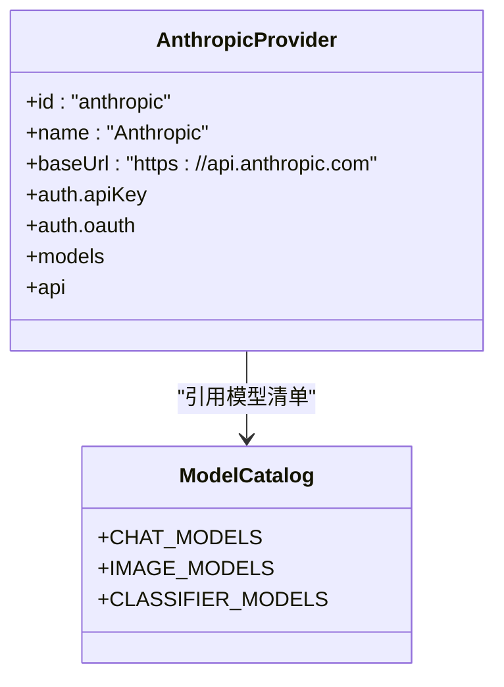

图表来源
- [packages/ai/src/providers/anthropic.ts:74-90](file://packages/ai/src/providers/anthropic.ts#L74-L90)
- [packages/ai/src/providers/anthropic.models.ts:7-14](file://packages/ai/src/providers/anthropic.models.ts#L7-L14)

章节来源
- [packages/ai/src/providers/anthropic.ts:74-90](file://packages/ai/src/providers/anthropic.ts#L74-L90)
- [packages/ai/src/providers/anthropic.models.ts:1-15](file://packages/ai/src/providers/anthropic.models.ts#L1-L15)

### 认证流程
支持的认证方式与优先级：
1. 存储的 API Key 凭证
2. `ANTHROPIC_AUTH_TOKEN`（作为 Authorization: Bearer）
3. `ANTHROPIC_OAUTH_TOKEN` 或 `ANTHROPIC_API_KEY`
4. 工作负载身份联合（OIDC Federation），由 SDK 交换并刷新短期令牌
5. OAuth（Claude Pro/Max）：浏览器登录或复制码登录，完成后转换为 API Key 使用

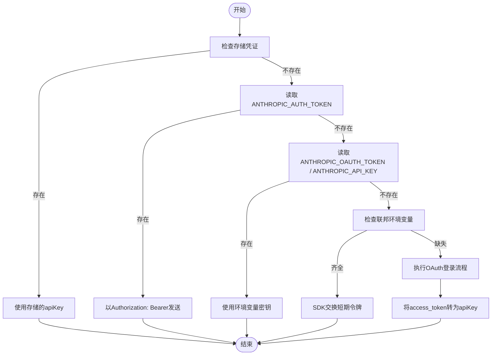

图表来源
- [packages/ai/src/providers/anthropic.ts:19-72](file://packages/ai/src/providers/anthropic.ts#L19-L72)
- [packages/ai/src/auth/oauth/anthropic.ts:140-307](file://packages/ai/src/auth/oauth/anthropic.ts#L140-L307)
- [packages/ai/src/env-api-keys.ts:29-36](file://packages/ai/src/env-api-keys.ts#L29-L36)

章节来源
- [packages/ai/src/providers/anthropic.ts:19-72](file://packages/ai/src/providers/anthropic.ts#L19-L72)
- [packages/ai/src/auth/oauth/anthropic.ts:140-307](file://packages/ai/src/auth/oauth/anthropic.ts#L140-L307)
- [packages/ai/src/env-api-keys.ts:73-82](file://packages/ai/src/env-api-keys.ts#L73-L82)

### 消息格式与流式响应
- 统一通过 `stream` 与 `streamSimple` 暴露流式接口，返回 `AssistantMessageEventStream`。
- 事件类型包括：
  - `message_start`：初始化输出对象、记录用量、识别回退模型
  - `content_block_start/delta/stop`：文本、思考、工具调用的增量
  - `message_delta`：更新用量、停止原因、错误信息
- 对工具调用参数进行流式拼接，保证 JSON 完整性。
- 支持“思考”内容块，包括明文、签名与“已屏蔽思考”的还原。

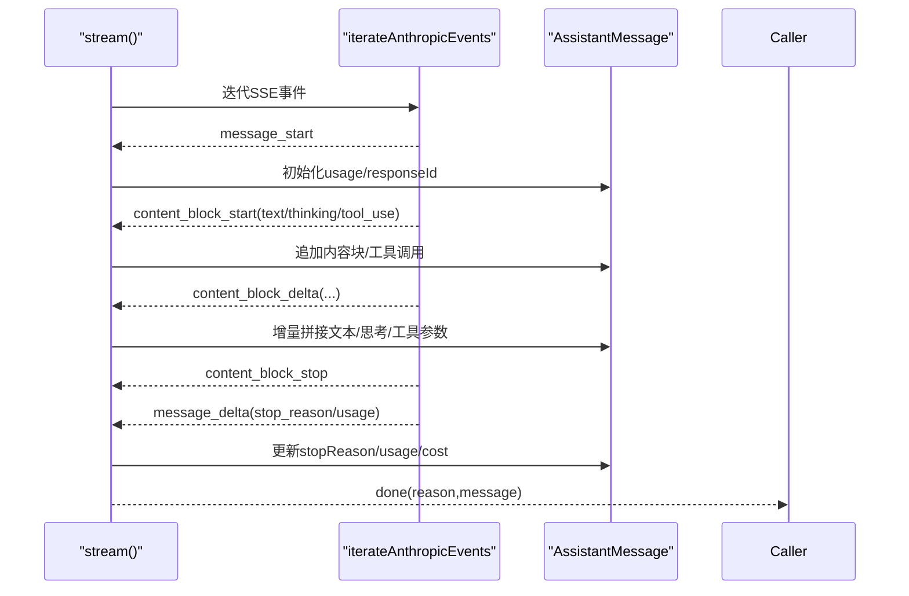

图表来源
- [packages/ai/src/api/anthropic-messages.ts:806-1174](file://packages/ai/src/api/anthropic-messages.ts#L806-L1174)

章节来源
- [packages/ai/src/api/anthropic-messages.ts:806-1174](file://packages/ai/src/api/anthropic-messages.ts#L806-L1174)

### 工具调用与严格模式
- 工具定义会转换为 Anthropic Beta Tool 格式，支持延迟加载占位符以保持缓存命中。
- 支持“严格工具”采样，遇到服务端拒绝时自动降级为非严格模式。
- OAuth 模式下会映射 Claude Code 的工具名称大小写，保持兼容。

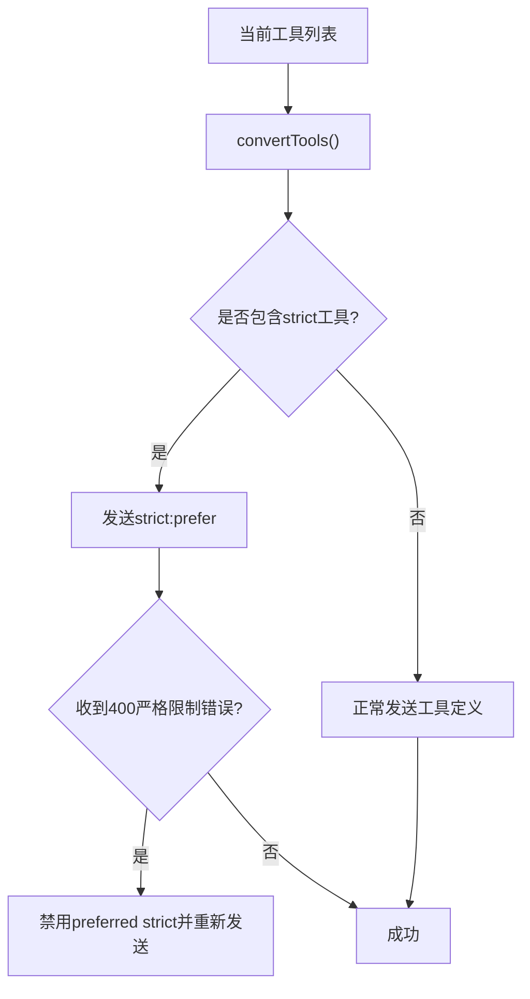

图表来源
- [packages/ai/src/api/anthropic-messages.ts:1437-1455](file://packages/ai/src/api/anthropic-messages.ts#L1437-L1455)
- [packages/ai/src/api/anthropic-messages.ts:916-936](file://packages/ai/src/api/anthropic-messages.ts#L916-L936)

章节来源
- [packages/ai/src/api/anthropic-messages.ts:1437-1455](file://packages/ai/src/api/anthropic-messages.ts#L1437-L1455)
- [packages/ai/src/api/anthropic-messages.ts:916-936](file://packages/ai/src/api/anthropic-messages.ts#L916-L936)

### 思考模式与自适应推理
- 支持两类思考模式：
  - 预算型思考：旧版模型使用 `thinking.type=enabled` 与 `budget_tokens`
  - 自适应思考：新版模型使用 `thinking.type=adaptive`，并可设置 `output_config.effort`
- 可通过 `thinkingEnabled`、`effort`、`thinkingDisplay`、`interleavedThinking` 控制行为。
- `streamSimple` 会根据模型能力自动选择自适应或预算型思考，并调整 `maxTokens` 与思考预算。

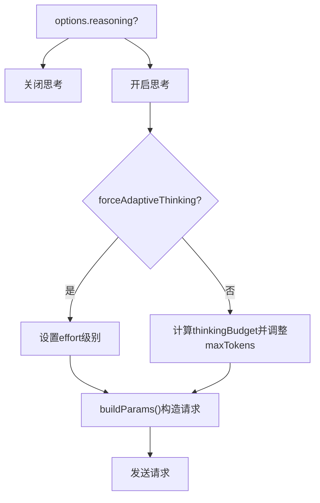

图表来源
- [packages/ai/src/api/anthropic-messages.ts:1201-1249](file://packages/ai/src/api/anthropic-messages.ts#L1201-L1249)
- [packages/ai/src/api/anthropic-messages.ts:1536-1570](file://packages/ai/src/api/anthropic-messages.ts#L1536-L1570)

章节来源
- [packages/ai/src/api/anthropic-messages.ts:1201-1249](file://packages/ai/src/api/anthropic-messages.ts#L1201-L1249)
- [packages/ai/src/api/anthropic-messages.ts:1536-1570](file://packages/ai/src/api/anthropic-messages.ts#L1536-L1570)

### 会话线程与继续回复
- 当启用消息线程时，后续请求可仅发送新增消息并通过 `thread.continue` 继续上一次回复。
- 若服务端拒绝 continue（如过期、指纹不匹配），会自动回退为新建线程或不带 thread 的正常请求。
- 会话状态按 sessionId 维护，并在会话结束时清理。

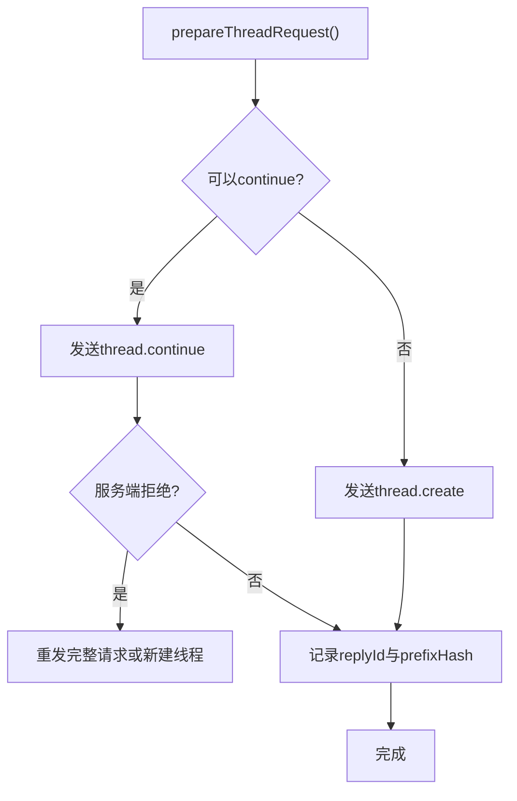

图表来源
- [packages/ai/src/api/anthropic-messages.ts:359-437](file://packages/ai/src/api/anthropic-messages.ts#L359-L437)
- [packages/ai/src/api/anthropic-messages.ts:443-468](file://packages/ai/src/api/anthropic-messages.ts#L443-L468)

章节来源
- [packages/ai/src/api/anthropic-messages.ts:359-437](file://packages/ai/src/api/anthropic-messages.ts#L359-L437)
- [packages/ai/src/api/anthropic-messages.ts:443-468](file://packages/ai/src/api/anthropic-messages.ts#L443-L468)

### 工作负载身份联合（OIDC Federation）
- 当未提供 API Key 或 Authorization Header 时，若满足联邦环境变量条件，则构造 SDK 的 federation config。
- SDK 负责从 identity token 文件交换短期访问令牌并刷新，pi 层只传递配置。

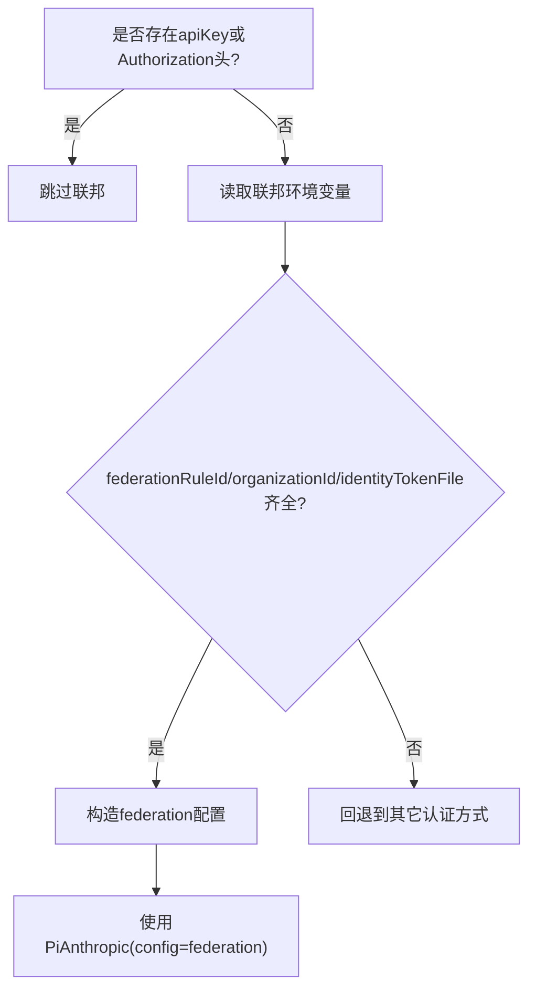

图表来源
- [packages/ai/src/api/anthropic-messages.ts:584-605](file://packages/ai/src/api/anthropic-messages.ts#L584-L605)
- [packages/ai/src/providers/anthropic.ts:49-70](file://packages/ai/src/providers/anthropic.ts#L49-L70)

章节来源
- [packages/ai/src/api/anthropic-messages.ts:584-605](file://packages/ai/src/api/anthropic-messages.ts#L584-L605)
- [packages/ai/src/providers/anthropic.ts:49-70](file://packages/ai/src/providers/anthropic.ts#L49-L70)

### OAuth（Claude Pro/Max）
- 支持两种登录方式：
  - 浏览器登录：启动本地回调服务器接收授权码
  - 复制码登录：用户手动粘贴授权码
- 使用 PKCE 安全流程，交换 access_token 与 refresh_token，并将 access_token 转换为 apiKey 用于后续请求。

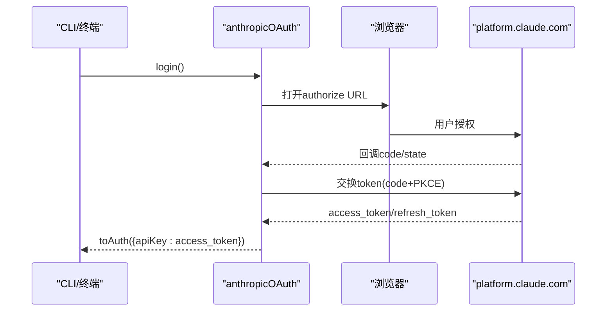

图表来源
- [packages/ai/src/auth/oauth/anthropic.ts:140-235](file://packages/ai/src/auth/oauth/anthropic.ts#L140-L235)
- [packages/ai/src/auth/oauth/anthropic.ts:278-307](file://packages/ai/src/auth/oauth/anthropic.ts#L278-L307)

章节来源
- [packages/ai/src/auth/oauth/anthropic.ts:140-235](file://packages/ai/src/auth/oauth/anthropic.ts#L140-L235)
- [packages/ai/src/auth/oauth/anthropic.ts:278-307](file://packages/ai/src/auth/oauth/anthropic.ts#L278-L307)

## 依赖关系分析
- 提供商层依赖：
  - `anthropicMessagesApi()`：懒加载的消息 API 实现
  - `lazyOAuth(loadAnthropicOAuth)`：惰性加载 OAuth 实现
  - `env-api-keys.ts`：环境变量常量与发现逻辑
- 消息 API 层依赖：
  - `@anthropic-ai/sdk`：官方 SDK，调用 Beta Messages API
  - 内部工具：SSE 解码、工具转换、成本计算、会话资源清理、诊断写入等

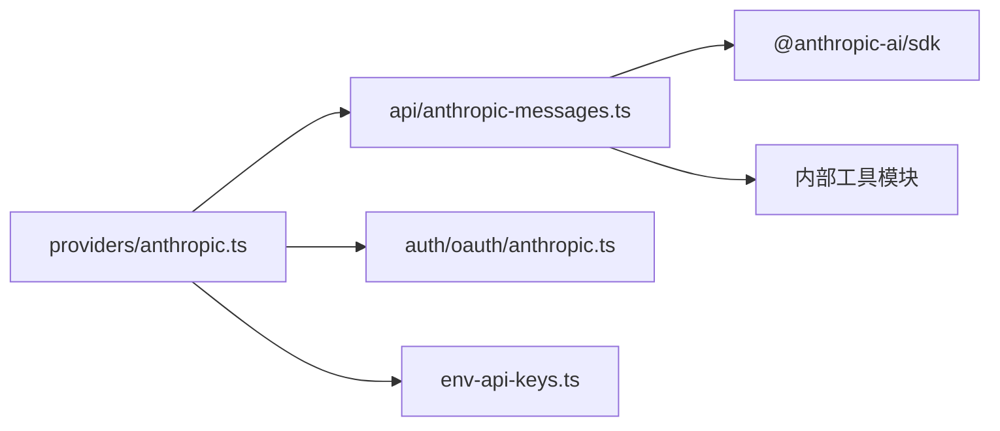

图表来源
- [packages/ai/src/providers/anthropic.ts:1-17](file://packages/ai/src/providers/anthropic.ts#L1-L17)
- [packages/ai/src/api/anthropic-messages.ts:1-55](file://packages/ai/src/api/anthropic-messages.ts#L1-L55)

章节来源
- [packages/ai/src/providers/anthropic.ts:1-17](file://packages/ai/src/providers/anthropic.ts#L1-L17)
- [packages/ai/src/api/anthropic-messages.ts:1-55](file://packages/ai/src/api/anthropic-messages.ts#L1-L55)

## 性能与成本优化
- 缓存控制：
  - 支持短/长缓存保留策略，默认短保留；可通过 `PI_CACHE_RETENTION` 切换为长保留。
  - 系统提示与工具定义可附加 cache_control，提升前缀命中。
- 会话线程：
  - 启用消息线程可减少重复消息传输，提高吞吐并降低延迟。
- 思考模式：
  - 自适应思考可根据任务复杂度动态分配推理资源；预算型思考可限制最大推理开销。
- 成本统计：
  - 基于 `message_start` 与 `message_delta` 的 usage 字段累计输入、输出、缓存读写与推理 token，并调用 `calculateCost` 计算费用。
  - OpenRouter 代理可在 delta 中注入计费字段，框架会合并上报。

章节来源
- [packages/ai/src/api/anthropic-messages.ts:74-102](file://packages/ai/src/api/anthropic-messages.ts#L74-L102)
- [packages/ai/src/api/anthropic-messages.ts:950-1135](file://packages/ai/src/api/anthropic-messages.ts#L950-L1135)

## 故障排查指南
常见错误与处理：
- 缺少 API Key：
  - 在未启用联邦且未提供 apiKey 或 Authorization 头时会抛出错误。
- 流中断或缺少停止原因：
  - 如果流结束但未收到 `message_stop` 或 stop reason，会抛出异常。
- 严格工具限制：
  - 当服务端拒绝 strict 工具时，自动降级为非严格模式并重试。
- 会话线程失败：
  - 针对特定错误码（如 thread_not_found、thread_already_continued）会重建线程；若端点不支持线程，则关闭线程功能并回退普通请求。
- 中止请求：
  - 当信号被中止时，流会标记为 aborted 并抛出相应错误。

章节来源
- [packages/ai/src/api/anthropic-messages.ts:560-562](file://packages/ai/src/api/anthropic-messages.ts#L560-L562)
- [packages/ai/src/api/anthropic-messages.ts:800-804](file://packages/ai/src/api/anthropic-messages.ts#L800-L804)
- [packages/ai/src/api/anthropic-messages.ts:916-936](file://packages/ai/src/api/anthropic-messages.ts#L916-L936)
- [packages/ai/src/api/anthropic-messages.ts:386-437](file://packages/ai/src/api/anthropic-messages.ts#L386-L437)
- [packages/ai/src/api/anthropic-messages.ts:1138-1147](file://packages/ai/src/api/anthropic-messages.ts#L1138-L1147)

## 结论
该实现为 Anthropic Claude 系列模型提供了完整的集成方案：
- 统一的提供商注册与模型清单管理
- 多源认证（API Key、Bearer、OAuth、联邦）
- 完善的流式事件处理与工具调用支持
- 思考模式（预算型与自适应）与会话线程优化
- 成本统计与缓存控制，便于生产环境优化

在实际使用中，建议：
- 明确选择认证方式，避免混用导致冲突
- 合理配置思考模式与 effort，平衡质量与成本
- 启用会话线程以提升连续对话效率
- 使用缓存控制减少重复提示的开销
- 关注错误日志与诊断信息，快速定位问题

## 附录：配置与环境变量速查
- 环境变量
  - `ANTHROPIC_API_KEY`：API Key
  - `ANTHROPIC_OAUTH_TOKEN`：OAuth 临时令牌
  - `ANTHROPIC_AUTH_TOKEN`：Bearer Token
  - `ANTHROPIC_FEDERATION_RULE_ID`、`ANTHROPIC_ORGANIZATION_ID`、`ANTHROPIC_IDENTITY_TOKEN_FILE`、`ANTHROPIC_SERVICE_ACCOUNT_ID`、`ANTHROPIC_WORKSPACE_ID`：联邦配置
- 常用选项
  - `thinkingEnabled`：启用思考
  - `effort`：自适应思考努力等级
  - `thinkingDisplay`：思考内容展示方式
  - `toolChoice`：工具选择策略
  - `cacheRetention`：缓存保留策略
  - `sessionId`：会话标识，用于线程与亲和性头

章节来源
- [packages/ai/src/env-api-keys.ts:29-36](file://packages/ai/src/env-api-keys.ts#L29-L36)
- [packages/ai/src/api/anthropic-messages.ts:470-530](file://packages/ai/src/api/anthropic-messages.ts#L470-L530)