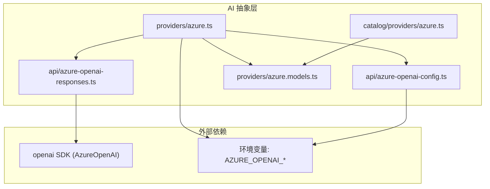
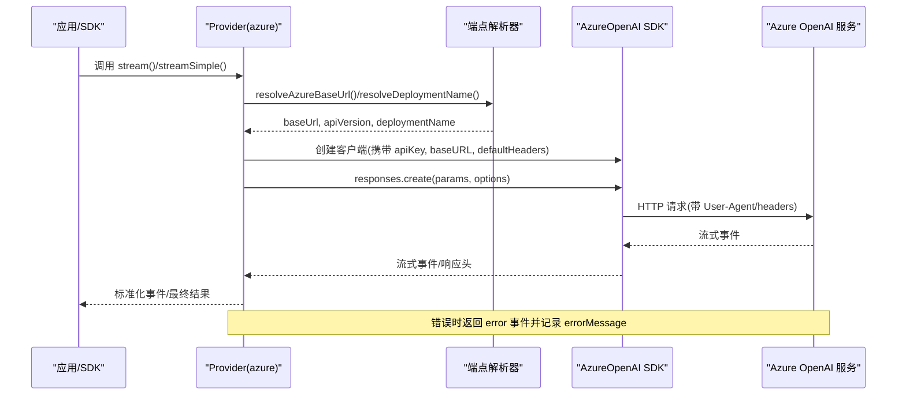
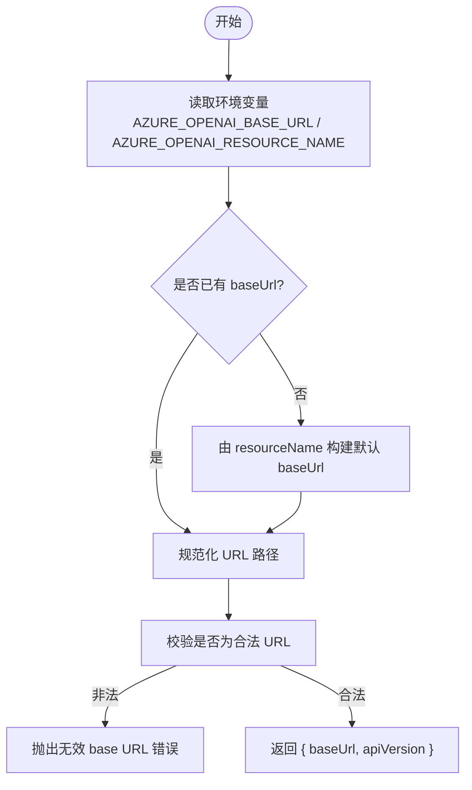
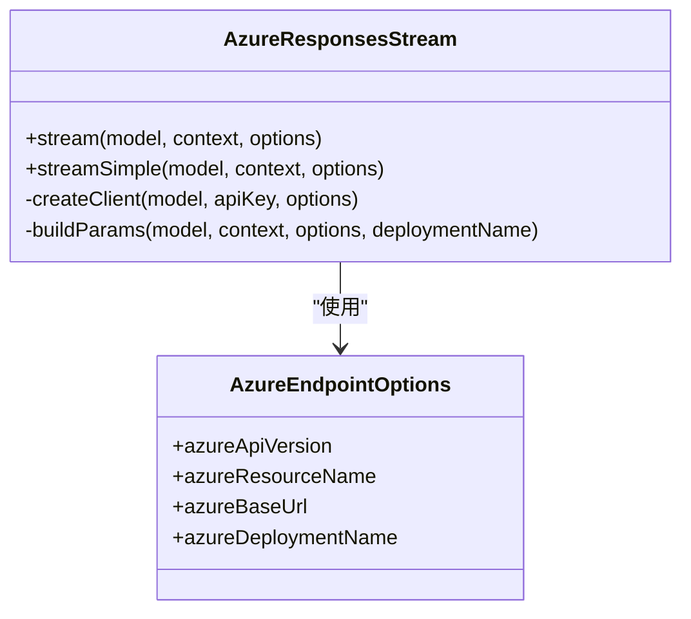
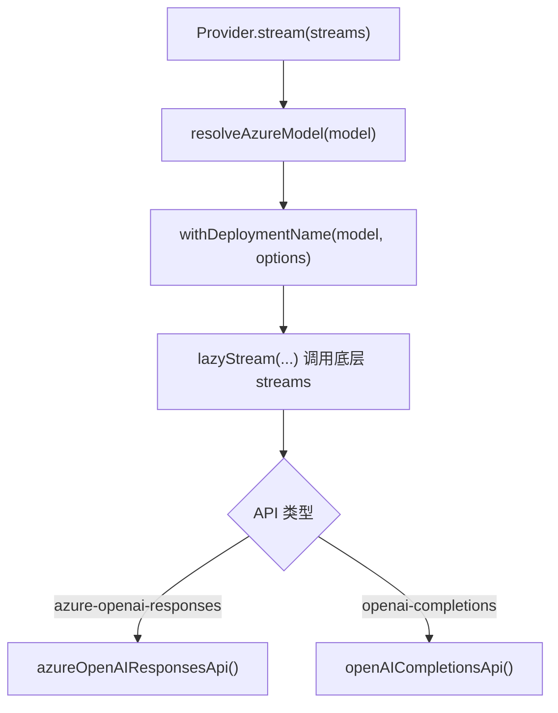
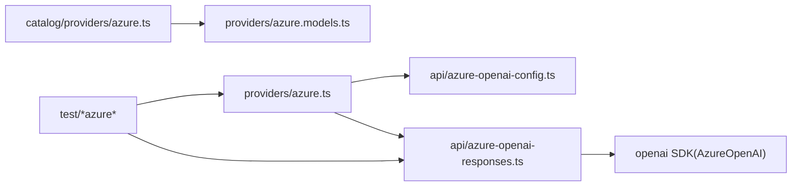

# Azure OpenAI提供商

<cite>
**本文引用的文件**   
- [README.md](file://README.md)
- [azure-openai-config.ts](file://packages/ai/src/api/azure-openai-config.ts)
- [azure-openai-responses.ts](file://packages/ai/src/api/azure-openai-responses.ts)
- [azure.ts](file://packages/ai/src/providers/azure.ts)
- [azure.models.ts](file://packages/ai/src/providers/azure.models.ts)
- [azure.ts（目录定义）](file://packages/ai/catalog/providers/azure.ts)
- [azure-openai-base-url.test.ts](file://packages/ai/test/azure-openai-base-url.test.ts)
- [azure-openai-completions.test.ts](file://packages/ai/test/azure-openai-completions.test.ts)
- [azure-utils.ts](file://packages/ai/test/azure-utils.ts)
</cite>

## 目录
1. [简介](#简介)
2. [项目结构](#项目结构)
3. [核心组件](#核心组件)
4. [架构总览](#架构总览)
5. [详细组件分析](#详细组件分析)
6. [依赖关系分析](#依赖关系分析)
7. [性能与调优](#性能与调优)
8. [故障排查](#故障排查)
9. [合规、数据隐私与企业治理](#合规数据隐私与企业治理)
10. [结论](#结论)

## 简介
本文件面向企业用户，系统化说明如何在当前代码库中配置和使用 Azure OpenAI 提供商。内容覆盖：
- 企业级认证与环境变量
- 资源组与端点管理（baseUrl、resourceName、apiVersion、deploymentName）
- 网络与安全（自定义 headers、代理、User-Agent）
- Azure 特定模型部署、版本管理与监控
- SDK 集成路径、错误处理策略与重试机制
- 性能优化（缓存、流式输出、推理强度控制）
- 合规性、数据隐私与企业治理最佳实践

该仓库通过统一的 AI 抽象层暴露多提供商能力，Azure OpenAI 以“azure”提供商形式接入，支持 Responses API 与 OpenAI Completions 两种调用路径，并内置端点解析、部署名映射、流式事件与错误归一化等能力。

## 项目结构
与 Azure OpenAI 直接相关的代码主要位于 packages/ai 下：
- API 适配层：负责 Azure OpenAI 的端点解析、参数构建、流式处理与错误格式化
- Provider 层：将 Azure 模型注册为统一 Provider，封装鉴权、模型列表与 API 路由
- Catalog 层：声明 Azure 侧模型元数据、兼容性与成本信息
- 测试用例：验证 baseUrl 规范化、鉴权、部署名映射、Completions 行为与 Responses 流事件

图表来源
- [azure.ts:1-56](file://packages/ai/src/providers/azure.ts#L1-L56)
- [azure-openai-config.ts:1-108](file://packages/ai/src/api/azure-openai-config.ts#L1-L108)
- [azure-openai-responses.ts:1-257](file://packages/ai/src/api/azure-openai-responses.ts#L1-L257)
- [azure.models.ts:1-15](file://packages/ai/src/providers/azure.models.ts#L1-L15)
- [azure.ts（目录定义）:1-67](file://packages/ai/catalog/providers/azure.ts#L1-L67)

章节来源
- [README.md:72-84](file://README.md#L72-L84)

## 核心组件
- Azure 端点与版本解析器：提供 baseUrl、apiVersion、deploymentName 的统一解析与校验逻辑
- Azure Responses 流式实现：基于 openai SDK 的 AzureOpenAI 客户端，封装消息转换、工具调用、推理参数、缓存键与流事件
- Azure Provider 包装器：注入鉴权、模型列表，并在分发前完成 baseUrl 与 deploymentName 的解析
- Azure Catalog 提供者：声明 Azure 侧模型清单、上下文窗口覆盖、兼容性与成本

章节来源
- [azure-openai-config.ts:1-108](file://packages/ai/src/api/azure-openai-config.ts#L1-L108)
- [azure-openai-responses.ts:1-257](file://packages/ai/src/api/azure-openai-responses.ts#L1-L257)
- [azure.ts:1-56](file://packages/ai/src/providers/azure.ts#L1-L56)
- [azure.ts（目录定义）:1-67](file://packages/ai/catalog/providers/azure.ts#L1-L67)

## 架构总览
下图展示从应用调用到 Azure OpenAI 的请求流程，包括鉴权、端点解析、请求构造、流式响应与错误处理。

图表来源
- [azure.ts:31-54](file://packages/ai/src/providers/azure.ts#L31-L54)
- [azure-openai-config.ts:68-107](file://packages/ai/src/api/azure-openai-config.ts#L68-L107)
- [azure-openai-responses.ts:40-129](file://packages/ai/src/api/azure-openai-responses.ts#L40-L129)

## 详细组件分析

### Azure 端点与版本解析器
职责：
- 解析并规范化 Azure OpenAI 的 baseUrl，支持多种 Azure 主机后缀
- 根据环境变量或选项确定 azureApiVersion、azureResourceName、azureBaseUrl、azureDeploymentName
- 抛出明确的错误提示当缺少必要配置

关键行为：
- 对 .openai.azure.com/.cognitiveservices.azure.com/.ai.azure.com 自动追加 /openai/v1 路径
- 默认 apiVersion 为 v1，可通过环境变量覆盖
- 若未提供 baseUrl 或 resourceName，抛出明确错误

图表来源
- [azure-openai-config.ts:37-94](file://packages/ai/src/api/azure-openai-config.ts#L37-L94)
- [azure-openai-config.ts:96-107](file://packages/ai/src/api/azure-openai-config.ts#L96-L107)

章节来源
- [azure-openai-config.ts:1-108](file://packages/ai/src/api/azure-openai-config.ts#L1-L108)

### Azure Responses 流式实现
职责：
- 使用 AzureOpenAI SDK 发起流式请求
- 将内部消息/工具转换为 Responses 协议所需格式
- 处理推理强度、工具选择、prompt cache key、store=false 等参数
- 统一错误格式化与事件流

关键点：
- 强制 store=false，避免服务端存储响应
- prompt_cache_key 会被截断至 OpenAI 限制长度
- 支持 onPayload/onResponse 钩子用于调试与审计
- 通过 retryProviderRequest 进行可配置的重试

图表来源
- [azure-openai-responses.ts:30-35](file://packages/ai/src/api/azure-openai-responses.ts#L30-L35)
- [azure-openai-responses.ts:154-171](file://packages/ai/src/api/azure-openai-responses.ts#L154-L171)
- [azure-openai-responses.ts:173-256](file://packages/ai/src/api/azure-openai-responses.ts#L173-L256)

章节来源
- [azure-openai-responses.ts:1-257](file://packages/ai/src/api/azure-openai-responses.ts#L1-L257)

### Azure Provider 包装器
职责：
- 注册鉴权方式（环境变量 AZURE_OPENAI_API_KEY）
- 加载 Azure 模型清单
- 在分发前注入 baseUrl 与 deploymentName
- 将 Responses 与 Completions 两类 API 路由到对应实现

重点：
- 使用 lazyStream 延迟解析，使未配置的端点在流内报错而非立即抛错
- withDeploymentName 将 catalog id 保留在消息 model 字段，同时替换请求中的 model 为部署名

图表来源
- [azure.ts:10-42](file://packages/ai/src/providers/azure.ts#L10-L42)
- [azure.ts:44-55](file://packages/ai/src/providers/azure.ts#L44-L55)

章节来源
- [azure.ts:1-56](file://packages/ai/src/providers/azure.ts#L1-L56)

### Azure Catalog 提供者
职责：
- 将 OpenAI Responses 模型映射为 Azure 侧模型
- 覆盖部分模型的上下文窗口
- 设置 Azure 特定的兼容性标志（如 grammar tools、thinking 行为）
- 为 DeepSeek 模型设置 Azure 定价与兼容行为

要点：
- 对某些 gpt-* 模型设置更大的上下文窗口
- 对 deepseek-v4-pro 单独设置 Azure 价格
- 对 openai-completions 关闭 developer role、启用 mid-convo system messages 等

章节来源
- [azure.ts（目录定义）:1-67](file://packages/ai/catalog/providers/azure.ts#L1-L67)

## 依赖关系分析
- Provider 层依赖 API 层进行端点解析与请求构建
- API 层依赖 openai SDK 的 AzureOpenAI 客户端
- Catalog 层生成模型清单，供 Provider 层消费
- 测试用例验证 baseUrl 规范化、鉴权、部署名映射与 Completions/Responses 行为

图表来源
- [azure.ts（目录定义）:1-67](file://packages/ai/catalog/providers/azure.ts#L1-L67)
- [azure.models.ts:1-15](file://packages/ai/src/providers/azure.models.ts#L1-L15)
- [azure.ts:1-56](file://packages/ai/src/providers/azure.ts#L1-L56)
- [azure-openai-responses.ts:1-257](file://packages/ai/src/api/azure-openai-responses.ts#L1-L257)

章节来源
- [azure.ts:1-56](file://packages/ai/src/providers/azure.ts#L1-L56)
- [azure-openai-responses.ts:1-257](file://packages/ai/src/api/azure-openai-responses.ts#L1-L257)

## 性能与调优
- 流式输出：Responses 流式接口减少首字节延迟，适合长文本与工具调用场景
- Prompt 缓存：
  - 通过 sessionId 生成 prompt_cache_key，并被截断至 OpenAI 限制长度
  - 对于 Azure Foundry 的 DeepSeek 模型，当 PI_CACHE_RETENTION=long 时会省略缓存相关参数以避免 400 错误
- 推理强度控制：
  - 支持 reasoningEffort 与 thinkingLevelMap，按模型能力裁剪
  - 对 DeepSeek 使用 reasoning_effort 替代 thinking 字段
- 最小输出令牌：Responses 要求 max_output_tokens 不低于阈值，否则会被拒绝
- 服务端存储：store=false，避免额外存储开销

章节来源
- [azure-openai-responses.ts:204-256](file://packages/ai/src/api/azure-openai-responses.ts#L204-L256)
- [azure-openai-completions.test.ts:110-177](file://packages/ai/test/azure-openai-completions.test.ts#L110-L177)

## 故障排查
常见问题与定位方法：
- 未配置 Azure OpenAI 端点：
  - 现象：流内返回 error 事件，errorMessage 包含“Azure OpenAI base URL is required”
  - 解决：设置 AZURE_OPENAI_BASE_URL 或 AZURE_OPENAI_RESOURCE_NAME
- 无效的 base URL：
  - 现象：errorMessage 包含“Invalid Azure OpenAI base URL”
  - 解决：检查 AZURE_OPENAI_BASE_URL 是否为合法 URL
- 鉴权失败：
  - 现象：errorMessage 包含“No API key for provider: azure”
  - 解决：设置 AZURE_OPENAI_API_KEY
- 部署名映射不生效：
  - 现象：请求 model 仍为 catalog id
  - 解决：设置 AZURE_OPENAI_DEPLOYMENT_NAME_MAP，格式为 "modelId=deploymentName"
- 非 Azure 代理路径被误改：
  - 现象：自定义代理路径被追加 /openai/v1
  - 解决：确保 host 不是 Azure 域名；或使用完整 /openai/v1 路径

诊断建议：
- 使用 onPayload/onResponse 钩子捕获请求体与响应头
- 检查 User-Agent 是否被正确设置，必要时通过 headers 覆盖
- 针对 DeepSeek 模型，确认未发送 thinking/prompt cache 参数

章节来源
- [azure-openai-base-url.test.ts:167-175](file://packages/ai/test/azure-openai-base-url.test.ts#L167-L175)
- [azure-openai-base-url.test.ts:224-230](file://packages/ai/test/azure-openai-base-url.test.ts#L224-L230)
- [azure-openai-completions.test.ts:216-230](file://packages/ai/test/azure-openai-completions.test.ts#L216-L230)
- [azure-utils.ts:18-22](file://packages/ai/test/azure-utils.ts#L18-L22)

## 合规、数据隐私与企业治理
- 鉴权与密钥管理：
  - 使用 AZURE_OPENAI_API_KEY 作为密钥来源，避免硬编码
  - 建议在容器或沙箱环境中运行，限制文件系统、进程与网络权限
- 数据驻留与区域：
  - 通过 AZURE_OPENAI_BASE_URL 指向指定区域或私有端点，满足数据驻留要求
- 日志与审计：
  - 利用 onPayload/onResponse 记录请求与响应摘要，避免敏感信息泄露
  - 结合企业日志系统收集指标与异常
- 模型与版本治理：
  - 使用 AZURE_OPENAI_API_VERSION 固定 API 版本，降低变更风险
  - 使用 AZURE_OPENAI_DEPLOYMENT_NAME_MAP 将 catalog id 映射到稳定部署名
- 安全头部与代理：
  - 通过 headers 注入企业所需的追踪、审计、限流等头部
  - 如需走企业代理，确保代理路径不被误改（非 Azure 域名不受影响）

章节来源
- [azure-openai-config.ts:72-94](file://packages/ai/src/api/azure-openai-config.ts#L72-L94)
- [azure-openai-responses.ts:154-171](file://packages/ai/src/api/azure-openai-responses.ts#L154-L171)
- [azure-openai-base-url.test.ts:121-165](file://packages/ai/test/azure-openai-base-url.test.ts#L121-L165)

## 结论
该代码库为企业使用 Azure OpenAI 提供了稳健的抽象与实现：
- 通过 Provider 层统一管理鉴权、模型与 API 路由
- 通过 API 层实现端点解析、参数构建、流式处理与错误归一化
- 通过 Catalog 层声明 Azure 侧模型元数据与兼容性
- 通过测试用例保障 baseUrl 规范化、鉴权、部署名映射与不同 API 的行为一致性

在企业环境中，建议：
- 严格管理 AZURE_OPENAI_API_KEY 与 AZURE_OPENAI_BASE_URL/AZURE_OPENAI_RESOURCE_NAME
- 使用 AZURE_OPENAI_API_VERSION 与 AZURE_OPENAI_DEPLOYMENT_NAME_MAP 进行版本与部署治理
- 借助 onPayload/onResponse 进行审计与监控
- 结合容器化与沙箱提升安全性与隔离性