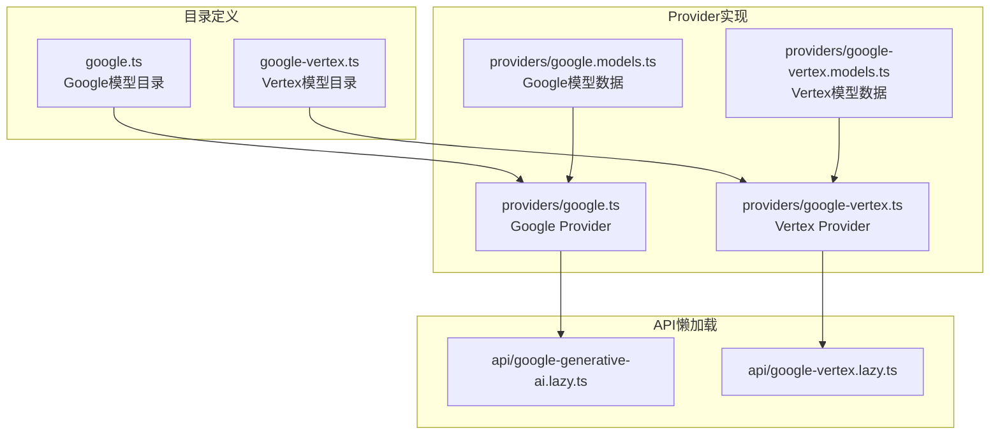
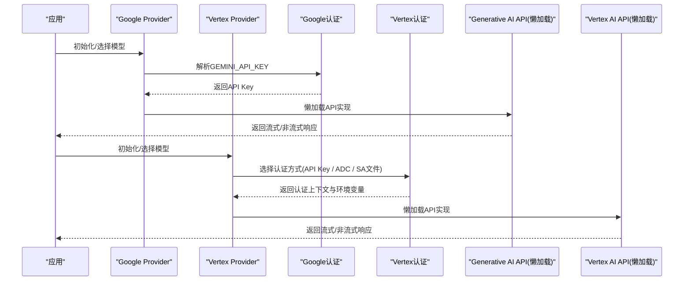
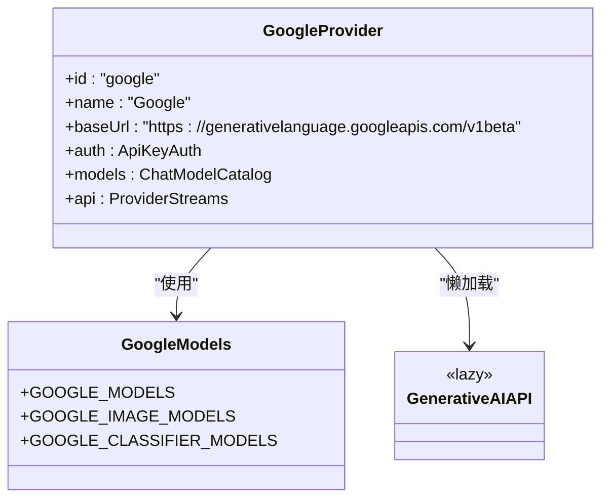
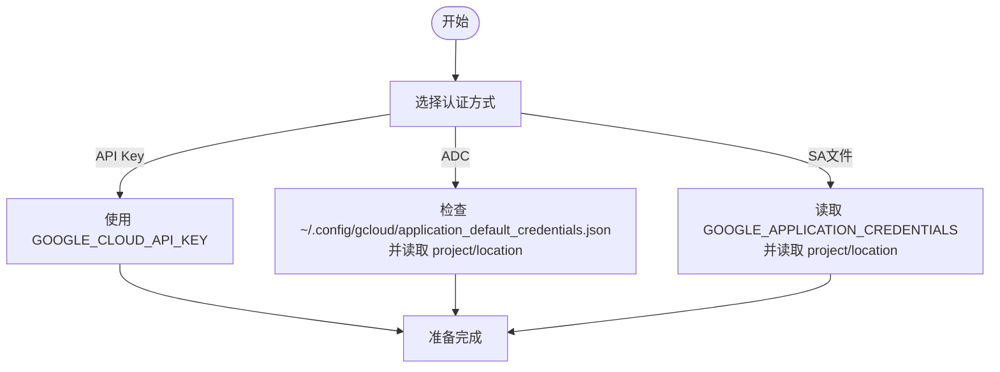
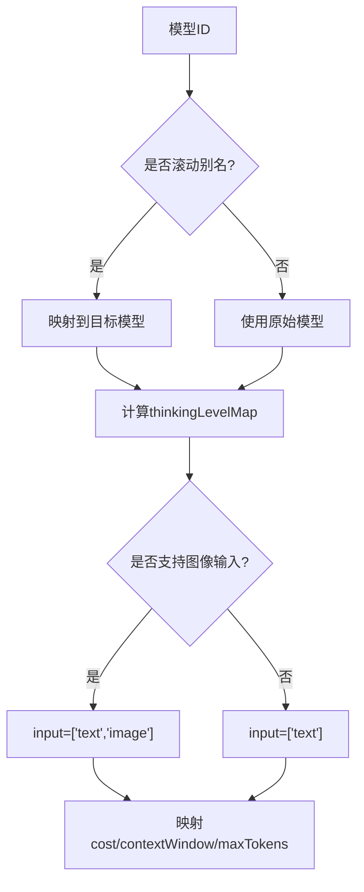
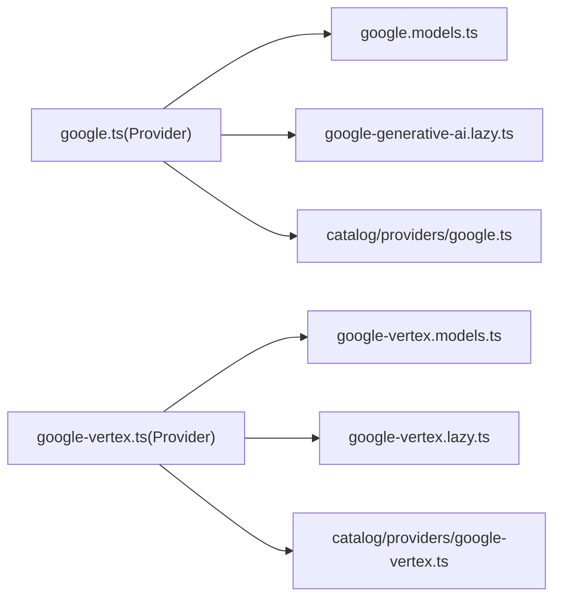

# Google生态提供商

<cite>
**本文引用的文件**
- [README.md](file://README.md)
- [packages/ai/catalog/providers/google.ts](file://packages/ai/catalog/providers/google.ts)
- [packages/ai/catalog/providers/google-vertex.ts](file://packages/ai/catalog/providers/google-vertex.ts)
- [packages/ai/src/providers/google.ts](file://packages/ai/src/providers/google.ts)
- [packages/ai/src/providers/google-vertex.ts](file://packages/ai/src/providers/google-vertex.ts)
- [packages/ai/src/providers/google.models.ts](file://packages/ai/src/providers/google.models.ts)
- [packages/ai/src/providers/google-vertex.models.ts](file://packages/ai/src/providers/google-vertex.models.ts)
- [packages/ai/src/api/google-generative-ai.lazy.ts](file://packages/ai/src/api/google-generative-ai.lazy.ts)
- [packages/ai/src/api/google-vertex.lazy.ts](file://packages/ai/src/api/google-vertex.lazy.ts)
</cite>

## 目录
1. [简介](#简介)
2. [项目结构](#项目结构)
3. [核心组件](#核心组件)
4. [架构总览](#架构总览)
5. [详细组件分析](#详细组件分析)
6. [依赖关系分析](#依赖关系分析)
7. [性能与优化建议](#性能与优化建议)
8. [故障排查指南](#故障排查指南)
9. [结论](#结论)
10. [附录](#附录)

## 简介
本文件面向在项目中集成Google生态（Gemini API与Vertex AI）的开发者，系统性说明：
- Gemini模型在Google AI Studio与Vertex AI上的配置、认证与API使用方式
- Vertex AI的企业级能力、部署选项与集成路径
- SDK调用流程、模型参数调优与性能优化建议
- 多模态输入、函数调用等高级特性的接入思路

本项目通过统一的Provider抽象封装Google的两个入口：
- Google Generative AI（Gemini API）
- Google Vertex AI（企业级平台）

两者共享模型目录、思考级别映射与部分工具链，但认证、端点与定价策略存在差异。

## 项目结构
围绕Google生态的关键代码位于 packages/ai 下，分为“目录定义”和“运行时Provider实现”两层：
- 目录定义层：catalog/providers 提供Google与Vertex的模型清单、别名、基础URL与成本映射
- Provider实现层：src/providers 提供认证、模型注册与API懒加载
- API懒加载层：src/api/*.lazy.ts 用于按需引入具体API实现，降低冷启动开销

图示来源
- [packages/ai/catalog/providers/google.ts:1-37](file://packages/ai/catalog/providers/google.ts#L1-L37)
- [packages/ai/catalog/providers/google-vertex.ts:1-44](file://packages/ai/catalog/providers/google-vertex.ts#L1-L44)
- [packages/ai/src/providers/google.ts:1-16](file://packages/ai/src/providers/google.ts#L1-L16)
- [packages/ai/src/providers/google-vertex.ts:1-101](file://packages/ai/src/providers/google-vertex.ts#L1-L101)
- [packages/ai/src/providers/google.models.ts:1-15](file://packages/ai/src/providers/google.models.ts#L1-L15)
- [packages/ai/src/providers/google-vertex.models.ts:1-15](file://packages/ai/src/providers/google-vertex.models.ts#L1-L15)
- [packages/ai/src/api/google-generative-ai.lazy.ts:1-5](file://packages/ai/src/api/google-generative-ai.lazy.ts#L1-L5)
- [packages/ai/src/api/google-vertex.lazy.ts:1-5](file://packages/ai/src/api/google-vertex.lazy.ts#L1-L5)

章节来源
- [README.md:72-84](file://README.md#L72-L84)

## 核心组件
- Google Provider（Generative AI）
  - 标识：google
  - 基础URL：https://generativelanguage.googleapis.com/v1beta
  - 认证：环境变量 GEMINI_API_KEY
  - 模型来源：GOOGLE_MODELS（由目录生成）
  - API：googleGenerativeAIApi（懒加载）

- Vertex Provider（Vertex AI）
  - 标识：google-vertex
  - 基础URL：https://{location}-aiplatform.googleapis.com
  - 认证：支持API Key、Application Default Credentials（ADC）、服务账号文件
  - 模型来源：GOOGLE_VERTEX_MODELS（由目录生成）
  - API：googleVertexApi（懒加载）

- 模型目录与家族特性
  - 滚动别名：gemini-flash-latest → gemini-3.5-flash；gemini-flash-lite-latest → gemini-3.1-flash-lite
  - 思考级别映射：基于模型ID与推理选项动态生成 thinkingLevelMap
  - 输入类型：根据 source.imageInput 决定 ["text"] 或 ["text","image"]
  - 成本与上下文窗口：从目录源映射，Vertex对缓存读取价格做了修正

章节来源
- [packages/ai/src/providers/google.ts:1-16](file://packages/ai/src/providers/google.ts#L1-L16)
- [packages/ai/src/providers/google-vertex.ts:1-101](file://packages/ai/src/providers/google-vertex.ts#L1-L101)
- [packages/ai/catalog/providers/google.ts:1-37](file://packages/ai/catalog/providers/google.ts#L1-L37)
- [packages/ai/catalog/providers/google-vertex.ts:1-44](file://packages/ai/catalog/providers/google-vertex.ts#L1-L44)
- [packages/ai/src/providers/google.models.ts:1-15](file://packages/ai/src/providers/google.models.ts#L1-L15)
- [packages/ai/src/providers/google-vertex.models.ts:1-15](file://packages/ai/src/providers/google-vertex.models.ts#L1-L15)

## 架构总览
下图展示从应用到Google生态的调用链路，包括认证解析、模型选择与API流式调用。

图示来源
- [packages/ai/src/providers/google.ts:1-16](file://packages/ai/src/providers/google.ts#L1-L16)
- [packages/ai/src/providers/google-vertex.ts:1-101](file://packages/ai/src/providers/google-vertex.ts#L1-L101)
- [packages/ai/src/api/google-generative-ai.lazy.ts:1-5](file://packages/ai/src/api/google-generative-ai.lazy.ts#L1-L5)
- [packages/ai/src/api/google-vertex.lazy.ts:1-5](file://packages/ai/src/api/google-vertex.lazy.ts#L1-L5)

## 详细组件分析

### Google Generative AI（Gemini API）
- Provider构造
  - id/name/baseUrl/auth/models/api 完整声明
  - auth通过 envApiKeyAuth 读取 GEMINI_API_KEY
  - models来自 GOOGLE_MODELS（自动生成）
  - api为 googleGenerativeAIApi（懒加载）

- 模型目录
  - baseUrl: https://generativelanguage.googleapis.com/v1beta
  - 滚动别名映射至最新稳定版本
  - 输入能力：文本/图像（取决于source.imageInput）
  - 成本与上下文窗口：从目录源映射

图示来源
- [packages/ai/src/providers/google.ts:1-16](file://packages/ai/src/providers/google.ts#L1-L16)
- [packages/ai/src/providers/google.models.ts:1-15](file://packages/ai/src/providers/google.models.ts#L1-L15)
- [packages/ai/src/api/google-generative-ai.lazy.ts:1-5](file://packages/ai/src/api/google-generative-ai.lazy.ts#L1-L5)

章节来源
- [packages/ai/src/providers/google.ts:1-16](file://packages/ai/src/providers/google.ts#L1-L16)
- [packages/ai/src/providers/google.models.ts:1-15](file://packages/ai/src/providers/google.models.ts#L1-L15)
- [packages/ai/catalog/providers/google.ts:1-37](file://packages/ai/catalog/providers/google.ts#L1-L37)

### Google Vertex AI
- Provider构造
  - id/name/auth/models/api 完整声明
  - auth支持三种方式：
    - API Key：直接传入密钥
    - ADC：gcloud application-default login，并设置 project/location
    - 服务账号文件：指定 credentials 文件路径
  - resolve逻辑会优先检查存储的credential/env，再回退到默认路径与env

- 模型目录
  - baseUrl: https://{location}-aiplatform.googleapis.com
  - include过滤：仅包含以 gemini- 开头的模型，排除特定预览版
  - 成本修正：针对 Gemini 2.5 Flash 的缓存读取价格进行对齐
  - 输入能力：同Google，依据source.imageInput决定

图示来源
- [packages/ai/src/providers/google-vertex.ts:1-101](file://packages/ai/src/providers/google-vertex.ts#L1-L101)

章节来源
- [packages/ai/src/providers/google-vertex.ts:1-101](file://packages/ai/src/providers/google-vertex.ts#L1-L101)
- [packages/ai/catalog/providers/google-vertex.ts:1-44](file://packages/ai/catalog/providers/google-vertex.ts#L1-L44)
- [packages/ai/src/providers/google-vertex.models.ts:1-15](file://packages/ai/src/providers/google-vertex.models.ts#L1-L15)

### 模型目录与家族特性
- 滚动别名
  - gemini-flash-latest → gemini-3.5-flash
  - gemini-flash-lite-latest → gemini-3.1-flash-lite
- 思考级别映射
  - 基于模型ID与推理选项生成 thinkingLevelMap
- 输入能力
  - 若 source.imageInput 存在，则 input=["text","image"]，否则 input=["text"]
- 成本与上下文窗口
  - 从目录源映射，Vertex对缓存读取价格做修正

图示来源
- [packages/ai/catalog/providers/google.ts:1-37](file://packages/ai/catalog/providers/google.ts#L1-L37)
- [packages/ai/catalog/providers/google-vertex.ts:1-44](file://packages/ai/catalog/providers/google-vertex.ts#L1-L44)

章节来源
- [packages/ai/catalog/providers/google.ts:1-37](file://packages/ai/catalog/providers/google.ts#L1-L37)
- [packages/ai/catalog/providers/google-vertex.ts:1-44](file://packages/ai/catalog/providers/google-vertex.ts#L1-L44)

## 依赖关系分析
- Provider与模型目录
  - google.ts 依赖 GOOGLE_MODELS
  - google-vertex.ts 依赖 GOOGLE_VERTEX_MODELS
- Provider与API
  - google.ts 通过 googleGenerativeAIApi 懒加载
  - google-vertex.ts 通过 googleVertexApi 懒加载
- 目录层与家族特性
  - google.ts 与 google-vertex.ts 均复用 googleThinkingLevels 与滚动别名映射

图示来源
- [packages/ai/src/providers/google.ts:1-16](file://packages/ai/src/providers/google.ts#L1-L16)
- [packages/ai/src/providers/google-vertex.ts:1-101](file://packages/ai/src/providers/google-vertex.ts#L1-L101)
- [packages/ai/src/providers/google.models.ts:1-15](file://packages/ai/src/providers/google.models.ts#L1-L15)
- [packages/ai/src/providers/google-vertex.models.ts:1-15](file://packages/ai/src/providers/google-vertex.models.ts#L1-L15)
- [packages/ai/src/api/google-generative-ai.lazy.ts:1-5](file://packages/ai/src/api/google-generative-ai.lazy.ts#L1-L5)
- [packages/ai/src/api/google-vertex.lazy.ts:1-5](file://packages/ai/src/api/google-vertex.lazy.ts#L1-L5)
- [packages/ai/catalog/providers/google.ts:1-37](file://packages/ai/catalog/providers/google.ts#L1-L37)
- [packages/ai/catalog/providers/google-vertex.ts:1-44](file://packages/ai/catalog/providers/google-vertex.ts#L1-L44)

## 性能与优化建议
- 模型选择与别名
  - 使用滚动别名（如 gemini-flash-latest）可自动获得最新稳定版本，减少维护成本
- 输入限制与多模态
  - 当 source.imageInput 存在时启用图像输入；注意请求大小与图片数量限制
- 成本优化
  - Vertex对缓存读取价格进行了修正，建议在计费统计中采用目录映射后的 cost 字段
- 思考模式与推理
  - 通过 thinkingLevelMap 控制不同模型的思考深度，避免不必要的长推理带来的延迟与成本
- 懒加载API
  - 使用 lazyApi 按需加载具体API实现，降低冷启动时间与内存占用

[本节为通用指导，不直接分析具体文件]

## 故障排查指南
- 认证失败
  - Google Generative AI：确认已设置 GEMINI_API_KEY
  - Vertex AI：
    - API Key：确认 GOOGLE_CLOUD_API_KEY 有效
    - ADC：执行 gcloud auth application-default login，并确保 project/location 已设置
    - 服务账号文件：确保 GOOGLE_APPLICATION_CREDENTIALS 指向有效的JSON文件
- 模型不可用
  - 检查模型ID是否在目录中，且未被 include 过滤规则排除
  - 滚动别名是否指向了预期目标模型
- 多模态异常
  - 确认模型具备图像输入能力（input包含image）
  - 检查请求体大小与图片数量是否符合限制
- 成本统计偏差
  - 使用目录层提供的 cost 映射，尤其是Vertex的缓存读取价格修正

章节来源
- [packages/ai/src/providers/google.ts:1-16](file://packages/ai/src/providers/google.ts#L1-L16)
- [packages/ai/src/providers/google-vertex.ts:1-101](file://packages/ai/src/providers/google-vertex.ts#L1-L101)
- [packages/ai/catalog/providers/google.ts:1-37](file://packages/ai/catalog/providers/google.ts#L1-L37)
- [packages/ai/catalog/providers/google-vertex.ts:1-44](file://packages/ai/catalog/providers/google-vertex.ts#L1-L44)

## 结论
本项目通过Provider抽象统一接入Google两大生态：
- Google Generative AI适合快速原型与轻量集成
- Vertex AI适合企业级部署、权限治理与成本可控的生产环境

借助目录层的模型管理、思考级别映射与成本修正，结合懒加载API，可在保证开发体验的同时提升运行效率与可维护性。

[本节为总结性内容，不直接分析具体文件]

## 附录
- 常用环境变量
  - GEMINI_API_KEY：Google Generative AI密钥
  - GOOGLE_CLOUD_API_KEY：Vertex AI密钥
  - GOOGLE_CLOUD_PROJECT：Vertex项目ID
  - GOOGLE_CLOUD_LOCATION：Vertex区域
  - GOOGLE_APPLICATION_CREDENTIALS：服务账号JSON路径
- 关键端点
  - Google：https://generativelanguage.googleapis.com/v1beta
  - Vertex：https://{location}-aiplatform.googleapis.com

[本节为补充信息，不直接分析具体文件]