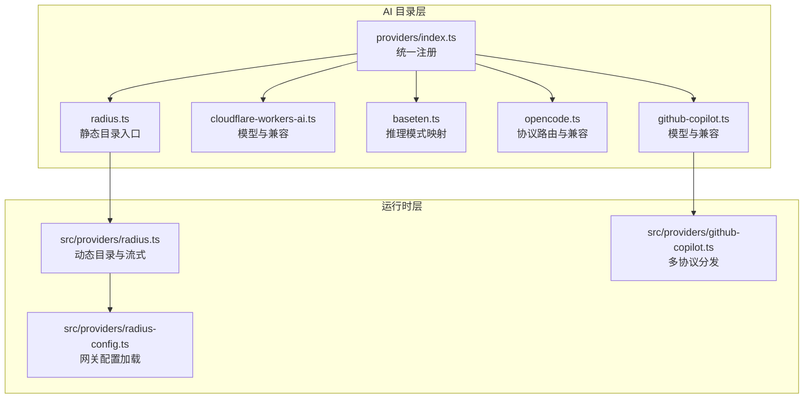
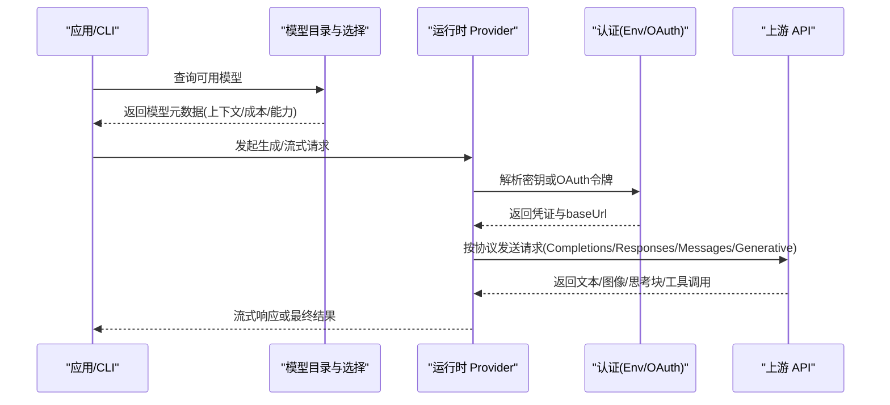
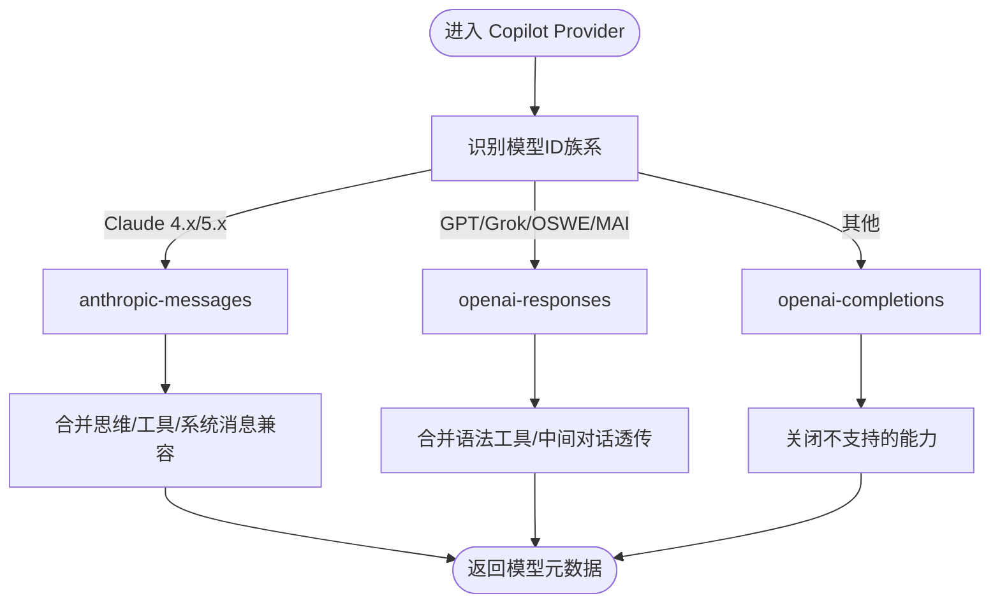
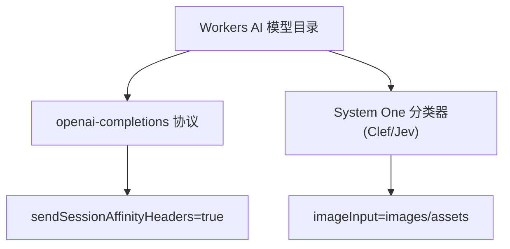
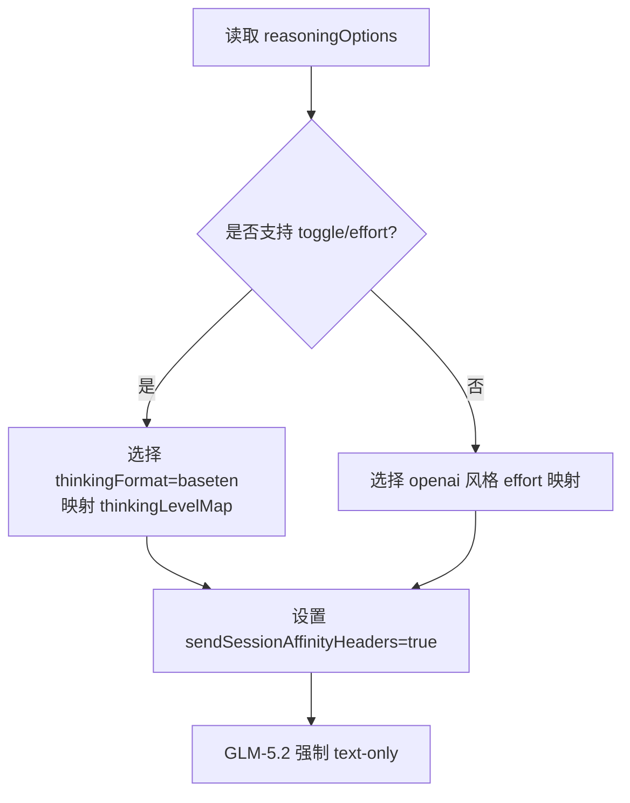
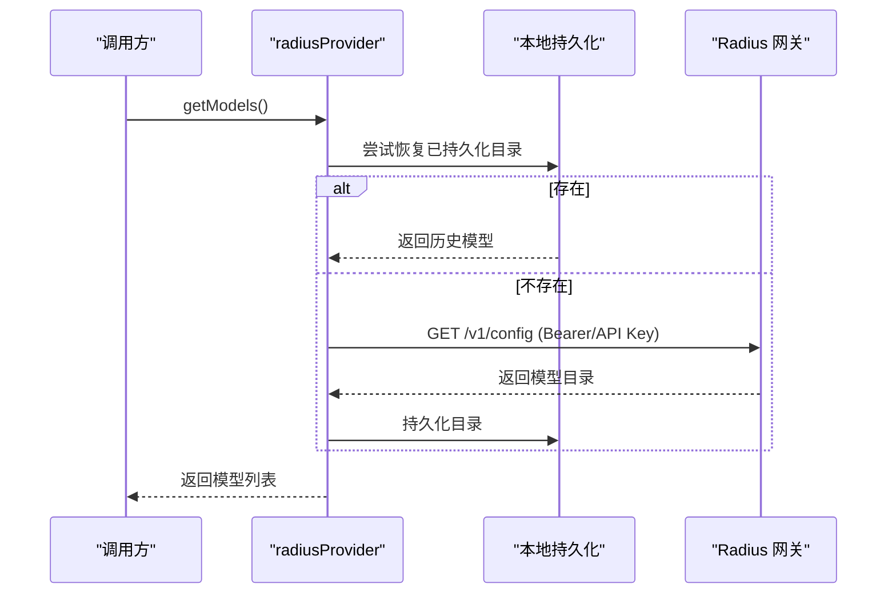
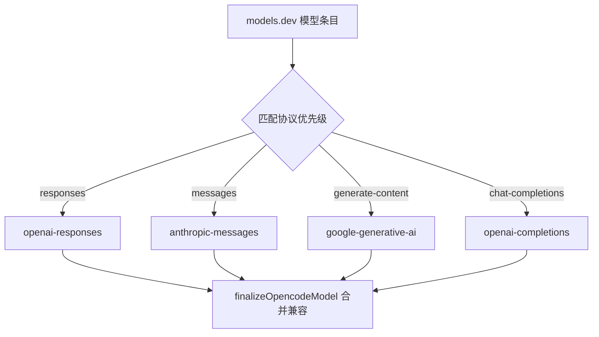
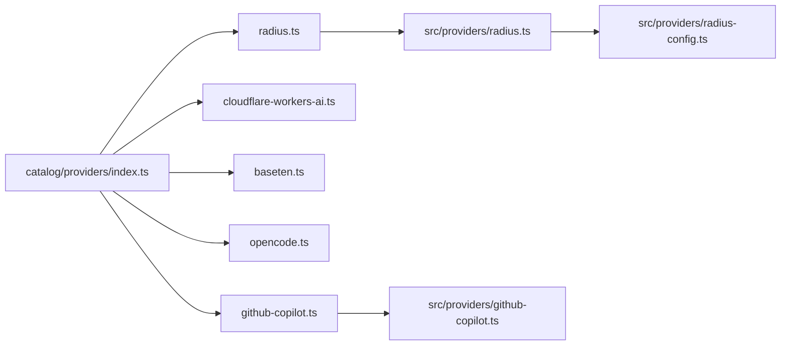

# 专业领域提供商

<cite>
**本文引用的文件**
- [README.md](file://README.md)
- [packages/ai/catalog/providers/index.ts](file://packages/ai/catalog/providers/index.ts)
- [packages/ai/catalog/providers/github-copilot.ts](file://packages/ai/catalog/providers/github-copilot.ts)
- [packages/ai/catalog/providers/cloudflare-workers-ai.ts](file://packages/ai/catalog/providers/cloudflare-workers-ai.ts)
- [packages/ai/catalog/providers/baseten.ts](file://packages/ai/catalog/providers/baseten.ts)
- [packages/ai/catalog/providers/radius.ts](file://packages/ai/catalog/providers/radius.ts)
- [packages/ai/catalog/providers/opencode.ts](file://packages/ai/catalog/providers/opencode.ts)
- [packages/ai/src/providers/radius.ts](file://packages/ai/src/providers/radius.ts)
- [packages/ai/src/providers/radius-config.ts](file://packages/ai/src/providers/radius-config.ts)
- [packages/ai/src/providers/github-copilot.ts](file://packages/ai/src/providers/github-copilot.ts)
- [packages/coding-agent/docs/providers.md](file://packages/coding-agent/docs/providers.md)
- [packages/ai/src/api/cloudflare-ai-binding.ts](file://packages/ai/src/api/cloudflare-ai-binding.ts)
</cite>

## 目录
1. [简介](#简介)
2. [项目结构](#项目结构)
3. [核心组件](#核心组件)
4. [架构总览](#架构总览)
5. [详细组件分析](#详细组件分析)
6. [依赖关系分析](#依赖关系分析)
7. [性能与成本优化](#性能与成本优化)
8. [故障排查指南](#故障排查指南)
9. [结论](#结论)
10. [附录：配置清单](#附录配置清单)

## 简介
本文件面向专业领域 LLM 提供商的集成与使用，聚焦 GitHub Copilot、Cloudflare Workers AI、Baseten、Radius、OpenCode 等垂直服务商。文档从代码仓库的实际实现出发，说明各提供商的特定能力、集成方式、适用场景，并给出开发工具、边缘计算、模型托管等场景的配置与最佳实践，涵盖性能优化、成本控制与扩展性建议。

## 项目结构
该仓库是一个多包 monorepo，AI 相关能力集中在 packages/ai 中，提供统一的模型目录、认证、API 适配与流式调用；CLI 与交互层在 packages/coding-agent 中。针对专业领域提供商，主要涉及以下位置：
- 提供商目录定义与注册：packages/ai/catalog/providers/index.ts
- 各提供商模型定义与兼容性：packages/ai/catalog/providers/*.ts
- 运行时 Provider 实现（如 Radius、GitHub Copilot）：packages/ai/src/providers/*.ts
- 官方文档与环境变量说明：packages/coding-agent/docs/providers.md
- Cloudflare 绑定传输：packages/ai/src/api/cloudflare-ai-binding.ts

**图示来源**
- [packages/ai/catalog/providers/index.ts:1-93](file://packages/ai/catalog/providers/index.ts#L1-L93)
- [packages/ai/catalog/providers/github-copilot.ts:1-140](file://packages/ai/catalog/providers/github-copilot.ts#L1-L140)
- [packages/ai/catalog/providers/cloudflare-workers-ai.ts:1-62](file://packages/ai/catalog/providers/cloudflare-workers-ai.ts#L1-L62)
- [packages/ai/catalog/providers/baseten.ts:1-90](file://packages/ai/catalog/providers/baseten.ts#L1-L90)
- [packages/ai/catalog/providers/opencode.ts:1-214](file://packages/ai/catalog/providers/opencode.ts#L1-L214)
- [packages/ai/catalog/providers/radius.ts:1-8](file://packages/ai/catalog/providers/radius.ts#L1-L8)
- [packages/ai/src/providers/radius.ts:1-91](file://packages/ai/src/providers/radius.ts#L1-L91)
- [packages/ai/src/providers/radius-config.ts:1-98](file://packages/ai/src/providers/radius-config.ts#L1-L98)
- [packages/ai/src/providers/github-copilot.ts:1-50](file://packages/ai/src/providers/github-copilot.ts#L1-L50)

**章节来源**
- [README.md:72-84](file://README.md#L72-L84)
- [packages/ai/catalog/providers/index.ts:1-93](file://packages/ai/catalog/providers/index.ts#L1-L93)

## 核心组件
- 提供商目录注册中心：集中导入并导出所有内置提供商定义，新增提供商需在此注册。
- 模型与兼容性定义：每个提供商通过 defineProvider 声明 id、models/classifiers/compat/finalize 等，描述模型元数据、输入类型、上下文窗口、成本、推理能力与协议差异。
- 运行时 Provider：将目录层定义与真实 API 对接，处理认证、模型过滤、流式请求与分类器路由。
- 网关与动态目录：Radius 支持从网关拉取组织级模型目录，并在本地持久化与刷新。

**章节来源**
- [packages/ai/catalog/providers/index.ts:1-93](file://packages/ai/catalog/providers/index.ts#L1-L93)
- [packages/ai/catalog/providers/github-copilot.ts:1-140](file://packages/ai/catalog/providers/github-copilot.ts#L1-L140)
- [packages/ai/catalog/providers/cloudflare-workers-ai.ts:1-62](file://packages/ai/catalog/providers/cloudflare-workers-ai.ts#L1-L62)
- [packages/ai/catalog/providers/baseten.ts:1-90](file://packages/ai/catalog/providers/baseten.ts#L1-L90)
- [packages/ai/catalog/providers/opencode.ts:1-214](file://packages/ai/catalog/providers/opencode.ts#L1-L214)
- [packages/ai/catalog/providers/radius.ts:1-8](file://packages/ai/catalog/providers/radius.ts#L1-L8)
- [packages/ai/src/providers/radius.ts:1-91](file://packages/ai/src/providers/radius.ts#L1-L91)
- [packages/ai/src/providers/radius-config.ts:1-98](file://packages/ai/src/providers/radius-config.ts#L1-L98)
- [packages/ai/src/providers/github-copilot.ts:1-50](file://packages/ai/src/providers/github-copilot.ts#L1-L50)

## 架构总览
下图展示“目录层 → 运行时层 → 上游 API”的分层架构，以及不同提供商的协议分流与认证路径。

**图示来源**
- [packages/ai/src/providers/github-copilot.ts:1-50](file://packages/ai/src/providers/github-copilot.ts#L1-L50)
- [packages/ai/src/providers/radius.ts:1-91](file://packages/ai/src/providers/radius.ts#L1-L91)
- [packages/ai/src/providers/radius-config.ts:81-98](file://packages/ai/src/providers/radius-config.ts#L81-L98)

## 详细组件分析

### GitHub Copilot
- 定位与能力
  - 面向开发者工作流的模型代理，支持 Claude/GPT/Grok 等多模型族。
  - 根据模型 ID 自动分流到 anthropic-messages、openai-responses、openai-completions 三种协议。
  - 支持 System One 分类器端点，用于任务路由与决策。
- 集成要点
  - 基础 URL 指向 individual 企业域；OAuth 登录可解析 proxy-ep 得到实际 baseUrl。
  - 支持 OAuth 订阅与 per-account 模型可用性过滤。
  - 对部分模型启用长上下文、思维层级覆盖、中间对话系统消息透传等兼容项。
- 适用场景
  - 开发者工具集成、企业内部模型治理、跨厂商模型统一接入。

**图示来源**
- [packages/ai/catalog/providers/github-copilot.ts:47-52](file://packages/ai/catalog/providers/github-copilot.ts#L47-L52)
- [packages/ai/catalog/providers/github-copilot.ts:115-138](file://packages/ai/catalog/providers/github-copilot.ts#L115-L138)

**章节来源**
- [packages/ai/catalog/providers/github-copilot.ts:1-140](file://packages/ai/catalog/providers/github-copilot.ts#L1-L140)
- [packages/ai/src/providers/github-copilot.ts:1-50](file://packages/ai/src/providers/github-copilot.ts#L1-L50)

### Cloudflare Workers AI
- 定位与能力
  - 基于 OpenAI Completions 协议的模型目录，附带 System One 分类器（Clef/Jev）。
  - 支持会话亲和头，便于缓存命中与稳定路由。
- 集成要点
  - 无公开目录，System One 分类器由仓库内维护。
  - 在 Worker 环境可通过 AI Binding 直连 Gateway，避免额外鉴权开销。
- 适用场景
  - 边缘推理、低延迟推理、与 Cloudflare 生态深度集成。

**图示来源**
- [packages/ai/catalog/providers/cloudflare-workers-ai.ts:1-62](file://packages/ai/catalog/providers/cloudflare-workers-ai.ts#L1-L62)
- [packages/ai/src/api/cloudflare-ai-binding.ts:1-23](file://packages/ai/src/api/cloudflare-ai-binding.ts#L1-L23)

**章节来源**
- [packages/ai/catalog/providers/cloudflare-workers-ai.ts:1-62](file://packages/ai/catalog/providers/cloudflare-workers-ai.ts#L1-L62)
- [packages/ai/src/api/cloudflare-ai-binding.ts:1-23](file://packages/ai/src/api/cloudflare-ai-binding.ts#L1-L23)

### Baseten
- 定位与能力
  - 以 OpenAI Completions 协议暴露推理服务，支持多种推理模式（toggle/effort）与思考层级映射。
  - 需要会话亲和头以启用自动提示缓存。
- 集成要点
  - 根据 reasoningOptions 动态选择 thinkingFormat 与 thinkingLevelMap。
  - GLM-5.2 系列为纯文本接口，即使 models.dev 标注图像输入也会被修正。
- 适用场景
  - 自托管模型托管平台、需要精细控制推理强度与缓存策略的场景。

**图示来源**
- [packages/ai/catalog/providers/baseten.ts:5-32](file://packages/ai/catalog/providers/baseten.ts#L5-L32)
- [packages/ai/catalog/providers/baseten.ts:53-87](file://packages/ai/catalog/providers/baseten.ts#L53-L87)

**章节来源**
- [packages/ai/catalog/providers/baseten.ts:1-90](file://packages/ai/catalog/providers/baseten.ts#L1-L90)

### Radius
- 定位与能力
  - 面向组织/团队的模型网关，支持动态目录、OAuth 与 API Key 双认证。
  - 默认提供基线模型，认证后可用组织级目录覆盖。
- 集成要点
  - 目录加载流程：优先恢复本地持久化目录 → 迁移旧存储 → 网络拉取 /v1/config → 持久化并更新内存。
  - 支持自定义网关地址，规范化 baseUrl 并校验返回结构。
- 适用场景
  - 企业模型治理、权限控制、按组织裁剪模型列表。

**图示来源**
- [packages/ai/src/providers/radius.ts:21-89](file://packages/ai/src/providers/radius.ts#L21-L89)
- [packages/ai/src/providers/radius-config.ts:81-98](file://packages/ai/src/providers/radius-config.ts#L81-L98)

**章节来源**
- [packages/ai/catalog/providers/radius.ts:1-8](file://packages/ai/catalog/providers/radius.ts#L1-L8)
- [packages/ai/src/providers/radius.ts:1-91](file://packages/ai/src/providers/radius.ts#L1-L91)
- [packages/ai/src/providers/radius-config.ts:1-98](file://packages/ai/src/providers/radius-config.ts#L1-L98)

### OpenCode
- 定位与能力
  - 聚合多家模型供应商，按 models.dev 提供的协议与 baseUrl 进行精确路由。
  - 支持 responses/messages/generate-content/chat-completions 四类协议。
  - 针对不同模型族（Claude/Kimi/Qwen/GPT）做思维层级与中间对话兼容。
- 集成要点
  - 若 models.dev 未列出受支持的 API，严格模式下会跳过模型并告警。
  - 对部分模型修正上下文窗口、maxTokens 与 long cache retention 支持。
- 适用场景
  - 多供应商统一接入、协议无关的模型编排与治理。

**图示来源**
- [packages/ai/catalog/providers/opencode.ts:32-76](file://packages/ai/catalog/providers/opencode.ts#L32-L76)
- [packages/ai/catalog/providers/opencode.ts:149-185](file://packages/ai/catalog/providers/opencode.ts#L149-L185)

**章节来源**
- [packages/ai/catalog/providers/opencode.ts:1-214](file://packages/ai/catalog/providers/opencode.ts#L1-L214)

## 依赖关系分析
- 目录层 providers/index.ts 集中导入并导出所有提供商定义，新增提供商必须在此注册。
- 各提供商定义文件依赖 define.ts 提供的 defineProvider/modelsDevModels/mergeThinking/mergeCompat 等工具函数。
- 运行时 Provider（如 radiusProvider、githubCopilotProvider）负责将目录层定义与具体 API 实现对接，并处理认证与模型过滤。

**图示来源**
- [packages/ai/catalog/providers/index.ts:1-93](file://packages/ai/catalog/providers/index.ts#L1-L93)
- [packages/ai/src/providers/radius.ts:1-91](file://packages/ai/src/providers/radius.ts#L1-L91)
- [packages/ai/src/providers/radius-config.ts:1-98](file://packages/ai/src/providers/radius-config.ts#L1-L98)
- [packages/ai/src/providers/github-copilot.ts:1-50](file://packages/ai/src/providers/github-copilot.ts#L1-L50)

**章节来源**
- [packages/ai/catalog/providers/index.ts:1-93](file://packages/ai/catalog/providers/index.ts#L1-L93)

## 性能与成本优化
- 会话亲和与缓存
  - Baseten 与 Cloudflare Workers AI 均开启会话亲和头以提升缓存命中率与路由稳定性。
  - 在 Cloudflare Worker 环境中，优先使用 AI Binding 访问 Gateway，减少鉴权与序列化开销。
- 推理强度与成本
  - Baseten/OpenCode 通过 thinkingLevelMap 将“off/minimal/low/medium/high/max”映射到后端能力，按需启用推理以降低费用。
  - 对不支持 long cache retention 的模型显式关闭，避免无效参数导致的失败或回退。
- 上下文与吞吐
  - 对已知模型的上下文窗口与 maxTokens 进行修正，防止溢出与浪费。
  - 在 GitHub Copilot 中对部分模型启用长上下文（例如百万级），但需结合业务负载评估成本。
- 成本核算
  - 各提供商模型定义中包含 cost 字段，建议在应用层统计 token 用量并按模型分层计费。

[本节为通用指导，不直接分析具体文件]

## 故障排查指南
- 认证失败
  - GitHub Copilot：检查 COPILOT_GITHUB_TOKEN 或 OAuth 流程是否正确；企业域需确认 baseUrl 解析。
  - Cloudflare：确保 CLOUDFLARE_API_KEY 与 ACCOUNT_ID 正确；Gateway 模式还需 CLOUDFLARE_GATEWAY_ID。
  - Radius：确认 RADIUS_API_KEY 或 OAuth 已配置；网关 /v1/config 返回状态码与 body 有助于定位问题。
- 模型不可用
  - GitHub Copilot：OAuth 登录后需启用所需模型；availableModelIds 过滤后可能为空。
  - OpenCode：若 models.dev 未列出受支持协议，严格模式会跳过模型并输出警告。
- 流式与工具调用异常
  - 某些模型不支持 eager tool input streaming 或 mid-conversation system messages，需在兼容层关闭相应能力。
  - 注意不同提供商对 thinking 对象签名与格式的差异，必要时启用 allowEmptySignature 等兼容项。

**章节来源**
- [packages/coding-agent/docs/providers.md:176-245](file://packages/coding-agent/docs/providers.md#L176-L245)
- [packages/ai/src/providers/radius-config.ts:81-98](file://packages/ai/src/providers/radius-config.ts#L81-L98)
- [packages/ai/catalog/providers/github-copilot.ts:115-138](file://packages/ai/catalog/providers/github-copilot.ts#L115-L138)
- [packages/ai/catalog/providers/opencode.ts:46-56](file://packages/ai/catalog/providers/opencode.ts#L46-L56)

## 结论
通过对 GitHub Copilot、Cloudflare Workers AI、Baseten、Radius、OpenCode 的代码级分析，可以看出本项目采用“目录层 + 运行时层”的分层架构，既保证了多提供商的统一抽象，又保留了协议与能力的差异化适配。在实际落地中，应优先利用会话亲和与缓存、按需启用推理强度、修正上下文与 maxTokens，并结合成本字段进行用量统计与预算控制。对于企业场景，Radius 的动态目录与权限控制尤为关键；对于边缘与低延迟场景，Cloudflare Workers AI 的 Binding 与亲和头能显著提升性能。

## 附录：配置清单
- GitHub Copilot
  - 环境变量：COPILOT_GITHUB_TOKEN
  - OAuth：支持订阅与企业域，baseUrl 可从 token 解析
- Cloudflare Workers AI
  - 环境变量：CLOUDFLARE_API_KEY、CLOUDFLARE_ACCOUNT_ID
  - Gateway：CLOUDFLARE_API_KEY、CLOUDFLARE_ACCOUNT_ID、CLOUDFLARE_GATEWAY_ID
- Baseten
  - 环境变量：BASTEN_API_KEY（按平台约定）
  - 特性：会话亲和、thinking 模式映射
- Radius
  - 环境变量：RADIUS_API_KEY
  - OAuth：支持组织级目录与权限裁剪
- OpenCode
  - 无需额外环境变量，依赖 models.dev 的协议与 baseUrl 信息

**章节来源**
- [packages/coding-agent/docs/providers.md:176-245](file://packages/coding-agent/docs/providers.md#L176-L245)
- [packages/ai/src/env-api-keys.ts:100-100](file://packages/ai/src/env-api-keys.ts#L100-L100)