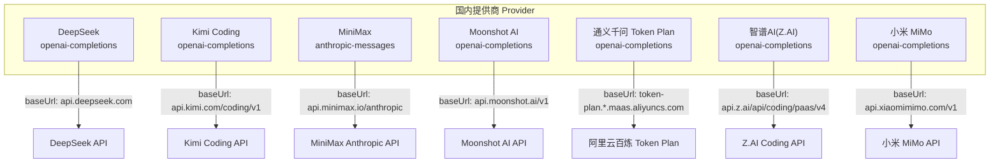
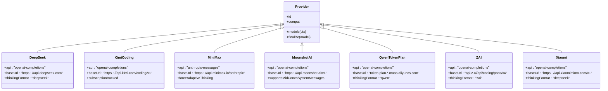
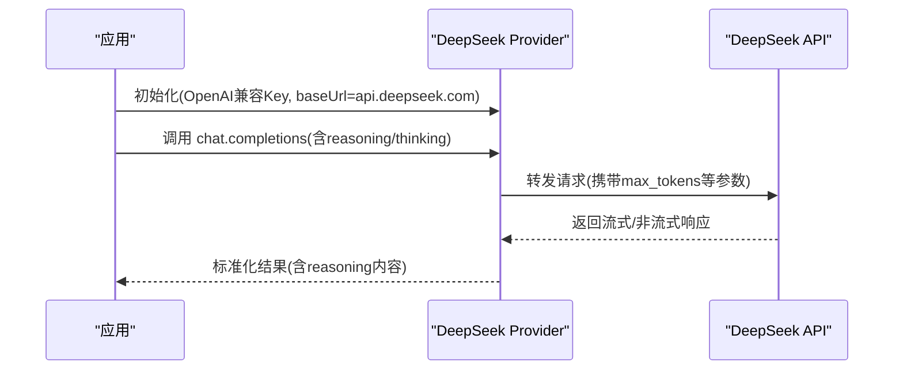
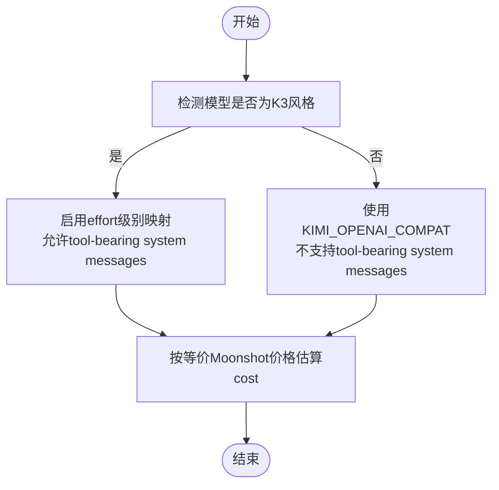
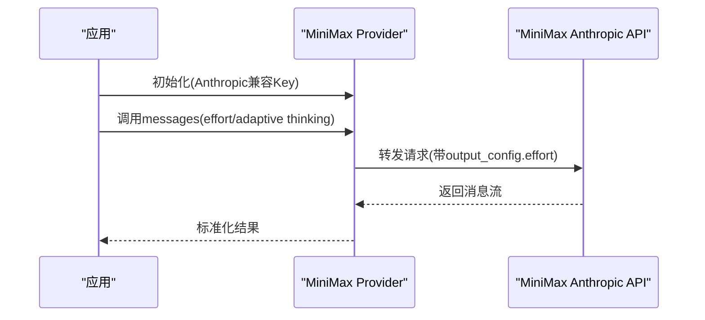
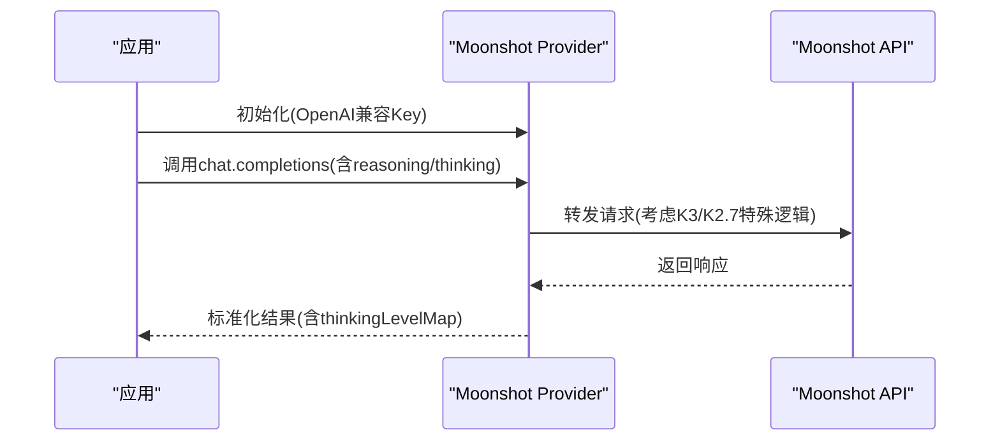
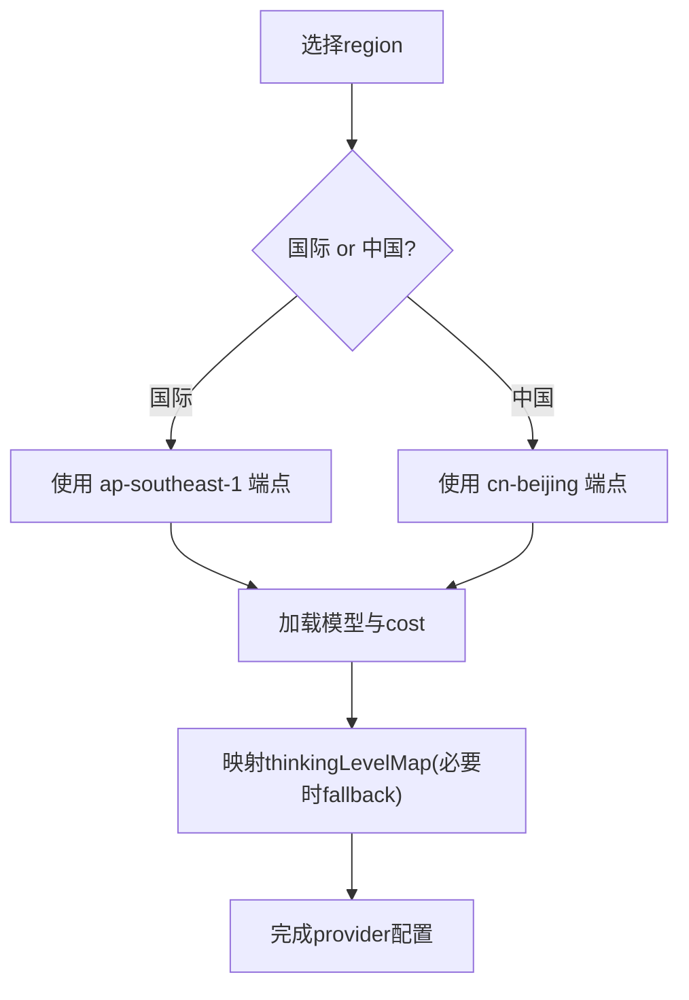
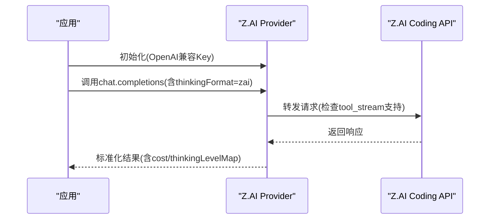
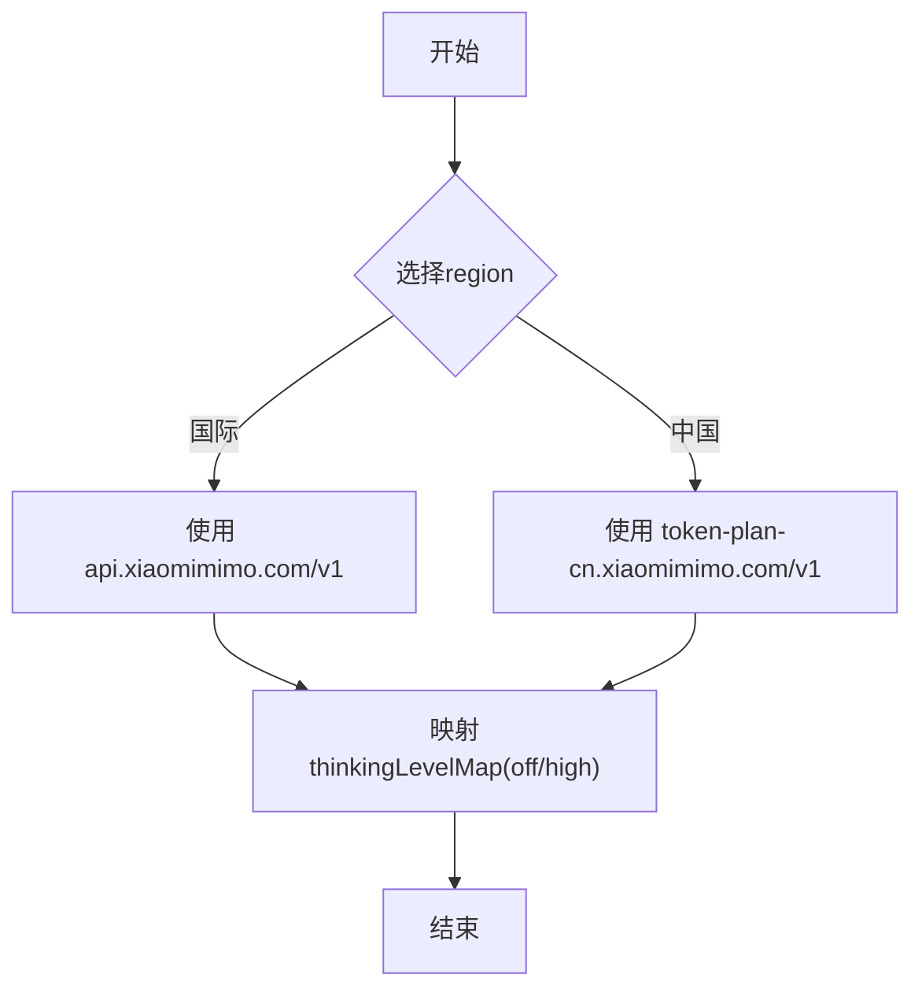
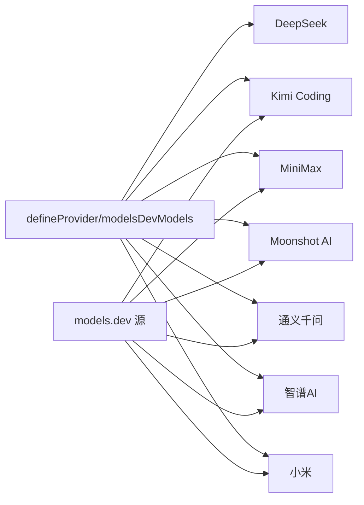

# 国内提供商

<cite>
**本文引用的文件**
- [deepseek.ts](file://packages/ai/catalog/providers/deepseek.ts)
- [kimi-coding.ts](file://packages/ai/catalog/providers/kimi-coding.ts)
- [minimax.ts](file://packages/ai/catalog/providers/minimax.ts)
- [minimax-cn.ts](file://packages/ai/catalog/providers/minimax-cn.ts)
- [moonshotai.ts](file://packages/ai/catalog/providers/moonshotai.ts)
- [moonshotai-cn.ts](file://packages/ai/catalog/providers/moonshotai-cn.ts)
- [qwen-token-plan.ts](file://packages/ai/catalog/providers/qwen-token-plan.ts)
- [qwen-token-plan-cn.ts](file://packages/ai/catalog/providers/qwen-token-plan-cn.ts)
- [xiaomi.ts](file://packages/ai/catalog/providers/xiaomi.ts)
- [xiaomi-token-plan-cn.ts](file://packages/ai/catalog/providers/xiaomi-token-plan-cn.ts)
- [zai.ts](file://packages/ai/catalog/providers/zai.ts)
- [zai-coding-cn.ts](file://packages/ai/catalog/providers/zai-coding-cn.ts)
</cite>

## 目录
1. [简介](#简介)
2. [项目结构](#项目结构)
3. [核心组件](#核心组件)
4. [架构总览](#架构总览)
5. [详细组件分析](#详细组件分析)
6. [依赖关系分析](#依赖关系分析)
7. [性能与成本考量](#性能与成本考量)
8. [故障排查指南](#故障排查指南)
9. [结论](#结论)
10. [附录](#附录)

## 简介
本文件面向国内大模型服务商的接入与使用，覆盖 DeepSeek、Kimi Coding、MiniMax、Moonshot AI、通义千问（阿里云百炼 Token Plan）、智谱AI（Z.AI）以及小米（MiMo）等。文档从认证方式、API 接口特点、模型能力与价格策略、中文环境配置示例、网络优化和本地化适配建议、合规与安全注意事项等方面展开，帮助读者在统一抽象下快速集成并稳定运行。

## 项目结构
本项目通过“catalog/providers”下的多个 provider 文件，为不同厂商提供统一的模型注册、能力描述与兼容性声明。每个 provider 负责：
- 暴露模型清单与基础 URL
- 声明 API 协议（如 openai-completions、anthropic-messages）
- 定义 thinking/reasoning 行为与兼容项
- 映射成本结构与计费来源

图示来源
- [deepseek.ts:10-21](file://packages/ai/catalog/providers/deepseek.ts#L10-L21)
- [kimi-coding.ts:17-24](file://packages/ai/catalog/providers/kimi-coding.ts#L17-L24)
- [minimax.ts:7-11](file://packages/ai/catalog/providers/minimax.ts#L7-L11)
- [moonshotai.ts:17-20](file://packages/ai/catalog/providers/moonshotai.ts#L17-L20)
- [qwen-token-plan.ts:5-9](file://packages/ai/catalog/providers/qwen-token-plan.ts#L5-L9)
- [zai.ts:46-49](file://packages/ai/catalog/providers/zai.ts#L46-L49)
- [xiaomi.ts:42-45](file://packages/ai/catalog/providers/xiaomi.ts#L42-L45)

章节来源
- [deepseek.ts:1-58](file://packages/ai/catalog/providers/deepseek.ts#L1-L58)
- [kimi-coding.ts:1-56](file://packages/ai/catalog/providers/kimi-coding.ts#L1-L56)
- [minimax.ts:1-27](file://packages/ai/catalog/providers/minimax.ts#L1-L27)
- [moonshotai.ts:1-72](file://packages/ai/catalog/providers/moonshotai.ts#L1-L72)
- [qwen-token-plan.ts:1-55](file://packages/ai/catalog/providers/qwen-token-plan.ts#L1-L55)
- [zai.ts:1-51](file://packages/ai/catalog/providers/zai.ts#L1-L51)
- [xiaomi.ts:1-47](file://packages/ai/catalog/providers/xiaomi.ts#L1-L47)

## 核心组件
- 统一抽象：所有国内 provider 均通过 defineProvider 注册，对外暴露 id、models、compat 与 finalize 钩子。
- 协议选择：多数采用 openai-completions 协议；MiniMax 使用 anthropic-messages 协议。
- 推理与思考：各 provider 对 thinking/reasoning 的支持程度不同，部分支持 effort 级别映射或强制自适应思考。
- 成本映射：cost 字段由 provider 内部根据官方定价或等价换算得出，部分订阅型服务以等价按量价估算。

章节来源
- [deepseek.ts:38-57](file://packages/ai/catalog/providers/deepseek.ts#L38-L57)
- [kimi-coding.ts:18-55](file://packages/ai/catalog/providers/kimi-coding.ts#L18-L55)
- [minimax.ts:23-26](file://packages/ai/catalog/providers/minimax.ts#L23-L26)
- [moonshotai.ts:66-71](file://packages/ai/catalog/providers/moonshotai.ts#L66-L71)
- [qwen-token-plan.ts:50-54](file://packages/ai/catalog/providers/qwen-token-plan.ts#L50-L54)
- [zai.ts:46-50](file://packages/ai/catalog/providers/zai.ts#L46-L50)
- [xiaomi.ts:42-46](file://packages/ai/catalog/providers/xiaomi.ts#L42-L46)

## 架构总览
下图展示国内提供商在 catalog 层中的统一接入点与差异点：

图示来源
- [deepseek.ts:38-57](file://packages/ai/catalog/providers/deepseek.ts#L38-L57)
- [kimi-coding.ts:18-55](file://packages/ai/catalog/providers/kimi-coding.ts#L18-L55)
- [minimax.ts:23-26](file://packages/ai/catalog/providers/minimax.ts#L23-L26)
- [moonshotai.ts:66-71](file://packages/ai/catalog/providers/moonshotai.ts#L66-L71)
- [qwen-token-plan.ts:50-54](file://packages/ai/catalog/providers/qwen-token-plan.ts#L50-L54)
- [zai.ts:46-50](file://packages/ai/catalog/providers/zai.ts#L46-L50)
- [xiaomi.ts:42-46](file://packages/ai/catalog/providers/xiaomi.ts#L42-L46)

## 详细组件分析

### DeepSeek
- 认证方式：使用 OpenAI 兼容协议的 API Key（通过环境变量或 SDK 配置注入）。
- API 特点：
  - 协议：openai-completions
  - baseUrl：https://api.deepseek.com
  - 支持 reasoning 与 deepseek 格式的 thinking
  - 支持 strict mode
  - V4 Pro 支持对话中插入 system 文本
- 模型能力与价格：
  - deepseek-flash：支持多模态输入（文本+图像），reasoning 开启，上下文窗口 1,000,000，最大输出 384,000 tokens
  - deepseek-v4-pro：纯文本，reasoning 开启，同上窗口与上限
  - cost 字段包含 input/output/cacheRead 等单价
- 本地化与网络：
  - 中国大陆建议使用就近区域代理或企业专线访问 https://api.deepseek.com
  - 若需缓存读加速，注意 cacheRead 计费项
- 合规与安全：
  - 遵循 DeepSeek 官方数据使用与隐私政策
  - 敏感数据脱敏后再发送

图示来源
- [deepseek.ts:10-21](file://packages/ai/catalog/providers/deepseek.ts#L10-L21)
- [deepseek.ts:38-57](file://packages/ai/catalog/providers/deepseek.ts#L38-L57)

章节来源
- [deepseek.ts:1-58](file://packages/ai/catalog/providers/deepseek.ts#L1-L58)

### Kimi Coding（月之暗面/Kimi）
- 认证方式：订阅制（kimi-code-plan-global），通过 models.dev 源拉取模型列表；SDK 侧使用 OpenAI 兼容协议。
- API 特点：
  - 协议：openai-completions
  - baseUrl：https://api.kimi.com/coding/v1
  - K3 系列支持 effort 级别映射与动态工具加载
  - 支持对话中插入 system 文本；K3 还支持 tool-bearing system messages
- 模型能力与价格：
  - 订阅模式，cost 字段以等价 Moonshot API 按量价估算
  - kimi-for-coding / kimi-for-coding-highspeed 等模型具备不同吞吐与成本档位
- 本地化与网络：
  - 中国大陆建议使用就近代理访问 https://api.kimi.com/coding/v1
  - 注意 K3 与非 K3 的行为差异（effort、tool-bearing system message）

图示来源
- [kimi-coding.ts:6-15](file://packages/ai/catalog/providers/kimi-coding.ts#L6-L15)
- [kimi-coding.ts:17-55](file://packages/ai/catalog/providers/kimi-coding.ts#L17-L55)

章节来源
- [kimi-coding.ts:1-56](file://packages/ai/catalog/providers/kimi-coding.ts#L1-L56)

### MiniMax
- 认证方式：Anthropic 兼容协议的 API Key。
- API 特点：
  - 协议：anthropic-messages
  - baseUrl：https://api.minimax.io/anthropic（国际）；中国节点 https://api.minimaxi.com/anthropic
  - 支持自适应思考（effort），部分模型强制 forceAdaptiveThinking
- 模型能力与价格：
  - 隐藏旧版模型（M2/M2.1/M2.5 系列）
  - 通过 getEffortThinkingLevelMap 生成 thinkingLevelMap
- 本地化与网络：
  - 中国大陆优先使用 minimax-cn 端点以减少延迟
  - 注意 effort 级别与 thinking.type="disabled" 的互斥关系

图示来源
- [minimax.ts:7-20](file://packages/ai/catalog/providers/minimax.ts#L7-L20)
- [minimax-cn.ts:4-7](file://packages/ai/catalog/providers/minimax-cn.ts#L4-L7)

章节来源
- [minimax.ts:1-27](file://packages/ai/catalog/providers/minimax.ts#L1-L27)
- [minimax-cn.ts:1-8](file://packages/ai/catalog/providers/minimax-cn.ts#L1-L8)

### Moonshot AI（Kimi 官方）
- 认证方式：OpenAI 兼容协议的 API Key。
- API 特点：
  - 协议：openai-completions
  - baseUrl：https://api.moonshot.ai/v1（国际）；中国节点 https://api.moonshot.cn/v1
  - K3 系列支持 effort 级别映射；K2.7 Code 始终思考（off=null）
  - 支持对话中插入 system 文本；K3 支持 tool-bearing system messages
- 模型能力与价格：
  - K3 系列 cost 映射到 KIMI_K3_COST；其他模型按 source.cost 映射
  - 不收取 cacheWrite（K3 系列）
- 本地化与网络：
  - 中国大陆建议使用 moonshotai-cn 端点
  - 注意 always-thinking 模型的 thinking 参数处理

图示来源
- [moonshotai.ts:17-39](file://packages/ai/catalog/providers/moonshotai.ts#L17-L39)
- [moonshotai.ts:49-64](file://packages/ai/catalog/providers/moonshotai.ts#L49-L64)
- [moonshotai-cn.ts:4-9](file://packages/ai/catalog/providers/moonshotai-cn.ts#L4-L9)

章节来源
- [moonshotai.ts:1-72](file://packages/ai/catalog/providers/moonshotai.ts#L1-L72)
- [moonshotai-cn.ts:1-10](file://packages/ai/catalog/providers/moonshotai-cn.ts#L1-L10)

### 通义千问（阿里云百炼 Token Plan）
- 认证方式：OpenAI 兼容协议的 API Key（sk-sp- 前缀），国际与中国大陆分别对应不同 baseUrl。
- API 特点：
  - 协议：openai-completions
  - baseUrl：
    - 国际：https://token-plan.ap-southeast-1.maas.aliyuncs.com/compatible-mode/v1
    - 中国：https://token-plan.cn-beijing.maas.aliyuncs.com/compatible-mode/v1
  - 支持 reasoning effort 级别映射；thinkingFormat 为 qwen
- 模型能力与价格：
  - 通过 models.dev 源拉取模型与成本
  - 部分模型（glm-5/glm-5.1）使用 fallback thinking 级别
- 本地化与网络：
  - 中国大陆必须使用 cn 端点
  - 注意 supportsReasoningEffort 的条件启用

图示来源
- [qwen-token-plan.ts:5-9](file://packages/ai/catalog/providers/qwen-token-plan.ts#L5-L9)
- [qwen-token-plan.ts:29-45](file://packages/ai/catalog/providers/qwen-token-plan.ts#L29-L45)
- [qwen-token-plan-cn.ts:4-8](file://packages/ai/catalog/providers/qwen-token-plan-cn.ts#L4-L8)

章节来源
- [qwen-token-plan.ts:1-55](file://packages/ai/catalog/providers/qwen-token-plan.ts#L1-L55)
- [qwen-token-plan-cn.ts:1-9](file://packages/ai/catalog/providers/qwen-token-plan-cn.ts#L1-L9)

### 智谱AI（Z.AI）
- 认证方式：OpenAI 兼容协议的 API Key。
- API 特点：
  - 协议：openai-completions
  - baseUrl：https://api.z.ai/api/coding/paas/v4（国际）；中国节点 https://open.bigmodel.cn/api/coding/paas/v4
  - 支持 thinkingFormat=zai 与 reasoning effort
  - 部分模型不支持 tool-stream（glm-4.5 系列）
- 模型能力与价格：
  - 使用 modelsDevChatModels 获取 pay-as-you-go 价格
  - glm-5.2/glm-5.2-highspeed 支持 off="none"
- 本地化与网络：
  - 中国大陆建议使用 zai-coding-cn 端点
  - 注意 tool_stream 的限制

图示来源
- [zai.ts:9-34](file://packages/ai/catalog/providers/zai.ts#L9-L34)
- [zai.ts:46-50](file://packages/ai/catalog/providers/zai.ts#L46-L50)
- [zai-coding-cn.ts:4-8](file://packages/ai/catalog/providers/zai-coding-cn.ts#L4-L8)

章节来源
- [zai.ts:1-51](file://packages/ai/catalog/providers/zai.ts#L1-L51)
- [zai-coding-cn.ts:1-9](file://packages/ai/catalog/providers/zai-coding-cn.ts#L1-L9)

### 小米（MiMo）
- 认证方式：OpenAI 兼容协议的 API Key。
- API 特点：
  - 协议：openai-completions
  - baseUrl：https://api.xiaomimimo.com/v1（国际）；中国节点 https://token-plan-cn.xiaomimimo.com/v1
  - thinkingFormat=deepseek；仅暴露 off 与 high 两个 effort 级别
  - requiresReasoningContentOnAssistantMessages=true
- 模型能力与价格：
  - 通过 models.dev 源拉取模型与成本
  - 预付费 Token Plan 与国际计费端点分离
- 本地化与网络：
  - 中国大陆建议使用 xiaomi-token-plan-cn 端点
  - 注意 effort 级别限制

图示来源
- [xiaomi.ts:4-10](file://packages/ai/catalog/providers/xiaomi.ts#L4-L10)
- [xiaomi.ts:11-37](file://packages/ai/catalog/providers/xiaomi.ts#L11-L37)
- [xiaomi-token-plan-cn.ts:4-8](file://packages/ai/catalog/providers/xiaomi-token-plan-cn.ts#L4-L8)

章节来源
- [xiaomi.ts:1-47](file://packages/ai/catalog/providers/xiaomi.ts#L1-L47)
- [xiaomi-token-plan-cn.ts:1-9](file://packages/ai/catalog/providers/xiaomi-token-plan-cn.ts#L1-L9)

## 依赖关系分析
- 共同依赖：
  - defineProvider/modelsDevModels/getEffortThinkingLevelMap：用于统一注册、模型拉取与 thinking 级别映射
  - types.Model/ModelCost：统一模型与成本数据结构
- 差异化依赖：
  - MiniMax 使用 anthropic-messages 协议
  - 其他 provider 主要使用 openai-completions 协议
- 外部依赖：
  - models.dev 源：提供模型元数据与成本信息
  - 各厂商官方 API 端点

图示来源
- [kimi-coding.ts:1-56](file://packages/ai/catalog/providers/kimi-coding.ts#L1-L56)
- [minimax.ts:1-27](file://packages/ai/catalog/providers/minimax.ts#L1-L27)
- [moonshotai.ts:1-72](file://packages/ai/catalog/providers/moonshotai.ts#L1-L72)
- [qwen-token-plan.ts:1-55](file://packages/ai/catalog/providers/qwen-token-plan.ts#L1-L55)
- [zai.ts:1-51](file://packages/ai/catalog/providers/zai.ts#L1-L51)
- [xiaomi.ts:1-47](file://packages/ai/catalog/providers/xiaomi.ts#L1-L47)

章节来源
- [kimi-coding.ts:1-56](file://packages/ai/catalog/providers/kimi-coding.ts#L1-L56)
- [minimax.ts:1-27](file://packages/ai/catalog/providers/minimax.ts#L1-L27)
- [moonshotai.ts:1-72](file://packages/ai/catalog/providers/moonshotai.ts#L1-L72)
- [qwen-token-plan.ts:1-55](file://packages/ai/catalog/providers/qwen-token-plan.ts#L1-L55)
- [zai.ts:1-51](file://packages/ai/catalog/providers/zai.ts#L1-L51)
- [xiaomi.ts:1-47](file://packages/ai/catalog/providers/xiaomi.ts#L1-L47)

## 性能与成本考量
- 推理与思考：
  - 合理设置 thinkingLevelMap 与 effort 级别，避免不必要的长思考导致延迟与成本上升
  - 对于始终思考的模型（如 Moonshot K2.7 Code），不要发送 thinking.disabled
- 缓存与计费：
  - DeepSeek 支持 cacheRead 计费，合理利用缓存可降低重复查询成本
  - Moonshot K3 系列不收取 cacheWrite，注意 cost 映射差异
- 流式传输：
  - Z.AI 部分模型不支持 tool_stream，需在客户端禁用相关选项以避免错误
- 网络优化：
  - 中国大陆优先选择各 provider 的 cn 端点以降低时延与丢包率
  - 结合企业专线/CDN 提升稳定性

[本节为通用指导，无需具体文件引用]

## 故障排查指南
- 认证失败：
  - 确认 API Key 与 baseUrl 匹配（国际 vs 中国）
  - 检查环境变量或 SDK 配置是否正确注入
- 协议不兼容：
  - MiniMax 使用 anthropic-messages，其他多为 openai-completions
  - 确保 thinkingFormat 与 effort 级别符合 provider 要求
- 模型能力异常：
  - 检查是否启用了 unsupported 特性（如 Z.AI 的 tool_stream）
  - 注意 always-thinking 模型的 thinking 参数处理
- 成本异常：
  - 核对 cost 字段来源（models.dev 或 provider 内映射）
  - 订阅型服务（如 Kimi Coding）以等价按量价估算

章节来源
- [kimi-coding.ts:6-15](file://packages/ai/catalog/providers/kimi-coding.ts#L6-L15)
- [zai.ts:6-7](file://packages/ai/catalog/providers/zai.ts#L6-L7)
- [moonshotai.ts:49-64](file://packages/ai/catalog/providers/moonshotai.ts#L49-L64)

## 结论
通过统一的 catalog/provider 抽象，国内多家 LLM 服务商可在一致的接口下被集成与管理。实践中应重点关注：
- 认证与 baseUrl 的区域选择
- thinking/reasoning 的能力与限制
- 成本结构与缓存计费
- 网络优化与合规安全

[本节为总结性内容，无需具体文件引用]

## 附录
- 配置要点速查：
  - DeepSeek：baseUrl=https://api.deepseek.com，thinkingFormat=deepseek
  - Kimi Coding：baseUrl=https://api.kimi.com/coding/v1，订阅制，K3 支持 effort
  - MiniMax：baseUrl=https://api.minimax.io/anthropic（国际）/https://api.minimaxi.com/anthropic（中国）
  - Moonshot AI：baseUrl=https://api.moonshot.ai/v1（国际）/https://api.moonshot.cn/v1（中国）
  - 通义千问：baseUrl=token-plan.*.maas.aliyuncs.com（国际/中国），thinkingFormat=qwen
  - 智谱AI：baseUrl=https://api.z.ai/api/coding/paas/v4（国际）/https://open.bigmodel.cn/api/coding/paas/v4（中国）
  - 小米：baseUrl=https://api.xiaomimimo.com/v1（国际）/https://token-plan-cn.xiaomimimo.com/v1（中国）

[本节为补充信息，无需具体文件引用]