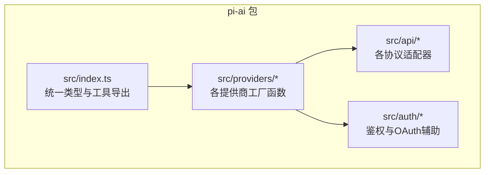
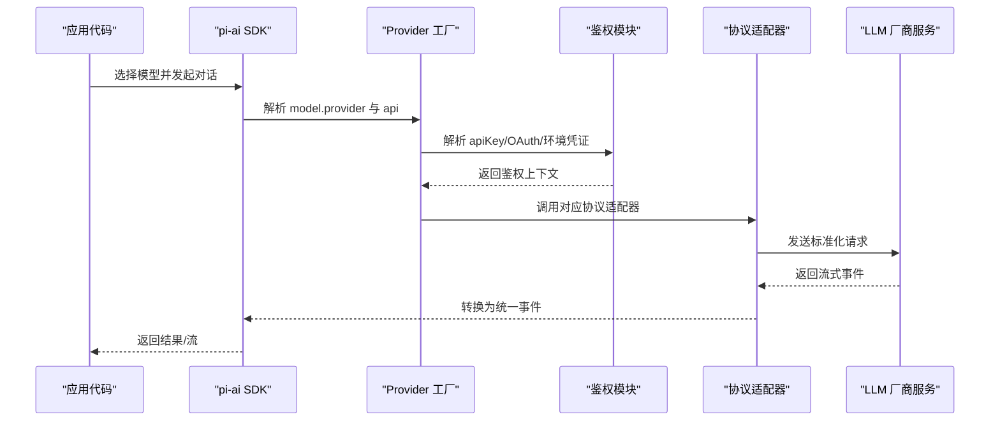
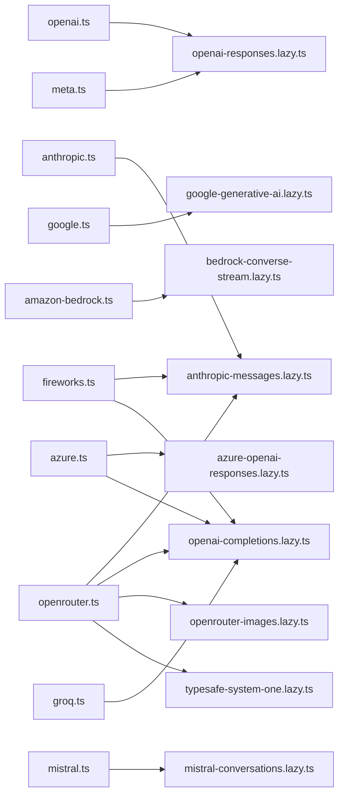

# 支持的提供商

<cite>
**本文引用的文件**
- [README.md](file://README.md)
- [packages/ai/src/index.ts](file://packages/ai/src/index.ts)
- [packages/ai/src/providers/openai.ts](file://packages/ai/src/providers/openai.ts)
- [packages/ai/src/providers/anthropic.ts](file://packages/ai/src/providers/anthropic.ts)
- [packages/ai/src/providers/google.ts](file://packages/ai/src/providers/google.ts)
- [packages/ai/src/providers/amazon-bedrock.ts](file://packages/ai/src/providers/amazon-bedrock.ts)
- [packages/ai/src/providers/azure.ts](file://packages/ai/src/providers/azure.ts)
- [packages/ai/src/providers/openrouter.ts](file://packages/ai/src/providers/openrouter.ts)
- [packages/ai/src/providers/mistral.ts](file://packages/ai/src/providers/mistral.ts)
- [packages/ai/src/providers/fireworks.ts](file://packages/ai/src/providers/fireworks.ts)
- [packages/ai/src/providers/groq.ts](file://packages/ai/src/providers/groq.ts)
- [packages/ai/src/providers/meta.ts](file://packages/ai/src/providers/meta.ts)
</cite>

## 目录
1. [简介](#简介)
2. [项目结构](#项目结构)
3. [核心组件](#核心组件)
4. [架构总览](#架构总览)
5. [详细组件分析](#详细组件分析)
6. [依赖关系分析](#依赖关系分析)
7. [性能与限制](#性能与限制)
8. [故障排查指南](#故障排查指南)
9. [结论](#结论)
10. [附录：提供商选择指南](#附录提供商选择指南)

## 简介
本文件面向开发者，系统化梳理本项目中已实现的 LLM 提供商支持情况，覆盖 OpenAI、Anthropic、Google、AWS Bedrock、Azure OpenAI、OpenRouter、Mistral、Fireworks、Groq、Meta 等。文档包含各提供商的配置方法、认证流程、API 特性、环境变量、SDK 使用方式、错误处理与性能特点，并提供选型建议，帮助快速落地多供应商接入。

## 项目结构
本项目通过统一的 Provider 抽象暴露多厂商能力，核心入口位于 packages/ai 包。每个提供商以独立的 provider 工厂函数注册，统一模型目录、鉴权策略与 API 适配层。

图表来源
- [packages/ai/src/index.ts:1-48](file://packages/ai/src/index.ts#L1-L48)

章节来源
- [README.md:72-86](file://README.md#L72-L86)
- [packages/ai/src/index.ts:1-48](file://packages/ai/src/index.ts#L1-L48)

## 核心组件
- Provider 工厂：每个提供商提供 createProvider 的工厂函数，声明 id、name、baseUrl、auth、models、api/classifiers/images 等元数据与实现。
- 鉴权：统一支持 API Key、OAuth、工作负载身份联邦（如 Anthropic）以及云原生凭证链（如 AWS）。
- API 适配：将不同厂商协议（OpenAI Responses/Completions、Anthropic Messages、Google Generative AI、Bedrock Converse Stream 等）统一为一致的流式接口。
- 模型目录：每个 provider 绑定其 models 列表，部分 provider 支持按密钥个性化模型清单（如 OpenRouter）。

章节来源
- [packages/ai/src/providers/openai.ts:9-35](file://packages/ai/src/providers/openai.ts#L9-L35)
- [packages/ai/src/providers/anthropic.ts:19-90](file://packages/ai/src/providers/anthropic.ts#L19-L90)
- [packages/ai/src/providers/google.ts:6-15](file://packages/ai/src/providers/google.ts#L6-L15)
- [packages/ai/src/providers/amazon-bedrock.ts:11-90](file://packages/ai/src/providers/amazon-bedrock.ts#L11-L90)
- [packages/ai/src/providers/azure.ts:44-55](file://packages/ai/src/providers/azure.ts#L44-L55)
- [packages/ai/src/providers/openrouter.ts:62-88](file://packages/ai/src/providers/openrouter.ts#L62-L88)
- [packages/ai/src/providers/mistral.ts:6-14](file://packages/ai/src/providers/mistral.ts#L6-L14)
- [packages/ai/src/providers/fireworks.ts:7-19](file://packages/ai/src/providers/fireworks.ts#L7-L19)
- [packages/ai/src/providers/groq.ts:6-14](file://packages/ai/src/providers/groq.ts#L6-L14)
- [packages/ai/src/providers/meta.ts:7-23](file://packages/ai/src/providers/meta.ts#L7-L23)

## 架构总览
下图展示典型调用路径：应用通过 pi-ai 的统一 SDK 调用某个 Provider，Provider 根据模型与 API 路由到具体适配器，完成鉴权、请求构建、流式响应与错误处理。

图表来源
- [packages/ai/src/providers/openai.ts:9-35](file://packages/ai/src/providers/openai.ts#L9-L35)
- [packages/ai/src/providers/anthropic.ts:74-90](file://packages/ai/src/providers/anthropic.ts#L74-L90)
- [packages/ai/src/providers/google.ts:6-15](file://packages/ai/src/providers/google.ts#L6-L15)
- [packages/ai/src/providers/amazon-bedrock.ts:82-90](file://packages/ai/src/providers/amazon-bedrock.ts#L82-L90)
- [packages/ai/src/providers/azure.ts:44-55](file://packages/ai/src/providers/azure.ts#L44-L55)
- [packages/ai/src/providers/openrouter.ts:62-88](file://packages/ai/src/providers/openrouter.ts#L62-L88)

## 详细组件分析

### OpenAI
- 标识与基础地址：id=openai，baseUrl=https://api.openai.com/v1
- 鉴权方式：
  - API Key：OPENAI_API_KEY
  - OAuth：ChatGPT 订阅登录（isSubscription=true）
- 模型与 API：
  - 主 API：openai-responses
  - 分类器：openai-decisions
  - 模型清单：OPENAI_MODELS + OPENAI_CLASSIFIER_MODELS
- 行为特性：
  - ChatGPT OAuth Token 仅能访问 Responses API，分类器会被过滤掉。

配置要点
- 环境变量：OPENAI_API_KEY
- OAuth：通过内置 OAuth 加载器引导登录 ChatGPT 订阅账号

SDK 使用提示
- 使用 openaiProvider() 注册后，选择 model.provider="openai" 且 api="openai-responses" 的模型进行对话；如需分类能力，使用 classifier="openai-decisions"。

章节来源
- [packages/ai/src/providers/openai.ts:9-35](file://packages/ai/src/providers/openai.ts#L9-L35)

### Anthropic
- 标识与基础地址：id=anthropic，baseUrl=https://api.anthropic.com
- 鉴权方式：
  - API Key：优先从存储凭据读取，其次 ANTHROPIC_AUTH_TOKEN、ANTHROPIC_OAUTH_TOKEN、ANTHROPIC_API_KEY
  - OAuth：Claude Pro/Max 订阅登录
  - 工作负载身份联邦：支持规则 ID、组织 ID、身份令牌文件、服务账号/工作区 ID 等环境变量组合
- 模型与 API：
  - 主 API：anthropic-messages
  - 模型清单：ANTHROPIC_MODELS

配置要点
- 环境变量：ANTHROPIC_API_KEY / ANTHROPIC_AUTH_TOKEN / ANTHROPIC_OAUTH_TOKEN
- 联邦：ANTHROPIC_FEDERATION_RULE_ID_ENV / ORGANIZATION_ID_ENV / IDENTITY_TOKEN_FILE_ENV / SERVICE_ACCOUNT_ID_ENV / WORKSPACE_ID_ENV

SDK 使用提示
- 使用 anthropicProvider() 注册后，选择 model.provider="anthropic" 且 api="anthropic-messages" 的模型进行对话。

章节来源
- [packages/ai/src/providers/anthropic.ts:19-90](file://packages/ai/src/providers/anthropic.ts#L19-L90)

### Google (Gemini)
- 标识与基础地址：id=google，baseUrl=https://generativelanguage.googleapis.com/v1beta
- 鉴权方式：API Key（GEMINI_API_KEY）
- 模型与 API：
  - 主 API：google-generative-ai
  - 模型清单：GOOGLE_MODELS

配置要点
- 环境变量：GEMINI_API_KEY

SDK 使用提示
- 使用 googleProvider() 注册后，选择 model.provider="google" 且 api="google-generative-ai" 的模型进行对话。

章节来源
- [packages/ai/src/providers/google.ts:6-15](file://packages/ai/src/providers/google.ts#L6-L15)

### Amazon Bedrock
- 标识：id=amazon-bedrock
- 鉴权方式：
  - Bearer Token：AWS_BEARER_TOKEN_BEDROCK
  - AWS Profile：AWS_PROFILE
  - 默认凭证链：Access Key/Secret Key、ECS 任务角色、Web Identity Token 等
- 模型与 API：
  - 主 API：bedrock-converse-stream
  - 模型清单：AMAZON_BEDROCK_MODELS

配置要点
- 环境变量：AWS_BEARER_TOKEN_BEDROCK / AWS_PROFILE / AWS_ACCESS_KEY_ID / AWS_SECRET_ACCESS_KEY / ECS/WebIdentity 相关变量

SDK 使用提示
- 使用 amazonBedrockProvider() 注册后，选择 model.provider="amazon-bedrock" 且 api="bedrock-converse-stream" 的模型进行对话。

章节来源
- [packages/ai/src/providers/amazon-bedrock.ts:11-90](file://packages/ai/src/providers/amazon-bedrock.ts#L11-L90)

### Azure OpenAI
- 标识：id=azure
- 鉴权方式：API Key（AZURE_OPENAI_API_KEY）
- 模型与 API：
  - azure-openai-responses
  - openai-completions（带部署名包装）
- 行为特性：
  - 自动解析 Azure 端点与部署名，并在请求中将 deployment name 作为 model 字段发送，保持 catalog id 不变。

配置要点
- 环境变量：AZURE_OPENAI_API_KEY

SDK 使用提示
- 使用 azureProvider() 注册后，可选择 api="azure-openai-responses" 或 "openai-completions" 的模型进行对话；部署名由内部逻辑注入。

章节来源
- [packages/ai/src/providers/azure.ts:10-55](file://packages/ai/src/providers/azure.ts#L10-L55)

### OpenRouter
- 标识与基础地址：id=openrouter，baseUrl=https://openrouter.ai/api/v1
- 鉴权方式：
  - API Key：OPENROUTER_API_KEY
  - OAuth：OpenRouter OAuth
- 模型与 API：
  - anthropic-messages
  - openai-completions
  - images：openrouter-images
  - classifiers：typesafe-system-one
  - 模型清单：OPENROUTER_MODELS + IMAGE + CLASSIFIER
- 行为特性：
  - 可按用户密钥个性化模型清单（限额、价格、上下文长度），失败时回退到静态清单。

配置要点
- 环境变量：OPENROUTER_API_KEY

SDK 使用提示
- 使用 openrouterProvider() 注册后，可选择 anthropic-messages 或 openai-completions 的模型；如需图像/分类能力，使用对应 images/classifiers。

章节来源
- [packages/ai/src/providers/openrouter.ts:13-88](file://packages/ai/src/providers/openrouter.ts#L13-L88)

### Mistral
- 标识与基础地址：id=mistral，baseUrl=https://api.mistral.ai
- 鉴权方式：API Key（MISTRAL_API_KEY）
- 模型与 API：
  - mistral-conversations
  - 模型清单：MISTRAL_MODELS

配置要点
- 环境变量：MISTRAL_API_KEY

SDK 使用提示
- 使用 mistralProvider() 注册后，选择 model.provider="mistral" 且 api="mistral-conversations" 的模型进行对话。

章节来源
- [packages/ai/src/providers/mistral.ts:6-14](file://packages/ai/src/providers/mistral.ts#L6-L14)

### Fireworks
- 标识与基础地址：id=fireworks，baseUrl=https://api.fireworks.ai/inference
- 鉴权方式：API Key（FIREWORKS_API_KEY）
- 模型与 API：
  - anthropic-messages
  - openai-completions
  - 模型清单：FIREWORKS_MODELS

配置要点
- 环境变量：FIREWORKS_API_KEY

SDK 使用提示
- 使用 fireworksProvider() 注册后，可选择 anthropic-messages 或 openai-completions 的模型进行对话。

章节来源
- [packages/ai/src/providers/fireworks.ts:7-19](file://packages/ai/src/providers/fireworks.ts#L7-L19)

### Groq
- 标识与基础地址：id=groq，baseUrl=https://api.groq.com/openai/v1
- 鉴权方式：API Key（GROQ_API_KEY）
- 模型与 API：
  - openai-completions
  - 模型清单：GROQ_MODELS

配置要点
- 环境变量：GROQ_API_KEY

SDK 使用提示
- 使用 groqProvider() 注册后，选择 model.provider="groq" 且 api="openai-completions" 的模型进行对话。

章节来源
- [packages/ai/src/providers/groq.ts:6-14](file://packages/ai/src/providers/groq.ts#L6-L14)

### Meta
- 标识与基础地址：id=meta，baseUrl=https://api.meta.ai/v1
- 鉴权方式：
  - API Key：META_API_KEY
  - OAuth：Muse 订阅登录（isSubscription=true）
- 模型与 API：
  - openai-responses
  - 模型清单：META_MODELS

配置要点
- 环境变量：META_API_KEY
- OAuth：通过内置 OAuth 加载器引导登录 Meta/Muse 订阅账号

SDK 使用提示
- 使用 metaProvider() 注册后，选择 model.provider="meta" 且 api="openai-responses" 的模型进行对话。

章节来源
- [packages/ai/src/providers/meta.ts:7-23](file://packages/ai/src/providers/meta.ts#L7-L23)

## 依赖关系分析
- Provider 层依赖 auth 与 api 两个横向能力：
  - auth：提供 envApiKeyAuth、lazyOAuth、工作负载身份联邦等通用鉴权能力。
  - api：针对不同协议的适配器（Responses/Completions/Messages/Gemini/Bedrock 等）。
- 模型清单由各 provider 内聚管理，便于独立扩展。
- OpenRouter 额外依赖用户级模型清单个性化逻辑，按需拉取限额与定价信息。

图表来源
- [packages/ai/src/providers/openai.ts:9-35](file://packages/ai/src/providers/openai.ts#L9-L35)
- [packages/ai/src/providers/anthropic.ts:74-90](file://packages/ai/src/providers/anthropic.ts#L74-L90)
- [packages/ai/src/providers/google.ts:6-15](file://packages/ai/src/providers/google.ts#L6-L15)
- [packages/ai/src/providers/amazon-bedrock.ts:82-90](file://packages/ai/src/providers/amazon-bedrock.ts#L82-L90)
- [packages/ai/src/providers/azure.ts:44-55](file://packages/ai/src/providers/azure.ts#L44-L55)
- [packages/ai/src/providers/openrouter.ts:62-88](file://packages/ai/src/providers/openrouter.ts#L62-L88)
- [packages/ai/src/providers/mistral.ts:6-14](file://packages/ai/src/providers/mistral.ts#L6-L14)
- [packages/ai/src/providers/fireworks.ts:7-19](file://packages/ai/src/providers/fireworks.ts#L7-L19)
- [packages/ai/src/providers/groq.ts:6-14](file://packages/ai/src/providers/groq.ts#L6-L14)
- [packages/ai/src/providers/meta.ts:7-23](file://packages/ai/src/providers/meta.ts#L7-L23)

## 性能与限制
- 流式传输：多数适配器基于流式协议（如 bedrock-converse-stream、openai-responses、anthropic-messages），适合长文本与实时交互场景。
- 延迟与吞吐：受限于各厂商配额与网络质量；OpenRouter 可聚合多家后端，但需关注其自身限速与计费。
- 鉴权开销：OAuth 首次登录存在额外交互；工作负载身份联邦（Anthropic）与 AWS 凭证链在容器/云环境中可减少密钥管理成本。
- 模型清单个性化：OpenRouter 会调用 /models/user 获取限额与价格，超时或鉴权失败会回退到静态清单，避免阻塞启动。

[本节为通用指导，不直接分析具体文件]

## 故障排查指南
- 鉴权失败
  - OpenAI：检查 OPENAI_API_KEY 是否设置；若使用 ChatGPT OAuth，确认订阅状态与 Responses API 可用。
  - Anthropic：优先检查 ANTHROPIC_AUTH_TOKEN/ANTHROPIC_OAUTH_TOKEN/ANTHROPIC_API_KEY；联邦模式需确保所有必需环境变量齐全。
  - Google：检查 GEMINI_API_KEY 是否有效。
  - Bedrock：优先检查 AWS_BEARER_TOKEN_BEDROCK/AWS_PROFILE/AWS_* 凭证链；容器环境注意 ECS/WebIdentity 变量。
  - Azure：检查 AZURE_OPENAI_API_KEY 与部署名是否正确。
  - OpenRouter：检查 OPENROUTER_API_KEY；/models/user 请求失败不影响基本功能。
  - Mistral/Fireworks/Groq/Meta：分别检查对应 *_API_KEY。
- 模型不可用
  - OpenRouter：若 /models/user 返回空集，可能该密钥无权限访问某些模型；请检查账户权限或回退到静态清单。
  - Azure：确认部署名与模型映射正确。
- 流式中断
  - 检查网络与代理设置；对 Bedrock/Azure 等云厂商，确认区域与端点可达性。

章节来源
- [packages/ai/src/providers/openrouter.ts:24-60](file://packages/ai/src/providers/openrouter.ts#L24-L60)
- [packages/ai/src/providers/amazon-bedrock.ts:54-79](file://packages/ai/src/providers/amazon-bedrock.ts#L54-L79)
- [packages/ai/src/providers/azure.ts:10-25](file://packages/ai/src/providers/azure.ts#L10-L25)

## 结论
本项目通过统一的 Provider 抽象与鉴权/协议适配层，实现了多 LLM 供应商的一致接入体验。开发者只需选择合适的 provider 工厂函数与环境变量，即可在统一的 SDK 下切换不同厂商与协议，同时保留各厂商特有能力的扩展点（图像、分类、联邦鉴权、云凭证链等）。

[本节为总结性内容，不直接分析具体文件]

## 附录：提供商选择指南
- 需要 OpenAI 生态与 Responses API：选择 OpenAI。
- 需要 Claude 系列与高级工具调用：选择 Anthropic。
- 需要 Gemini 系列与 Google 生态集成：选择 Google。
- 需要在 AWS 生态中使用托管模型与 IAM 凭证：选择 Amazon Bedrock。
- 企业私有化部署或已有 Azure OpenAI 资源：选择 Azure。
- 希望聚合多家模型并按限额/价格动态筛选：选择 OpenRouter。
- 需要 Mistral 系列模型：选择 Mistral。
- 需要 Fireworks 推理服务：选择 Fireworks。
- 需要 Groq 高性能推理：选择 Groq。
- 需要 Meta 模型 API 或 Muse 订阅：选择 Meta。

[本节为概念性指导，不直接分析具体文件]