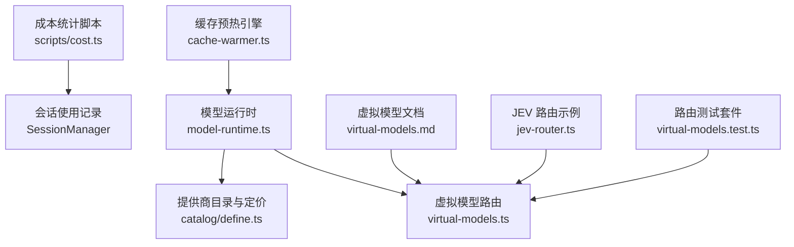
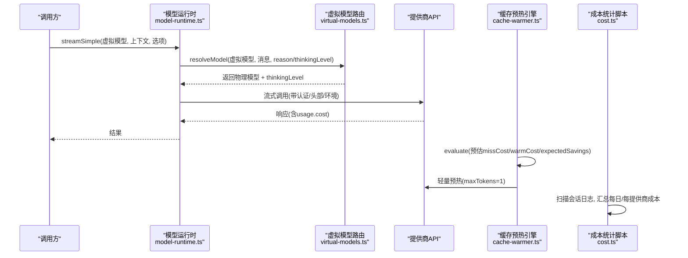
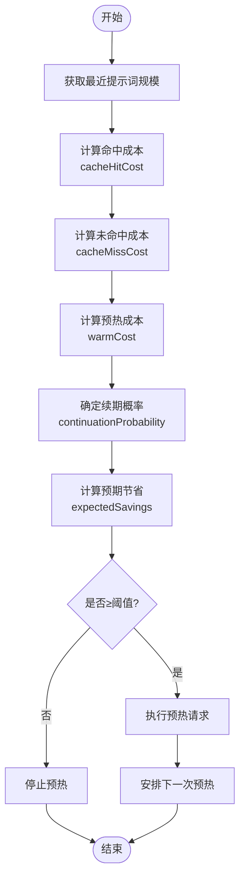
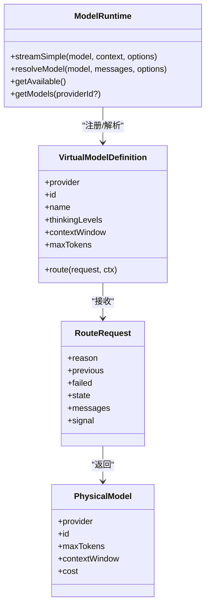
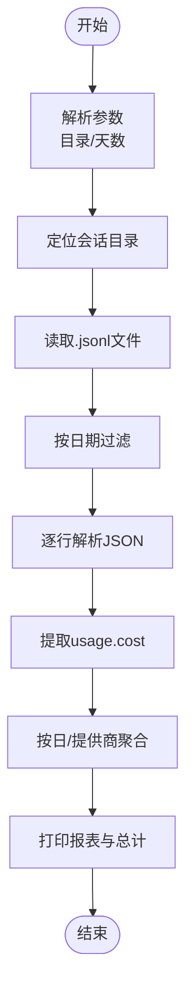
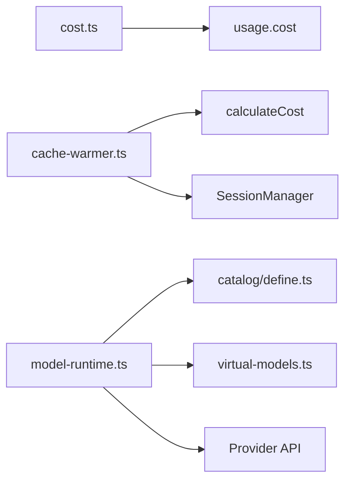

# 成本优化路由

<cite>
**本文引用的文件**
- [scripts/cost.ts](file://scripts/cost.ts)
- [packages/coding-agent/src/core/cache-warmer.ts](file://packages/coding-agent/src/core/cache-warmer.ts)
- [packages/coding-agent/src/core/model-runtime.ts](file://packages/coding-agent/src/core/model-runtime.ts)
- [packages/ai/catalog/define.ts](file://packages/ai/catalog/define.ts)
- [packages/coding-agent/docs/virtual-models.md](file://packages/coding-agent/docs/virtual-models.md)
- [packages/coding-agent/test/suite/virtual-models.test.ts](file://packages/coding-agent/test/suite/virtual-models.test.ts)
- [packages/coding-agent/examples/extensions/jev-router.ts](file://packages/coding-agent/examples/extensions/jev-router.ts)
</cite>

## 目录
1. [简介](#简介)
2. [项目结构](#项目结构)
3. [核心组件](#核心组件)
4. [架构总览](#架构总览)
5. [详细组件分析](#详细组件分析)
6. [依赖关系分析](#依赖关系分析)
7. [性能与成本考量](#性能与成本考量)
8. [故障排查指南](#故障排查指南)
9. [结论](#结论)
10. [附录](#附录)

## 简介
本文件系统化梳理“成本优化路由”的设计与实现，覆盖以下主题：
- 基于价格的模型选择、预算控制与成本监控机制
- 成本计算算法、价格比较策略与最优路径选择
- 成本阈值设置、预算预警与支出报告
- 批量请求优化、缓存利用与资源复用技巧

该方案以虚拟模型路由为核心，结合提示词缓存预热（Prompt Cache Warming）与按提供商/模型的定价数据，形成端到端的成本优化闭环。

## 项目结构
围绕成本优化的关键代码分布在如下位置：
- 成本统计脚本：scripts/cost.ts
- 提示词缓存预热与经济学评估：packages/coding-agent/src/core/cache-warmer.ts
- 模型运行时与虚拟模型路由：packages/coding-agent/src/core/model-runtime.ts
- 模型目录与定价来源：packages/ai/catalog/define.ts
- 虚拟模型文档与示例：packages/coding-agent/docs/virtual-models.md、packages/coding-agent/examples/extensions/jev-router.ts
- 路由行为测试：packages/coding-agent/test/suite/virtual-models.test.ts

图表来源
- [scripts/cost.ts:1-184](file://scripts/cost.ts#L1-L184)
- [packages/coding-agent/src/core/cache-warmer.ts:1-456](file://packages/coding-agent/src/core/cache-warmer.ts#L1-L456)
- [packages/coding-agent/src/core/model-runtime.ts:1-800](file://packages/coding-agent/src/core/model-runtime.ts#L1-L800)
- [packages/ai/catalog/define.ts:1-143](file://packages/ai/catalog/define.ts#L1-L143)
- [packages/coding-agent/docs/virtual-models.md:27-115](file://packages/coding-agent/docs/virtual-models.md#L27-L115)
- [packages/coding-agent/examples/extensions/jev-router.ts:1-19](file://packages/coding-agent/examples/extensions/jev-router.ts#L1-L19)
- [packages/coding-agent/test/suite/virtual-models.test.ts:39-78](file://packages/coding-agent/test/suite/virtual-models.test.ts#L39-L78)

章节来源
- [scripts/cost.ts:1-184](file://scripts/cost.ts#L1-L184)
- [packages/coding-agent/src/core/cache-warmer.ts:1-456](file://packages/coding-agent/src/core/cache-warmer.ts#L1-L456)
- [packages/coding-agent/src/core/model-runtime.ts:1-800](file://packages/coding-agent/src/core/model-runtime.ts#L1-L800)
- [packages/ai/catalog/define.ts:1-143](file://packages/ai/catalog/define.ts#L1-L143)
- [packages/coding-agent/docs/virtual-models.md:27-115](file://packages/coding-agent/docs/virtual-models.md#L27-L115)
- [packages/coding-agent/test/suite/virtual-models.test.ts:39-78](file://packages/coding-agent/test/suite/virtual-models.test.ts#L39-L78)

## 核心组件
- 成本统计脚本：扫描会话日志，按天与提供商汇总输入、输出、缓存读写与总成本，支持按目录和时间窗口筛选。
- 缓存预热引擎：根据最近一次真实请求的提示词规模与模型定价，估算“命中/未命中”成本差，结合续期概率与最小预期节省阈值决定是否发起一次低成本“预热”请求以延长缓存有效期。
- 模型运行时：统一封装提供商调用、认证、可用性与虚拟模型路由；在流式接口中自动识别虚拟模型并解析为物理模型，同时限制输出预算到目标模型上限。
- 模型目录与定价：从 models.dev 等来源构建模型元数据，包含 cost 字段（input/output/cacheRead/cacheWrite），供成本计算与路由决策使用。
- 虚拟模型文档与示例：定义路由上下文、reason 语义、thinking level 映射与状态持久化；JEV 示例展示“先强后弱”的成本优化策略。

章节来源
- [scripts/cost.ts:1-184](file://scripts/cost.ts#L1-L184)
- [packages/coding-agent/src/core/cache-warmer.ts:1-456](file://packages/coding-agent/src/core/cache-warmer.ts#L1-L456)
- [packages/coding-agent/src/core/model-runtime.ts:1-800](file://packages/coding-agent/src/core/model-runtime.ts#L1-L800)
- [packages/ai/catalog/define.ts:1-143](file://packages/ai/catalog/define.ts#L1-L143)
- [packages/coding-agent/docs/virtual-models.md:27-115](file://packages/coding-agent/docs/virtual-models.md#L27-L115)

## 架构总览
成本优化路由的整体流程如下：
- 用户或系统发起请求时，若选择虚拟模型，则进入路由阶段，由 route(request, ctx) 决定具体物理模型与 thinking level。
- 运行时会校验认证、合并头部与环境变量，并将虚拟模型请求转发至实际提供商。
- 每次响应附带 usage.cost，用于后续成本统计与缓存预热经济学评估。
- 缓存预热引擎在安全时间窗内周期性发送一次“仅输出1 token”的轻量请求，以刷新提示词缓存 TTL，降低后续真实请求的 cache miss 成本。
- 成本统计脚本定期汇总各提供商、各天的花费，帮助定位高成本来源与优化机会。

图表来源
- [packages/coding-agent/src/core/model-runtime.ts:744-781](file://packages/coding-agent/src/core/model-runtime.ts#L744-L781)
- [packages/coding-agent/src/core/cache-warmer.ts:380-402](file://packages/coding-agent/src/core/cache-warmer.ts#L380-L402)
- [scripts/cost.ts:69-123](file://scripts/cost.ts#L69-L123)

## 详细组件分析

### 成本计算与经济学评估（缓存预热）
- 成本计算：通过 calculateCost(model, usage) 将 input/output/cacheRead/cacheWrite 转换为美元成本。
- 经济学评估：
  - cacheHitCost：命中缓存的读取成本
  - cacheMissCost：未命中时的写入或输入成本
  - warmCost：预热请求成本（读取提示词+1个输出token）
  - expectedSavings = continuationProbability × missCost − warmCost
  - 当 expectedSavings ≥ 阈值（默认 $0.05）时执行预热
- 安全边界：
  - 最大预热时长：活跃会话 1 小时，空闲会话 30 分钟
  - 刷新截止时间：保留一半原始过期余量，避免迟到导致全价写入
  - 续期概率：空闲场景采用固定估计值，避免过度乐观

图表来源
- [packages/coding-agent/src/core/cache-warmer.ts:72-86](file://packages/coding-agent/src/core/cache-warmer.ts#L72-L86)
- [packages/coding-agent/src/core/cache-warmer.ts:380-402](file://packages/coding-agent/src/core/cache-warmer.ts#L380-L402)
- [packages/coding-agent/src/core/cache-warmer.ts:15-26](file://packages/coding-agent/src/core/cache-warmer.ts#L15-L26)

章节来源
- [packages/coding-agent/src/core/cache-warmer.ts:1-456](file://packages/coding-agent/src/core/cache-warmer.ts#L1-L456)

### 虚拟模型路由与预算控制
- 路由入口：streamSimple 检测到虚拟模型时，调用 resolveModel 解析为物理模型，并根据目标模型 maxTokens 限制输出预算。
- 路由上下文：
  - reason：user/continuation/retry/direct 等
  - previous：上一次成功响应的物理模型与 thinking level
  - failed：失败重试时的上下文
  - state：路由器状态（可持久化）
- 预算控制：
  - 对 direct 调用，若调用者未指定 maxTokens，则以目标物理模型的 maxTokens 作为上限
  - thinking level 会被钳制到目标模型支持的范围
- 路由约束：
  - 不允许路由到另一个虚拟模型
  - 路由到的物理模型必须存在且提供商已配置认证

图表来源
- [packages/coding-agent/src/core/model-runtime.ts:744-781](file://packages/coding-agent/src/core/model-runtime.ts#L744-L781)
- [packages/coding-agent/docs/virtual-models.md:63-115](file://packages/coding-agent/docs/virtual-models.md#L63-L115)
- [packages/coding-agent/test/suite/virtual-models.test.ts:198-231](file://packages/coding-agent/test/suite/virtual-models.test.ts#L198-L231)

章节来源
- [packages/coding-agent/src/core/model-runtime.ts:744-781](file://packages/coding-agent/src/core/model-runtime.ts#L744-L781)
- [packages/coding-agent/docs/virtual-models.md:63-115](file://packages/coding-agent/docs/virtual-models.md#L63-L115)
- [packages/coding-agent/test/suite/virtual-models.test.ts:198-231](file://packages/coding-agent/test/suite/virtual-models.test.ts#L198-L231)

### 成本统计与支出报告
- 输入：会话目录与天数范围
- 处理：
  - 遍历 .jsonl 会话文件，过滤近 N 天
  - 解析每条 assistant 消息中的 usage.cost
  - 按天与提供商聚合 total/input/output/cacheRead/cacheWrite/requests
- 输出：
  - 每日明细与提供商合计
  - 全局总计

图表来源
- [scripts/cost.ts:6-29](file://scripts/cost.ts#L6-L29)
- [scripts/cost.ts:69-123](file://scripts/cost.ts#L69-L123)
- [scripts/cost.ts:125-184](file://scripts/cost.ts#L125-L184)

章节来源
- [scripts/cost.ts:1-184](file://scripts/cost.ts#L1-L184)

### 定价来源与模型目录
- 模型目录构建：
  - 从 models.dev 拉取工具能力模型
  - 映射 cost 字段（input/output/cacheRead/cacheWrite）
  - 补充 contextWindow/maxTokens 等限制
- 家族规则：
  - 例如 OpenAI 长上下文定价调整，按比例放大 input/output/cacheRead/cacheWrite
- 提供商适配：
  - Azure/Anthropic/DeepSeek 等提供商的 cost 映射与回退逻辑

章节来源
- [packages/ai/catalog/define.ts:110-143](file://packages/ai/catalog/define.ts#L110-L143)

### 成本优化策略示例（JEV 路由）
- 思路：先用强模型进行规划/首编辑，再切换到更便宜的模型完成后续任务
- 优点：在保证质量的前提下显著降低成本
- 风险：允许一次 prompt-cache miss，需权衡质量与成本

章节来源
- [packages/coding-agent/examples/extensions/jev-router.ts:1-19](file://packages/coding-agent/examples/extensions/jev-router.ts#L1-L19)

## 依赖关系分析
- 成本统计脚本依赖会话日志结构与 usage.cost 字段
- 缓存预热引擎依赖：
  - 模型定价（calculateCost）
  - 会话分支的最新提示词规模
  - 提供商环境变量（PI_CACHE_RETENTION）
- 模型运行时依赖：
  - 提供商目录与认证
  - 虚拟模型定义与路由函数
  - 会话管理器（appendUsage/getBranch）

图表来源
- [scripts/cost.ts:86-123](file://scripts/cost.ts#L86-L123)
- [packages/coding-agent/src/core/cache-warmer.ts:72-86](file://packages/coding-agent/src/core/cache-warmer.ts#L72-L86)
- [packages/coding-agent/src/core/model-runtime.ts:744-781](file://packages/coding-agent/src/core/model-runtime.ts#L744-L781)
- [packages/ai/catalog/define.ts:110-143](file://packages/ai/catalog/define.ts#L110-L143)

章节来源
- [scripts/cost.ts:86-123](file://scripts/cost.ts#L86-L123)
- [packages/coding-agent/src/core/cache-warmer.ts:72-86](file://packages/coding-agent/src/core/cache-warmer.ts#L72-L86)
- [packages/coding-agent/src/core/model-runtime.ts:744-781](file://packages/coding-agent/src/core/model-runtime.ts#L744-L781)
- [packages/ai/catalog/define.ts:110-143](file://packages/ai/catalog/define.ts#L110-L143)

## 性能与成本考量
- 缓存命中率：
  - 合理设置 PI_CACHE_RETENTION（short/long/none）
  - 关注 idle 续期概率，避免无效预热
- 输出预算：
  - 对 direct 调用强制以目标模型 maxTokens 为上限，防止超支
- 路由策略：
  - 根据 thinking level 与任务复杂度选择不同物理模型
  - 允许可控的 cache miss，换取质量提升
- 成本可见性：
  - 使用 cost.ts 定期生成日报/周报，定位高成本提供商与模型
  - 结合 /session 查看缓存预热经济学指标

[本节为通用指导，不直接分析具体文件]

## 故障排查指南
- 预热未触发：
  - 检查 economicsAvailable 是否为 false（提示词规模为 0 或缺少定价）
  - 确认 CACHE_WARMING_MINIMUM_EXPECTED_SAVINGS 阈值是否过高
  - 验证 getPromptCacheTtlMs 返回值（retention=none 或无 TTL）
- 路由失败：
  - 路由到虚拟模型或未知模型会报错
  - 目标提供商未配置认证会抛出 ModelsError
- 成本统计为空：
  - 确认会话目录编码正确（encodeSessionDir）
  - 检查 days 参数与文件时间戳格式

章节来源
- [packages/coding-agent/src/core/cache-warmer.ts:380-402](file://packages/coding-agent/src/core/cache-warmer.ts#L380-L402)
- [packages/coding-agent/src/core/cache-warmer.ts:39-58](file://packages/coding-agent/src/core/cache-warmer.ts#L39-L58)
- [packages/coding-agent/test/suite/virtual-models.test.ts:198-207](file://packages/coding-agent/test/suite/virtual-models.test.ts#L198-L207)
- [scripts/cost.ts:31-45](file://scripts/cost.ts#L31-L45)

## 结论
通过虚拟模型路由、提示词缓存预热与按提供商/模型的定价体系，系统实现了端到端的成本优化：
- 路由层根据任务需求与预算动态选择物理模型
- 预热引擎在安全边界内最大化缓存命中率
- 成本统计提供可视化支出报告，辅助持续优化

建议在生产环境中：
- 启用缓存预热并结合业务流量调优阈值
- 使用 JEV 类策略平衡质量与成本
- 定期运行 cost.ts 生成报告，持续迭代路由策略

[本节为总结性内容，不直接分析具体文件]

## 附录
- 配置要点：
  - PI_CACHE_RETENTION：short/long/none
  - CACHE_WARMING_MINIMUM_EXPECTED_SAVINGS：默认 $0.05
  - MAX_WARMING_AGE_MS/MAX_IDLE_WARMING_AGE_MS：安全时间窗
- 最佳实践：
  - 对高频重复提示词开启 long 缓存
  - 对长对话使用 compaction 控制上下文规模
  - 在路由中维护 phase/state，减少不必要的模型切换

[本节为通用指导，不直接分析具体文件]