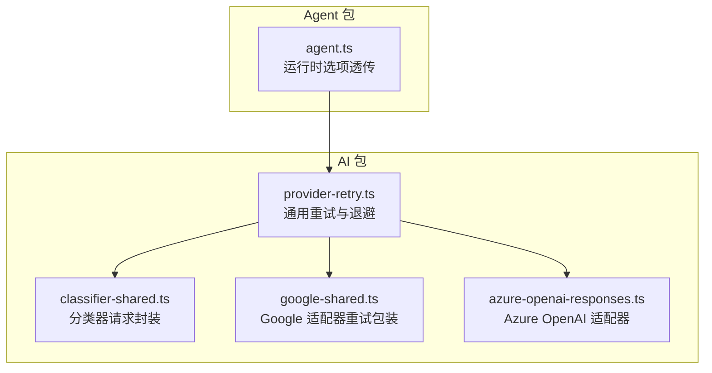
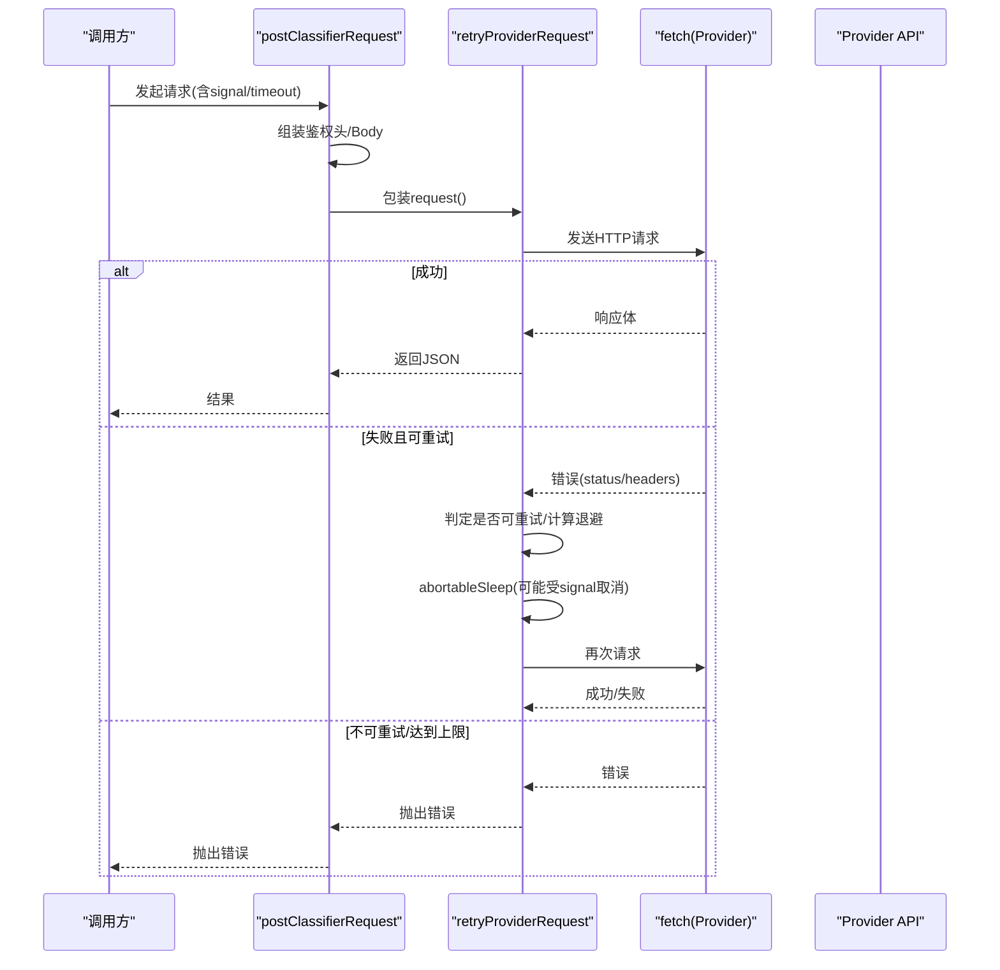
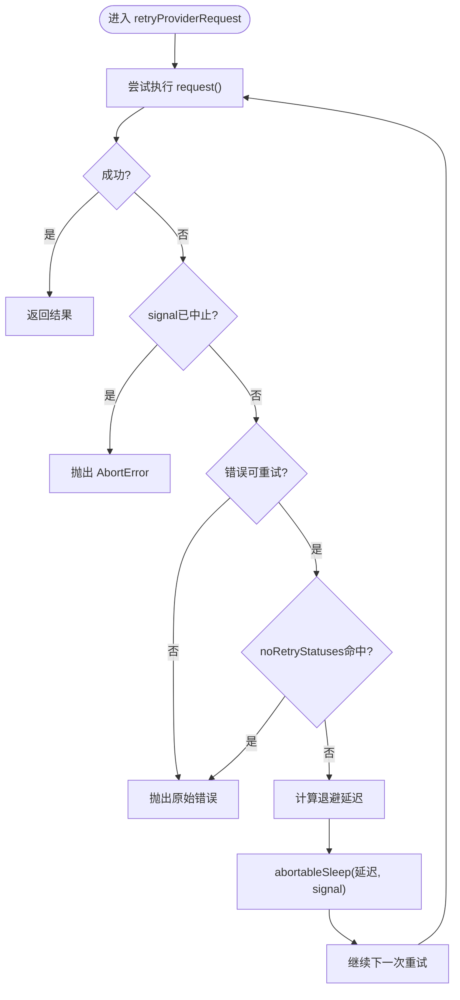
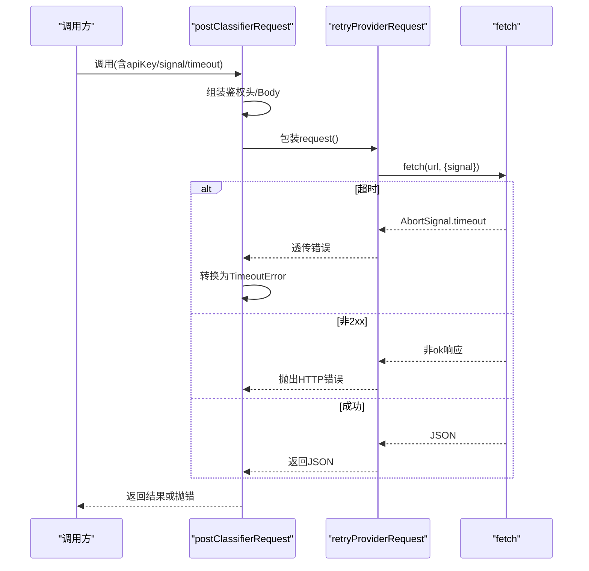
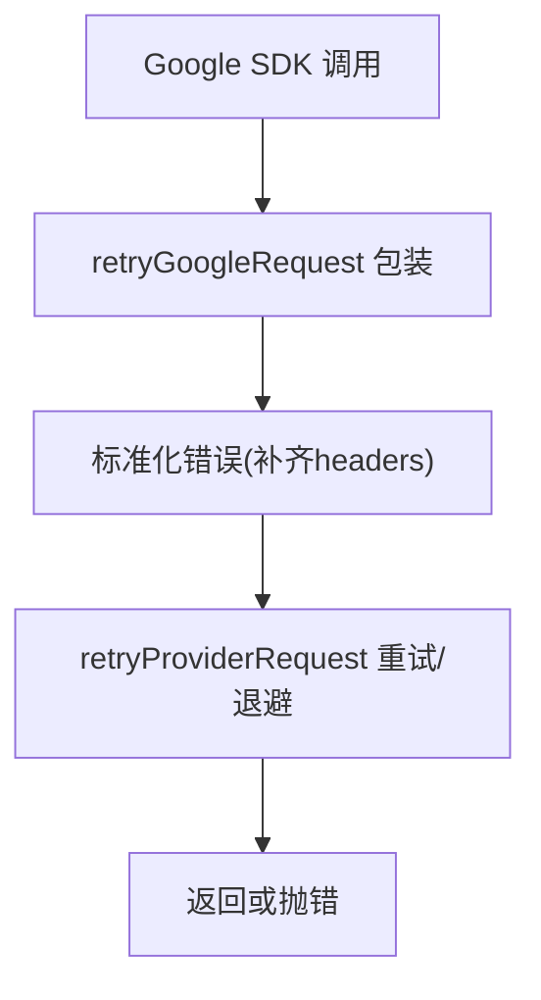
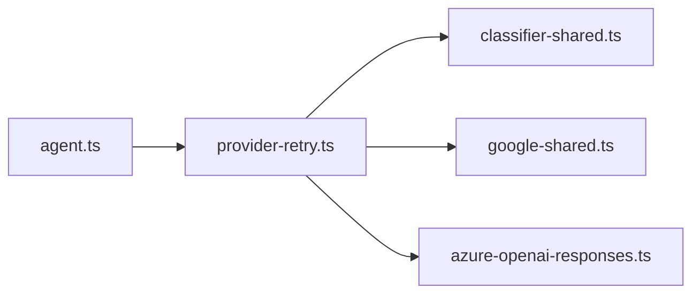

# 故障转移机制

<cite>
**本文引用的文件**
- [packages/ai/src/utils/provider-retry.ts](file://packages/ai/src/utils/provider-retry.ts)
- [packages/ai/test/provider-retry.test.ts](file://packages/ai/test/provider-retry.test.ts)
- [packages/ai/src/api/classifier-shared.ts](file://packages/ai/src/api/classifier-shared.ts)
- [packages/ai/src/api/google-shared.ts](file://packages/ai/src/api/google-shared.ts)
- [packages/ai/src/api/azure-openai-responses.ts](file://packages/ai/src/api/azure-openai-responses.ts)
- [packages/agent/src/agent.ts](file://packages/agent/src/agent.ts)
</cite>

## 目录
1. [简介](#简介)
2. [项目结构](#项目结构)
3. [核心组件](#核心组件)
4. [架构总览](#架构总览)
5. [详细组件分析](#详细组件分析)
6. [依赖关系分析](#依赖关系分析)
7. [性能与可靠性考量](#性能与可靠性考量)
8. [故障排查指南](#故障排查指南)
9. [结论](#结论)
10. [附录](#附录)

## 简介
本文件系统化梳理多提供商自动切换、健康检查策略与错误恢复流程，覆盖 Provider 可用性检测、认证状态监控、动态重连机制、故障检测阈值、重试策略与降级处理方案。同时给出配置示例、监控指标与调试技巧，并文档化异步操作取消、信号处理和资源清理机制。

## 项目结构
围绕“故障转移”的关键代码集中在 AI 包的重试工具与各 API 适配层：
- 通用重试与退避逻辑：packages/ai/src/utils/provider-retry.ts
- 分类器请求封装（Bearer 鉴权 + 重试）：packages/ai/src/api/classifier-shared.ts
- Google 系列适配器（统一包装重试）：packages/ai/src/api/google-shared.ts
- Azure OpenAI Responses 适配器（显式传入重试参数）：packages/ai/src/api/azure-openai-responses.ts
- Agent 运行时对重试参数的透传：packages/agent/src/agent.ts
- 单元测试验证重试行为与取消语义：packages/ai/test/provider-retry.test.ts

**图表来源**
- [packages/ai/src/utils/provider-retry.ts:1-129](file://packages/ai/src/utils/provider-retry.ts#L1-L129)
- [packages/ai/src/api/classifier-shared.ts:1-132](file://packages/ai/src/api/classifier-shared.ts#L1-L132)
- [packages/ai/src/api/google-shared.ts:544-574](file://packages/ai/src/api/google-shared.ts#L544-L574)
- [packages/ai/src/api/azure-openai-responses.ts:89-95](file://packages/ai/src/api/azure-openai-responses.ts#L89-L95)
- [packages/agent/src/agent.ts:232-260](file://packages/agent/src/agent.ts#L232-L260)

**章节来源**
- [packages/ai/src/utils/provider-retry.ts:1-129](file://packages/ai/src/utils/provider-retry.ts#L1-L129)
- [packages/ai/src/api/classifier-shared.ts:1-132](file://packages/ai/src/api/classifier-shared.ts#L1-L132)
- [packages/ai/src/api/google-shared.ts:544-574](file://packages/ai/src/api/google-shared.ts#L544-L574)
- [packages/ai/src/api/azure-openai-responses.ts:89-95](file://packages/ai/src/api/azure-openai-responses.ts#L89-L95)
- [packages/agent/src/agent.ts:232-260](file://packages/agent/src/agent.ts#L232-L260)

## 核心组件
- 通用重试器 retryProviderRequest
  - 职责：实现可中断的指数退避重试；尊重 provider 返回的 retry-after/retry-after-ms；支持 noRetryStatuses 白名单；支持 AbortSignal 取消。
  - 关键能力：
    - 可重试错误判定：x-should-retry=true/false 优先；否则按 408/409/429/5xx 判定。
    - 服务器延迟上限校验：默认最大 60s，可通过 maxRetryDelayMs 调整或置 0 禁用限制。
    - 退避计算：基于重试次数指数增长，带抖动；若未提供 retry-after*，则使用内置退避。
    - 取消支持：abortableSleep 监听 AbortSignal，触发后抛出 AbortError。
- 分类器请求封装 postClassifierRequest
  - 职责：Bearer 鉴权、请求头组装、超时控制、调用 retryProviderRequest 进行重试。
  - 关键点：将 timeout 与外部 signal 合并为 AbortSignal.any；失败时区分 TimeoutError 与 HTTP 错误。
- Google 适配器重试包装 retryGoogleRequest
  - 职责：将 SDK 异常标准化（补齐 headers），再交由 retryProviderRequest 处理。
- Azure OpenAI Responses 适配器
  - 职责：在调用处显式传入 maxRetries/maxRetryDelayMs，复用通用重试策略。
- Agent 运行时
  - 职责：将 maxRetryDelayMs 等参数从运行时选项透传到下游调用链。

**章节来源**
- [packages/ai/src/utils/provider-retry.ts:1-129](file://packages/ai/src/utils/provider-retry.ts#L1-L129)
- [packages/ai/src/api/classifier-shared.ts:42-107](file://packages/ai/src/api/classifier-shared.ts#L42-L107)
- [packages/ai/src/api/google-shared.ts:544-574](file://packages/ai/src/api/google-shared.ts#L544-L574)
- [packages/ai/src/api/azure-openai-responses.ts:89-95](file://packages/ai/src/api/azure-openai-responses.ts#L89-L95)
- [packages/agent/src/agent.ts:232-260](file://packages/agent/src/agent.ts#L232-L260)

## 架构总览
下图展示一次分类器请求从上层到 Provider 的完整路径，以及重试、超时、取消与鉴权的交互点。

**图表来源**
- [packages/ai/src/api/classifier-shared.ts:63-107](file://packages/ai/src/api/classifier-shared.ts#L63-L107)
- [packages/ai/src/utils/provider-retry.ts:99-129](file://packages/ai/src/utils/provider-retry.ts#L99-L129)

## 详细组件分析

### 通用重试器 retryProviderRequest
- 重试判定
  - 优先读取 x-should-retry 头决定可重试性。
  - 若无该头，仅对 408/409/429/5xx 进行重试。
  - 支持 noRetryStatuses 强制不重试特定状态码。
- 退避策略
  - 优先解析 retry-after-ms；其次 retry-after（秒或日期）。
  - 若均未提供，采用指数退避：0.5 * 2^retryIndex，上限 8 秒，并加入最多 25% 抖动。
  - 所有来自服务器的延迟均受 maxRetryDelayMs 限制（默认 60s），超过即直接报错；设为 0 可禁用限制。
- 取消与清理
  - 每次循环前检查 AbortSignal.aborted。
  - 退避期间通过 abortableSleep 监听 abort 事件，触发后立即清理定时器并抛出 AbortError。
- 复杂度
  - 时间复杂度：O(k)，k 为实际重试次数。
  - 空间复杂度：O(1)。

**图表来源**
- [packages/ai/src/utils/provider-retry.ts:24-69](file://packages/ai/src/utils/provider-retry.ts#L24-L69)
- [packages/ai/src/utils/provider-retry.ts:71-97](file://packages/ai/src/utils/provider-retry.ts#L71-L97)
- [packages/ai/src/utils/provider-retry.ts:99-129](file://packages/ai/src/utils/provider-retry.ts#L99-L129)

**章节来源**
- [packages/ai/src/utils/provider-retry.ts:1-129](file://packages/ai/src/utils/provider-retry.ts#L1-L129)

### 分类器请求封装 postClassifierRequest
- 鉴权与头部
  - 注入 Bearer token、content-type，并合并 identity 与模型自定义头。
- 超时与取消
  - 若配置 timeoutMs，构造 AbortSignal.timeout；与外部 signal 合并为 AbortSignal.any。
  - 若因内部 timeout 触发而外部 signal 未中止，则抛出 TimeoutError。
- 重试
  - 默认 maxRetries=2，maxRetryDelayMs 透传，noRetryStatuses 可选。
- 回调钩子
  - onPayload/onResponse 用于载荷转换与响应元数据记录。

**图表来源**
- [packages/ai/src/api/classifier-shared.ts:42-107](file://packages/ai/src/api/classifier-shared.ts#L42-L107)

**章节来源**
- [packages/ai/src/api/classifier-shared.ts:1-132](file://packages/ai/src/api/classifier-shared.ts#L1-L132)

### Google 适配器重试包装 retryGoogleRequest
- 作用：将 Google SDK 的 ApiError 标准化（补齐缺失的 headers），再交给 retryProviderRequest 处理。
- 适用场景：Google GenAI/Vertex 的请求路径统一走此包装，确保与 Anthropic/OpenAI 一致的退避与取消语义。

**图表来源**
- [packages/ai/src/api/google-shared.ts:544-574](file://packages/ai/src/api/google-shared.ts#L544-L574)
- [packages/ai/src/utils/provider-retry.ts:99-129](file://packages/ai/src/utils/provider-retry.ts#L99-L129)

**章节来源**
- [packages/ai/src/api/google-shared.ts:544-574](file://packages/ai/src/api/google-shared.ts#L544-L574)

### Azure OpenAI Responses 适配器
- 在调用处显式传入 maxRetries 与 maxRetryDelayMs，复用通用重试策略。
- 体现“上层业务按需定制重试参数”的模式。

**章节来源**
- [packages/ai/src/api/azure-openai-responses.ts:89-95](file://packages/ai/src/api/azure-openai-responses.ts#L89-L95)

### Agent 运行时参数透传
- 将 maxRetryDelayMs 从运行时选项传递至下游调用链，保证全局一致性。

**章节来源**
- [packages/agent/src/agent.ts:232-260](file://packages/agent/src/agent.ts#L232-L260)

## 依赖关系分析
- 低耦合高内聚：provider-retry.ts 作为纯函数工具，被多个 API 适配器复用。
- 适配器层负责协议差异与错误标准化，重试策略集中管理，避免重复实现。
- Agent 层仅透传配置，不侵入重试逻辑，保持关注点分离。

**图表来源**
- [packages/ai/src/utils/provider-retry.ts:1-129](file://packages/ai/src/utils/provider-retry.ts#L1-L129)
- [packages/ai/src/api/classifier-shared.ts:1-132](file://packages/ai/src/api/classifier-shared.ts#L1-L132)
- [packages/ai/src/api/google-shared.ts:544-574](file://packages/ai/src/api/google-shared.ts#L544-L574)
- [packages/ai/src/api/azure-openai-responses.ts:89-95](file://packages/ai/src/api/azure-openai-responses.ts#L89-L95)
- [packages/agent/src/agent.ts:232-260](file://packages/agent/src/agent.ts#L232-L260)

**章节来源**
- [packages/ai/src/utils/provider-retry.ts:1-129](file://packages/ai/src/utils/provider-retry.ts#L1-L129)
- [packages/ai/src/api/classifier-shared.ts:1-132](file://packages/ai/src/api/classifier-shared.ts#L1-L132)
- [packages/ai/src/api/google-shared.ts:544-574](file://packages/ai/src/api/google-shared.ts#L544-L574)
- [packages/ai/src/api/azure-openai-responses.ts:89-95](file://packages/ai/src/api/azure-openai-responses.ts#L89-L95)
- [packages/agent/src/agent.ts:232-260](file://packages/agent/src/agent.ts#L232-L260)

## 性能与可靠性考量
- 退避与抖动
  - 指数退避上限 8 秒，配合随机抖动降低雪崩风险。
- 服务器延迟保护
  - 默认限制 60s，防止 Provider 恶意或异常的大延迟导致长时间阻塞。
- 取消与资源清理
  - 每次重试前检查 AbortSignal；退避期间监听 abort 事件并清理定时器，避免悬挂任务。
- 可观测性建议
  - 统计重试次数、最终状态码分布、平均/分位延迟、取消率。
  - 针对 noRetryStatuses 命中情况单独计数，便于识别上游变更。
- 降级策略
  - 当 Provider 持续失败时，可在上层切换到备用 Provider 或返回缓存/兜底结果。
  - 结合 onPayload/onResponse 钩子记录上下文，辅助定位问题。

[本节为通用指导，无需具体文件引用]

## 故障排查指南
- 常见问题与定位
  - 未触发重试：检查错误是否携带 status/headers，或是否命中 noRetryStatuses。
  - 退避过长：确认 retry-after* 头值是否过大；必要时调大 maxRetryDelayMs 或置 0 禁用限制。
  - 请求被取消：检查外部 AbortSignal 是否在退避期间被触发；确认上层是否正确传播 signal。
  - 鉴权失败：确认 Bearer token 是否有效；观察 onResponse 钩子中的状态码。
- 调试技巧
  - 使用 onPayload/onResponse 打印请求/响应摘要。
  - 在测试中用 fake timers 验证退避与取消路径。
  - 针对 Google SDK 异常，确认 headers 已被标准化。

**章节来源**
- [packages/ai/test/provider-retry.test.ts:1-90](file://packages/ai/test/provider-retry.test.ts#L1-L90)
- [packages/ai/src/api/classifier-shared.ts:42-107](file://packages/ai/src/api/classifier-shared.ts#L42-L107)
- [packages/ai/src/api/google-shared.ts:544-574](file://packages/ai/src/api/google-shared.ts#L544-L574)

## 结论
本项目通过统一的 retryProviderRequest 实现了跨 Provider 的一致重试、退避与取消语义；各适配器层专注协议差异与错误标准化；Agent 层负责参数透传。该设计在保证可靠性的同时具备良好的可扩展性与可观测性，适合在多 Provider 环境下稳定运行。

[本节为总结性内容，无需具体文件引用]

## 附录

### 故障转移配置示例
- 基础重试
  - maxRetries: 2
  - maxRetryDelayMs: 60000（默认）
- 禁用服务器延迟上限
  - maxRetryDelayMs: 0
- 指定不重试的状态码
  - noRetryStatuses: [504]
- 组合超时与取消
  - 设置 timeoutMs 与外部 signal，二者任一触发即停止

**章节来源**
- [packages/ai/src/utils/provider-retry.ts:1-129](file://packages/ai/src/utils/provider-retry.ts#L1-L129)
- [packages/ai/src/api/classifier-shared.ts:63-107](file://packages/ai/src/api/classifier-shared.ts#L63-L107)

### 监控指标建议
- 重试次数与成功率
- 状态码分布（含 noRetryStatuses 命中）
- 平均/分位延迟（含退避等待）
- 取消率（AbortError）
- 鉴权失败率（401/403）
- Provider 健康度（连续失败次数、恢复时间）

[本节为通用指导，无需具体文件引用]

### 异步取消与资源清理
- 每次重试前检查 AbortSignal.aborted。
- 退避期间通过 abortableSleep 监听 abort 事件，立即清理定时器并抛出 AbortError。
- 上层应正确传播 signal，避免悬挂任务。

**章节来源**
- [packages/ai/src/utils/provider-retry.ts:71-97](file://packages/ai/src/utils/provider-retry.ts#L71-L97)
- [packages/ai/src/utils/provider-retry.ts:99-129](file://packages/ai/src/utils/provider-retry.ts#L99-L129)