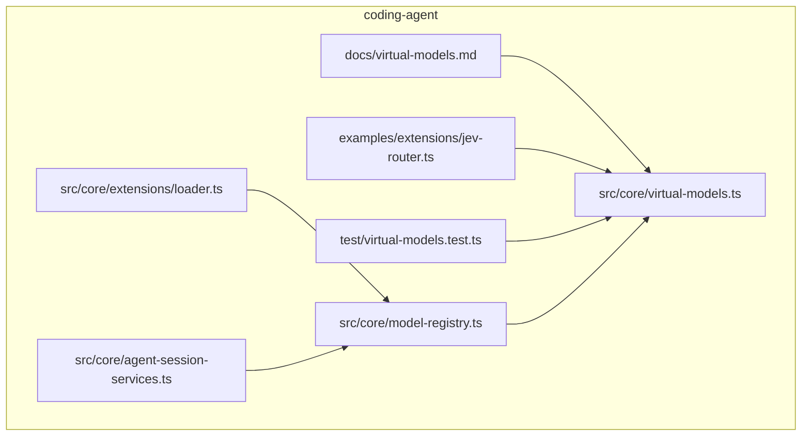
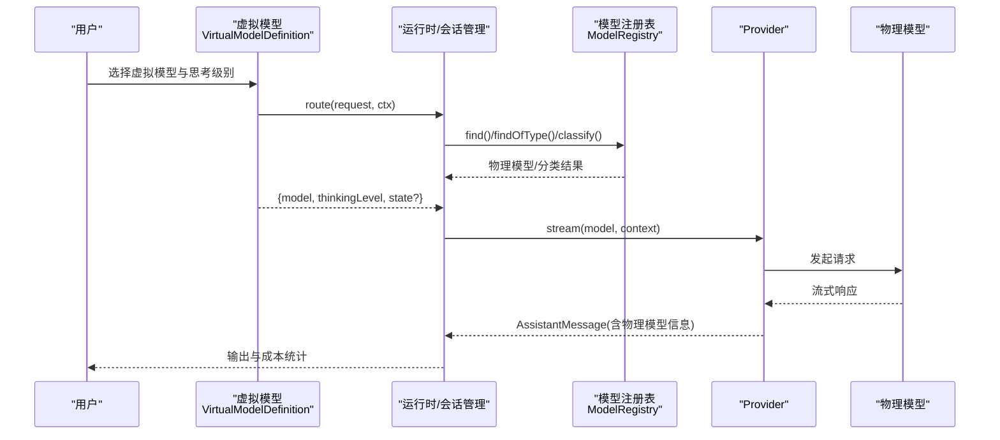
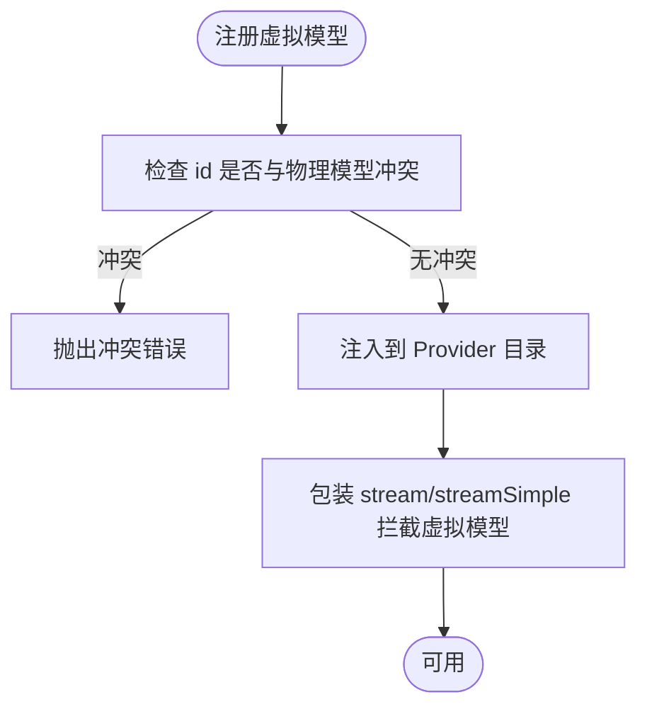
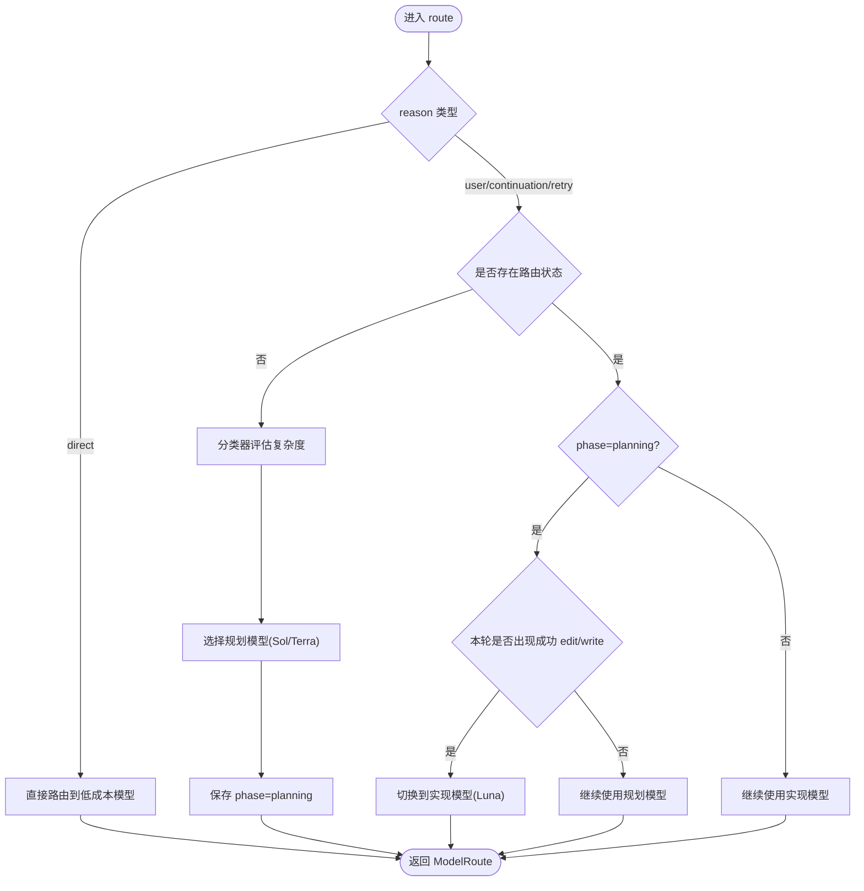
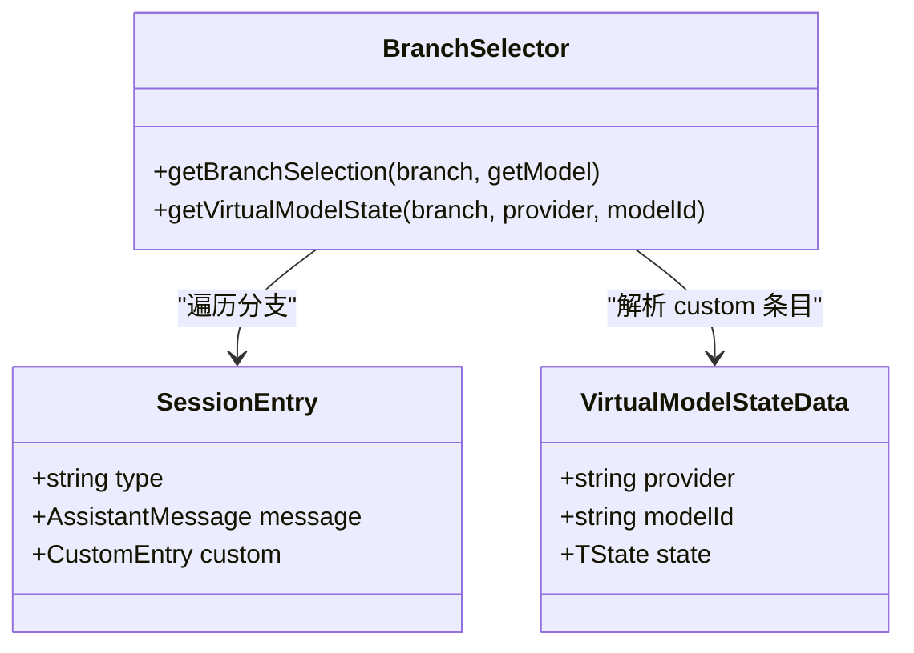
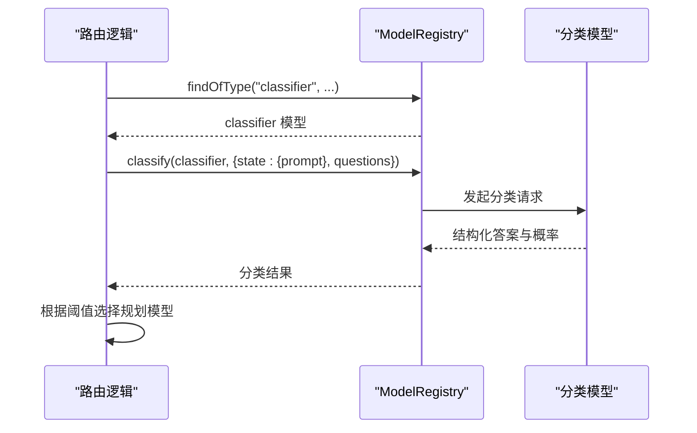
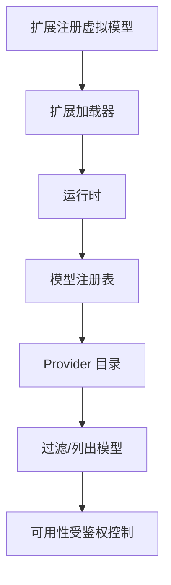
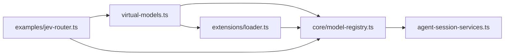

# 智能路由算法

<cite>
**本文引用的文件**   
- [virtual-models.md](file://packages/coding-agent/docs/virtual-models.md)
- [virtual-models.ts](file://packages/coding-agent/src/core/virtual-models.ts)
- [jev-router.ts](file://packages/coding-agent/examples/extensions/jev-router.ts)
- [model-registry.ts](file://packages/coding-agent/src/core/model-registry.ts)
- [extensions-loader.ts](file://packages/coding-agent/src/core/extensions/loader.ts)
- [agent-session-services.ts](file://packages/coding-agent/src/core/agent-session-services.ts)
- [virtual-models.test.ts](file://packages/coding-agent/test/virtual-models.test.ts)
</cite>

## 目录
1. [引言](#引言)
2. [项目结构](#项目结构)
3. [核心组件](#核心组件)
4. [架构总览](#架构总览)
5. [详细组件分析](#详细组件分析)
6. [依赖关系分析](#依赖关系分析)
7. [性能与准确率评估](#性能与准确率评估)
8. [故障排查指南](#故障排查指南)
9. [结论](#结论)
10. [附录：配置、规则与扩展开发](#附录配置规则与扩展开发)

## 引言
本文件面向“智能路由算法”的实现与使用，围绕以下目标展开：
- 虚拟模型定义：如何在系统中声明一个可选择的“虚拟模型”，并在每次请求时动态选择物理模型。
- 路由规则引擎与决策树：通过 `route(request, ctx)` 实现上下文感知的路由逻辑，支持状态持久化、重试与继续调用。
- 语义匹配与内容分类：借助分类器能力对输入进行复杂度或意图判断，驱动模型选择。
- 优先级、条件判断与动态规则加载：在会话分支上维护路由状态，结合外部分类结果形成稳定的决策路径。
- 配置示例、自定义规则与扩展开发：提供完整示例与扩展点说明。
- 性能、准确率与 A/B 测试框架：给出评估维度与落地建议。

## 项目结构
智能路由相关代码主要位于 coding-agent 包中，分为文档、核心实现、示例扩展与测试四个部分：
- 文档层：解释虚拟模型概念、注册方式、路由参数与状态机制。
- 核心层：定义虚拟模型类型、会话分支选择与状态读取、虚拟模型注入到 Provider 的目录。
- 示例层：提供一个基于分类器的“规划-实现”两阶段路由示例。
- 测试层：验证虚拟模型的注册、冲突检测、不可路由等边界行为。

图表来源
- [virtual-models.md:1-115](file://packages/coding-agent/docs/virtual-models.md#L1-L115)
- [virtual-models.ts:1-239](file://packages/coding-agent/src/core/virtual-models.ts#L1-L239)
- [jev-router.ts:1-114](file://packages/coding-agent/examples/extensions/jev-router.ts#L1-L114)
- [model-registry.ts:225-230](file://packages/coding-agent/src/core/model-registry.ts#L225-L230)
- [extensions-loader.ts:233-236](file://packages/coding-agent/src/core/extensions/loader.ts#L233-L236)
- [agent-session-services.ts:184-184](file://packages/coding-agent/src/core/agent-session-services.ts#L184-L184)

章节来源
- [virtual-models.md:1-115](file://packages/coding-agent/docs/virtual-models.md#L1-L115)
- [virtual-models.ts:1-239](file://packages/coding-agent/src/core/virtual-models.ts#L1-L239)

## 核心组件
- 虚拟模型定义与生命周期
  - 通过 `VirtualModelDefinition` 声明虚拟模型，包含 provider、id、name、thinkingLevels、contextWindow、maxTokens、input 与 route 函数。
  - 系统会为虚拟模型生成目录项，但不直接流式调用；所有下游只看到物理模型。
- 路由请求与返回
  - `ModelRouteRequest` 提供当前选择、思考级别、reason（user/continuation/retry/direct）、previous、failed、state、messages、signal 等上下文。
  - `ModelRoute` 返回目标物理模型、thinkingLevel 与可选的新 state。
- 会话分支选择与状态
  - `getBranchSelection` 根据会话分支条目恢复虚拟模型选择或回退到最近一次物理响应。
  - `getVirtualModelState` 从会话分支中读取上次保存的路由状态。
- Provider 包装
  - `withVirtualModels` 将虚拟模型合并进 Provider 目录，并拦截对虚拟模型的流式调用，强制先路由。

章节来源
- [virtual-models.ts:84-102](file://packages/coding-agent/src/core/virtual-models.ts#L84-L102)
- [virtual-models.ts:52-82](file://packages/coding-agent/src/core/virtual-models.ts#L52-L82)
- [virtual-models.ts:128-167](file://packages/coding-agent/src/core/virtual-models.ts#L128-L167)
- [virtual-models.ts:201-238](file://packages/coding-agent/src/core/virtual-models.ts#L201-L238)

## 架构总览
下图展示用户选择虚拟模型后，系统如何将其转换为物理模型并执行请求，同时记录选择与调度信息。

图表来源
- [virtual-models.md:63-86](file://packages/coding-agent/docs/virtual-models.md#L63-L86)
- [virtual-models.ts:169-187](file://packages/coding-agent/src/core/virtual-models.ts#L169-L187)
- [virtual-models.ts:201-238](file://packages/coding-agent/src/core/virtual-models.ts#L201-L238)

## 详细组件分析

### 虚拟模型定义与注册
- 声明要点
  - provider 决定虚拟模型的可见性与鉴权范围；可与物理模型共存。
  - id 不能与同 provider 的物理模型冲突；若后续目录刷新新增同名物理模型，虚拟模型会遮蔽它。
  - thinkingLevels 控制对外暴露的思考级别选项；未设置的限制视为未知。
  - input 指定支持的输入类型；默认文本与图像。
- 注册与卸载
  - 扩展可通过 `pi.registerVirtualModel` 注册；SDK 也可通过 `modelRuntime.registerVirtualModel` 注册。
  - 重复注册相同 provider/id 会替换已有虚拟模型；`unregisterVirtualModel` 可移除。
- 目录注入
  - `withVirtualModels` 将虚拟模型加入 Provider 目录，并对虚拟模型调用做拦截，确保必须先路由。

图表来源
- [virtual-models.ts:169-187](file://packages/coding-agent/src/core/virtual-models.ts#L169-L187)
- [virtual-models.ts:201-238](file://packages/coding-agent/src/core/virtual-models.ts#L201-L238)
- [virtual-models.test.ts:189-196](file://packages/coding-agent/test/virtual-models.test.ts#L189-L196)

章节来源
- [virtual-models.md:31-61](file://packages/coding-agent/docs/virtual-models.md#L31-L61)
- [virtual-models.ts:84-102](file://packages/coding-agent/src/core/virtual-models.ts#L84-L102)
- [virtual-models.ts:201-238](file://packages/coding-agent/src/core/virtual-models.ts#L201-L238)
- [virtual-models.test.ts:174-196](file://packages/coding-agent/test/virtual-models.test.ts#L174-L196)

### 路由规则引擎与决策树
- 路由入口
  - 每次使用虚拟模型发起请求前都会调用 `route(request, ctx)`。
  - reason 区分首次用户请求、工具续调、自动重试与外部直调。
- 上下文感知
  - previous：上一次成功响应的物理模型与思考级别，可用于保持提示缓存与思维签名稳定。
  - failed：重试场景下携带失败消息的 stopReason 与 errorMessage，便于按错误类型切换模型。
  - state：路由状态，JSON 可序列化，跨请求保存在会话分支，支持分叉与压缩存活。
- 决策树模式
  - 典型策略：先规划（强模型）→ 检测到编辑工具成功后切换到实现（低成本模型）。
  - 示例 jev-router 通过分类器评估复杂度，选择 Sol/Terra 作为规划模型，再在第一次成功 edit/write 后切到 Luna。

图表来源
- [virtual-models.md:63-112](file://packages/coding-agent/docs/virtual-models.md#L63-L112)
- [jev-router.ts:61-88](file://packages/coding-agent/examples/extensions/jev-router.ts#L61-L88)
- [jev-router.ts:99-111](file://packages/coding-agent/examples/extensions/jev-router.ts#L99-L111)

章节来源
- [virtual-models.md:63-112](file://packages/coding-agent/docs/virtual-models.md#L63-L112)
- [virtual-models.ts:52-82](file://packages/coding-agent/src/core/virtual-models.ts#L52-L82)
- [jev-router.ts:1-114](file://packages/coding-agent/examples/extensions/jev-router.ts#L1-L114)

### 上下文感知路由与状态持久化
- 会话分支选择
  - `getBranchSelection` 优先取最近的 model_change；若虚拟模型已注销则回退到最近一次物理响应。
- 路由状态读取与写入
  - `getVirtualModelState` 从会话分支的 custom 条目中读取 JSON 序列化的路由状态。
  - route 返回新 state 会被持久化；返回 undefined 或原 state 引用表示不变更。
- direct 请求
  - 外部直调（如压缩摘要）不带 state，且忽略其返回的 state。

图表来源
- [virtual-models.ts:128-167](file://packages/coding-agent/src/core/virtual-models.ts#L128-L167)

章节来源
- [virtual-models.ts:128-167](file://packages/coding-agent/src/core/virtual-models.ts#L128-L167)
- [virtual-models.md:88-112](file://packages/coding-agent/docs/virtual-models.md#L88-L112)

### 语义匹配与内容分类算法
- 分类器接入
  - 通过 `ctx.modelRegistry.findOfType("classifier", ...)` 获取分类模型。
  - 使用 `ctx.modelRegistry.classify()` 传入 prompt 与结构化问题，得到答案与概率。
- 复杂度判定
  - 示例中根据“标准 vs 复杂”二分类阈值决定是否选用更强规划模型。
- 延迟与成本
  - 分类调用会增加首 token 前的延迟；应谨慎使用或在低延迟路径中缓存结果。

图表来源
- [jev-router.ts:61-88](file://packages/coding-agent/examples/extensions/jev-router.ts#L61-L88)

章节来源
- [jev-router.ts:61-88](file://packages/coding-agent/examples/extensions/jev-router.ts#L61-L88)
- [virtual-models.md:112-112](file://packages/coding-agent/docs/virtual-models.md#L112-L112)

### 路由优先级、条件判断与动态规则加载
- 优先级
  - 虚拟模型在 Provider 目录中与物理模型并存；虚拟模型会遮蔽同名物理模型。
  - 过滤与列出模型时，虚拟模型与物理模型分别处理，保证可用性遵循 Provider 鉴权。
- 条件判断
  - 依据 reason、previous、failed、state、messages 等上下文组合条件。
  - 示例中通过“首轮分类 + 编辑工具成功触发”的条件链完成阶段切换。
- 动态规则加载
  - 扩展可在运行时注册/卸载虚拟模型；重复注册覆盖旧定义。
  - 服务层会将扩展注册的虚拟模型注入运行时。

图表来源
- [extensions-loader.ts:233-236](file://packages/coding-agent/src/core/extensions/loader.ts#L233-L236)
- [extensions-loader.ts:512-525](file://packages/coding-agent/src/core/extensions/loader.ts#L512-L525)
- [model-registry.ts:225-230](file://packages/coding-agent/src/core/model-registry.ts#L225-L230)
- [agent-session-services.ts:184-184](file://packages/coding-agent/src/core/agent-session-services.ts#L184-L184)

章节来源
- [virtual-models.ts:201-238](file://packages/coding-agent/src/core/virtual-models.ts#L201-L238)
- [extensions-loader.ts:233-236](file://packages/coding-agent/src/core/extensions/loader.ts#L233-L236)
- [extensions-loader.ts:512-525](file://packages/coding-agent/src/core/extensions/loader.ts#L512-L525)
- [model-registry.ts:225-230](file://packages/coding-agent/src/core/model-registry.ts#L225-L230)
- [agent-session-services.ts:184-184](file://packages/coding-agent/src/core/agent-session-services.ts#L184-L184)

## 依赖关系分析
- 模块耦合
  - 虚拟模型核心类型与工具集中在 virtual-models.ts。
  - 示例扩展 jev-router.ts 依赖 ModelRegistry 的分类能力与查找能力。
  - 扩展加载器与模型注册表负责虚拟模型的动态注册与目录注入。
- 外部依赖
  - 分类器模型来自 catalog 中的 classifier 类型模型，具体实现由 Provider 提供。
- 循环依赖
  - 未见明显循环依赖；虚拟模型不会路由到另一个虚拟模型，避免递归。

图表来源
- [virtual-models.ts:1-239](file://packages/coding-agent/src/core/virtual-models.ts#L1-L239)
- [extensions-loader.ts:233-236](file://packages/coding-agent/src/core/extensions/loader.ts#L233-L236)
- [model-registry.ts:225-230](file://packages/coding-agent/src/core/model-registry.ts#L225-L230)
- [agent-session-services.ts:184-184](file://packages/coding-agent/src/core/agent-session-services.ts#L184-L184)
- [jev-router.ts:1-114](file://packages/coding-agent/examples/extensions/jev-router.ts#L1-L114)

章节来源
- [virtual-models.ts:1-239](file://packages/coding-agent/src/core/virtual-models.ts#L1-L239)
- [extensions-loader.ts:233-236](file://packages/coding-agent/src/core/extensions/loader.ts#L233-L236)
- [model-registry.ts:225-230](file://packages/coding-agent/src/core/model-registry.ts#L225-L230)
- [agent-session-services.ts:184-184](file://packages/coding-agent/src/core/agent-session-services.ts#L184-L184)
- [jev-router.ts:1-114](file://packages/coding-agent/examples/extensions/jev-router.ts#L1-L114)

## 性能与准确率评估
- 性能特征
  - 分类调用增加首 token 前延迟；建议在高频路径中缓存分类结果或使用轻量分类器。
  - 在 continuation/retry 场景中复用 previous/failed 可减少提示缓存丢失与思维签名变化。
  - 虚拟模型本身不产生流量，仅在选择阶段计算；实际成本由物理模型承担。
- 准确率评估
  - 以分类阈值为关键超参，结合业务指标（任务完成率、返工率、平均成本）评估。
  - 通过会话分支与转录记录对比不同路由策略的效果。
- A/B 测试框架建议
  - 利用虚拟模型的可替换性，为同一业务场景部署多套路由策略（例如固定阈值 vs 自适应阈值）。
  - 通过 `/session` 查看各物理模型的成本分布，结合转录中的 selection/dispatch 信息进行离线分析。
  - 在扩展中埋点统计分类命中率、切换次数与失败原因，用于持续优化。

[本节为通用指导，不直接分析具体文件]

## 故障排查指南
- 常见错误
  - 路由返回虚拟模型：系统拒绝，请求以错误结束。
  - 路由返回无鉴权的物理模型：请求以错误结束。
  - 虚拟模型未路由即流式调用：抛出“必须先在流式调用前路由”的错误。
  - 虚拟模型 id 与物理模型冲突：注册时报错。
- 诊断步骤
  - 检查 route 返回值是否为有效物理模型与合法 thinkingLevel。
  - 确认 Provider 已配置鉴权且模型存在于目录。
  - 查看会话分支的 model_change 与 assistant message，确认选择与调度一致。
  - 对于分类器失败，检查 classify 返回的 stopReason 与 answers。

章节来源
- [virtual-models.md:84-86](file://packages/coding-agent/docs/virtual-models.md#L84-L86)
- [virtual-models.ts:189-194](file://packages/coding-agent/src/core/virtual-models.ts#L189-L194)
- [virtual-models.test.ts:198-200](file://packages/coding-agent/test/virtual-models.test.ts#L198-L200)

## 结论
该智能路由体系以“虚拟模型”为核心抽象，将用户选择与物理模型解耦，通过可扩展的 `route` 函数实现上下文感知、状态持久化与语义驱动的决策。配合分类器与示例扩展，可以快速构建“规划-实现”等多阶段路由策略。系统在目录注入、鉴权、会话分支与成本统计方面提供了完善支撑，便于在生产环境进行性能与准确率评估以及 A/B 测试。

[本节为总结性内容，不直接分析具体文件]

## 附录：配置、规则与扩展开发

### 虚拟模型配置要点
- provider：虚拟模型所属提供者 ID，决定可见性与鉴权。
- id：唯一标识，不得与同 provider 的物理模型冲突。
- name：显示名称。
- thinkingLevels：对外暴露的思考级别集合。
- contextWindow/maxTokens：首次响应前显示的上下文窗口与最大 token 数。
- input：支持的输入类型数组。
- route：核心决策函数，接收 request 与 ctx，返回 ModelRoute。

章节来源
- [virtual-models.md:31-61](file://packages/coding-agent/docs/virtual-models.md#L31-L61)
- [virtual-models.ts:84-102](file://packages/coding-agent/src/core/virtual-models.ts#L84-L102)

### 路由规则设计模板
- 基础模板
  - 根据 reason 区分首次用户请求与其他续调。
  - 复用 previous/failed 保持缓存与思维签名稳定。
  - 使用 state 保存阶段或分类结果。
- 复杂度驱动
  - 使用分类器评估任务复杂度，阈值决定强/弱模型。
- 阶段切换
  - 检测到编辑工具成功后从规划阶段切换到实现阶段。

章节来源
- [virtual-models.md:63-112](file://packages/coding-agent/docs/virtual-models.md#L63-L112)
- [jev-router.ts:61-111](file://packages/coding-agent/examples/extensions/jev-router.ts#L61-L111)

### 扩展开发指南
- 注册虚拟模型
  - 在扩展中使用 `pi.registerVirtualModel` 注册；重复注册会覆盖。
  - 使用 `pi.unregisterVirtualModel(provider, id)` 卸载。
- 访问模型与分类器
  - 通过 `ctx.modelRegistry.find` 查找物理模型。
  - 通过 `ctx.modelRegistry.findOfType("classifier", ...)` 与 `classify` 进行语义分类。
- 注意事项
  - route 中不要返回虚拟模型。
  - state 必须是 JSON 可序列化对象。
  - direct 请求不携带也不持久化 state。

章节来源
- [virtual-models.md:31-61](file://packages/coding-agent/docs/virtual-models.md#L31-L61)
- [virtual-models.md:88-112](file://packages/coding-agent/docs/virtual-models.md#L88-L112)
- [extensions-loader.ts:233-236](file://packages/coding-agent/src/core/extensions/loader.ts#L233-L236)
- [extensions-loader.ts:512-525](file://packages/coding-agent/src/core/extensions/loader.ts#L512-L525)