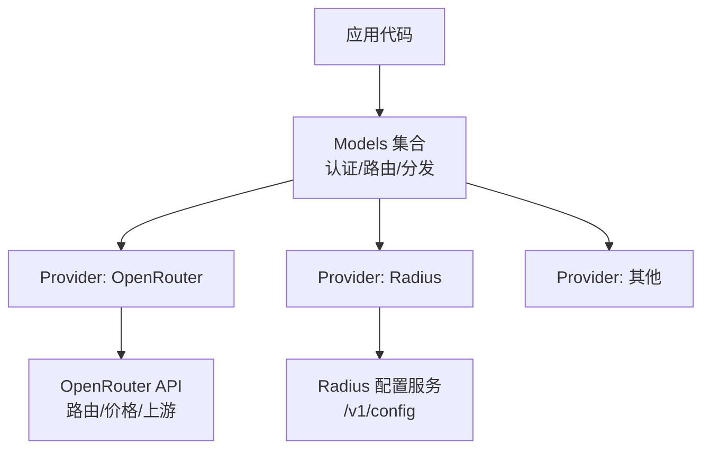
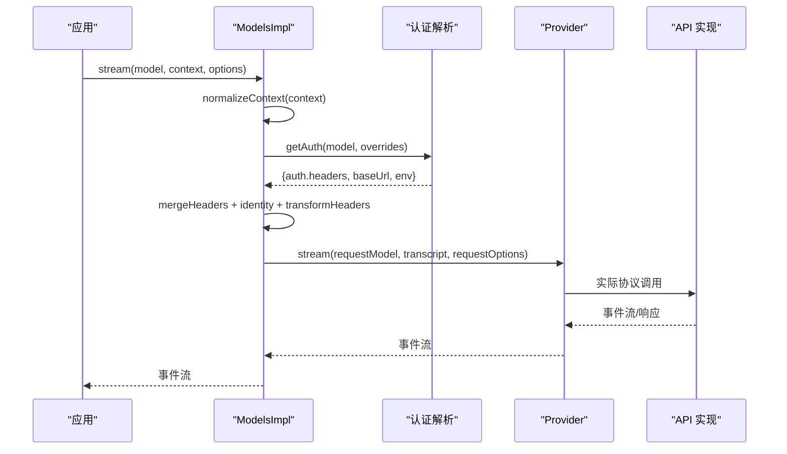
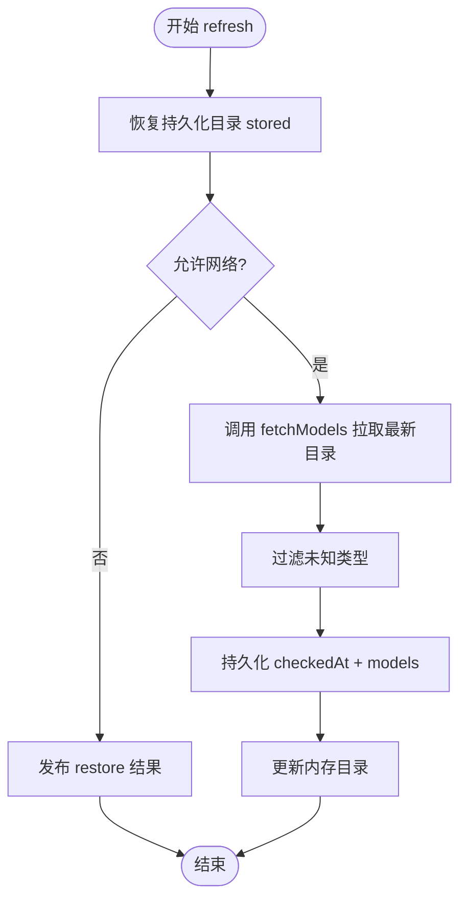
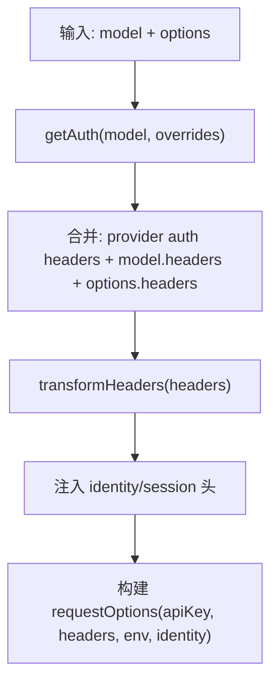
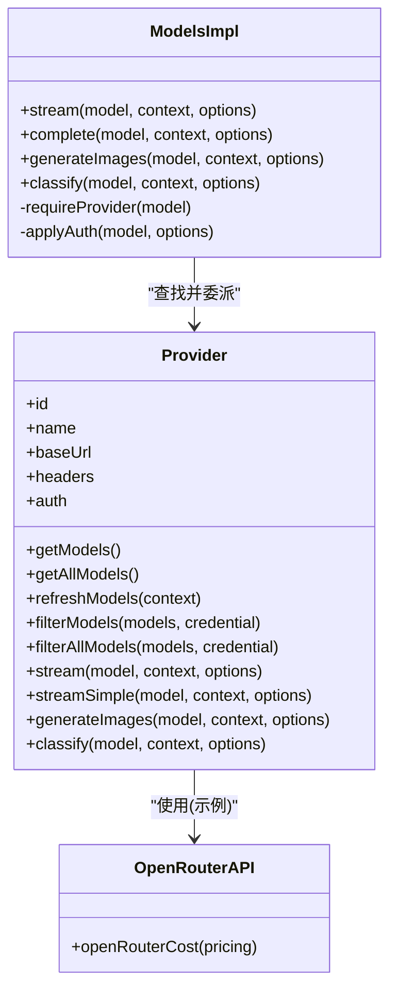
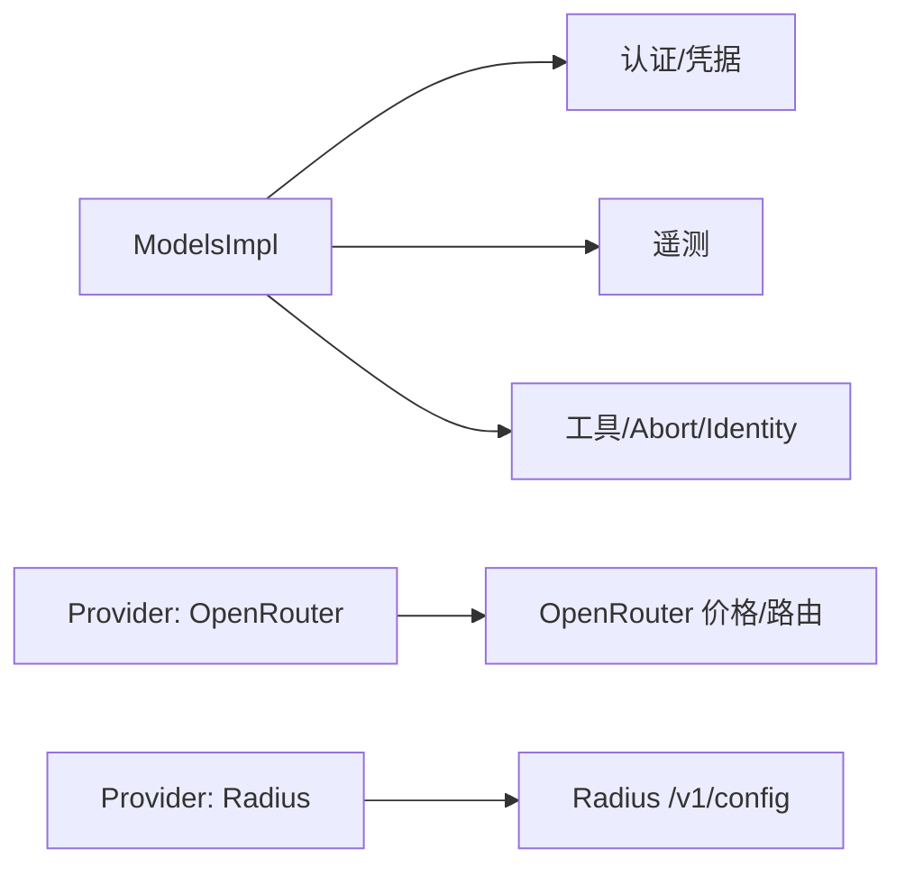
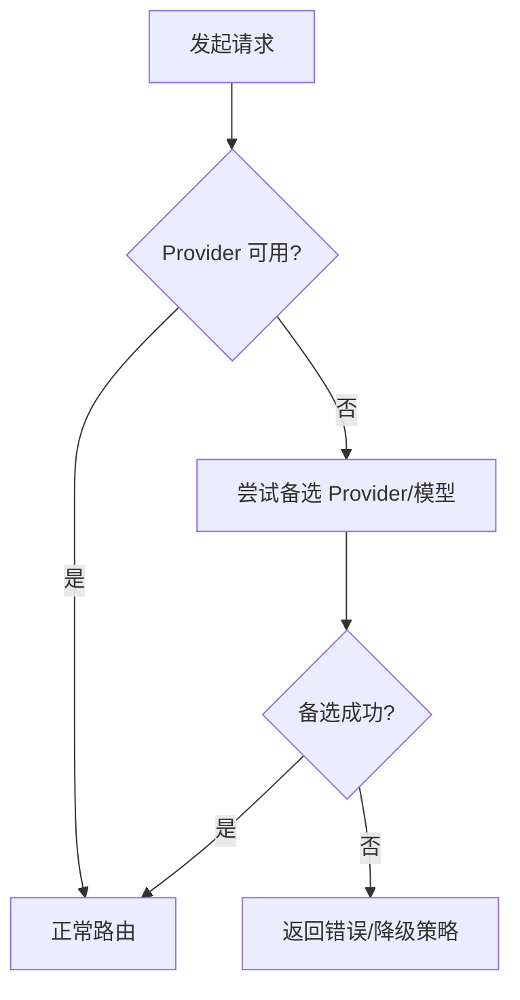

# 模型路由与负载均衡

<cite>
**本文引用的文件**   
- [packages/ai/src/models.ts](file://packages/ai/src/models.ts)
- [packages/ai/src/providers/openrouter-api.ts](file://packages/ai/src/providers/openrouter-api.ts)
- [packages/ai/src/providers/radius-config.ts](file://packages/ai/src/providers/radius-config.ts)
- [packages/ai/README.md](file://packages/ai/README.md)
- [packages/coding-agent/test/virtual-models.test.ts](file://packages/coding-agent/test/virtual-models.test.ts)
</cite>

## 目录
1. [引言](#引言)
2. [项目结构](#项目结构)
3. [核心组件](#核心组件)
4. [架构总览](#架构总览)
5. [详细组件分析](#详细组件分析)
6. [依赖关系分析](#依赖关系分析)
7. [性能与成本优化](#性能与成本优化)
8. [故障转移、健康检查与自动切换](#故障转移健康检查与自动切换)
9. [监控指标与可观测性](#监控指标与可观测性)
10. [配置指南：路由规则、权重与容量感知](#配置指南路由规则权重与容量感知)
11. [缓存策略与预热机制](#缓存策略与预热机制)
12. [疑难解答](#疑难解答)
13. [结论](#结论)

## 引言
本文件面向“模型路由与负载均衡系统”，围绕多提供商接入、智能路由、成本优化、延迟优先、容量感知调度、模型发现与健康检查、自动切换等主题，给出基于仓库现有实现的系统化说明。该系统的核心是统一的 `Models` 集合与 `Provider` 抽象：`Models` 负责认证解析、请求头合并、身份标识、遥测观察与操作分发；每个 `Provider` 拥有自身的模型目录、鉴权方式与具体 API 实现（流式、图像生成、分类器等）。OpenRouter 作为聚合网关，提供路由偏好、价格与上游选择能力；Radius 提供动态网关目录与按组织可见性过滤。

## 项目结构
- `packages/ai/src/models.ts`：定义 `Provider`、`Models`、`createProvider`、`createModels`、成本计算、思考级别工具函数等，是路由与调度的中枢。
- `packages/ai/src/providers/openrouter-api.ts`：OpenRouter 价格结构与成本转换逻辑，支撑成本优化路由。
- `packages/ai/src/providers/radius-config.ts`：从 Radius 网关拉取配置并加载模型目录，支撑动态模型发现。
- `packages/ai/README.md`：用户文档，涵盖 Provider 注册、模型查询、刷新、头部变换、身份标识、OAuth 等使用方式。
- `packages/coding-agent/test/virtual-models.test.ts`：虚拟模型与物理模型冲突检测、路由到真实模型的测试用例，体现路由约束。

**图表来源**
- [packages/ai/src/models.ts:147-247](file://packages/ai/src/models.ts#L147-L247)
- [packages/ai/src/providers/openrouter-api.ts:1-78](file://packages/ai/src/providers/openrouter-api.ts#L1-L78)
- [packages/ai/src/providers/radius-config.ts:81-97](file://packages/ai/src/providers/radius-config.ts#L81-L97)

**章节来源**
- [packages/ai/src/models.ts:147-247](file://packages/ai/src/models.ts#L147-L247)
- [packages/ai/README.md:243-374](file://packages/ai/README.md#L243-L374)

## 核心组件
- `Provider`：运行时单元，持有 id/name/baseUrl/headers、鉴权、模型列表、流式/图像/分类器实现，以及可选的动态刷新与可用性过滤。
- `Models`：统一入口，负责：
  - 同步读取模型目录（静态或上次刷新结果）
  - 异步刷新模型目录（支持离线恢复、网络访问控制、强制刷新）
  - 认证解析与请求头合并（含 transformHeaders、identity、session 头）
  - 将请求委派给对应 Provider
  - 暴露 getAvailable/getAllAvailable 等“已认证可用模型”视图
- `createProvider`：组合静态 baseline 模型与动态 overlay 模型，按 model.api 分派 API 实现，支持 images/classifiers。
- `calculateCost`：根据模型 cost/tiers 与 usage 计算成本，支持长缓存写入双倍计费。
- OpenRouter 价格转换：将 $/token 转换为 $/1M tokens，处理负值回退与 prompt-length tiers。
- Radius 配置加载：通过 `/v1/config` 获取网关配置与模型列表，支持鉴权头。

**章节来源**
- [packages/ai/src/models.ts:147-247](file://packages/ai/src/models.ts#L147-L247)
- [packages/ai/src/models.ts:1031-1233](file://packages/ai/src/models.ts#L1031-L1233)
- [packages/ai/src/models.ts:1251-1272](file://packages/ai/src/models.ts#L1251-L1272)
- [packages/ai/src/providers/openrouter-api.ts:1-78](file://packages/ai/src/providers/openrouter-api.ts#L1-L78)
- [packages/ai/src/providers/radius-config.ts:81-97](file://packages/ai/src/providers/radius-config.ts#L81-L97)

## 架构总览
下图展示一次聊天流式请求的端到端流程：应用调用 `Models.stream()`，内部进行上下文标准化、认证解析、头部合并、身份注入，然后委派给目标 Provider 的具体 API 实现。

**图表来源**
- [packages/ai/src/models.ts:901-920](file://packages/ai/src/models.ts#L901-L920)
- [packages/ai/src/models.ts:856-899](file://packages/ai/src/models.ts#L856-L899)

**章节来源**
- [packages/ai/src/models.ts:901-920](file://packages/ai/src/models.ts#L901-L920)
- [packages/ai/src/models.ts:856-899](file://packages/ai/src/models.ts#L856-L899)

## 详细组件分析

### 模型发现与目录管理
- 静态目录：Provider 在构造时提供 baseline models。
- 动态目录：Provider 可通过 `fetchModels` 返回 overlay，`Models.refresh()` 会先恢复持久化目录，再按需拉取最新目录，并通过 `context.publish()` 原子更新存储与内存状态。
- 类型过滤：未知类型的模型会被丢弃，保证向后兼容。
- 可用性过滤：Provider 可实现 `filterModels` / `filterAllModels`，结合认证状态输出可用模型集。

**图表来源**
- [packages/ai/src/models.ts:545-563](file://packages/ai/src/models.ts#L545-L563)
- [packages/ai/src/models.ts:1138-1165](file://packages/ai/src/models.ts#L1138-L1165)

**章节来源**
- [packages/ai/src/models.ts:545-563](file://packages/ai/src/models.ts#L545-L563)
- [packages/ai/src/models.ts:1138-1165](file://packages/ai/src/models.ts#L1138-L1165)

### 认证与请求头合并
- 认证来源：Provider 的 apiKey/oauth，支持环境、凭据存储、OAuth 登录与刷新。
- 请求头优先级：provider auth headers → model.headers → 显式 options.headers → transformHeaders → Provider.stream*()。
- 身份标识：默认 identity 可在 createModels 设置，请求级覆盖字段；OpenRouter 等网关会接收 attribution 头。
- transformHeaders：由 `Models` 提供，最终控制层，可删除低层默认头。

**图表来源**
- [packages/ai/src/models.ts:856-899](file://packages/ai/src/models.ts#L856-L899)
- [packages/ai/README.md:410-432](file://packages/ai/README.md#L410-L432)

**章节来源**
- [packages/ai/src/models.ts:856-899](file://packages/ai/src/models.ts#L856-L899)
- [packages/ai/README.md:410-432](file://packages/ai/README.md#L410-L432)

### 路由与分发
- `Models` 根据 model.provider 找到对应 Provider，再按 model.api 分派到 Provider 的 API 实现（单实现或多实现映射）。
- 不支持的操作会返回错误结果（如 generateImages/classify 未实现），不抛出异常，便于上层容错。
- 虚拟模型：测试显示虚拟模型可路由到物理模型，且不允许与物理模型 ID 冲突。

**图表来源**
- [packages/ai/src/models.ts:147-247](file://packages/ai/src/models.ts#L147-L247)
- [packages/ai/src/models.ts:1080-1233](file://packages/ai/src/models.ts#L1080-L1233)
- [packages/ai/src/providers/openrouter-api.ts:1-78](file://packages/ai/src/providers/openrouter-api.ts#L1-L78)

**章节来源**
- [packages/ai/src/models.ts:1080-1233](file://packages/ai/src/models.ts#L1080-L1233)
- [packages/coding-agent/test/virtual-models.test.ts:174-200](file://packages/coding-agent/test/virtual-models.test.ts#L174-L200)

## 依赖关系分析
- `ModelsImpl` 依赖：
  - 认证模块：resolveProviderAuth、OAuth 刷新、CredentialStore
  - 遥测：observeModelRequest
  - 工具：abort、identity、model-operations、transcript
- Provider 实现依赖：
  - OpenRouter：价格结构、路由偏好、上游选择
  - Radius：动态配置加载、组织可见性过滤
- 外部集成点：
  - OAuth 回调服务器（OpenRouter）
  - 远程模型目录（OpenRouter /models、Radius /v1/config）

**图表来源**
- [packages/ai/src/models.ts:1-70](file://packages/ai/src/models.ts#L1-L70)
- [packages/ai/src/providers/openrouter-api.ts:1-78](file://packages/ai/src/providers/openrouter-api.ts#L1-L78)
- [packages/ai/src/providers/radius-config.ts:81-97](file://packages/ai/src/providers/radius-config.ts#L81-L97)

**章节来源**
- [packages/ai/src/models.ts:1-70](file://packages/ai/src/models.ts#L1-L70)
- [packages/ai/src/providers/openrouter-api.ts:1-78](file://packages/ai/src/providers/openrouter-api.ts#L1-L78)
- [packages/ai/src/providers/radius-config.ts:81-97](file://packages/ai/src/providers/radius-config.ts#L81-L97)

## 性能与成本优化
- 成本计算：
  - `calculateCost` 根据 input/output/cacheRead/cacheWrite 与 tiers 计算总成本，长缓存写入按双倍输入价计费。
  - OpenRouter 价格转换将 $/token 转为 $/1M tokens，忽略时间相关 override，仅保留 prompt-length tiers。
- 延迟优先策略：
  - 当前 SDK 未内置延迟探测与自动选择；可在上层通过并发探测多个候选模型/Provider，选择首响应的路径。
- 容量感知调度：
  - 当前 SDK 未内置容量指标；可在 Provider 层扩展 filterModels/filterAllModels 或自定义调度器，依据上游限流/配额信息进行过滤或降级。
- 流式与懒加载：
  - `lazyStream` 与 Provider 的 lazy API 模块导入减少冷启动开销。

**章节来源**
- [packages/ai/src/models.ts:1251-1272](file://packages/ai/src/models.ts#L1251-L1272)
- [packages/ai/src/providers/openrouter-api.ts:35-77](file://packages/ai/src/providers/openrouter-api.ts#L35-L77)
- [packages/ai/README.md:243-277](file://packages/ai/README.md#L243-L277)

## 故障转移、健康检查与自动切换
- 健康检查：
  - `checkAuth` 用于检查 Provider 是否具备完整认证配置，不刷新 OAuth。
  - `getAvailable` / `getAllAvailable` 返回已通过认证的模型集合，可作为“可用模型池”。
- 故障转移：
  - SDK 未内置请求级重试/故障转移；可在上层对同一语义模型的多候选 Provider 进行轮询或失败回退。
  - Virtual model 测试表明：当请求指定虚拟模型时，可路由到物理模型，避免无效路由。
- 自动切换：
  - 模型目录刷新失败不会阻塞后续同步读取；Provider 抛错会被捕获为无模型，保障可用性。
  - `refresh()` 返回 errors Map，供上层统计与告警。

**图表来源**
- [packages/ai/src/models.ts:690-752](file://packages/ai/src/models.ts#L690-L752)
- [packages/ai/src/models.ts:565-625](file://packages/ai/src/models.ts#L565-L625)
- [packages/coding-agent/test/virtual-models.test.ts:174-200](file://packages/coding-agent/test/virtual-models.test.ts#L174-L200)

**章节来源**
- [packages/ai/src/models.ts:690-752](file://packages/ai/src/models.ts#L690-L752)
- [packages/ai/src/models.ts:565-625](file://packages/ai/src/models.ts#L565-L625)
- [packages/coding-agent/test/virtual-models.test.ts:174-200](file://packages/coding-agent/test/virtual-models.test.ts#L174-L200)

## 监控指标与可观测性
- 遥测观察：`observeModelRequest` 在流式/简单流/延迟请求中触发，可用于采集耗时、错误率、用量等指标。
- 成本与用量：
  - 响应包含 usage.cost.totalFromProvider 标记，指示是否为上游账单成本。
  - calculateCost 提供估算成本，适用于无上游账单的场景。
- 建议指标：
  - 每 Provider/model 的请求数、成功率、P50/P95 延迟、错误码分布
  - 成本估算与实际账单差异
  - 模型目录刷新失败次数与恢复时长

**章节来源**
- [packages/ai/src/models.ts:901-920](file://packages/ai/src/models.ts#L901-L920)
- [packages/ai/src/models.ts:1251-1272](file://packages/ai/src/models.ts#L1251-L1272)
- [packages/ai/README.md:237-241](file://packages/ai/README.md#L237-L241)

## 配置指南：路由规则、权重与容量感知
- 路由规则：
  - 通过 `models.getModel(provider, id)` 精确选择模型；`models.getModelsOfType(type, provider)` 筛选特定类型。
  - 使用 `models.setProvider(...)` 注册多个 Provider，实现多源接入。
- 权重分配：
  - SDK 未内置权重；可在上层维护候选列表与权重，按权重随机或加权轮询选择。
- 容量感知：
  - 在 Provider 层实现 `filterModels` / `filterAllModels`，依据上游配额/限流/区域等条件过滤不可用模型。
- OpenRouter 路由偏好：
  - 通过 OpenRouter 的 routing preferences 控制上游 Provider 选择（参考 README 与 schema 描述）。
- Radius 动态目录：
  - 通过 `models.refresh({ providers: ['radius'] })` 刷新 Radius 网关目录，支持离线恢复与组织可见性过滤。

**章节来源**
- [packages/ai/README.md:279-374](file://packages/ai/README.md#L279-L374)
- [packages/ai/src/models.ts:258-367](file://packages/ai/src/models.ts#L258-L367)
- [packages/ai/src/models.ts:1035-1069](file://packages/ai/src/models.ts#L1035-L1069)

## 缓存策略与预热机制
- 模型目录缓存：
  - `InMemoryModelsStore` 与 `ModelsStore` 接口支持持久化目录；`refresh()` 先恢复 stored，再按需拉取。
  - `allowNetwork=false` 可仅恢复缓存，不进行网络访问。
- 预热建议：
  - 应用启动时调用 `models.refresh()` 预热所有 Provider 的模型目录。
  - 对高频使用的模型，提前执行轻量探测（如短文本流）以建立连接与缓存。
- 上游缓存：
  - OpenRouter 支持输入缓存（cacheRead/cacheWrite），SDK 会在 usage 中反映缓存命中与写入成本。

**章节来源**
- [packages/ai/src/models.ts:545-563](file://packages/ai/src/models.ts#L545-L563)
- [packages/ai/src/models.ts:565-625](file://packages/ai/src/models.ts#L565-L625)
- [packages/ai/src/providers/openrouter-api.ts:3-10](file://packages/ai/src/providers/openrouter-api.ts#L3-L10)

## 疑难解答
- Provider 未配置：
  - `getAuth` 返回 undefined 表示 Provider 未配置；请求时会抛出 ModelsError("auth", ...)。
- 未知 Provider：
  - `requireProvider` 在找不到 Provider 时抛出 ModelsError("provider", ...)。
- 不支持的操作：
  - generateImages/classify 未实现时返回错误结果而非抛出异常，便于上层处理。
- 模型刷新失败：
  - `refresh()` 返回 errors Map，不包含被取消的请求错误；上层可据此告警。

**章节来源**
- [packages/ai/src/models.ts:843-849](file://packages/ai/src/models.ts#L843-L849)
- [packages/ai/src/models.ts:993-1028](file://packages/ai/src/models.ts#L993-L1028)
- [packages/ai/src/models.ts:565-625](file://packages/ai/src/models.ts#L565-L625)

## 结论
该仓库提供了稳定的多 Provider 模型路由与调度基础设施：`Models` 统一封装认证、头部、身份与分发；`Provider` 抽象承载各上游的差异；OpenRouter 与 Radius 分别提供聚合路由与动态目录能力。成本计算与遥测观察为优化与治理提供基础。对于更高级的智能路由（延迟优先、容量感知、自动故障转移），可在上层基于现有能力扩展：维护候选集、实施探测与回退、结合 Provider 的 filterModels 做容量与配额控制。