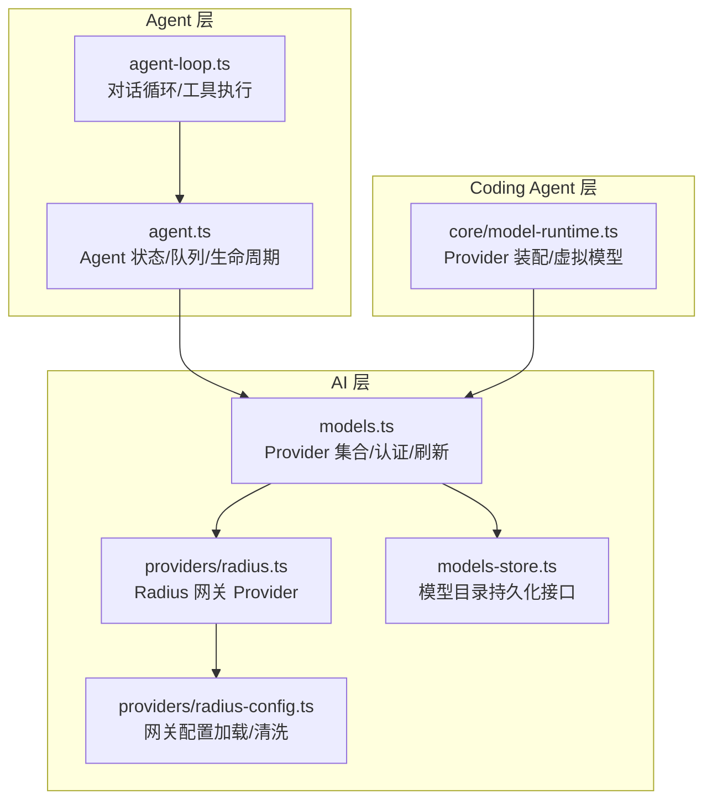
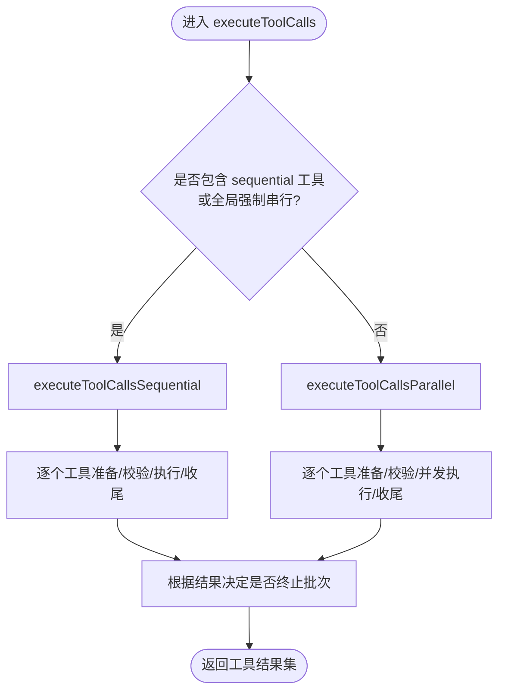
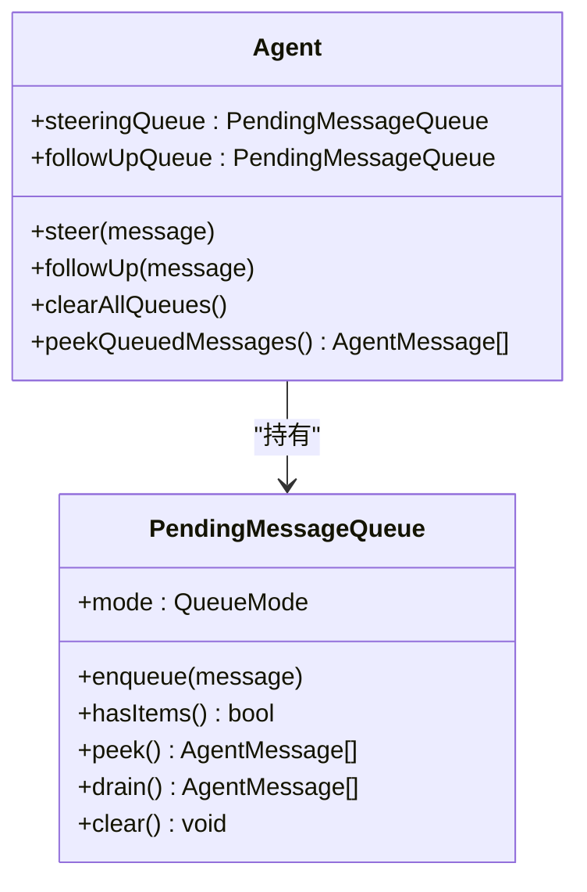
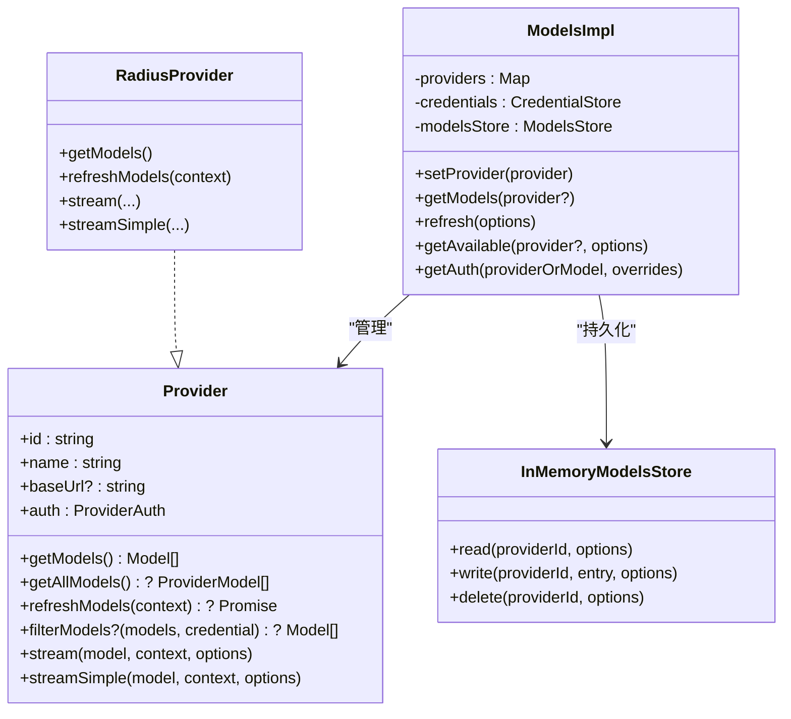
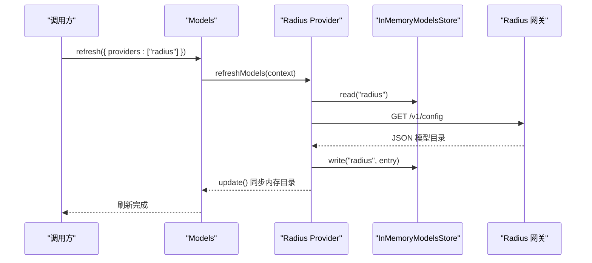
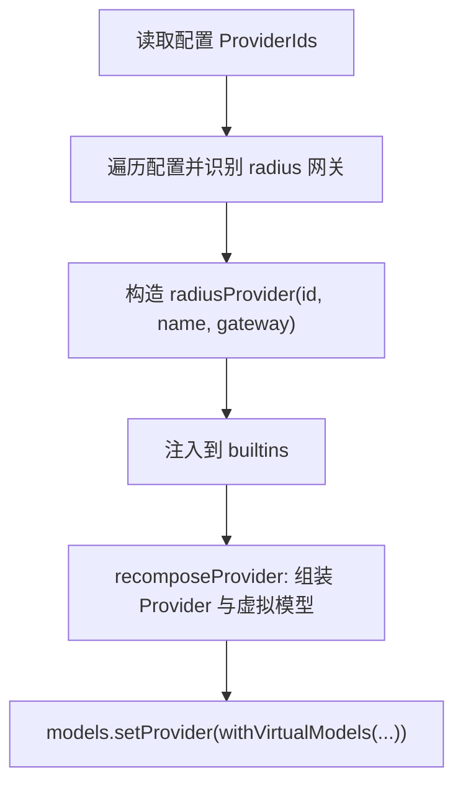
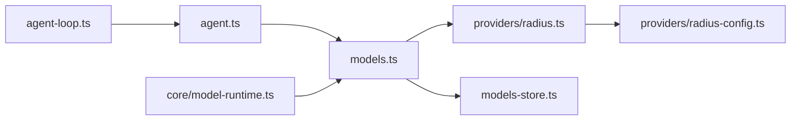

# 负载均衡策略

<cite>
**本文引用的文件**
- [packages/agent/src/agent-loop.ts](file://packages/agent/src/agent-loop.ts)
- [packages/agent/src/agent.ts](file://packages/agent/src/agent.ts)
- [packages/ai/src/models.ts](file://packages/ai/src/models.ts)
- [packages/ai/src/providers/radius.ts](file://packages/ai/src/providers/radius.ts)
- [packages/ai/src/providers/radius-config.ts](file://packages/ai/src/providers/radius-config.ts)
- [packages/ai/src/models-store.ts](file://packages/ai/src/models-store.ts)
- [packages/coding-agent/src/core/model-runtime.ts](file://packages/coding-agent/src/core/model-runtime.ts)
- [packages/ai/test/radius-provider.test.ts](file://packages/ai/test/radius-provider.test.ts)
</cite>

## 目录
1. [引言](#引言)
2. [项目结构](#项目结构)
3. [核心组件](#核心组件)
4. [架构总览](#架构总览)
5. [详细组件分析](#详细组件分析)
6. [依赖关系分析](#依赖关系分析)
7. [性能与容量感知调度](#性能与容量感知调度)
8. [配置示例与统计指标](#配置示例与统计指标)
9. [并发控制、限流与队列管理](#并发控制限流与队列管理)
10. [故障排查指南](#故障排查指南)
11. [结论](#结论)

## 引言
本文件面向“负载均衡策略”的落地实现，聚焦仓库中围绕模型路由、提供者（Provider）编排、Agent 工具调用与请求流式处理的关键代码。文档将解释：
- 权重分配与请求分发模式在现有代码中的体现；
- 轮询、加权轮询、最少连接数三类算法的实现现状与扩展点；
- 负载监控、动态调整策略与性能优化技巧；
- 负载均衡配置示例、统计指标收集与调优指南；
- 并发控制、限流机制与队列管理。

需要特别说明的是：当前仓库并未内置通用的“多后端实例级”负载均衡器（例如按 IP/端口维度的轮询或最少连接）。但存在两类与负载均衡密切相关的机制：
- 模型/提供者层面的选择与刷新（Models + Provider），可用于“按模型或网关路由”的负载均衡；
- Agent 层的工具调用执行模式（串行/并行）与消息队列（steering/follow-up），用于“任务级并发与顺序控制”。

## 项目结构
与负载均衡相关的主要模块分布如下：
- Agent 层：负责对话循环、工具调用执行模式、消息队列与事件流。
- AI 层：提供 Provider 抽象、模型目录、认证、流式 API 封装与遥测。
- Coding Agent 层：组合 Provider、注入虚拟模型、注册 Radius 网关 Provider。



**图表来源**
- [packages/agent/src/agent-loop.ts:172-330](file://packages/agent/src/agent-loop.ts#L172-L330)
- [packages/agent/src/agent.ts:194-263](file://packages/agent/src/agent.ts#L194-L263)
- [packages/ai/src/models.ts:147-247](file://packages/ai/src/models.ts#L147-L247)
- [packages/ai/src/providers/radius.ts:21-89](file://packages/ai/src/providers/radius.ts#L21-L89)
- [packages/ai/src/providers/radius-config.ts:81-97](file://packages/ai/src/providers/radius-config.ts#L81-L97)
- [packages/ai/src/models-store.ts:21-46](file://packages/ai/src/models-store.ts#L21-L46)
- [packages/coding-agent/src/core/model-runtime.ts:271-306](file://packages/coding-agent/src/core/model-runtime.ts#L271-L306)

**章节来源**
- [packages/agent/src/agent-loop.ts:172-330](file://packages/agent/src/agent-loop.ts#L172-L330)
- [packages/agent/src/agent.ts:194-263](file://packages/agent/src/agent.ts#L194-L263)
- [packages/ai/src/models.ts:147-247](file://packages/ai/src/models.ts#L147-L247)
- [packages/ai/src/providers/radius.ts:21-89](file://packages/ai/src/providers/radius.ts#L21-L89)
- [packages/ai/src/providers/radius-config.ts:81-97](file://packages/ai/src/providers/radius-config.ts#L81-L97)
- [packages/ai/src/models-store.ts:21-46](file://packages/ai/src/models-store.ts#L21-L46)
- [packages/coding-agent/src/core/model-runtime.ts:271-306](file://packages/coding-agent/src/core/model-runtime.ts#L271-L306)

## 核心组件
- Agent 循环与工具执行：决定工具调用是串行还是并行，并在截断/错误时采取失败回退策略。
- Agent 对象：维护会话状态、消息队列（steering/follow-up）、事件订阅与生命周期。
- Models/Provider：统一抽象模型提供方，支持静态/动态模型目录、认证、刷新与可用模型过滤。
- Radius Provider：从网关拉取并缓存模型目录，支持组织级禁用模型。
- Model Runtime：装配 Provider、注入虚拟模型、替换 Provider 实现。

这些组件共同构成“模型级负载均衡”的基础设施：通过 Provider 与模型目录的动态刷新，结合上层路由策略（如虚拟模型、外部网关），可实现按模型/组织的流量分发。

**章节来源**
- [packages/agent/src/agent-loop.ts:518-670](file://packages/agent/src/agent-loop.ts#L518-L670)
- [packages/agent/src/agent.ts:194-263](file://packages/agent/src/agent.ts#L194-L263)
- [packages/ai/src/models.ts:147-247](file://packages/ai/src/models.ts#L147-L247)
- [packages/ai/src/providers/radius.ts:21-89](file://packages/ai/src/providers/radius.ts#L21-L89)
- [packages/coding-agent/src/core/model-runtime.ts:271-306](file://packages/coding-agent/src/core/model-runtime.ts#L271-L306)

## 架构总览
下图展示一次 Agent 请求到 Provider 的完整路径，以及工具调用与流式响应的关键节点。

```mermaid
sequenceDiagram
participant App as "应用"
participant Agent as "Agent(agent.ts)"
participant Loop as "AgentLoop(agent-loop.ts)"
participant Stream as "StreamFn(流式函数)"
participant Models as "Models(models.ts)"
participant Provider as "Provider(radius.ts)"
participant Gateway as "Radius 网关"
App->>Agent : prompt()/continue()
Agent->>Loop : runAgentLoop()/runAgentLoopContinue()
Loop->>Stream : streamAssistantResponse(...)
Stream->>Models : stream(model, context, options)
Models->>Provider : stream(model, context, options)
Provider->>Gateway : HTTP 请求(带鉴权/头)
Gateway-->>Provider : 流式响应
Provider-->>Models : AssistantMessageEventStream
Models-->>Stream : 事件流
Stream-->>Loop : 文本/思考/工具调用事件
Loop->>Loop : executeToolCalls(串行/并行)
Loop-->>Agent : tool_execution_start/end, message_*
Agent-->>App : 事件回调/状态更新
```

**图表来源**
- [packages/agent/src/agent.ts:379-467](file://packages/agent/src/agent.ts#L379-L467)
- [packages/agent/src/agent-loop.ts:390-479](file://packages/agent/src/agent-loop.ts#L390-L479)
- [packages/agent/src/agent-loop.ts:518-670](file://packages/agent/src/agent-loop.ts#L518-L670)
- [packages/ai/src/models.ts:324-348](file://packages/ai/src/models.ts#L324-L348)
- [packages/ai/src/providers/radius.ts:87-89](file://packages/ai/src/providers/radius.ts#L87-L89)

## 详细组件分析

### 工具调用执行模式（轮询/加权轮询/最少连接数的扩展点）
- 当前实现提供两种执行模式：
  - 串行：适合强依赖顺序的工具链。
  - 并行：预检串行、执行并发，提升吞吐。
- 该模式可作为“任务级负载均衡”的基础：
  - 轮询：可在外层对多个同构工具/子任务做简单轮询派发。
  - 加权轮询：为不同工具/子任务设置权重，按权重比例派发。
  - 最少连接数：基于每个工具的活跃任务计数，选择负载最低者。



**图表来源**
- [packages/agent/src/agent-loop.ts:518-533](file://packages/agent/src/agent-loop.ts#L518-L533)
- [packages/agent/src/agent-loop.ts:540-594](file://packages/agent/src/agent-loop.ts#L540-L594)
- [packages/agent/src/agent-loop.ts:596-670](file://packages/agent/src/agent-loop.ts#L596-L670)

**章节来源**
- [packages/agent/src/agent-loop.ts:518-670](file://packages/agent/src/agent-loop.ts#L518-L670)

### Agent 状态与消息队列（Steering/Follow-up）
- Agent 维护两个队列：
  - steeringQueue：在当前助手回合结束后插入的消息。
  - followUpQueue：仅在 Agent 自然停止后执行的消息。
- 队列模式支持“一次性”和“全部”两种出队策略，便于控制后续消息的吞吐与顺序。



**图表来源**
- [packages/agent/src/agent.ts:149-180](file://packages/agent/src/agent.ts#L149-L180)
- [packages/agent/src/agent.ts:194-263](file://packages/agent/src/agent.ts#L194-L263)
- [packages/agent/src/agent.ts:307-342](file://packages/agent/src/agent.ts#L307-L342)

**章节来源**
- [packages/agent/src/agent.ts:149-180](file://packages/agent/src/agent.ts#L149-L180)
- [packages/agent/src/agent.ts:194-263](file://packages/agent/src/agent.ts#L194-L263)
- [packages/agent/src/agent.ts:307-342](file://packages/agent/src/agent.ts#L307-L342)

### 模型与 Provider 体系（模型级负载均衡基础）
- Provider 抽象：
  - 拥有 id/name/baseUrl/auth。
  - 提供 getModels/getAllModels、refreshModels、filterModels 等能力。
  - 暴露 stream/streamSimple 等流式接口。
- Models 集合：
  - 管理 Provider 注册、认证解析、可用模型过滤。
  - 支持并发刷新、持久化存储、AbortSignal 取消。
- Radius Provider：
  - 从网关拉取模型目录，支持组织级禁用模型。
  - 使用 InMemoryModelsStore 进行内存持久化。



**图表来源**
- [packages/ai/src/models.ts:147-247](file://packages/ai/src/models.ts#L147-L247)
- [packages/ai/src/models.ts:400-462](file://packages/ai/src/models.ts#L400-L462)
- [packages/ai/src/models.ts:565-625](file://packages/ai/src/models.ts#L565-L625)
- [packages/ai/src/providers/radius.ts:21-89](file://packages/ai/src/providers/radius.ts#L21-L89)
- [packages/ai/src/models-store.ts:21-46](file://packages/ai/src/models-store.ts#L21-L46)

**章节来源**
- [packages/ai/src/models.ts:147-247](file://packages/ai/src/models.ts#L147-L247)
- [packages/ai/src/models.ts:400-462](file://packages/ai/src/models.ts#L400-L462)
- [packages/ai/src/models.ts:565-625](file://packages/ai/src/models.ts#L565-L625)
- [packages/ai/src/providers/radius.ts:21-89](file://packages/ai/src/providers/radius.ts#L21-L89)
- [packages/ai/src/models-store.ts:21-46](file://packages/ai/src/models-store.ts#L21-L46)

### 动态模型目录与组织级限制（容量感知的上游入口）
- Radius Provider 从网关加载配置，清洗并持久化模型目录。
- 组织可禁用部分模型，Models.getAvailable 会应用 filterModels 过滤。
- 这为“按组织/模型可用性”的流量分流提供了基础。



**图表来源**
- [packages/ai/src/providers/radius.ts:43-89](file://packages/ai/src/providers/radius.ts#L43-L89)
- [packages/ai/src/providers/radius-config.ts:81-97](file://packages/ai/src/providers/radius-config.ts#L81-L97)
- [packages/ai/src/models-store.ts:28-46](file://packages/ai/src/models-store.ts#L28-L46)

**章节来源**
- [packages/ai/src/providers/radius.ts:43-89](file://packages/ai/src/providers/radius.ts#L43-L89)
- [packages/ai/src/providers/radius-config.ts:81-97](file://packages/ai/src/providers/radius-config.ts#L81-L97)
- [packages/ai/src/models-store.ts:28-46](file://packages/ai/src/models-store.ts#L28-L46)

### 虚拟模型与 Provider 装配（可扩展路由层）
- Coding Agent 的 model-runtime 将默认 Provider 与配置 Provider 合并，并为特定 Provider 注入虚拟模型。
- 这允许在不改动上游 Provider 的情况下，增加“逻辑模型”，作为上层路由/负载均衡的锚点。



**图表来源**
- [packages/coding-agent/src/core/model-runtime.ts:271-306](file://packages/coding-agent/src/core/model-runtime.ts#L271-L306)

**章节来源**
- [packages/coding-agent/src/core/model-runtime.ts:271-306](file://packages/coding-agent/src/core/model-runtime.ts#L271-L306)

## 依赖关系分析
- Agent 层依赖 AI 层的流式函数与 Provider 抽象。
- AI 层通过 Models 聚合 Provider，并提供认证、刷新与可用模型过滤。
- Radius Provider 依赖网关配置加载与模型目录持久化。
- Coding Agent 层通过 model-runtime 装配 Provider 与虚拟模型。



**图表来源**
- [packages/agent/src/agent-loop.ts:172-330](file://packages/agent/src/agent-loop.ts#L172-L330)
- [packages/agent/src/agent.ts:194-263](file://packages/agent/src/agent.ts#L194-L263)
- [packages/ai/src/models.ts:147-247](file://packages/ai/src/models.ts#L147-L247)
- [packages/ai/src/providers/radius.ts:21-89](file://packages/ai/src/providers/radius.ts#L21-L89)
- [packages/ai/src/providers/radius-config.ts:81-97](file://packages/ai/src/providers/radius-config.ts#L81-L97)
- [packages/ai/src/models-store.ts:21-46](file://packages/ai/src/models-store.ts#L21-L46)
- [packages/coding-agent/src/core/model-runtime.ts:271-306](file://packages/coding-agent/src/core/model-runtime.ts#L271-L306)

**章节来源**
- [packages/agent/src/agent-loop.ts:172-330](file://packages/agent/src/agent-loop.ts#L172-L330)
- [packages/agent/src/agent.ts:194-263](file://packages/agent/src/agent.ts#L194-L263)
- [packages/ai/src/models.ts:147-247](file://packages/ai/src/models.ts#L147-L247)
- [packages/ai/src/providers/radius.ts:21-89](file://packages/ai/src/providers/radius.ts#L21-L89)
- [packages/ai/src/providers/radius-config.ts:81-97](file://packages/ai/src/providers/radius-config.ts#L81-L97)
- [packages/ai/src/models-store.ts:21-46](file://packages/ai/src/models-store.ts#L21-L46)
- [packages/coding-agent/src/core/model-runtime.ts:271-306](file://packages/coding-agent/src/core/model-runtime.ts#L271-L306)

## 性能与容量感知调度
- 工具调用并行度：
  - 并行模式能显著提升吞吐，但需确保 beforeToolCall 的幂等性与安全性（已保证预检串行）。
  - 对于 I/O 密集工具，建议开启并行；对强依赖顺序的工具，保持串行。
- 模型目录刷新：
  - 并发刷新各 Provider，避免阻塞；失败不中断其他 Provider。
  - 使用 AbortSignal 控制取消，避免资源泄漏。
- 容量感知扩展点：
  - 在 Provider.filterModels 中按组织/配额/健康状态过滤模型，实现“可用性感知”的流量分发。
  - 在上层路由（如虚拟模型）中按延迟/错误率/成本选择具体物理模型。

[本节为通用指导，不直接分析具体文件]

## 配置示例与统计指标

### 负载均衡配置示例
- 启用 Radius Provider 并通过网关获取模型目录：
  - 在 coding-agent 的配置中声明 providerId 与 baseUrl，model-runtime 会自动装配 radiusProvider。
- 使用 Models.refresh 刷新指定 Provider：
  - 仅刷新 radius 提供商，避免全量刷新开销。
- 使用 Models.getAvailable 获取可用模型：
  - 自动应用 Provider.filterModels 过滤，得到组织级可用模型列表。

参考路径：
- [packages/coding-agent/src/core/model-runtime.ts:271-306](file://packages/coding-agent/src/core/model-runtime.ts#L271-L306)
- [packages/ai/src/models.ts:565-625](file://packages/ai/src/models.ts#L565-L625)
- [packages/ai/src/models.ts:715-752](file://packages/ai/src/models.ts#L715-L752)

**章节来源**
- [packages/coding-agent/src/core/model-runtime.ts:271-306](file://packages/coding-agent/src/core/model-runtime.ts#L271-L306)
- [packages/ai/src/models.ts:565-625](file://packages/ai/src/models.ts#L565-L625)
- [packages/ai/src/models.ts:715-752](file://packages/ai/src/models.ts#L715-L752)

### 统计指标收集
- 遥测钩子：
  - Models.stream/complete/streamSimple 等接口支持 onPayload/onResponse/onProviderStreamEvent。
  - Agent 层通过 EventStream 发射 message/tool_execution 等事件，可接入外部监控系统。
- 建议采集：
  - 每 Provider 的请求数、错误率、P95/P99 延迟、重试次数。
  - 工具调用成功率、平均耗时、并发度。
  - 模型目录刷新频率、失败率、缓存命中率。

参考路径：
- [packages/ai/src/models.ts:324-348](file://packages/ai/src/models.ts#L324-L348)
- [packages/agent/src/agent-loop.ts:424-478](file://packages/agent/src/agent-loop.ts#L424-L478)
- [packages/agent/src/agent-loop.ts:789-798](file://packages/agent/src/agent-loop.ts#L789-L798)

**章节来源**
- [packages/ai/src/models.ts:324-348](file://packages/ai/src/models.ts#L324-L348)
- [packages/agent/src/agent-loop.ts:424-478](file://packages/agent/src/agent-loop.ts#L424-L478)
- [packages/agent/src/agent-loop.ts:789-798](file://packages/agent/src/agent-loop.ts#L789-L798)

### 调优指南
- 工具调用：
  - 对 I/O 密集型工具启用并行；对顺序敏感工具保持串行。
  - 在 beforeToolCall 中做快速失败（如权限检查），减少无效并发。
- 模型目录：
  - 合理设置刷新间隔，避免频繁网络请求。
  - 使用 InMemoryModelsStore 缓存目录，降低冷启动延迟。
- 路由策略：
  - 在虚拟模型层按延迟/错误率/成本选择物理模型。
  - 结合 Provider.filterModels 实现组织级/配额级隔离。

[本节为通用指导，不直接分析具体文件]

## 并发控制、限流与队列管理

### 并发控制
- 工具调用：
  - 并行模式下，所有 prepareToolCall 预检串行，实际执行并发。
  - 支持 AbortSignal 中断，避免资源泄漏。
- 模型目录刷新：
  - 并发刷新各 Provider，失败互不影响。
  - 使用 generation 与 AbortController 控制刷新生命周期。

参考路径：
- [packages/agent/src/agent-loop.ts:596-670](file://packages/agent/src/agent-loop.ts#L596-L670)
- [packages/ai/src/models.ts:565-625](file://packages/ai/src/models.ts#L565-L625)

**章节来源**
- [packages/agent/src/agent-loop.ts:596-670](file://packages/agent/src/agent-loop.ts#L596-L670)
- [packages/ai/src/models.ts:565-625](file://packages/ai/src/models.ts#L565-L625)

### 限流机制
- 当前仓库未内置通用限流器。
- 建议在以下位置实现：
  - 工具调用前：基于令牌桶/漏桶限制并发或速率。
  - Provider 层：按 Provider 维度限制 QPS。
  - 模型目录刷新：限制并发刷新数量与频率。

[本节为通用指导，不直接分析具体文件]

### 队列管理
- Steering/Follow-up 队列：
  - 支持“一次性”和“全部”两种出队模式。
  - 可通过 peek/drain 控制消息消费策略。
- 建议：
  - 在高负载场景下，使用“一次性”模式避免消息堆积。
  - 在批处理场景中，使用“全部”模式批量处理。

参考路径：
- [packages/agent/src/agent.ts:149-180](file://packages/agent/src/agent.ts#L149-L180)
- [packages/agent/src/agent.ts:307-342](file://packages/agent/src/agent.ts#L307-L342)

**章节来源**
- [packages/agent/src/agent.ts:149-180](file://packages/agent/src/agent.ts#L149-L180)
- [packages/agent/src/agent.ts:307-342](file://packages/agent/src/agent.ts#L307-L342)

## 故障排查指南
- 工具调用失败：
  - 检查 beforeToolCall 是否阻断（block=true）。
  - 检查工具参数是否被截断（length stopReason）。
- 模型目录刷新失败：
  - 检查 Provider 认证是否有效。
  - 检查网关是否返回有效 JSON。
- 可用模型为空：
  - 检查 Provider.filterModels 是否正确过滤。
  - 检查 Models.getAvailable 是否传入正确的 providerId。

参考路径：
- [packages/agent/src/agent-loop.ts:488-513](file://packages/agent/src/agent-loop.ts#L488-L513)
- [packages/agent/src/agent-loop.ts:718-787](file://packages/agent/src/agent-loop.ts#L718-L787)
- [packages/ai/src/providers/radius-config.ts:81-97](file://packages/ai/src/providers/radius-config.ts#L81-L97)
- [packages/ai/test/radius-provider.test.ts:52-75](file://packages/ai/test/radius-provider.test.ts#L52-L75)

**章节来源**
- [packages/agent/src/agent-loop.ts:488-513](file://packages/agent/src/agent-loop.ts#L488-L513)
- [packages/agent/src/agent-loop.ts:718-787](file://packages/agent/src/agent-loop.ts#L718-L787)
- [packages/ai/src/providers/radius-config.ts:81-97](file://packages/ai/src/providers/radius-config.ts#L81-L97)
- [packages/ai/test/radius-provider.test.ts:52-75](file://packages/ai/test/radius-provider.test.ts#L52-L75)

## 结论
- 当前仓库未内置通用“多后端实例级”负载均衡器，但提供了“模型级负载均衡”的基础设施：
  - Provider 抽象与动态模型目录刷新；
  - Agent 层的工具调用执行模式与消息队列；
  - Coding Agent 层的 Provider 装配与虚拟模型注入。
- 若需实现轮询、加权轮询、最少连接数等算法，可在以下层面扩展：
  - 工具调用层：对同构工具/子任务做轮询/加权/最少连接派发。
  - 模型路由层：在虚拟模型或外部网关中按延迟/错误率/成本选择物理模型。
- 建议结合遥测与监控，持续优化负载分布与系统稳定性。

[本节为总结性内容，不直接分析具体文件]