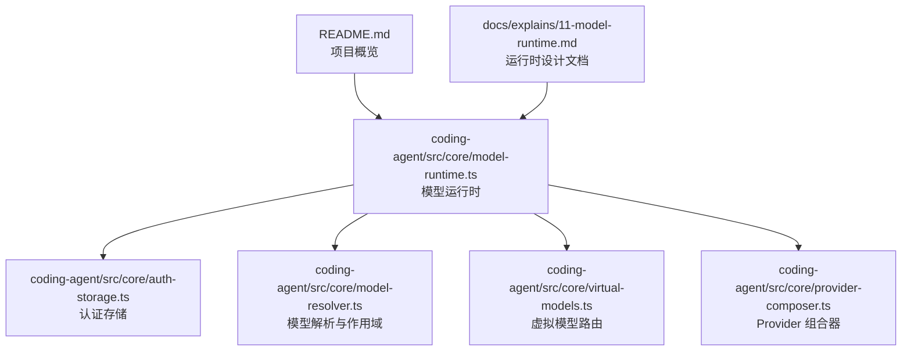
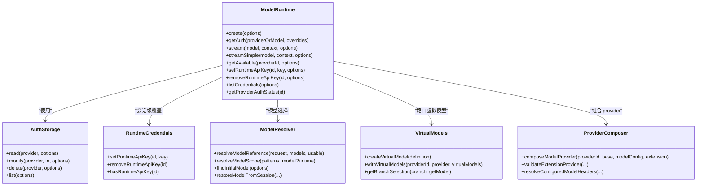
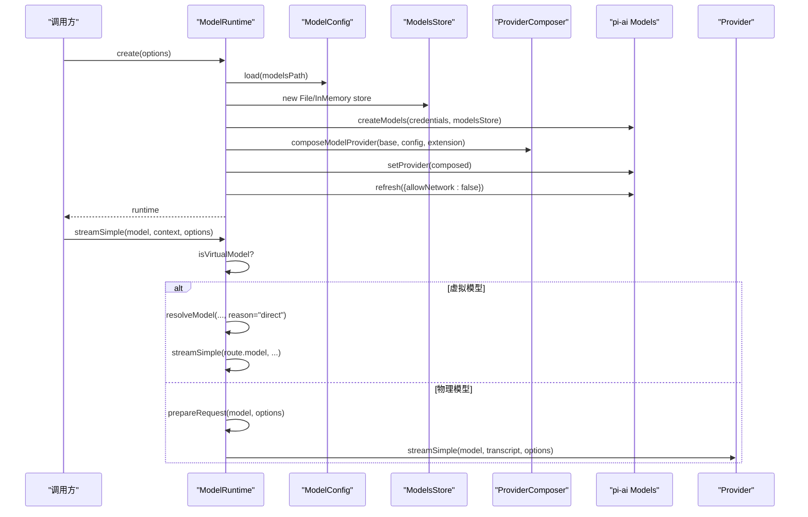
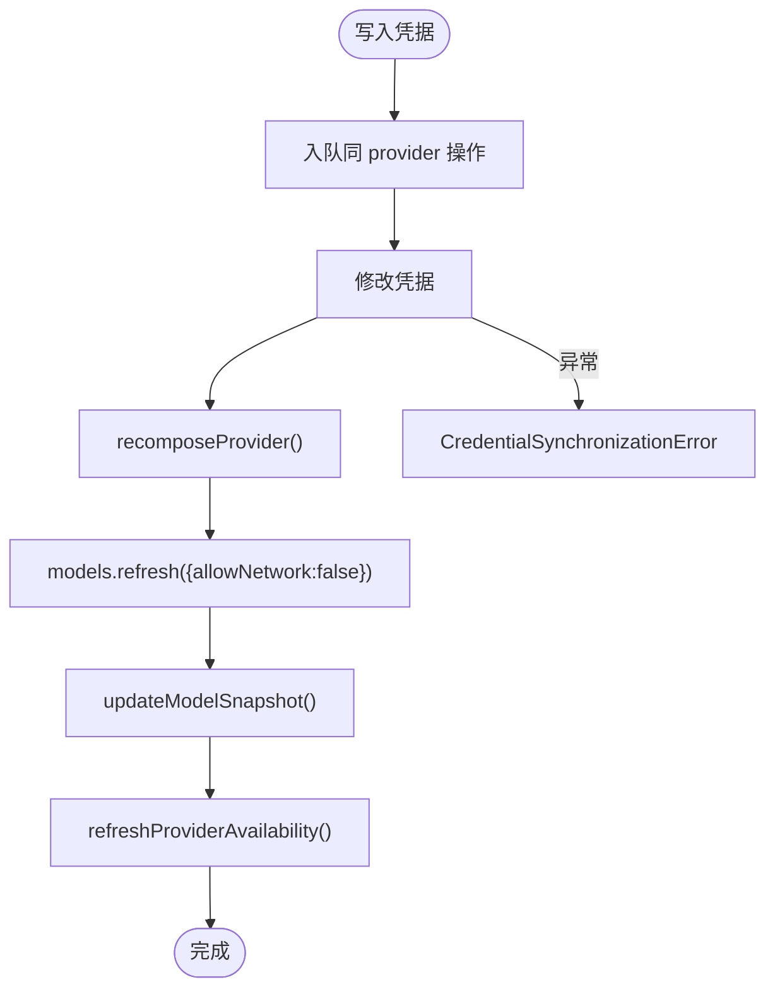
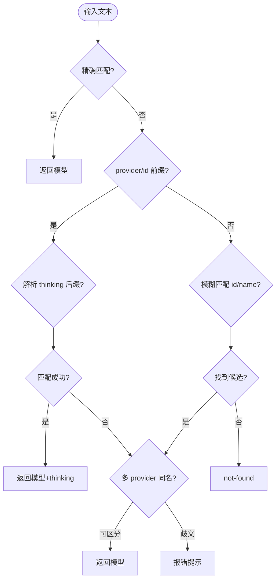
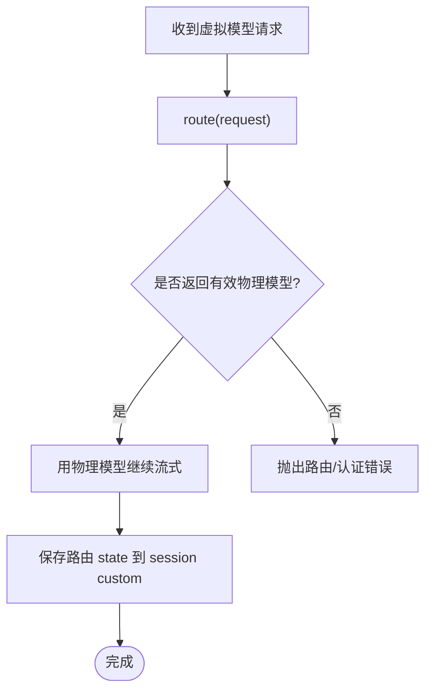
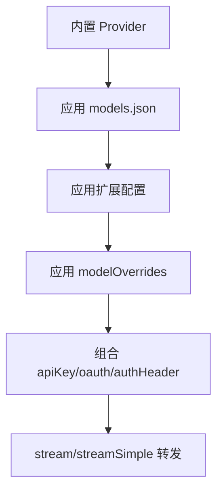
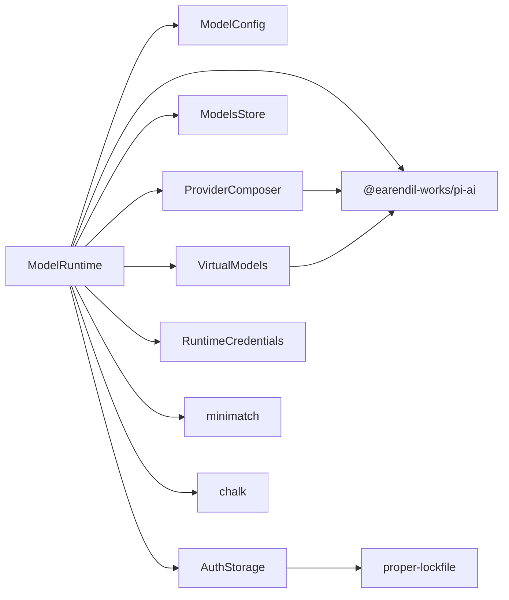

# 模型运行时与认证系统

<cite>
**本文引用的文件**   
- [README.md](file://README.md)
- [11-model-runtime.md](file://docs/explains/11-model-runtime.md)
- [model-runtime.ts](file://packages/coding-agent/src/core/model-runtime.ts)
- [auth-storage.ts](file://packages/coding-agent/src/core/auth-storage.ts)
- [model-resolver.ts](file://packages/coding-agent/src/core/model-resolver.ts)
- [virtual-models.ts](file://packages/coding-agent/src/core/virtual-models.ts)
- [provider-composer.ts](file://packages/coding-agent/src/core/provider-composer.ts)
- [auth-check.ts](file://packages/coding-agent/src/cli/auth-check.ts)
</cite>

## 目录
1. [引言](#引言)
2. [项目结构](#项目结构)
3. [核心组件](#核心组件)
4. [架构总览](#架构总览)
5. [详细组件分析](#详细组件分析)
6. [依赖关系分析](#依赖关系分析)
7. [性能考量](#性能考量)
8. [故障排查指南](#故障排查指南)
9. [结论](#结论)
10. [附录](#附录)

## 引言
本文件聚焦于 Pi 项目的“模型运行时与认证系统”，围绕以下目标展开：
- 解释模型运行时如何组合 provider、管理凭据、刷新模型目录并分发流式请求。
- 说明认证存储的持久化、并发安全与会话级覆盖机制。
- 梳理模型引用解析、作用域选择与初始模型选择策略。
- 阐述虚拟模型的路由语义与状态持久化。
- 给出架构图、流程图和时序图，帮助读者快速理解关键路径。

该子系统位于 coding-agent 包的核心层，向上暴露统一的 Models 接口，向下对接 pi-ai 的多 provider 能力与内置 provider 目录。

## 项目结构
从仓库视角看，相关代码集中在 packages/coding-agent/src/core 目录，文档在 docs/explains/11-model-runtime.md 中做了高层说明；顶层 README 提供项目背景与包概览。

图表来源
- [README.md:72-84](file://README.md#L72-L84)
- [11-model-runtime.md:1-24](file://docs/explains/11-model-runtime.md#L1-L24)

章节来源
- [README.md:72-84](file://README.md#L72-L84)
- [11-model-runtime.md:1-24](file://docs/explains/11-model-runtime.md#L1-L24)

## 核心组件
- ModelRuntime：统一实现 pi-ai 的 Models 接口，负责 provider 组合、认证合并、模型目录缓存、可用性快照、流式请求入口。
- AuthStorage：基于 auth.json 的凭据存储，支持同步/异步锁、读缓存、会话级覆盖（RuntimeCredentials）。
- ModelResolver：模型引用解析、作用域匹配、CLI 模型选择、初始模型恢复。
- VirtualModels：虚拟模型定义、路由、分支选择与状态持久化。
- ProviderComposer：将内置 provider、models.json 配置、扩展配置叠加为最终 provider。

章节来源
- [model-runtime.ts:174-269](file://packages/coding-agent/src/core/model-runtime.ts#L174-L269)
- [auth-storage.ts:329-491](file://packages/coding-agent/src/core/auth-storage.ts#L329-L491)
- [model-resolver.ts:150-177](file://packages/coding-agent/src/core/model-resolver.ts#L150-L177)
- [virtual-models.ts:170-238](file://packages/coding-agent/src/core/virtual-models.ts#L170-L238)
- [provider-composer.ts:546-693](file://packages/coding-agent/src/core/provider-composer.ts#L546-L693)

## 架构总览
ModelRuntime 作为门面，协调认证、模型目录、provider 组合与虚拟模型路由，所有流式调用都通过 lazyStream 延迟执行，使认证失败等错误以 stream 错误形式上报。

图表来源
- [model-runtime.ts:174-269](file://packages/coding-agent/src/core/model-runtime.ts#L174-L269)
- [auth-storage.ts:329-491](file://packages/coding-agent/src/core/auth-storage.ts#L329-L491)
- [model-resolver.ts:150-177](file://packages/coding-agent/src/core/model-resolver.ts#L150-L177)
- [virtual-models.ts:170-238](file://packages/coding-agent/src/core/virtual-models.ts#L170-L238)
- [provider-composer.ts:546-693](file://packages/coding-agent/src/core/provider-composer.ts#L546-L693)

## 详细组件分析

### ModelRuntime：运行时门面与流入口
- 职责
  - 初始化时加载 ModelConfig、ModelsStore，注册内置 provider，按需注入远程目录个性化。
  - 维护 all/available/configuredProviders/storedProviders/auth 快照，并提供 getAvailable/getError 等查询。
  - 凭据变更串行化：login/logout/setRuntimeApiKey/removeRuntimeApiKey 均进入同一 provider 的队列，随后 recomposeProvider → refresh → updateModelSnapshot → refreshProviderAvailability。
  - prepareRequest 合并 headers/env/apiKey/baseUrl，确保会话头、provider 配置、扩展 before_provider_headers 的顺序正确。
  - 所有流方法走 lazyStream，虚拟模型在 streamSimple 中先 resolveModel 再重试物理模型。

图表来源
- [model-runtime.ts:218-269](file://packages/coding-agent/src/core/model-runtime.ts#L218-L269)
- [model-runtime.ts:667-713](file://packages/coding-agent/src/core/model-runtime.ts#L667-L713)
- [model-runtime.ts:744-781](file://packages/coding-agent/src/core/model-runtime.ts#L744-L781)

章节来源
- [model-runtime.ts:174-269](file://packages/coding-agent/src/core/model-runtime.ts#L174-L269)
- [model-runtime.ts:327-341](file://packages/coding-agent/src/core/model-runtime.ts#L327-L341)
- [model-runtime.ts:343-440](file://packages/coding-agent/src/core/model-runtime.ts#L343-L440)
- [model-runtime.ts:580-649](file://packages/coding-agent/src/core/model-runtime.ts#L580-L649)
- [model-runtime.ts:667-713](file://packages/coding-agent/src/core/model-runtime.ts#L667-L713)
- [model-runtime.ts:715-781](file://packages/coding-agent/src/core/model-runtime.ts#L715-L781)

### AuthStorage：认证存储与并发安全
- 文件权限与锁
  - auth.json 目录 0700，文件 0600；同步锁最多重试 10 次；异步锁 30 秒 stale 超时与指数退避。
- 读缓存
  - 按文件 revision(mtime/size) 判断是否重载；并发读合并到一次 reload，reader 计数决定何时 abort。
- 会话级覆盖
  - RuntimeCredentials 在持久化之上提供内存覆盖，用于 --api-key 或临时切换。
- 凭据变更同步
  - login/logout/setRuntimeApiKey/removeRuntimeApiKey 会触发 CredentialSynchronizationError 包装，提示磁盘已变但内存未跟上。

图表来源
- [model-runtime.ts:580-649](file://packages/coding-agent/src/core/model-runtime.ts#L580-L649)
- [auth-storage.ts:61-203](file://packages/coding-agent/src/core/auth-storage.ts#L61-L203)
- [auth-storage.ts:329-491](file://packages/coding-agent/src/core/auth-storage.ts#L329-L491)

章节来源
- [auth-storage.ts:61-203](file://packages/coding-agent/src/core/auth-storage.ts#L61-L203)
- [auth-storage.ts:329-491](file://packages/coding-agent/src/core/auth-storage.ts#L329-L491)
- [model-runtime.ts:580-649](file://packages/coding-agent/src/core/model-runtime.ts#L580-L649)

### ModelResolver：模型引用与作用域
- 引用解析
  - 精确 id → provider/id 前缀 → thinking 后缀 → 模糊匹配 id/name。
  - 多 provider 同名时优先报错，避免按目录顺序猜测。
- 作用域与初始选择
  - 支持 provider/model、model、glob、thinking 后缀。
  - findInitialModel 优先级：scopedModels[0] → settings 默认（需有认证）→ 已知 provider 默认 → 第一个可用模型。
  - restoreModelFromSession 失败时回退并输出 fallback message。

图表来源
- [model-resolver.ts:150-177](file://packages/coding-agent/src/core/model-resolver.ts#L150-L177)
- [model-resolver.ts:236-296](file://packages/coding-agent/src/core/model-resolver.ts#L236-L296)
- [model-resolver.ts:333-427](file://packages/coding-agent/src/core/model-resolver.ts#L333-L427)
- [model-resolver.ts:549-616](file://packages/coding-agent/src/core/model-resolver.ts#L549-L616)

章节来源
- [model-resolver.ts:150-177](file://packages/coding-agent/src/core/model-resolver.ts#L150-L177)
- [model-resolver.ts:236-296](file://packages/coding-agent/src/core/model-resolver.ts#L236-L296)
- [model-resolver.ts:333-427](file://packages/coding-agent/src/core/model-resolver.ts#L333-L427)
- [model-resolver.ts:549-616](file://packages/coding-agent/src/core/model-resolver.ts#L549-L616)

### VirtualModels：虚拟模型路由
- 定义与挂载
  - api 固定为 pi-virtual，不会到达 provider；可挂到已有物理模型的 provider 下。
  - withVirtualModels 将虚拟模型加入 catalog，同时屏蔽同名物理 chat 模型。
- 路由语义
  - route(reason ∈ {user, continuation, retry, direct})，返回物理模型与 thinking level。
  - 路由 state 持久化为 session custom entry，下次同 provider/model 路由携带。
- 分支选择
  - getBranchSelection 优先最近 model_change；若为虚拟模型则保持虚拟选择，否则回退到最后一条物理 assistant 响应。

图表来源
- [virtual-models.ts:170-238](file://packages/coding-agent/src/core/virtual-models.ts#L170-L238)
- [model-runtime.ts:744-781](file://packages/coding-agent/src/core/model-runtime.ts#L744-L781)

章节来源
- [virtual-models.ts:170-238](file://packages/coding-agent/src/core/virtual-models.ts#L170-L238)
- [model-runtime.ts:744-781](file://packages/coding-agent/src/core/model-runtime.ts#L744-L781)

### ProviderComposer：Provider 组合器
- 组合层次
  - 内置 provider → models.json 配置 → 扩展配置 → modelOverrides。
- 认证组合
  - apiKey/oauth 均可被扩展或 models.json 覆盖；authHeader 可将 apiKey 注入 Authorization。
- 模型构建
  - applyModelsJson/applyExtension 生成最终模型列表；modelOverrides 对 chat 模型字段进行深度合并。
- 流转发
  - 若 extension.streamSimple 且 model.api 匹配，直接走扩展；否则回退到 base 或通用 API provider。

图表来源
- [provider-composer.ts:302-356](file://packages/coding-agent/src/core/provider-composer.ts#L302-L356)
- [provider-composer.ts:379-511](file://packages/coding-agent/src/core/provider-composer.ts#L379-L511)
- [provider-composer.ts:546-693](file://packages/coding-agent/src/core/provider-composer.ts#L546-L693)

章节来源
- [provider-composer.ts:302-356](file://packages/coding-agent/src/core/provider-composer.ts#L302-L356)
- [provider-composer.ts:379-511](file://packages/coding-agent/src/core/provider-composer.ts#L379-L511)
- [provider-composer.ts:546-693](file://packages/coding-agent/src/core/provider-composer.ts#L546-L693)

### CLI 集成：认证检查与最小运行时
- auth-check 提供 getProviderCredential 与 createAuthCheckModelRuntime，便于在不刷新网络的情况下构造最小 ModelRuntime 进行认证检查。

章节来源
- [auth-check.ts:55-73](file://packages/coding-agent/src/cli/auth-check.ts#L55-L73)

## 依赖关系分析
- ModelRuntime 依赖
  - pi-ai：Models、Provider、lazyStream、模型类型与工具函数。
  - 内部 core：ModelConfig、AuthStorage、ModelsStore、ProviderComposer、VirtualModels、RuntimeCredentials。
- 外部依赖
  - proper-lockfile：auth.json 文件锁。
  - minimatch：作用域 glob 匹配。
  - chalk：诊断信息着色。

图表来源
- [model-runtime.ts:1-95](file://packages/coding-agent/src/core/model-runtime.ts#L1-L95)
- [auth-storage.ts:1-15](file://packages/coding-agent/src/core/auth-storage.ts#L1-L15)
- [model-resolver.ts:1-18](file://packages/coding-agent/src/core/model-resolver.ts#L1-L18)
- [virtual-models.ts:1-26](file://packages/coding-agent/src/core/virtual-models.ts#L1-L26)
- [provider-composer.ts:1-40](file://packages/coding-agent/src/core/provider-composer.ts#L1-L40)

章节来源
- [model-runtime.ts:1-95](file://packages/coding-agent/src/core/model-runtime.ts#L1-L95)
- [auth-storage.ts:1-15](file://packages/coding-agent/src/core/auth-storage.ts#L1-L15)
- [model-resolver.ts:1-18](file://packages/coding-agent/src/core/model-resolver.ts#L1-L18)
- [virtual-models.ts:1-26](file://packages/coding-agent/src/core/virtual-models.ts#L1-L26)
- [provider-composer.ts:1-40](file://packages/coding-agent/src/core/provider-composer.ts#L1-L40)

## 性能考量
- 可用性刷新去抖与序号控制
  - availabilityRefreshSeq/providerAvailabilitySeq/errorSeq 保证旧结果不覆盖新结果，单 provider 增量刷新减少开销。
- 读缓存与并发合并
  - AuthStorage.readLatestData 共享 readState，合并并发 reload，降低 auth.json 频繁读取成本。
- 懒执行
  - lazyStream 将认证失败、provider 不存在等错误推迟到真正消费流时抛出，避免同步阻塞。
- 离线模式
  - create 时根据 process.env.PI_OFFLINE 与 allowModelNetwork 控制是否允许网络刷新模型目录。

章节来源
- [model-runtime.ts:343-440](file://packages/coding-agent/src/core/model-runtime.ts#L343-L440)
- [auth-storage.ts:394-441](file://packages/coding-agent/src/core/auth-storage.ts#L394-L441)
- [model-runtime.ts:218-269](file://packages/coding-agent/src/core/model-runtime.ts#L218-L269)

## 故障排查指南
- 常见错误
  - CredentialSynchronizationError：凭据写入成功但本地快照同步失败，包含 provider、operation、credential 信息。
  - Provider composition error：models.json 或扩展配置导致组合失败，getError 可汇总配置与组合错误。
  - Availability refresh error：可用性刷新失败会被记录在 availabilityError，可通过 getError 获取。
- 定位步骤
  - 检查 hasConfiguredAuth/isUsingOAuth/isUsingSubscription 判断认证来源。
  - 查看 getProviderAuthStatus 确认 source 是 stored/runtime/environment/fallback/models_json_key/command。
  - 使用 listCredentials 列出凭证元数据，结合 getAvailableSnapshot 观察可用模型集合。
  - 对于虚拟模型，确认 route 返回的物理模型存在且 provider 已认证。

章节来源
- [model-runtime.ts:137-155](file://packages/coding-agent/src/core/model-runtime.ts#L137-L155)
- [model-runtime.ts:512-521](file://packages/coding-agent/src/core/model-runtime.ts#L512-L521)
- [model-runtime.ts:655-665](file://packages/coding-agent/src/core/model-runtime.ts#L655-L665)
- [model-runtime.ts:486-506](file://packages/coding-agent/src/core/model-runtime.ts#L486-L506)

## 结论
模型运行时与认证系统以 ModelRuntime 为中心，将 provider 组合、认证存储、模型目录缓存、虚拟模型路由与流式请求统一起来。其设计要点包括：
- provider 组合而非固定绑定，支持内置、配置、扩展与虚拟模型多层叠加。
- 认证与模型目录分离，凭据变更串行事务化，保证一致性。
- 虚拟模型仅作用于选择层，消息与 provider 交互始终面向物理模型。
- 歧义不猜，明确报错引导用户使用 provider/id 指定。
- 错误尽量下沉到 stream，上层统一处理认证失败与 provider 不可用。

## 附录
- 参考文档
  - [11-model-runtime.md](file://docs/explains/11-model-runtime.md)
- 示例与用法
  - SDK 示例中演示了 ModelRuntime.create、自定义模型、API Key/OAuth 配置等场景。

章节来源
- [11-model-runtime.md:1-303](file://docs/explains/11-model-runtime.md#L1-L303)