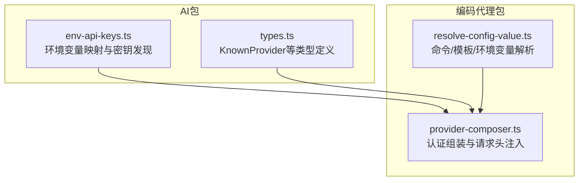
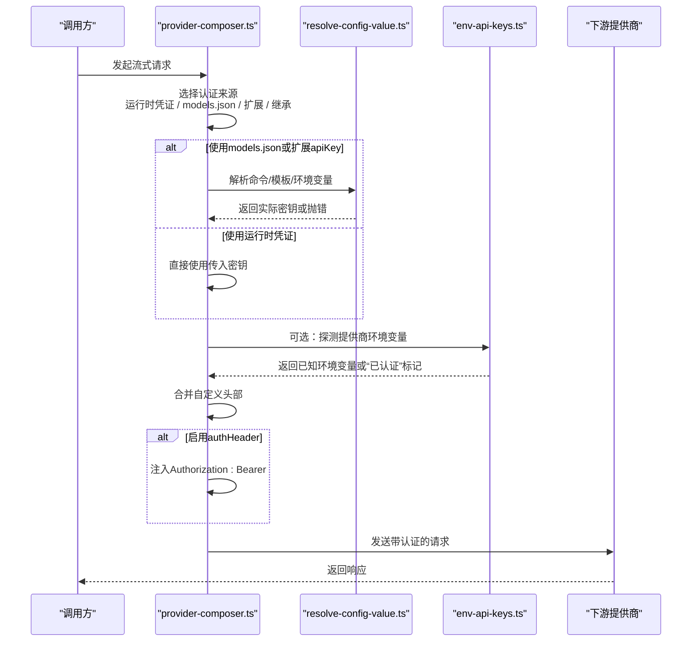
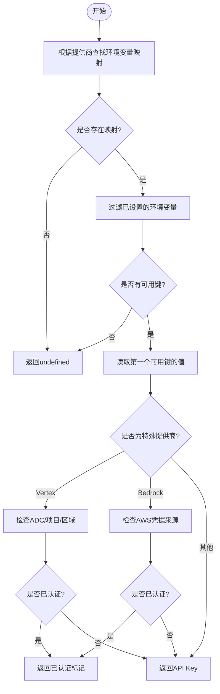
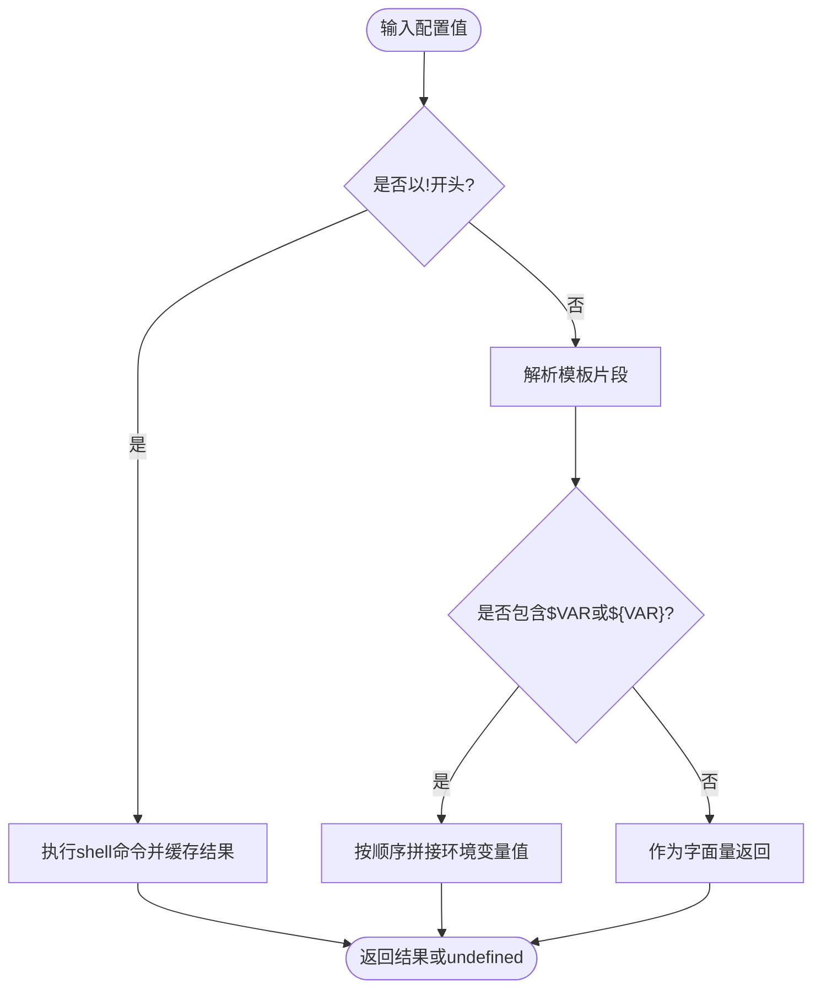
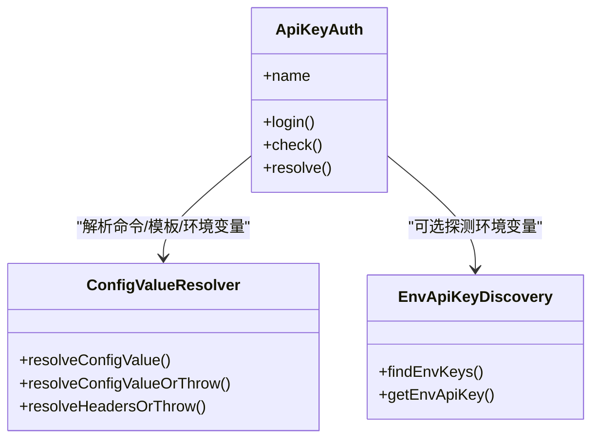
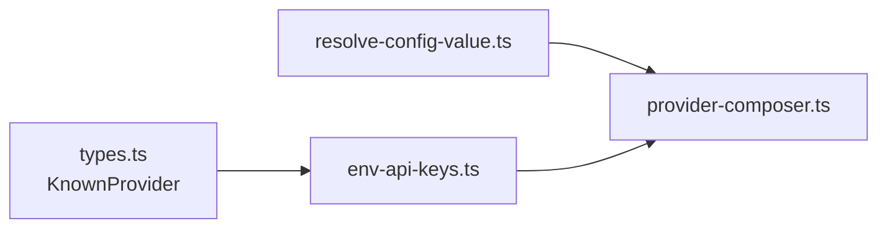

# API密钥认证

<cite>
**本文引用的文件**
- [packages/ai/src/env-api-keys.ts](file://packages/ai/src/env-api-keys.ts)
- [packages/coding-agent/src/core/provider-composer.ts](file://packages/coding-agent/src/core/provider-composer.ts)
- [packages/coding-agent/src/core/resolve-config-value.ts](file://packages/coding-agent/src/core/resolve-config-value.ts)
- [packages/ai/src/types.ts](file://packages/ai/src/types.ts)
- [packages/ai/README.md](file://packages/ai/README.md)
- [packages/coding-agent/docs/models.md](file://packages/coding-agent/docs/models.md)
- [packages/coding-agent/docs/custom-provider.md](file://packages/coding-agent/docs/custom-provider.md)
</cite>

## 目录
1. [简介](#简介)
2. [项目结构](#项目结构)
3. [核心组件](#核心组件)
4. [架构总览](#架构总览)
5. [详细组件分析](#详细组件分析)
6. [依赖关系分析](#依赖关系分析)
7. [性能与行为特征](#性能与行为特征)
8. [安全最佳实践](#安全最佳实践)
9. [常见配置问题与解决方案](#常见配置问题与解决方案)
10. [结论](#结论)

## 简介
本文件面向需要理解并正确配置“API密钥认证”的用户与维护者，覆盖以下主题：
- 环境变量配置、密钥格式解析与存储机制
- 支持的提供商列表、密钥获取方式与配置示例
- 密钥优先级规则、默认值处理与错误处理策略
- 安全最佳实践：密钥轮换、权限最小化、审计日志
- 常见问题排查指南

该实现由两部分组成：
- 通用环境密钥发现层：负责根据提供商识别应读取的环境变量，并支持部分云厂商的隐式凭据检测。
- 运行时认证组装层：负责从命令行、已存储凭据、models.json、扩展注册和继承的基础提供商中组合出最终认证结果，并注入请求头。

## 项目结构
围绕API密钥认证的关键代码分布在两个包中：
- `packages/ai`：提供提供商类型、环境变量映射、已知提供商枚举与环境密钥读取能力。
- `packages/coding-agent`：提供模型与提供商装配逻辑、配置值解析（命令、模板、环境变量）、以及最终认证对象构建。

**图表来源**
- [packages/ai/src/env-api-keys.ts:73-127](file://packages/ai/src/env-api-keys.ts#L73-L127)
- [packages/ai/src/types.ts:90-134](file://packages/ai/src/types.ts#L90-L134)
- [packages/coding-agent/src/core/resolve-config-value.ts:145-151](file://packages/coding-agent/src/core/resolve-config-value.ts#L145-L151)
- [packages/coding-agent/src/core/provider-composer.ts:422-486](file://packages/coding-agent/src/core/provider-composer.ts#L422-L486)

**章节来源**
- [packages/ai/src/env-api-keys.ts:1-197](file://packages/ai/src/env-api-keys.ts#L1-L197)
- [packages/coding-agent/src/core/provider-composer.ts:422-486](file://packages/coding-agent/src/core/provider-composer.ts#L422-L486)
- [packages/coding-agent/src/core/resolve-config-value.ts:145-251](file://packages/coding-agent/src/core/resolve-config-value.ts#L145-L251)
- [packages/ai/src/types.ts:90-134](file://packages/ai/src/types.ts#L90-L134)

## 核心组件
- 环境变量与密钥发现
  - 维护每个提供商对应的环境变量名映射。
  - 提供函数用于查找已配置的环境变量键名，或直接读取第一个可用密钥。
  - 对部分云厂商（如Google Vertex、Amazon Bedrock）支持非显式API Key的“已认证”状态判断。
- 配置值解析
  - 支持三种形式：
    - 命令：以`!`开头，执行shell命令并取标准输出作为值。
    - 模板：包含`$VAR`或`${VAR}`的环境变量插值。
    - 字面量：直接作为值使用。
  - 提供缺失变量检测、强制抛错解析、头部值统一解析等工具。
- 认证组装器
  - 按优先级组合API密钥来源：
    - 运行时传入的凭证
    - models.json中的apiKey
    - 扩展注册的apiKey
    - 基础提供商继承的认证
  - 支持将API密钥注入为Authorization Bearer头。
  - 支持通过authHeader开关控制是否自动注入Authorization头。

**章节来源**
- [packages/ai/src/env-api-keys.ts:137-196](file://packages/ai/src/env-api-keys.ts#L137-L196)
- [packages/coding-agent/src/core/resolve-config-value.ts:145-251](file://packages/coding-agent/src/core/resolve-config-value.ts#L145-L251)
- [packages/coding-agent/src/core/provider-composer.ts:379-486](file://packages/coding-agent/src/core/provider-composer.ts#L379-L486)

## 架构总览
下图展示一次API调用时，认证信息如何被解析、合并并最终注入到请求中。

**图表来源**
- [packages/coding-agent/src/core/provider-composer.ts:422-486](file://packages/coding-agent/src/core/provider-composer.ts#L422-L486)
- [packages/coding-agent/src/core/resolve-config-value.ts:145-251](file://packages/coding-agent/src/core/resolve-config-value.ts#L145-L251)
- [packages/ai/src/env-api-keys.ts:137-196](file://packages/ai/src/env-api-keys.ts#L137-L196)

## 详细组件分析

### 环境变量与密钥发现
- 已知提供商映射
  - 针对OpenAI、Anthropic、Azure OpenAI、Google Gemini、Vertex AI、Bedrock、Groq、Cerebras、OpenRouter、Vercel AI Gateway、ZAI、Mistral、Minimax、Moonshot、HuggingFace、Fireworks、Together、Baseten、OpenCode、Kimi、Meta、Cloudflare Workers AI、Cloudflare AI Gateway、Xiaomi等提供商，定义了各自的环境变量名。
- 特殊处理
  - Anthropic：存在多个相关环境变量，但普通API Key读取会跳过仅用于Bearer头的令牌变量。
  - Google Vertex：若检测到ADC凭据、项目和区域配置，则视为“已认证”，不要求显式API Key。
  - Amazon Bedrock：支持多种AWS凭据来源；只要任一来源存在即视为“已认证”。
- 公开接口
  - 查找可用的环境变量键名列表。
  - 直接读取第一个可用的API Key。

**图表来源**
- [packages/ai/src/env-api-keys.ts:73-127](file://packages/ai/src/env-api-keys.ts#L73-L127)
- [packages/ai/src/env-api-keys.ts:137-196](file://packages/ai/src/env-api-keys.ts#L137-L196)

**章节来源**
- [packages/ai/src/env-api-keys.ts:73-127](file://packages/ai/src/env-api-keys.ts#L73-L127)
- [packages/ai/src/env-api-keys.ts:137-196](file://packages/ai/src/env-api-keys.ts#L137-L196)

### 配置值解析：命令、模板与字面量
- 命令模式
  - 以`!`开头的字符串会被当作shell命令执行，其标准输出作为值。
  - 命令结果在进程生命周期内缓存，避免重复执行。
- 模板模式
  - 支持`$VAR`和`${VAR}`语法进行环境变量插值。
  - 支持转义：`$$`表示字面量`$`，`$!`表示字面量`!`。
- 字面量模式
  - 不以`!`开头且不含模板语法的值被视为字面量。
- 错误处理
  - 当必需的环境变量缺失或命令失败时，提供强抛错版本，便于快速定位配置问题。

**图表来源**
- [packages/coding-agent/src/core/resolve-config-value.ts:145-251](file://packages/coding-agent/src/core/resolve-config-value.ts#L145-L251)

**章节来源**
- [packages/coding-agent/src/core/resolve-config-value.ts:145-251](file://packages/coding-agent/src/core/resolve-config-value.ts#L145-L251)

### 认证组装与请求头注入
- 认证来源优先级
  - 运行时传入的凭证优先于models.json或扩展配置的apiKey。
  - 若未提供运行时凭证，则尝试从models.json或扩展配置中解析apiKey。
  - 若均未提供，则回退到基础提供商继承的认证。
- 头部合并与Authorization注入
  - 支持合并自定义头部。
  - 当启用authHeader时，会将API Key注入为Authorization: Bearer头。
  - 若启用authHeader但未解析到API Key，会抛出错误。
- 状态与来源标注
  - 认证结果包含source字段，标识密钥来源：例如“stored credential”“configured API key”“environment”等。

**图表来源**
- [packages/coding-agent/src/core/provider-composer.ts:379-486](file://packages/coding-agent/src/core/provider-composer.ts#L379-L486)
- [packages/coding-agent/src/core/resolve-config-value.ts:229-282](file://packages/coding-agent/src/core/resolve-config-value.ts#L229-L282)
- [packages/ai/src/env-api-keys.ts:137-196](file://packages/ai/src/env-api-keys.ts#L137-L196)

**章节来源**
- [packages/coding-agent/src/core/provider-composer.ts:379-486](file://packages/coding-agent/src/core/provider-composer.ts#L379-L486)

## 依赖关系分析
- 类型依赖
  - KnownProvider枚举集中声明了所有受支持的提供商ID，供环境变量映射与认证逻辑使用。
- 模块耦合
  - provider-composer依赖resolve-config-value进行配置值解析，并可选择性地调用env-api-keys进行环境变量探测。
  - env-api-keys独立于上层认证组装，可被兼容层或其他模块复用。
- 外部集成点
  - shell命令执行：用于动态获取密钥。
  - Node.js文件系统与路径模块：用于检测Google ADC凭据文件是否存在。

**图表来源**
- [packages/ai/src/types.ts:90-134](file://packages/ai/src/types.ts#L90-L134)
- [packages/ai/src/env-api-keys.ts:73-127](file://packages/ai/src/env-api-keys.ts#L73-L127)
- [packages/coding-agent/src/core/resolve-config-value.ts:145-251](file://packages/coding-agent/src/core/resolve-config-value.ts#L145-L251)
- [packages/coding-agent/src/core/provider-composer.ts:422-486](file://packages/coding-agent/src/core/provider-composer.ts#L422-L486)

**章节来源**
- [packages/ai/src/types.ts:90-134](file://packages/ai/src/types.ts#L90-L134)
- [packages/ai/src/env-api-keys.ts:73-127](file://packages/ai/src/env-api-keys.ts#L73-L127)
- [packages/coding-agent/src/core/resolve-config-value.ts:145-251](file://packages/coding-agent/src/core/resolve-config-value.ts#L145-L251)
- [packages/coding-agent/src/core/provider-composer.ts:422-486](file://packages/coding-agent/src/core/provider-composer.ts#L422-L486)

## 性能与行为特征
- 命令结果缓存
  - 命令执行结果在进程生命周期内缓存，避免重复开销。
- 惰性加载Node模块
  - 仅在Node/Bun环境中动态导入fs/os/path，以减少浏览器构建体积。
- 条件性ADC检测
  - 对Google ADC凭据文件的检测采用缓存与懒加载策略，避免不必要的文件系统访问。
- 头部解析与合并
  - 头部值使用与API Key相同的解析逻辑，确保配置一致性。

[本节为一般性说明，不直接分析具体代码行]

## 安全最佳实践

### 密钥轮换
- 推荐做法
  - 使用命令模式动态获取密钥，例如从密钥管理服务或CI/CD安全存储中读取。
  - 在models.json中使用命令或环境变量引用，避免硬编码密钥。
  - 定期轮换密钥后，无需修改代码，只需更新密钥服务或环境变量。
- 注意事项
  - 命令模式会缓存结果，如需立即生效，可在测试或运维流程中清除命令缓存。

**章节来源**
- [packages/coding-agent/src/core/resolve-config-value.ts:198-216](file://packages/coding-agent/src/core/resolve-config-value.ts#L198-L216)
- [packages/coding-agent/src/core/resolve-config-value.ts:284-287](file://packages/coding-agent/src/core/resolve-config-value.ts#L284-L287)

### 权限最小化
- 仅授予必要权限
  - 为不同提供商创建独立的API Key，避免使用全局管理员密钥。
  - 对云厂商凭据（如AWS、GCP）使用最小权限角色或命名空间。
- 隔离运行环境
  - 在生产环境中通过容器或工作负载身份管理凭据，避免泄露到日志或调试输出。

[本节为一般性建议，不直接分析具体代码行]

### 审计日志
- 记录认证来源
  - 利用认证结果的source字段，记录密钥来自“stored credential”“configured API key”“environment”等。
- 避免记录敏感值
  - 日志中不要打印API Key本身，只记录来源与状态。
- 结合平台审计
  - 对于云厂商凭据，结合云平台审计日志（如AWS CloudTrail、GCP Audit Logs）追踪凭据使用。

**章节来源**
- [packages/coding-agent/src/core/provider-composer.ts:435-486](file://packages/coding-agent/src/core/provider-composer.ts#L435-L486)

## 常见配置问题与解决方案

### 问题：未找到API Key
- 现象
  - 提示缺少环境变量或命令执行失败。
- 排查步骤
  - 确认providers文档中列出的环境变量名是否正确。
  - 检查models.json中apiKey是否为命令、模板或字面量。
  - 若为模板，确认所有引用的环境变量均已设置。
  - 若为命令，检查命令是否可执行且返回非空值。

**章节来源**
- [packages/ai/README.md:494-515](file://packages/ai/README.md#L494-L515)
- [packages/coding-agent/src/core/resolve-config-value.ts:229-251](file://packages/coding-agent/src/core/resolve-config-value.ts#L229-L251)

### 问题：Authorization头未注入
- 现象
  - 请求未携带Authorization: Bearer头。
- 排查步骤
  - 确认是否启用了authHeader。
  - 确认已解析到API Key。
  - 若使用Anthropic OAuth令牌，注意该令牌需通过Authorization头传递，而非普通API Key环境变量。

**章节来源**
- [packages/coding-agent/src/core/provider-composer.ts:379-391](file://packages/coding-agent/src/core/provider-composer.ts#L379-L391)
- [packages/ai/src/env-api-keys.ts:78-82](file://packages/ai/src/env-api-keys.ts#L78-L82)

### 问题：Vertex或Bedrock显示“已认证”但无法调用
- 现象
  - 系统认为已认证，但实际调用失败。
- 排查步骤
  - 对于Vertex：确认ADC凭据文件存在，且GOOGLE_CLOUD_PROJECT与GOOGLE_CLOUD_LOCATION已设置。
  - 对于Bedrock：确认至少一个AWS凭据来源有效（如AWS_PROFILE、IAM Keys、ECS任务角色等）。

**章节来源**
- [packages/ai/src/env-api-keys.ts:161-193](file://packages/ai/src/env-api-keys.ts#L161-L193)

### 问题：models.json中apiKey未生效
- 现象
  - 配置了apiKey但未被使用。
- 排查步骤
  - 确认apiKey不是纯环境变量名（不带$前缀），否则会被当作字面量。
  - 若使用$或${}语法，确认环境变量存在。
  - 若使用!命令，确认命令成功执行并返回非空值。

**章节来源**
- [packages/coding-agent/test/model-registry.test.ts:1656-1786](file://packages/coding-agent/test/model-registry.test.ts#L1656-L1786)
- [packages/coding-agent/src/core/resolve-config-value.ts:145-151](file://packages/coding-agent/src/core/resolve-config-value.ts#L145-L151)

## 结论
本项目通过分层设计实现了灵活、可扩展的API密钥认证机制：
- 环境变量映射与密钥发现层提供统一的提供商密钥读取能力。
- 配置值解析层支持命令、模板与字面量，兼顾安全性与灵活性。
- 认证组装层按明确优先级组合密钥来源，并支持Authorization头注入。
- 对云厂商凭据提供“已认证”状态检测，简化复杂场景的配置。

建议在生产环境中优先使用命令模式或外部密钥管理服务，配合严格的权限控制与审计日志，确保密钥安全与可追溯性。