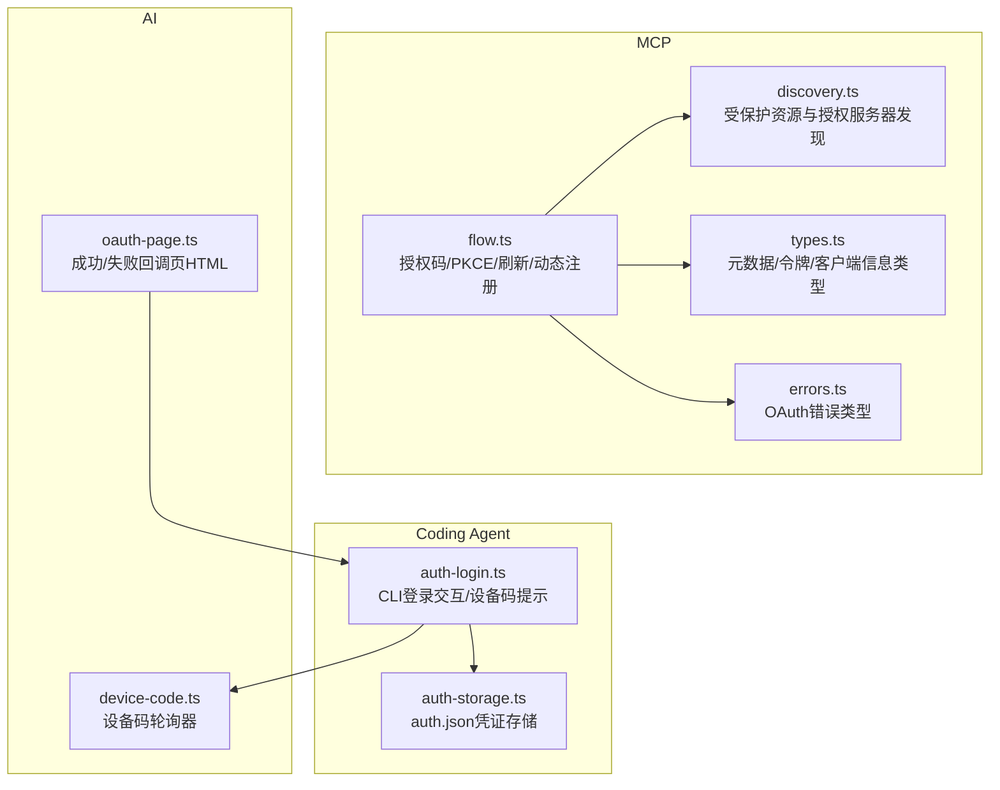
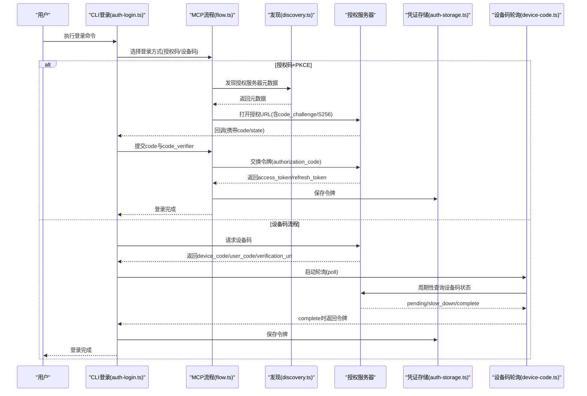
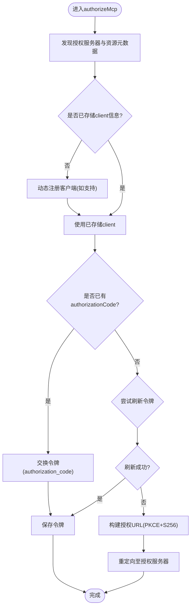
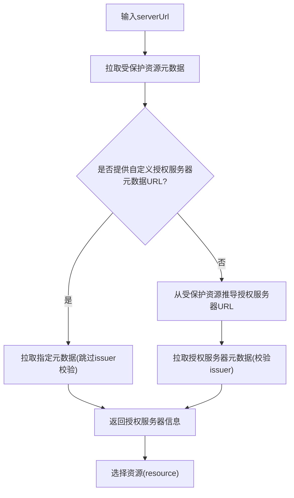
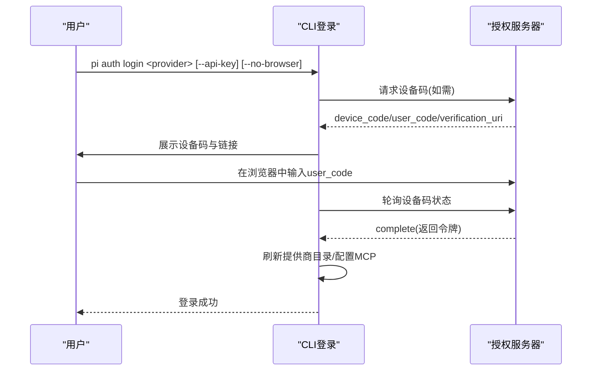
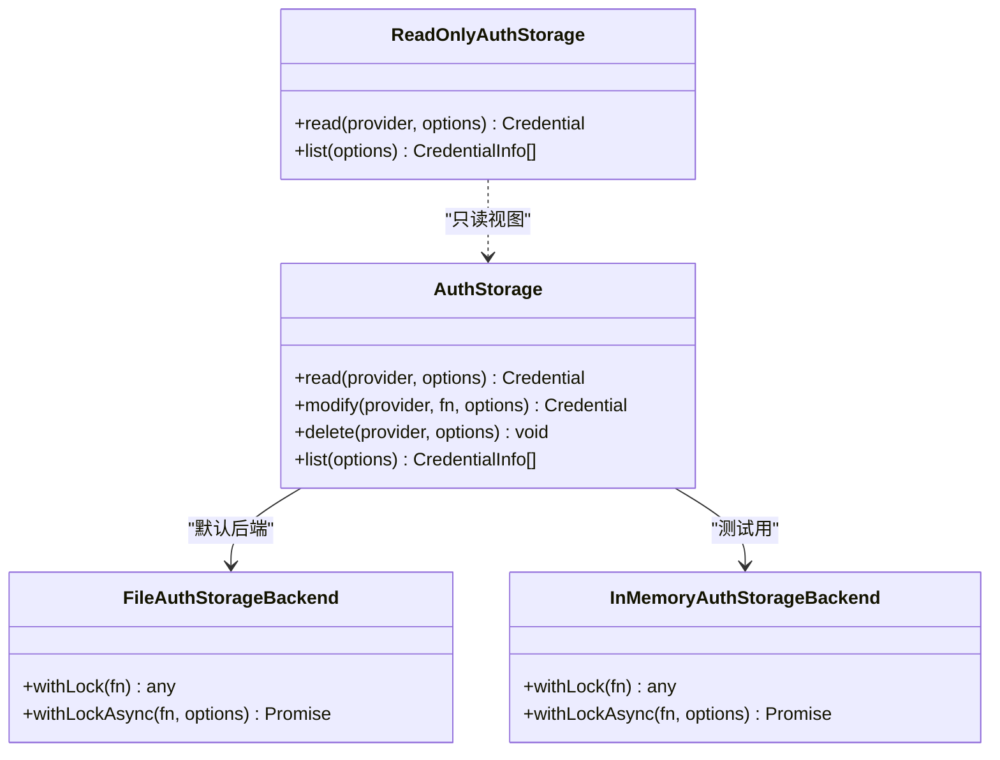
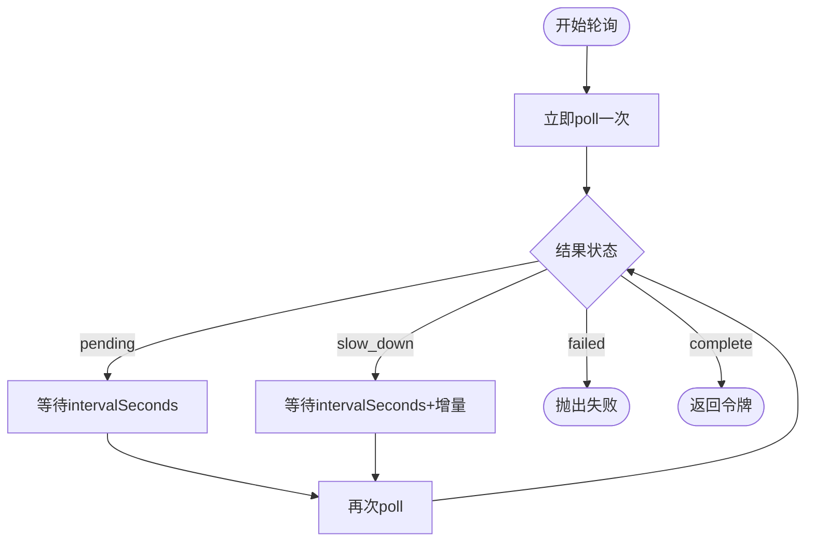
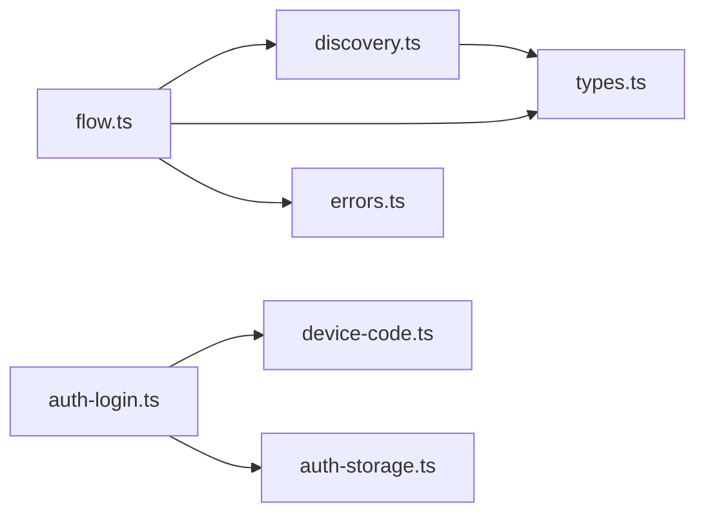

# OAuth认证流程

<cite>
**本文引用的文件**   
- [packages/mcp/src/oauth/flow.ts](file://packages/mcp/src/oauth/flow.ts)
- [packages/mcp/src/oauth/discovery.ts](file://packages/mcp/src/oauth/discovery.ts)
- [packages/mcp/src/oauth/types.ts](file://packages/mcp/src/oauth/types.ts)
- [packages/mcp/src/oauth/errors.ts](file://packages/mcp/src/oauth/errors.ts)
- [packages/coding-agent/src/cli/auth-login.ts](file://packages/coding-agent/src/cli/auth-login.ts)
- [packages/coding-agent/src/core/auth-storage.ts](file://packages/coding-agent/src/core/auth-storage.ts)
- [packages/ai/src/utils/oauth-page.ts](file://packages/ai/src/utils/oauth-page.ts)
- [packages/ai/src/auth/oauth/device-code.ts](file://packages/ai/src/auth/oauth/device-code.ts)
- [packages/ai/test/oauth-device-code.test.ts](file://packages/ai/test/oauth-device-code.test.ts)
</cite>

## 目录
1. [简介](#简介)
2. [项目结构](#项目结构)
3. [核心组件](#核心组件)
4. [架构总览](#架构总览)
5. [详细组件分析](#详细组件分析)
6. [依赖关系分析](#依赖关系分析)
7. [性能与可扩展性](#性能与可扩展性)
8. [故障排查指南](#故障排查指南)
9. [结论](#结论)
10. [附录：提供商差异与配置要点](#附录提供商差异与配置要点)

## 简介
本文件系统化梳理仓库中的OAuth2.0实现，覆盖授权码流程、PKCE扩展、设备代码流程、回调页面、状态与令牌管理、错误处理与安全策略。文档同时给出不同提供商的实现差异与常见配置项说明，帮助开发者快速集成并排障。

## 项目结构
本项目在多个包中实现了OAuth相关能力：
- MCP层提供通用OAuth流程、发现机制、类型与错误定义。
- Coding Agent CLI负责交互式登录、设备码流程展示与MCP服务器配置联动。
- AI层提供设备码轮询工具与回调页面模板。
- 凭证存储通过auth.json持久化访问令牌、刷新令牌与过期时间等。

**图表来源**
- [packages/mcp/src/oauth/flow.ts:1-531](file://packages/mcp/src/oauth/flow.ts#L1-L531)
- [packages/mcp/src/oauth/discovery.ts:1-216](file://packages/mcp/src/oauth/discovery.ts#L1-L216)
- [packages/mcp/src/oauth/types.ts:1-216](file://packages/mcp/src/oauth/types.ts#L1-L216)
- [packages/mcp/src/oauth/errors.ts:1-67](file://packages/mcp/src/oauth/errors.ts#L1-L67)
- [packages/coding-agent/src/cli/auth-login.ts:1-278](file://packages/coding-agent/src/cli/auth-login.ts#L1-L278)
- [packages/coding-agent/src/core/auth-storage.ts:1-509](file://packages/coding-agent/src/core/auth-storage.ts#L1-L509)
- [packages/ai/src/auth/oauth/device-code.ts:1-31](file://packages/ai/src/auth/oauth/device-code.ts#L1-L31)
- [packages/ai/src/utils/oauth-page.ts:1-110](file://packages/ai/src/utils/oauth-page.ts#L1-L110)

**章节来源**
- [packages/mcp/src/oauth/flow.ts:1-531](file://packages/mcp/src/oauth/flow.ts#L1-L531)
- [packages/mcp/src/oauth/discovery.ts:1-216](file://packages/mcp/src/oauth/discovery.ts#L1-L216)
- [packages/mcp/src/oauth/types.ts:1-216](file://packages/mcp/src/oauth/types.ts#L1-L216)
- [packages/mcp/src/oauth/errors.ts:1-67](file://packages/mcp/src/oauth/errors.ts#L1-L67)
- [packages/coding-agent/src/cli/auth-login.ts:1-278](file://packages/coding-agent/src/cli/auth-login.ts#L1-L278)
- [packages/coding-agent/src/core/auth-storage.ts:1-509](file://packages/coding-agent/src/core/auth-storage.ts#L1-L509)
- [packages/ai/src/auth/oauth/device-code.ts:1-31](file://packages/ai/src/auth/oauth/device-code.ts#L1-L31)
- [packages/ai/src/utils/oauth-page.ts:1-110](file://packages/ai/src/utils/oauth-page.ts#L1-L110)

## 核心组件
- MCP OAuth流程引擎：封装授权码交换、PKCE、动态客户端注册、令牌刷新、Www-Authenticate挑战处理与重试逻辑。
- 发现模块：拉取受保护资源元数据与授权服务器元数据，校验issuer，选择资源标识。
- 类型与错误：统一的元数据、令牌、客户端信息与错误类定义。
- CLI登录：交互式选择登录方式（浏览器/设备码/API Key），展示设备码与验证链接，必要时自动打开浏览器。
- 凭证存储：基于auth.json的读写锁、并发安全、只读视图与内存后端。
- 设备码轮询：RFC 8628轮询器，支持slow_down、超时与取消。
- 回调页面：成功/失败HTML模板，用于本地回调或内嵌页面展示。

**章节来源**
- [packages/mcp/src/oauth/flow.ts:1-531](file://packages/mcp/src/oauth/flow.ts#L1-L531)
- [packages/mcp/src/oauth/discovery.ts:1-216](file://packages/mcp/src/oauth/discovery.ts#L1-L216)
- [packages/mcp/src/oauth/types.ts:1-216](file://packages/mcp/src/oauth/types.ts#L1-L216)
- [packages/mcp/src/oauth/errors.ts:1-67](file://packages/mcp/src/oauth/errors.ts#L1-L67)
- [packages/coding-agent/src/cli/auth-login.ts:1-278](file://packages/coding-agent/src/cli/auth-login.ts#L1-L278)
- [packages/coding-agent/src/core/auth-storage.ts:1-509](file://packages/coding-agent/src/core/auth-storage.ts#L1-L509)
- [packages/ai/src/auth/oauth/device-code.ts:1-31](file://packages/ai/src/auth/oauth/device-code.ts#L1-L31)
- [packages/ai/src/utils/oauth-page.ts:1-110](file://packages/ai/src/utils/oauth-page.ts#L1-L110)

## 架构总览
下图展示了从用户发起登录到获取令牌的端到端流程，涵盖授权码+PKCE和设备码两种路径，以及刷新与重试机制。

**图表来源**
- [packages/coding-agent/src/cli/auth-login.ts:1-278](file://packages/coding-agent/src/cli/auth-login.ts#L1-L278)
- [packages/mcp/src/oauth/flow.ts:174-316](file://packages/mcp/src/oauth/flow.ts#L174-L316)
- [packages/mcp/src/oauth/discovery.ts:119-193](file://packages/mcp/src/oauth/discovery.ts#L119-L193)
- [packages/ai/src/auth/oauth/device-code.ts:1-31](file://packages/ai/src/auth/oauth/device-code.ts#L1-L31)
- [packages/coding-agent/src/core/auth-storage.ts:329-491](file://packages/coding-agent/src/core/auth-storage.ts#L329-L491)

## 详细组件分析

### MCP OAuth流程引擎（授权码+PKCE）
- PKCE生成：使用WebCrypto生成随机verifier与S256 challenge。
- 授权URL构建：强制response_type=code，注入client_id、code_challenge、code_challenge_method=S256、redirect_uri，可选state/scope/resource；当scope包含offline_access时添加prompt=consent。
- 令牌交换：POST /token，grant_type=authorization_code，携带code、code_verifier、redirect_uri；根据元数据选择客户端认证方式（Basic/Post/none）。
- 动态注册：若未存储client信息且支持动态注册，则POST /register，application_type按redirect_uris推断为native/web。
- 刷新令牌：grant_type=refresh_token，保留原refresh_token并合并新令牌。
- 401挑战处理：解析Www-Authenticate，支持insufficient_scope提升scope，必要时跳过刷新直接重新授权。
- 安全校验：拒绝非HTTPS端点（除回环地址），校验issuer一致性，限制仅HTTP/HTTPS URL。

**图表来源**
- [packages/mcp/src/oauth/flow.ts:174-316](file://packages/mcp/src/oauth/flow.ts#L174-L316)
- [packages/mcp/src/oauth/flow.ts:339-466](file://packages/mcp/src/oauth/flow.ts#L339-L466)
- [packages/mcp/src/oauth/flow.ts:468-531](file://packages/mcp/src/oauth/flow.ts#L468-L531)

**章节来源**
- [packages/mcp/src/oauth/flow.ts:174-316](file://packages/mcp/src/oauth/flow.ts#L174-L316)
- [packages/mcp/src/oauth/flow.ts:339-466](file://packages/mcp/src/oauth/flow.ts#L339-L466)
- [packages/mcp/src/oauth/flow.ts:468-531](file://packages/mcp/src/oauth/flow.ts#L468-L531)

### 发现与元数据处理
- 受保护资源元数据：优先从/.well-known/oauth-protected-resource读取，路径不匹配时回退根路径。
- 授权服务器元数据：依次尝试oauth-authorization-server与openid-configuration，校验issuer与expected一致。
- 资源选择：比较serverUrl与metadata.resource的origin与路径前缀，确保资源归属正确。
- Www-Authenticate解析：提取resource_metadata、scope、error等参数，供后续scope提升或重试。

**图表来源**
- [packages/mcp/src/oauth/discovery.ts:70-104](file://packages/mcp/src/oauth/discovery.ts#L70-L104)
- [packages/mcp/src/oauth/discovery.ts:119-193](file://packages/mcp/src/oauth/discovery.ts#L119-L193)
- [packages/mcp/src/oauth/discovery.ts:202-215](file://packages/mcp/src/oauth/discovery.ts#L202-L215)

**章节来源**
- [packages/mcp/src/oauth/discovery.ts:70-104](file://packages/mcp/src/oauth/discovery.ts#L70-L104)
- [packages/mcp/src/oauth/discovery.ts:119-193](file://packages/mcp/src/oauth/discovery.ts#L119-L193)
- [packages/mcp/src/oauth/discovery.ts:202-215](file://packages/mcp/src/oauth/discovery.ts#L202-L215)

### 类型与错误模型
- 类型：AuthorizationServerMetadata、OAuthProtectedResourceMetadata、OAuthTokens、OAuthClientInformationMixed等，均带结构化校验。
- 错误：OAuthError、OAuthIssuerMismatchError、OAuthInsecureEndpointError、OAuthRegistrationError、McpOAuthAuthorizationRequiredError等，便于上层统一处理。

**章节来源**
- [packages/mcp/src/oauth/types.ts:9-86](file://packages/mcp/src/oauth/types.ts#L9-L86)
- [packages/mcp/src/oauth/types.ts:145-215](file://packages/mcp/src/oauth/types.ts#L145-L215)
- [packages/mcp/src/oauth/errors.ts:1-67](file://packages/mcp/src/oauth/errors.ts#L1-L67)

### CLI登录交互与设备码流程
- 登录入口：解析参数(providerRef、--api-key、--no-browser)，选择OAuth或API Key登录。
- 交互提示：显示授权URL、设备码与验证链接，必要时自动打开浏览器；支持“其他登录方式”提示。
- 设备码展示：打印user_code与verificationUri，等待用户完成授权。
- 登录后刷新：登录成功后刷新提供商模型目录，必要时更新MCP服务器配置指向当前登录。

**图表来源**
- [packages/coding-agent/src/cli/auth-login.ts:36-92](file://packages/coding-agent/src/cli/auth-login.ts#L36-L92)
- [packages/coding-agent/src/cli/auth-login.ts:131-203](file://packages/coding-agent/src/cli/auth-login.ts#L131-L203)
- [packages/coding-agent/src/cli/auth-login.ts:223-277](file://packages/coding-agent/src/cli/auth-login.ts#L223-L277)

**章节来源**
- [packages/coding-agent/src/cli/auth-login.ts:36-92](file://packages/coding-agent/src/cli/auth-login.ts#L36-L92)
- [packages/coding-agent/src/cli/auth-login.ts:131-203](file://packages/coding-agent/src/cli/auth-login.ts#L131-L203)
- [packages/coding-agent/src/cli/auth-login.ts:223-277](file://packages/coding-agent/src/cli/auth-login.ts#L223-L277)

### 凭证存储（auth.json）
- 文件写入：以0o600权限创建/写入，确保敏感信息最小暴露。
- 并发控制：同步/异步加锁，兼容Windows EPERM重试，避免多进程竞争。
- 只读视图：ReadOnlyAuthStorage提供不可变读取接口，校验字段合法性。
- 内存后端：InMemoryAuthStorageBackend用于测试与无文件场景。
- 数据结构：支持api_key与oauth两类凭证；oauth凭证包含access、refresh、expires等字段。

**图表来源**
- [packages/coding-agent/src/core/auth-storage.ts:61-203](file://packages/coding-agent/src/core/auth-storage.ts#L61-L203)
- [packages/coding-agent/src/core/auth-storage.ts:205-324](file://packages/coding-agent/src/core/auth-storage.ts#L205-L324)
- [packages/coding-agent/src/core/auth-storage.ts:329-491](file://packages/coding-agent/src/core/auth-storage.ts#L329-L491)

**章节来源**
- [packages/coding-agent/src/core/auth-storage.ts:61-203](file://packages/coding-agent/src/core/auth-storage.ts#L61-L203)
- [packages/coding-agent/src/core/auth-storage.ts:205-324](file://packages/coding-agent/src/core/auth-storage.ts#L205-L324)
- [packages/coding-agent/src/core/auth-storage.ts:329-491](file://packages/coding-agent/src/core/auth-storage.ts#L329-L491)

### 设备码轮询器（RFC 8628）
- 初始轮询：立即发起第一次poll，随后按intervalSeconds周期轮询。
- slow_down支持：服务端返回slow_down时，将间隔增加固定增量。
- 超时与取消：支持expiresInSeconds与AbortSignal取消。
- 测试结果：验证了立即轮询、首次等待、slow_down与取消行为。

**图表来源**
- [packages/ai/src/auth/oauth/device-code.ts:1-31](file://packages/ai/src/auth/oauth/device-code.ts#L1-L31)
- [packages/ai/test/oauth-device-code.test.ts:11-42](file://packages/ai/test/oauth-device-code.test.ts#L11-L42)
- [packages/ai/test/oauth-device-code.test.ts:98-129](file://packages/ai/test/oauth-device-code.test.ts#L98-L129)
- [packages/ai/test/oauth-device-code.test.ts:131-133](file://packages/ai/test/oauth-device-code.test.ts#L131-L133)

**章节来源**
- [packages/ai/src/auth/oauth/device-code.ts:1-31](file://packages/ai/src/auth/oauth/device-code.ts#L1-L31)
- [packages/ai/test/oauth-device-code.test.ts:11-42](file://packages/ai/test/oauth-device-code.test.ts#L11-L42)
- [packages/ai/test/oauth-device-code.test.ts:98-129](file://packages/ai/test/oauth-device-code.test.ts#L98-L129)
- [packages/ai/test/oauth-device-code.test.ts:131-133](file://packages/ai/test/oauth-device-code.test.ts#L131-L133)

### 回调页面与状态展示
- 成功页面：渲染标题、消息与可选详情。
- 失败页面：渲染错误消息与可选详情。
- HTML转义：对用户输入进行HTML转义，防止XSS。

**章节来源**
- [packages/ai/src/utils/oauth-page.ts:1-110](file://packages/ai/src/utils/oauth-page.ts#L1-L110)

## 依赖关系分析
- flow.ts依赖discovery.ts进行元数据发现，依赖types.ts进行类型校验，依赖errors.ts抛出标准化错误。
- auth-login.ts依赖device-code.ts进行设备码轮询，依赖auth-storage.ts持久化凭证。
- discovery.ts依赖types.ts解析元数据，并在需要时调用全局fetch。
- types.ts依赖jsonrpc.ts的isObject辅助函数进行基础对象校验。

**图表来源**
- [packages/mcp/src/oauth/flow.ts:1-34](file://packages/mcp/src/oauth/flow.ts#L1-L34)
- [packages/mcp/src/oauth/discovery.ts:1-17](file://packages/mcp/src/oauth/discovery.ts#L1-L17)
- [packages/coding-agent/src/cli/auth-login.ts:1-11](file://packages/coding-agent/src/cli/auth-login.ts#L1-L11)
- [packages/ai/src/auth/oauth/device-code.ts:1-24](file://packages/ai/src/auth/oauth/device-code.ts#L1-L24)

**章节来源**
- [packages/mcp/src/oauth/flow.ts:1-34](file://packages/mcp/src/oauth/flow.ts#L1-L34)
- [packages/mcp/src/oauth/discovery.ts:1-17](file://packages/mcp/src/oauth/discovery.ts#L1-L17)
- [packages/coding-agent/src/cli/auth-login.ts:1-11](file://packages/coding-agent/src/cli/auth-login.ts#L1-L11)
- [packages/ai/src/auth/oauth/device-code.ts:1-24](file://packages/ai/src/auth/oauth/device-code.ts#L1-L24)

## 性能与可扩展性
- 并发安全：auth-storage使用文件锁与异步链式操作，避免竞态条件；Windows EPERM重试提升稳定性。
- 网络优化：发现阶段对4xx与502视为“未发现”，自动尝试备选URL；受保护资源元数据存在路径回退。
- 令牌刷新：authorizeMcp在invalid_grant或invalid_client/unauthorized_client时清理相应凭据并重试，减少重复授权。
- 可扩展点：
  - 自定义客户端认证：通过addClientAuthentication钩子注入Header或Body参数。
  - 自定义状态与Verifier存储：通过provider.state/saveCodeVerifier等接口实现。
  - 自定义发现URL：通过authorizationServerMetadataUrl绕过自动发现，适用于特定环境。

[本节为通用指导，不直接分析具体文件]

## 故障排查指南
- 授权服务器不支持授权码或PKCE：检查元数据response_types_supported与code_challenge_methods_supported。
- issuer不匹配：确认授权服务器URL与元数据issuer一致，或临时跳过校验（仅限可信环境）。
- 非HTTPS端点被拒绝：确保token_endpoint与authorization_endpoint使用HTTPS（回环地址除外）。
- 动态注册失败：检查registration_endpoint是否存在与服务端响应体错误。
- 刷新令牌失败：查看是否为invalid_grant或server_error；必要时清理tokens并重试。
- 设备码轮询异常：检查slow_down与interval设置、系统时钟漂移（WSL/VM）、超时与取消信号。
- 回调页面显示错误：核对HTML转义与错误详情输出。

**章节来源**
- [packages/mcp/src/oauth/flow.ts:191-213](file://packages/mcp/src/oauth/flow.ts#L191-L213)
- [packages/mcp/src/oauth/flow.ts:259-288](file://packages/mcp/src/oauth/flow.ts#L259-L288)
- [packages/mcp/src/oauth/flow.ts:468-531](file://packages/mcp/src/oauth/flow.ts#L468-L531)
- [packages/mcp/src/oauth/errors.ts:1-67](file://packages/mcp/src/oauth/errors.ts#L1-L67)
- [packages/ai/test/oauth-device-code.test.ts:98-129](file://packages/ai/test/oauth-device-code.test.ts#L98-L129)
- [packages/ai/src/utils/oauth-page.ts:94-109](file://packages/ai/src/utils/oauth-page.ts#L94-L109)

## 结论
该仓库提供了完整的OAuth2.0实现，涵盖授权码+PKCE、设备码流程、动态客户端注册、令牌刷新与401挑战处理，并通过auth.json实现安全的凭证存储。发现模块增强了跨提供商兼容性，CLI层提供了友好的交互体验。建议在集成时关注issuer校验、HTTPS要求与scope提升策略，并结合设备码轮询器的slow_down与超时机制进行健壮性设计。

[本节为总结性内容，不直接分析具体文件]

## 附录：提供商差异与配置要点
- 授权服务器元数据差异：
  - response_types_supported：必须包含code。
  - code_challenge_methods_supported：必须包含S256。
  - token_endpoint_auth_methods_supported：决定客户端认证方式（Basic/Post/none）。
  - authorization_response_iss_parameter_supported：决定是否校验授权响应的iss。
- 动态客户端注册：
  - registration_endpoint：若不存在则需预注册client_id/client_secret。
  - application_type：native或web，由redirect_uris推断。
- 资源与scope：
  - resource：受保护资源URL，需与serverUrl匹配。
  - scope：若包含offline_access，需prompt=consent；insufficient_scope时需提升scope。
- 设备码流程：
  - interval与slow_down：遵循RFC 8628，注意时钟同步。
  - verification_uri_complete：部分提供商提供完整验证链接。
- 回调与状态：
  - redirect_uri：必须与授权请求一致。
  - state：建议传递随机值用于防CSRF。

[本节为通用指导，不直接分析具体文件]