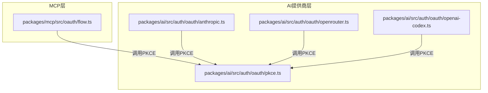
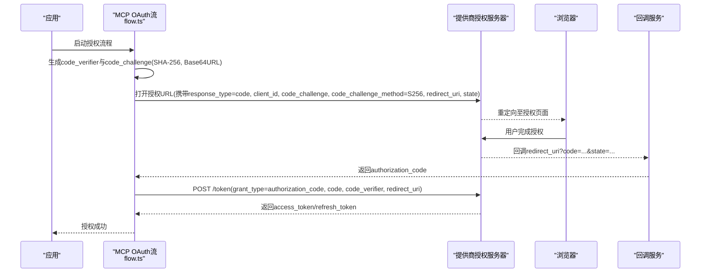
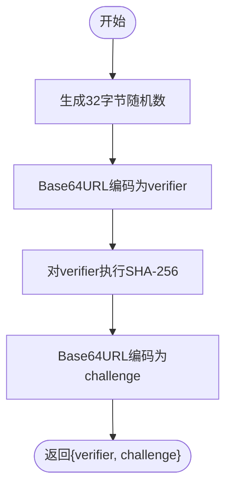
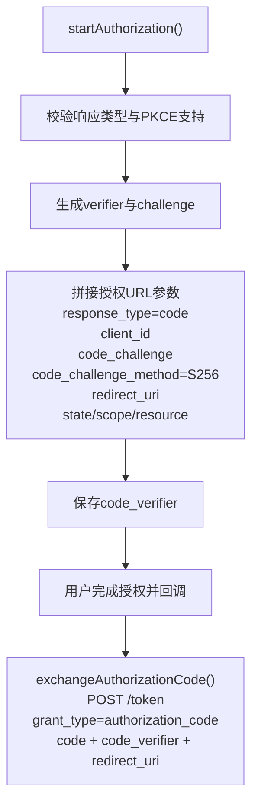
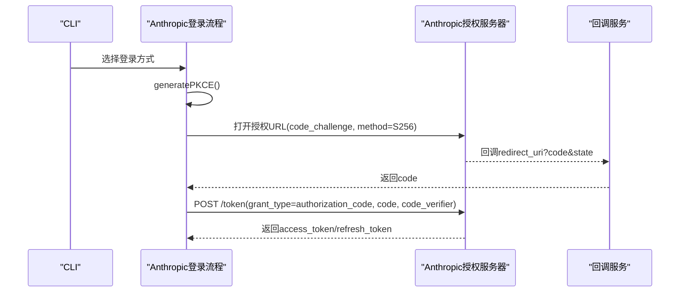
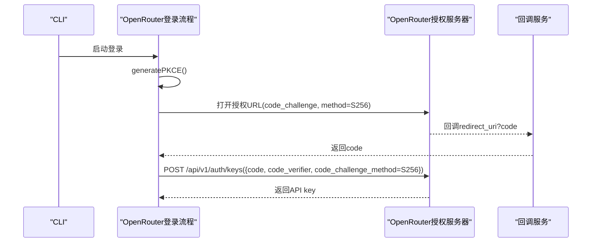
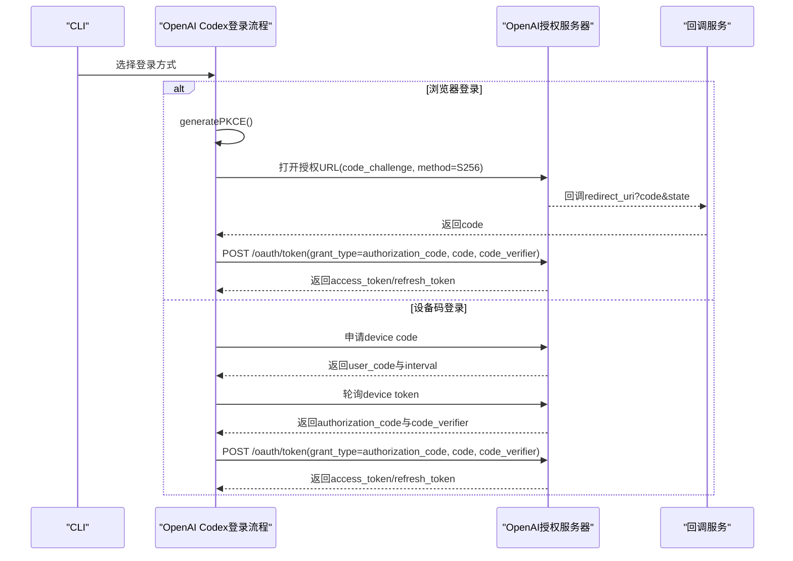
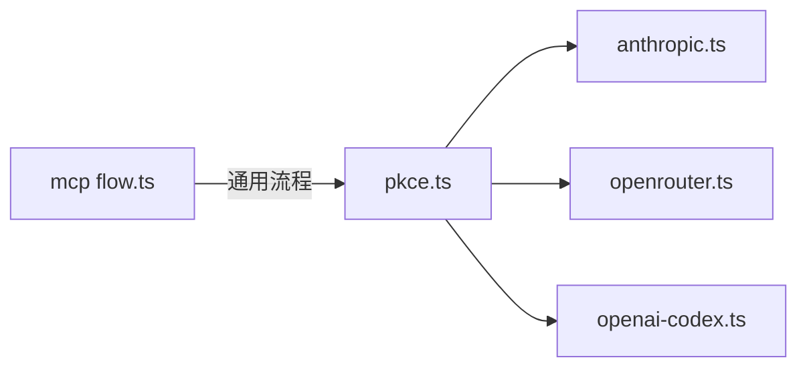

# PKCE扩展

<cite>
**本文引用的文件**   
- [packages/mcp/src/oauth/flow.ts](file://packages/mcp/src/oauth/flow.ts)
- [packages/ai/src/auth/oauth/pkce.ts](file://packages/ai/src/auth/oauth/pkce.ts)
- [packages/ai/src/auth/oauth/anthropic.ts](file://packages/ai/src/auth/oauth/anthropic.ts)
- [packages/ai/src/auth/oauth/openrouter.ts](file://packages/ai/src/auth/oauth/openrouter.ts)
- [packages/ai/src/auth/oauth/openai-codex.ts](file://packages/ai/src/auth/oauth/openai-codex.ts)
</cite>

## 目录
1. [简介](#简介)
2. [项目结构](#项目结构)
3. [核心组件](#核心组件)
4. [架构总览](#架构总览)
5. [详细组件分析](#详细组件分析)
6. [依赖关系分析](#依赖关系分析)
7. [性能与实现特性](#性能与实现特性)
8. [安全最佳实践](#安全最佳实践)
9. [常见问题排查](#常见问题排查)
10. [结论](#结论)

## 简介
本文件面向在项目中实现或集成PKCE（Proof Key for Code Exchange）的开发者，系统说明PKCE的安全原理、代码验证器生成过程、code_verifier与code_challenge的计算方法，并对比传统授权码流程与PKCE版本。文档还给出仓库中现有实现的参考路径、支持PKCE的提供商清单与配置要点，以及安全建议与排错指南。

## 项目结构
本项目在两个位置实现了PKCE能力：
- MCP OAuth流：提供通用的授权码交换与PKCE工具函数，供MCP客户端使用。
- AI包OAuth提供商：为Anthropic、OpenRouter、OpenAI Codex等提供商封装了各自的登录与令牌交换流程，均基于统一的PKCE工具函数。

图表来源
- [packages/mcp/src/oauth/flow.ts:174-213](file://packages/mcp/src/oauth/flow.ts#L174-L213)
- [packages/ai/src/auth/oauth/pkce.ts:1-35](file://packages/ai/src/auth/oauth/pkce.ts#L1-L35)
- [packages/ai/src/auth/oauth/anthropic.ts:140-198](file://packages/ai/src/auth/oauth/anthropic.ts#L140-L198)
- [packages/ai/src/auth/oauth/openrouter.ts:113-157](file://packages/ai/src/auth/oauth/openrouter.ts#L113-L157)
- [packages/ai/src/auth/oauth/openai-codex.ts:289-308](file://packages/ai/src/auth/oauth/openai-codex.ts#L289-L308)

章节来源
- [packages/mcp/src/oauth/flow.ts:174-213](file://packages/mcp/src/oauth/flow.ts#L174-L213)
- [packages/ai/src/auth/oauth/pkce.ts:1-35](file://packages/ai/src/auth/oauth/pkce.ts#L1-L35)

## 核心组件
- PKCE工具函数：负责生成随机code_verifier，并计算SHA-256哈希后Base64URL编码得到code_challenge。
- MCP OAuth流：封装完整的授权码流程，包括发现元数据、构造授权URL、保存code_verifier、交换授权码换取令牌。
- 各提供商登录流程：分别对接各自授权端点与令牌端点，统一通过PKCE工具生成challenge并在授权请求中携带S256方法。

章节来源
- [packages/ai/src/auth/oauth/pkce.ts:1-35](file://packages/ai/src/auth/oauth/pkce.ts#L1-L35)
- [packages/mcp/src/oauth/flow.ts:174-304](file://packages/mcp/src/oauth/flow.ts#L174-L304)
- [packages/ai/src/auth/oauth/anthropic.ts:140-198](file://packages/ai/src/auth/oauth/anthropic.ts#L140-L198)
- [packages/ai/src/auth/oauth/openrouter.ts:113-157](file://packages/ai/src/auth/oauth/openrouter.ts#L113-L157)
- [packages/ai/src/auth/oauth/openai-codex.ts:289-308](file://packages/ai/src/auth/oauth/openai-codex.ts#L289-L308)

## 架构总览
下图展示从应用发起登录到最终获取令牌的端到端流程，涵盖PKCE参数生成、授权跳转、回调处理与令牌交换。

图表来源
- [packages/mcp/src/oauth/flow.ts:174-213](file://packages/mcp/src/oauth/flow.ts#L174-L213)
- [packages/mcp/src/oauth/flow.ts:290-304](file://packages/mcp/src/oauth/flow.ts#L290-L304)

## 详细组件分析

### PKCE工具函数
- 功能：生成安全的随机code_verifier，并通过SHA-256计算code_challenge，两者均采用Base64URL编码。
- 平台兼容：同时适用于Node.js与浏览器环境，使用Web Crypto API进行加密原语操作。
- 复杂度：时间复杂度O(n)，空间复杂度O(n)，n为字节数组长度（固定32字节）。

图表来源
- [packages/ai/src/auth/oauth/pkce.ts:9-34](file://packages/ai/src/auth/oauth/pkce.ts#L9-L34)

章节来源
- [packages/ai/src/auth/oauth/pkce.ts:1-35](file://packages/ai/src/auth/oauth/pkce.ts#L1-L35)

### MCP OAuth流中的PKCE
- 授权阶段：检查授权服务器是否支持authorization code与PKCE S256；构造授权URL时附加code_challenge与code_challenge_method=S256；保存code_verifier以便后续交换。
- 令牌交换阶段：将authorization_code与之前保存的code_verifier一并发送至令牌端点。

图表来源
- [packages/mcp/src/oauth/flow.ts:174-213](file://packages/mcp/src/oauth/flow.ts#L174-L213)
- [packages/mcp/src/oauth/flow.ts:290-304](file://packages/mcp/src/oauth/flow.ts#L290-L304)

章节来源
- [packages/mcp/src/oauth/flow.ts:174-304](file://packages/mcp/src/oauth/flow.ts#L174-L304)

### Anthropic提供商的PKCE流程
- 登录入口：调用generatePKCE()生成verifier与challenge；构造授权URL并携带code_challenge与method=S256；支持浏览器回调与手动粘贴两种模式。
- 令牌交换：将authorization_code与verifier发送至令牌端点，解析access_token与refresh_token。

图表来源
- [packages/ai/src/auth/oauth/anthropic.ts:140-198](file://packages/ai/src/auth/oauth/anthropic.ts#L140-L198)
- [packages/ai/src/auth/oauth/anthropic.ts:96-138](file://packages/ai/src/auth/oauth/anthropic.ts#L96-L138)

章节来源
- [packages/ai/src/auth/oauth/anthropic.ts:140-198](file://packages/ai/src/auth/oauth/anthropic.ts#L140-L198)
- [packages/ai/src/auth/oauth/anthropic.ts:96-138](file://packages/ai/src/auth/oauth/anthropic.ts#L96-L138)

### OpenRouter提供商的PKCE流程
- 特点：以授权码换取长期有效的用户可控API key，而非短期access/refresh token对。
- 流程：生成PKCE参数，构造授权URL；回调后直接交换code与verifier获取key。

图表来源
- [packages/ai/src/auth/oauth/openrouter.ts:113-157](file://packages/ai/src/auth/oauth/openrouter.ts#L113-L157)
- [packages/ai/src/auth/oauth/openrouter.ts:58-111](file://packages/ai/src/auth/oauth/openrouter.ts#L58-L111)

章节来源
- [packages/ai/src/auth/oauth/openrouter.ts:113-157](file://packages/ai/src/auth/oauth/openrouter.ts#L113-L157)
- [packages/ai/src/auth/oauth/openrouter.ts:58-111](file://packages/ai/src/auth/oauth/openrouter.ts#L58-L111)

### OpenAI Codex提供商的PKCE流程
- 登录方式：支持浏览器登录与设备码登录；浏览器登录使用PKCE；设备码流程由服务端下发authorization_code与code_verifier。
- 令牌交换：使用authorization_code与code_verifier换取access_token与refresh_token。

图表来源
- [packages/ai/src/auth/oauth/openai-codex.ts:289-308](file://packages/ai/src/auth/oauth/openai-codex.ts#L289-L308)
- [packages/ai/src/auth/oauth/openai-codex.ts:145-165](file://packages/ai/src/auth/oauth/openai-codex.ts#L145-L165)
- [packages/ai/src/auth/oauth/openai-codex.ts:231-287](file://packages/ai/src/auth/oauth/openai-codex.ts#L231-L287)

章节来源
- [packages/ai/src/auth/oauth/openai-codex.ts:289-308](file://packages/ai/src/auth/oauth/openai-codex.ts#L289-L308)
- [packages/ai/src/auth/oauth/openai-codex.ts:145-165](file://packages/ai/src/auth/oauth/openai-codex.ts#L145-L165)
- [packages/ai/src/auth/oauth/openai-codex.ts:231-287](file://packages/ai/src/auth/oauth/openai-codex.ts#L231-L287)

## 依赖关系分析
- PKCE工具函数被多个提供商复用，降低重复实现风险。
- MCP OAuth流提供通用流程，适合需要对接任意符合规范的授权服务器的场景。
- 各提供商模块仅关注自身端点差异与业务语义，保持低耦合。

图表来源
- [packages/ai/src/auth/oauth/pkce.ts:1-35](file://packages/ai/src/auth/oauth/pkce.ts#L1-L35)
- [packages/ai/src/auth/oauth/anthropic.ts:140-198](file://packages/ai/src/auth/oauth/anthropic.ts#L140-L198)
- [packages/ai/src/auth/oauth/openrouter.ts:113-157](file://packages/ai/src/auth/oauth/openrouter.ts#L113-L157)
- [packages/ai/src/auth/oauth/openai-codex.ts:289-308](file://packages/ai/src/auth/oauth/openai-codex.ts#L289-L308)
- [packages/mcp/src/oauth/flow.ts:174-304](file://packages/mcp/src/oauth/flow.ts#L174-L304)

章节来源
- [packages/ai/src/auth/oauth/pkce.ts:1-35](file://packages/ai/src/auth/oauth/pkce.ts#L1-L35)
- [packages/mcp/src/oauth/flow.ts:174-304](file://packages/mcp/src/oauth/flow.ts#L174-L304)

## 性能与实现特性
- 随机数生成：使用Web Crypto API的getRandomValues，保证跨平台安全性与性能。
- 哈希计算：SHA-256采用Web Crypto API的subtle.digest，避免第三方库开销。
- 编码：Base64URL编码在内存中进行，固定输入长度（32字节），开销可忽略。
- 并发与安全：所有网络请求支持AbortSignal，便于超时与取消控制。

[本节为通用指导，不直接分析具体文件]

## 安全最佳实践
- 始终使用S256作为code_challenge_method，并确保授权服务器支持该算法。
- 使用密码学安全的随机源生成code_verifier（至少32字节熵）。
- 在授权请求中携带state参数，并在回调中严格校验state，防止CSRF攻击。
- 仅在HTTPS或本地回环地址上使用回调URI，避免中间人攻击。
- 妥善存储code_verifier，仅在令牌交换时使用，使用后销毁。
- 校验授权响应的iss字段（如适用），确保令牌来自预期的授权服务器。
- 对令牌端点请求设置超时与重试限制，避免资源泄露。

[本节为通用指导，不直接分析具体文件]

## 常见问题排查
- 授权服务器不支持PKCE S256：检查元数据中的code_challenge_methods_supported是否包含S256。
- 回调URI不一致：确保授权请求与令牌交换使用的redirect_uri完全一致。
- state不匹配：确认回调中的state与生成的state一致，否则拒绝交换。
- code_verifier错误：若令牌交换失败，检查是否使用了正确的verifier，且未篡改。
- 非HTTPS回调：在非本地主机上必须使用HTTPS，否则会被拒绝。
- 令牌端点认证方法不匹配：根据授权服务器支持的token_endpoint_auth_methods_supported选择合适的client_secret传输方式。

章节来源
- [packages/mcp/src/oauth/flow.ts:192-213](file://packages/mcp/src/oauth/flow.ts#L192-L213)
- [packages/mcp/src/oauth/flow.ts:290-304](file://packages/mcp/src/oauth/flow.ts#L290-L304)

## 结论
本项目在MCP层与AI提供商层均实现了标准PKCE流程，通过统一的PKCE工具函数保证了实现的一致性与安全性。各提供商模块专注于自身端点差异，便于扩展与维护。遵循上述安全最佳实践与排错指南，可在不同环境中稳定地启用PKCE以提升授权码流程的安全性。

[本节为总结性内容，不直接分析具体文件]