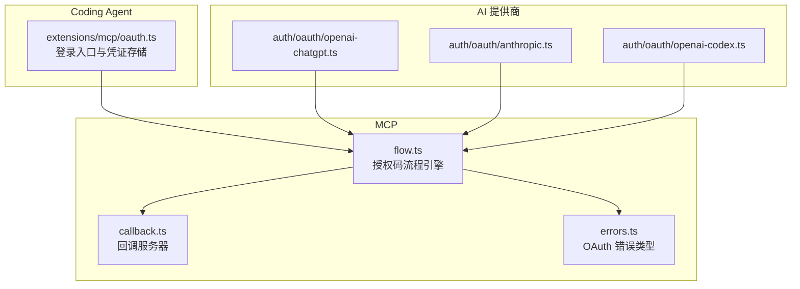
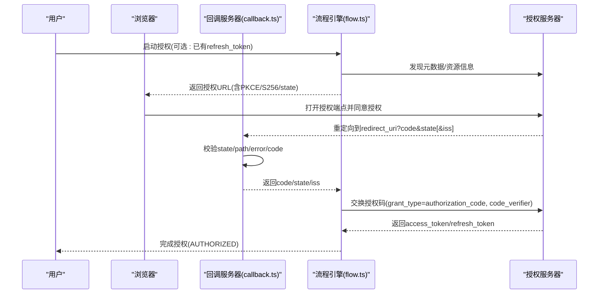
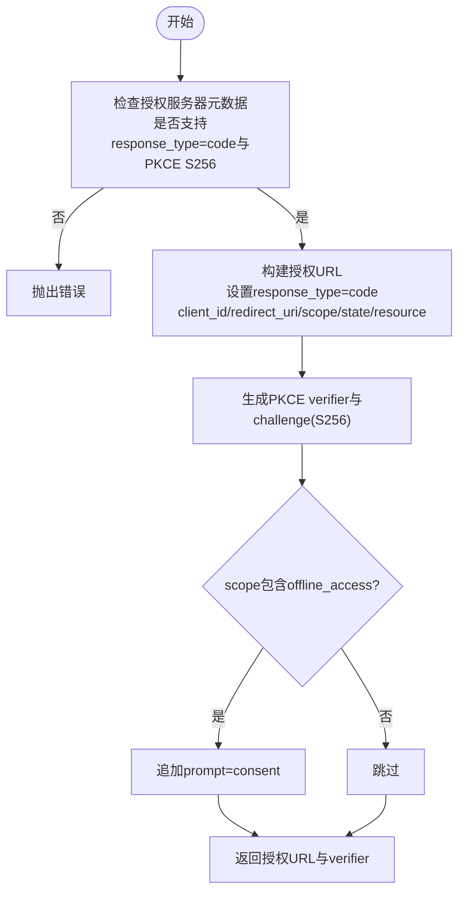
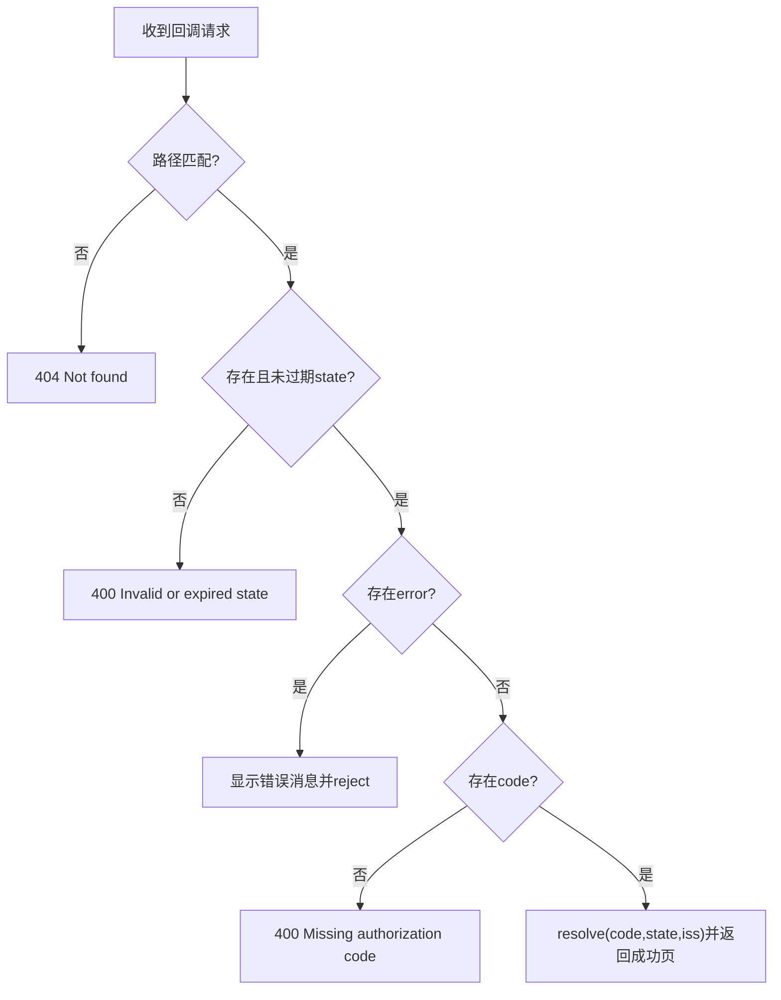
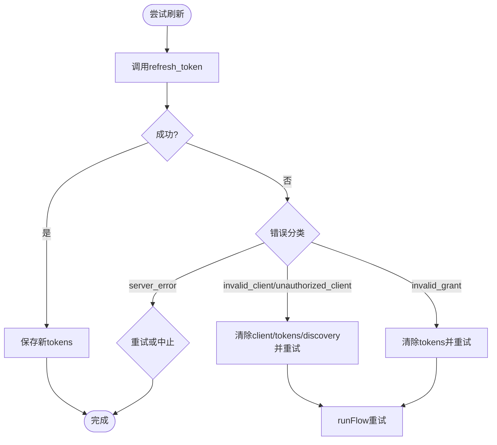
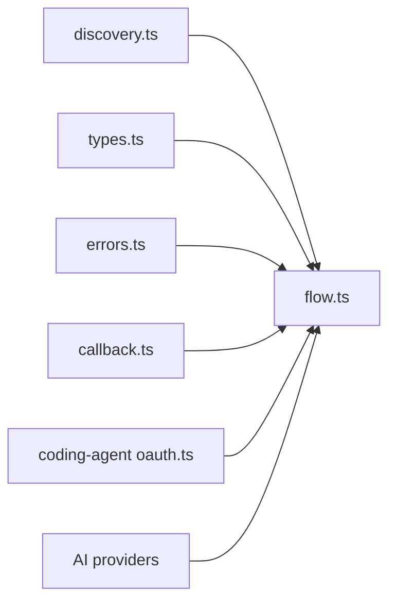

# 授权码流程

<cite>
**本文引用的文件**
- [packages/mcp/src/oauth/flow.ts](file://packages/mcp/src/oauth/flow.ts)
- [packages/mcp/src/oauth/callback.ts](file://packages/mcp/src/oauth/callback.ts)
- [packages/mcp/src/oauth/errors.ts](file://packages/mcp/src/oauth/errors.ts)
- [packages/coding-agent/src/extensions/mcp/oauth.ts](file://packages/coding-agent/src/extensions/mcp/oauth.ts)
- [packages/ai/src/auth/oauth/openai-chatgpt.ts](file://packages/ai/src/auth/oauth/openai-chatgpt.ts)
- [packages/ai/src/auth/oauth/anthropic.ts](file://packages/ai/src/auth/oauth/anthropic.ts)
- [packages/ai/src/auth/oauth/openai-codex.ts](file://packages/ai/src/auth/oauth/openai-codex.ts)
- [packages/ai/test/oauth-callback-server.test.ts](file://packages/ai/test/oauth-callback-server.test.ts)
- [packages/mcp/test/authorization-server.ts](file://packages/mcp/test/authorization-server.ts)
</cite>

## 目录
1. [简介](#简介)
2. [项目结构](#项目结构)
3. [核心组件](#核心组件)
4. [架构总览](#架构总览)
5. [详细组件分析](#详细组件分析)
6. [依赖关系分析](#依赖关系分析)
7. [性能与可靠性](#性能与可靠性)
8. [故障排查指南](#故障排查指南)
9. [结论](#结论)
10. [附录：不同提供商配置要点](#附录不同提供商配置要点)

## 简介
本文面向实现 OAuth2.0 授权码流程的开发者，结合仓库中的 MCP 与 AI 相关实现，系统说明以下主题：
- 标准授权码获取、交换与刷新流程
- 回调服务器配置、状态参数验证与安全性考虑
- 不同提供商的授权端点与令牌端点配置方式
- 完整的端到端示例路径（不直接粘贴代码）
- 错误处理与重试机制
- 常见问题与解决方案，包括重定向 URI 配置与跨域问题

本仓库中，MCP 侧提供了通用的 OAuth 流程引擎与回调服务器；AI 侧则包含多个具体提供商的实现。两者共同构成可复用的授权码流程参考实现。

## 项目结构
围绕授权码流程的关键代码分布在以下模块：
- MCP OAuth 流程引擎：负责发现元数据、构建授权 URL、交换授权码、刷新令牌、客户端认证方法选择等
- MCP 回调服务器：本地监听回调、校验 state、解析 code 与 iss、渲染结果页
- Coding Agent 集成：将 MCP OAuth 能力封装为登录入口，管理凭证存储与刷新锁
- AI 提供商实现：针对特定厂商的授权与令牌请求细节
- 测试与服务端模拟：用于验证流程、端点行为与错误分支



图表来源
- [packages/mcp/src/oauth/flow.ts:181-213](file://packages/mcp/src/oauth/flow.ts#L181-L213)
- [packages/mcp/src/oauth/callback.ts:34-164](file://packages/mcp/src/oauth/callback.ts#L34-L164)
- [packages/coding-agent/src/extensions/mcp/oauth.ts:175-239](file://packages/coding-agent/src/extensions/mcp/oauth.ts#L175-L239)
- [packages/ai/src/auth/oauth/openai-chatgpt.ts:85-116](file://packages/ai/src/auth/oauth/openai-chatgpt.ts#L85-L116)
- [packages/ai/src/auth/oauth/anthropic.ts:108-119](file://packages/ai/src/auth/oauth/anthropic.ts#L108-L119)
- [packages/ai/src/auth/oauth/openai-codex.ts:155-159](file://packages/ai/src/auth/oauth/openai-codex.ts#L155-L159)

章节来源
- [packages/mcp/src/oauth/flow.ts:1-531](file://packages/mcp/src/oauth/flow.ts#L1-L531)
- [packages/mcp/src/oauth/callback.ts:1-165](file://packages/mcp/src/oauth/callback.ts#L1-L165)
- [packages/coding-agent/src/extensions/mcp/oauth.ts:1-240](file://packages/coding-agent/src/extensions/mcp/oauth.ts#L1-L240)

## 核心组件
- 授权码流程引擎（flow.ts）
  - 生成授权 URL（含 PKCE）
  - 交换授权码换取访问令牌
  - 刷新令牌
  - 动态注册客户端或复用已注册客户端
  - 选择客户端认证方法（Basic、POST、none）
  - 支持资源发现与 scope 提升
- 回调服务器（callback.ts）
  - 本地 HTTP 服务监听回调
  - 校验 state、path、code、iss
  - 超时与关闭清理
- 错误模型（errors.ts）
  - OAuthError、IssuerMismatch、InsecureEndpoint、RegistrationError 等
- Coding Agent 集成（extensions/mcp/oauth.ts）
  - 提供登录入口、回调监听、凭证持久化、刷新锁
- AI 提供商实现
  - 针对 OpenAI ChatGPT、Anthropic、OpenAI Codex 的具体授权与令牌请求

章节来源
- [packages/mcp/src/oauth/flow.ts:139-179](file://packages/mcp/src/oauth/flow.ts#L139-L179)
- [packages/mcp/src/oauth/callback.ts:34-164](file://packages/mcp/src/oauth/callback.ts#L34-L164)
- [packages/mcp/src/oauth/errors.ts:1-40](file://packages/mcp/src/oauth/errors.ts#L1-L40)
- [packages/coding-agent/src/extensions/mcp/oauth.ts:66-157](file://packages/coding-agent/src/extensions/mcp/oauth.ts#L66-L157)

## 架构总览
下图展示从用户发起登录到获得访问令牌的完整交互序列，涵盖浏览器、回调服务器、流程引擎与授权服务器。



图表来源
- [packages/mcp/src/oauth/flow.ts:181-213](file://packages/mcp/src/oauth/flow.ts#L181-L213)
- [packages/mcp/src/oauth/flow.ts:290-316](file://packages/mcp/src/oauth/flow.ts#L290-L316)
- [packages/mcp/src/oauth/callback.ts:124-163](file://packages/mcp/src/oauth/callback.ts#L124-L163)

## 详细组件分析

### 授权码获取与 PKCE
- 流程引擎在构建授权 URL 时：
  - 强制 response_type=code
  - 使用 WebCrypto 生成 PKCE verifier 与 S256 challenge
  - 附加 client_id、redirect_uri、scope、state、resource 等参数
  - 若请求 offline_access，自动添加 prompt=consent 以触发刷新令牌授权
- 安全要求：
  - 授权端点必须为 https（除非 loopback）
  - 不支持 PKCE S256 的授权服务器会被拒绝



图表来源
- [packages/mcp/src/oauth/flow.ts:181-213](file://packages/mcp/src/oauth/flow.ts#L181-L213)

章节来源
- [packages/mcp/src/oauth/flow.ts:181-213](file://packages/mcp/src/oauth/flow.ts#L181-L213)

### 授权码交换与客户端认证
- 交换授权码时：
  - grant_type=authorization_code
  - 携带 code、code_verifier、redirect_uri
  - 根据元数据支持的 token_endpoint_auth_methods_supported 与客户端信息选择认证方法：
    - client_secret_basic：Authorization: Basic
    - client_secret_post：表单字段 client_id/client_secret
    - none：仅 client_id
- 令牌响应解析：
  - 即使非 2xx，也优先检查 body.error 字段
  - 成功时解析 access_token/refresh_token/scope

```mermaid
classDiagram
class TokenRequest {
+metadata
+clientInformation
+resource
+addClientAuthentication()
+fetch()
+signal
}
class ClientAuthMethod {
<<enum>>
"client_secret_basic"
"client_secret_post"
"none"
}
class OAuthTokens {
+access_token
+refresh_token
+scope
}
TokenRequest --> ClientAuthMethod : "选择认证方法"
TokenRequest --> OAuthTokens : "返回令牌"
```

图表来源
- [packages/mcp/src/oauth/flow.ts:139-172](file://packages/mcp/src/oauth/flow.ts#L139-L172)
- [packages/mcp/src/oauth/flow.ts:215-257](file://packages/mcp/src/oauth/flow.ts#L215-L257)

章节来源
- [packages/mcp/src/oauth/flow.ts:139-172](file://packages/mcp/src/oauth/flow.ts#L139-L172)
- [packages/mcp/src/oauth/flow.ts:215-257](file://packages/mcp/src/oauth/flow.ts#L215-L257)

### 回调服务器与状态验证
- 回调服务器职责：
  - 监听本地地址与端口，构造 redirectUrl
  - 校验 path（支持 extraPaths），防止多服务器共用同一回调路径被混淆
  - 校验 state：不存在或重复即失败
  - 校验 error 参数：向调用方 reject 并显示错误页
  - 校验 code：缺失时报错
  - 可选解析 iss（RFC 9207）
- 超时与清理：
  - 默认 5 分钟超时
  - close() 会清理所有 pending 请求



图表来源
- [packages/mcp/src/oauth/callback.ts:124-163](file://packages/mcp/src/oauth/callback.ts#L124-L163)

章节来源
- [packages/mcp/src/oauth/callback.ts:34-164](file://packages/mcp/src/oauth/callback.ts#L34-L164)

### 刷新令牌与错误重试
- 刷新令牌：
  - grant_type=refresh_token
  - 保留原 refresh_token（旋转场景下由上层决定替换策略）
- 错误处理与重试：
  - invalid_client/unauthorized_client：清除相关凭据后重试
  - invalid_grant：清除 tokens 并重试
  - server_error：可能继续重试或按信号中止
- 并发刷新保护：
  - Coding Agent 层使用文件锁避免多进程并发刷新冲突
  - 超时与重试策略可配置



图表来源
- [packages/mcp/src/oauth/flow.ts:306-316](file://packages/mcp/src/oauth/flow.ts#L306-L316)
- [packages/mcp/src/oauth/flow.ts:468-492](file://packages/mcp/src/oauth/flow.ts#L468-L492)
- [packages/coding-agent/src/extensions/mcp/oauth.ts:96-129](file://packages/coding-agent/src/extensions/mcp/oauth.ts#L96-L129)

章节来源
- [packages/mcp/src/oauth/flow.ts:306-316](file://packages/mcp/src/oauth/flow.ts#L306-L316)
- [packages/mcp/src/oauth/flow.ts:468-492](file://packages/mcp/src/oauth/flow.ts#L468-L492)
- [packages/coding-agent/src/extensions/mcp/oauth.ts:96-129](file://packages/coding-agent/src/extensions/mcp/oauth.ts#L96-L129)

### 不同提供商的授权端点与令牌端点配置
- 通用发现机制：
  - 通过 /.well-known/oauth-authorization-server 或资源元数据发现授权端点与令牌端点
  - 支持显式传入 authorizationServerMetadataUrl 覆盖发现
- 具体实现差异：
  - OpenAI ChatGPT：自定义回调服务器与授权/令牌端点组合
  - Anthropic：明确传递 redirect_uri 与 grant_type=authorization_code
  - OpenAI Codex：支持从持久化状态恢复 authorization_code 与 code_verifier

章节来源
- [packages/mcp/src/oauth/flow.ts:339-371](file://packages/mcp/src/oauth/flow.ts#L339-L371)
- [packages/ai/src/auth/oauth/openai-chatgpt.ts:85-116](file://packages/ai/src/auth/oauth/openai-chatgpt.ts#L85-L116)
- [packages/ai/src/auth/oauth/anthropic.ts:108-119](file://packages/ai/src/auth/oauth/anthropic.ts#L108-L119)
- [packages/ai/src/auth/oauth/openai-codex.ts:155-159](file://packages/ai/src/auth/oauth/openai-codex.ts#L155-L159)

## 依赖关系分析
- flow.ts 依赖 discovery 与 types，统一处理元数据、类型解析与安全校验
- callback.ts 独立于流程引擎，仅负责回调接收与基础校验
- coding-agent 集成层依赖 MCP OAuth 能力，并提供凭证存储与刷新锁
- AI 提供商实现复用底层流程或自行实现令牌交换逻辑



图表来源
- [packages/mcp/src/oauth/flow.ts:1-34](file://packages/mcp/src/oauth/flow.ts#L1-L34)
- [packages/mcp/src/oauth/callback.ts:1-165](file://packages/mcp/src/oauth/callback.ts#L1-L165)
- [packages/coding-agent/src/extensions/mcp/oauth.ts:17-36](file://packages/coding-agent/src/extensions/mcp/oauth.ts#L17-L36)

章节来源
- [packages/mcp/src/oauth/flow.ts:1-34](file://packages/mcp/src/oauth/flow.ts#L1-L34)
- [packages/mcp/src/oauth/callback.ts:1-165](file://packages/mcp/src/oauth/callback.ts#L1-L165)
- [packages/coding-agent/src/extensions/mcp/oauth.ts:17-36](file://packages/coding-agent/src/extensions/mcp/oauth.ts#L17-L36)

## 性能与可靠性
- 并发刷新保护：
  - 使用文件锁避免多进程同时刷新导致令牌不一致
  - 锁失效时间、等待时间与重试间隔可配置
- 网络请求控制：
  - 支持 AbortSignal 取消请求
  - 对不安全端点（非 HTTPS 且非 loopback）直接拒绝
- 缓存与发现：
  - 可选择缓存发现状态，减少元数据拉取次数
  - 显式 metadataUrl 可绕过缓存，便于快速切换

章节来源
- [packages/coding-agent/src/extensions/mcp/oauth.ts:96-129](file://packages/coding-agent/src/extensions/mcp/oauth.ts#L96-L129)
- [packages/mcp/src/oauth/flow.ts:133-137](file://packages/mcp/src/oauth/flow.ts#L133-L137)
- [packages/mcp/src/oauth/flow.ts:339-371](file://packages/mcp/src/oauth/flow.ts#L339-L371)

## 故障排查指南
- 回调未到达或超时
  - 检查回调服务器是否绑定到预期 host/port/path
  - 确认授权服务器的 redirect_uri 与回调服务器一致
  - 查看回调服务器的 extraPaths 配置是否与授权服务器注册的 redirect_uri 路径匹配
- state 无效或过期
  - 确保每次授权请求生成唯一 state 并在回调中严格校验
  - 注意回调服务器的超时时间，避免长时间未完成的授权
- 授权码与 redirect_uri 不一致
  - 当使用 authorizationCode 模式时，需保证 exchange 使用的 redirect_uri 与授权请求一致
- 客户端认证失败
  - 检查 token_endpoint_auth_methods_supported 与客户端信息是否匹配
  - client_secret_basic 需要 client_secret；none 不需要
- issuer 不匹配
  - 如果授权服务器支持 authorization_response_iss_parameter_supported，需校验 iss 与元数据 issuer 一致
- 跨域问题
  - 回调服务器通常监听 localhost，授权服务器应允许该回调地址
  - 若使用远程回调，需确保 CORS 与 HTTPS 配置正确

章节来源
- [packages/mcp/src/oauth/callback.ts:64-87](file://packages/mcp/src/oauth/callback.ts#L64-L87)
- [packages/mcp/src/oauth/callback.ts:124-163](file://packages/mcp/src/oauth/callback.ts#L124-L163)
- [packages/mcp/src/oauth/flow.ts:387-393](file://packages/mcp/src/oauth/flow.ts#L387-L393)
- [packages/mcp/src/oauth/flow.ts:139-172](file://packages/mcp/src/oauth/flow.ts#L139-L172)
- [packages/mcp/src/oauth/errors.ts:13-25](file://packages/mcp/src/oauth/errors.ts#L13-L25)

## 结论
本仓库提供了完整的 OAuth2.0 授权码流程实现，涵盖从授权 URL 构建、PKCE、回调校验、令牌交换到刷新与错误重试的全链路。通过 MCP 层的通用引擎与 AI 提供商的具体实现，开发者可以快速适配不同授权服务器，并确保安全性与可靠性。

## 附录：不同提供商配置要点
- OpenAI ChatGPT
  - 自定义回调服务器与授权/令牌端点
  - 回调路径与 redirect_uri 需一致
- Anthropic
  - 明确传递 redirect_uri 与 grant_type=authorization_code
  - 注意平台特定的回调路径
- OpenAI Codex
  - 支持从持久化状态恢复 authorization_code 与 code_verifier
  - 令牌交换时需携带正确的 redirect_uri

章节来源
- [packages/ai/src/auth/oauth/openai-chatgpt.ts:85-116](file://packages/ai/src/auth/oauth/openai-chatgpt.ts#L85-L116)
- [packages/ai/src/auth/oauth/anthropic.ts:108-119](file://packages/ai/src/auth/oauth/anthropic.ts#L108-L119)
- [packages/ai/src/auth/oauth/openai-codex.ts:155-159](file://packages/ai/src/auth/oauth/openai-codex.ts#L155-L159)