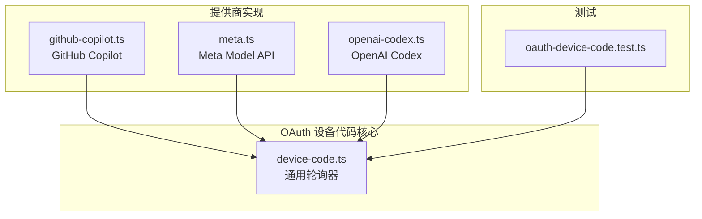
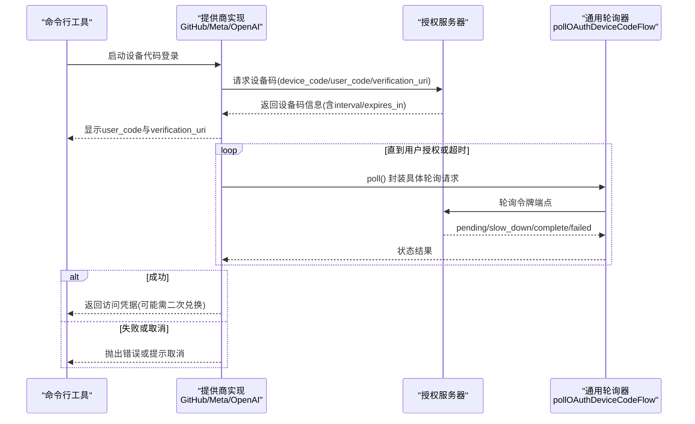
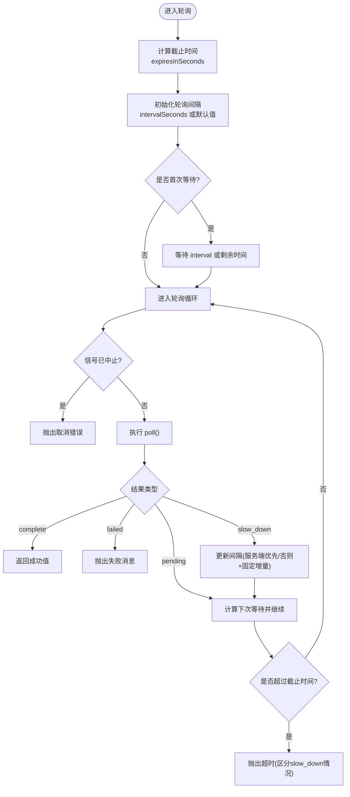
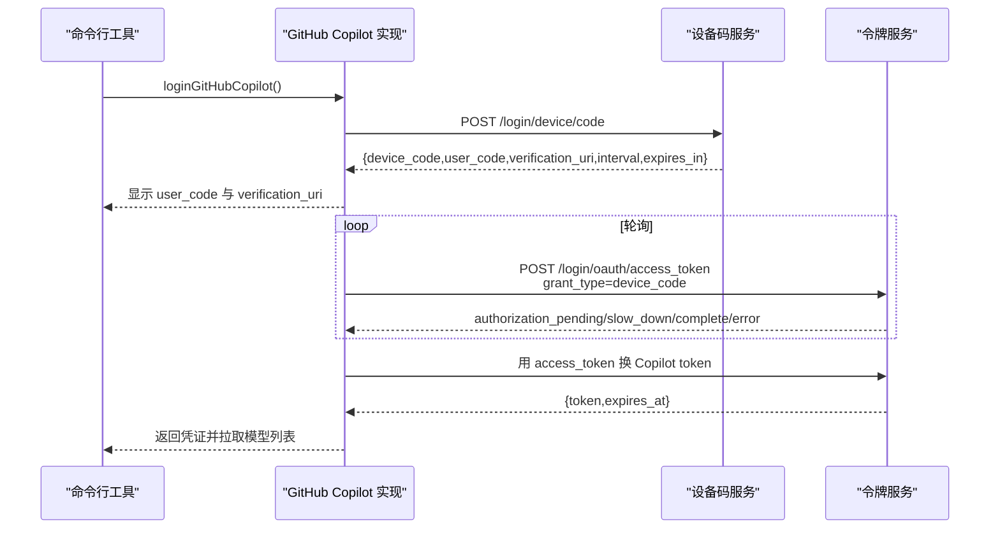
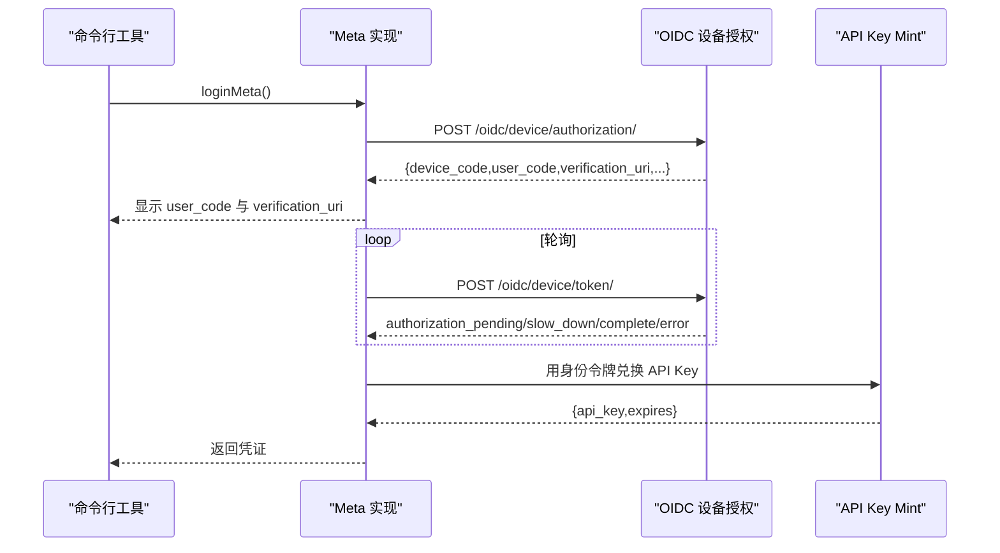
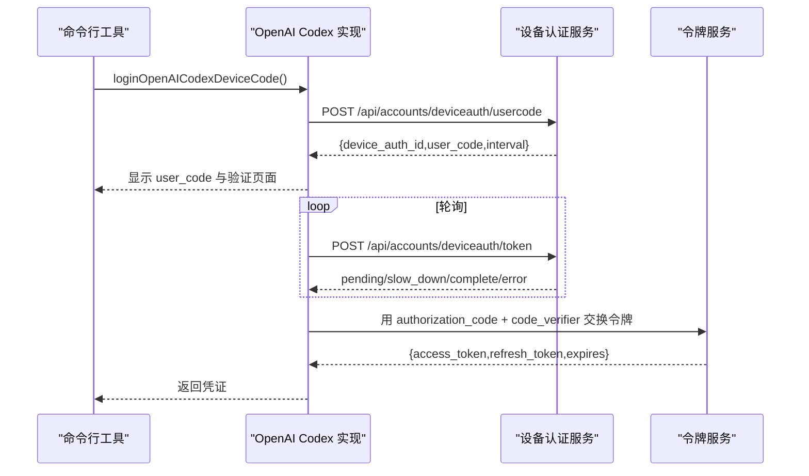
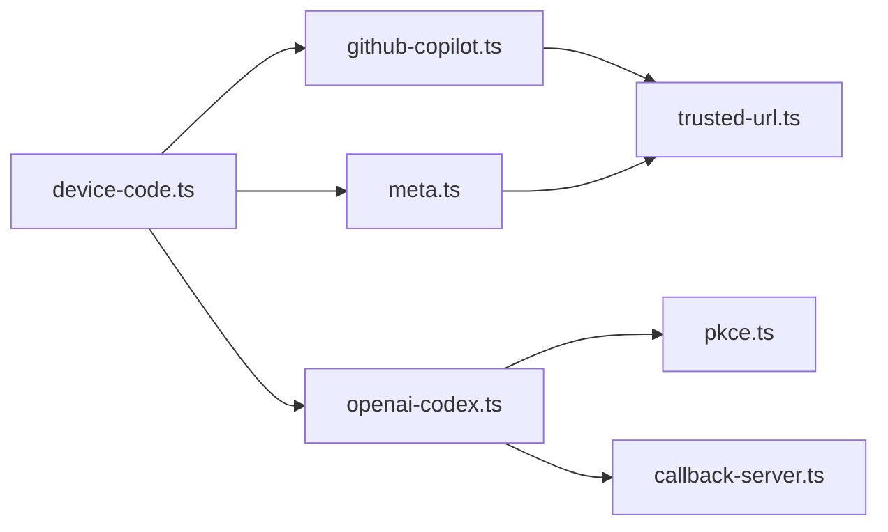

# 设备代码流程

<cite>
**本文引用的文件**   
- [device-code.ts](file://packages/ai/src/auth/oauth/device-code.ts)
- [github-copilot.ts](file://packages/ai/src/auth/oauth/github-copilot.ts)
- [meta.ts](file://packages/ai/src/auth/oauth/meta.ts)
- [openai-codex.ts](file://packages/ai/src/auth/oauth/openai-codex.ts)
- [oauth-device-code.test.ts](file://packages/ai/test/oauth-device-code.test.ts)
</cite>

## 目录
1. [简介](#简介)
2. [项目结构](#项目结构)
3. [核心组件](#核心组件)
4. [架构总览](#架构总览)
5. [详细组件分析](#详细组件分析)
6. [依赖关系分析](#依赖关系分析)
7. [性能与超时特性](#性能与超时特性)
8. [错误处理策略](#错误处理策略)
9. [用户体验优化建议](#用户体验优化建议)
10. [故障排查指南](#故障排查指南)
11. [结论](#结论)

## 简介
本文面向在无浏览器环境（例如终端、CI、WSL/虚拟机）中完成 OAuth 2.0 认证的设备代码流程，围绕以下目标展开：
- 解释无浏览器场景下的认证动机与设备代码生成过程。
- 说明用户确认步骤、轮询间隔控制与超时处理。
- 覆盖设备注册、代码验证和用户授权确认的完整链路。
- 提供命令行工具中的设备代码实现示例与调用路径。
- 文档化不同提供商（GitHub Copilot、Meta、OpenAI Codex）在设备代码 API 上的差异与配置要求。
- 总结错误处理策略与用户体验优化建议。

本仓库通过一个通用的设备代码轮询器，为多个提供商实现统一的“请求设备码 → 展示用户码与验证链接 → 轮询令牌 → 成功或失败”的流程。

## 项目结构
与设备代码流程直接相关的代码集中在 `packages/ai/src/auth/oauth` 目录下，包含通用轮询逻辑与各提供商的具体实现；测试用例位于 `packages/ai/test/oauth-device-code.test.ts`。

**图表来源**
- [device-code.ts:1-99](file://packages/ai/src/auth/oauth/device-code.ts#L1-L99)
- [github-copilot.ts:207-305](file://packages/ai/src/auth/oauth/github-copilot.ts#L207-L305)
- [meta.ts:62-132](file://packages/ai/src/auth/oauth/meta.ts#L62-L132)
- [openai-codex.ts:187-287](file://packages/ai/src/auth/oauth/openai-codex.ts#L187-L287)
- [oauth-device-code.test.ts:1-146](file://packages/ai/test/oauth-device-code.test.ts#L1-L146)

**章节来源**
- [device-code.ts:1-99](file://packages/ai/src/auth/oauth/device-code.ts#L1-L99)
- [github-copilot.ts:1-502](file://packages/ai/src/auth/oauth/github-copilot.ts#L1-L502)
- [meta.ts:1-198](file://packages/ai/src/auth/oauth/meta.ts#L1-L198)
- [openai-codex.ts:1-439](file://packages/ai/src/auth/oauth/openai-codex.ts#L1-L439)
- [oauth-device-code.test.ts:1-146](file://packages/ai/test/oauth-device-code.test.ts#L1-L146)

## 核心组件
- 通用设备代码轮询器：负责计算截止时间、初始轮询间隔、slow_down 响应处理、可中断等待、以及最终超时提示。
- GitHub Copilot 设备代码流程：发起设备码请求、校验并信任 verification_uri、轮询 access_token、刷新 Copilot token 并拉取模型列表。
- Meta Model API 设备代码流程：发起设备授权、轮询身份令牌、将身份令牌兑换为短期 API Key。
- OpenAI Codex 设备代码流程：获取 device_auth_id 与 user_code，轮询获得 authorization_code 与 code_verifier，再交换标准 OAuth 令牌。

**章节来源**
- [device-code.ts:1-99](file://packages/ai/src/auth/oauth/device-code.ts#L1-L99)
- [github-copilot.ts:207-305](file://packages/ai/src/auth/oauth/github-copilot.ts#L207-L305)
- [meta.ts:62-132](file://packages/ai/src/auth/oauth/meta.ts#L62-L132)
- [openai-codex.ts:187-287](file://packages/ai/src/auth/oauth/openai-codex.ts#L187-L287)

## 架构总览
下图展示了从 CLI 触发登录到最终获得访问凭据的整体序列。各提供商共享同一个轮询器，差异在于设备码接口、轮询体字段与成功后处理。

**图表来源**
- [github-copilot.ts:428-478](file://packages/ai/src/auth/oauth/github-copilot.ts#L428-L478)
- [meta.ts:165-183](file://packages/ai/src/auth/oauth/meta.ts#L165-L183)
- [openai-codex.ts:341-357](file://packages/ai/src/auth/oauth/openai-codex.ts#L341-L357)
- [device-code.ts:46-98](file://packages/ai/src/auth/oauth/device-code.ts#L46-L98)

## 详细组件分析

### 通用设备代码轮询器
该轮询器是设备代码流程的核心调度器，职责包括：
- 根据 expiresInSeconds 计算截止时间。
- 使用 intervalSeconds 作为初始轮询间隔，若未提供则采用 RFC 8628 默认值。
- 对 slow_down 响应进行节流：优先使用服务端提供的 interval，否则按规范增加固定时长。
- 支持 waitBeforeFirstPoll，用于首次轮询前等待。
- 支持 AbortSignal 中断，避免长时间阻塞。
- 统一超时消息，并在多次 slow_down 后给出更明确的提示。

**图表来源**
- [device-code.ts:46-98](file://packages/ai/src/auth/oauth/device-code.ts#L46-L98)

**章节来源**
- [device-code.ts:1-99](file://packages/ai/src/auth/oauth/device-code.ts#L1-L99)
- [oauth-device-code.test.ts:11-42](file://packages/ai/test/oauth-device-code.test.ts#L11-L42)
- [oauth-device-code.test.ts:44-66](file://packages/ai/test/oauth-device-code.test.ts#L44-L66)
- [oauth-device-code.test.ts:68-96](file://packages/ai/test/oauth-device-code.test.ts#L68-L96)
- [oauth-device-code.test.ts:98-129](file://packages/ai/test/oauth-device-code.test.ts#L98-L129)
- [oauth-device-code.test.ts:131-144](file://packages/ai/test/oauth-device-code.test.ts#L131-L144)

### GitHub Copilot 设备代码流程
GitHub Copilot 的设备代码流程特点：
- 设备码端点：POST `/login/device/code`，返回 device_code、user_code、verification_uri、interval、expires_in。
- 安全校验：对 verification_uri 进行可信域名校验。
- 轮询端点：POST `/login/oauth/access_token`，grant_type 使用设备代码授权类型。
- 成功后：用 access_token 换取 Copilot token，并拉取模型列表以启用必要模型。

**图表来源**
- [github-copilot.ts:207-255](file://packages/ai/src/auth/oauth/github-copilot.ts#L207-L255)
- [github-copilot.ts:257-305](file://packages/ai/src/auth/oauth/github-copilot.ts#L257-L305)
- [github-copilot.ts:307-361](file://packages/ai/src/auth/oauth/github-copilot.ts#L307-L361)
- [github-copilot.ts:428-478](file://packages/ai/src/auth/oauth/github-copilot.ts#L428-L478)

**章节来源**
- [github-copilot.ts:207-305](file://packages/ai/src/auth/oauth/github-copilot.ts#L207-L305)
- [github-copilot.ts:428-478](file://packages/ai/src/auth/oauth/github-copilot.ts#L428-L478)

### Meta Model API 设备代码流程
Meta 的流程将身份认证与 API 访问分离：
- 设备授权端点：POST `/oidc/device/authorization/`，返回 device_code、user_code、verification_uri_complete/verification_uri、interval、expires_in。
- 轮询端点：POST `/oidc/device/token/`，grant_type 使用设备代码授权类型。
- 成功后：用身份令牌兑换短期 API Key（约一天有效期），并将 identity token 作为 refresh 存储以便后续重新 mint。

**图表来源**
- [meta.ts:62-89](file://packages/ai/src/auth/oauth/meta.ts#L62-L89)
- [meta.ts:91-132](file://packages/ai/src/auth/oauth/meta.ts#L91-L132)
- [meta.ts:134-163](file://packages/ai/src/auth/oauth/meta.ts#L134-L163)
- [meta.ts:165-183](file://packages/ai/src/auth/oauth/meta.ts#L165-L183)

**章节来源**
- [meta.ts:62-132](file://packages/ai/src/auth/oauth/meta.ts#L62-L132)
- [meta.ts:134-163](file://packages/ai/src/auth/oauth/meta.ts#L134-L163)
- [meta.ts:165-183](file://packages/ai/src/auth/oauth/meta.ts#L165-L183)

### OpenAI Codex 设备代码流程
OpenAI Codex 的设备代码流程较为特殊：
- 设备码端点：POST `/api/accounts/deviceauth/usercode`，返回 device_auth_id、user_code、interval。
- 轮询端点：POST `/api/accounts/deviceauth/token`，携带 device_auth_id 与 user_code。
- 成功后：返回 authorization_code 与 code_verifier，再用标准 OAuth 授权码流程换取 access_token 与 refresh_token。
- 支持两种登录方式：浏览器回调与设备代码（headless）。

**图表来源**
- [openai-codex.ts:187-229](file://packages/ai/src/auth/oauth/openai-codex.ts#L187-L229)
- [openai-codex.ts:231-287](file://packages/ai/src/auth/oauth/openai-codex.ts#L231-L287)
- [openai-codex.ts:341-357](file://packages/ai/src/auth/oauth/openai-codex.ts#L341-L357)

**章节来源**
- [openai-codex.ts:187-287](file://packages/ai/src/auth/oauth/openai-codex.ts#L187-L287)
- [openai-codex.ts:341-357](file://packages/ai/src/auth/oauth/openai-codex.ts#L341-L357)

## 依赖关系分析
- 所有提供商实现都依赖通用轮询器 `pollOAuthDeviceCodeFlow`，从而复用超时、slow_down、可中断等待等逻辑。
- GitHub Copilot 额外依赖 trusted-url 校验 verification_uri，并进一步调用 Copilot 内部 token 与模型列表接口。
- Meta 依赖 trusted-url 校验 verification_uri_complete/verification_uri，并在成功后调用 key-mint 接口。
- OpenAI Codex 还依赖 PKCE 与回调服务器（仅浏览器模式），设备代码模式不依赖回调服务器。

**图表来源**
- [device-code.ts:46-98](file://packages/ai/src/auth/oauth/device-code.ts#L46-L98)
- [github-copilot.ts:8-9](file://packages/ai/src/auth/oauth/github-copilot.ts#L8-L9)
- [meta.ts:17-18](file://packages/ai/src/auth/oauth/meta.ts#L17-L18)
- [openai-codex.ts:18-20](file://packages/ai/src/auth/oauth/openai-codex.ts#L18-L20)

**章节来源**
- [device-code.ts:46-98](file://packages/ai/src/auth/oauth/device-code.ts#L46-L98)
- [github-copilot.ts:8-9](file://packages/ai/src/auth/oauth/github-copilot.ts#L8-L9)
- [meta.ts:17-18](file://packages/ai/src/auth/oauth/meta.ts#L17-L18)
- [openai-codex.ts:18-20](file://packages/ai/src/auth/oauth/openai-codex.ts#L18-L20)

## 性能与超时特性
- 默认轮询间隔：RFC 8628 规定当授权服务器省略 interval 时，客户端应使用 5 秒。
- 最小轮询间隔：实现中设置了最小间隔（毫秒级），防止过于频繁的请求。
- slow_down 处理：收到 slow_down 时，优先使用服务端提供的 interval；若无，则按规范增加固定时长。
- 首次等待：可选 waitBeforeFirstPoll，用于在首次轮询前等待，避免立即请求。
- 超时处理：达到 expiresInSeconds 截止时间后抛出超时错误；若期间出现过 slow_down，会给出更明确的提示，常用于 WSL/VM 时钟漂移问题。
- 可中断等待：通过 AbortSignal 支持取消操作，避免长时间阻塞。

**章节来源**
- [device-code.ts:1-99](file://packages/ai/src/auth/oauth/device-code.ts#L1-L99)
- [oauth-device-code.test.ts:68-96](file://packages/ai/test/oauth-device-code.test.ts#L68-L96)
- [oauth-device-code.test.ts:98-129](file://packages/ai/test/oauth-device-code.test.ts#L98-L129)

## 错误处理策略
- 通用轮询器：
  - 取消：抛出“登录已取消”错误。
  - 失败：将 provider 封装的 failed 消息原样抛出。
  - 超时：区分普通超时与 slow_down 导致的超时，提供更明确提示。
- GitHub Copilot：
  - 设备码响应校验失败：抛出无效响应或不可信 verification_uri 错误。
  - 轮询失败：根据 error 与 description 组装错误消息。
- Meta：
  - 设备授权失败：根据 HTTP 状态与 JSON detail 输出错误。
  - 身份令牌兑换失败：区分 access_denied、expired_token 与一般失败。
  - API Key mint 失败：401/403 表示会话过期，提示重新登录；其他状态输出错误详情。
- OpenAI Codex：
  - 设备码请求失败：区分 404（功能未启用）与其他错误。
  - 轮询失败：区分 pending、slow_down 与具体错误消息。
  - 令牌交换失败：输出状态与响应体摘要。

**章节来源**
- [device-code.ts:1-99](file://packages/ai/src/auth/oauth/device-code.ts#L1-L99)
- [github-copilot.ts:207-305](file://packages/ai/src/auth/oauth/github-copilot.ts#L207-L305)
- [meta.ts:62-132](file://packages/ai/src/auth/oauth/meta.ts#L62-L132)
- [meta.ts:134-163](file://packages/ai/src/auth/oauth/meta.ts#L134-L163)
- [openai-codex.ts:187-287](file://packages/ai/src/auth/oauth/openai-codex.ts#L187-L287)

## 用户体验优化建议
- 清晰展示 user_code 与 verification_uri，并提供复制与打开链接的便捷操作。
- 在 UI 中显示剩余时间与当前轮询间隔，帮助用户理解进度。
- 对 slow_down 进行友好提示，解释可能的原因（如网络或服务端限流）。
- 在 WSL/VM 环境中检测到多次 slow_down 后，提示检查系统时钟同步。
- 支持取消操作，允许用户在等待过程中主动终止流程。
- 对不同提供商的错误信息进行本地化与可读性优化，减少技术术语对用户的影响。

[本节为概念性建议，不直接分析具体文件]

## 故障排查指南
- 无法获取设备码：
  - 检查网络连通性与代理设置。
  - 确认 client_id 与端点 URL 正确。
  - 查看提供商返回的错误详情（HTTP 状态与 JSON body）。
- 轮询一直 pending：
  - 确认用户已在浏览器中完成授权。
  - 检查 interval 与 slow_down 行为是否符合预期。
  - 在 WSL/VM 中检查系统时钟是否与主机同步。
- 超时错误：
  - 确认 expiresInSeconds 是否合理。
  - 若出现多次 slow_down，尝试重启进程或校正系统时间。
- 令牌兑换失败：
  - 核对 grant_type、device_code、client_id 等参数。
  - 对于 OpenAI Codex，确认 authorization_code 与 code_verifier 是否正确传递。
  - 对于 Meta，确认身份令牌是否仍有效，必要时重新登录。

**章节来源**
- [device-code.ts:1-99](file://packages/ai/src/auth/oauth/device-code.ts#L1-L99)
- [github-copilot.ts:207-305](file://packages/ai/src/auth/oauth/github-copilot.ts#L207-L305)
- [meta.ts:62-132](file://packages/ai/src/auth/oauth/meta.ts#L62-L132)
- [openai-codex.ts:187-287](file://packages/ai/src/auth/oauth/openai-codex.ts#L187-L287)

## 结论
本仓库通过统一的设备代码轮询器，为多个提供商提供了稳定、可中断、符合 RFC 8628 的设备代码流程实现。不同提供商在设备码接口、轮询体字段与成功后处理上存在差异，但整体交互一致：请求设备码 → 展示用户码与验证链接 → 轮询令牌 → 成功或失败。通过合理的超时、slow_down 与错误处理策略，结合友好的用户提示，可以在无浏览器环境下顺利完成 OAuth 认证。

[本节为总结性内容，不直接分析具体文件]