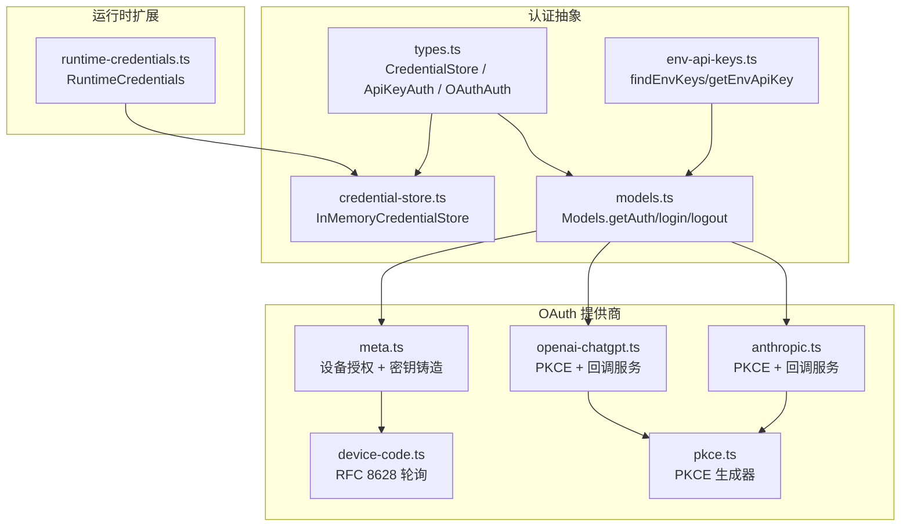
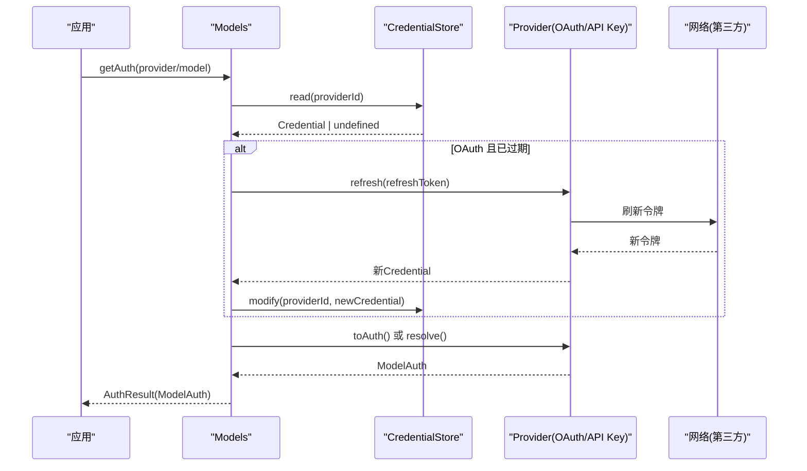
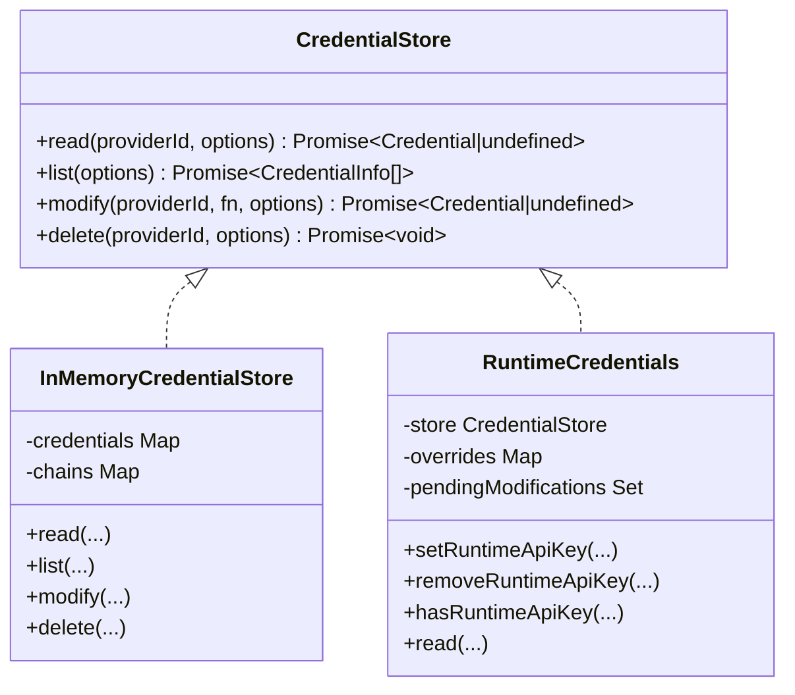
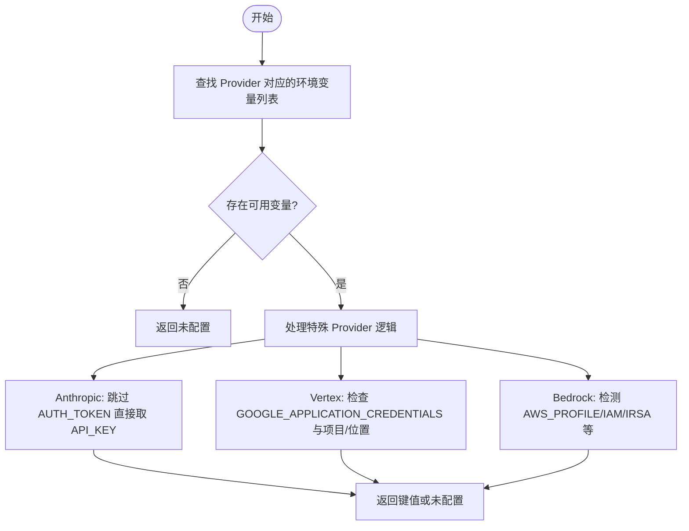
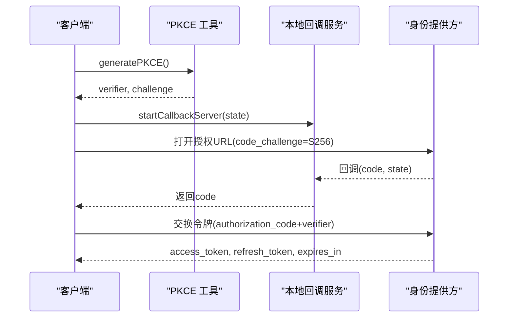
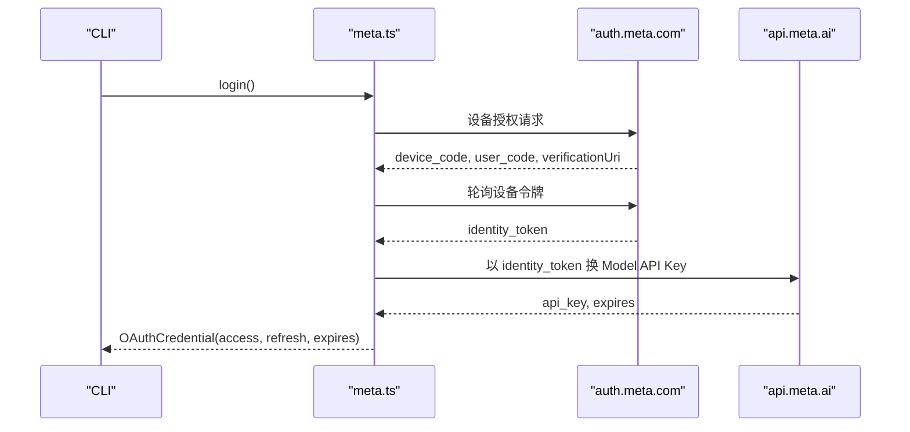
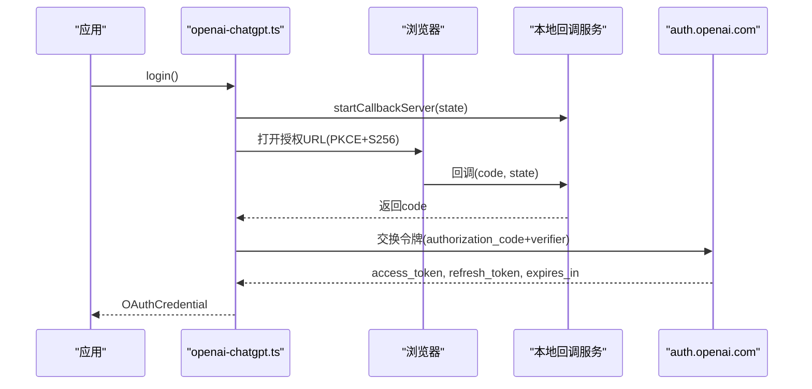
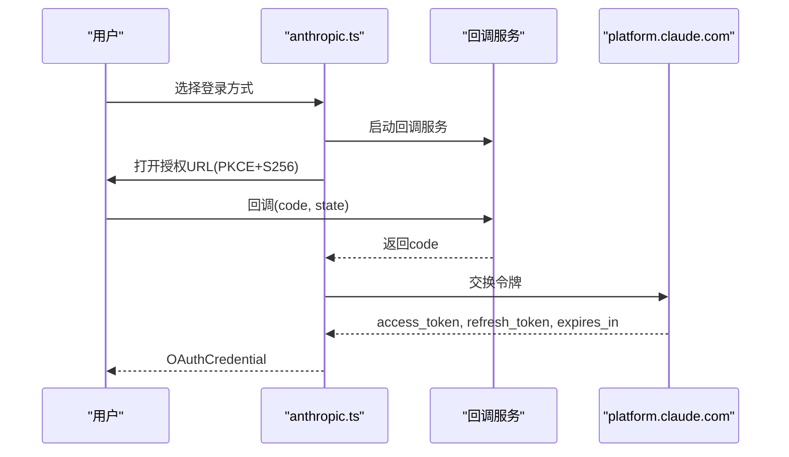
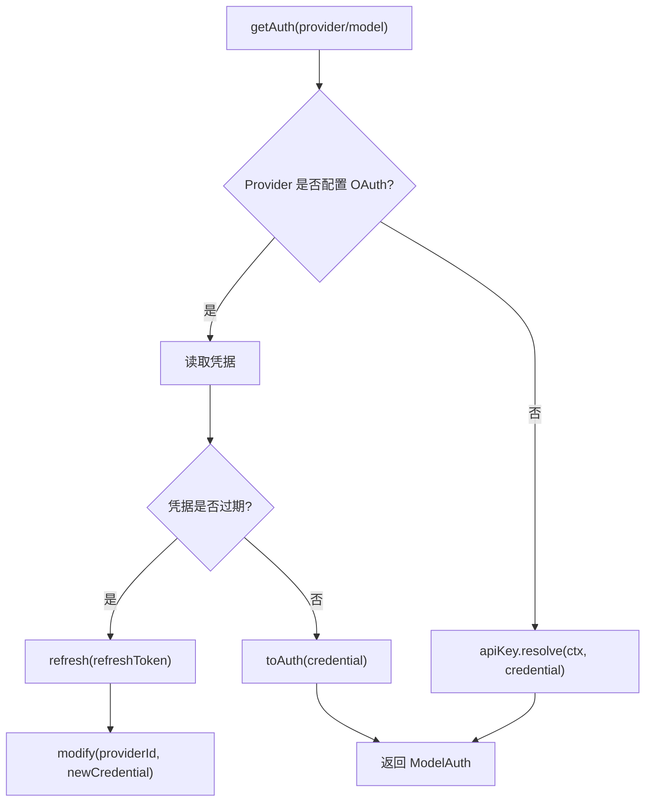
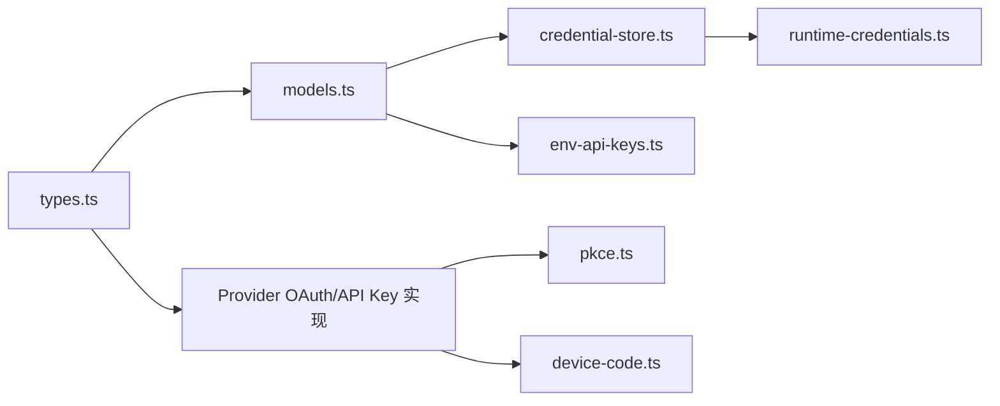

# 认证与授权

<cite>
**本文引用的文件**   
- [packages/ai/src/auth/types.ts](file://packages/ai/src/auth/types.ts)
- [packages/ai/src/auth/credential-store.ts](file://packages/ai/src/auth/credential-store.ts)
- [packages/ai/src/models.ts](file://packages/ai/src/models.ts)
- [packages/ai/src/env-api-keys.ts](file://packages/ai/src/env-api-keys.ts)
- [packages/ai/src/auth/oauth/meta.ts](file://packages/ai/src/auth/oauth/meta.ts)
- [packages/ai/src/auth/oauth/device-code.ts](file://packages/ai/src/auth/oauth/device-code.ts)
- [packages/ai/src/auth/oauth/pkce.ts](file://packages/ai/src/auth/oauth/pkce.ts)
- [packages/ai/src/auth/oauth/openai-chatgpt.ts](file://packages/ai/src/auth/oauth/openai-chatgpt.ts)
- [packages/ai/src/auth/oauth/anthropic.ts](file://packages/ai/src/auth/oauth/anthropic.ts)
- [packages/coding-agent/src/core/runtime-credentials.ts](file://packages/coding-agent/src/core/runtime-credentials.ts)
</cite>

## 目录
1. [简介](#简介)
2. [项目结构](#项目结构)
3. [核心组件](#核心组件)
4. [架构总览](#架构总览)
5. [详细组件分析](#详细组件分析)
6. [依赖关系分析](#依赖关系分析)
7. [性能与安全考量](#性能与安全考量)
8. [故障排查指南](#故障排查指南)
9. [结论](#结论)
10. [附录](#附录)

## 简介
本文件系统化梳理 LLM 提供商的认证与授权实现，覆盖 API 密钥管理、OAuth 流程与环境变量配置；说明多提供商认证集成、令牌刷新与安全存储机制；解释认证中间件、请求签名与权限验证流程；并提供安全最佳实践、密钥轮换与审计日志的实现指南，以及常见认证问题的排查方法与解决方案。

## 项目结构
本项目在 packages/ai 中提供统一的认证抽象与多提供商实现，coding-agent 通过运行时凭据叠加层接入持久化存储。关键路径：
- 类型与契约：packages/ai/src/auth/types.ts
- 凭据存储：packages/ai/src/auth/credential-store.ts
- 模型侧认证解析与登录编排：packages/ai/src/models.ts
- 环境变量发现与读取：packages/ai/src/env-api-keys.ts
- OAuth 提供商实现：Meta、OpenAI ChatGPT、Anthropic 等
- 设备码轮询与 PKCE 工具：device-code.ts、pkce.ts
- 运行时凭据叠加：packages/coding-agent/src/core/runtime-credentials.ts

图表来源
- [packages/ai/src/auth/types.ts:1-260](file://packages/ai/src/auth/types.ts#L1-L260)
- [packages/ai/src/auth/credential-store.ts:1-68](file://packages/ai/src/auth/credential-store.ts#L1-L68)
- [packages/ai/src/models.ts:640-839](file://packages/ai/src/models.ts#L640-L839)
- [packages/ai/src/env-api-keys.ts:1-197](file://packages/ai/src/env-api-keys.ts#L1-L197)
- [packages/ai/src/auth/oauth/meta.ts:1-198](file://packages/ai/src/auth/oauth/meta.ts#L1-L198)
- [packages/ai/src/auth/oauth/openai-chatgpt.ts:1-310](file://packages/ai/src/auth/oauth/openai-chatgpt.ts#L1-L310)
- [packages/ai/src/auth/oauth/anthropic.ts:1-308](file://packages/ai/src/auth/oauth/anthropic.ts#L1-L308)
- [packages/ai/src/auth/oauth/device-code.ts:1-99](file://packages/ai/src/auth/oauth/device-code.ts#L1-L99)
- [packages/ai/src/auth/oauth/pkce.ts:1-35](file://packages/ai/src/auth/oauth/pkce.ts#L1-L35)
- [packages/coding-agent/src/core/runtime-credentials.ts:1-30](file://packages/coding-agent/src/core/runtime-credentials.ts#L1-L30)

章节来源
- [packages/ai/src/auth/types.ts:1-260](file://packages/ai/src/auth/types.ts#L1-L260)
- [packages/ai/src/auth/credential-store.ts:1-68](file://packages/ai/src/auth/credential-store.ts#L1-L68)
- [packages/ai/src/models.ts:640-839](file://packages/ai/src/models.ts#L640-L839)
- [packages/ai/src/env-api-keys.ts:1-197](file://packages/ai/src/env-api-keys.ts#L1-L197)
- [packages/ai/src/auth/oauth/meta.ts:1-198](file://packages/ai/src/auth/oauth/meta.ts#L1-L198)
- [packages/ai/src/auth/oauth/openai-chatgpt.ts:1-310](file://packages/ai/src/auth/oauth/openai-chatgpt.ts#L1-L310)
- [packages/ai/src/auth/oauth/anthropic.ts:1-308](file://packages/ai/src/auth/oauth/anthropic.ts#L1-L308)
- [packages/ai/src/auth/oauth/device-code.ts:1-99](file://packages/ai/src/auth/oauth/device-code.ts#L1-L99)
- [packages/ai/src/auth/oauth/pkce.ts:1-35](file://packages/ai/src/auth/oauth/pkce.ts#L1-L35)
- [packages/coding-agent/src/core/runtime-credentials.ts:1-30](file://packages/coding-agent/src/core/runtime-credentials.ts#L1-L30)

## 核心组件
- 认证类型与契约
  - CredentialStore：定义 read/list/modify/delete，保证 per-provider 串行写入，避免并发刷新导致令牌竞争。
  - ApiKeyAuth/OAuthAuth：统一描述 API Key 与 OAuth 两种认证方式的能力边界（login/check/resolve/refresh/toAuth）。
  - AuthContext/AuthInteraction：注入环境访问与用户交互能力，支持取消信号。
- 凭据存储
  - InMemoryCredentialStore：内存实现，按 providerId 序列化任务链，确保 modify 互斥。
  - RuntimeCredentials：运行时覆盖层，优先返回进程内临时 API Key，再回退到底层存储。
- 模型侧认证解析
  - Models.getAuth：根据 Provider 配置选择 OAuth 或 API Key 路径，必要时触发 refresh。
  - Models.login/logout：编排登录/登出，调用 Provider 的 login 并持久化结果。
- 环境变量
  - findEnvKeys/getEnvApiKey：枚举已知环境变量，支持 Anthropic/AWS/Vertex 等特殊逻辑。

章节来源
- [packages/ai/src/auth/types.ts:1-260](file://packages/ai/src/auth/types.ts#L1-L260)
- [packages/ai/src/auth/credential-store.ts:1-68](file://packages/ai/src/auth/credential-store.ts#L1-L68)
- [packages/coding-agent/src/core/runtime-credentials.ts:1-30](file://packages/coding-agent/src/core/runtime-credentials.ts#L1-L30)
- [packages/ai/src/models.ts:640-839](file://packages/ai/src/models.ts#L640-L839)
- [packages/ai/src/env-api-keys.ts:1-197](file://packages/ai/src/env-api-keys.ts#L1-L197)

## 架构总览
下图展示从应用发起请求到最终携带鉴权信息的完整链路：Models 读取凭据、解析认证、必要时刷新 OAuth，最后将 ModelAuth（apiKey/headers/baseUrl）交给下游 HTTP 客户端。

图表来源
- [packages/ai/src/models.ts:640-839](file://packages/ai/src/models.ts#L640-L839)
- [packages/ai/src/auth/credential-store.ts:1-68](file://packages/ai/src/auth/credential-store.ts#L1-L68)
- [packages/ai/src/auth/types.ts:1-260](file://packages/ai/src/auth/types.ts#L1-L260)

## 详细组件分析

### 认证类型与凭据存储
- CredentialStore 接口约定了只写路径 modify 的串行语义，确保 refresh 与登录不会并发执行。
- InMemoryCredentialStore 使用 Map 存储凭据，并通过 promise chain 实现 per-provider 序列化。
- RuntimeCredentials 作为 overlay，允许进程内临时覆盖 API Key，便于测试或无状态运行场景。

图表来源
- [packages/ai/src/auth/types.ts:45-94](file://packages/ai/src/auth/types.ts#L45-L94)
- [packages/ai/src/auth/credential-store.ts:1-68](file://packages/ai/src/auth/credential-store.ts#L1-L68)
- [packages/coding-agent/src/core/runtime-credentials.ts:1-30](file://packages/coding-agent/src/core/runtime-credentials.ts#L1-L30)

章节来源
- [packages/ai/src/auth/types.ts:45-94](file://packages/ai/src/auth/types.ts#L45-L94)
- [packages/ai/src/auth/credential-store.ts:1-68](file://packages/ai/src/auth/credential-store.ts#L1-L68)
- [packages/coding-agent/src/core/runtime-credentials.ts:1-30](file://packages/coding-agent/src/core/runtime-credentials.ts#L1-L30)

### API 密钥管理与环境变量
- 环境变量映射：为各 Provider 定义标准环境变量名，如 OPENAI_API_KEY、ANTHROPIC_API_KEY 等。
- 特殊逻辑：Anthropic 区分 AUTH_TOKEN/OAUTH_TOKEN/API_KEY；Google Vertex 支持 ADC；Amazon Bedrock 支持多种 AWS 凭证来源。
- 查询接口：findEnvKeys 用于状态显示，getEnvApiKey 用于实际取值。

图表来源
- [packages/ai/src/env-api-keys.ts:73-197](file://packages/ai/src/env-api-keys.ts#L73-L197)

章节来源
- [packages/ai/src/env-api-keys.ts:1-197](file://packages/ai/src/env-api-keys.ts#L1-L197)

### OAuth 通用流程与工具
- PKCE：基于 Web Crypto 生成 verifier/challenge，兼容 Node/Browser。
- 设备授权轮询：RFC 8628 实现，支持 slow_down、超时、中止信号。
- 回调服务：本地 HTTP 服务器接收浏览器回调，支持手动粘贴 URL 的回退方案。

图表来源
- [packages/ai/src/auth/oauth/pkce.ts:1-35](file://packages/ai/src/auth/oauth/pkce.ts#L1-L35)
- [packages/ai/src/auth/oauth/openai-chatgpt.ts:85-131](file://packages/ai/src/auth/oauth/openai-chatgpt.ts#L85-L131)
- [packages/ai/src/auth/oauth/device-code.ts:46-99](file://packages/ai/src/auth/oauth/device-code.ts#L46-L99)

章节来源
- [packages/ai/src/auth/oauth/pkce.ts:1-35](file://packages/ai/src/auth/oauth/pkce.ts#L1-L35)
- [packages/ai/src/auth/oauth/device-code.ts:1-99](file://packages/ai/src/auth/oauth/device-code.ts#L1-L99)

### Meta 提供商认证（设备授权 + 密钥铸造）
- 流程要点：
  - 设备授权：向 auth.meta.com 申请 device_code/user_code/verificationUri。
  - 轮询获取 identity token。
  - 用 identity token 向 api.meta.ai/muse-code/key 换取短期 Model API Key（约一天）。
  - 存储 refresh=identity token，access=api_key，expires=当前时间+有效期。
- 错误处理：401/403 表示会话失效，需重新登录；其他失败抛出明确错误信息。

图表来源
- [packages/ai/src/auth/oauth/meta.ts:62-163](file://packages/ai/src/auth/oauth/meta.ts#L62-L163)

章节来源
- [packages/ai/src/auth/oauth/meta.ts:1-198](file://packages/ai/src/auth/oauth/meta.ts#L1-L198)

### OpenAI ChatGPT 提供商认证（PKCE + 回调服务）
- 流程要点：
  - 动态 client_id，agent host ID 由应用提供（UUID）。
  - 启动本地回调服务监听端口，支持手动粘贴回调 URL。
  - 使用 authorization_code + code_verifier 交换 access_token/refresh_token。
  - 刷新时使用 refresh_token 与 clientId 获取新令牌。
- 安全点：校验 scope 包含必要范围；state 一致性校验；ID Token 存在性校验。

图表来源
- [packages/ai/src/auth/oauth/openai-chatgpt.ts:85-131](file://packages/ai/src/auth/oauth/openai-chatgpt.ts#L85-L131)
- [packages/ai/src/auth/oauth/openai-chatgpt.ts:183-223](file://packages/ai/src/auth/oauth/openai-chatgpt.ts#L183-L223)

章节来源
- [packages/ai/src/auth/oauth/openai-chatgpt.ts:1-310](file://packages/ai/src/auth/oauth/openai-chatgpt.ts#L1-L310)

### Anthropic 提供商认证（PKCE + 回调服务）
- 流程要点：
  - 支持浏览器登录与复制代码登录两种方式。
  - 回调服务优先绑定固定端口，失败时自动回退到随机端口。
  - 使用 authorization_code + code_verifier 交换 access_token/refresh_token。
  - 刷新流程使用 refresh_token 获取新令牌。
- 错误处理：对 JSON 解析、HTTP 响应进行严格校验，输出详细错误上下文。

图表来源
- [packages/ai/src/auth/oauth/anthropic.ts:140-198](file://packages/ai/src/auth/oauth/anthropic.ts#L140-L198)
- [packages/ai/src/auth/oauth/anthropic.ts:240-276](file://packages/ai/src/auth/oauth/anthropic.ts#L240-L276)

章节来源
- [packages/ai/src/auth/oauth/anthropic.ts:1-308](file://packages/ai/src/auth/oauth/anthropic.ts#L1-L308)

### 模型侧认证解析与登录编排
- getAuth：
  - 若 Provider 配置了 OAuth，则读取凭据并在过期时触发 refresh。
  - 否则走 API Key 路径，调用 provider.auth.resolve 合并 credential.env 与环境变量。
- checkProviderAuth：
  - 若凭据类型为 OAuth，直接返回 OAuth 可用。
  - 若 Provider 提供了 check，则先尝试轻量可用性检查；否则回退到完整解析。
- login/logout：
  - 调用 Provider 的 login 方法，成功后通过 credentials.modify 持久化。
  - logout 删除对应 Provider 的凭据。

图表来源
- [packages/ai/src/models.ts:640-839](file://packages/ai/src/models.ts#L640-L839)
- [packages/ai/src/auth/types.ts:174-259](file://packages/ai/src/auth/types.ts#L174-L259)

章节来源
- [packages/ai/src/models.ts:640-839](file://packages/ai/src/models.ts#L640-L839)
- [packages/ai/src/auth/types.ts:174-259](file://packages/ai/src/auth/types.ts#L174-L259)

## 依赖关系分析
- 低耦合高内聚：
  - types.ts 定义契约，models.ts 负责编排，provider 实现各自 OAuth/API Key 细节。
  - credential-store.ts 与 runtime-credentials.ts 解耦存储实现，可替换为持久化后端。
- 外部依赖：
  - 各 Provider 的 OAuth 端点与 API 端点。
  - Node.js http.createServer（仅 CLI 环境），Web Crypto（跨平台）。

图表来源
- [packages/ai/src/auth/types.ts:1-260](file://packages/ai/src/auth/types.ts#L1-L260)
- [packages/ai/src/models.ts:640-839](file://packages/ai/src/models.ts#L640-L839)
- [packages/ai/src/auth/credential-store.ts:1-68](file://packages/ai/src/auth/credential-store.ts#L1-L68)
- [packages/coding-agent/src/core/runtime-credentials.ts:1-30](file://packages/coding-agent/src/core/runtime-credentials.ts#L1-L30)
- [packages/ai/src/env-api-keys.ts:1-197](file://packages/ai/src/env-api-keys.ts#L1-L197)
- [packages/ai/src/auth/oauth/pkce.ts:1-35](file://packages/ai/src/auth/oauth/pkce.ts#L1-L35)
- [packages/ai/src/auth/oauth/device-code.ts:1-99](file://packages/ai/src/auth/oauth/device-code.ts#L1-L99)

章节来源
- [packages/ai/src/auth/types.ts:1-260](file://packages/ai/src/auth/types.ts#L1-L260)
- [packages/ai/src/models.ts:640-839](file://packages/ai/src/models.ts#L640-L839)
- [packages/ai/src/auth/credential-store.ts:1-68](file://packages/ai/src/auth/credential-store.ts#L1-L68)
- [packages/coding-agent/src/core/runtime-credentials.ts:1-30](file://packages/coding-agent/src/core/runtime-credentials.ts#L1-L30)
- [packages/ai/src/env-api-keys.ts:1-197](file://packages/ai/src/env-api-keys.ts#L1-L197)
- [packages/ai/src/auth/oauth/pkce.ts:1-35](file://packages/ai/src/auth/oauth/pkce.ts#L1-L35)
- [packages/ai/src/auth/oauth/device-code.ts:1-99](file://packages/ai/src/auth/oauth/device-code.ts#L1-L99)

## 性能与安全考量
- 并发控制
  - CredentialStore.modify 串行化，避免并发刷新导致令牌覆盖。
  - 所有 IO 操作支持 AbortSignal，及时释放资源。
- 令牌刷新策略
  - 提前刷新：在 expires 前一定裕量（如几分钟）触发刷新，避免请求开始时令牌即将过期。
  - 短生命周期密钥：Meta 的 Model API Key 约一天，refresh 使用 identity token 重新铸造。
- 安全存储
  - 推荐实现持久化 CredentialStore（如加密文件/系统钥匙串），避免明文落盘。
  - RuntimeCredentials 仅用于进程内临时覆盖，不替代持久化存储。
- 最小权限原则
  - OAuth scope 仅申请必要范围（如 chatgpt.tokens.use.direct）。
  - Anthropic/OpenAI 均校验 scope 与必要字段存在性。
- 传输安全
  - 所有网络请求使用 HTTPS，回调服务仅在本地回环地址监听。
- 审计与日志
  - 建议在 CredentialsStore.modify 处记录变更事件（providerId、时间戳、变更类型），注意脱敏敏感字段。
  - 对失败的网络请求记录状态码与错误摘要，避免记录完整令牌。

[本节为通用指导，无需列出具体文件来源]

## 故障排查指南
- 常见问题与定位
  - 环境变量未生效：确认 findEnvKeys 返回的变量名与实际一致；Anthropic 需区分 AUTH_TOKEN/OAUTH_TOKEN/API_KEY。
  - OAuth 回调端口占用：OpenAI ChatGPT 默认端口被占用时会报错；关闭冲突进程或更换端口。
  - 设备授权超时：WSL/VM 时钟漂移会导致 slow_down 累积后超时；同步系统时钟并重试。
  - Meta 会话失效：mint 返回 401/403 表示会话过期，需重新登录。
  - Anthropic 回调失败：检查回调 URL 与 state 一致性；若无法启动回调服务，使用“复制代码”模式。
- 诊断步骤
  - 使用 checkAuth 快速判断 Provider 是否已配置（OAuth 或 API Key）。
  - 查看 ModelsError 的错误码与 cause，定位是存储读取失败还是 Provider 网络错误。
  - 在 CredentialsStore.modify 前后增加审计日志，观察是否发生重复刷新或写入失败。
- 恢复建议
  - 清理无效凭据后重新登录。
  - 更新系统时钟或重启 VM。
  - 调整回调端口或关闭冲突进程。

章节来源
- [packages/ai/src/models.ts:640-839](file://packages/ai/src/models.ts#L640-L839)
- [packages/ai/src/env-api-keys.ts:1-197](file://packages/ai/src/env-api-keys.ts#L1-L197)
- [packages/ai/src/auth/oauth/meta.ts:134-163](file://packages/ai/src/auth/oauth/meta.ts#L134-L163)
- [packages/ai/src/auth/oauth/openai-chatgpt.ts:233-298](file://packages/ai/src/auth/oauth/openai-chatgpt.ts#L233-L298)
- [packages/ai/src/auth/oauth/anthropic.ts:140-198](file://packages/ai/src/auth/oauth/anthropic.ts#L140-L198)
- [packages/ai/src/auth/oauth/device-code.ts:46-99](file://packages/ai/src/auth/oauth/device-code.ts#L46-L99)

## 结论
本项目通过统一的认证抽象与多提供商实现，实现了灵活的 API Key 与 OAuth 认证路径，结合安全的凭据存储与并发控制，保证了令牌刷新与登录流程的可靠性。遵循最小权限、传输安全与审计日志的最佳实践，可有效降低安全风险并提升可观测性。

[本节为总结性内容，无需列出具体文件来源]

## 附录
- 常用环境变量参考
  - OPENAI_API_KEY、AZURE_OPENAI_API_KEY、NVIDIA_API_KEY、DEEPSEEK_API_KEY、GEMINI_API_KEY、GOOGLE_CLOUD_API_KEY、GROQ_API_KEY、CEREBRAS_API_KEY、XAI_API_KEY、TYPESAFE_API_KEY、RADIUS_API_KEY、OPENROUTER_API_KEY、AI_GATEWAY_API_KEY、ZAI_API_KEY、HF_TOKEN、FIREWORKS_API_KEY、TOGETHER_API_KEY、BASETEN_API_KEY、OPENCODE_API_KEY、KIMI_API_KEY、META_API_KEY、CLOUDFLARE_API_KEY、XIAOMI_API_KEY 等。
  - Anthropic 专用：ANTHROPIC_AUTH_TOKEN、ANTHROPIC_OAUTH_TOKEN、ANTHROPIC_API_KEY、ANTHROPIC_ORGANIZATION_ID_ENV、ANTHROPIC_SERVICE_ACCOUNT_ID_ENV、ANTHROPIC_WORKSPACE_ID_ENV。
  - Google Vertex：GOOGLE_APPLICATION_CREDENTIALS、GOOGLE_CLOUD_PROJECT、GCLOUD_PROJECT、GOOGLE_CLOUD_LOCATION。
  - Amazon Bedrock：AWS_PROFILE、AWS_ACCESS_KEY_ID、AWS_SECRET_ACCESS_KEY、AWS_BEARER_TOKEN_BEDROCK、AWS_CONTAINER_CREDENTIALS_RELATIVE_URI、AWS_CONTAINER_CREDENTIALS_FULL_URI、AWS_WEB_IDENTITY_TOKEN_FILE。

章节来源
- [packages/ai/src/env-api-keys.ts:29-127](file://packages/ai/src/env-api-keys.ts#L29-L127)
- [packages/ai/src/env-api-keys.ts:161-193](file://packages/ai/src/env-api-keys.ts#L161-L193)