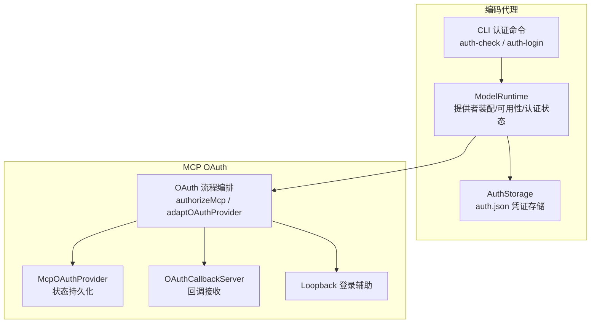
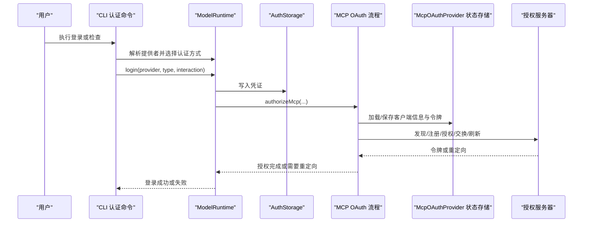
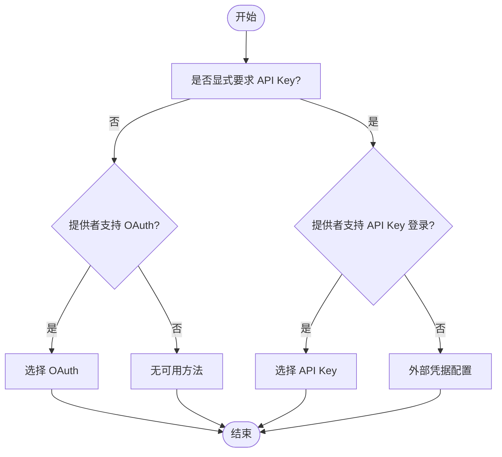
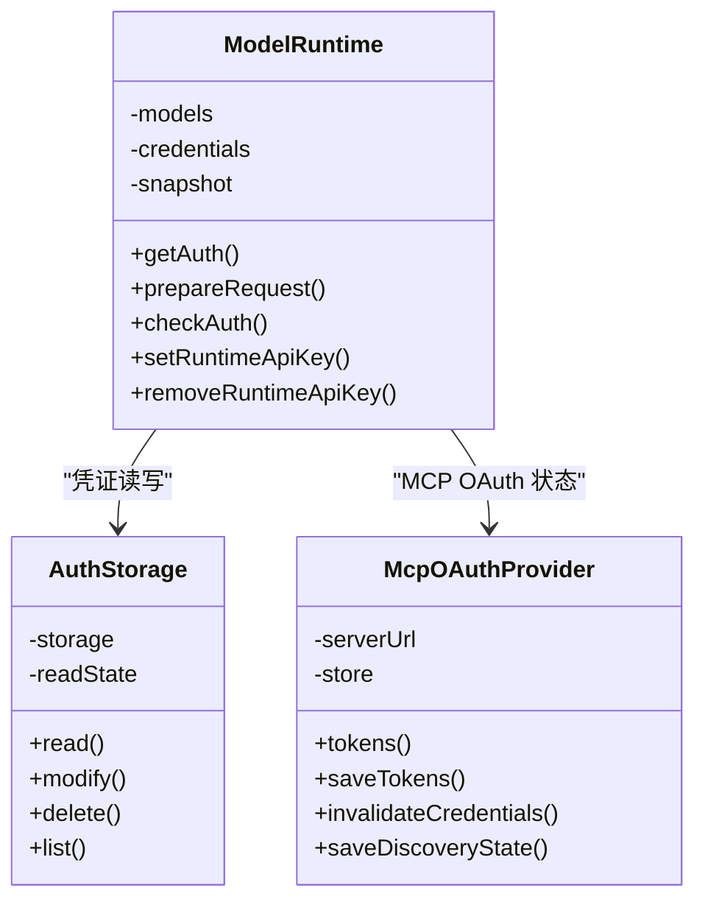
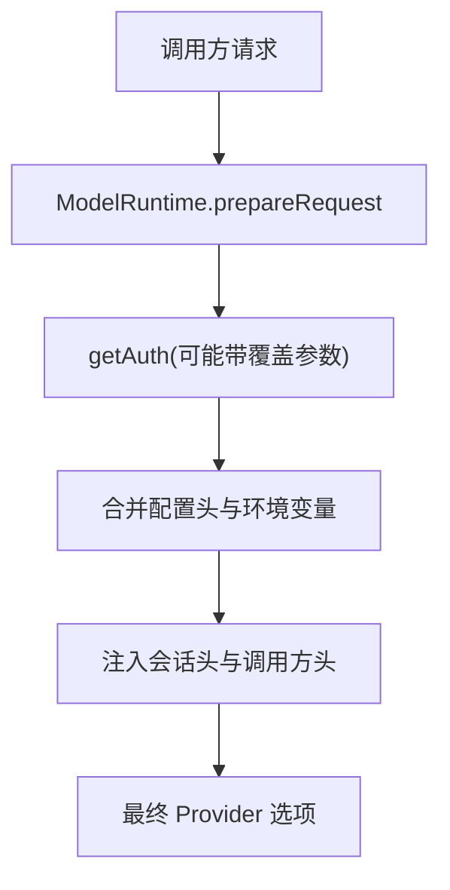
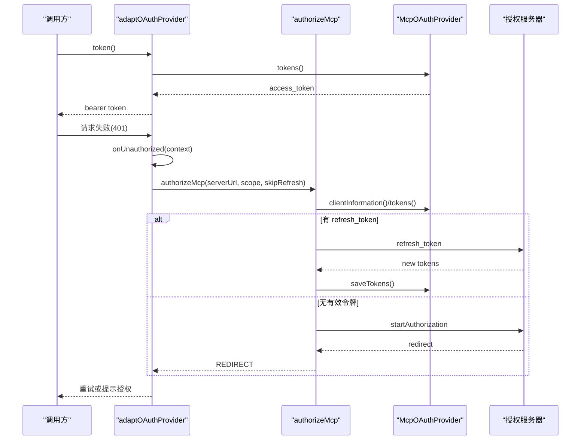
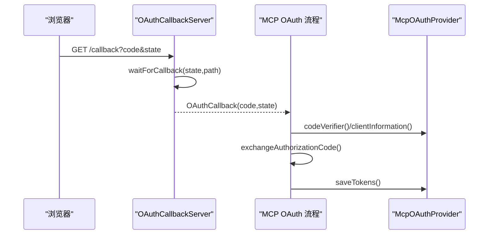
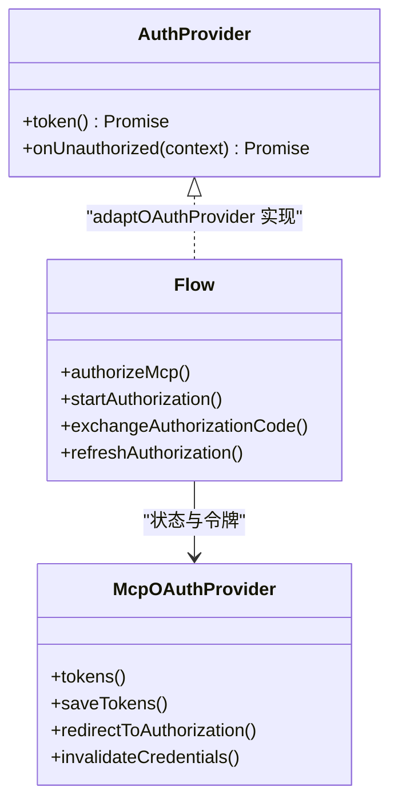
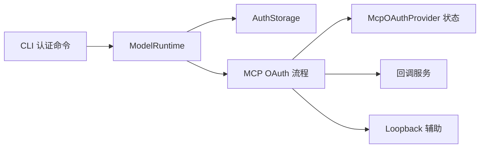

# 认证解析与上下文

<cite>
**本文引用的文件**
- [auth-check.ts](file://packages/coding-agent/src/cli/auth-check.ts)
- [auth-login.ts](file://packages/coding-agent/src/cli/auth-login.ts)
- [auth-storage.ts](file://packages/coding-agent/src/core/auth-storage.ts)
- [model-runtime.ts](file://packages/coding-agent/src/core/model-runtime.ts)
- [flow.ts](file://packages/mcp/src/oauth/flow.ts)
- [provider.ts](file://packages/mcp/src/oauth/provider.ts)
- [callback.ts](file://packages/mcp/src/oauth/callback.ts)
- [loopback.ts](file://packages/mcp/src/oauth/loopback.ts)
- [index.ts](file://packages/mcp/src/oauth/index.ts)
- [auth-provider.ts](file://packages/mcp/src/auth-provider.ts)
</cite>

## 目录
1. [引言](#引言)
2. [项目结构](#项目结构)
3. [核心组件](#核心组件)
4. [架构总览](#架构总览)
5. [详细组件分析](#详细组件分析)
6. [依赖关系分析](#依赖关系分析)
7. [性能与缓存策略](#性能与缓存策略)
8. [故障排查指南](#故障排查指南)
9. [结论](#结论)

## 引言
本文围绕“认证解析与上下文”展开，聚焦以下目标：
- 说明认证方式选择算法、优先级规则与回退机制。
- 解释认证上下文管理、会话状态维护与跨组件共享。
- 说明动态认证切换、条件认证与组合认证的实现。
- 提供认证中间件开发指南、自定义认证器集成方法与调试工具使用建议。
- 文档化认证性能优化与缓存策略。

本仓库将认证能力分为两层：
- 编码代理层：负责 CLI 登录流程、凭证存储、运行时模型与提供者装配、可用性快照与认证状态查询。
- MCP OAuth 层：负责 OAuth 发现、授权码交换、刷新令牌、PKCE、回调服务、状态持久化与 401 自动重试。

## 项目结构
与认证相关的代码主要分布在两个包中：
- packages/coding-agent：CLI 认证命令、凭证存储、运行时模型与提供者装配、可用性检查。
- packages/mcp：MCP 协议的 OAuth 客户端实现，包括流程编排、状态存储、回调服务和适配层。

**图表来源**
- [auth-check.ts:22-53](file://packages/coding-agent/src/cli/auth-check.ts#L22-L53)
- [auth-login.ts:36-92](file://packages/coding-agent/src/cli/auth-login.ts#L36-L92)
- [auth-storage.ts:329-491](file://packages/coding-agent/src/core/auth-storage.ts#L329-L491)
- [model-runtime.ts:174-216](file://packages/coding-agent/src/core/model-runtime.ts#L174-L216)
- [flow.ts:468-530](file://packages/mcp/src/oauth/flow.ts#L468-L530)
- [provider.ts:53-167](file://packages/mcp/src/oauth/provider.ts#L53-L167)
- [callback.ts:34-122](file://packages/mcp/src/oauth/callback.ts#L34-L122)
- [loopback.ts:36-54](file://packages/mcp/src/oauth/loopback.ts#L36-L54)

**章节来源**
- [auth-check.ts:22-53](file://packages/coding-agent/src/cli/auth-check.ts#L22-L53)
- [auth-login.ts:36-92](file://packages/coding-agent/src/cli/auth-login.ts#L36-L92)
- [auth-storage.ts:329-491](file://packages/coding-agent/src/core/auth-storage.ts#L329-L491)
- [model-runtime.ts:174-216](file://packages/coding-agent/src/core/model-runtime.ts#L174-L216)
- [flow.ts:468-530](file://packages/mcp/src/oauth/flow.ts#L468-L530)
- [provider.ts:53-167](file://packages/mcp/src/oauth/provider.ts#L53-L167)
- [callback.ts:34-122](file://packages/mcp/src/oauth/callback.ts#L34-L122)
- [loopback.ts:36-54](file://packages/mcp/src/oauth/loopback.ts#L36-L54)

## 核心组件
- CLI 认证检查与凭证获取：用于判断提供者是否已就绪、返回认证类型与原因。
- CLI 登录流程：交互式选择认证方式（OAuth 或 API Key），处理浏览器打开、设备码、信息提示等事件。
- 凭证存储：基于 auth.json 的读写、并发锁、只读视图、内存后端与一次性读取工具。
- 运行时模型与提供者：装配内置与扩展提供者、虚拟模型、配置覆盖、可用性快照、认证状态查询与请求头合并。
- MCP OAuth 流程：发现授权服务器、注册客户端、授权码交换、刷新令牌、PKCE、范围升级、401 自适应重试。
- MCP OAuth 状态提供者：按服务器 URL 隔离状态，持久化客户端信息、令牌、PKCE verifier、发现结果。
- 回调服务：本地回调服务器、等待授权响应、超时与关闭清理。
- Loopback 登录辅助：为环回地址登录生成回调路径与服务端特定重定向 URI。

**章节来源**
- [auth-check.ts:22-64](file://packages/coding-agent/src/cli/auth-check.ts#L22-L64)
- [auth-login.ts:36-92](file://packages/coding-agent/src/cli/auth-login.ts#L36-L92)
- [auth-storage.ts:329-491](file://packages/coding-agent/src/core/auth-storage.ts#L329-L491)
- [model-runtime.ts:174-216](file://packages/coding-agent/src/core/model-runtime.ts#L174-L216)
- [flow.ts:181-316](file://packages/mcp/src/oauth/flow.ts#L181-L316)
- [provider.ts:53-167](file://packages/mcp/src/oauth/provider.ts#L53-L167)
- [callback.ts:34-122](file://packages/mcp/src/oauth/callback.ts#L34-L122)
- [loopback.ts:36-54](file://packages/mcp/src/oauth/loopback.ts#L36-L54)

## 架构总览
认证体系由“CLI 入口 + 运行时装配 + 凭证存储 + MCP OAuth 流程”组成。CLI 负责用户交互与登录；运行时负责提供者装配、可用性检查与认证状态；凭证存储负责持久化；MCP OAuth 负责与远端授权服务器的交互和令牌生命周期管理。

**图表来源**
- [auth-login.ts:36-92](file://packages/coding-agent/src/cli/auth-login.ts#L36-L92)
- [auth-storage.ts:329-491](file://packages/coding-agent/src/core/auth-storage.ts#L329-L491)
- [flow.ts:468-530](file://packages/mcp/src/oauth/flow.ts#L468-L530)
- [provider.ts:53-167](file://packages/mcp/src/oauth/provider.ts#L53-L167)

## 详细组件分析

### 认证方式选择算法、优先级与回退
CLI 登录时根据提供者能力与参数决定认证方式：
- 若未显式要求 API Key 且提供者支持 OAuth，则优先选择 OAuth。
- 若显式要求 API Key 且提供者支持 API Key 登录，则选择 API Key。
- 若仅支持 OAuth 但强制 API Key，则报告不可用。
- 若既不支持 OAuth 也不支持 API Key 登录，则视为外部凭据配置。

该逻辑确保在可用性与用户意图之间取得平衡，并在不可用时给出明确提示。

**图表来源**
- [auth-login.ts:116-128](file://packages/coding-agent/src/cli/auth-login.ts#L116-L128)

**章节来源**
- [auth-login.ts:116-128](file://packages/coding-agent/src/cli/auth-login.ts#L116-L128)

### 认证上下文管理与会话状态维护
- ModelRuntime 维护运行时快照，包含所有模型、可用模型、已配置提供者、已存储提供者与认证检查结果。
- 通过 getAuth 合并配置头与环境变量，支持运行时 API Key 覆盖。
- prepareRequest 将会话 ID 注入请求头，并按 provider 与 model 维度组装最终选项。
- MCP OAuth 状态提供者按 serverUrl 隔离状态，避免不同服务器之间的凭证泄漏。

**图表来源**
- [model-runtime.ts:174-216](file://packages/coding-agent/src/core/model-runtime.ts#L174-L216)
- [auth-storage.ts:329-491](file://packages/coding-agent/src/core/auth-storage.ts#L329-L491)
- [provider.ts:53-167](file://packages/mcp/src/oauth/provider.ts#L53-L167)

**章节来源**
- [model-runtime.ts:556-578](file://packages/coding-agent/src/core/model-runtime.ts#L556-L578)
- [model-runtime.ts:667-713](file://packages/coding-agent/src/core/model-runtime.ts#L667-L713)
- [provider.ts:164-167](file://packages/mcp/src/oauth/provider.ts#L164-L167)

### 动态认证切换、条件认证与组合认证
- 动态切换：ModelRuntime.setRuntimeApiKey/removeRuntimeApiKey 会重新装配提供者并刷新可用性快照，使运行时密钥生效。
- 条件认证：ModelRuntime.getAuth 可接受 apiKey/env/minOAuthValidityMs 等覆盖参数，结合配置头合并，形成条件认证。
- 组合认证：prepareRequest 合并 OpenCode 会话头、提供者认证头与调用方 headers，支持 transformHeaders 钩子进行组合增强。

**图表来源**
- [model-runtime.ts:556-578](file://packages/coding-agent/src/core/model-runtime.ts#L556-L578)
- [model-runtime.ts:667-713](file://packages/coding-agent/src/core/model-runtime.ts#L667-L713)

**章节来源**
- [model-runtime.ts:622-641](file://packages/coding-agent/src/core/model-runtime.ts#L622-L641)
- [model-runtime.ts:556-578](file://packages/coding-agent/src/core/model-runtime.ts#L556-L578)
- [model-runtime.ts:667-713](file://packages/coding-agent/src/core/model-runtime.ts#L667-L713)

### MCP OAuth 流程与回退机制
- 发现与注册：discoverOAuthServerInfo 与 registerClient 支持动态注册与客户端元数据文档。
- 授权码交换：exchangeAuthorizationCode 使用 PKCE，校验 iss 参数与 redirect_uri。
- 刷新令牌：refreshAuthorization 在现有 refresh_token 存在时尝试刷新；失败时触发回退。
- 范围升级：stepUpScope 合并已授予与挑战范围，避免丢失旧权限。
- 401 自适应：adaptOAuthProvider 在 401 时串行刷新令牌，必要时抛出需用户授权的错误。

**图表来源**
- [flow.ts:468-530](file://packages/mcp/src/oauth/flow.ts#L468-L530)
- [flow.ts:290-316](file://packages/mcp/src/oauth/flow.ts#L290-L316)
- [flow.ts:181-213](file://packages/mcp/src/oauth/flow.ts#L181-L213)
- [provider.ts:53-167](file://packages/mcp/src/oauth/provider.ts#L53-L167)

**章节来源**
- [flow.ts:290-316](file://packages/mcp/src/oauth/flow.ts#L290-L316)
- [flow.ts:322-331](file://packages/mcp/src/oauth/flow.ts#L322-L331)
- [flow.ts:468-530](file://packages/mcp/src/oauth/flow.ts#L468-L530)

### 回调服务与会话状态
- OAuthCallbackServer 监听本地回调端口，等待 state 匹配的授权响应，支持额外路径区分服务端特定重定向 URI。
- Loopback 登录辅助为环回地址生成回调路径与服务端特定重定向 URI，便于多实例或多服务器场景。
- McpOAuthProvider 持久化 state、clientInformation、tokens、codeVerifier 与 discovery 状态，按 serverUrl 隔离。

**图表来源**
- [callback.ts:34-122](file://packages/mcp/src/oauth/callback.ts#L34-L122)
- [loopback.ts:36-54](file://packages/mcp/src/oauth/loopback.ts#L36-L54)
- [flow.ts:290-316](file://packages/mcp/src/oauth/flow.ts#L290-L316)
- [provider.ts:53-167](file://packages/mcp/src/oauth/provider.ts#L53-L167)

**章节来源**
- [callback.ts:34-122](file://packages/mcp/src/oauth/callback.ts#L34-L122)
- [loopback.ts:36-54](file://packages/mcp/src/oauth/loopback.ts#L36-L54)
- [provider.ts:84-127](file://packages/mcp/src/oauth/provider.ts#L84-L127)

### 认证中间件开发与自定义认证器集成
- 中间件接口：MCP 的 AuthProvider 暴露 token() 与可选 onUnauthorized()，适合封装 HTTP 传输层的认证与重试。
- 适配器：adaptOAuthProvider 将 OAuth 流程封装为 AuthProvider，统一处理 401 与范围不足。
- 自定义集成：可通过实现 OAuthClientProvider 接口，注入自定义状态存储、客户端元数据文档与重定向行为，再交由 authorizeMcp 编排。

**图表来源**
- [auth-provider.ts:1-21](file://packages/mcp/src/auth-provider.ts#L1-L21)
- [flow.ts:468-530](file://packages/mcp/src/oauth/flow.ts#L468-L530)
- [provider.ts:53-167](file://packages/mcp/src/oauth/provider.ts#L53-L167)

**章节来源**
- [auth-provider.ts:1-21](file://packages/mcp/src/auth-provider.ts#L1-L21)
- [flow.ts:468-530](file://packages/mcp/src/oauth/flow.ts#L468-L530)
- [provider.ts:53-167](file://packages/mcp/src/oauth/provider.ts#L53-L167)

## 依赖关系分析
- CLI 认证命令依赖 ModelRuntime 以解析提供者、选择认证方式并执行登录。
- ModelRuntime 依赖 CredentialStore（默认 AuthStorage）进行凭证读写，并通过 Models 装配提供者与虚拟模型。
- MCP OAuth 流程依赖 Discovery、Types、Errors 与状态提供者，对外暴露 authorizeMcp 与 adaptOAuthProvider。
- 回调服务与 Loopback 辅助作为 OAuth 流程的用户交互支撑。

**图表来源**
- [auth-check.ts:22-53](file://packages/coding-agent/src/cli/auth-check.ts#L22-L53)
- [auth-login.ts:36-92](file://packages/coding-agent/src/cli/auth-login.ts#L36-L92)
- [auth-storage.ts:329-491](file://packages/coding-agent/src/core/auth-storage.ts#L329-L491)
- [model-runtime.ts:174-216](file://packages/coding-agent/src/core/model-runtime.ts#L174-L216)
- [flow.ts:468-530](file://packages/mcp/src/oauth/flow.ts#L468-L530)
- [provider.ts:53-167](file://packages/mcp/src/oauth/provider.ts#L53-L167)
- [callback.ts:34-122](file://packages/mcp/src/oauth/callback.ts#L34-L122)
- [loopback.ts:36-54](file://packages/mcp/src/oauth/loopback.ts#L36-L54)

**章节来源**
- [auth-check.ts:22-53](file://packages/coding-agent/src/cli/auth-check.ts#L22-L53)
- [auth-login.ts:36-92](file://packages/coding-agent/src/cli/auth-login.ts#L36-L92)
- [auth-storage.ts:329-491](file://packages/coding-agent/src/core/auth-storage.ts#L329-L491)
- [model-runtime.ts:174-216](file://packages/coding-agent/src/core/model-runtime.ts#L174-L216)
- [flow.ts:468-530](file://packages/mcp/src/oauth/flow.ts#L468-L530)
- [provider.ts:53-167](file://packages/mcp/src/oauth/provider.ts#L53-L167)
- [callback.ts:34-122](file://packages/mcp/src/oauth/callback.ts#L34-L122)
- [loopback.ts:36-54](file://packages/mcp/src/oauth/loopback.ts#L36-L54)

## 性能与缓存策略
- 凭证存储缓存：AuthStorage 维护 readState 与共享文件读取状态，避免重复解析 auth.json；withLockAsync 使用指数退避与 EPERM 重试，提升 Windows 环境稳定性。
- 可用性快照：ModelRuntime 维护 all/available/configuredProviders/storedProviders/auth 快照，减少频繁网络与文件系统访问。
- MCP 发现缓存：McpOAuthProvider.saveDiscoveryState/discoveryState 缓存授权服务器元数据与资源元数据，减少重复发现开销。
- 令牌过期计算：McpOAuthProvider.saveTokens 记录 expires_in 并计算 tokensExpireAt，便于上层做有效性判断。
- 并发安全：FileAuthStorageBackend 使用 proper-lockfile 保证并发写安全；McpOAuthProvider.update 串行化写操作，避免竞态。

建议：
- 在高并发场景下优先使用 FileAuthStorageBackend，并确保进程退出前调用 settleCredentialWrites。
- 对高频鉴权路径启用 MCP 发现缓存，避免每次请求都进行远端发现。
- 对 OAuth 刷新采用 adaptOAuthProvider 的串行化刷新，避免并发刷新导致的令牌轮换冲突。

**章节来源**
- [auth-storage.ts:118-203](file://packages/coding-agent/src/core/auth-storage.ts#L118-L203)
- [auth-storage.ts:329-491](file://packages/coding-agent/src/core/auth-storage.ts#L329-L491)
- [model-runtime.ts:334-372](file://packages/coding-agent/src/core/model-runtime.ts#L334-L372)
- [provider.ts:105-113](file://packages/mcp/src/oauth/provider.ts#L105-L113)
- [provider.ts:144-150](file://packages/mcp/src/oauth/provider.ts#L144-L150)
- [flow.ts:468-530](file://packages/mcp/src/oauth/flow.ts#L468-L530)

## 故障排查指南
常见问题与定位要点：
- 登录不可用：检查 selectAuthType 返回的不可用消息，确认提供者是否支持所选认证方式。
- 凭证同步失败：关注 CredentialSynchronizationError，查看是否因模型刷新或可用性更新失败导致。
- OAuth 回调超时：检查 OAuthCallbackServer.waitForCallback 的超时设置与 state 匹配情况。
- 401 循环：确认 adaptOAuthProvider 的 inFlight 串行刷新是否生效，以及 invalid_grant/invalid_client/unauthorized_client 的回退逻辑。
- 范围不足：检查 stepUpScope 是否正确合并已授予与挑战范围，必要时手动指定 scope。

调试建议：
- 使用 CLI 的 check 命令快速判断提供者状态与认证类型。
- 在登录过程中观察终端输出，确认浏览器打开、设备码与提示信息。
- 在 MCP 侧启用日志，观察 discover、register、authorize、exchange、refresh 各阶段。
- 使用 MemoryOAuthStateStore 或 InMemoryAuthStorageBackend 进行单元测试，隔离外部依赖。

**章节来源**
- [auth-login.ts:116-128](file://packages/coding-agent/src/cli/auth-login.ts#L116-L128)
- [model-runtime.ts:600-620](file://packages/coding-agent/src/core/model-runtime.ts#L600-L620)
- [callback.ts:93-102](file://packages/mcp/src/oauth/callback.ts#L93-L102)
- [flow.ts:468-530](file://packages/mcp/src/oauth/flow.ts#L468-L530)
- [flow.ts:322-331](file://packages/mcp/src/oauth/flow.ts#L322-L331)

## 结论
本仓库的认证体系以 CLI 为入口、ModelRuntime 为核心、AuthStorage 为持久层、MCP OAuth 为协议实现，形成了从用户交互到远端授权的全链路能力。通过清晰的认证方式选择算法、严格的会话状态隔离与可靠的回退机制，系统能够在多种环境下稳定运行。配合缓存策略与并发控制，认证路径具备较好的性能与鲁棒性。对于扩展与定制，AuthProvider 与 OAuthClientProvider 提供了明确的集成点，便于开发者构建自定义认证中间件与认证器。