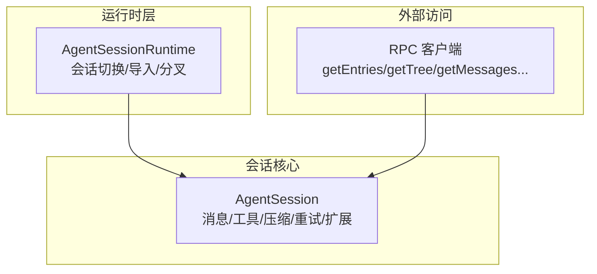
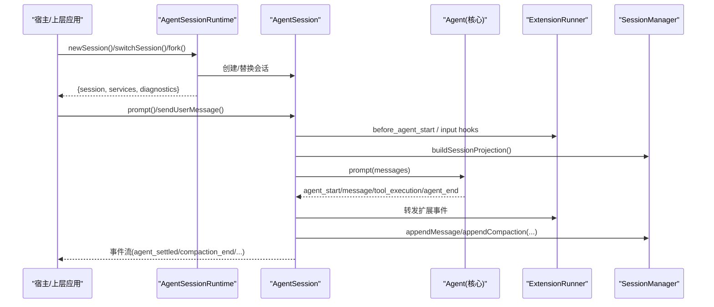
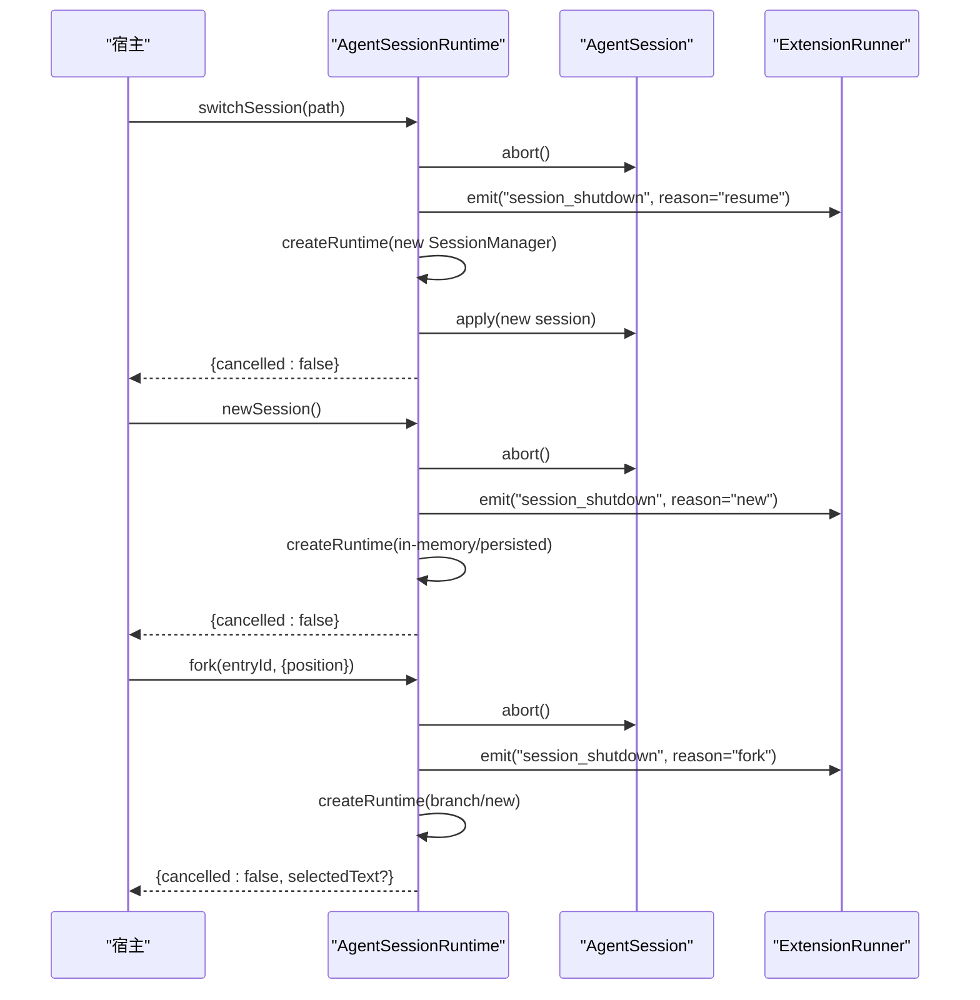
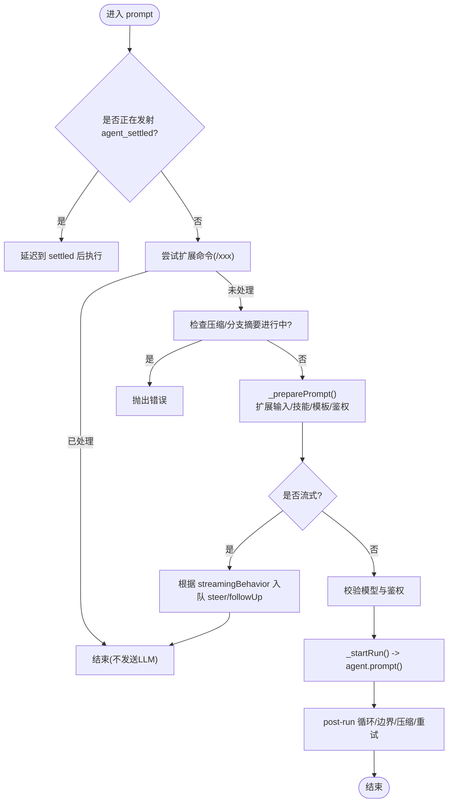
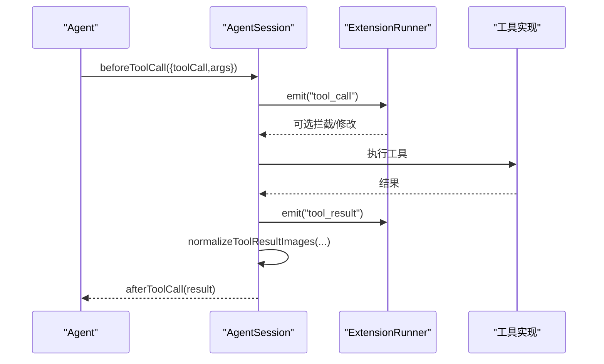
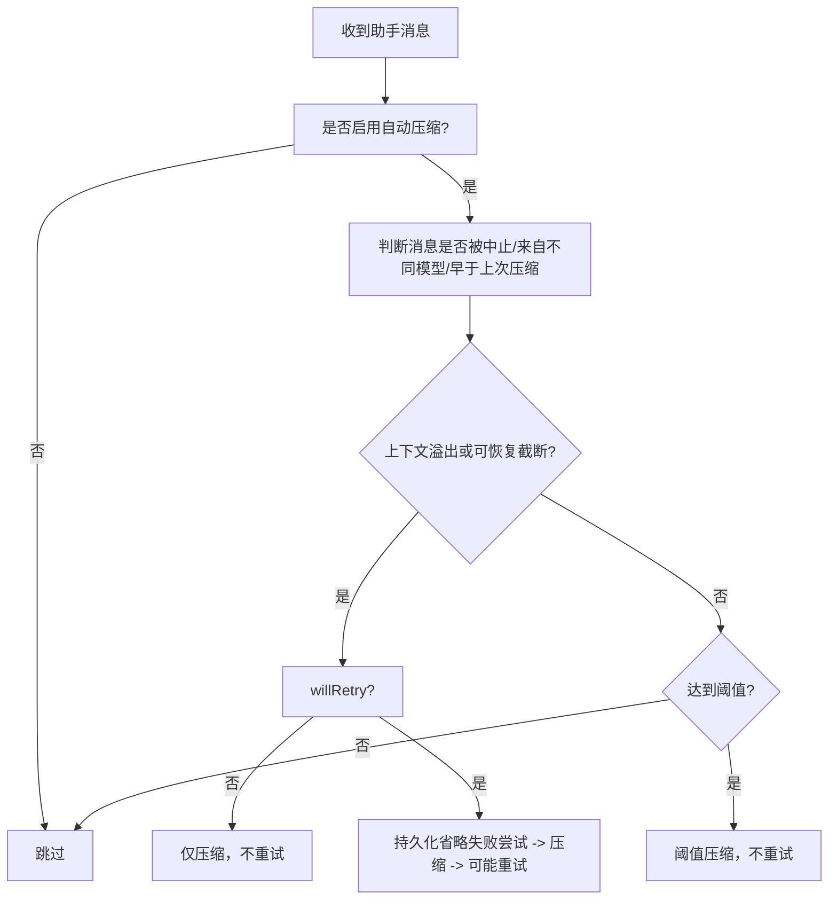
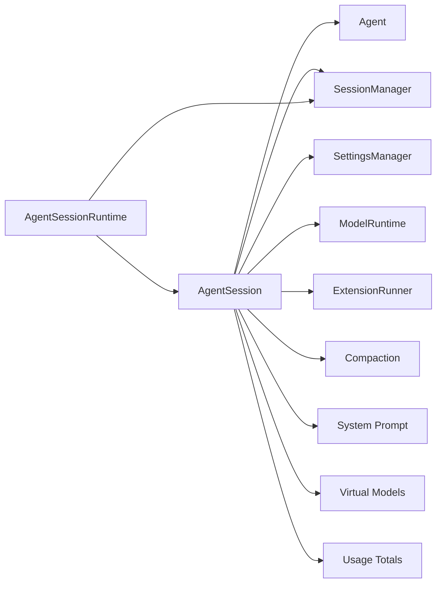

# 会话管理 API

<cite>
**本文引用的文件**
- [agent-session.ts](file://packages/coding-agent/src/core/agent-session.ts)
- [agent-session-runtime.ts](file://packages/coding-agent/src/core/agent-session-runtime.ts)
- [rpc-client.ts](file://packages/coding-agent/src/modes/rpc/rpc-client.ts)
- [utilities.ts](file://packages/coding-agent/test/utilities.ts)
</cite>

## 目录
1. [简介](#简介)
2. [项目结构](#项目结构)
3. [核心组件](#核心组件)
4. [架构总览](#架构总览)
5. [详细组件分析](#详细组件分析)
6. [依赖关系分析](#依赖关系分析)
7. [性能与容量管理](#性能与容量管理)
8. [故障排查指南](#故障排查指南)
9. [结论](#结论)
10. [附录：API 参考与示例](#附录api-参考与示例)

## 简介
本文件面向使用 AgentSession 的开发者，系统化说明会话创建、消息发送、工具调用、会话状态管理与生命周期控制等能力。文档基于仓库中的核心实现进行梳理，提供接口语义、参数与返回值类型、事件模型、错误处理机制以及常见使用场景的代码路径指引。

## 项目结构
AgentSession 是会话与代理生命周期的核心抽象，跨多种运行模式（交互、打印、RPC）共享；AgentSessionRuntime 负责运行时切换、会话导入/新建/分叉等宿主级流程；RPC 客户端暴露一组对会话树和消息的只读查询方法；测试辅助函数展示了如何构造 AgentSession 并启用持久化。



图表来源
- [agent-session-runtime.ts:74-418](file://packages/coding-agent/src/core/agent-session-runtime.ts#L74-L418)
- [agent-session.ts:409-4541](file://packages/coding-agent/src/core/agent-session.ts#L409-L4541)
- [rpc-client.ts:416-453](file://packages/coding-agent/src/modes/rpc/rpc-client.ts#L416-L453)

章节来源
- [agent-session.ts:1-16](file://packages/coding-agent/src/core/agent-session.ts#L1-L16)
- [agent-session-runtime.ts:17-41](file://packages/coding-agent/src/core/agent-session-runtime.ts#L17-L41)

## 核心组件
- AgentSession：封装代理状态、事件订阅、模型与思考级别、压缩（手动/自动）、Bash 执行、会话分支与导航、工具注册与调用、扩展系统绑定等。
- AgentSessionRuntime：封装当前 AgentSession 与其 cwd 绑定的服务，提供 newSession、switchSession、fork、importFromJsonl、dispose 等生命周期操作。
- RPC 客户端：提供 getEntries、getTree、getLastAssistantText、setSessionName、getMessages 等远程访问接口。
- 测试辅助 utilities：展示如何构造 AgentSession、启用持久化、清理资源。

章节来源
- [agent-session.ts:409-559](file://packages/coding-agent/src/core/agent-session.ts#L409-L559)
- [agent-session-runtime.ts:74-118](file://packages/coding-agent/src/core/agent-session-runtime.ts#L74-L118)
- [rpc-client.ts:416-453](file://packages/coding-agent/src/modes/rpc/rpc-client.ts#L416-L453)
- [utilities.ts:278-298](file://packages/coding-agent/test/utilities.ts#L278-L298)

## 架构总览
AgentSession 通过内部钩子将 Agent 事件桥接到扩展系统与持久化层，并在请求前/后注入上下文投影、工具声明、压缩与重试逻辑。AgentSessionRuntime 在宿主侧管理会话替换、关闭与诊断信息。RPC 客户端以 JSON-RPC 风格访问会话数据。



图表来源
- [agent-session-runtime.ts:196-259](file://packages/coding-agent/src/core/agent-session-runtime.ts#L196-L259)
- [agent-session.ts:1918-1963](file://packages/coding-agent/src/core/agent-session.ts#L1918-L1963)
- [agent-session.ts:1138-1238](file://packages/coding-agent/src/core/agent-session.ts#L1138-L1238)
- [agent-session.ts:1342-1421](file://packages/coding-agent/src/core/agent-session.ts#L1342-L1421)

## 详细组件分析

### AgentSession 类概览
- 职责
  - 代理事件订阅与分发（含扩展事件桥接）
  - 会话消息与自定义消息持久化
  - 模型与思考级别选择、切换与循环
  - 工具注册、可见性过滤、激活与系统提示构建
  - 会话压缩（手动/自动阈值/溢出恢复）
  - Bash 执行与结果记录
  - 会话树导航与分支摘要
  - 自动重试与退避
  - 扩展绑定与命令/工具暴露
- 关键属性（部分）
  - isStreaming/isIdle/isCompacting/isRetrying
  - model/thinkingLevel/systemPrompt/messages/sessionId/sessionFile/sessionName
  - activeToolNames/callableToolNames
- 关键事件（部分）
  - agent_start/agent_end/turn_start/turn_end
  - message_start/message_update/message_end
  - tool_execution_start/update/end
  - compaction_start/end、auto_retry_start/end、summarization_retry_*
  - session_info_changed、thinking_level_changed、entry_appended、queue_update、bash_execution_update

章节来源
- [agent-session.ts:209-254](file://packages/coding-agent/src/core/agent-session.ts#L209-L254)
- [agent-session.ts:1479-1739](file://packages/coding-agent/src/core/agent-session.ts#L1479-L1739)
- [agent-session.ts:1138-1421](file://packages/coding-agent/src/core/agent-session.ts#L1138-L1421)

#### 类图（代码级）
```mermaid
classDiagram
class AgentSession {
+prompt(text, options) Promise~void~
+steer(text, images?, options?) Promise~QueuedInputDisposition~
+followUp(text, images?, options?) Promise~QueuedInputDisposition~
+sendUserMessage(content, options?) Promise~void~
+sendCustomMessage(message, options?) Promise~void~
+clearQueue() { steering : string[], followUp : string[] }
+abort() Promise~void~
+waitForIdle() Promise~void~
+setModel(model, options?) Promise~void~
+cycleModel(direction?, options?) Promise~ModelCycleResult|undefined~
+setThinkingLevel(level, options?) void
+cycleThinkingLevel(options?) ThinkingLevel|undefined
+getAvailableThinkingLevels() ThinkingLevel[]
+supportsThinking() boolean
+setSteeringMode(mode) void
+setFollowUpMode(mode) void
+compact(customInstructions?) Promise~CompactionResult~
+abortCompaction() void
+abortBranchSummary() void
+executeBash(command, onChunk?, options?) Promise~BashResult~
+recordBashResult(command, result, options?) void
+abortBash() void
+setSessionName(name) void
+navigateTree(targetId, options?) Promise~{editorText?, cancelled : boolean, aborted?, summaryEntry?}~
+getUserMessagesForForking() {entryId,text}[]
+getSessionStats() SessionStats
+getContextUsage() ContextUsage|undefined
+exportToHtml(outputPath?, options?) Promise~string~
+exportToJsonl(outputPath?) string
+summarizeForBugReport(options) Promise~string~
+getLastAssistantText() string|undefined
+subscribe(listener) () => void
+dispose() void
+refreshContext() void
+getActiveToolNames() string[]
+getCallableToolNames() string[]
+getAllTools() ToolInfo[]
+getToolDefinition(name) ToolDefinition|undefined
+setActiveToolsByName(toolNames) void
+reload(options?) Promise~void~
}
```

图表来源
- [agent-session.ts:2137-2171](file://packages/coding-agent/src/core/agent-session.ts#L2137-L2171)
- [agent-session.ts:2338-2360](file://packages/coding-agent/src/core/agent-session.ts#L2338-L2360)
- [agent-session.ts:2507-2537](file://packages/coding-agent/src/core/agent-session.ts#L2507-L2537)
- [agent-session.ts:2435-2471](file://packages/coding-agent/src/core/agent-session.ts#L2435-L2471)
- [agent-session.ts:2576-2593](file://packages/coding-agent/src/core/agent-session.ts#L2576-L2593)
- [agent-session.ts:2619-2734](file://packages/coding-agent/src/core/agent-session.ts#L2619-L2734)
- [agent-session.ts:2746-2819](file://packages/coding-agent/src/core/agent-session.ts#L2746-L2819)
- [agent-session.ts:2898-3043](file://packages/coding-agent/src/core/agent-session.ts#L2898-L3043)
- [agent-session.ts:3978-4010](file://packages/coding-agent/src/core/agent-session.ts#L3978-L4010)
- [agent-session.ts:4079-4084](file://packages/coding-agent/src/core/agent-session.ts#L4079-L4084)
- [agent-session.ts:4101-4298](file://packages/coding-agent/src/core/agent-session.ts#L4101-L4298)
- [agent-session.ts:4325-4422](file://packages/coding-agent/src/core/agent-session.ts#L4325-L4422)
- [agent-session.ts:4430-4458](file://packages/coding-agent/src/core/agent-session.ts#L4430-L4458)
- [agent-session.ts:4464-4478](file://packages/coding-agent/src/core/agent-session.ts#L4464-L4478)
- [agent-session.ts:4489-4511](file://packages/coding-agent/src/core/agent-session.ts#L4489-L4511)
- [agent-session.ts:1428-1473](file://packages/coding-agent/src/core/agent-session.ts#L1428-L1473)
- [agent-session.ts:1479-1566](file://packages/coding-agent/src/core/agent-session.ts#L1479-L1566)
- [agent-session.ts:3790-3836](file://packages/coding-agent/src/core/agent-session.ts#L3790-L3836)

### AgentSessionRuntime 类概览
- 职责
  - 持有当前 AgentSession 及其 cwd 绑定服务
  - 提供 newSession、switchSession、fork、importFromJsonl、dispose
  - 在会话切换前触发 session_before_switch/session_before_fork 扩展钩子
  - 统一 session_shutdown 事件与资源清理
- 关键方法
  - switchSession(sessionPath, options?)
  - newSession(options?)
  - fork(entryId, options?)
  - importFromJsonl(inputPath, cwdOverride?)
  - dispose()

章节来源
- [agent-session-runtime.ts:74-118](file://packages/coding-agent/src/core/agent-session-runtime.ts#L74-L118)
- [agent-session-runtime.ts:196-259](file://packages/coding-agent/src/core/agent-session-runtime.ts#L196-L259)
- [agent-session-runtime.ts:262-350](file://packages/coding-agent/src/core/agent-session-runtime.ts#L262-L350)
- [agent-session-runtime.ts:359-402](file://packages/coding-agent/src/core/agent-session-runtime.ts#L359-L402)
- [agent-session-runtime.ts:409-418](file://packages/coding-agent/src/core/agent-session-runtime.ts#L409-L418)

#### 运行时序列图（会话切换/新建/分叉）


图表来源
- [agent-session-runtime.ts:196-259](file://packages/coding-agent/src/core/agent-session-runtime.ts#L196-L259)
- [agent-session-runtime.ts:262-350](file://packages/coding-agent/src/core/agent-session-runtime.ts#L262-L350)
- [agent-session-runtime.ts:409-418](file://packages/coding-agent/src/core/agent-session-runtime.ts#L409-L418)

### 消息发送与会话队列
- prompt(text, options?)
  - 支持扩展命令拦截、技能模板展开、图片附件、流式行为（steer/followUp）
  - 非流式时校验模型与鉴权
- steer(text, images?, options?)
  - 插队消息：在当前助手轮次工具调用完成后、下一次 LLM 调用前投递
- followUp(text, images?, options?)
  - 尾随消息：在代理完成所有工具调用与插队消息后投递
- sendUserMessage(content, options?)
  - 标准化文本/图片输入，始终触发一轮对话
- sendCustomMessage(message, options?)
  - 插入自定义消息，支持 nextTurn 上下文注入或作为 steer/followUp 投递
- clearQueue()
  - 清空队列并返回待处理消息

章节来源
- [agent-session.ts:2137-2171](file://packages/coding-agent/src/core/agent-session.ts#L2137-L2171)
- [agent-session.ts:2338-2360](file://packages/coding-agent/src/core/agent-session.ts#L2338-L2360)
- [agent-session.ts:2507-2537](file://packages/coding-agent/src/core/agent-session.ts#L2507-L2537)
- [agent-session.ts:2435-2471](file://packages/coding-agent/src/core/agent-session.ts#L2435-L2471)
- [agent-session.ts:2544-2567](file://packages/coding-agent/src/core/agent-session.ts#L2544-L2567)

#### 消息发送流程图（prompt）


图表来源
- [agent-session.ts:2137-2171](file://packages/coding-agent/src/core/agent-session.ts#L2137-L2171)
- [agent-session.ts:2177-2238](file://packages/coding-agent/src/core/agent-session.ts#L2177-L2238)
- [agent-session.ts:1918-1963](file://packages/coding-agent/src/core/agent-session.ts#L1918-L1963)

### 工具调用与会话内嵌套调用
- 工具钩子
  - beforeToolCall/afterToolCall：扩展可拦截输入/输出，并进行图像归一化等处理
- 嵌套调用
  - _executeNestedToolCall：通过 NestedToolCallRunner 执行由工具发起的工具调用，保持父调用 ID 与事件透传
- 工具注册与可见性
  - getAllTools/getToolDefinition/setActiveToolsByName/getActiveToolNames/getCallableToolNames
  - 支持 allowlist/denylist、MCP 工具保留策略、prepareLoadout 动态隐藏声明

章节来源
- [agent-session.ts:688-760](file://packages/coding-agent/src/core/agent-session.ts#L688-L760)
- [agent-session.ts:766-800](file://packages/coding-agent/src/core/agent-session.ts#L766-L800)
- [agent-session.ts:1542-1566](file://packages/coding-agent/src/core/agent-session.ts#L1542-L1566)
- [agent-session.ts:1578-1591](file://packages/coding-agent/src/core/agent-session.ts#L1578-L1591)
- [agent-session.ts:1622-1685](file://packages/coding-agent/src/core/agent-session.ts#L1622-L1685)
- [agent-session.ts:3625-3723](file://packages/coding-agent/src/core/agent-session.ts#L3625-L3723)

#### 工具调用时序图


图表来源
- [agent-session.ts:688-760](file://packages/coding-agent/src/core/agent-session.ts#L688-L760)

### 会话状态与生命周期
- 状态读取
  - state/model/thinkingLevel/systemPrompt/messages/sessionId/sessionFile/sessionName
  - isStreaming/isIdle/isCompacting/isRetrying/autoRetryEnabled/autoCompactionEnabled
- 模型与思考级别
  - setModel/cycleModel/getAvailableThinkingLevels/setThinkingLevel/cycleThinkingLevel/supportsThinking
- 队列模式
  - setSteeringMode/setFollowUpMode
- 扩展绑定
  - bindExtensions：注入 UI 上下文、命令、错误监听、shutdown 处理器等
- 重载
  - reload：重新加载扩展/设置/资源，重建工具注册表，必要时重发 session_start

章节来源
- [agent-session.ts:1479-1739](file://packages/coding-agent/src/core/agent-session.ts#L1479-L1739)
- [agent-session.ts:2619-2734](file://packages/coding-agent/src/core/agent-session.ts#L2619-L2734)
- [agent-session.ts:2746-2819](file://packages/coding-agent/src/core/agent-session.ts#L2746-L2819)
- [agent-session.ts:2825-2846](file://packages/coding-agent/src/core/agent-session.ts#L2825-L2846)
- [agent-session.ts:3388-3412](file://packages/coding-agent/src/core/agent-session.ts#L3388-L3412)
- [agent-session.ts:3790-3836](file://packages/coding-agent/src/core/agent-session.ts#L3790-L3836)

### 会话压缩与分支摘要
- 手动压缩
  - compact(customInstructions?)：中止当前运行，准备压缩，触发 session_before_compact，默认生成摘要并写入会话
- 自动压缩
  - _checkCompaction/_runAutoCompaction：阈值/溢出两种触发路径，支持“压缩+重试”恢复
- 分支摘要
  - navigateTree：可选择对废弃分支生成摘要，支持扩展覆盖指令/标签/摘要内容

章节来源
- [agent-session.ts:2898-3043](file://packages/coding-agent/src/core/agent-session.ts#L2898-L3043)
- [agent-session.ts:3081-3215](file://packages/coding-agent/src/core/agent-session.ts#L3081-L3215)
- [agent-session.ts:3227-3374](file://packages/coding-agent/src/core/agent-session.ts#L3227-L3374)
- [agent-session.ts:4101-4298](file://packages/coding-agent/src/core/agent-session.ts#L4101-L4298)

#### 自动压缩决策流程


图表来源
- [agent-session.ts:3081-3215](file://packages/coding-agent/src/core/agent-session.ts#L3081-L3215)
- [agent-session.ts:3227-3374](file://packages/coding-agent/src/core/agent-session.ts#L3227-L3374)

### Bash 执行
- executeBash：执行 shell 命令，支持前缀/路径配置、流式输出回调、排除上下文标记、取消
- recordBashResult：记录 Bash 执行结果为会话消息（流式下延后刷新）
- abortBash：取消所有运行中的 Bash

章节来源
- [agent-session.ts:3978-4010](file://packages/coding-agent/src/core/agent-session.ts#L3978-L4010)
- [agent-session.ts:4016-4070](file://packages/coding-agent/src/core/agent-session.ts#L4016-L4070)

### 会话导出与统计
- exportToHtml：导出为 HTML，支持主题与工具渲染器
- exportToJsonl：导出当前分支为 JSONL
- getSessionStats：聚合全量会话条目统计（用户/助手/工具调用/Token/成本）
- getContextUsage：估算当前上下文 Token 占用与百分比

章节来源
- [agent-session.ts:4325-4422](file://packages/coding-agent/src/core/agent-session.ts#L4325-L4422)
- [agent-session.ts:4430-4458](file://packages/coding-agent/src/core/agent-session.ts#L4430-L4458)

### RPC 客户端（只读访问）
- getEntries(since?)：按追加顺序获取会话条目
- getTree()：获取会话条目树
- getLastAssistantText()：最后一条助手消息文本
- setSessionName(name)：设置会话显示名
- getMessages()：获取会话全部消息

章节来源
- [rpc-client.ts:416-453](file://packages/coding-agent/src/modes/rpc/rpc-client.ts#L416-L453)

## 依赖关系分析
- AgentSession 依赖
  - Agent：核心代理循环与事件
  - SessionManager：会话树、条目、投影、持久化
  - SettingsManager：设置项（压缩/重试/工具/图片等）
  - ModelRuntime：模型解析、鉴权、可用模型快照
  - ExtensionRunner：扩展生命周期、命令、工具、事件
  - 其他：compaction、tools、system-prompt、virtual-models、usage-totals 等
- AgentSessionRuntime 依赖
  - AgentSession、SessionManager、extensions runner、文件系统与路径工具



图表来源
- [agent-session.ts:18-161](file://packages/coding-agent/src/core/agent-session.ts#L18-L161)
- [agent-session-runtime.ts:1-15](file://packages/coding-agent/src/core/agent-session-runtime.ts#L1-L15)

章节来源
- [agent-session.ts:18-161](file://packages/coding-agent/src/core/agent-session.ts#L18-L161)
- [agent-session-runtime.ts:1-15](file://packages/coding-agent/src/core/agent-session-runtime.ts#L1-L15)

## 性能与容量管理
- 上下文窗口与压缩
  - 自动压缩在溢出/可恢复截断/阈值三种情况下触发，避免上下文超限与重复失败
  - 压缩后可选择性重试一次，随后不再重试，防止无限循环
- 重试机制
  - 自动重试遵循指数退避与最大次数限制，区分可重试错误与上下文溢出
- 缓存预热
  - cacheWarmer 可预热最近会话请求的提示缓存，减少冷启动开销
- Bash 与图片
  - Bash 输出可排除上下文以减少请求体积
  - 图片自动缩放与归一化，依据模型输入限制调整

章节来源
- [agent-session.ts:3081-3215](file://packages/coding-agent/src/core/agent-session.ts#L3081-L3215)
- [agent-session.ts:3846-3963](file://packages/coding-agent/src/core/agent-session.ts#L3846-L3963)
- [agent-session.ts:499-502](file://packages/coding-agent/src/core/agent-session.ts#L499-L502)
- [agent-session.ts:4016-4070](file://packages/coding-agent/src/core/agent-session.ts#L4016-L4070)

## 故障排查指南
- 无法提交 prompt
  - 压缩/分支摘要进行中：等待完成后再提交
  - 流式模式下未指定 streamingBehavior：需指定 steer 或 followUp
  - 未选择模型或未配置鉴权：先设置模型并完成认证
- 压缩失败
  - 手动压缩：检查是否已有压缩条目或会话过小
  - 自动压缩：关注 willRetry 与 errorMessage，必要时降低上下文或切换更大上下文模型
- 工具调用异常
  - 扩展拦截抛错：检查 extension hook 的错误日志
  - 嵌套调用无助手消息：确保在有效助手消息上下文中调用
- Bash 执行
  - 取消执行：调用 abortBash
  - 输出未进入上下文：确认 excludeFromContext 标志
- 会话切换/导入
  - 被扩展取消：检查 session_before_switch/session_before_fork 返回 cancel
  - 文件不存在：importFromJsonl 会抛出特定错误

章节来源
- [agent-session.ts:2155-2159](file://packages/coding-agent/src/core/agent-session.ts#L2155-L2159)
- [agent-session.ts:2202-2207](file://packages/coding-agent/src/core/agent-session.ts#L2202-L2207)
- [agent-session.ts:2217-2235](file://packages/coding-agent/src/core/agent-session.ts#L2217-L2235)
- [agent-session.ts:2898-3043](file://packages/coding-agent/src/core/agent-session.ts#L2898-L3043)
- [agent-session.ts:3227-3374](file://packages/coding-agent/src/core/agent-session.ts#L3227-L3374)
- [agent-session-runtime.ts:359-402](file://packages/coding-agent/src/core/agent-session-runtime.ts#L359-L402)

## 结论
AgentSession 提供了完整的会话生命周期管理能力，涵盖消息发送、工具调用、模型与思考级别管理、压缩与重试、Bash 执行、扩展集成与导出统计等。AgentSessionRuntime 在宿主侧提供会话切换、导入与分叉的统一入口。结合事件模型与扩展钩子，可在不侵入核心逻辑的前提下实现丰富的业务定制。

## 附录：API 参考与示例

### TypeScript 接口与用法要点（摘要）
- AgentSessionConfig
  - agent、sessionManager、settingsManager、cwd、modelRuntime、resourceLoader
  - customTools、initialActiveToolNames、usesDefaultTools、defaultToolModifiers
  - allowedToolNames、excludedToolNames、baseToolsOverride、extensionRunnerRef、sessionStartEvent
- PromptOptions
  - expandPromptTemplates、images、streamingBehavior、source、preflightResult
- ModelMutationOptions
  - persist
- ModelCycleResult
  - model、thinkingLevel、isScoped
- SessionStats
  - sessionFile、sessionId、userMessages、assistantMessages、toolCalls、toolResults、totalMessages、tokens、cost、contextUsage

章节来源
- [agent-session.ts:266-314](file://packages/coding-agent/src/core/agent-session.ts#L266-L314)
- [agent-session.ts:328-354](file://packages/coding-agent/src/core/agent-session.ts#L328-L354)
- [agent-session.ts:356-374](file://packages/coding-agent/src/core/agent-session.ts#L356-L374)

### 常见使用场景与代码路径
- 创建会话并启用持久化
  - 参考测试辅助：构造 AgentSession 并 subscribe 以启用持久化
  - 路径：[utilities.ts:278-298](file://packages/coding-agent/test/utilities.ts#L278-L298)
- 发送用户消息
  - 同步发送：sendUserMessage
  - 流式排队：prompt(..., { streamingBehavior })
  - 路径：[agent-session.ts:2507-2537](file://packages/coding-agent/src/core/agent-session.ts#L2507-L2537)、[agent-session.ts:2137-2171](file://packages/coding-agent/src/core/agent-session.ts#L2137-L2171)
- 处理工具调用结果
  - 通过扩展事件 tool_execution_start/update/end 与 afterToolCall 钩子
  - 路径：[agent-session.ts:1393-1421](file://packages/coding-agent/src/core/agent-session.ts#L1393-L1421)、[agent-session.ts:719-760](file://packages/coding-agent/src/core/agent-session.ts#L719-L760)
- 设置会话名称
  - 直接调用 setSessionName 或通过扩展 pi.setSessionName
  - 路径：[agent-session.ts:4079-4084](file://packages/coding-agent/src/core/agent-session.ts#L4079-L4084)、[rpc-client.ts:443-445](file://packages/coding-agent/src/modes/rpc/rpc-client.ts#L443-L445)
- 会话树导航与分支摘要
  - navigateTree 支持摘要生成、扩展覆盖指令与标签
  - 路径：[agent-session.ts:4101-4298](file://packages/coding-agent/src/core/agent-session.ts#L4101-L4298)
- 会话导出与统计
  - exportToHtml/exportToJsonl/getSessionStats/getContextUsage
  - 路径：[agent-session.ts:4325-4458](file://packages/coding-agent/src/core/agent-session.ts#L4325-L4458)