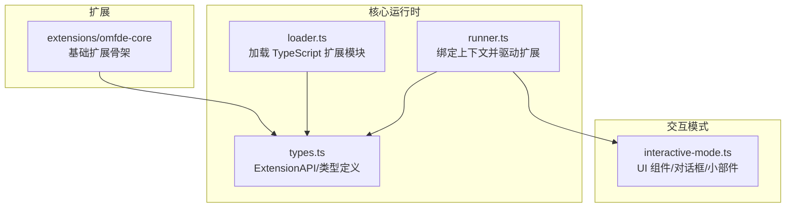
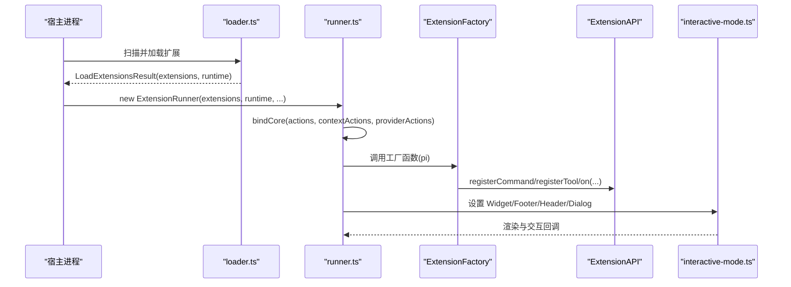
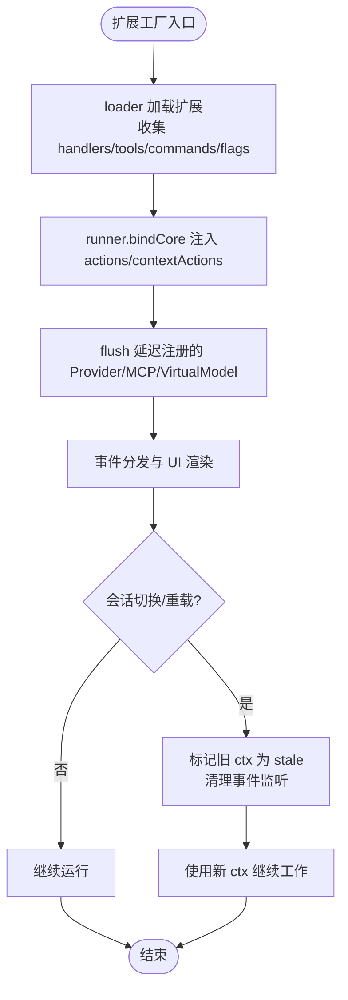
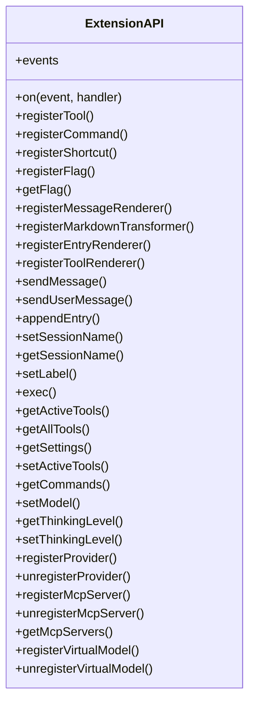
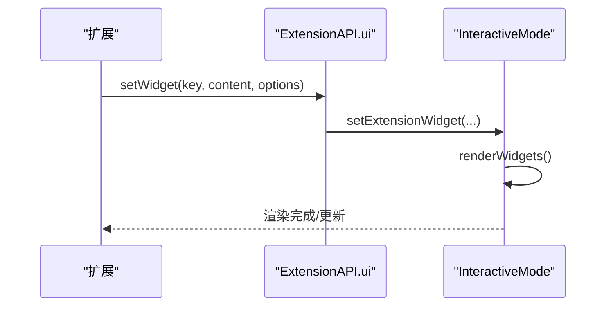
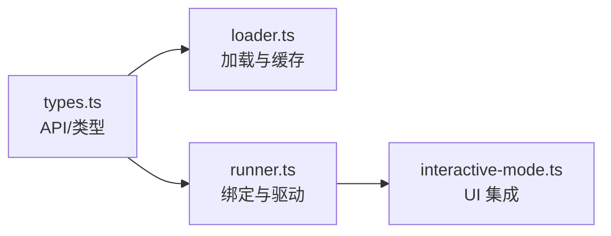

# 扩展开发 API

<cite>
**本文引用的文件**   
- [extensions/README.md](file://extensions/README.md)
- [extensions/omfde-core/src/index.ts](file://extensions/omfde-core/src/index.ts)
- [extensions/omfde-core/package.json](file://extensions/omfde-core/package.json)
- [packages/coding-agent/src/core/extensions/types.ts](file://packages/coding-agent/src/core/extensions/types.ts)
- [packages/coding-agent/src/core/extensions/loader.ts](file://packages/coding-agent/src/core/extensions/loader.ts)
- [packages/coding-agent/src/core/extensions/runner.ts](file://packages/coding-agent/src/core/extensions/runner.ts)
- [packages/coding-agent/src/modes/interactive/interactive-mode.ts](file://packages/coding-agent/src/modes/interactive/interactive-mode.ts)
</cite>

## 目录
1. [简介](#简介)
2. [项目结构](#项目结构)
3. [核心组件](#核心组件)
4. [架构总览](#架构总览)
5. [详细组件分析](#详细组件分析)
6. [依赖关系分析](#依赖关系分析)
7. [性能与可维护性](#性能与可维护性)
8. [故障排查指南](#故障排查指南)
9. [结论](#结论)
10. [附录：完整示例与最佳实践](#附录完整示例与最佳实践)

## 简介
本文件面向扩展开发者，系统性说明如何在 Pi 平台中实现 Extension、管理扩展生命周期、使用事件系统、集成 UI 组件，并提供命令、工具、主题等扩展点的完整 API 参考。文档同时给出扩展注册流程、错误处理、性能注意事项以及常见问题的解决方案，帮助你在不修改内核的前提下安全地扩展系统能力。

## 项目结构
仓库将“平台级扩展”放在 extensions 目录，避免与上游 packages 混淆；扩展通过 ExtensionAPI 接入，优先使用事件、工具、命令和 UI 能力，不改内核。

图示来源
- [extensions/README.md:1-8](file://extensions/README.md#L1-L8)
- [extensions/omfde-core/src/index.ts:1-20](file://extensions/omfde-core/src/index.ts#L1-L20)
- [packages/coding-agent/src/core/extensions/loader.ts:1-40](file://packages/coding-agent/src/core/extensions/loader.ts#L1-L40)
- [packages/coding-agent/src/core/extensions/runner.ts:364-415](file://packages/coding-agent/src/core/extensions/runner.ts#L364-L415)
- [packages/coding-agent/src/core/extensions/types.ts:1637-1966](file://packages/coding-agent/src/core/extensions/types.ts#L1637-L1966)
- [packages/coding-agent/src/modes/interactive/interactive-mode.ts:2521-2643](file://packages/coding-agent/src/modes/interactive/interactive-mode.ts#L2521-L2643)

章节来源
- [extensions/README.md:1-8](file://extensions/README.md#L1-L8)

## 核心组件
- ExtensionFactory：扩展工厂函数，接收 ExtensionAPI，支持同步或异步初始化。
- ExtensionAPI：扩展对外暴露的统一接口，包含事件订阅、工具注册、命令/快捷键/标志位、消息渲染、会话元数据、模型与思维级别、Provider/MCP/VirtualModel、共享事件总线等。
- ExtensionRuntime：运行期状态与动作集合，在 loader 创建后由 runner.bindCore 注入真实实现。
- ExtensionRunner：负责绑定上下文、刷新 Provider/MCP/VirtualModel、派发事件、管理扩展错误与诊断。
- InteractiveMode：交互模式下对 UI 组件（Widget/Footer/Header/Dialog）的承载与调度。

章节来源
- [packages/coding-agent/src/core/extensions/types.ts:2092-2123](file://packages/coding-agent/src/core/extensions/types.ts#L2092-L2123)
- [packages/coding-agent/src/core/extensions/types.ts:1637-1966](file://packages/coding-agent/src/core/extensions/types.ts#L1637-L1966)
- [packages/coding-agent/src/core/extensions/types.ts:2198-2332](file://packages/coding-agent/src/core/extensions/types.ts#L2198-L2332)
- [packages/coding-agent/src/core/extensions/loader.ts:160-220](file://packages/coding-agent/src/core/extensions/loader.ts#L160-L220)
- [packages/coding-agent/src/core/extensions/runner.ts:364-539](file://packages/coding-agent/src/core/extensions/runner.ts#L364-L539)
- [packages/coding-agent/src/modes/interactive/interactive-mode.ts:2521-2643](file://packages/coding-agent/src/modes/interactive/interactive-mode.ts#L2521-L2643)

## 架构总览
扩展从工厂函数开始，经 loader 加载为 Extension 对象，再由 runner 绑定上下文并驱动事件与 UI。交互模式提供 UI 容器，扩展通过 ExtensionAPI 与宿主通信。

图示来源
- [packages/coding-agent/src/core/extensions/loader.ts:160-220](file://packages/coding-agent/src/core/extensions/loader.ts#L160-L220)
- [packages/coding-agent/src/core/extensions/runner.ts:417-539](file://packages/coding-agent/src/core/extensions/runner.ts#L417-L539)
- [packages/coding-agent/src/modes/interactive/interactive-mode.ts:2521-2643](file://packages/coding-agent/src/modes/interactive/interactive-mode.ts#L2521-L2643)

## 详细组件分析

### ExtensionAPI 与扩展生命周期
- 生命周期阶段
  - 加载阶段：loader 执行 ExtensionFactory，收集 handlers/tools/commands/flags/renderers/markdownTransformer 等。
  - 绑定阶段：runner.bindCore 将 actions/contextActions/providerActions 注入 runtime，并 flush 延迟注册的 Provider/MCP/VirtualModel。
  - 运行阶段：事件总线分发 session_start/tool_execution/message_* 等事件；UI 组件通过 interactive-mode 渲染。
- 关键行为
  - 注册阶段仅允许部分 API（如 registerTool），其他动作在绑定后才可用。
  - 会话切换/重载时，旧 ctx 会被标记为 stale，需使用 withSession/newSession/fork/switchSession/reload 返回的新 ctx。

图示来源
- [packages/coding-agent/src/core/extensions/loader.ts:160-220](file://packages/coding-agent/src/core/extensions/loader.ts#L160-L220)
- [packages/coding-agent/src/core/extensions/runner.ts:417-539](file://packages/coding-agent/src/core/extensions/runner.ts#L417-L539)

章节来源
- [packages/coding-agent/src/core/extensions/types.ts:2092-2123](file://packages/coding-agent/src/core/extensions/types.ts#L2092-L2123)
- [packages/coding-agent/src/core/extensions/types.ts:2198-2332](file://packages/coding-agent/src/core/extensions/types.ts#L2198-L2332)
- [packages/coding-agent/src/core/extensions/loader.ts:160-220](file://packages/coding-agent/src/core/extensions/loader.ts#L160-L220)
- [packages/coding-agent/src/core/extensions/runner.ts:417-539](file://packages/coding-agent/src/core/extensions/runner.ts#L417-L539)

### 事件系统与扩展通信
- 事件订阅：ExtensionAPI.on 支持大量系统事件，包括会话、消息、工具、模型选择、输入等。
- 共享事件总线：ExtensionAPI.events 提供跨扩展通信通道。
- 生命周期相关事件：session_start/session_shutdown/before_switch/before_fork/before_compact 等。
- 资源与 Provider：resources_discover、before_provider_request、after_provider_response、provider_stream_event。
- Agent 流式事件：agent_start/agent_end/agent_before_settle/agent_settled、turn_start/turn_end、message_start/message_update/message_end。
- 工具调用：tool_call/tool_result、tool_execution_start/update/end。
- 用户交互：user_bash、input。

图示来源
- [packages/coding-agent/src/core/extensions/types.ts:1637-1966](file://packages/coding-agent/src/core/extensions/types.ts#L1637-L1966)

章节来源
- [packages/coding-agent/src/core/extensions/types.ts:1637-1966](file://packages/coding-agent/src/core/extensions/types.ts#L1637-L1966)

### 命令、快捷键与 CLI 标志位
- registerCommand：注册斜杠命令，handler 接收参数与上下文。
- registerShortcut：注册键盘快捷键及其描述与处理器。
- registerFlag/getFlag：注册 CLI 标志位（boolean/string）并读取值。
- getCommands：获取当前会话可用的斜杠命令信息。

章节来源
- [packages/coding-agent/src/core/extensions/types.ts:1724-1753](file://packages/coding-agent/src/core/extensions/types.ts#L1724-L1753)
- [packages/coding-agent/src/core/extensions/types.ts:1828-1829](file://packages/coding-agent/src/core/extensions/types.ts#L1828-L1829)

### 工具扩展（Tool）
- registerTool：注册 LLM 可调用的工具，包含参数 schema、提示词指导、暴露范围、命名空间与注解等。
- getActiveTools/getAllTools/setActiveTools：查询与设置当前生效的工具集。
- refreshTools：刷新工具列表（绑定后可用）。

章节来源
- [packages/coding-agent/src/core/extensions/types.ts:1715-1718](file://packages/coding-agent/src/core/extensions/types.ts#L1715-L1718)
- [packages/coding-agent/src/core/extensions/types.ts:1813-1826](file://packages/coding-agent/src/core/extensions/types.ts#L1813-L1826)
- [packages/coding-agent/src/core/extensions/types.ts:2169-2188](file://packages/coding-agent/src/core/extensions/types.ts#L2169-L2188)

### 消息与 Markdown 渲染
- registerMessageRenderer：为 CustomMessageEntry 注册自定义渲染器。
- registerMarkdownTransformer：在交互式模式渲染前转换 Markdown，可按 messageTypes 筛选。
- registerEntryRenderer：为 CustomEntry 注册渲染器（不参与 LLM 上下文）。
- registerToolRenderer：决定工具调用的绘制方式，按扩展加载顺序执行。

章节来源
- [packages/coding-agent/src/core/extensions/types.ts:1759-1773](file://packages/coding-agent/src/core/extensions/types.ts#L1759-L1773)

### 会话与模型控制
- sendMessage/sendUserMessage/appendEntry：向会话发送消息或追加条目。
- setSessionName/getSessionName/setLabel：会话名称与条目标签。
- exec：执行 shell 命令。
- setModel/getThinkingLevel/setThinkingLevel：设置模型与思维级别。
- getSettings/getCommands：读取设置与命令清单。

章节来源
- [packages/coding-agent/src/core/extensions/types.ts:1778-1848](file://packages/coding-agent/src/core/extensions/types.ts#L1778-L1848)

### Provider、MCP 与 VirtualModel
- registerProvider/unregisterProvider：注册或移除模型 Provider（支持 baseUrl/oauth/streamSimple/models 等）。
- registerMcpServer/unregisterMcpServer/getMcpServers：注册/移除 MCP 服务器并获取已注册列表。
- registerVirtualModel/unregisterVirtualModel：注册虚拟模型路由到物理模型。

章节来源
- [packages/coding-agent/src/core/extensions/types.ts:1850-1962](file://packages/coding-agent/src/core/extensions/types.ts#L1850-L1962)

### UI 组件集成（Widget/Footer/Header/Dialog）
- setWidget：在编辑器上方或下方放置字符串数组或自定义组件。
- setFooter：替换底部栏为自定义组件。
- setHeader：替换顶部栏为自定义组件。
- setTitle：设置标题。
- editor/pasteToEditor/setEditorText/getEditorText：编辑器读写。
- addAutocompleteProvider/setEditorComponent/getEditorComponent：自动补全与编辑器组件。
- dialog 栈：push/remove/showTop 管理扩展对话框，支持阻塞状态与嵌套打开。

图示来源
- [packages/coding-agent/src/modes/interactive/interactive-mode.ts:2521-2643](file://packages/coding-agent/src/modes/interactive/interactive-mode.ts#L2521-L2643)

章节来源
- [packages/coding-agent/src/modes/interactive/interactive-mode.ts:2521-2643](file://packages/coding-agent/src/modes/interactive/interactive-mode.ts#L2521-L2643)
- [packages/coding-agent/src/modes/interactive/interactive-mode.ts:2811-2839](file://packages/coding-agent/src/modes/interactive/interactive-mode.ts#L2811-L2839)

### 主题定制
- ExtensionAPI.ui.theme/getTheme/getAllThemes/setTheme：在 TUI 环境下访问与切换主题。
- 非 TUI 环境：setTheme 返回失败结果，提示不可用。

章节来源
- [packages/coding-agent/src/core/extensions/runner.ts:354-359](file://packages/coding-agent/src/core/extensions/runner.ts#L354-L359)

### 示例扩展：omfde-core
- 作用：注册 /omfde 命令作为平台探针，显示加载成功通知。
- 依赖：peerDependencies 指向 @earendil-works/pi-coding-agent。

章节来源
- [extensions/omfde-core/src/index.ts:1-20](file://extensions/omfde-core/src/index.ts#L1-L20)
- [extensions/omfde-core/package.json:1-16](file://extensions/omfde-core/package.json#L1-L16)

## 依赖关系分析
- loader 负责动态加载 TypeScript 扩展，使用 jiti 并在不同运行环境（Bun/SEA/Bundled Node）下选择合适的加载策略与别名映射。
- runner 在 bindCore 时将 actions/contextActions/providerActions 注入 runtime，并 flush 延迟注册项。
- types 集中定义所有扩展 API 与数据结构，贯穿 loader/runner/UI 层。

图示来源
- [packages/coding-agent/src/core/extensions/types.ts:1637-1966](file://packages/coding-agent/src/core/extensions/types.ts#L1637-L1966)
- [packages/coding-agent/src/core/extensions/loader.ts:1-40](file://packages/coding-agent/src/core/extensions/loader.ts#L1-L40)
- [packages/coding-agent/src/core/extensions/runner.ts:364-539](file://packages/coding-agent/src/core/extensions/runner.ts#L364-L539)
- [packages/coding-agent/src/modes/interactive/interactive-mode.ts:2521-2643](file://packages/coding-agent/src/modes/interactive/interactive-mode.ts#L2521-L2643)

章节来源
- [packages/coding-agent/src/core/extensions/loader.ts:1-40](file://packages/coding-agent/src/core/extensions/loader.ts#L1-L40)
- [packages/coding-agent/src/core/extensions/runner.ts:364-539](file://packages/coding-agent/src/core/extensions/runner.ts#L364-L539)

## 性能与可维护性
- 扩展工厂缓存：loader 对扩展模块进行缓存，但每次加载仍会重新执行工厂函数，避免重复模块加载的同时保证实例隔离。
- 延迟注册：Provider/MCP/VirtualModel 在加载阶段被排队，bindCore 时统一 flush，减少早期依赖缺失导致的错误。
- 事件监听清理：runner 在会话切换/重载时清理扩展拥有的事件监听，防止内存泄漏与重复触发。
- UI 组件限制：widget 最大行数限制，避免视图溢出；dialog 采用栈式管理，确保嵌套交互稳定。

章节来源
- [packages/coding-agent/src/core/extensions/loader.ts:136-158](file://packages/coding-agent/src/core/extensions/loader.ts#L136-L158)
- [packages/coding-agent/src/core/extensions/runner.ts:463-521](file://packages/coding-agent/src/core/extensions/runner.ts#L463-L521)
- [packages/coding-agent/src/modes/interactive/interactive-mode.ts:2609-2643](file://packages/coding-agent/src/modes/interactive/interactive-mode.ts#L2609-L2643)

## 故障排查指南
- “扩展运行期未初始化”错误：在扩展加载阶段调用尚未绑定的 action 方法会抛出错误。应在 bindCore 之后或使用 ctx.* 提供的上下文方法。
- 旧 ctx 失效：会话切换/重载后捕获的 pi 或 ctx 变为 stale，应使用 withSession/newSession/fork/switchSession/reload 返回的新 ctx。
- Provider/MCP/VirtualModel 注册失败：检查配置合法性与命名冲突；若没有扩展处理 MCP 注册，将被报告为扩展错误。
- UI 不可用：在非 TUI 环境或测试环境中，setTheme 等方法可能返回失败或空实现，需做兼容处理。

章节来源
- [packages/coding-agent/src/core/extensions/loader.ts:160-220](file://packages/coding-agent/src/core/extensions/loader.ts#L160-L220)
- [packages/coding-agent/src/core/extensions/runner.ts:463-521](file://packages/coding-agent/src/core/extensions/runner.ts#L463-L521)
- [packages/coding-agent/src/core/extensions/runner.ts:354-359](file://packages/coding-agent/src/core/extensions/runner.ts#L354-L359)

## 结论
通过 ExtensionAPI，扩展可以在不修改内核的情况下，以声明式的方式注册命令、工具、事件处理器与 UI 组件，并通过事件系统与宿主深度协作。loader 与 runner 共同保障扩展的安全加载、生命周期管理与错误隔离。遵循本文的最佳实践与排错建议，可显著提升扩展的稳定性和可维护性。

## 附录：完整示例与最佳实践

### 最小可扩展示例（命令与通知）
- 目标：注册一个斜杠命令，输出平台加载成功的通知。
- 步骤：
  - 导出默认工厂函数，接收 ExtensionAPI。
  - 调用 registerCommand 注册命令名与描述。
  - 在 handler 中使用 ctx.ui.notify 输出通知。
- 参考路径：[extensions/omfde-core/src/index.ts:1-20](file://extensions/omfde-core/src/index.ts#L1-L20)

章节来源
- [extensions/omfde-core/src/index.ts:1-20](file://extensions/omfde-core/src/index.ts#L1-L20)

### 事件订阅与工具注册示例
- 目标：在会话开始时记录日志，并注册一个 LLM 可调用的工具。
- 步骤：
  - 使用 pi.on("session_start", handler) 订阅会话启动事件。
  - 使用 pi.registerTool 注册工具定义，包含参数 schema 与描述。
  - 在工具 handler 中通过 ctx.exec 或 ctx.sendUserMessage 与宿主交互。
- 参考路径：
  - [packages/coding-agent/src/core/extensions/types.ts:1647-1663](file://packages/coding-agent/src/core/extensions/types.ts#L1647-L1663)
  - [packages/coding-agent/src/core/extensions/types.ts:1715-1718](file://packages/coding-agent/src/core/extensions/types.ts#L1715-L1718)
  - [packages/coding-agent/src/core/extensions/types.ts:1810-1811](file://packages/coding-agent/src/core/extensions/types.ts#L1810-L1811)

章节来源
- [packages/coding-agent/src/core/extensions/types.ts:1647-1663](file://packages/coding-agent/src/core/extensions/types.ts#L1647-L1663)
- [packages/coding-agent/src/core/extensions/types.ts:1715-1718](file://packages/coding-agent/src/core/extensions/types.ts#L1715-L1718)
- [packages/coding-agent/src/core/extensions/types.ts:1810-1811](file://packages/coding-agent/src/core/extensions/types.ts#L1810-L1811)

### UI 组件与小部件示例
- 目标：在编辑器上方展示一段文本小部件，或在编辑器区域显示自定义对话框。
- 步骤：
  - 使用 pi.ui.setWidget 设置字符串数组或组件工厂。
  - 使用 pi.ui.editor 或 pi.ui.pasteToEditor 与编辑器交互。
  - 如需弹窗，使用交互模式的对话框栈机制（由宿主管理）。
- 参考路径：
  - [packages/coding-agent/src/modes/interactive/interactive-mode.ts:2521-2643](file://packages/coding-agent/src/modes/interactive/interactive-mode.ts#L2521-L2643)
  - [packages/coding-agent/src/modes/interactive/interactive-mode.ts:2811-2839](file://packages/coding-agent/src/modes/interactive/interactive-mode.ts#L2811-L2839)

章节来源
- [packages/coding-agent/src/modes/interactive/interactive-mode.ts:2521-2643](file://packages/coding-agent/src/modes/interactive/interactive-mode.ts#L2521-L2643)
- [packages/coding-agent/src/modes/interactive/interactive-mode.ts:2811-2839](file://packages/coding-agent/src/modes/interactive/interactive-mode.ts#L2811-L2839)

### 主题定制示例
- 目标：在 TUI 环境下读取当前主题并尝试切换主题。
- 步骤：
  - 使用 pi.ui.theme 获取当前主题。
  - 使用 pi.ui.getAllThemes 列出可用主题。
  - 使用 pi.ui.setTheme 切换主题；在非 TUI 环境需处理失败返回。
- 参考路径：
  - [packages/coding-agent/src/core/extensions/runner.ts:354-359](file://packages/coding-agent/src/core/extensions/runner.ts#L354-L359)

章节来源
- [packages/coding-agent/src/core/extensions/runner.ts:354-359](file://packages/coding-agent/src/core/extensions/runner.ts#L354-L359)

### Provider/MCP/VirtualModel 示例
- 目标：注册一个自定义 Provider、一个 MCP 服务器与一个虚拟模型。
- 步骤：
  - 使用 pi.registerProvider 注册 Provider（可含 baseUrl/oauth/models）。
  - 使用 pi.registerMcpServer 注册 MCP 服务器。
  - 使用 pi.registerVirtualModel 注册虚拟模型路由。
- 参考路径：
  - [packages/coding-agent/src/core/extensions/types.ts:1850-1962](file://packages/coding-agent/src/core/extensions/types.ts#L1850-L1962)

章节来源
- [packages/coding-agent/src/core/extensions/types.ts:1850-1962](file://packages/coding-agent/src/core/extensions/types.ts#L1850-L1962)

### 最佳实践
- 仅在 bindCore 之后调用需要运行时的 action；加载阶段只允许注册类 API。
- 使用 trackEventBusSubscription 或合理地在卸载时取消事件监听，避免内存泄漏。
- 会话切换/重载后，始终使用新的 ctx，不要复用旧的 pi 或 command ctx。
- UI 组件要释放资源（dispose），widget 行数控制在限制内，避免视图溢出。
- Provider/MCP/VirtualModel 注册失败时，记录错误并回退到默认行为，保证系统稳定性。