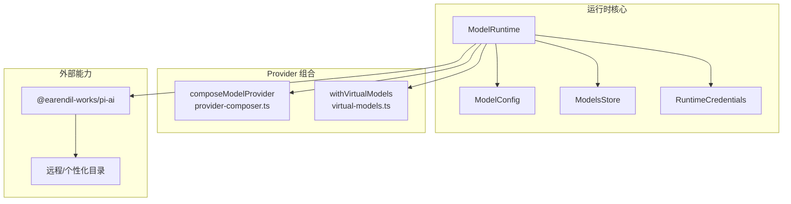
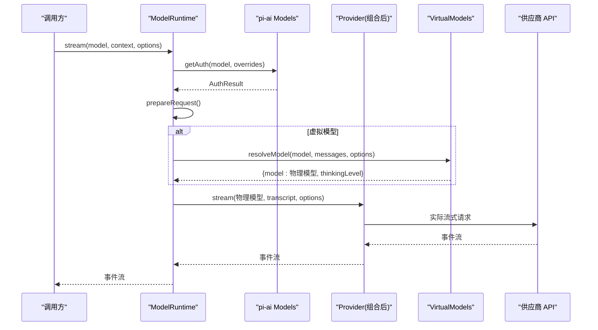
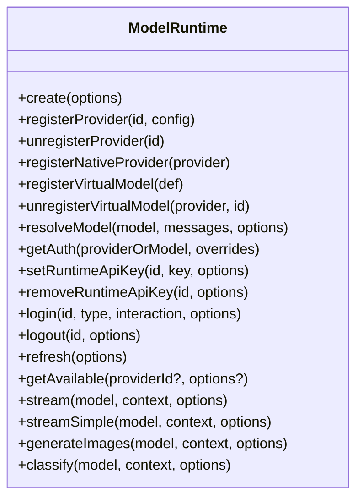
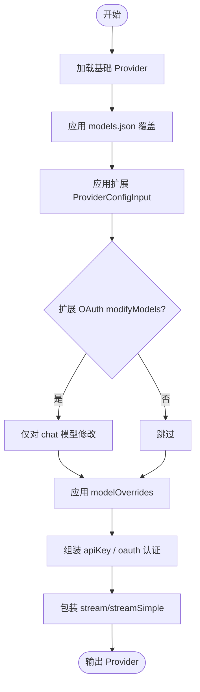
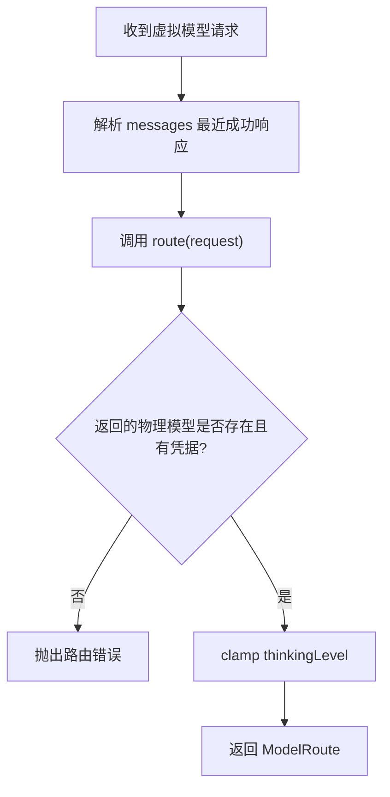
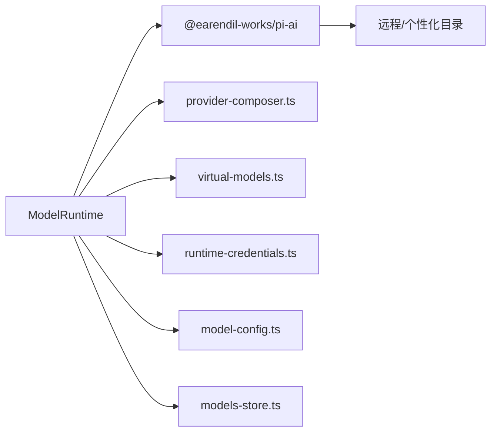

# 模型运行时 API

<cite>
**本文引用的文件**   
- [model-runtime.ts](file://packages/coding-agent/src/core/model-runtime.ts)
- [virtual-models.ts](file://packages/coding-agent/src/core/virtual-models.ts)
- [provider-composer.ts](file://packages/coding-agent/src/core/provider-composer.ts)
- [11-model-runtime.md](file://docs/explains/11-model-runtime.md)
</cite>

## 目录
1. [简介](#简介)
2. [项目结构](#项目结构)
3. [核心组件](#核心组件)
4. [架构总览](#架构总览)
5. [详细组件分析](#详细组件分析)
6. [依赖关系分析](#依赖关系分析)
7. [性能与资源管理](#性能与资源管理)
8. [故障排查指南](#故障排查指南)
9. [结论](#结论)

## 简介
本文面向使用或扩展“模型运行时”的开发者，系统性说明 ModelRuntime 的配置选项、认证管理、模型选择与请求路由机制，并给出多提供商配置、缓存策略、错误重试、虚拟模型与模型路由的高级用法示例。同时总结性能监控与资源管理的最佳实践。

## 项目结构
ModelRuntime 位于编码代理的核心层，负责：
- 组合内置 provider、扩展 provider、models.json 覆盖与虚拟模型；
- 管理凭据（API Key、OAuth）与运行时覆盖；
- 提供统一的流式与非流式调用入口；
- 维护模型目录快照与可用性状态；
- 将虚拟模型路由到物理模型后再发起请求。

**图示来源**
- [model-runtime.ts:174-269](file://packages/coding-agent/src/core/model-runtime.ts#L174-L269)
- [provider-composer.ts:546-693](file://packages/coding-agent/src/core/provider-composer.ts#L546-L693)
- [virtual-models.ts:201-238](file://packages/coding-agent/src/core/virtual-models.ts#L201-L238)

**章节来源**
- [11-model-runtime.md:12-24](file://docs/explains/11-model-runtime.md#L12-L24)

## 核心组件
- ModelRuntime：对外暴露 Models 接口，封装认证、模型目录、请求准备与分发、虚拟模型路由、凭据同步等。
- ProviderComposer：组合内置 provider、models.json 覆盖、扩展 provider，生成最终 Provider 与模型列表。
- VirtualModels：定义虚拟模型、路由协议、会话状态持久化与分支选择恢复。
- RuntimeCredentials：在持久化凭据之上提供进程级运行时覆盖（如临时 API Key）。
- ModelConfig：加载 models.json，提供 provider 级覆盖与校验。
- ModelsStore：模型目录缓存（文件或内存），配合 pi-ai 的 Models 实现。

关键职责边界：
- ModelRuntime 不直接访问网络凭据，而是委托给 pi-ai 的 Models 与 RuntimeCredentials；
- ProviderComposer 负责“如何构建一个 provider”，不包含凭据读取；
- VirtualModels 只负责“把虚拟模型映射为物理模型”，不参与网络 I/O。

**章节来源**
- [model-runtime.ts:174-269](file://packages/coding-agent/src/core/model-runtime.ts#L174-L269)
- [provider-composer.ts:92-110](file://packages/coding-agent/src/core/provider-composer.ts#L92-L110)
- [virtual-models.ts:28-102](file://packages/coding-agent/src/core/virtual-models.ts#L28-L102)

## 架构总览
ModelRuntime 作为统一入口，向上暴露 Models 语义，向下组合 provider 与虚拟模型，并通过 pi-ai 与具体供应商交互。

**图示来源**
- [model-runtime.ts:715-733](file://packages/coding-agent/src/core/model-runtime.ts#L715-L733)
- [model-runtime.ts:667-713](file://packages/coding-agent/src/core/model-runtime.ts#L667-L713)
- [model-runtime.ts:1040-1071](file://packages/coding-agent/src/core/model-runtime.ts#L1040-L1071)
- [virtual-models.ts:201-238](file://packages/coding-agent/src/core/virtual-models.ts#L201-L238)

## 详细组件分析

### ModelRuntime：配置、认证、模型选择与路由
- 构造与初始化
  - 通过静态工厂 create(options) 创建实例；
  - 支持 allowModelNetwork、modelRefreshTimeoutMs、catalogBaseUrl、refreshOnCreate、signal 等启动期控制；
  - 自动处理 OpenRouter 个性化目录与远程目录包装。
- Provider 组合
  - 内置 provider 可被 radius 网关替换；
  - 按优先级组合 nativeExtensionProviders、builtins、extensionProviders、config、virtualModels；
  - 组合失败时记录 compositionErrors 并回退到 base provider。
- 模型快照与可用性
  - 维护 all/available/configuredProviders/storedProviders/auth 快照；
  - 全量与单 provider 可用性刷新采用序号防抖与错误序列号隔离；
  - markProvisionallyConfigured 解决启动竞态，避免初始选择读到未就绪 provider。
- 认证管理
  - 支持 setRuntimeApiKey/removeRuntimeApiKey/login/logout；
  - 所有凭据变更走 enqueueCredentialOperation 串行队列，再 synchronizeCredentialState 重组合、刷新、更新快照；
  - CredentialSynchronizationError 区分“凭据已落盘但本地不一致”的情况；
  - settleCredentialWrites 等待 OAuth 刷新写入完成。
- 请求准备与路由
  - prepareRequest 合并 headers/env/apiKey，必要时覆盖 model.baseUrl；
  - stream/streamSimple/complete/fetchDeferred/cancelDeferred/generateImages/classify 统一经 lazyStream 延迟执行；
  - virtual model 在 streamSimple 中先 resolveModel，再用物理模型继续流式调用；
  - resolveModel 要求路由结果必须是已注册物理模型且该 provider 有凭据，thinking level 会被 clamp。

**图示来源**
- [model-runtime.ts:174-269](file://packages/coding-agent/src/core/model-runtime.ts#L174-L269)
- [model-runtime.ts:863-926](file://packages/coding-agent/src/core/model-runtime.ts#L863-L926)
- [model-runtime.ts:928-1071](file://packages/coding-agent/src/core/model-runtime.ts#L928-L1071)

**章节来源**
- [model-runtime.ts:110-126](file://packages/coding-agent/src/core/model-runtime.ts#L110-L126)
- [model-runtime.ts:218-269](file://packages/coding-agent/src/core/model-runtime.ts#L218-L269)
- [model-runtime.ts:271-332](file://packages/coding-agent/src/core/model-runtime.ts#L271-L332)
- [model-runtime.ts:343-440](file://packages/coding-agent/src/core/model-runtime.ts#L343-L440)
- [model-runtime.ts:556-649](file://packages/coding-agent/src/core/model-runtime.ts#L556-L649)
- [model-runtime.ts:667-713](file://packages/coding-agent/src/core/model-runtime.ts#L667-L713)
- [model-runtime.ts:715-843](file://packages/coding-agent/src/core/model-runtime.ts#L715-L843)
- [model-runtime.ts:845-926](file://packages/coding-agent/src/core/model-runtime.ts#L845-L926)
- [model-runtime.ts:928-1071](file://packages/coding-agent/src/core/model-runtime.ts#L928-L1071)

### ProviderComposer：多提供商叠加与认证注入
- 输入来源
  - 内置 provider；
  - models.json 中的 baseUrl、headers、compat、modelOverrides、models；
  - 扩展 ProviderConfigInput（name、baseUrl、apiKey、api、streamSimple、images、classifiers、headers、authHeader、oauth、models、refreshModels）。
- 模型装配顺序
  - applyModelsJson → applyExtension → modelOverrides；
  - extension.oauth.modifyModels 仅作用于 chat 模型；
  - 最终 getAllModels 返回带覆盖后的模型集合。
- 认证组装
  - composeApiKeyAuth：支持 stored credential、configured apiKey（含命令值与环境变量）、inherited check/resolve；
  - composeOAuthAuth：适配扩展 OAuth，注入 headers 与 authHeader；
  - withConfiguredAuth：合并 headers 并在需要时注入 Authorization Bearer。
- 动态能力
  - refreshModels：支持扩展刷新模型列表与 OAuth 凭证上下文；
  - generateImages/classify：优先扩展实现，其次 base provider，否则返回错误结果。

**图示来源**
- [provider-composer.ts:302-356](file://packages/coding-agent/src/core/provider-composer.ts#L302-L356)
- [provider-composer.ts:358-511](file://packages/coding-agent/src/core/provider-composer.ts#L358-L511)
- [provider-composer.ts:546-693](file://packages/coding-agent/src/core/provider-composer.ts#L546-L693)

**章节来源**
- [provider-composer.ts:92-110](file://packages/coding-agent/src/core/provider-composer.ts#L92-L110)
- [provider-composer.ts:302-356](file://packages/coding-agent/src/core/provider-composer.ts#L302-L356)
- [provider-composer.ts:358-511](file://packages/coding-agent/src/core/provider-composer.ts#L358-L511)
- [provider-composer.ts:546-693](file://packages/coding-agent/src/core/provider-composer.ts#L546-L693)

### VirtualModels：虚拟模型与模型路由
- 虚拟模型定义
  - 固定 api=pi-virtual，不会直接到达供应商；
  - 可挂在已有物理模型的 provider 下，也可单独列出；
  - 支持 thinkingLevels、contextWindow、maxTokens、input 类型声明。
- 路由协议
  - route(request) 返回目标物理模型与 thinkingLevel，可选 state；
  - reason 包含 user/continuation/retry/direct；
  - previous/failed/state/messages 辅助决策。
- 会话状态与选择恢复
  - 路由 state 以自定义 entry 持久化；
  - getBranchSelection 优先保留虚拟模型选择直到下一次 model_change；
  - 虚拟模型注销后回退到最后一次物理响应。

**图示来源**
- [virtual-models.ts:28-102](file://packages/coding-agent/src/core/virtual-models.ts#L28-L102)
- [virtual-models.ts:104-187](file://packages/coding-agent/src/core/virtual-models.ts#L104-L187)
- [virtual-models.ts:201-238](file://packages/coding-agent/src/core/virtual-models.ts#L201-L238)
- [model-runtime.ts:1040-1071](file://packages/coding-agent/src/core/model-runtime.ts#L1040-L1071)

**章节来源**
- [virtual-models.ts:28-102](file://packages/coding-agent/src/core/virtual-models.ts#L28-L102)
- [virtual-models.ts:104-187](file://packages/coding-agent/src/core/virtual-models.ts#L104-L187)
- [virtual-models.ts:201-238](file://packages/coding-agent/src/core/virtual-models.ts#L201-L238)
- [model-runtime.ts:1040-1071](file://packages/coding-agent/src/core/model-runtime.ts#L1040-L1071)

### 高级用法示例

#### 多提供商支持的配置方法
- 通过 registerProvider 注册扩展 provider，设置 baseUrl、apiKey、headers、authHeader、oauth、models、refreshModels；
- 通过 models.json 覆盖 baseUrl、headers、compat、modelOverrides、models；
- 通过 registerNativeProvider 注入原生扩展 provider；
- radius 网关会自动替换对应 provider 的 baseUrl 与名称。

参考路径：
- [provider-composer.ts:92-110](file://packages/coding-agent/src/core/provider-composer.ts#L92-L110)
- [provider-composer.ts:302-356](file://packages/coding-agent/src/core/provider-composer.ts#L302-L356)
- [model-runtime.ts:271-286](file://packages/coding-agent/src/core/model-runtime.ts#L271-L286)
- [model-runtime.ts:965-986](file://packages/coding-agent/src/core/model-runtime.ts#L965-L986)

#### 缓存策略
- 模型目录缓存由 ModelsStore 提供（文件或内存），可通过 options.modelsStore/modelsStorePath 指定；
- 启动时可禁用网络刷新 allowModelNetwork=false，或使用 modelRefreshTimeoutMs 限制；
- refreshOnCreate=false 可跳过初始目录与可用性刷新，保持静态可用模型。

参考路径：
- [model-runtime.ts:218-269](file://packages/coding-agent/src/core/model-runtime.ts#L218-L269)
- [model-runtime.ts:885-926](file://packages/coding-agent/src/core/model-runtime.ts#L885-L926)

#### 错误重试机制
- 虚拟模型路由支持 failed 参数，用于自动重试场景；
- resolveModel 会携带上一次失败的物理模型与消息，供路由策略决定重试目标；
- 流式调用统一经 lazyStream，认证失败、provider 不存在等错误可在流开始时抛出并被统一处理。

参考路径：
- [model-runtime.ts:744-781](file://packages/coding-agent/src/core/model-runtime.ts#L744-L781)
- [model-runtime.ts:1040-1071](file://packages/coding-agent/src/core/model-runtime.ts#L1040-L1071)

#### 模型选择器、虚拟模型与模型路由
- 使用 registerVirtualModel 注册路由逻辑，根据 reason/previous/failed/messages/state 选择物理模型；
- 在 agent loop 外部的 direct 请求也会进入 resolveModel，确保摘要、扩展调用等场景一致；
- 路由返回的 state 会持久化到会话分支，下次路由可复用。

参考路径：
- [model-runtime.ts:996-1029](file://packages/coding-agent/src/core/model-runtime.ts#L996-L1029)
- [virtual-models.ts:52-102](file://packages/coding-agent/src/core/virtual-models.ts#L52-L102)
- [virtual-models.ts:158-187](file://packages/coding-agent/src/core/virtual-models.ts#L158-L187)

## 依赖关系分析

**图示来源**
- [model-runtime.ts:1-96](file://packages/coding-agent/src/core/model-runtime.ts#L1-L96)
- [model-runtime.ts:174-269](file://packages/coding-agent/src/core/model-runtime.ts#L174-L269)

**章节来源**
- [model-runtime.ts:1-96](file://packages/coding-agent/src/core/model-runtime.ts#L1-L96)
- [model-runtime.ts:174-269](file://packages/coding-agent/src/core/model-runtime.ts#L174-L269)

## 性能与资源管理
- 流式调用延迟化
  - 所有入口经 lazyStream，认证失败、provider 不存在等错误推迟到真正消费流时抛出，避免同步阻塞；
  - 虚拟模型在 streamSimple 中先路由再流式，避免不必要的网络开销。
- 并发与序列化
  - 凭据操作通过 enqueueCredentialOperation 同 provider 串行，避免竞态；
  - availabilityRefreshSeq/providerAvailabilitySeq/availabilityErrorSeq 保证刷新结果有序与错误隔离。
- 资源清理
  - settleCredentialWrites 在退出前等待进行中的凭据写入，防止 OAuth refresh token 丢失；
  - refresh 支持 AbortSignal，允许取消长时间的网络刷新。
- 监控建议
  - 通过 getError 聚合配置错误、组合错误与可用性刷新错误；
  - 结合 isUsingOAuth/isUsingSubscription/hasConfiguredAuth 判断认证来源与订阅模式；
  - 在扩展 refreshModels 中发布模型变更，便于上层统计与告警。

**章节来源**
- [model-runtime.ts:343-440](file://packages/coding-agent/src/core/model-runtime.ts#L343-L440)
- [model-runtime.ts:580-649](file://packages/coding-agent/src/core/model-runtime.ts#L580-L649)
- [model-runtime.ts:715-781](file://packages/coding-agent/src/core/model-runtime.ts#L715-L781)
- [model-runtime.ts:885-926](file://packages/coding-agent/src/core/model-runtime.ts#L885-L926)
- [model-runtime.ts:512-521](file://packages/coding-agent/src/core/model-runtime.ts#L512-L521)

## 故障排查指南
- 常见错误定位
  - 配置错误：getError 会汇总 ModelConfig 错误；
  - Provider 组合错误：compositionErrors 记录每个 provider 的组合异常；
  - 可用性刷新错误：availabilityError 记录最新一次刷新异常；
  - 凭据同步错误：CredentialSynchronizationError 表明凭据已写盘但本地不一致。
- 诊断步骤
  - 检查 hasConfiguredAuth/getProviderAuthStatus 确认认证来源；
  - 检查 getAvailableSnapshot 与 getError 获取当前可用模型与错误；
  - 若涉及虚拟模型，检查 resolveModel 是否返回有效物理模型与 thinkingLevel；
  - 若使用 OAuth，调用 settleCredentialWrites 确保刷新写入完成。
- 典型问题
  - “Provider is not configured”：prepareRequest 发现无认证；
  - “Virtual model must be routed before streaming”：虚拟模型未走 resolveModel；
  - “Provider does not support deferred responses”：底层 provider 不支持延迟响应。

**章节来源**
- [model-runtime.ts:512-521](file://packages/coding-agent/src/core/model-runtime.ts#L512-L521)
- [model-runtime.ts:667-713](file://packages/coding-agent/src/core/model-runtime.ts#L667-L713)
- [model-runtime.ts:744-781](file://packages/coding-agent/src/core/model-runtime.ts#L744-L781)
- [model-runtime.ts:807-826](file://packages/coding-agent/src/core/model-runtime.ts#L807-L826)
- [model-runtime.ts:600-619](file://packages/coding-agent/src/core/model-runtime.ts#L600-L619)

## 结论
ModelRuntime 将 provider 组合、认证管理、模型目录与虚拟模型路由整合为统一运行时。通过串行凭据操作、延迟流式调用与有序快照刷新，它在复杂多提供商环境中提供了稳定、可扩展且可观测的模型调用体验。结合 ProviderComposer 与 VirtualModels，用户可以在不改动供应商实现的前提下，灵活叠加配置、注入认证、动态刷新模型，并以虚拟模型实现智能路由与重试策略。