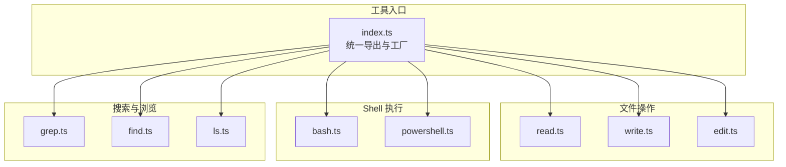
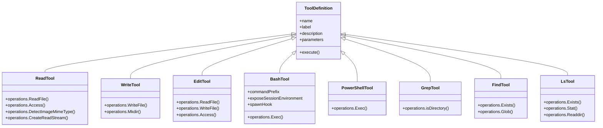
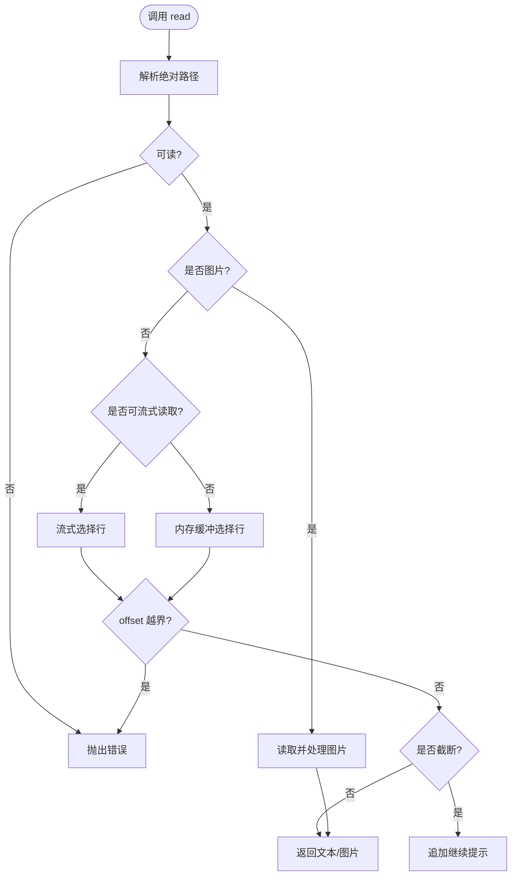
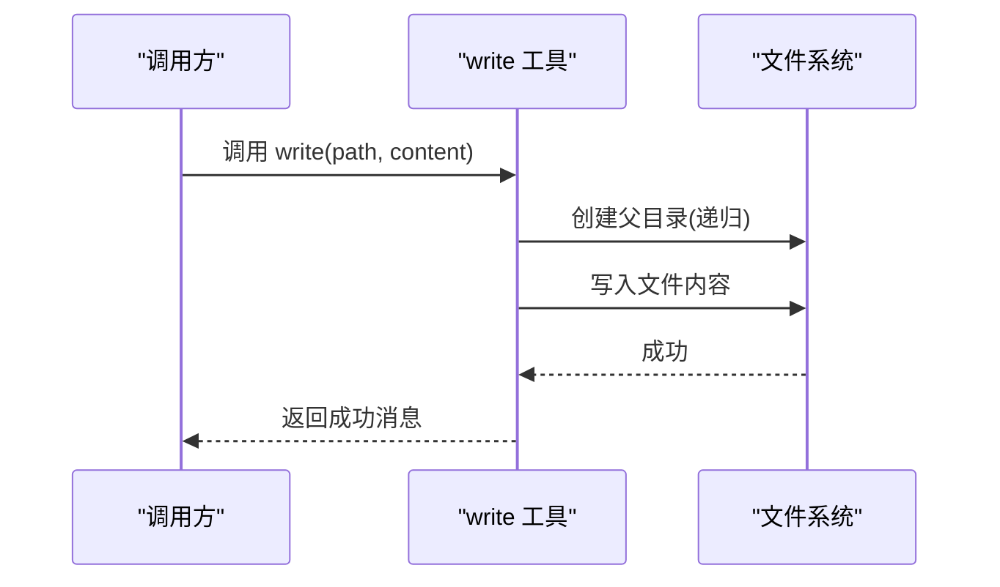
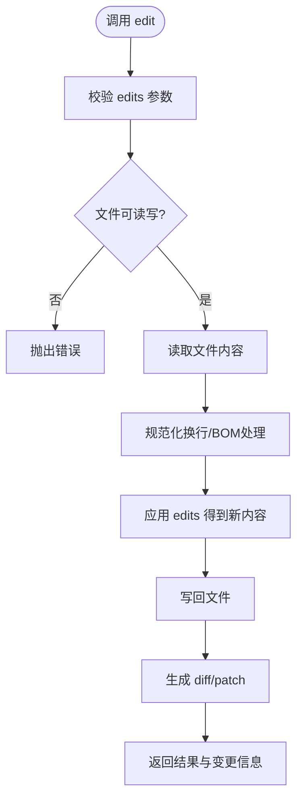
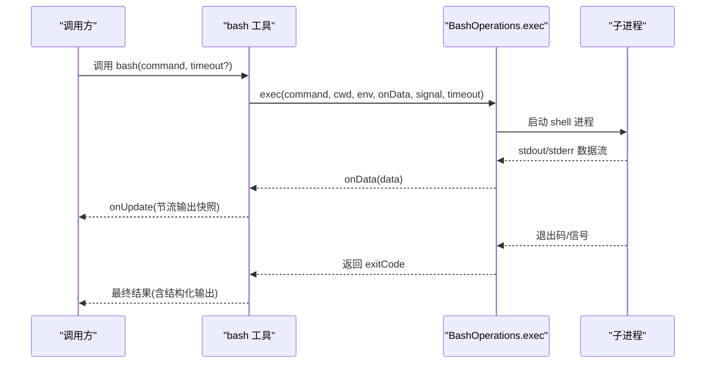
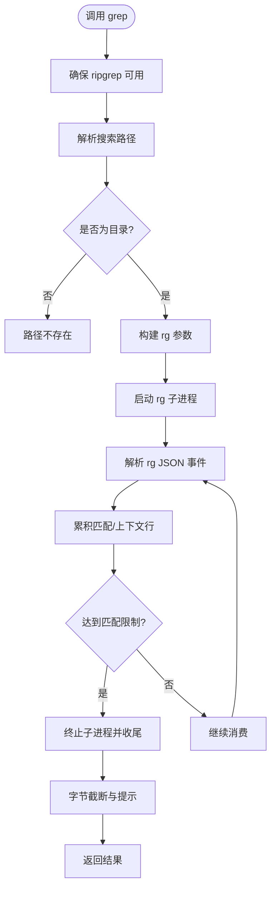
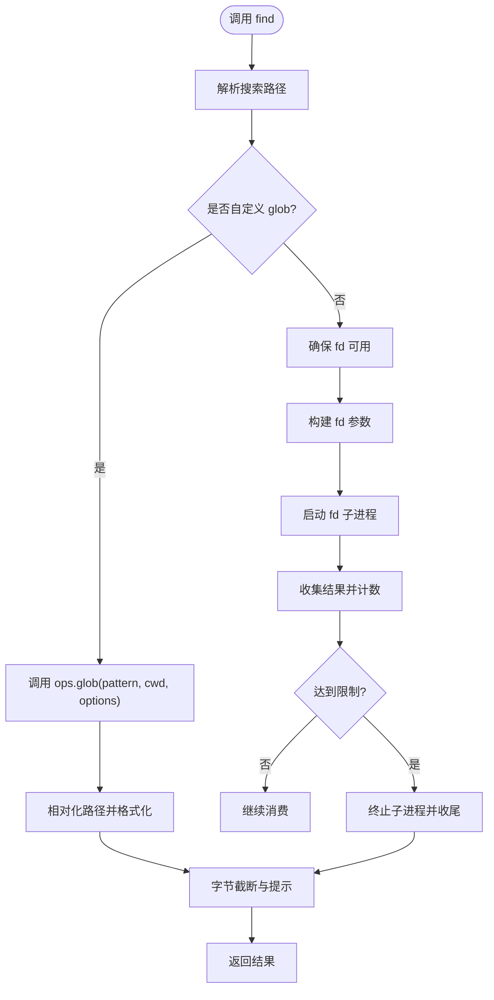
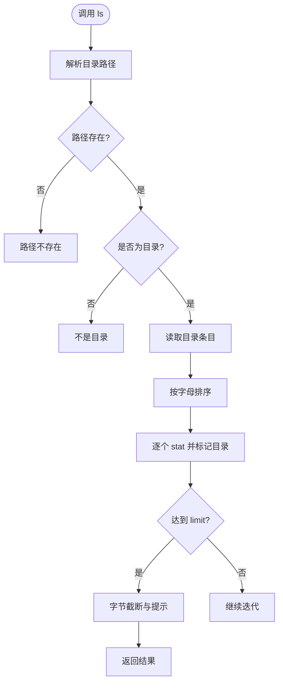
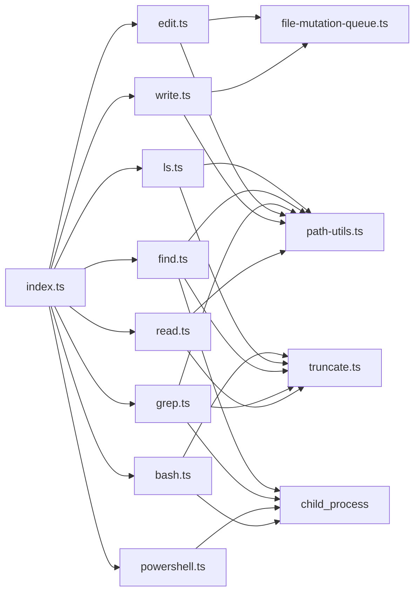

# 内置工具

<cite>
**本文引用的文件**
- [packages/coding-agent/src/core/tools/index.ts](file://packages/coding-agent/src/core/tools/index.ts)
- [packages/coding-agent/src/core/tools/read.ts](file://packages/coding-agent/src/core/tools/read.ts)
- [packages/coding-agent/src/core/tools/write.ts](file://packages/coding-agent/src/core/tools/write.ts)
- [packages/coding-agent/src/core/tools/edit.ts](file://packages/coding-agent/src/core/tools/edit.ts)
- [packages/coding-agent/src/core/tools/bash.ts](file://packages/coding-agent/src/core/tools/bash.ts)
- [packages/coding-agent/src/core/tools/powershell.ts](file://packages/coding-agent/src/core/tools/powershell.ts)
- [packages/coding-agent/src/core/tools/grep.ts](file://packages/coding-agent/src/core/tools/grep.ts)
- [packages/coding-agent/src/core/tools/find.ts](file://packages/coding-agent/src/core/tools/find.ts)
- [packages/coding-agent/src/core/tools/ls.ts](file://packages/coding-agent/src/core/tools/ls.ts)
</cite>

## 目录
1. [简介](#简介)
2. [项目结构](#项目结构)
3. [核心组件](#核心组件)
4. [架构总览](#架构总览)
5. [详细组件分析](#详细组件分析)
6. [依赖关系分析](#依赖关系分析)
7. [性能与限制](#性能与限制)
8. [故障排查指南](#故障排查指南)
9. [结论](#结论)

## 简介
本文件系统化介绍代码库中的内置工具，包括：文件读取 read、文件写入 write、文件编辑 edit、Shell 命令执行 bash/powershell、文本搜索 grep、文件查找 find、目录列表 ls。每个工具均说明输入参数、输出格式、错误处理、截断策略以及最佳实践，并给出常见使用场景和组合用法建议。

这些工具统一通过工具定义工厂 createToolDefinition/createTool 暴露，支持“编程式调用”和“面向模型的提示词片段”，并提供可插拔的 operations 接口，便于扩展为远程文件系统或自定义 Shell 后端。

## 项目结构
内置工具集中在 packages/coding-agent/src/core/tools 目录下，采用“按功能分文件 + 统一入口导出”的组织方式：
- index.ts：统一导出所有工具类型、创建函数、工具名集合与批量构建器。
- read.ts / write.ts / edit.ts：文件 I/O 与精确编辑。
- bash.ts / powershell.ts：Shell 命令执行（共享底层实现）。
- grep.ts / find.ts / ls.ts：内容搜索、文件查找、目录列举。
- truncate.ts：通用截断与格式化能力（被多个工具复用）。
- renderers/*：各工具的渲染辅助（用于 UI 展示等）。

图表来源
- [packages/coding-agent/src/core/tools/index.ts:1-225](file://packages/coding-agent/src/core/tools/index.ts#L1-L225)

章节来源
- [packages/coding-agent/src/core/tools/index.ts:1-225](file://packages/coding-agent/src/core/tools/index.ts#L1-L225)

## 核心组件
- 工具名与注册
  - 工具名集合 ToolName 包含：read、bash、powershell、edit、write、grep、find、ls。
  - allToolNames 提供完整枚举；createAllTools/createAllToolDefinitions 一次性生成全部工具实例或定义。
- 工具选项聚合
  - ToolsOptions 将各工具的 Options 合并，供批量构建器使用。
- 工厂方法
  - createToolDefinition(toolName, cwd, options)：根据名称返回对应工具定义。
  - createTool(toolName, cwd, options)：根据名称返回可执行工具实例。
  - createCodingTools/createReadOnlyTools/createAllTools：按用途分组构建工具集。

章节来源
- [packages/coding-agent/src/core/tools/index.ts:95-225](file://packages/coding-agent/src/core/tools/index.ts#L95-L225)

## 架构总览
下图展示了工具的统一抽象与具体实现的依赖关系。每个工具都遵循“Schema 定义 + 可插拔 operations + execute 执行 + 渲染器”的模式。

图表来源
- [packages/coding-agent/src/core/tools/read.ts:44-93](file://packages/coding-agent/src/core/tools/read.ts#L44-L93)
- [packages/coding-agent/src/core/tools/write.ts:22-41](file://packages/coding-agent/src/core/tools/write.ts#L22-L41)
- [packages/coding-agent/src/core/tools/edit.ts:76-98](file://packages/coding-agent/src/core/tools/edit.ts#L76-L98)
- [packages/coding-agent/src/core/tools/bash.ts:70-93](file://packages/coding-agent/src/core/tools/bash.ts#L70-L93)
- [packages/coding-agent/src/core/tools/powershell.ts:23-36](file://packages/coding-agent/src/core/tools/powershell.ts#L23-L36)
- [packages/coding-agent/src/core/tools/grep.ts:48-71](file://packages/coding-agent/src/core/tools/grep.ts#L48-L71)
- [packages/coding-agent/src/core/tools/find.ts:47-67](file://packages/coding-agent/src/core/tools/find.ts#L47-L67)
- [packages/coding-agent/src/core/tools/ls.ts:29-51](file://packages/coding-agent/src/core/tools/ls.ts#L29-L51)

## 详细组件分析

### 文件读取 read
- 功能概述
  - 读取文本文件或图片文件（jpg/png/gif/webp/bmp），文本以字符串返回，图片以结构化图像块返回。
  - 支持 offset/limit 分页读取大文件，自动检测图片 MIME 类型并可按需缩放。
- 输入参数
  - path：要读取的文件路径（相对或绝对）。
  - offset：起始行号（从 1 开始）。
  - limit：最大读取行数。
- 输出格式
  - 文本：字符串。
  - 图片：对象 { type:"image", data, mimeType, note }。
- 关键行为
  - 若单行超过字节上限，会提示使用 bash 命令截取该行。
  - 若发生截断，会在输出末尾提示继续使用 offset 继续读取。
  - 非视觉模型时，图片会被省略并在 note 中提示。
- 错误处理
  - 无法访问或超出文件范围时报错。
  - 支持 AbortSignal 中断。
- 最佳实践
  - 大文件优先使用 offset/limit 分页读取。
  - 需要整文件时，结合 bash 命令进行更灵活的处理。

图表来源
- [packages/coding-agent/src/core/tools/read.ts:228-357](file://packages/coding-agent/src/core/tools/read.ts#L228-L357)

章节来源
- [packages/coding-agent/src/core/tools/read.ts:14-18](file://packages/coding-agent/src/core/tools/read.ts#L14-L18)
- [packages/coding-agent/src/core/tools/read.ts:27-38](file://packages/coding-agent/src/core/tools/read.ts#L27-L38)
- [packages/coding-agent/src/core/tools/read.ts:44-93](file://packages/coding-agent/src/core/tools/read.ts#L44-L93)
- [packages/coding-agent/src/core/tools/read.ts:228-357](file://packages/coding-agent/src/core/tools/read.ts#L228-L357)

### 文件写入 write
- 功能概述
  - 创建或覆盖写入文件，自动创建父目录。
- 输入参数
  - path：目标文件路径。
  - content：要写入的内容。
- 输出格式
  - 成功返回文本消息。
- 关键行为
  - 通过 withFileMutationQueue 保证对同一文件的并发写安全。
  - 支持 AbortSignal 中断。
- 错误处理
  - 写入失败或中断时抛出错误。
- 最佳实践
  - 适合新建文件或整体重写；局部修改建议使用 edit。

图表来源
- [packages/coding-agent/src/core/tools/write.ts:43-91](file://packages/coding-agent/src/core/tools/write.ts#L43-L91)

章节来源
- [packages/coding-agent/src/core/tools/write.ts:10-13](file://packages/coding-agent/src/core/tools/write.ts#L10-L13)
- [packages/coding-agent/src/core/tools/write.ts:22-41](file://packages/coding-agent/src/core/tools/write.ts#L22-L41)
- [packages/coding-agent/src/core/tools/write.ts:43-91](file://packages/coding-agent/src/core/tools/write.ts#L43-L91)

### 文件编辑 edit
- 功能概述
  - 基于精确文本替换的原子编辑，支持一次调用中对同一文件的多处不重叠替换。
- 输入参数
  - path：目标文件路径。
  - edits：[{ oldText, newText }] 数组，oldText 必须唯一且不重叠。
- 输出格式
  - 成功返回文本消息与 details.diff/details.patch 等变更信息。
- 关键行为
  - 兼容旧版 single-edit 输入与 JSON 字符串形式的 edits。
  - 保留原始换行符与 BOM。
  - 通过 withFileMutationQueue 保证并发写安全。
- 错误处理
  - 文件不可读写、匹配失败或中断时抛出错误。
- 最佳实践
  - 尽量合并邻近改动到单个 edit，避免重叠或嵌套。
  - oldText 保持短小且唯一，提高匹配稳定性。

图表来源
- [packages/coding-agent/src/core/tools/edit.ts:140-212](file://packages/coding-agent/src/core/tools/edit.ts#L140-L212)

章节来源
- [packages/coding-agent/src/core/tools/edit.ts:20-40](file://packages/coding-agent/src/core/tools/edit.ts#L20-L40)
- [packages/coding-agent/src/core/tools/edit.ts:67-98](file://packages/coding-agent/src/core/tools/edit.ts#L67-L98)
- [packages/coding-agent/src/core/tools/edit.ts:100-138](file://packages/coding-agent/src/core/tools/edit.ts#L100-L138)
- [packages/coding-agent/src/core/tools/edit.ts:140-212](file://packages/coding-agent/src/core/tools/edit.ts#L140-L212)

### Shell 命令执行 bash
- 功能概述
  - 在指定工作目录下执行 bash 命令，支持超时、环境变量注入、进程树清理与实时输出节流更新。
- 输入参数
  - command：要执行的命令。
  - timeout：超时秒数（可选）。
- 输出格式
  - 面向模型：文本输出，可能附带截断提示。
  - 结构化输出：{ output, truncated, full_output_path?, exit_code, wall_time_seconds }。
- 关键行为
  - 默认启用会话环境变量 PI_*（可通过 exposeSessionEnvironment 控制）。
  - 支持 commandPrefix 在每个命令前注入前置命令。
  - 支持 spawnHook 在执行前调整 command/cwd/env。
  - 输出按最后 N 行或字节上限截断，必要时保存完整输出到临时文件。
- 错误处理
  - 工作目录不存在、命令终止无退出码、超时、被中止等情况均有明确错误提示。
- 最佳实践
  - 长输出命令务必设置合理 timeout。
  - 需要查看完整输出时使用 full_output_path。

图表来源
- [packages/coding-agent/src/core/tools/bash.ts:271-448](file://packages/coding-agent/src/core/tools/bash.ts#L271-L448)

章节来源
- [packages/coding-agent/src/core/tools/bash.ts:39-49](file://packages/coding-agent/src/core/tools/bash.ts#L39-L49)
- [packages/coding-agent/src/core/tools/bash.ts:70-93](file://packages/coding-agent/src/core/tools/bash.ts#L70-L93)
- [packages/coding-agent/src/core/tools/bash.ts:206-253](file://packages/coding-agent/src/core/tools/bash.ts#L206-L253)
- [packages/coding-agent/src/core/tools/bash.ts:271-448](file://packages/coding-agent/src/core/tools/bash.ts#L271-L448)

### Shell 命令执行 powershell
- 功能概述
  - 在 Windows 环境下执行 PowerShell 命令，复用 bash 的工具定义与执行流程。
- 输入参数
  - 同 bash：command、timeout。
- 输出格式
  - 同 bash：文本输出与结构化输出。
- 关键行为
  - 自动注入 UTF-8 输出编码初始化语句。
  - 默认使用 getPowerShellConfig 获取 PowerShell 配置。
- 错误处理
  - 继承 bash 的错误处理逻辑。
- 最佳实践
  - 与 bash 一致，注意超时与输出大小。

章节来源
- [packages/coding-agent/src/core/tools/powershell.ts:16-68](file://packages/coding-agent/src/core/tools/powershell.ts#L16-L68)

### 文本搜索 grep
- 功能概述
  - 基于 ripgrep 的文本搜索，支持正则/字面量、忽略大小写、glob 过滤、上下文行、匹配数量限制。
- 输入参数
  - pattern：搜索模式（正则或字面量）。
  - path：搜索路径（目录或文件，默认当前目录）。
  - glob：文件过滤（如 '*.ts'）。
  - ignoreCase：忽略大小写。
  - literal：字面量匹配。
  - context：前后上下文行数。
  - limit：最大匹配数（默认 100）。
- 输出格式
  - 文本输出，包含文件路径、行号与匹配行；超长行会被截断。
  - details 包含 truncation/matchLimitReached/linesTruncated 等提示。
- 关键行为
  - 尊重 .gitignore。
  - 当达到匹配限制后，仍消费必要的尾部上下文行，再终止子进程。
- 错误处理
  - ripgrep 不可用、路径不存在、子进程异常等报错。
- 最佳实践
  - 使用 glob 缩小范围，配合 limit 控制输出规模。
  - 遇到超长行，使用 read 工具查看完整行。

图表来源
- [packages/coding-agent/src/core/tools/grep.ts:73-316](file://packages/coding-agent/src/core/tools/grep.ts#L73-L316)

章节来源
- [packages/coding-agent/src/core/tools/grep.ts:20-32](file://packages/coding-agent/src/core/tools/grep.ts#L20-L32)
- [packages/coding-agent/src/core/tools/grep.ts:48-71](file://packages/coding-agent/src/core/tools/grep.ts#L48-L71)
- [packages/coding-agent/src/core/tools/grep.ts:73-316](file://packages/coding-agent/src/core/tools/grep.ts#L73-L316)

### 文件查找 find
- 功能概述
  - 基于 fd 的文件查找，支持 glob 模式，尊重 .gitignore，返回相对路径。
- 输入参数
  - pattern：glob 模式（如 '*.ts'、'**/*.json'）。
  - path：搜索目录（默认当前目录）。
  - limit：最大结果数（默认 1000）。
- 输出格式
  - 文本输出，每行一个相对路径；details 包含 truncation/resultLimitReached 等提示。
- 关键行为
  - 在非 git 仓库中使用 --no-require-git 以保持一致行为。
  - 支持自定义 operations.glob 替代 fd。
- 错误处理
  - fd 不可用、路径不存在、子进程异常等报错。
- 最佳实践
  - 使用更具体的 pattern 减少结果集。
  - 使用 limit 控制输出规模。

图表来源
- [packages/coding-agent/src/core/tools/find.ts:69-326](file://packages/coding-agent/src/core/tools/find.ts#L69-L326)

章节来源
- [packages/coding-agent/src/core/tools/find.ts:25-31](file://packages/coding-agent/src/core/tools/find.ts#L25-L31)
- [packages/coding-agent/src/core/tools/find.ts:47-67](file://packages/coding-agent/src/core/tools/find.ts#L47-L67)
- [packages/coding-agent/src/core/tools/find.ts:69-326](file://packages/coding-agent/src/core/tools/find.ts#L69-L326)

### 目录列表 ls
- 功能概述
  - 列出目录内容，按字母排序，目录项以 '/' 后缀标识，包含隐藏文件。
- 输入参数
  - path：目录路径（默认当前目录）。
  - limit：最大条目数（默认 500）。
- 输出格式
  - 文本输出，每行一个条目；details 包含 truncation/entryLimitReached 等提示。
- 关键行为
  - 对每个条目尝试 stat 判断是否为目录。
  - 支持 AbortSignal 中断。
- 错误处理
  - 路径不存在、不是目录、无法读取目录等报错。
- 最佳实践
  - 大目录务必设置 limit。
  - 如需递归遍历，可使用 find 或 bash 命令。

图表来源
- [packages/coding-agent/src/core/tools/ls.ts:53-169](file://packages/coding-agent/src/core/tools/ls.ts#L53-L169)

章节来源
- [packages/coding-agent/src/core/tools/ls.ts:10-13](file://packages/coding-agent/src/core/tools/ls.ts#L10-L13)
- [packages/coding-agent/src/core/tools/ls.ts:29-51](file://packages/coding-agent/src/core/tools/ls.ts#L29-L51)
- [packages/coding-agent/src/core/tools/ls.ts:53-169](file://packages/coding-agent/src/core/tools/ls.ts#L53-L169)

## 依赖关系分析
- 内部依赖
  - 所有工具通过 index.ts 统一导出，便于集中管理与批量构建。
  - truncate.ts 提供的 DEFAULT_MAX_BYTES、DEFAULT_MAX_LINES、truncateHead/formatSize 被 read、grep、find、ls、bash 等工具复用。
  - path-utils.ts 提供 resolveToCwd/resolveReadPathAsync/pathExists 等路径工具。
  - tool-definition-wrapper.ts 包装工具定义，使其符合 AgentTool 接口。
  - file-mutation-queue.ts 保障对同一文件的并发写安全（write、edit）。
- 外部依赖
  - child_process.spawn 用于执行外部命令（bash、powershell、fd、rg）。
  - fs/promises 提供文件访问能力。
  - ensureTool 负责自动发现或下载 fd/rg。

图表来源
- [packages/coding-agent/src/core/tools/index.ts:1-225](file://packages/coding-agent/src/core/tools/index.ts#L1-L225)
- [packages/coding-agent/src/core/tools/read.ts:1-12](file://packages/coding-agent/src/core/tools/read.ts#L1-L12)
- [packages/coding-agent/src/core/tools/write.ts:1-8](file://packages/coding-agent/src/core/tools/write.ts#L1-L8)
- [packages/coding-agent/src/core/tools/edit.ts:1-18](file://packages/coding-agent/src/core/tools/edit.ts#L1-L18)
- [packages/coding-agent/src/core/tools/bash.ts:1-19](file://packages/coding-agent/src/core/tools/bash.ts#L1-L19)
- [packages/coding-agent/src/core/tools/powershell.ts:1-14](file://packages/coding-agent/src/core/tools/powershell.ts#L1-L14)
- [packages/coding-agent/src/core/tools/grep.ts:1-18](file://packages/coding-agent/src/core/tools/grep.ts#L1-L18)
- [packages/coding-agent/src/core/tools/find.ts:1-10](file://packages/coding-agent/src/core/tools/find.ts#L1-L10)
- [packages/coding-agent/src/core/tools/ls.ts:1-8](file://packages/coding-agent/src/core/tools/ls.ts#L1-L8)

章节来源
- [packages/coding-agent/src/core/tools/index.ts:1-225](file://packages/coding-agent/src/core/tools/index.ts#L1-L225)

## 性能与限制
- 输出截断
  - 多数工具对输出进行字节级截断（DEFAULT_MAX_BYTES）或行数限制（DEFAULT_MAX_LINES），并在输出末尾附加提示，指导如何继续获取更多内容。
- 流式处理
  - read 支持流式读取大文件，避免一次性加载整个文件到内存。
  - bash 支持实时输出节流更新，避免频繁 UI 刷新。
- 外部工具
  - grep 依赖 ripgrep（rg），find 依赖 fd；若不可用会尝试自动下载。
- 并发安全
  - write 与 edit 通过文件变更队列保证对同一文件的并发写安全。
- 超时与中止
  - bash/powershell 支持超时与 AbortSignal；grep/find/ls 也支持 AbortSignal。

[本节为通用性能讨论，不直接分析具体文件]

## 故障排查指南
- 常见错误与定位
  - 路径不存在：grep/find/ls 在路径检查失败时会抛出明确错误。
  - 不是目录：ls 对非目录路径会拒绝。
  - 权限不足：read/edit 在 access 检查失败时抛出错误。
  - 外部工具缺失：grep/find 在 rg/fd 不可用时报错。
  - 命令超时：bash/powershell 在超时时抛出带超时信息的错误。
  - 操作中止：所有工具在收到 AbortSignal 时抛出“Operation aborted”。
- 调试建议
  - 对于大文件读取，先使用 read 的 offset/limit 分段查看，或使用 bash 命令进行更细粒度处理。
  - 对于长输出命令，设置合理的 timeout，并使用 full_output_path 查看完整输出。
  - 对于编辑失败，检查 oldText 是否唯一且不重叠，必要时合并相邻改动。

章节来源
- [packages/coding-agent/src/core/tools/read.ts:264-351](file://packages/coding-agent/src/core/tools/read.ts#L264-L351)
- [packages/coding-agent/src/core/tools/write.ts:57-88](file://packages/coding-agent/src/core/tools/write.ts#L57-L88)
- [packages/coding-agent/src/core/tools/edit.ts:156-209](file://packages/coding-agent/src/core/tools/edit.ts#L156-L209)
- [packages/coding-agent/src/core/tools/bash.ts:389-445](file://packages/coding-agent/src/core/tools/bash.ts#L389-L445)
- [packages/coding-agent/src/core/tools/grep.ts:120-311](file://packages/coding-agent/src/core/tools/grep.ts#L120-L311)
- [packages/coding-agent/src/core/tools/find.ts:108-322](file://packages/coding-agent/src/core/tools/find.ts#L108-L322)
- [packages/coding-agent/src/core/tools/ls.ts:80-165](file://packages/coding-agent/src/core/tools/ls.ts#L80-L165)

## 结论
内置工具提供了统一的文件与 Shell 操作能力，具备完善的参数校验、错误处理、截断提示与可扩展性。推荐在以下场景使用：
- 读取大文件：优先使用 read 的 offset/limit，必要时结合 bash 进行行级处理。
- 写入与编辑：新建或整体重写使用 write；局部精确修改使用 edit。
- 命令执行：bash/powershell 用于系统命令与脚本，注意超时与输出大小。
- 搜索与浏览：grep 用于内容搜索，find 用于文件查找，ls 用于目录列举。

[本节为总结性内容，不直接分析具体文件]