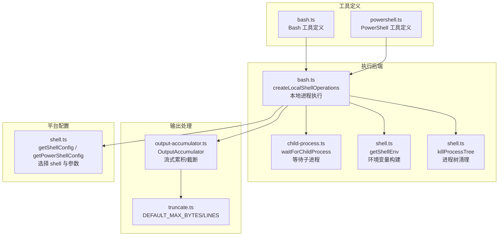
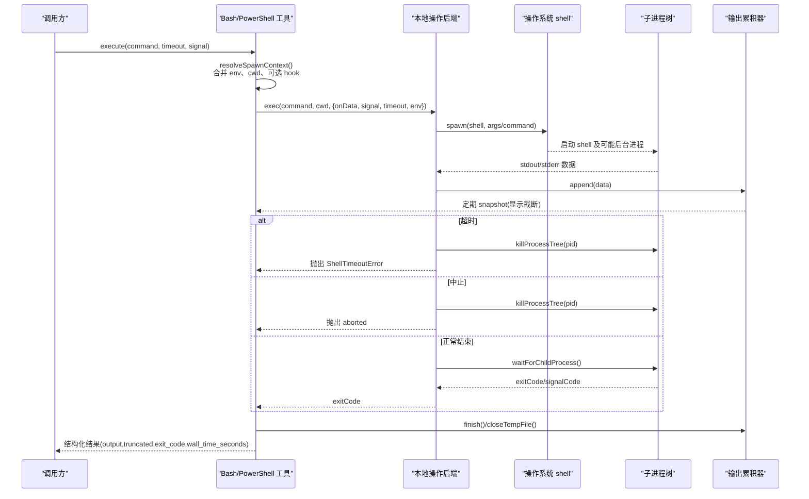
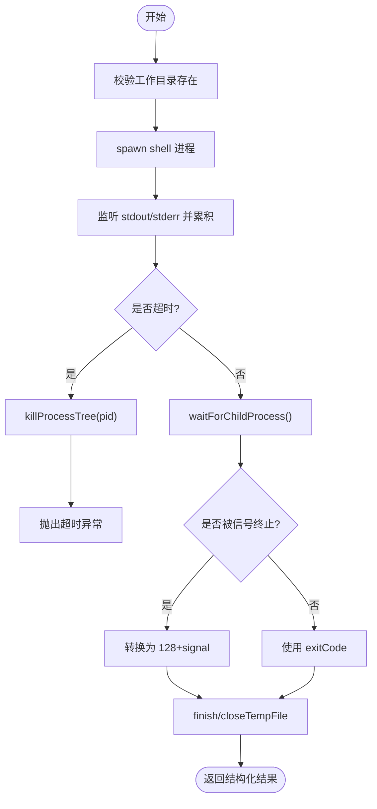
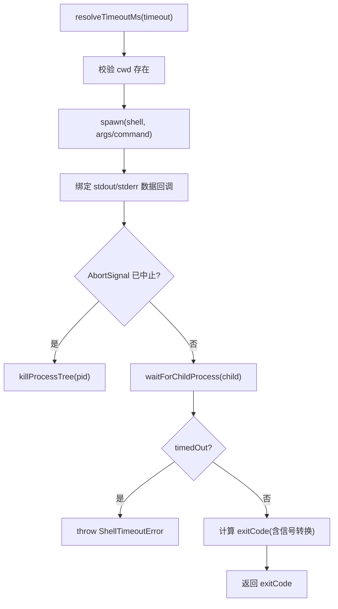
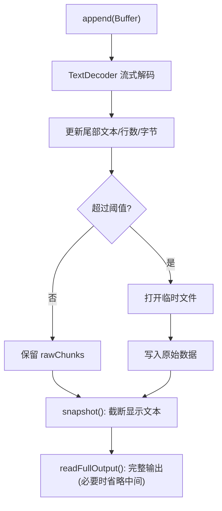
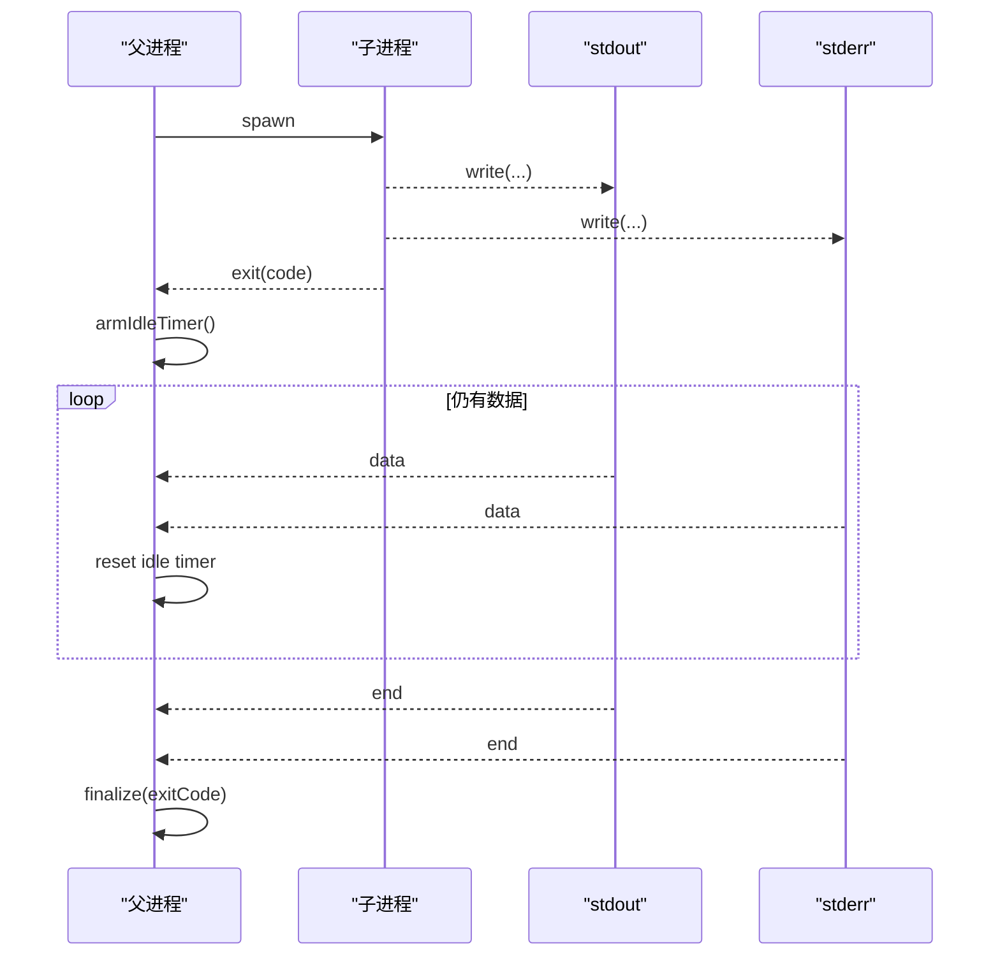
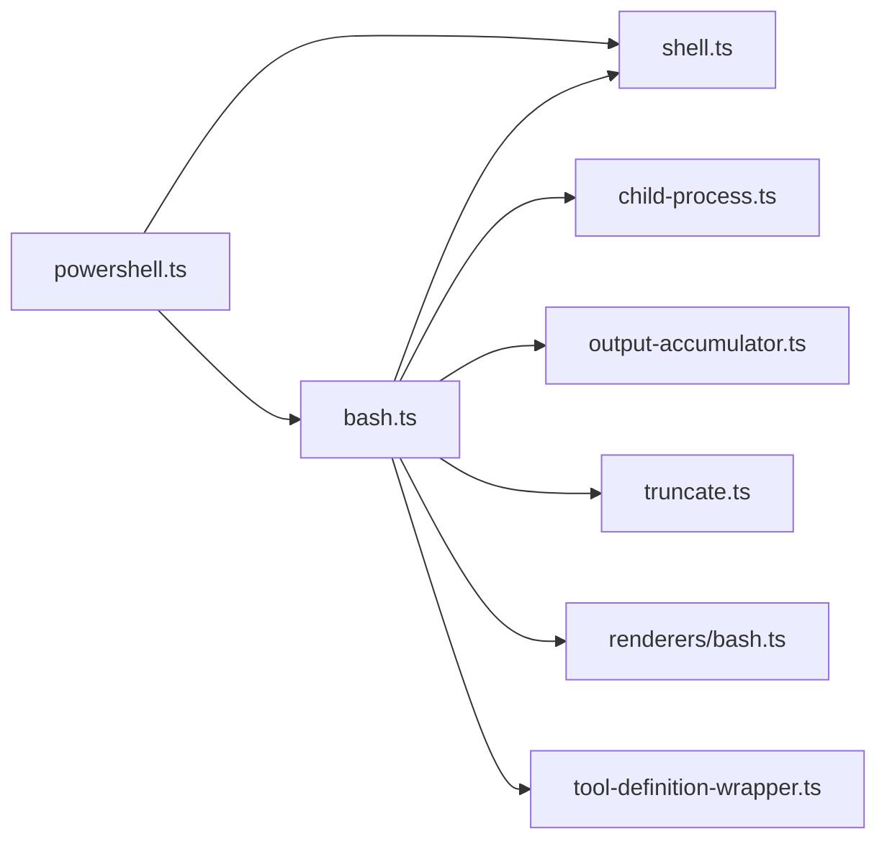

# Shell执行工具

<cite>
**本文引用的文件**   
- [bash.ts](file://packages/coding-agent/src/core/tools/bash.ts)
- [powershell.ts](file://packages/coding-agent/src/core/tools/powershell.ts)
- [shell.ts](file://packages/coding-agent/src/utils/shell.ts)
- [output-accumulator.ts](file://packages/coding-agent/src/core/tools/output-accumulator.ts)
- [child-process.ts](file://packages/coding-agent/src/utils/child-process.ts)
- [truncate.ts](file://packages/coding-agent/src/core/tools/truncate.ts)
- [tool-definition-wrapper.ts](file://packages/coding-agent/src/core/tools/tool-definition-wrapper.ts)
- [renderers/bash.ts](file://packages/coding-agent/src/core/tools/renderers/bash.ts)
- [harness.ts](file://packages/evals/src/harness.ts)
</cite>

## 目录
1. [简介](#简介)
2. [项目结构](#项目结构)
3. [核心组件](#核心组件)
4. [架构总览](#架构总览)
5. [详细组件分析](#详细组件分析)
6. [依赖关系分析](#依赖关系分析)
7. [性能与资源限制](#性能与资源限制)
8. [安全机制与最佳实践](#安全机制与最佳实践)
9. [故障排除指南](#故障排除指南)
10. [结论](#结论)

## 简介
本文件面向“Shell执行工具”，系统性说明如何在当前工程中通过 Bash 和 PowerShell 执行系统命令。文档覆盖以下主题：
- 功能特性：命令参数、超时控制、输出截断、结构化结果、进程生命周期管理。
- 安全机制：工作目录校验、环境变量继承与隔离、PowerShell 执行策略、进程树清理。
- 执行环境：跨平台 shell 解析、Windows 与 Unix 差异、工作目录与环境变量注入。
- 上下文管理：会话元数据暴露、spawnHook 钩子、命令前缀。
- 输出流处理：实时流式累积、UTF-8 解码、大输出落盘、显示快照与完整输出分离。
- 使用示例：在不同操作系统上执行系统命令的调用方式与注意事项。
- 优化与排障：性能建议、常见问题定位与修复思路。

## 项目结构
Shell 执行能力集中在 coding-agent 包中，围绕“工具定义 + 本地后端操作 + 通用 shell 配置”组织：
- 工具定义层：提供 bash 与 powershell 两个工具的定义、参数 schema、渲染器与包装。
- 本地执行层：封装 spawn、等待子进程退出、进程组杀除、环境变量构建。
- 通用 shell 配置：根据平台自动选择 bash 或 PowerShell，并设置运行参数。
- 输出累积层：流式缓冲、行/字节上限、临时文件持久化、截断信息。



**图表来源**
- [bash.ts:109-194](file://packages/coding-agent/src/core/tools/bash.ts#L109-L194)
- [powershell.ts:32-36](file://packages/coding-agent/src/core/tools/powershell.ts#L32-L36)
- [shell.ts:84-167](file://packages/coding-agent/src/utils/shell.ts#L84-L167)
- [child-process.ts:49-137](file://packages/coding-agent/src/utils/child-process.ts#L49-L137)
- [output-accumulator.ts:35-119](file://packages/coding-agent/src/core/tools/output-accumulator.ts#L35-L119)

**章节来源**
- [bash.ts:1-477](file://packages/coding-agent/src/core/tools/bash.ts#L1-L477)
- [powershell.ts:1-67](file://packages/coding-agent/src/core/tools/powershell.ts#L1-L67)
- [shell.ts:1-263](file://packages/coding-agent/src/utils/shell.ts#L1-L263)
- [output-accumulator.ts:1-258](file://packages/coding-agent/src/core/tools/output-accumulator.ts#L1-L258)
- [child-process.ts:1-138](file://packages/coding-agent/src/utils/child-process.ts#L1-L138)

## 核心组件
- Bash 工具定义与执行：
  - 定义参数 schema（command、timeout），返回结构化输出（output、truncated、exit_code、wall_time_seconds）。
  - 支持 commandPrefix、exposeSessionEnvironment、spawnHook、自定义 operations。
  - 默认使用本地 shell 后端 createLocalShellOperations。
- PowerShell 工具定义：
  - 复用 Bash 的工具定义框架，仅替换 shell 名称、提示符、参数与前缀。
  - 在 Windows 上启用 UTF-8 输出与 ExecutionPolicy=Bypass。
- 本地 shell 操作后端：
  - 校验工作目录存在；按平台选择 stdin 或 argv 传参；非 Windows 下 detached。
  - 统一处理 stdout/stderr 流、AbortSignal、超时、进程组杀除。
  - 将信号终止转换为标准 exit code（128+signal）。
- 子进程等待与清理：
  - waitForChildProcess 避免被后代进程持有的 stdio 句柄阻塞，优雅等待管道结束。
  - killProcessTree 跨平台清理进程树（Windows taskkill，Unix/macOS SIGKILL/SIGSTOP）。
- 输出累积与截断：
  - OutputAccumulator 维护滚动尾部文本、统计行数/字节数，超过阈值时写临时文件。
  - snapshot 提供显示用截断内容；readFullOutput 提供程序调用方使用的完整输出（带省略标记）。

**章节来源**
- [bash.ts:39-68](file://packages/coding-agent/src/core/tools/bash.ts#L39-L68)
- [bash.ts:109-194](file://packages/coding-agent/src/core/tools/bash.ts#L109-L194)
- [bash.ts:271-449](file://packages/coding-agent/src/core/tools/bash.ts#L271-L449)
- [powershell.ts:32-67](file://packages/coding-agent/src/core/tools/powershell.ts#L32-L67)
- [child-process.ts:49-137](file://packages/coding-agent/src/utils/child-process.ts#L49-L137)
- [output-accumulator.ts:35-176](file://packages/coding-agent/src/core/tools/output-accumulator.ts#L35-L176)

## 架构总览
下图展示一次命令执行的端到端流程：从工具定义到本地 shell 执行、输出累积、超时与错误处理、最终结构化返回。



**图表来源**
- [bash.ts:271-449](file://packages/coding-agent/src/core/tools/bash.ts#L271-L449)
- [bash.ts:109-194](file://packages/coding-agent/src/core/tools/bash.ts#L109-L194)
- [child-process.ts:49-137](file://packages/coding-agent/src/utils/child-process.ts#L49-L137)
- [output-accumulator.ts:64-119](file://packages/coding-agent/src/core/tools/output-accumulator.ts#L64-L119)

## 详细组件分析

### Bash 工具
- 输入参数：
  - command：要执行的 shell 命令字符串。
  - timeout：可选超时秒数，内部转为毫秒并做范围校验。
- 输出结构：
  - output：stdout+stderr 合并后的文本（可能被截断）。
  - truncated：是否发生截断。
  - full_output_path：当截断时，完整输出保存的临时文件路径。
  - exit_code：进程退出码；若为 null 表示无退出码（视为失败）。
  - wall_time_seconds：墙钟时间（秒）。
- 执行行为：
  - 工作目录不存在直接报错。
  - 非 Windows 下以 detached 模式启动，便于后台进程独立于父进程。
  - 支持 AbortSignal 取消；超时触发后对进程树执行 kill。
  - 将信号终止转换为 128+signal 的标准约定，避免误判成功。
- 上下文与环境：
  - 默认暴露 PI_* 会话元数据（可关闭）。
  - 支持 spawnHook 修改 command/cwd/env。
  - 支持 commandPrefix 在每个命令前追加固定前缀。



**图表来源**
- [bash.ts:109-194](file://packages/coding-agent/src/core/tools/bash.ts#L109-L194)
- [bash.ts:271-449](file://packages/coding-agent/src/core/tools/bash.ts#L271-L449)

**章节来源**
- [bash.ts:39-68](file://packages/coding-agent/src/core/tools/bash.ts#L39-L68)
- [bash.ts:109-194](file://packages/coding-agent/src/core/tools/bash.ts#L109-L194)
- [bash.ts:271-449](file://packages/coding-agent/src/core/tools/bash.ts#L271-L449)

### PowerShell 工具
- 特点：
  - 复用 Bash 工具定义框架，仅替换 shellName、prompt、tempFilePrefix。
  - 在 Windows 上强制 UTF-8 输出编码，避免乱码。
  - 使用 POWERSHELL_ARGS：-NoProfile、-NonInteractive、-ExecutionPolicy Bypass、-Command。
- 执行流程：
  - 创建 PowerShell 本地操作后端，并在命令前附加 UTF-8 编码设置语句。
  - 其余流程与 Bash 一致（超时、取消、输出累积、结构化返回）。

```mermaid
classDiagram
class PowerShellTool {
+execute(command, options)
+operations : PowerShellOperations
}
class LocalShellOperations {
+exec(command, cwd, options) Promise~{exitCode}~
}
class ShellConfig {
+shell string
+args string[]
+commandTransport? string
}
PowerShellTool --> LocalShellOperations : "使用"
LocalShellOperations --> ShellConfig : "读取"
```

**图表来源**
- [powershell.ts:32-67](file://packages/coding-agent/src/core/tools/powershell.ts#L32-L67)
- [shell.ts:139-167](file://packages/coding-agent/src/utils/shell.ts#L139-L167)

**章节来源**
- [powershell.ts:1-67](file://packages/coding-agent/src/core/tools/powershell.ts#L1-L67)
- [shell.ts:139-167](file://packages/coding-agent/src/utils/shell.ts#L139-L167)

### 本地 shell 操作后端
- 关键职责：
  - 解析 shell 配置（getShellConfig/getPowerShellConfig）。
  - 校验工作目录存在。
  - 根据 commandTransport 决定通过 stdin 或 argv 传递命令。
  - 非 Windows 下 detached，以便后台进程不被父进程回收。
  - 统一处理 onData、AbortSignal、超时、进程树清理。
  - 将信号终止转换为标准 exit code。
- 进程清理：
  - Windows：调用 System32/taskkill.exe /F /T /PID pid。
  - macOS：先尝试 SIGSTOP 再 SIGKILL 减少竞态。
  - Linux/Unix：优先 group kill，失败回退单进程 kill。



**图表来源**
- [bash.ts:109-194](file://packages/coding-agent/src/core/tools/bash.ts#L109-L194)
- [shell.ts:218-262](file://packages/coding-agent/src/utils/shell.ts#L218-L262)

**章节来源**
- [bash.ts:109-194](file://packages/coding-agent/src/core/tools/bash.ts#L109-L194)
- [shell.ts:218-262](file://packages/coding-agent/src/utils/shell.ts#L218-L262)

### 输出累积与截断
- OutputAccumulator：
  - 使用 TextDecoder 流式解码，维护滚动尾部文本与行数/字节计数。
  - 达到阈值时开启临时文件，后续原始数据直接写入磁盘。
  - snapshot 提供显示用截断内容；readFullOutput 提供完整输出（超大时首尾拼接省略标记）。
- 截断策略：
  - 默认最大行数与字节数来自 truncate.ts 常量。
  - 截断原因分为 lines 或 bytes，并提供 totalLines/totalBytes 等统计。



**图表来源**
- [output-accumulator.ts:64-176](file://packages/coding-agent/src/core/tools/output-accumulator.ts#L64-L176)
- [truncate.ts:1-200](file://packages/coding-agent/src/core/tools/truncate.ts#L1-L200)

**章节来源**
- [output-accumulator.ts:35-176](file://packages/coding-agent/src/core/tools/output-accumulator.ts#L35-L176)
- [truncate.ts:1-200](file://packages/coding-agent/src/core/tools/truncate.ts#L1-L200)

### 子进程等待与清理
- waitForChildProcess：
  - 监听 stdout/stderr 的 data/end/close 事件。
  - 子进程 exit 后，若仍有数据到达则延时释放，避免丢失尾部输出。
  - 最终销毁 streams 并 resolve exitCode。
- killProcessTree：
  - Windows：taskkill /F /T /PID pid。
  - macOS：先 SIGSTOP 再 SIGKILL，降低 a; b 竞态风险。
  - Linux/Unix：group kill，失败回退单进程 kill。



**图表来源**
- [child-process.ts:49-137](file://packages/coding-agent/src/utils/child-process.ts#L49-L137)

**章节来源**
- [child-process.ts:49-137](file://packages/coding-agent/src/utils/child-process.ts#L49-L137)
- [shell.ts:218-262](file://packages/coding-agent/src/utils/shell.ts#L218-L262)

## 依赖关系分析
- 模块耦合：
  - bash.ts 依赖 shell.ts（获取 shell 配置与环境）、child-process.ts（等待子进程）、output-accumulator.ts（输出累积）、truncate.ts（默认限制）、renderers/bash.ts（渲染器）与 tool-definition-wrapper.ts（工具包装）。
  - powershell.ts 依赖 shell.ts（PowerShell 配置）与 bash.ts（复用工具定义框架）。
- 外部依赖：
  - Node.js child_process.spawn/spawnSync。
  - cross-spawn（Windows 兼容）。
  - typebox（参数 schema 校验）。



**图表来源**
- [bash.ts:1-20](file://packages/coding-agent/src/core/tools/bash.ts#L1-L20)
- [powershell.ts:1-14](file://packages/coding-agent/src/core/tools/powershell.ts#L1-L14)

**章节来源**
- [bash.ts:1-20](file://packages/coding-agent/src/core/tools/bash.ts#L1-L20)
- [powershell.ts:1-14](file://packages/coding-agent/src/core/tools/powershell.ts#L1-L14)

## 性能与资源限制
- 输出大小限制：
  - 默认最大行数与字节数由 truncate.ts 常量控制；超出阈值后写临时文件，避免内存膨胀。
  - 结构化输出 readFullOutput 也受 STRUCTURED_OUTPUT_MAX_BYTES 限制，防止模型侧接收过大 payload。
- 超时控制：
  - 超时以秒为单位传入，内部转毫秒并做范围校验；超时后触发进程树清理。
- 流式处理：
  - 使用 TextDecoder 流式解码与滚动尾部文本，减少全量内存占用。
  - 输出更新节流（BASH_UPDATE_THROTTLE_MS），避免 UI 频繁刷新。
- 进程清理：
  - 非 Windows 下 detached 模式配合进程组 kill，确保后台进程不泄漏。
  - Windows 使用 taskkill /T 递归清理。

[本节为通用指导，不直接分析具体文件]

## 安全机制与最佳实践
- 工作目录校验：
  - 执行前检查 cwd 是否存在，避免在不可预期目录执行命令。
- 环境变量继承与隔离：
  - getShellEnv 将 binDir 注入 PATH，保证工具链可用。
  - 默认暴露 PI_* 会话元数据（可关闭），避免敏感信息泄露。
  - 评估沙箱（eval harness）提供隔离环境的参考实现，可在需要时切换用户/组身份。
- PowerShell 执行策略：
  - 使用 -ExecutionPolicy Bypass 与 -NoProfile/-NonInteractive，避免交互式与脚本策略影响。
- 进程生命周期：
  - 支持 AbortSignal 取消；超时后 killProcessTree 清理进程树。
  - 非 Windows 下 detached 模式需跟踪 PID，以便父进程退出时清理。
- 最佳实践：
  - 始终设置合理 timeout，避免长时间挂起。
  - 谨慎使用 exposeSessionEnvironment，仅在需要时暴露会话元数据。
  - 使用 spawnHook 对命令进行白名单或重写，增强安全性。
  - 对大输出场景启用临时文件，避免内存压力。
  - 在 Windows 上优先安装 pwsh（PowerShell 7），以获得更好兼容性。

**章节来源**
- [bash.ts:109-194](file://packages/coding-agent/src/core/tools/bash.ts#L109-L194)
- [shell.ts:169-181](file://packages/coding-agent/src/utils/shell.ts#L169-L181)
- [shell.ts:139-167](file://packages/coding-agent/src/utils/shell.ts#L139-L167)
- [harness.ts:82-188](file://packages/evals/src/harness.ts#L82-L188)

## 故障排除指南
- “工作目录不存在”：
  - 现象：执行前抛出工作目录不存在错误。
  - 排查：确认传入 cwd 有效且存在；若使用 ctx.cwd，确保上下文正确。
- “未找到 bash/PowerShell”：
  - 现象：getShellConfig 或 getPowerShellConfig 抛出未找到 shell 的错误。
  - 排查：
    - Windows：安装 Git for Windows 或将 bash.exe 加入 PATH；或设置 shellPath。
    - PowerShell：安装 pwsh 或 powershell.exe，或添加到 PATH。
- “命令超时但 shell 已退出”：
  - 现象：ShellTimeoutError 附带 shellExit 信息，表明 shell 已退出但后台进程仍在写输出。
  - 排查：检查命令是否启动后台任务；适当增大 timeout 或在命令中显式等待。
- “输出乱码（Windows PowerShell）”：
  - 现象：中文或特殊字符显示异常。
  - 排查：确认 PowerShell 工具已启用 UTF-8 输出（默认已设置）；检查终端编码。
- “进程未清理导致残留”：
  - 现象：父进程退出后仍有 shell 或子进程残留。
  - 排查：确认 detached 模式下 PID 被跟踪；检查 killTrackedDetachedChildren 是否被调用。

**章节来源**
- [bash.ts:109-194](file://packages/coding-agent/src/core/tools/bash.ts#L109-L194)
- [shell.ts:84-167](file://packages/coding-agent/src/utils/shell.ts#L84-L167)
- [shell.ts:218-262](file://packages/coding-agent/src/utils/shell.ts#L218-L262)

## 结论
本工程的 Shell 执行工具以 Bash 与 PowerShell 为核心，提供了统一的工具定义、跨平台 shell 解析、健壮的子进程管理与输出累积机制。通过工作目录校验、环境变量注入、PowerShell 执行策略、进程树清理与超时/取消控制，系统在易用性与安全性之间取得平衡。对于大输出与长时间任务，建议结合临时文件与合理超时策略；在需要更高隔离性时，可参考 eval harness 的沙箱实现进一步加固。